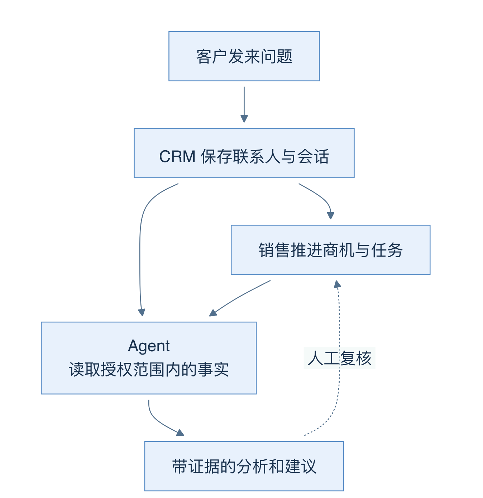
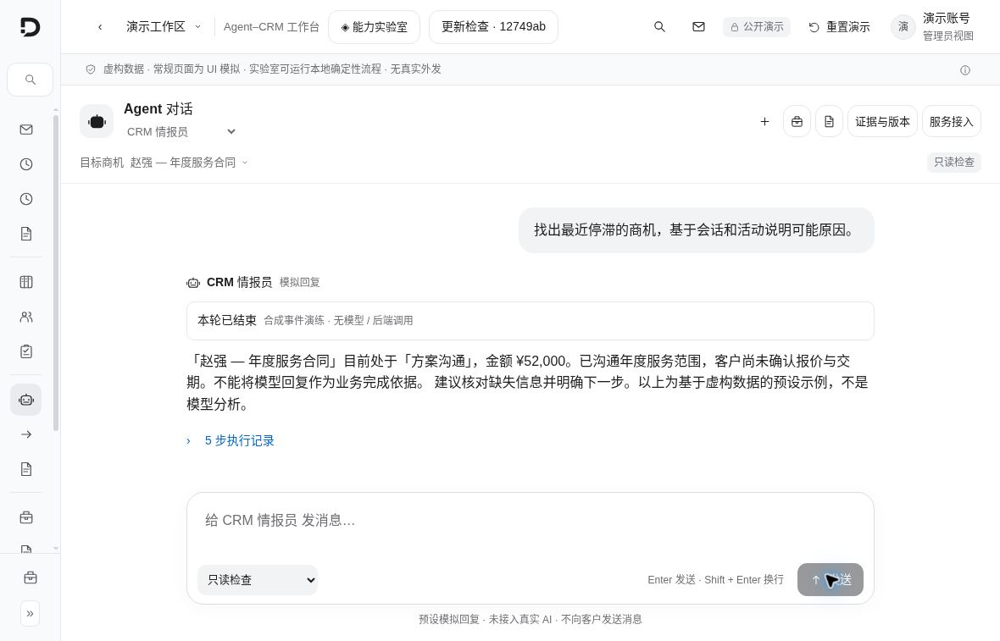
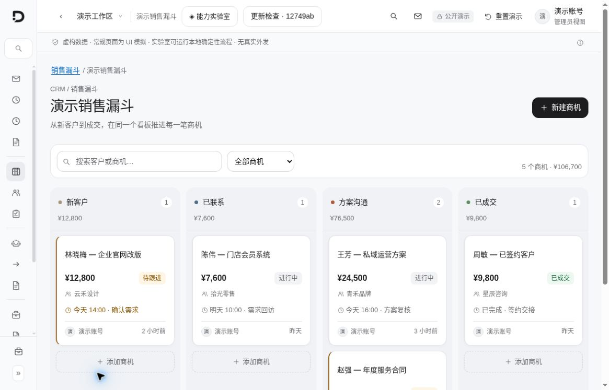
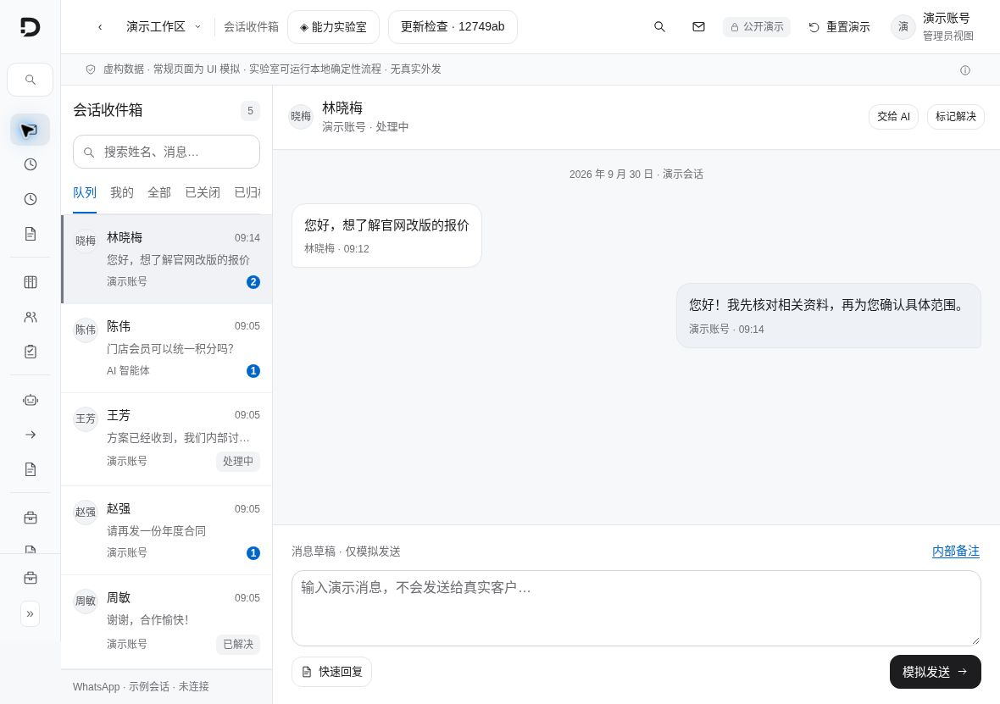
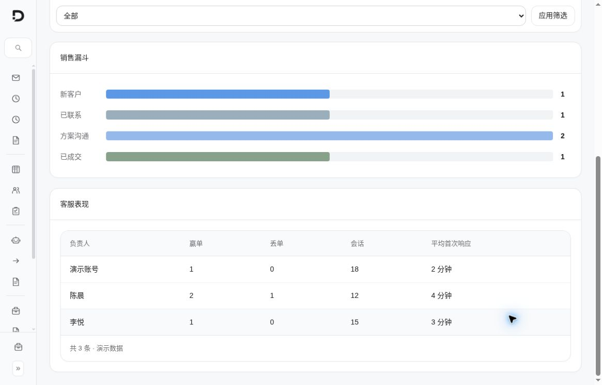
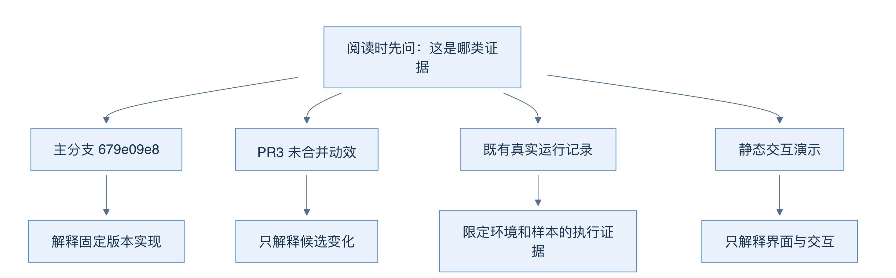

# 01 从客户问题开始认识 AI Native CRM

[返回母文档](../README.md) · [下一章](02.md)

**本章目标：**理解 CRM、Agent、模型与人的职责，区分事实和建议。

## 业务流程与阅读起点

你会学到：这个项目服务谁，CRM 与 Agent 怎样配合，以及怎样区分代码、运行记录和演示界面。

AI Native CRM 是一个可自行部署的客户关系管理系统。它把联系人、客户会话、商机、跟进任务和组织知识放在同一套系统中，再让 Agent 在权限范围内读取资料、分析问题、提出操作。仓库和内部模块也使用 Pi Native CRM 这个名称。

先想一个具体问题：销售经理希望知道“这笔商机为什么停住了，下一步应该做什么”。传统 CRM 保存客户信息、当前阶段、聊天历史和待办。Agent 读取这些记录，找出可引用的依据，再给出摘要或建议。CRM 负责业务事实与权限；模型负责有边界的推理。两者不是彼此替代。

图中实线表示正常业务信息的流动，虚线表示需要人复核的建议。生成一段“建议回复”不会自动产生客户消息。

### 先分清四个责任

在 AI Native CRM 中，不能把所有智能化能力笼统归为“AI 做的”。系统由明确的四方职责共同驱动：

| 角色 | 它拥有什么？ | 它能执行什么？ | 核心代码锚点 |
|---|---|---|---|
| **人类操作员 (Human)** | 业务常识、战略意图与最终责任 | 发起任务委托、审批外发提案、处理异常 | `app/app/` 前端交互 |
| **CRM 数据库 (Database)** | 业务事实（唯一真理 SOT）、租户规则 | 执行 RLS 行级隔离、唯一性约束、记录不可篡改审计日志 | `supabase/migrations/` |
| **智能体运行时 (Pi Agent)** | 任务分解逻辑、回合控制、上下文生命周期 | 编排工具调用循环、拦截高危操作、生成结构化结果 | `lib/agent-runtime/pi/` |
| **大语言模型 (LLM)** | 语言理解、上下文推理与拟人生成能力 | 提出下一步建议、生成草案、决定调用哪个受控工具 | `Model Gateway (BYOK)` |

> 📌 **核心边界原则：** 模型输出的永远是推理建议与工具参数，模型**绝不直接获得数据库写权限**；任何具有外部副作用的操作必须经由受控工具（Tools）或 HITL 审批流水线完成。

遇到一个组件时，先问四件事：它读什么？它能写什么？谁验证这次操作？进程退出后，哪些内容仍然存在？后面的技术栈、Agent 和知识设计都沿这四个问题展开。

### 第一眼先记住五个入口

- 首页：把客户数量、近期任务、默认漏斗和有权查看的 Agent 活动放到一起。读取失败会显示失败状态，不应把零值当成真数据。
- 联系人与商机：联系人描述“这个人”；商机描述“这次业务机会”。一个人和一次机会不是同一个对象。
- Inbox：查看渠道会话，回复或记录内部备注。发送受渠道、会话、角色及其他业务规则约束。
- Agent–CRM 工作台：选择内置 Agent、任务和 CRM 范围，观察一次运行的工具、证据、结果与评测。
- 知识与记忆：知识库提供组织材料；经过确认的记忆保存特定事实。它们必须保留来源与适用范围。

项目还有日程、任务、风险雷达、快速回复、统计、组织设置、隐私请求与部署工具。本书先把这些入口放回完整产品中，再重点跟踪 CRM、Agent 和知识三条主线。目录不是“所有按钮都经过本次在线验收”的声明。

### 从当前新界面认入口

以下图片于 2026-10-04 从当前公开演示的真实浏览器页面直接截取，使用虚构数据；静态演示没有连接 CRM 后端、模型或真实通信渠道。它们说明界面如何呈现，不是主分支业务功能的在线验收。

工作台把 Agent、目标商机、执行模式、任务结果和记录入口放在同一处。图中任务来自页面的预置样例；「本轮已结束」只代表这一段本地模拟结束，不能据此推断真实模型或业务执行已经成功。

四列分别是新客户、已联系、方案沟通、已成交。卡片将机会金额、公司、待办和负责人放在一起，帮助你把联系人、商机与跟进任务关联起来。

左侧选择会话，右侧阅读消息和准备草稿。图中保留「WhatsApp · 示例会话 · 未连接」与「模拟发送」提示；没有发生真实外发。

统计页展示聚合指标的组织方式。这里的商机数量、会话数和响应时间都属于演示样本，不能用作真实业务成绩。

本次使用 9 张当前界面实拍，另在联系人、Inbox、看板、工作台、记忆、知识与 Eval 对应章节放置近景。图片来源清单记录页面、状态、拍摄时间、尺寸与哈希。所有图片未经重绘或像素修改；细节图由浏览器直接截取面板区域。

演示 Site 固定到第 9 版 `acd09a467d7fa45b410a10e35137fe2d729b52bb`，页面显示的接线基线标签为 `12749ab`。这两个标识与下方正文主分支 `679e09e8` 是不同口径；截图里出现动效或检查样例，不表示候选改动已经合并。

### 本书固定在哪个版本

正文基线为主分支提交 `679e09e80878dff7b1c79b8537317b2b9e355331`。PR #2 已合并。2026-10-05 再次核验主分支未变化。2026-10-04 核验 PR 时，动效 PR #3 仍为 draft，头提交为 `50125afd199de3234d0a2bad3c9e5c434c9c2262`；它没有进入本书主线。

四个框是四类证据，不能相互替代。主分支说明“代码是什么”；既有运行记录说明“某个环境在某次执行中发生了什么”；静态演示只说明交互表现；未合并 PR 说明候选改动。

本书没有启动真实数据库、调用真实模型或发送渠道消息。后文涉及真实运行成绩时，会明确标成仓库已有验收记录。CodeWiki 自身的图、链接、网页与内容包验证是另一件事。

### 怎么读更省力

第一次看项目：按 01 → 02 → 03 → 04 → 05 读。先说清业务对象和责任，再跟一条实际请求。

想懂技术栈怎样搭成系统：读 [03 技术栈与运行层](03.md) → [05 身份和组织边界](05.md) → [11 看板并发](11.md) → [15 后台时间线](15.md)。每章都从一个操作进入，不必先记住全部依赖名。

想懂“资料怎样成为模型输入”：读 [22 客户读取](22.md) → [23 记忆排序](23.md) → [24 上下文构造](24.md) → [25 知识检索](25.md)。注意每层保存的内容、来源和有效期。

想看 Agent：读 14 → 15 → 16 → 17 → 18 → 19 → 20 → 21，再进入记忆和知识章节。

想判断是否可上线：读 26 → 27 → 28 → 35。先分清测试覆盖、证据来源和当前缺口，再看分数。

正文采用短句、明确主语和一致术语。图解用于解释结构、调用与因果关系；这不是任何技术写作标准的认证，也不复制第三方书籍插图。

### 源码定位

固定版本：main `679e09e8`

- [`app/app/page.tsx:9-29`](https://github.com/helsome/AiNativeCrm/blob/679e09e80878dff7b1c79b8537317b2b9e355331/app/app/page.tsx#L9-L29)：首页认证、组织选择和失败状态
- [`lib/home/read-home-dashboard.ts:27-95`](https://github.com/helsome/AiNativeCrm/blob/679e09e80878dff7b1c79b8537317b2b9e355331/lib/home/read-home-dashboard.ts#L27-L95)：首页业务摘要的实际读取
- [`lib/navigation/catalogo.ts:105-235`](https://github.com/helsome/AiNativeCrm/blob/679e09e80878dff7b1c79b8537317b2b9e355331/lib/navigation/catalogo.ts#L105-L235)：工作台、Inbox、日程、联系人、任务与漏斗入口
- [`app/app/ai/workbench/page.tsx:16-67`](https://github.com/helsome/AiNativeCrm/blob/679e09e80878dff7b1c79b8537317b2b9e355331/app/app/ai/workbench/page.tsx#L16-L67)：工作台角色和真实模型配置前提
- [`docs/testing/system-acceptance-fixes-2026-10-03.md:1-71`](https://github.com/helsome/AiNativeCrm/blob/679e09e80878dff7b1c79b8537317b2b9e355331/docs/testing/system-acceptance-fixes-2026-10-03.md#L1-L71)：既有验收记录及未关闭边界

## 实现详解

### 核心命题：什么算"事实"

所谓"事实底座"，在本仓库中不是一句口号，而是由代码强制的三条规则。

**第一，事实只存在于 Postgres 里。** 系统把 `event_log` 当作事件溯源的唯一入口，Postgres 触发器**永不**发起 HTTP 调用——触发器只写入一行事件，由 worker 消费并产生副作用 [CLAUDE.md](https://github.com/helsome/AiNativeCrm/blob/679e09e80878dff7b1c79b8537317b2b9e355331/CLAUDE.md#L49)。这条禁令消灭了"数据库里发生了一件事，但外部世界不知道"这一整类不一致状态。事实源是数据库，副作用是派生。

**第二，事实的读取必须带租户作用域。** 所有 tenant-aware 表都带 `organization_id uuid not null`，行级安全（RLS）通过 `fn_user_org_ids()` 辅助函数统一施加 [ARCHITECTURE.md](https://github.com/helsome/AiNativeCrm/blob/679e09e80878dff7b1c79b8537317b2b9e355331/ARCHITECTURE.md#L10)。智能体能读到哪条客户记录，取决于它以谁的身份被调用，而不是取决于模型"想"看什么。

**第三，事实的写入必须留痕。** 每一次成功的 POST/PATCH/DELETE 都会产生一条 `api_audit_log` 记录，且该表对 `anon`、`authenticated`、`service_role` **都没有** UPDATE/DELETE/TRUNCATE 授权——连 service_role 也没有 [CLAUDE.md](https://github.com/helsome/AiNativeCrm/blob/679e09e80878dff7b1c79b8537317b2b9e355331/CLAUDE.md#L89)。这是从 schema 层保证的，不是靠提示词或纪律维持的。

这三条共同构成了"底座"：**智能体的每一个认知都源自数据库，每一次状态改变都写回数据库并被审计**。智能体本身是无状态的执行器，状态全部沉淀在 CRM 里。

---

### 智能体回合的四层契约

智能体读取事实的过程，是整个系统最精妙也最容易被低估的部分。`docs/architecture/agent-turn-pi.md` 用四层清晰定义了它 [agent-turn-pi.md](https://github.com/helsome/AiNativeCrm/blob/679e09e80878dff7b1c79b8537317b2b9e355331/docs/architecture/agent-turn-pi.md#L3)：

| 层级 | 职责 | 关键产物 |
| --- | --- | --- |
| 1. CRM 组装 | 构建租户作用域上下文、系统策略、记忆/RAG 结果、已发布智能体配置、能力工具 | 给模型的输入 |
| 2. 模型网关 | 解析 provider / model / 凭据 / 绑定，并做预检预算决策 | 模型选择 + 预算闸门 |
| 3. `AgentRuntime.run()` | Pi Agent Core 拥有循环，CRM 回调执行前后工具策略 | 生命周期与工具事件 |
| 4. CRM 持久化 | 持久化消息、用量、审计轨迹、队列状态 | 回到事实层 |

这张表最重要的信息是**所有权归属**：循环归 Pi，副作用归 CRM。文档用一句话点明——发送、转人工、对外自动化仍然是 CRM 拥有的效果 [agent-turn-pi.md](https://github.com/helsome/AiNativeCrm/blob/679e09e80878dff7b1c79b8537317b2b9e355331/docs/architecture/agent-turn-pi.md#L11)。

侧效应用的是纵深防御，一共有五层同时生效 [agent-turn-pi.md](https://github.com/helsome/AiNativeCrm/blob/679e09e80878dff7b1c79b8537317b2b9e355331/docs/architecture/agent-turn-pi.md#L19)：

- 现有的 CRM 护栏留在能力处理器内部
- `beforeToolCall` 可以在执行前阻断或终止
- `afterToolCall` 可以脱敏/替换结果或终止整个回合
- 影子模式只允许读取类能力
- 租户与 RBAC 检查保留在数据库/API 边界

#### 上下文如何被装配成提示词

理解了上表之后，`lib/agent-engine/agent/context-builder.ts` 的价值才显现——它是"事实"与"语言"之间的翻译层。函数按固定顺序装配出若干文本块：上一个回合的检查点、累积摘要、漏斗状态、线索记忆索引、已标记的日程、最近消息 [context-builder.ts](https://github.com/helsome/AiNativeCrm/blob/679e09e80878dff7b1c79b8537317b2b9e355331/lib/agent-engine/agent/context-builder.ts#L54)。

其中两处注释揭示了设计者对"事实如何影响模型"的深刻理解，值得逐字读：

**检查点的时间戳必须被声明。** 检查点块被放在提示词的**第一位置**——高于历史记录，因为模型会把最前面的内容读作"最新指令"。但这个检查点其实是**上一个回合结束时**写的，早于客户刚发来的那条消息。注释直说：不说明这点，一个过期的检查点就会赢过与它矛盾的历史记录 [context-builder.ts](https://github.com/helsome/AiNativeCrm/blob/679e09e80878dff7b1c79b8537317b2b9e355331/lib/agent-engine/agent/context-builder.ts#L55)。

**字段名本身会泄漏给模型。** 漏斗状态块原本叫 `## Estado do funil (lead_state)`，注释承认这是"免费泄漏"——模型读到表名就会复述它，而复述表名等于打开了第二条泄漏通道 [context-builder.ts](https://github.com/helsome/AiNativeCrm/blob/679e09e80878dff7b1c79b8537317b2b9e355331/lib/agent-engine/agent/context-builder.ts#L69)。

还有一个更微妙的规则：**空字段不是"信息不存在"的证据**。当 `contact.email` 为空时，不把它当作事实呈现，因为模型会以"档案权威"的态度读取它，赢过客户刚刚输入了邮箱的历史记录；而且由于不存在写入路径，该字段永远保持为空，请求就会永远重复 [context-builder.ts](https://github.com/helsome/AiNativeCrm/blob/679e09e80878dff7b1c79b8537317b2b9e355331/lib/agent-engine/agent/context-builder.ts#L90)。但这个提醒是**条件性**的——总是加上会教会模型怀疑正常数据，那是镜像缺陷。

---

### CRM 如何被暴露为工具

"底座"要能被智能体操作，就必须有受控的接口层。这个接口是 MCP（Model Context Protocol）。

`lib/mcp/tools/catalogo/` 按业务领域把工具分组：漏斗、日程、客服、商业、升级、演进、治理、运营、留存 [lib/mcp/tools/catalogo](https://github.com/helsome/AiNativeCrm/tree/679e09e80878dff7b1c79b8537317b2b9e355331/lib/mcp/tools/catalogo)。每个工具有**两套面向不同读者的描述**——`description` 面向模型（技术性，决定工具被如何选择），`rotulo`/`explicacao`/`oQueToca` 面向配置智能体的普通人（诊所老板、店主），必须不含行话；这个门禁由一个专门的测试守着 [catalog.ts](https://github.com/helsome/AiNativeCrm/tree/679e09e80878dff7b1c79b8537317b2b9e355331/lib/mcp/tools/catalogo)。

还有一个极易被破坏的约束：工具的 `name` 是**线上契约**。客户 VPS 上已发布的智能体和外部 MCP 客户端都引用这串字符串，永不重命名已发布的工具——友好名称只是展示层 [catalog.ts](https://github.com/helsome/AiNativeCrm/tree/679e09e80878dff7b1c79b8537317b2b9e355331/lib/mcp/tools/catalogo)。

MCP 服务端的执行流程同样严谨：`createMcpServer` 为每个工具注册处理器，处理器依次检查角色与作用域、调用业务逻辑、写入 `api_audit_log`、返回标准 MCP 内容结构 [lib/mcp/server.ts](https://github.com/helsome/AiNativeCrm/blob/679e09e80878dff7b1c79b8537317b2b9e355331/lib/mcp/server.ts#L1)。错误以 `{ isError: true }` 返回，MCP 错误码放在 metadata 而非 JSON-RPC 错误封装中 [lib/mcp/server.ts](https://github.com/helsome/AiNativeCrm/blob/679e09e80878dff7b1c79b8537317b2b9e355331/lib/mcp/server.ts#L8)。

值得单独指出的是一个细节：MCP 与内部智能体入口**共享同一套参数净化逻辑**。注释解释了原因——一个落在可选字段上的兜底 UUID 会变成对不存在 id 的过滤，而空结果会被读作"没有数据"；两条路径进同一个处理器，所以必须一起净化，"关上门却忘了窗户"是不允许的 [lib/mcp/server.ts](https://github.com/helsome/AiNativeCrm/blob/679e09e80878dff7b1c79b8537317b2b9e355331/lib/mcp/server.ts#L51)。

---

## 继续阅读

[返回母文档](../README.md) · [下一章](02.md)

