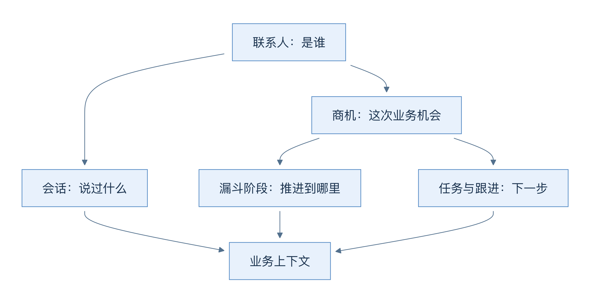
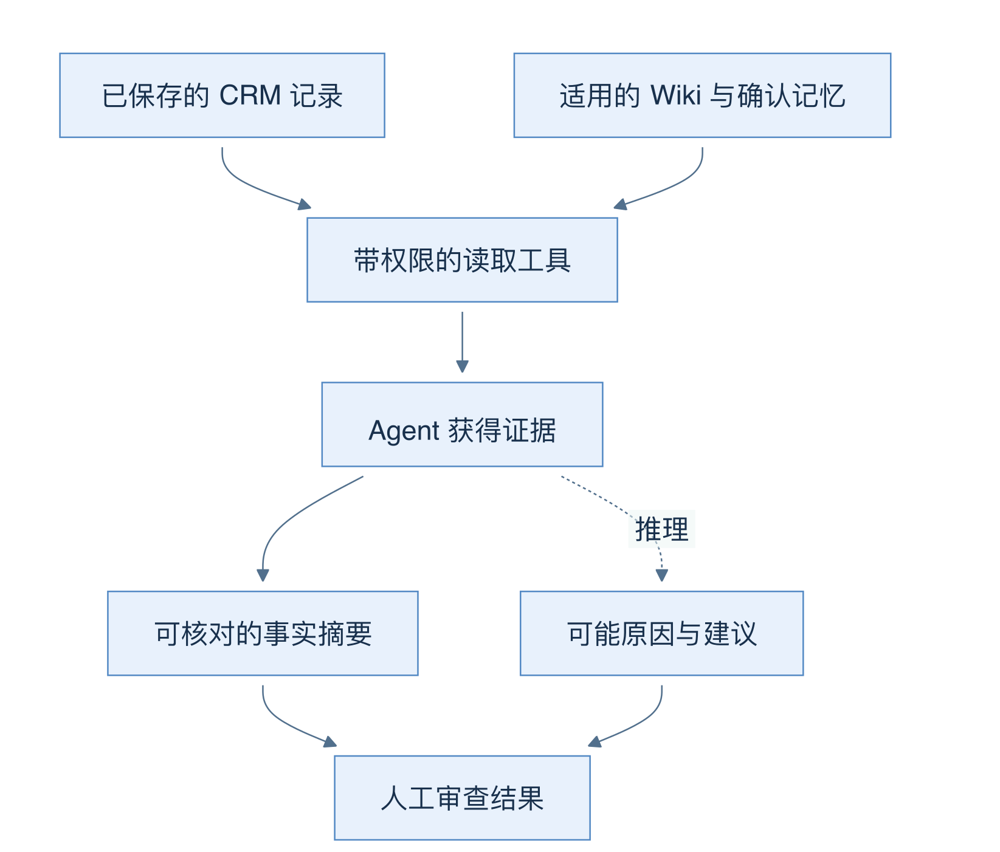

# 02 一笔业务怎样经过 CRM 和 Agent

[返回母文档](../README.md) · [上一章](01.md) · [下一章](03.md)

**本章目标：**沿客户问题、商机、跟进和人工决定理解完整业务链。

## 业务流程与阅读起点

你会学到：联系人、会话、商机、任务与 Agent 结果各自解决什么问题，以及为什么它们要保持独立。

假设客户林女士询问一项服务。这里的姓名与场景只是教学例子，不是读取到的真实客户。

接待人员先在 Inbox 看见消息。联系人回答“是谁”，会话回答“在哪条沟通线上聊了什么”。销售团队可以把这次需求关联到商机，再把商机放进销售漏斗的某个阶段。如果下一步还没有发生，就建立任务或跟进安排。这个结构让“已经知道什么”和“接下来要做什么”分开。

箭头表示业务关联，并非每条关系都是一对一。联系人可以有多次沟通和业务机会；任务与跟进也不能被一段 Agent 建议自动替代。

### 人和 Agent 看到的是同一批事实吗

工作台中的 Agent 不直接获得任意 SQL 权限。它通过已注册的 CRM 工具读取资料，工具和运行范围再限制可见内容。四个内置 Agent 分别聚焦情报、销售运营、客户沟通和监督。名称体现任务侧重，不意味着每个 Agent 都具有相同读写权限。

例如 CRM 情报员可以查联系人、商机、会话历史、知识和组织记忆。它的契约要求区分数据库事实、推断与未知。对于“为什么停滞”，最近一次联系时间可以是读取到的事实；“客户可能还在比较报价”则是推断。没有依据时，应说缺少资料，而不是把推断写回成事实。

实线表示读取，虚线表示模型形成的推断。人需要检查依据是否支持结论，也要看来源是否适用于当前客户、组织和时间。

### 一次常见工作，不只有一个成功标志

1. 打开客户资料，确认当前组织和目标联系人
2. 阅读会话，确认消息属于哪个渠道和哪段业务
3. 查看商机阶段、负责人和未完成事项
4. 启动只读分析，让 Agent 提出有来源的摘要
5. 检查结果、缺口和评测，再决定下一步
6. 若要更改 CRM 或对外沟通，通过相应正式操作和权限检查执行

“Run 已完成”表示本次运行到达完成状态；“评测待复核”表示结果仍有质量问题；“消息行创建成功”也不一定表示外部平台已经送达。后文会分别解释这些状态，避免把页面上的一个绿色提示当作整条业务链通过。

### 三个容易混淆的边界

第一，聊天外观不等于自动多轮记忆。当前工作台会在页面显示先前轮次，但每次提交会创建独立 Run；请求没有自动附上全部聊天历史。需要延续客户背景时，先理解显式 CRM 范围、运行恢复与已确认记忆分别做什么。

第二，工作台草稿不等于可发送提案。当前 start 与 resume 的发送候选数组为空，四个内置 Agent 没有直接发送工具。系统其他辅助 CRM 路径存在审批发送流程，但不能把那条链路的能力移到工作台上理解。

第三，公司政策与客户偏好不能混用。客户偏好“先看书面说明”可以成为经过确认的客户事实；它不能证明所有客户都必须遵守某项组织政策。Wiki、记忆和工具证据各有适用范围。

### 日常 CRM 之外还有什么

日程管理实际预约；任务管理期限与完成状态；雷达帮助发现冷却或遗漏的业务；指标页聚合团队表现。组织设置、隐私请求和审计记录控制系统如何被使用。本书在主流程中解释这些模块的连接点，不把菜单存在当成全部场景已验收。

### 源码定位

固定版本：main `679e09e8`

- [`lib/navigation/catalogo.ts:145-235`](https://github.com/helsome/AiNativeCrm/blob/679e09e80878dff7b1c79b8537317b2b9e355331/lib/navigation/catalogo.ts#L145-L235)：接待与 CRM 模块划分
- [`lib/ai/agents/builtins.ts:1-75`](https://github.com/helsome/AiNativeCrm/blob/679e09e80878dff7b1c79b8537317b2b9e355331/lib/ai/agents/builtins.ts#L1-L75)：内置 Agent 结构、情报员工具和证据要求
- [`app/app/ai/workbench/page.tsx:21-41`](https://github.com/helsome/AiNativeCrm/blob/679e09e80878dff7b1c79b8537317b2b9e355331/app/app/ai/workbench/page.tsx#L21-L41)：商机上下文与组织过滤
- [`docs/architecture/agent-crm-workbench.md:1-114`](https://github.com/helsome/AiNativeCrm/blob/679e09e80878dff7b1c79b8537317b2b9e355331/docs/architecture/agent-crm-workbench.md#L1-L114)：工具、知识和运行契约
- 工作台独立 Run 与发送候选的具体实现：见第 10、13 章源码定位

## 继续阅读

[返回母文档](../README.md) · [上一章](01.md) · [下一章](03.md)

