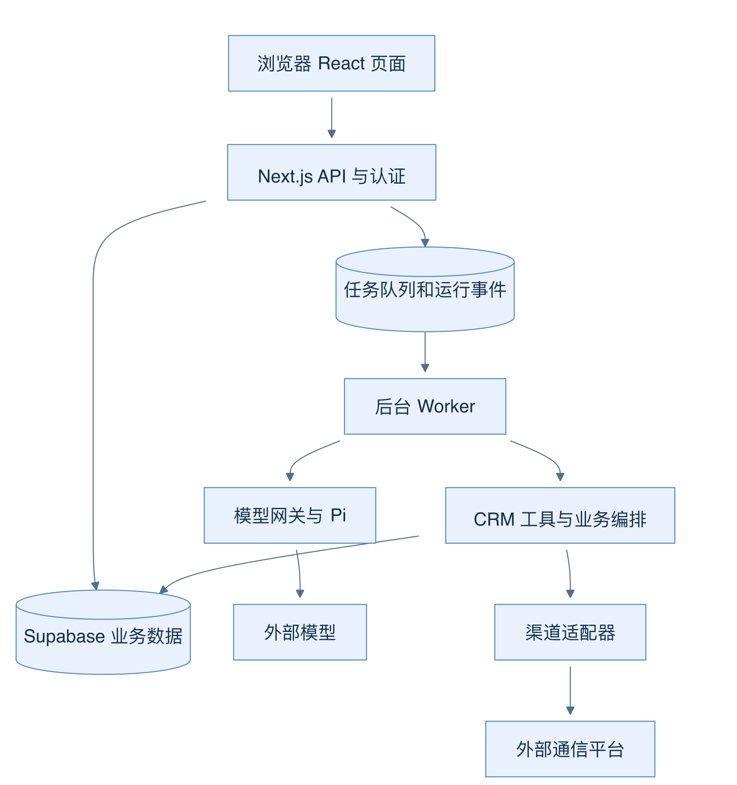
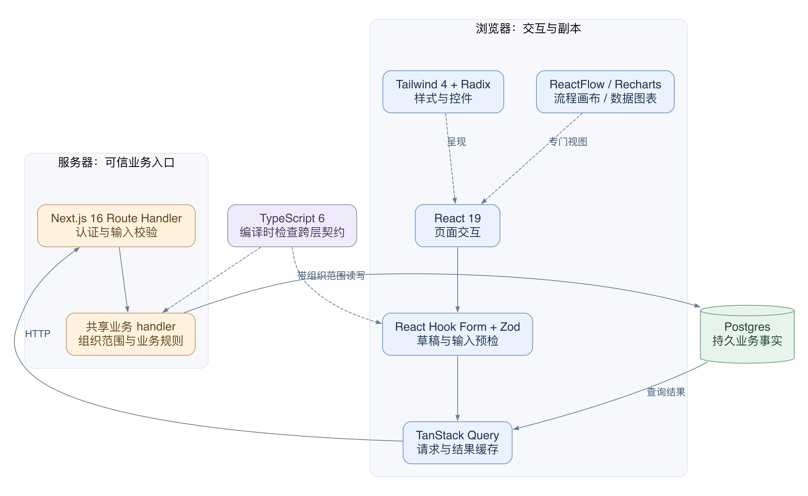
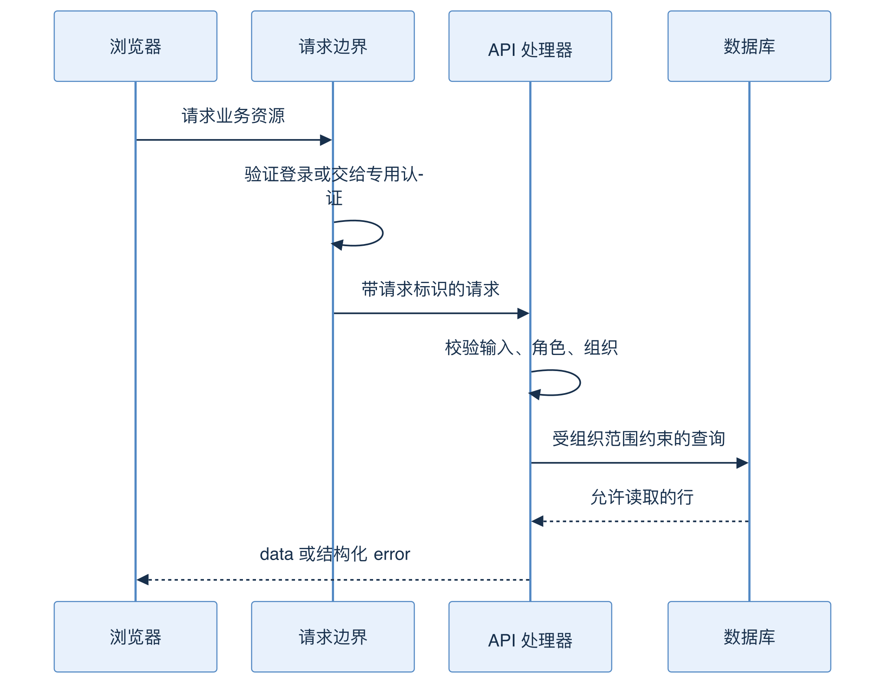
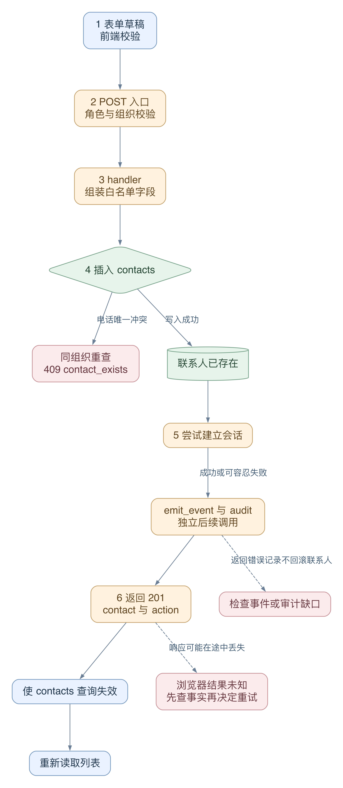
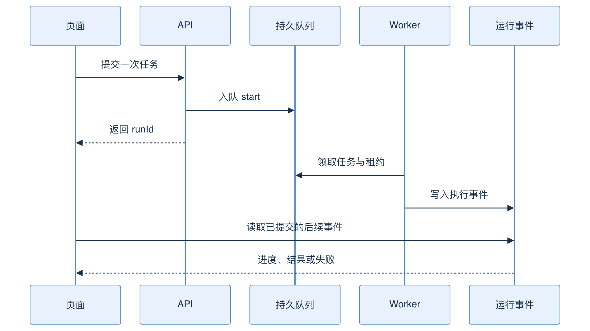
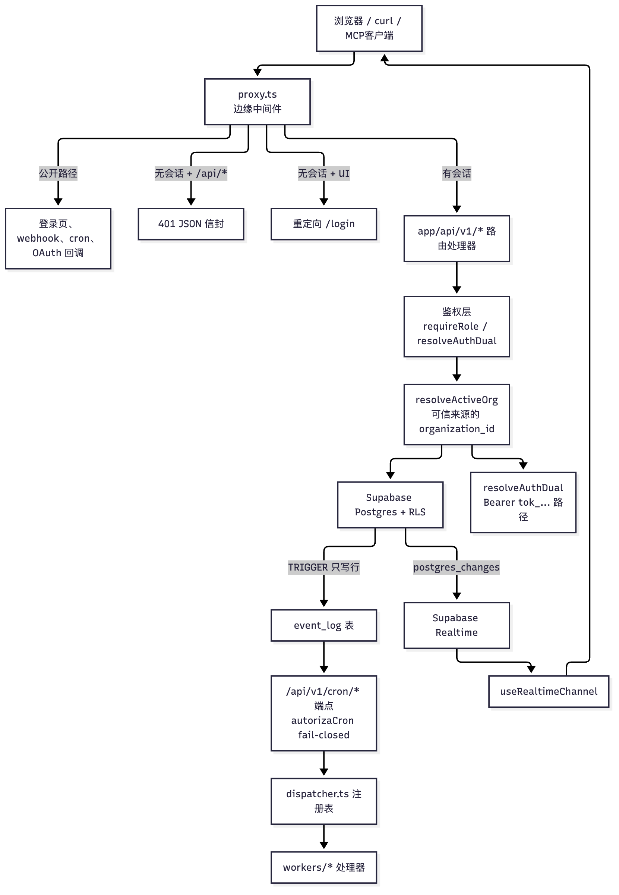
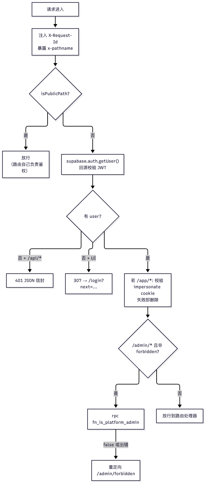
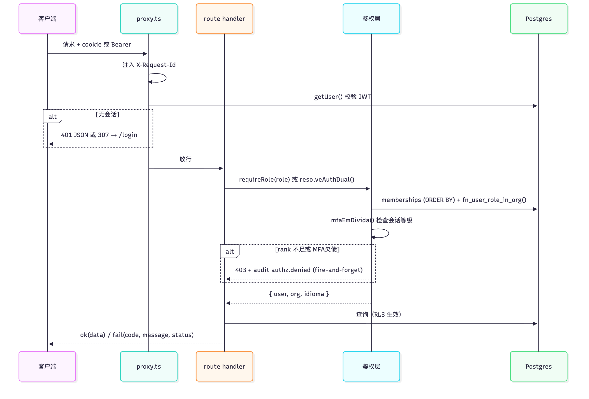
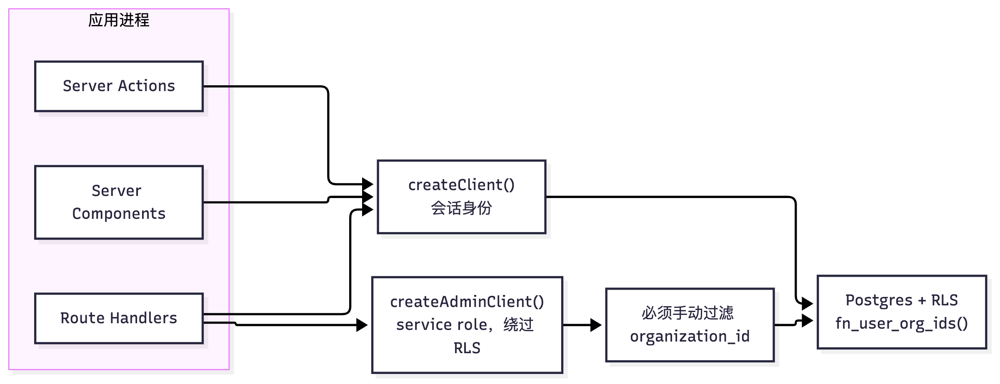
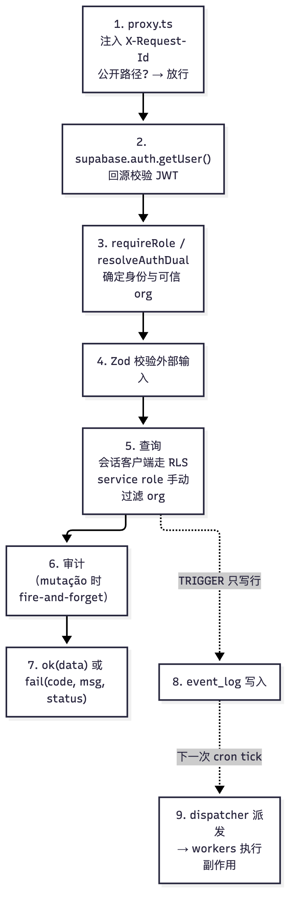

# 03 代码地图与分层架构：请求走过哪些层

[返回母文档](../README.md) · [上一章](02.md) · [下一章](04.md)

**本章目标：**从浏览器操作定位应用、鉴权、数据库、事件和实时层。

## 业务流程与阅读起点

你会学到：页面、API、数据库、Worker、模型网关和外部渠道如何配合，遇到问题时应该从哪里开始查。

这个仓库把网页和业务 API 放在同一个 Next.js 应用里，但“同一个仓库”不等于“所有工作都在同一个请求内完成”。浏览器适合展示状态和接收操作；服务器负责验证与业务规则；数据库保存事实；Worker 负责持续消费后台任务。模型与渠道都是边界外的服务。



实线表示请求或资料传递。图省略具体部署网络，强调职责：浏览器不能绕过业务 API 直接获得管理数据库或模型凭据。

### 先回答：这些技术为什么要放在一起

技术栈不是一串等价的工具名。它们解决不同问题。先用“谁拥有这个状态”来分层，再看依赖名。下面的职责有实现依据；关于取舍的说明，是从这些边界得到的架构解释，不是作者选型过程的记录。



图 02-D：实线表示本例中的运行时调用或资料流。虚线表示呈现或静态契约的配合。它是职责图，不是部署网络图。TypeScript 并不在浏览器和服务器之间另开一条网络通道。

1. Next.js 16 提供页面入口，也提供 HTTP 入口。`app/app/contacts/page.tsx` 返回联系人组件；`app/api/v1/contacts/route.ts` 接收同一功能的请求。因此网页与 API 可以共享类型和业务代码，但它们仍跨越 HTTP 信任边界。页面默认可以在服务器执行；联系人交互组件明确写了 `"use client"`。同仓库不等于所有代码都进入浏览器。源码：[`app/app/contacts/page.tsx:1-9`](https://github.com/helsome/AiNativeCrm/blob/679e09e80878dff7b1c79b8537317b2b9e355331/app/app/contacts/page.tsx#L1-L9)、[`app/app/contacts/_client.tsx:1-26`](https://github.com/helsome/AiNativeCrm/blob/679e09e80878dff7b1c79b8537317b2b9e355331/app/app/contacts/_client.tsx#L1-L26)。
2. React 19 管页面交互。搜索文字、排序方向、弹窗开关保存在组件状态中。这些状态只表示“这张页面现在怎么显示”。它们不能证明联系人已写入数据库。源码：[`app/app/contacts/_client.tsx:47-75`](https://github.com/helsome/AiNativeCrm/blob/679e09e80878dff7b1c79b8537317b2b9e355331/app/app/contacts/_client.tsx#L47-L75)。
3. Tailwind 4 管样式，Radix 管控件结构与交互基础。本仓库用 `components/ui/dialog.tsx` 包装 Radix Dialog，再加上自己的样式、关闭按钮和翻译。业务弹窗复用这层组件。这样页面不必各写一套弹窗；代价是修改共用组件会影响多个入口。CSS 的扫描目录在 `app/globals.css` 显式列出，新 UI 目录若不在范围内，类名可能没有对应样式。源码：[`components/ui/dialog.tsx:1-55`](https://github.com/helsome/AiNativeCrm/blob/679e09e80878dff7b1c79b8537317b2b9e355331/components/ui/dialog.tsx#L1-L55)、`app/globals.css:1-25`。
4. React Hook Form 管表单值和提交。Zod 检查值能否满足输入契约。新建联系人弹窗先用 `useForm` 收集数据，再调用 `contactCreateSchema.safeParse`。它没有在此处使用 `zodResolver`。服务器仍独立校验，并按组织的国家配置选择证件规则。前端校验减少无效往返；服务器校验守住被直接调用的 API。源码：[`components/contacts/NewContactDialog.tsx:49-88`](https://github.com/helsome/AiNativeCrm/blob/679e09e80878dff7b1c79b8537317b2b9e355331/components/contacts/NewContactDialog.tsx#L49-L88)、[`app/api/v1/contacts/route.ts:157-198`](https://github.com/helsome/AiNativeCrm/blob/679e09e80878dff7b1c79b8537317b2b9e355331/app/api/v1/contacts/route.ts#L157-L198)、[`lib/schemas/contacts.ts:68-99`](https://github.com/helsome/AiNativeCrm/blob/679e09e80878dff7b1c79b8537317b2b9e355331/lib/schemas/contacts.ts#L68-L99)。
5. TanStack Query 管“服务器资料在浏览器里的副本”。联系人列表使用无限分页查询；新建和修改使用 mutation。写入成功后，hook 使相关查询失效，让界面重新读取事实。QueryClient 不是另一个 CRM 数据库。源码：[`hooks/contacts/useContactList.ts:22-44`](https://github.com/helsome/AiNativeCrm/blob/679e09e80878dff7b1c79b8537317b2b9e355331/hooks/contacts/useContactList.ts#L22-L44)、[`hooks/contacts/useCreateContact.ts:21-33`](https://github.com/helsome/AiNativeCrm/blob/679e09e80878dff7b1c79b8537317b2b9e355331/hooks/contacts/useCreateContact.ts#L21-L33)、[`hooks/contacts/useUpdateContact.ts:8-27`](https://github.com/helsome/AiNativeCrm/blob/679e09e80878dff7b1c79b8537317b2b9e355331/hooks/contacts/useUpdateContact.ts#L8-L27)。
6. TypeScript 6 管编译时的形状。项目开启 strict；创建 hook 用 `import type` 关联 handler 的返回类型，避免把 `{ contact, action }` 误当联系人本身。`import type` 不表示把服务端实现装进浏览器。类型检查也不能验证运行时收到的 JSON，更不能代替角色守卫。源码：[`tsconfig.json:2-21`](https://github.com/helsome/AiNativeCrm/blob/679e09e80878dff7b1c79b8537317b2b9e355331/tsconfig.json#L2-L21)、[`hooks/contacts/useCreateContact.ts:5-28`](https://github.com/helsome/AiNativeCrm/blob/679e09e80878dff7b1c79b8537317b2b9e355331/hooks/contacts/useCreateContact.ts#L5-L28)。
7. ReactFlow 和 Recharts 是专门的呈现工具。跟进编辑器动态加载 ReactFlow 画布，并关闭这块画布的 SSR；它帮助用户编辑流程图，后台执行仍由另一个模块负责。Recharts 的 UsageChart 接收已经准备好的 payload，再把 series 画成图。图表不是计费账本，画布也不是 Worker。源码：[`app/app/ai/followups/[id]/_components/FlowBuilder.tsx:1-30`](https://github.com/helsome/AiNativeCrm/blob/679e09e80878dff7b1c79b8537317b2b9e355331/app/app/ai/followups/[id]/_components/FlowBuilder.tsx#L1-L30)、[`components/ai/UsageChart.tsx:14-20`](https://github.com/helsome/AiNativeCrm/blob/679e09e80878dff7b1c79b8537317b2b9e355331/components/ai/UsageChart.tsx#L14-L20)、[`components/ai/UsageChart.tsx:66-97`](https://github.com/helsome/AiNativeCrm/blob/679e09e80878dff7b1c79b8537317b2b9e355331/components/ai/UsageChart.tsx#L66-L97)。

版本依据是这个固定提交的 [`package.json:45-106`](https://github.com/helsome/AiNativeCrm/blob/679e09e80878dff7b1c79b8537317b2b9e355331/package.json#L45-L106)、[`package.json:108-136`](https://github.com/helsome/AiNativeCrm/blob/679e09e80878dff7b1c79b8537317b2b9e355331/package.json#L108-L136)。版本表只说明这里装了什么，不代表这些库在所有页面同时运行。

#### 失败分支：前端“通过”为什么仍会失败

一个字段可以通过 TypeScript，却未通过 Zod；它也可以通过前端 Zod，却未通过服务器按组织配置建立的 schema。输入通过后，数据库还会检查唯一性和约束。最后，HTTP 可能在数据库提交之后断开。因此“能编译”“允许提交”“数据库接受”“浏览器收到成功”是四个不同结果。

当前 HTTP 客户端特别区分读写：写请求遇到网络异常或超时，不自动按网络错误重试；它不知道第一次写入是否已经完成。客户端虽附带 Idempotency-Key，但只对真正消费该键的服务端路径有效。本章的联系人 POST 没有调用通用幂等 helper。不能因为请求头存在，就把任意写入当成安全重放。源码：[`lib/api/client.ts:248-250`](https://github.com/helsome/AiNativeCrm/blob/679e09e80878dff7b1c79b8537317b2b9e355331/lib/api/client.ts#L248-L250)、[`lib/api/client.ts:298-304`](https://github.com/helsome/AiNativeCrm/blob/679e09e80878dff7b1c79b8537317b2b9e355331/lib/api/client.ts#L298-L304)、[`lib/api/client.ts:333-359`](https://github.com/helsome/AiNativeCrm/blob/679e09e80878dff7b1c79b8537317b2b9e355331/lib/api/client.ts#L333-L359)、[`app/api/v1/contacts/route.ts:157-207`](https://github.com/helsome/AiNativeCrm/blob/679e09e80878dff7b1c79b8537317b2b9e355331/app/api/v1/contacts/route.ts#L157-L207)。

### Supabase 是一组能力，Postgres 是业务事实的落点

不要把 Supabase、Postgres、Realtime 和 Redis 当成四个并列的业务数据库。

- Postgres 保存联系人、成员关系、消息、运行记录、事件和任务状态。唯一索引、CHECK、RLS 与事务在这里生效。重开网页后，系统从这里重建业务视图
- Supabase Auth 验证登录用户。会话客户端把请求的身份带到 Supabase；业务代码再解析组织和角色。Auth 用户不是 CRM 联系人
- RLS 在 Postgres 查询时限制行。它不是 JavaScript 的列表过滤。不同表有不同策略，不能从一个表的规则推断整个系统
- Supabase Storage 保存媒体对象。业务表保存对象路径和业务关联。例如联系人头像路由先查当前组织中的联系人，再为私有 `whatsapp-media` 对象生成短期签名 URL。数据库记录仍决定“这张头像属于谁”。源码：[`app/api/v1/contacts/[id]/avatar/route.ts:47-92`](https://github.com/helsome/AiNativeCrm/blob/679e09e80878dff7b1c79b8537317b2b9e355331/app/api/v1/contacts/[id]/avatar/route.ts#L47-L92)
- Supabase Realtime 通知页面数据变化。Inbox hook 收到变化后使 conversations 查询失效，再从 API 取资料。通知帮助界面变新，通知本身不是新的业务事实。源码：[`hooks/inbox/useConversationsRealtime.ts:151-177`](https://github.com/helsome/AiNativeCrm/blob/679e09e80878dff7b1c79b8537317b2b9e355331/hooks/inbox/useConversationsRealtime.ts#L151-L177)
- Redis 在这里承担辅助计数等职责。限流 helper 使用固定窗口 `INCR` 加 `EXPIRE`；Redis 不可达时，计数退回进程内存。这会失去跨实例的共享计数能力，不是切换 CRM 数据存储。源码：[`lib/ai/dispatcher/rate-limit.ts:20-45`](https://github.com/helsome/AiNativeCrm/blob/679e09e80878dff7b1c79b8537317b2b9e355331/lib/ai/dispatcher/rate-limit.ts#L20-L45)、[`lib/ai/dispatcher/rate-limit.ts:120-152`](https://github.com/helsome/AiNativeCrm/blob/679e09e80878dff7b1c79b8537317b2b9e355331/lib/ai/dispatcher/rate-limit.ts#L120-L152)

一个容易被旧概述误导的点：当前通用 API 幂等 helper 把预留和结果收据写入 Postgres 的 `idempotency_keys`，并不是统一存在 Redis。它也不是每条 POST 的自动中间件。源码：[`lib/api/idempotency.ts:15-47`](https://github.com/helsome/AiNativeCrm/blob/679e09e80878dff7b1c79b8537317b2b9e355331/lib/api/idempotency.ts#L15-L47)。


### 从目录定位一项功能

```text
app/
├── (public)/         # 公开路由：登录、注册、LGPD 同意页
├── app/              # 业务受限页面 (Server Components 默认 + Client Components)
│   ├── contacts/     # 客户 360 主数据与时间线
│   ├── inbox/        # 统一多渠道会话收件箱 (WhatsApp/邮件)
│   ├── ai/workbench/ # Agent 智能体工作台 (任务下发、事件流、评测结果)
│   └── pipeline/     # 销售商机看板 (四阶段流转)
└── api/v1/           # RESTful 业务 API (166+ Handlers)
lib/
├── agent-runtime/pi/ # Pi Agent Core 适配层 (Turn 循环、Tool 桥接、Usage 治理)
├── agent-engine/     # 渠道 Agent 执行引擎、Prompt 模板、Context 组装
├── ai/               # 智能体目录 (Builtins)、Guardrails 护栏、Mem0/RAG 适配
├── auth/             # 认证守卫、RBAC 角色权限、MFA 策略 (lib/auth/politica-mfa.ts)
└── supabase/         # 数据库客户端 (browser, server, admin service_role)
supabase/
└── migrations/       # PostgreSQL 表结构、约束与 RLS 策略 (Multi-tenancy 核心防线)
workers/              # 异步事件消费者 (AI 响应、RAG 向量索引、媒体持久化、LGPD)
proxy.ts              # 边缘中间件 (X-Request-Id 注入、会话校验初步分流)
```

**排查问题定位法则：** 遇到 UI 渲染问题查 `app/app/`；遇到接口报错查 `app/api/v1/`；遇到越权与租户泄漏查 `supabase/migrations/` 中的 RLS 与 `resolveActiveOrg()`；遇到模型与工具循环异常查 `lib/agent-runtime/pi/runtime.ts`。

不要只按目录名判断能力是否接通。例如审批执行器存在，不代表每个页面都会创建审批提案；必须沿入口一直追到生产者和消费者。

### 沿一次真实读取走完，而不是只记目录

先看请求的边界，再打开“联系人”搜索林女士。普通未登录 API 返回 JSON 401，页面请求才跳转登录；联系人列表采用下文的专用认证分支。



图 02-B 按时间向下读：身份、输入、角色和组织是不同检查点。下面按实际联系人代码走，不把概览当成每条路由的固定顺序。

1. `ContactsPage` 渲染 `ContactsListClient`。组件保存输入文字，延迟 250 毫秒后更新 search，再组合 filters。浏览器目前只改变了查询条件，没有修改林女士的记录。源码：[`app/app/contacts/_client.tsx:47-70`](https://github.com/helsome/AiNativeCrm/blob/679e09e80878dff7b1c79b8537317b2b9e355331/app/app/contacts/_client.tsx#L47-L70)
2. `useContactList` 以 `["contacts", filters]` 作为查询键，把筛选值和分页 cursor 放进 URL，再 GET `/api/v1/contacts`。源码：[`hooks/contacts/useContactList.ts:22-44`](https://github.com/helsome/AiNativeCrm/blob/679e09e80878dff7b1c79b8537317b2b9e355331/hooks/contacts/useContactList.ts#L22-L44)
3. 这个确切路径在 public-paths 清单内，所以 proxy 不用 cookie 提前拒绝它。GET handler 自己选择 cookie 或 bearer 分支。浏览器分支用 requireRole("viewer")；bearer 分支验证 token、mcp:read 和角色。此处的“公开”只是守卫归属发生变化。源码：[`lib/auth/public-paths.ts:61-70`](https://github.com/helsome/AiNativeCrm/blob/679e09e80878dff7b1c79b8537317b2b9e355331/lib/auth/public-paths.ts#L61-L70)、[`app/api/v1/contacts/route.ts:57-109`](https://github.com/helsome/AiNativeCrm/blob/679e09e80878dff7b1c79b8537317b2b9e355331/app/api/v1/contacts/route.ts#L57-L109)
4. handler 把已验证的 organization_id 和 actor 放进 HandlerCtx。查询参数则单独经过 Zod。组织标识与搜索文字不是同一类输入：搜索文字来自用户，组织范围来自认证。源码：[`app/api/v1/contacts/route.ts:112-147`](https://github.com/helsome/AiNativeCrm/blob/679e09e80878dff7b1c79b8537317b2b9e355331/app/api/v1/contacts/route.ts#L112-L147)、[`lib/api/handlers/types.ts:74-96`](https://github.com/helsome/AiNativeCrm/blob/679e09e80878dff7b1c79b8537317b2b9e355331/lib/api/handlers/types.ts#L74-L96)
5. `listContactsHandler` 先限定 organization_id，排除已经合并的联系人，再排序、筛选并多取一行以判断是否还有下一页。它为当前页补会话摘要时，再次限定相同 organization_id。源码：[`app/api/v1/contacts/_handler.ts:90-123`](https://github.com/helsome/AiNativeCrm/blob/679e09e80878dff7b1c79b8537317b2b9e355331/app/api/v1/contacts/_handler.ts#L90-L123)、[`app/api/v1/contacts/_handler.ts:198-220`](https://github.com/helsome/AiNativeCrm/blob/679e09e80878dff7b1c79b8537317b2b9e355331/app/api/v1/contacts/_handler.ts#L198-L220)、[`app/api/v1/contacts/_handler.ts:227-264`](https://github.com/helsome/AiNativeCrm/blob/679e09e80878dff7b1c79b8537317b2b9e355331/app/api/v1/contacts/_handler.ts#L227-L264)
6. 路由返回 `{ data, meta }`。Query 保存这一页；React 把已加载的 pages 展平成列表。发生错误时页面显示重试入口，不能把失败响应当成空客户名单。源码：[`app/api/v1/contacts/route.ts:148-153`](https://github.com/helsome/AiNativeCrm/blob/679e09e80878dff7b1c79b8537317b2b9e355331/app/api/v1/contacts/route.ts#L148-L153)、[`app/app/contacts/_client.tsx:72-75`](https://github.com/helsome/AiNativeCrm/blob/679e09e80878dff7b1c79b8537317b2b9e355331/app/app/contacts/_client.tsx#L72-L75)、[`app/app/contacts/_client.tsx:223-243`](https://github.com/helsome/AiNativeCrm/blob/679e09e80878dff7b1c79b8537317b2b9e355331/app/app/contacts/_client.tsx#L223-L243)

这条读取链有两个关键依赖方向：页面依赖 API 契约，业务 handler 依赖可信上下文和数据客户端。handler 不需要知道哪个按钮触发了它。REST 与 MCP 可复用联系人读取 handler，从而共享查询和组织过滤；各入口仍要独立验证自己的身份。源码：[`lib/mcp/tools/contacts.ts:14-47`](https://github.com/helsome/AiNativeCrm/blob/679e09e80878dff7b1c79b8537317b2b9e355331/lib/mcp/tools/contacts.ts#L14-L47)。

### 写入不是“把浏览器对象同步到数据库”

接着创建一个合成联系人。下面只讲新建联系人，不把其他写入口的规则套进来。



图 02-E：绿色节点是持久业务事实，蓝色节点是浏览器副本。侧路说明成功写入后仍可能出现的不完整结果。不要把整张图当成一个数据库事务。

1. 表单构造 payload，运行前端 schema。mutation 把 payload 发给 POST `/api/v1/contacts`
2. POST 检查支持会话能否写入，再执行 requireRole("agent")。此 POST 走 cookie 身份；不能因为相同路径的 GET 接受 bearer，就认为 POST 也接受。它从 org 读取国家配置，然后验证正文
3. `createContactHandler` 组装白名单字段。organization_id 来自 ctx，created_by_user_id 只在 actor 为 user 时填入。电话先规范化。浏览器无权用正文给记录改归属。源码：[`app/api/v1/contacts/_handler.ts:376-407`](https://github.com/helsome/AiNativeCrm/blob/679e09e80878dff7b1c79b8537317b2b9e355331/app/api/v1/contacts/_handler.ts#L376-L407)
4. Postgres INSERT 返回联系人。若活跃联系人电话唯一索引冲突，handler 在同组织重新查找电话，再返回 409 contact_exists 和已有 contact_id。其他唯一冲突不保证得到相同的 409；当前代码可能返回 internal_error。源码：[`app/api/v1/contacts/_handler.ts:409-435`](https://github.com/helsome/AiNativeCrm/blob/679e09e80878dff7b1c79b8537317b2b9e355331/app/api/v1/contacts/_handler.ts#L409-L435)
5. 联系人已写入后，代码尝试建立会话。这个动作是 best-effort，失败不撤销联系人。随后代码调用 emit_event，再写 audit。emit_event 返回的数据库 error 会被记录；audit 自己捕获写入错误。这些调用不能证明“联系人、会话、事件、审计四项一起原子提交”。源码：[`app/api/v1/contacts/_handler.ts:437-477`](https://github.com/helsome/AiNativeCrm/blob/679e09e80878dff7b1c79b8537317b2b9e355331/app/api/v1/contacts/_handler.ts#L437-L477)、[`lib/audit/index.ts:51-104`](https://github.com/helsome/AiNativeCrm/blob/679e09e80878dff7b1c79b8537317b2b9e355331/lib/audit/index.ts#L51-L104)
6. POST 返回 201，正文是 `{ data: { contact, action } }`。hook 使 contacts 查询失效；弹窗清空表单并关闭。页面随后读取的新列表是持久结果的副本。若 HTTP 响应丢失，应先查实际记录，再判断是否重试，不能仅看弹窗报错。源码：[`hooks/contacts/useCreateContact.ts:21-33`](https://github.com/helsome/AiNativeCrm/blob/679e09e80878dff7b1c79b8537317b2b9e355331/hooks/contacts/useCreateContact.ts#L21-L33)、[`components/contacts/NewContactDialog.tsx:78-90`](https://github.com/helsome/AiNativeCrm/blob/679e09e80878dff7b1c79b8537317b2b9e355331/components/contacts/NewContactDialog.tsx#L78-L90)

这条链解释了分层的收益，也暴露代价：共用 handler 避免多个入口各写业务规则；多次独立写入则需要明确说明部分成功。只在界面增加一个“成功”提示，不能修复事件或审计的缺口。

### 同步请求结束，后台工作为什么还在继续

模型调用和外部重试不适合依附页面连接。仓库把异步工作放入持久队列；数据库触发器记录事件，不直接发 HTTP。对照新建联系人，再看 Workbench：两者都返回 201，但后者先交付运行标识。



图 02-C 向下展示时间。先返回标识，再观察执行；安全重试仍取决于幂等记录和执行租约。

1. Workbench API 先写 `ai_workbench_runs`，状态为 queued；再写 run_started 事件。这里的 run_started 是已记录启动请求，不是模型已经回答。源码：[`app/api/v1/ai/workbench/runs/route.ts:240-279`](https://github.com/helsome/AiNativeCrm/blob/679e09e80878dff7b1c79b8537317b2b9e355331/app/api/v1/ai/workbench/runs/route.ts#L240-L279)
2. API 把 workbench_start 写入 Postgres `job_queue`，然后返回 run_id 与 queued。HTTP 请求至此结束。源码：[`app/api/v1/ai/workbench/runs/route.ts:293-319`](https://github.com/helsome/AiNativeCrm/blob/679e09e80878dff7b1c79b8537317b2b9e355331/app/api/v1/ai/workbench/runs/route.ts#L293-L319)、[`lib/agent-engine/queue/queue.ts:83-118`](https://github.com/helsome/AiNativeCrm/blob/679e09e80878dff7b1c79b8537317b2b9e355331/lib/agent-engine/queue/queue.ts#L83-L118)
3. Worker 是另一个长运行进程。它从数据库领取可运行任务，记录 locked_by、locked_at 与尝试次数。它不是用户页面中的循环，也不是 Redis 队列。源码：[`workers/agent-worker/main.ts:9-23`](https://github.com/helsome/AiNativeCrm/blob/679e09e80878dff7b1c79b8537317b2b9e355331/workers/agent-worker/main.ts#L9-L23)、[`lib/agent-engine/queue/queue.ts:130-153`](https://github.com/helsome/AiNativeCrm/blob/679e09e80878dff7b1c79b8537317b2b9e355331/lib/agent-engine/queue/queue.ts#L130-L153)
4. Workbench consumer 用 job.organization_id 和 runId 重新读取运行状态。它在执行副作用前检查租约，并把 queued 改成 running。任务 payload 是线索，持久运行状态与有效租约才决定能否继续。源码：[`lib/ai/agents/workbench-start-job.ts:46-88`](https://github.com/helsome/AiNativeCrm/blob/679e09e80878dff7b1c79b8537317b2b9e355331/lib/ai/agents/workbench-start-job.ts#L46-L88)
5. 页面读取后续状态和事件。关闭页面不会删除已入库任务；Worker 意外退出后，超时租约允许重新处理。领取与结算规则见第 15 章，这种恢复机制不承诺外部动作恰好执行一次

失败分支也不同：若运行记录已保存、但入队失败，API 尝试把 run 标为 failed，写入 run_failed，并返回 503 start_queue_unavailable。它没有把“保存了 run”伪装成“后台已接手”。若 Worker 没有运行，已经成功入队的请求仍可长期停在 queued。前一个问题查入队路径，后一个问题查消费者。源码：[`app/api/v1/ai/workbench/runs/route.ts:280-317`](https://github.com/helsome/AiNativeCrm/blob/679e09e80878dff7b1c79b8537317b2b9e355331/app/api/v1/ai/workbench/runs/route.ts#L280-L317)。

### 接下来把模型和渠道边界拆开

第 19–20 章继续追模型调用：网关选择组织凭据、provider 与绑定，管理用量、预算和审计；Pi 执行模型—工具循环。CRM 工具仍遵守业务规则。

渠道适配器负责通信，业务编排决定能否发送。适配器连通不代表客户已收到消息；完整发送链见第 06、08、13 章。

### 排查时按症状选入口

页面没有数据：先看请求和 API 错误，再看组织与角色。Run 一直排队：看 Worker 是否领取及租约状态。模型不可用：看绑定、凭据和 provider 错误。答案无依据：看工具观察、知识检索与引用。HTTP 成功但客户没收到：看消息状态、队列与渠道回执。

这种分层能缩短排查路径，也能防止在一个层面通过后误报整个系统通过。

### 用四个问题检查你是否真的理解这一层

- 关掉弹窗后，什么会丢失？表单草稿会丢失；已经提交的 contacts 行不会因此撤销
- Query 显示旧名字时，什么有权决定新名字？先看 API 重新读取的 contacts 行，再检查哪些查询未失效
- Redis 宕机后，联系人会转存哪里？不会转存；这里退回内存的是限流计数
- Run 返回 201 后，谁负责模型工作？已领取持久任务的 Worker；201 本身只确认启动记录与入队路径已通过

### 源码定位

固定版本：main `679e09e8`

- [`package.json:7-43`](https://github.com/helsome/AiNativeCrm/blob/679e09e80878dff7b1c79b8537317b2b9e355331/package.json#L7-L43)：开发、构建、Worker 与不同测试命令
- [`proxy.ts:13-88`](https://github.com/helsome/AiNativeCrm/blob/679e09e80878dff7b1c79b8537317b2b9e355331/proxy.ts#L13-L88)：请求标识、公共路径与认证分流
- [`app/app/ai/workbench/page.tsx:16-53`](https://github.com/helsome/AiNativeCrm/blob/679e09e80878dff7b1c79b8537317b2b9e355331/app/app/ai/workbench/page.tsx#L16-L53)：角色、组织和模型配置读取
- [`workers/agent-worker/main.ts:9-23`](https://github.com/helsome/AiNativeCrm/blob/679e09e80878dff7b1c79b8537317b2b9e355331/workers/agent-worker/main.ts#L9-L23)：后台执行职责与退出约定
- [`AGENTS.md:37-104`](https://github.com/helsome/AiNativeCrm/blob/679e09e80878dff7b1c79b8537317b2b9e355331/AGENTS.md#L37-L104)：目录、数据流及规范入口；具体实现以本书后续源码定位为准

## 实现详解

本页回答一个入门者最容易混淆的问题：这个仓库的请求从浏览器进入系统后，到底依次穿过哪些层、每层负责什么、为什么这样切分。它是一张**地图**，不是某个子系统的深入说明——租户隔离、REST 契约、智能体回合、RAG 等各自有独立页面，这里只负责把骨架搭起来，让你在进入那些专题前知道每块砖砌在哪一堵墙里。

理解这套分层只需要一个核心判断：**每一层只信任上一层的产物，不信任请求本身**。请求体永远不提供 `organization_id`；cookie 永远不被直接解码成身份；Postgres 触发器永远不发 HTTP；边缘中间件永远不查数据库。

### 六层的职责边界

整个系统可以压缩成六层，从上到下依次是边缘中间件、应用层、鉴权层、数据库层、事件队列与实时层。

| 层 | 代码位置 | 输入 | 输出 | 绝对不做的事 |
| --- | --- | --- | --- | --- |
| **边缘中间件** | [proxy.ts](https://github.com/helsome/AiNativeCrm/blob/679e09e80878dff7b1c79b8537317b2b9e355331/proxy.ts#L12) | `NextRequest` | 放行 / 重定向 / 401 JSON | 不查数据库、不读 body、不信任 cookie 内容 |
| **应用层** | `app/**/route.ts` | 已通过边缘的请求 | `ok()` / `fail()` 响应 | 不自己解析身份 |
| **鉴权层** | [lib/auth/server.ts](https://github.com/helsome/AiNativeCrm/blob/679e09e80878dff7b1c79b8537317b2b9e355331/lib/auth/server.ts#L115)、[lib/auth/require-role.ts](https://github.com/helsome/AiNativeCrm/blob/679e09e80878dff7b1c79b8537317b2b9e355331/lib/auth/require-role.ts#L53) | cookie 或 Bearer | `AuthUser` + `ActiveOrg` | 不信任客户端传来的 org |
| **数据库层** | [lib/supabase/server.ts](https://github.com/helsome/AiNativeCrm/blob/679e09e80878dff7b1c79b8537317b2b9e355331/lib/supabase/server.ts#L12)、`supabase/migrations/` | 会话客户端 / service role | RLS 过滤后的行 | 不做业务判定 |
| **事件队列** | [lib/event-log/dispatcher.ts](https://github.com/helsome/AiNativeCrm/blob/679e09e80878dff7b1c79b8537317b2b9e355331/lib/event-log/dispatcher.ts#L55)、[lib/event-log/drain.ts](https://github.com/helsome/AiNativeCrm/blob/679e09e80878dff7b1c79b8537317b2b9e355331/lib/event-log/drain.ts#L124) | `event_log` 行 | 副作用 | 不在触发器里出网 |
| **实时层** | [lib/realtime/channels.ts](https://github.com/helsome/AiNativeCrm/blob/679e09e80878dff7b1c79b8537317b2b9e355331/lib/realtime/channels.ts#L1)、[hooks/realtime/useRealtimeChannel.ts](https://github.com/helsome/AiNativeCrm/blob/679e09e80878dff7b1c79b8537317b2b9e355331/hooks/realtime/useRealtimeChannel.ts#L52) | Postgres 变更 / broadcast | 浏览器推送 | 不作为权威数据源 |

层的关键分界在于**信任的传递方向**。应用层把鉴权决策当作既定事实消费，数据库层把 RLS 当作最终裁判，事件队列把"发生了什么"当作唯一真相来源。



### 边缘中间件：proxy.ts 是唯一的入口闸门

Next16 把 `middleware.ts` 改名为 `proxy.ts`，整个项目的边缘层只有这一个文件。它的职责非常窄，只有五步。

**第一步，无条件注入关联标识。** 每次请求读 `x-request-id`，没有就 `crypto.randomUUID()` 生成一个，写回响应头；同时把 `pathname` 通过 `x-pathname` 头暴露给 Server Components供 onboarding 布局使用。这一行是后面所有层能把一条用户动作和一条审计记录对应起来的基础——[wrappers.ts](https://github.com/helsome/AiNativeCrm/blob/679e09e80878dff7b1c79b8537317b2b9e355331/lib/api/wrappers.ts#L53) 里的 `ok()`/`fail()` 会在缺省时再补一个新 UUID，但优先沿用这里的值。Sources: [proxy.ts](https://github.com/helsome/AiNativeCrm/blob/679e09e80878dff7b1c79b8537317b2b9e355331/proxy.ts#L15)

**第二步，公开路径直接返回。** `isPublicPath(pathname)` 命中就放行，不做任何鉴权。这里有一个极其容易误读的语义：`PUBLIC_PATHS` 里的"公开"意思是**"代理不做决定"**，而不是"这条路由没有鉴权"。像 `/api/v1/cron/*`、`/api/mcp`、`/api/v1/webhooks/*`都在列表里，但它们各自在路由内部做 Bearer校验或 HMAC 校验——如果误以为"公开=无鉴权"而去调用，会得到 401 而完全找错方向。Sources: [public-paths.ts](https://github.com/helsome/AiNativeCrm/blob/679e09e80878dff7b1c79b8537317b2b9e355331/lib/auth/public-paths.ts#L1)

这个列表是用正则数组实现的，匹配优先级是**数组顺序，首个命中即返回**。因此作者对每一条都加了 `$` 锚定，防止未来的子路径"顺风车"变成公开路由——`/api/v1/messages`公开而 `/api/v1/messages/[id]` 不公开，正是靠这一点。Sources: [public-paths.ts](https://github.com/helsome/AiNativeCrm/blob/679e09e80878dff7b1c79b8537317b2b9e355331/lib/auth/public-paths.ts#L5)

**第三步，用 Supabase 服务端客户端验证 JWT。** 边缘层用 `createServerClient` 包了一层 cookie 读写桥，cookie 名固定为 `sb-pi-native-auth`，选项是 `sameSite: "strict"` + `httpOnly` + 按 `cookieSecure()` 决定 `secure`。关键是调用 `supabase.auth.getUser()` 而不是 `getSession()`：后者只读本地 cookie 不回源校验，前者会让 Supabase Auth 服务验证签名。Sources: [proxy.ts](https://github.com/helsome/AiNativeCrm/blob/679e09e80878dff7b1c79b8537317b2b9e355331/proxy.ts#L36)

**第四步，失败分叉成两种响应。** 没有 `user` 时，`/api/*` 前缀返回 401 JSON 信封 `{error:{code,message}}`，绝不返回 HTML 重定向——因为 JSON 消费方拿到一段 307 HTML 是无法处理的；UI 路由则重定向到 `/login?next=<path+search>`，保留原始意图。Sources: [proxy.ts](https://github.com/helsome/AiNativeCrm/blob/679e09e80878dff7b1c79b8537317b2b9e355331/proxy.ts#L70)

**第五步，边缘层里两个额外的早门。** `/app/*` 路径上校验 impersonate cookie（只做 HMAC + 过期检查，因为边缘运行时没有数据库能力，任何失败就删掉这个表现层 cookie，而数据库中的支持会话仍然是权威）；`/admin/*` 路径上额外调用 `fn_is_platform_admin` RPC 做早期拦截，但 `/admin/forbidden` 被显式跳过以免无限重定向环。Sources: [proxy.ts](https://github.com/helsome/AiNativeCrm/blob/679e09e80878dff7b1c79b8537317b2b9e355331/proxy.ts#L93)



匹配器 `config.matcher` 排除了静态资源和 Next 内部路径，只对真正需要处理的路径执行上述逻辑。Sources: [proxy.ts](https://github.com/helsome/AiNativeCrm/blob/679e09e80878dff7b1c79b8537317b2b9e355331/proxy.ts#L121)

### 应用层：Server Components 与 Route Handlers 同仓

Next.js 16 App Router 意味着 UI 和后端路由在同一个仓库、同一棵 `app/` 树下。默认是 Server Component，需要客户端状态时才显式 `"use client"`。构建产物走 `output: "standalone"`，因为 Docker 镜像的 runner 阶段只复制 standalone 目录。Sources: [next.config.ts](https://github.com/helsome/AiNativeCrm/blob/679e09e80878dff7b1c79b8537317b2b9e355331/next.config.ts#L12)

`standalone` 有一个必须知道的陷阱：`outputFileTracingIncludes` 里显式声明了 `@swc/helpers`、`@napi-rs/canvas` 和 `pdfjs-dist` 三个包，因为 file tracing 追不到编译器注入的 helper，也追不到通过字符串字面量导入的子路径。不声明的话镜像能构建、能发布，只在 `docker compose up` 时 crashloop 成 `MODULE_NOT_FOUND`。Sources: [next.config.ts](https://github.com/helsome/AiNativeCrm/blob/679e09e80878dff7b1c79b8537317b2b9e355331/next.config.ts#L22)

全局响应头在 `headers()` 里集中声明：`X-Content-Type-Options: nosniff`、`X-Frame-Options: DENY`、`Referrer-Policy`，以及一条精细的 `Permissions-Policy`——麦克风只对 self 开放（composer 的 PTT 录音器要用 `getUserMedia`），摄像头和地理位置完全关闭。Sources: [next.config.ts](https://github.com/helsome/AiNativeCrm/blob/679e09e80878dff7b1c79b8537317b2b9e355331/next.config.ts#L100)

**路由处理器的统一契约是 `ok()` / `fail()`**，而不是直接用 `NextResponse`。前者保证 `{data, meta?}` / `{error:{code,message,details?}}` 的信封形状、正确的状态码，以及 `X-Request-Id` 头的存在。Sources: [wrappers.ts](https://github.com/helsome/AiNativeCrm/blob/679e09e80878dff7b1c79b8537317b2b9e355331/lib/api/wrappers.ts#L1)

### 鉴权层：四个必须理解的设计决定

#### getUser 而非 getSession

这是全项目最硬的一条规则，服务端任何地方调用 Supabase 客户端都必须用 `getUser()`。原因很直接：`getSession()` 只读本地 cookie 就返回结果，从不向 Auth 服务验证 JWT 签名——一个被篡改的 cookie 能直接伪造出任意用户身份。Sources: [supabase/server.ts](https://github.com/helsome/AiNativeCrm/blob/679e09e80878dff7b1c79b8537317b2b9e355331/lib/supabase/server.ts#L1)

#### 失败要"响亮"，不能"安静"

`loadAuthUser` 在解析 platform_admin 和 memberships 时，任何一条查询出错都会 **抛异常而不是降级成空数组**。这条决定的来由写在源码注释里：曾经把 `rawMemberships` 为 null 转成 `[]`，结果 PostgREST 一次 `name resolution failed` 就让所有用户看到"你不属于任何组织"——六个错误诊断，全是错的。在鉴权路径上静默降级权限是最坏结局：它看起来像一个授权决定，实际是基础设施缺陷。Sources: [lib/auth/server.ts](https://github.com/helsome/AiNativeCrm/blob/679e09e80878dff7b1c79b8537317b2b9e355331/lib/auth/server.ts#L196)

但"响亮"需要区分"没登录"和"查不了"。`ehSessaoAusente()` 用 `error.name === "AuthSessionMissingError"` 识别前者——因为没有 session 时 `getUser()` 并不返回 `error: null`，而是返回一个 status 400 的 `AuthSessionMissingError`，把这个记成错误会让每个匿名爬虫都刷一条 ERROR 日志，重新制造这个函数要消除的歧义。Sources: [lib/auth/server.ts](https://github.com/helsome/AiNativeCrm/blob/679e09e80878dff7b1c79b8537317b2b9e355331/lib/auth/server.ts#L80)

#### 双重鉴权：cookie 与 Bearer 各走各的门

同时服务浏览器和服务器的路由，用 [auth-dual.ts](https://github.com/helsome/AiNativeCrm/blob/679e09e80878dff7b1c79b8537317b2b9e355331/lib/api/auth-dual.ts#L1) 统一解析身份。它检查 `Authorization` 头：有 Bearer 就走 `validateBearerToken()`，用 scope 和 role 两个正交检查卡住，然后 **`organization_id` 直接取自 token 在数据库里的那一行**；没有 Bearer 就走 `requireRole()`，返回会话客户端。两条路径返回完全相同的形状，handler 无需知道身份从哪来。

错误语义是精确的：token 缺失/无效/被吊销/过期返回 401，token 有效但 scope 或 role 不足返回 403。这个区分不是洁癖——它决定了客户端该重新认证还是该申请提权。

这个模块的注释里点出了一个致命的时序问题：**全局 `proxy.ts` 在任何 route handler 之前运行，只认会话 cookie**。所以任何要接受 Bearer 的路径，都必须在 `PUBLIC_PATHS` 里登记，否则 Bearer 请求会在到达 handler 之前就被代理返回 401。Sources: [auth-dual.ts](https://github.com/helsome/AiNativeCrm/blob/679e09e80878dff7b1c79b8537317b2b9e355331/lib/api/auth-dual.ts#L21)

#### 组织解析与角色解析是两步，且角色来自数据库

`resolveActiveOrg` 的优先级是：cookie `active_org`（若确实是成员）→ 第一条 membership。这条 fallback 之所以安全，是因为 membership 查询里有 `ORDER BY accepted_at, organization_id`——去掉那个 `ORDER BY`，"第一条"就退化成 Postgres 的返回顺序，而它同时决定了界面语言。Sources: [lib/auth/server.ts](https://github.com/helsome/AiNativeCrm/blob/679e09e80878dff7b1c79b8537317b2b9e355331/lib/auth/server.ts#L57)

`requireRole` 更进一步：即使从 membership 快照知道了角色，它仍然调用 RPC `fn_user_role_in_org` 拿数据库里的**有效角色**——这和 RLS 策略用的是同一个 SECURITY DEFINER 函数，所以授权判定和行过滤永远共享同一个真相来源。被吊销的 membership 会在这里失败关闭。Sources: [require-role.ts](https://github.com/helsome/AiNativeCrm/blob/679e09e80878dff7b1c79b8537317b2b9e355331/lib/auth/require-role.ts#L14)

MFA 被放在 rank 检查**之后**、成功返回**之前**，这个顺序是刻意的：角色不足的用户拿到的仍然是"权限不足"，响应不会泄露他连到达那一层才会被问到的 MFA 状态。Sources: [require-role.ts](https://github.com/helsome/AiNativeCrm/blob/679e09e80878dff7b1c79b8537317b2b9e355331/lib/auth/require-role.ts#L104)



### 数据库层：RLS 是裁判，不是建议

数据库层由两件事组成：客户端工厂和迁移脚本。

三个客户端各自有严格的边界。`lib/supabase/server.ts` 创建**会话客户端**，携带用户身份，所有查询都受 RLS 约束——这是绝大多数路由应该用的那个。它的 `setAll` 包在 try/catch 里，因为 Server Component 中写 cookie 会抛异常，那种情况直接忽略即可（会话刷新由 `proxy.ts` 负责）。Sources: [supabase/server.ts](https://github.com/helsome/AiNativeCrm/blob/679e09e80878dff7b1c79b8537317b2b9e355331/lib/supabase/server.ts#L18)

service role 客户端绕过 RLS，因此**任何使用它的 handler 都必须手动过滤 `organization_id`**。这条规则贯穿了整个 API 面。

`lib/database.types.ts` 是数据库 schema 的 TypeScript 镜像，仓库里有多条不变量测试直接断言它和 SQL 迁移不发生漂移——这是"数据库是唯一真相"在类型层面的强制。

迁移文件命名带序号（`00001` 到 `0408`），最新的一个是 `20261003010000_0408_cliente_agenda_guc_valido.sql`。仓库自带一个 `vigia-colisao-de-migration.ts` 脚本专门检测时间戳碰撞。



数据库层的详细规则——`organization_id` 强制、辅助函数、服务端越权防线——见 [租户隔离体系](05.md)。REST 契约、幂等键和错误码的完整清单见 [REST API 契约](06.md)。

### 事件队列：Postgres 只写行，进程出网

这套队列的核心宪法只有一句：**Postgres 触发器永远不做 HTTP**。触发器只往 `event_log` 写一行；出网的工作交给进程。

#### 注册表与派发

[dispatcher.ts](https://github.com/helsome/AiNativeCrm/blob/679e09e80878dff7b1c79b8537317b2b9e355331/lib/event-log/dispatcher.ts#L55) 维护一个处理器注册表。每个处理器声明自己消费哪些事件类型，以及一个稳定的 `consumer_key`。`dispatchEvent` 把一行事件派给所有 `key`尚未出现在 `consumed_by` 里的匹配处理器——**幂等性由数据库字段本身保证，而不是由内存状态保证**。处理器抛异常会被捕获成 `status: "error"` 的结果，不会让整批派发中断。Sources: [dispatcher.ts](https://github.com/helsome/AiNativeCrm/blob/679e09e80878dff7b1c79b8537317b2b9e355331/lib/event-log/dispatcher.ts#L84)

处理器还支持 `lane: "business" | "integration"` 字段，集成类工作（第三方网络调用）可以与业务主线分开排空。

#### 注册顺序不是随意的

[register-handlers.ts](https://github.com/helsome/AiNativeCrm/blob/679e09e80878dff7b1c79b8537317b2b9e355331/lib/event-log/register-handlers.ts#L27) 里的顺序编码了依赖关系和延迟敏感度：

| 位置 | 处理器 | 为什么在这个位置 |
| --- | --- | --- |
| 第 1 个 | `followupReactivityHandler` | follow-up 必须先于 LLM，否则 `match_reply` 读不到响应 |
| 中段 | AI响应、情绪、交接、RAG、LGPD、自动化、媒体 | 纯写库工作，可以排队 |
| 倒数第 2 | `avisoDeCasoAoSuporteHandler` | 走第三方网络，绝不能延迟写库者——它和 `followupGatilhoCasoHandler` 消费同一事件 |
| 最后 | `conversaoDeVendaHandler` | 最外部的消费者，依赖第三方网络 |

Sources: [register-handlers.ts](https://github.com/helsome/AiNativeCrm/blob/679e09e80878dff7b1c79b8537317b2b9e355331/lib/event-log/register-handlers.ts#L32)

#### 排空循环的三个不变量

[drain.ts](https://github.com/helsome/AiNativeCrm/blob/679e09e80878dff7b1c79b8537317b2b9e355331/lib/event-log/drain.ts#L124) 的排空逻辑有三个值得单独记住的点。

**第一，只排空已注册的事件类型。** 没有 handler 的 `event_type`（比如被专属 cron 消费的 `ai_agent.dispatch_requested`）完全不被触碰。Sources: [drain.ts](https://github.com/helsome/AiNativeCrm/blob/679e09e80878dff7b1c79b8537317b2b9e355331/lib/event-log/drain.ts#L140)

**第二，卡在 `processing` 的孤儿会被收回来。** 行在 handler 运行**之前**就被标成 `processing`，如果进程中途死掉（OOM、访问外部服务无超时），这一行会永远卡住。drain 用10 分钟窗口 + `updated_at` 判断孤儿（trigger `trg_event_log_touch` 会在每次 UPDATE 时重写它），把它们放回队列。

**这次回收要计一次尝试**——这是被生产数据教会的：2026-09-15 worker 被一个 18KB 的 PDF 撑爆堆 313 次，因为只有"handler 返回错误"才递增 `attempts`，进程死掉的路径永远是 0，事件无限循环。Sources: [drain.ts](https://github.com/helsome/AiNativeCrm/blob/679e09e80878dff7b1c79b8537317b2b9e355331/lib/event-log/drain.ts#L144)

**第三，退避是指数的。** `backoffAt` 按 `2^attempts` 分钟计算，`MAX_ATTEMPTS = 5`。耗尽后状态转 `dead`，并强制开一条 `severity: "critical"` 的 `agent_inbox_items` 通知——因为一个耗尽重试的事件如果静默消失，就等于产品承诺过却没兑现的副作用，而且没有留下任何凭据。Sources: [drain.ts](https://github.com/helsome/AiNativeCrm/blob/679e09e80878dff7b1c79b8537317b2b9e355331/lib/event-log/drain.ts#L33)

排空端点位于 `app/api/v1/cron/`，鉴权走 `autorizaCron()`：接受 `Authorization: Bearer` 或 `x-cron-secret` 头，与 `INTERNAL_CRON_SECRET` 和 `INTERNAL_SECRET` 做 **SHA-256 预哈希 + `timingSafeEqual`** 的定长时间比较。预哈希保证固定 32 字节长度，既防时序攻击也防通过提前返回泄露字符串长度。**完全 fail-closed**：没配 secret 或没带 token，一律拒绝。Sources: [cron-auth.ts](https://github.com/helsome/AiNativeCrm/blob/679e09e80878dff7b1c79b8537317b2b9e355331/lib/auth/cron-auth.ts#L5)

事件日志的完整契约（声明、去重、退避、死信）见 [事件日志驱动的工作进程](16.md)。

### 实时层：客户端只是被通知，不是权威

实时通道有两个用途：`postgres_changes` 监听数据库行变更（inbox、看板），`broadcast` 传轻量信号。工厂函数集中在 [lib/realtime/channels.ts](https://github.com/helsome/AiNativeCrm/blob/679e09e80878dff7b1c79b8537317b2b9e355331/lib/realtime/channels.ts#L1)。

[useRealtimeChannel.ts](https://github.com/helsome/AiNativeCrm/blob/679e09e80878dff7b1c79b8537317b2b9e355331/hooks/realtime/useRealtimeChannel.ts#L52) 的文档注释记录了一次真实的架构修正，值得完整读一遍，因为它展示了一个隐蔽的失败模式：这个 hook 曾经自己取 token 并在每次订阅前调 `realtime.setAuth()`。从 realtime-js 2.112.x 起，client 的 `accessToken` 回调**优先于**手工设置的 token，而标准回调在看不到 httpOnly cookie 时返回 anon key。实测结果是用户 token 只存活约 2ms，之后所有通道都以匿名身份加入——匿名可以成功订阅、返回 `SUBSCRIBED`，但因为 RLS 在另一端过滤，什么都收不到。

测试之所以全绿，是因为它们只验证了 `setAuth` **被调用**，而不是它的**效果**。现在 token 的唯一来源在 `lib/supabase/browser.ts` 的回调里，由 socket 在 join、重连和每次心跳时自动调用。Sources: [useRealtimeChannel.ts](https://github.com/helsome/AiNativeCrm/blob/679e09e80878dff7b1c79b8537317b2b9e355331/hooks/realtime/useRealtimeChannel.ts#L26)

同一个 hook 里还有两个精细决定：每次重连都**从头创建新通道**（进入错误状态的通道不会复活，对同一个对象重新 `subscribe()` 会返回 `SUBSCRIBED` 却永远不再投递）；`removeChannel` 之前必须先把 `active` 引用置空，否则提前回调的 `CLOSED` 会通过守卫判断、武装出一个孤儿定时器，在 2ⁿ 秒后摧毁一个已经恢复健康的通道。Sources: [useRealtimeChannel.ts](https://github.com/helsome/AiNativeCrm/blob/679e09e80878dff7b1c79b8537317b2b9e355331/hooks/realtime/useRealtimeChannel.ts#L148)

### 把六层串起来看一次完整请求



第 5 步之后的那条虚线是关键：**请求生命周期和副作用生命周期是解耦的**。Postgres 触发器在事务内写一行就结束，真正的网络调用发生在之后某次 cron tick 里。这条边界一旦模糊（比如在触发器里直接调 WAHA），事务会变成一个持锁的网络调用，失败也无法回滚。

### 常见误解速查

| 误解 | 事实 |
| --- | --- |
| `PUBLIC_PATHS` 里的路由无鉴权 | 只表示 proxy 不决定；Bearer/HMAC 校验在路由内部 |
| `getSession()` 更快，能省一次网络往返 | 它不向 Auth 服务验证签名，等于信任未验证的 cookie |
| service role 客户端更方便 | 它绕过 RLS；忘记手动过滤 org 就是跨租户泄漏 |
| 把 `organization_id` 从 body 读出来就行 | 那等于让客户端决定授权范围 |
| 触发器里发 HTTP 最直接 | 事务变成持锁的网络调用，失败不可回滚 |
| 通道返回 `SUBSCRIBED` 就说明能用 | 匿名通道也返回 SUBSCRIBED，RLS 会在另一端静默过滤 |
| 事件卡在 `processing` 说明还在跑 | 超过 10 分钟就是孤儿，进程已经死了 |
| 鉴权查询失败就当"无组织"处理 | 那会让一次 PostgREST 抖动伪装成授权决定 |

## 继续阅读

[返回母文档](../README.md) · [上一章](02.md) · [下一章](04.md)

