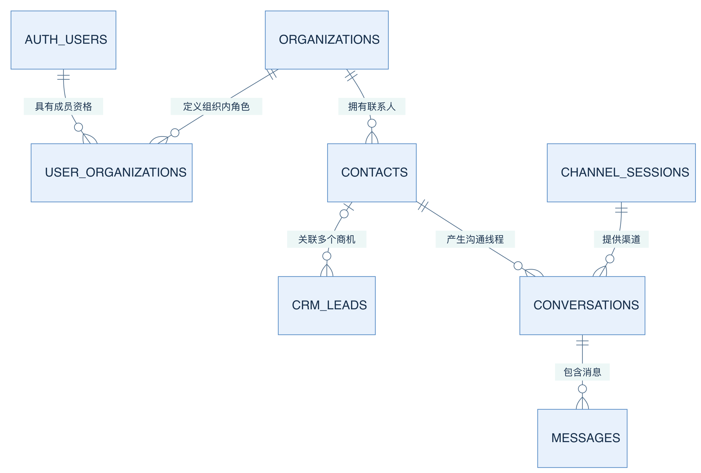
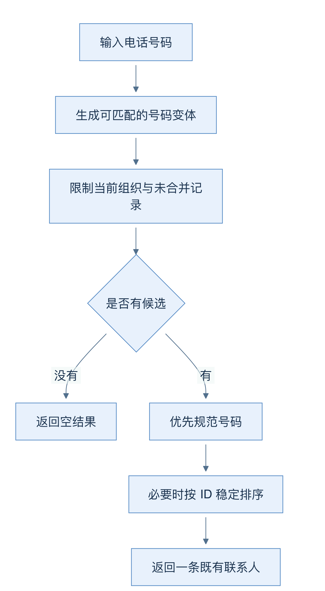
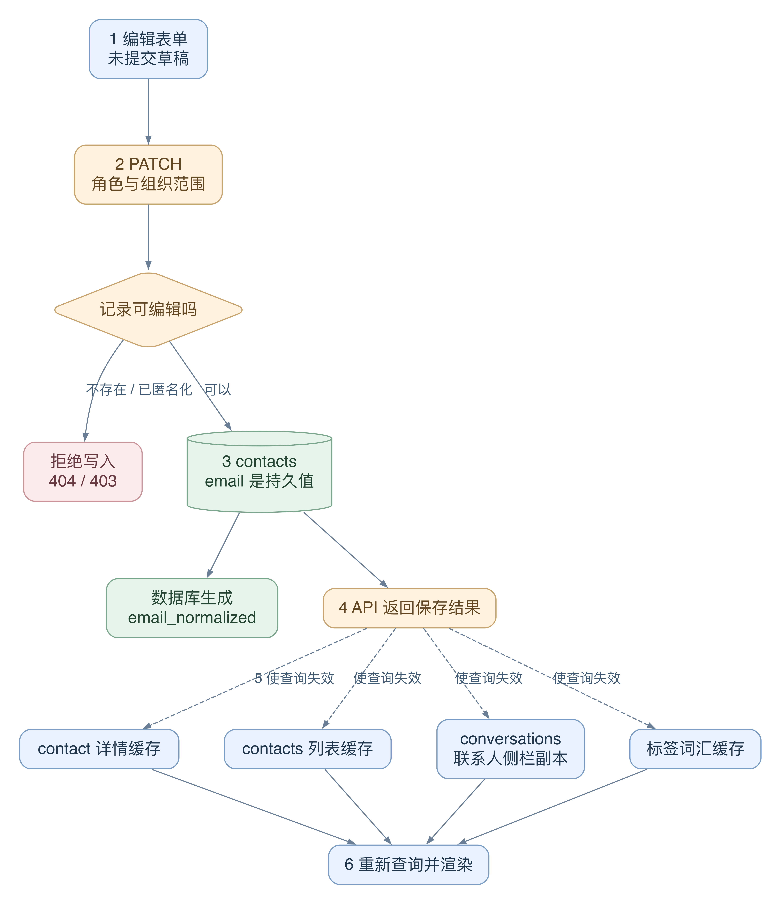
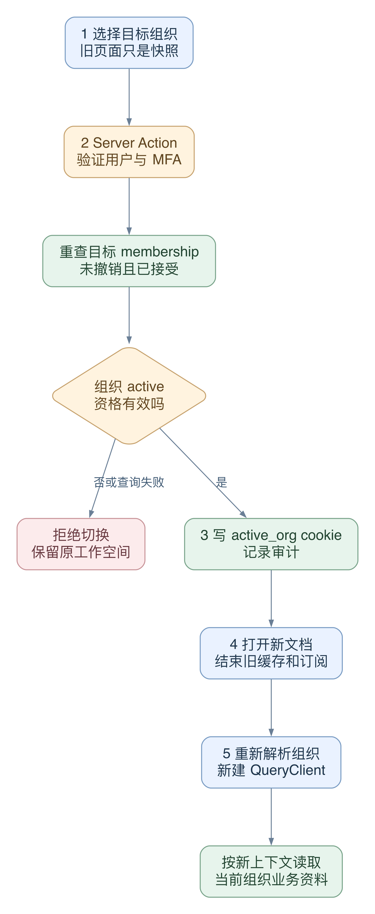

# 04 数据地图：组织、身份、联系人和商机

[返回母文档](../README.md) · [上一章](03.md) · [下一章](05.md)

**本章目标：**分清组织、用户、联系人与商机的关系和持久化位置。

## 业务流程与阅读起点

学习目标：看到一个 ID 时，能先问“它代表谁、属于哪个组织、与哪条业务记录有关”，再顺着外键读代码。本章是经过源码确认的数据骨架，不是完整数据库字典。

### 先分清两种“人”和一种“组织”

假设客服小陈为甲公司工作，并服务客户林女士。小陈登录系统，身份来自 Supabase Auth；他在甲公司的资格放在 user_organizations，记录 user_id、organization_id、role 和 revoked_at。林女士是 contacts 中的一行，不因为成为联系人就获得登录账户。organizations 表示使用这套 CRM 的租户组织，也保存语言、时区、设置等；不要把它直接理解为“客户任职公司”的企业客户档案。

一个用户可以加入多个组织，而且在不同组织拥有不同角色。active_org cookie 只是当前工作空间的选择提示：服务端只接受用户有效 membership 中的组织；找不到该 cookie 对应成员关系时，回退到按 accepted_at、organization_id 排序的第一项。平台支持会话另有受控分支。由此可见，改 cookie 不能凭空获得成员资格。

图 03-A：连线表示引用或归属，不表示调用顺序。中间的联系人把销售和沟通连起来；用户成员关系位于另一侧。一个联系人可以关联多个商机，也可以在不同渠道会话中出现。为保持可读，图中省略了每张业务表重复的 organization_id。

### 同一个客户，不等于同一笔生意

contacts 保存人的资料与联系状态。crm_leads 保存一次销售机会，包括所属漏斗 pipeline_id、当前阶段 stage_id、金额 value_cents、币种 currency、负责人等。这里把 lead 统一讲作“商机”；界面词汇可通过漏斗 vocabulary 改成订单或客户，所以不要只凭页面上的中文或葡语名称猜表名。

例如林女士先咨询一次服务，几个月后又提出新的需求，可以保留一个 contact_id，而建立两条 lead。联系资料发生变化，不需要把每个商机复制一遍。conversations 是沟通线程，连接 contact 与 channel_session；messages 才是具体的收发消息。消息里的 external_id 是渠道提供方编号，CRM 自身 id 是数据库编号，二者不能混用。外发消息在渠道接受之前允许 external_id 为空。

数据库对消息建立 organization_id 与 external_id 的联合唯一约束。它解决外部事件重复进入同一租户的问题，不能据此推断所有人工发送请求都天然幂等。联系人电话、标准化邮箱、证件 hash 的唯一索引也都包含组织，并排除已经合并到别人的记录。

### 身份归一是确定性规则

“看起来像同一个人”不足以自动合并。电话查询先得到可匹配的形式，再限制 organization_id 与 is_merged_into 为空。巴西手机号存在第九位数字变体；当前 helper 优先选择 canonicalPhoneBR 的规范形式，仍有多个候选时用 ID 排序做稳定选择。它不是模型打相似分后猜身份，也不是适用于所有国家的万能规则。

图 03-B：箭头表示查询与选择的先后。规范化解决同一号码的写法差异，组织过滤解决数据边界，两者不能互相替代。查到旧记录也不等于执行了合并操作。

### 给每一个 ID 先贴上“对象类型”

下面四个问题比“这个值是不是 UUID”更重要：它标识什么对象？谁生成它？它属于哪个组织？当前操作是否允许使用它？格式正确，只回答了语法问题。

- user_id 标识登录账户。`user_organizations` 把账户与租户连接，并为这段关系保存角色。角色属于“账户在组织中的资格”，不是账户全局的一个固定等级
- contact_id 标识租户内的联系人。电话、姓名和邮箱是联系资料或匹配字段；修改它们不应让已有会话和商机换成另一个身份
- lead_id 标识一次商机。lead 的 contact_id 可以为空，所以不能假设每张卡已经绑定联系人。pipeline_id 和 stage_id 说明商机所在的业务流程位置。源码：[`supabase/baseline.sql:1439-1468`](https://github.com/helsome/AiNativeCrm/blob/679e09e80878dff7b1c79b8537317b2b9e355331/supabase/baseline.sql#L1439-L1468)
- conversation_id 标识沟通线程，message.id 标识单条消息。conversation 保存 contact_id 和 channel_session_id；message 还保存 external_id，以关联渠道记录。不能拿消息的外部编号替换联系人 ID。源码：[`supabase/baseline.sql:1363-1393`](https://github.com/helsome/AiNativeCrm/blob/679e09e80878dff7b1c79b8537317b2b9e355331/supabase/baseline.sql#L1363-L1393)、[`supabase/baseline.sql:1634-1665`](https://github.com/helsome/AiNativeCrm/blob/679e09e80878dff7b1c79b8537317b2b9e355331/supabase/baseline.sql#L1634-L1665)
- run_id 标识一次执行。它不是 ai_agents 中的 agent_id，也不是客户 ID。某次执行可以读取客户资料，但运行结果仍是另一个对象

执行者也有类型。HandlerCtx 的 actor 可以是 user、ai_agent、api_token 或 webhook_source。服务器 token 的 id 是 token 行的 ID，不是 auth.users 的 ID；ai_agent 的 actor.id 用于执行关联，actor.agent_id 才专门指向 Agent 对象。把这些 ID 填进 `created_by_user_id` 之类的外键，不会让它变成人类操作。创建联系人时，代码只为 user 填 created_by_user_id。源码：[`lib/api/handlers/types.ts:17-72`](https://github.com/helsome/AiNativeCrm/blob/679e09e80878dff7b1c79b8537317b2b9e355331/lib/api/handlers/types.ts#L17-L72)、[`lib/mcp/auth.ts:64-76`](https://github.com/helsome/AiNativeCrm/blob/679e09e80878dff7b1c79b8537317b2b9e355331/lib/mcp/auth.ts#L64-L76)、[`app/api/v1/contacts/_handler.ts:382-395`](https://github.com/helsome/AiNativeCrm/blob/679e09e80878dff7b1c79b8537317b2b9e355331/app/api/v1/contacts/_handler.ts#L382-L395)。

这些区分还有业务意义。后续规则可能分别对人工、集成和 Agent 采取不同限制。审计里写错“谁做的”，不只是显示错一个名字，还可能让错误的执行者走过本不属于它的分支。

### 状态归谁所有：原始值、派生值、缓存与草稿

假设林女士的邮箱改了。系统里可能同时出现旧表单、新数据库行、旧查询缓存和旧会话侧栏。它们短时间不一致，不表示四处都可以争夺写入权。

图 03-C：实线表示写入或读取。虚线表示刷新通知。绿色是持久记录；蓝色是浏览器状态。这里画的是一次编辑的状态关系，不是表之间的外键图。

1. 编辑框先保存草稿。用户输入文字，还没有改变 contacts。取消编辑应理解为丢弃这份草稿，不是删除联系人
2. PATCH handler 在当前组织中读取旧行。不存在时返回 404；记录已匿名化时返回 403 lgpd_anonymization_irreversible。只有通过这个检查，代码才组装 patch。源码：[`app/api/v1/contacts/_handler.ts:484-525`](https://github.com/helsome/AiNativeCrm/blob/679e09e80878dff7b1c79b8537317b2b9e355331/app/api/v1/contacts/_handler.ts#L484-L525)
3. 应用写 email，Postgres 计算 email_normalized。`email_normalized` 是 GENERATED ALWAYS 列，表达式为 lower(trim(email))。应用若把它也放进 UPDATE，数据库会拒绝这次写入。派生字段的计算权必须留在数据库。源码：[`supabase/baseline.sql:1322-1329`](https://github.com/helsome/AiNativeCrm/blob/679e09e80878dff7b1c79b8537317b2b9e355331/supabase/baseline.sql#L1322-L1329)、[`app/api/v1/contacts/_handler.ts:528-540`](https://github.com/helsome/AiNativeCrm/blob/679e09e80878dff7b1c79b8537317b2b9e355331/app/api/v1/contacts/_handler.ts#L528-L540)
4. UPDATE 同时限定 organization_id 与 contactId，再读取保存后的行。保存结果才成为新的业务事实。联系人不存在或被范围排除，不能被一个本地 contactId“补回”。源码：[`app/api/v1/contacts/_handler.ts:589-607`](https://github.com/helsome/AiNativeCrm/blob/679e09e80878dff7b1c79b8537317b2b9e355331/app/api/v1/contacts/_handler.ts#L589-L607)
5. 浏览器 mutation 成功后，使 contact 详情、contacts 列表、conversations 列表和 contact-tag-vocabulary 失效。Inbox 侧栏从 conversation.contacts 读取联系人，所以只刷新联系人详情还不够。源码：[`hooks/contacts/useUpdateContact.ts:8-27`](https://github.com/helsome/AiNativeCrm/blob/679e09e80878dff7b1c79b8537317b2b9e355331/hooks/contacts/useUpdateContact.ts#L8-L27)
6. 相关查询重新取数，React 再显示新值。刷新缓存只是修复副本；不能靠刷新缓存修复一个被数据库拒绝的写入

#### JSON 字段也要有明确的更新语义

两个字段都叫 jsonb，不代表它们都该 merge。

- custom_fields 用整体替换。界面提交它所编辑的整份对象。若服务端总是 merge，用户在界面删除的键会从旧记录里复活
- consent 按用途 merge。更新一个用途，不应顺便清除其他用途的记录。服务端先读取旧 consent，再覆盖本次提供的用途

这是现行 patch 代码的明确差异，位于 [`app/api/v1/contacts/_handler.ts:546-566`](https://github.com/helsome/AiNativeCrm/blob/679e09e80878dff7b1c79b8537317b2b9e355331/app/api/v1/contacts/_handler.ts#L546-L566)。它说明“存储类型”不能替代“业务写入契约”。调用者必须知道自己提交的是完整快照还是局部变更。

失败分支：如果数据已写入，但只让 `["contact", id]` 失效，详情页会变新，Inbox 侧栏却可能保留旧值。用户看到“没保存”，实际故障在副本刷新。反过来，如果 UPDATE 返回错误，先改本地列表也不能把失败变成成功。这两个问题必须分开排查。

### 唯一性、匹配与合并，是三种动作

读联系人身份代码时，不要把这三件事混成“去重”。

1. 唯一索引负责拒绝冲突。当前电话、标准化邮箱和证件 hash 的索引都包含 organization_id，且只覆盖非空、未合并的记录。因此甲组织与乙组织可以分别保存同一个人的资料；系统没有把它们建成跨租户共享的“全球客户档案”。源码：[`supabase/baseline.sql:2862-2870`](https://github.com/helsome/AiNativeCrm/blob/679e09e80878dff7b1c79b8537317b2b9e355331/supabase/baseline.sql#L2862-L2870)
2. 匹配 helper 负责在当前组织找候选。电话变体查询排除 is_merged_into 非空的记录，再优先选 canonicalPhoneBR 的规范形式；剩余平局按 ID 稳定排序。这一步选择“本次归到谁”，不改写所有历史引用。源码：[`lib/channels/contato-por-telefone.ts:50-98`](https://github.com/helsome/AiNativeCrm/blob/679e09e80878dff7b1c79b8537317b2b9e355331/lib/channels/contato-por-telefone.ts#L50-L98)
3. 合并负责改变记录关系。已经合并的旧行保留 is_merged_into，列表不再把它当作活跃联系人。删除旧行与保留合并指向不是同一操作。列表的具体排除条件位于 [`app/api/v1/contacts/_handler.ts:99-120`](https://github.com/helsome/AiNativeCrm/blob/679e09e80878dff7b1c79b8537317b2b9e355331/app/api/v1/contacts/_handler.ts#L99-L120)

实际失败例：新建时撞到电话唯一索引，INSERT 返回 23505。handler 还要按当前组织重查号码，才把它转成 409 contact_exists。23505 只是“某个唯一约束失败”，并不能单凭错误码宣布“已找到同一个人”。源码：[`app/api/v1/contacts/_handler.ts:409-435`](https://github.com/helsome/AiNativeCrm/blob/679e09e80878dff7b1c79b8537317b2b9e355331/app/api/v1/contacts/_handler.ts#L409-L435)。

### 切换组织时，权限上下文和缓存必须一起换

active_org 不是身份本身。它是“我现在想在哪个组织工作”的选择。真正的成员资格仍在数据库。前端也不能把甲组织的缓存带到乙组织后，继续把它当作乙组织的列表。

图 03-D：上半段验证资格，下半段重建界面。拒绝分支保留原工作空间。箭头不表示浏览器可以自己授予成员资格。

1. 用户在 TenantSwitcher 点选组织。组件进入切换状态，然后调用 Server Action setActiveOrg
2. Server Action 检查 UUID、登录、支持会话和 MFA。随后重新查询这名用户在目标组织的 membership，要求未撤销、已接受，且组织为 active。它不相信浏览器序列化的旧资格。源码：[`app/actions/shell/setActiveOrg.ts:9-22`](https://github.com/helsome/AiNativeCrm/blob/679e09e80878dff7b1c79b8537317b2b9e355331/app/actions/shell/setActiveOrg.ts#L9-L22)
3. 验证通过后，服务端写 HttpOnly 的 active_org cookie，并记录切换审计。失败就不写 cookie。源码：[`app/actions/shell/setActiveOrg.ts:23-31`](https://github.com/helsome/AiNativeCrm/blob/679e09e80878dff7b1c79b8537317b2b9e355331/app/actions/shell/setActiveOrg.ts#L23-L31)
4. 浏览器用 `window.location.assign("/app/inbox")` 打开新文档。旧 QueryClient、订阅和在途响应随旧文档结束。失败时组件取消过渡并给出错误。源码：[`components/shell/TenantSwitcher.tsx:25-37`](https://github.com/helsome/AiNativeCrm/blob/679e09e80878dff7b1c79b8537317b2b9e355331/components/shell/TenantSwitcher.tsx#L25-L37)
5. 新页面重新解析用户与组织。AuthProvider 也用 user、org 和支持会话信息组成 Providers 的 key；上下文变化时重建 QueryClient，并重置 Realtime 认证缓存。源码：[`hooks/auth/AuthProvider.tsx:35-41`](https://github.com/helsome/AiNativeCrm/blob/679e09e80878dff7b1c79b8537317b2b9e355331/hooks/auth/AuthProvider.tsx#L35-L41)、[`hooks/auth/AuthProvider.tsx:88-90`](https://github.com/helsome/AiNativeCrm/blob/679e09e80878dff7b1c79b8537317b2b9e355331/hooks/auth/AuthProvider.tsx#L88-L90)、[`app/providers.tsx:8-16`](https://github.com/helsome/AiNativeCrm/blob/679e09e80878dff7b1c79b8537317b2b9e355331/app/providers.tsx#L8-L16)

因此，要解释联系人缓存键为什么只有 `["contacts", filters]`，不能只读那个 hook。还要读拥有 QueryClient 的上下文边界。当前切换方案用整页导航和带身份的 provider key 清掉旧副本；它以一次完整加载换取明确的上下文重置。以后若改成不重载的组织切换，就必须同时重审缓存键、订阅和在途请求，不能只把 location.assign 换成局部导航。

失败分支：点击前用户还是乙组织成员，点击时资格已撤销。setActiveOrg 的新查询应拒绝切换；旧下拉列表不能当作授权证据。若数据库查询失败，它也返回失败，不能根据旧列表照常写 cookie。本章说明的是源码分支，未声称已对真实账户完成运行验证。

### 再回看数据地图

读任意一个客户功能时，按这个顺序追：登录账户 → 当前组织 → 业务对象 ID → 数据库行 → 响应 → 界面副本。再另看执行者和审计。这样就能同时说清“资料属于谁”“谁操作了它”“为什么页面还没变新”，而不把三个问题塞进一个 ID。

### 新 Workbench 在这张地图的哪里

旧 CRM 数据没有被聊天界面替换。新增 ai_workbench_runs 记录一次任务的 agent、发起用户、inspect/act 模式、范围和执行状态；ai_agent_run_events 记录事件；ai_agent_action_proposals 记录提案。它们描述“助手做了什么”，contacts、crm_leads、messages 描述业务事实。数据库已提供 workbench_run_id、workbench_proposal_id 到 ai_reply_drafts 的关联，以及复用审核发送执行器的契约；但当前 Workbench start/resume 的发送 candidates 仍为空，未接通实际发送候选生产。它不是已经验证可走通的外发入口，断点见第 18 章。任务 completed、回复草稿 approved、消息 sent 是不同对象的状态，不能相互代证。

### 容易踩的坑

- 把组织 ID 从请求正文直接当作授权范围；应由已验证身份解析
- 把联系人当商机，一次新需求覆盖上次机会，导致历史含义丢失
- 把 display_name 当人工姓名的唯一来源；显示规则先尝试 name，再尝试渠道显示名，并过滤技术标识
- 只读 baseline 最早定义就断言最终规则；它是初始结构加追加迁移，同名函数以后面的定义为准

读代码练习：拿一个合成 contact_id，分别找它的商机、会话、消息。每一步都说清查询为什么仍要携带组织范围；不需要连接真实客户数据。

### 源码定位

固定 main：679e09e80878dff7b1c79b8537317b2b9e355331

- 租户与成员：[`supabase/baseline.sql:1723-1748`](https://github.com/helsome/AiNativeCrm/blob/679e09e80878dff7b1c79b8537317b2b9e355331/supabase/baseline.sql#L1723-L1748)、[`supabase/baseline.sql:1831-1843`](https://github.com/helsome/AiNativeCrm/blob/679e09e80878dff7b1c79b8537317b2b9e355331/supabase/baseline.sql#L1831-L1843)
- 联系人与商机核心列：[`supabase/baseline.sql:1322-1353`](https://github.com/helsome/AiNativeCrm/blob/679e09e80878dff7b1c79b8537317b2b9e355331/supabase/baseline.sql#L1322-L1353)、[`supabase/baseline.sql:1439-1469`](https://github.com/helsome/AiNativeCrm/blob/679e09e80878dff7b1c79b8537317b2b9e355331/supabase/baseline.sql#L1439-L1469)
- 会话、消息与外部编号：[`supabase/baseline.sql:1363-1393`](https://github.com/helsome/AiNativeCrm/blob/679e09e80878dff7b1c79b8537317b2b9e355331/supabase/baseline.sql#L1363-L1393)、[`supabase/baseline.sql:1634-1665`](https://github.com/helsome/AiNativeCrm/blob/679e09e80878dff7b1c79b8537317b2b9e355331/supabase/baseline.sql#L1634-L1665)、[`supabase/baseline.sql:2283-2292`](https://github.com/helsome/AiNativeCrm/blob/679e09e80878dff7b1c79b8537317b2b9e355331/supabase/baseline.sql#L2283-L2292)
- 联系人唯一索引：[`supabase/baseline.sql:2862-2870`](https://github.com/helsome/AiNativeCrm/blob/679e09e80878dff7b1c79b8537317b2b9e355331/supabase/baseline.sql#L2862-L2870)
- 活跃组织选择：[`lib/auth/server.ts:74-84`](https://github.com/helsome/AiNativeCrm/blob/679e09e80878dff7b1c79b8537317b2b9e355331/lib/auth/server.ts#L74-L84)、[`lib/auth/server.ts:172-195`](https://github.com/helsome/AiNativeCrm/blob/679e09e80878dff7b1c79b8537317b2b9e355331/lib/auth/server.ts#L172-L195)、[`lib/auth/server.ts:280-303`](https://github.com/helsome/AiNativeCrm/blob/679e09e80878dff7b1c79b8537317b2b9e355331/lib/auth/server.ts#L280-L303)
- 电话候选选择：[`lib/channels/contato-por-telefone.ts:50-98`](https://github.com/helsome/AiNativeCrm/blob/679e09e80878dff7b1c79b8537317b2b9e355331/lib/channels/contato-por-telefone.ts#L50-L98)
- 姓名显示优先级：[`lib/contacts/rotulo-do-contato.ts:92-98`](https://github.com/helsome/AiNativeCrm/blob/679e09e80878dff7b1c79b8537317b2b9e355331/lib/contacts/rotulo-do-contato.ts#L92-L98)
- Workbench 新对象：[`supabase/migrations/20260926010000_0381_builtin_agents_e_model_binding.sql:60-128`](https://github.com/helsome/AiNativeCrm/blob/679e09e80878dff7b1c79b8537317b2b9e355331/supabase/migrations/20260926010000_0381_builtin_agents_e_model_binding.sql#L60-L128)
- 回复草稿关联：[`supabase/migrations/20260926020000_0382_workbench_confirmed_reply.sql:1-29`](https://github.com/helsome/AiNativeCrm/blob/679e09e80878dff7b1c79b8537317b2b9e355331/supabase/migrations/20260926020000_0382_workbench_confirmed_reply.sql#L1-L29)
- 发送候选尚未接通：[`lib/ai/agents/workbench-start-job.ts:545-558`](https://github.com/helsome/AiNativeCrm/blob/679e09e80878dff7b1c79b8537317b2b9e355331/lib/ai/agents/workbench-start-job.ts#L545-L558)、[`lib/ai/agents/run-resumed-workbench-turn.ts:326-335`](https://github.com/helsome/AiNativeCrm/blob/679e09e80878dff7b1c79b8537317b2b9e355331/lib/ai/agents/run-resumed-workbench-turn.ts#L326-L335)

## 继续阅读

[返回母文档](../README.md) · [上一章](03.md) · [下一章](05.md)

