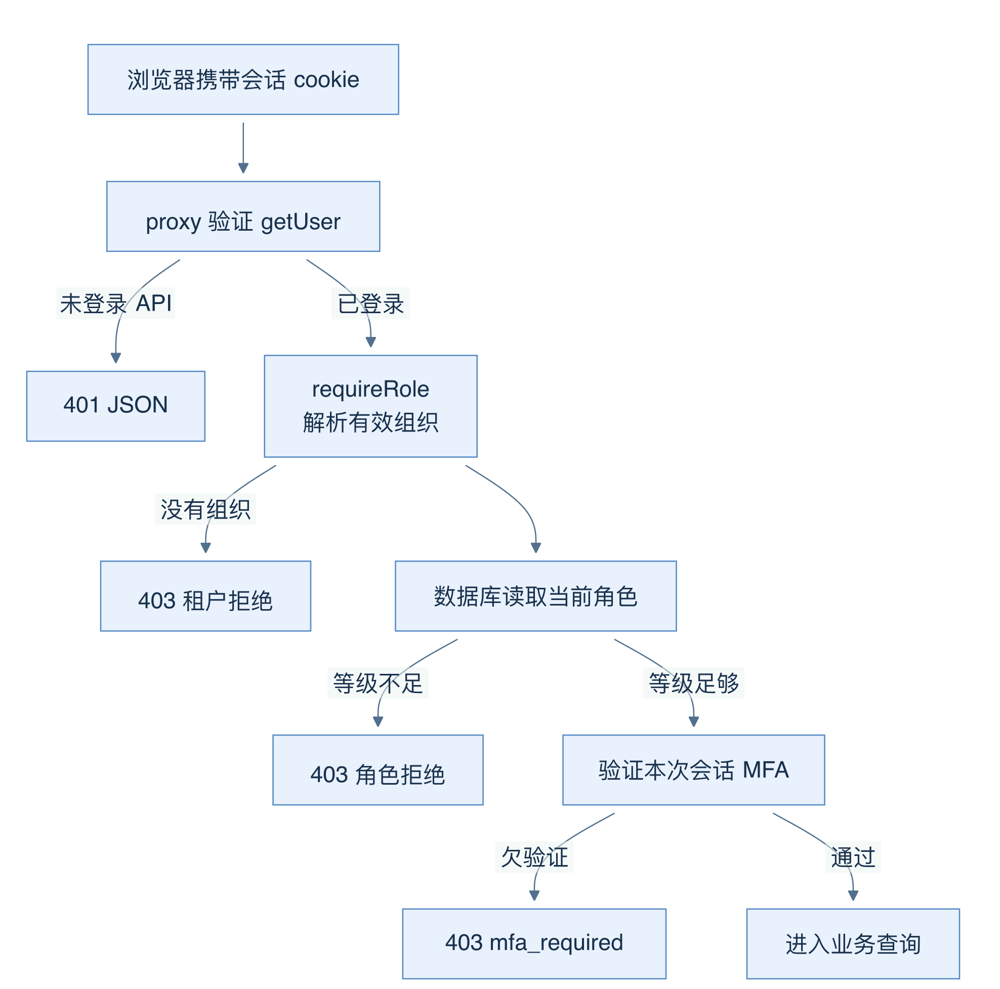
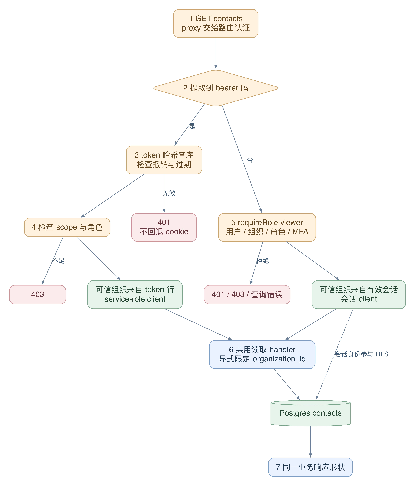
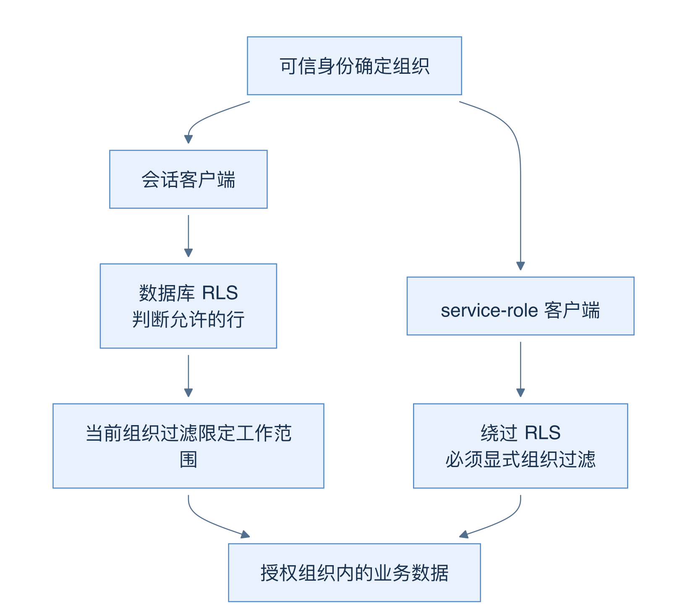

# 05 身份、角色与租户隔离：权限落在哪一层

[返回母文档](../README.md) · [上一章](04.md) · [下一章](06.md)

**本章目标：**理解 RBAC、RLS、service role 和服务端组织过滤的分工。

## 业务流程与阅读起点

学习目标：把登录验证、角色授权和数据隔离拆开理解，并能解释同一页面里的 401、403、404 为什么含义不同。以下讲当前实现；不要把仓库概述中的旧角色数字当成现行代码。

### 先看边界，再走真实请求

下面先以联系人列表 GET 走完 cookie 与 bearer 两条路线，再解释各层为什么不能相互替代。



图 04-A 是常见 cookie 路径的预览。侧向分支表示提前拒绝；各 REST handler 的实际检查仍须逐个读取。

### 人类角色与机器角色不要混在一起

四个人类角色依次为 viewer、agent、manager、admin，对应只读、日常操作、管理配置与组织管理。当前 TypeScript 的 ROLE_RANK 插入 ai_operator，排序为 viewer=1、agent=2、ai_operator=3、manager=4、admin=5。

ai_operator 只用于已发布 Agent 的临时 token。user_organizations 的 CHECK 仍只允许四个人类角色，不能把客服改成 ai_operator。平台管理员、MFA 与支持会话另见本章后半部分。

### 四类输入，只有一类可以直接进入业务查询范围

请求里可以同时带 cookie、Authorization、contactId、organization_id 和搜索条件。它们不是同等可信。

- HttpOnly 会话 cookie 和 bearer 是待验证的身份证明。存在不等于有效
- 路径中的 contactId 是待查对象。它说明“想操作哪条记录”，不说明“允许操作它”
- body、query 里的业务值是待校验内容。Zod 可以验证格式和范围，但 UUID 合法不等于租户合法
- 经过守卫得到的 HandlerCtx 才是业务层使用的授权上下文。organization_id、actor、requestId 在这里各有含义，不能用一个字段代替另一个

例如，用户知道乙组织的一条 contactId。甲组织的联系人详情 handler 仍同时过滤 contactId 和甲组织的 organization_id。查询不到时返回 404。这个 ID 不能让查询自动切到乙组织。源码：[`app/api/v1/contacts/_handler.ts:284-306`](https://github.com/helsome/AiNativeCrm/blob/679e09e80878dff7b1c79b8537317b2b9e355331/app/api/v1/contacts/_handler.ts#L284-L306)。

### 同一个 GET，为什么需要两条认证路线

浏览器依赖会话 cookie。服务器集成通常没有浏览器会话，所以联系人列表 GET 接受 bearer。两条路线最后复用业务读取函数，但取得组织和权限的方法不同。



图 04-C：橙色是尚未验证的输入；绿色是从数据库或有效会话解析的上下文。两条路线汇合的是业务查询，不是凭据。图只描述 GET `/api/v1/contacts`。

1. proxy 根据精确路径让请求进入 handler。`/api/v1/contacts` 在 public-paths 清单内；这是为了让没有 cookie 的 bearer 请求抵达自己的认证器。匹配针对路径，不会替 POST 授权，也不会自动覆盖 contacts/[id]。源码：[`lib/auth/public-paths.ts:61-70`](https://github.com/helsome/AiNativeCrm/blob/679e09e80878dff7b1c79b8537317b2b9e355331/lib/auth/public-paths.ts#L61-L70)、[`proxy.ts:32-34`](https://github.com/helsome/AiNativeCrm/blob/679e09e80878dff7b1c79b8537317b2b9e355331/proxy.ts#L32-L34)
2. GET 先检查能否提取 bearer。若能，就使用 token 路线；若不能，就使用 cookie 路线。已进入 bearer 路线后，token 验证失败会直接返回错误，不会悄悄用 cookie 继续。源码：[`app/api/v1/contacts/route.ts:57-101`](https://github.com/helsome/AiNativeCrm/blob/679e09e80878dff7b1c79b8537317b2b9e355331/app/api/v1/contacts/route.ts#L57-L101)
3. bearer 路线要求 dsk_ 格式，计算 SHA256，再查 api_tokens.token_hash。数据库行提供 organization_id 和 scopes；revoked_at 或 expires_at 使 token 失效。用户不能通过 query 让 token 换一个组织。普通无效 token 返回 401；查询 token 的基础设施故障映射成 500。源码：[`lib/mcp/auth.ts:121-162`](https://github.com/helsome/AiNativeCrm/blob/679e09e80878dff7b1c79b8537317b2b9e355331/lib/mcp/auth.ts#L121-L162)、[`lib/mcp/auth.ts:165-196`](https://github.com/helsome/AiNativeCrm/blob/679e09e80878dff7b1c79b8537317b2b9e355331/lib/mcp/auth.ts#L165-L196)
4. token 身份成立后，还要同时满足 mcp:read 与至少 viewer 的角色。scope 回答“这个 token 可调用哪类能力”；role 回答“这类操作要求的等级够不够”。有 role:admin 但没有需要的 scope，仍不会通过这里的 scope 检查。源码：[`app/api/v1/contacts/route.ts:79-98`](https://github.com/helsome/AiNativeCrm/blob/679e09e80878dff7b1c79b8537317b2b9e355331/app/api/v1/contacts/route.ts#L79-L98)、[`lib/mcp/auth.ts:199-212`](https://github.com/helsome/AiNativeCrm/blob/679e09e80878dff7b1c79b8537317b2b9e355331/lib/mcp/auth.ts#L199-L212)
5. cookie 路线调用 requireRole("viewer")。它验证用户、解析组织、重查数据库有效角色，并检查当前会话的 MFA。返回的 orgId 与 user.id 组成可信上下文。源码：[`app/api/v1/contacts/route.ts:101-109`](https://github.com/helsome/AiNativeCrm/blob/679e09e80878dff7b1c79b8537317b2b9e355331/app/api/v1/contacts/route.ts#L101-L109)、[`lib/auth/require-role.ts:52-155`](https://github.com/helsome/AiNativeCrm/blob/679e09e80878dff7b1c79b8537317b2b9e355331/lib/auth/require-role.ts#L52-L155)
6. bearer 路线给业务 handler 传 service-role client；cookie 路线传会话 client。两条路线都传已解析的 organization_id。随后 `listContactsHandler` 显式添加这个组织条件。不能因为它在会话路线下看起来重复，就删掉共用 handler 的过滤。源码：[`app/api/v1/contacts/route.ts:92-108`](https://github.com/helsome/AiNativeCrm/blob/679e09e80878dff7b1c79b8537317b2b9e355331/app/api/v1/contacts/route.ts#L92-L108)、[`app/api/v1/contacts/_handler.ts:99-123`](https://github.com/helsome/AiNativeCrm/blob/679e09e80878dff7b1c79b8537317b2b9e355331/app/api/v1/contacts/_handler.ts#L99-L123)
7. 两条路线返回相同的业务响应形状。统一的是业务契约，凭据和身份解析仍各自独立

失败练习：拿一个有效的甲组织 token，请求时附带“乙组织”的搜索参数。组织来源仍是 token 行。再拿一个被撤销的 token，即使角色原来是 admin，也应在 token 验证阶段停止。角色是有效身份之后的判断，不能反过来补救失效身份。

### 拒绝发生在哪一层

对照上面的 GET，按责任定位检查：

- proxy 处理请求标识和普通登录边界。未登录 API 得到 JSON 401，页面请求才跳转登录；它不决定每个业务动作的最低角色。源码：[`proxy.ts:61-88`](https://github.com/helsome/AiNativeCrm/blob/679e09e80878dff7b1c79b8537317b2b9e355331/proxy.ts#L61-L88)
- requireRole 防止旧页面继续使用旧资格。它调用数据库 fn_user_role_in_org；effectiveRole 为空时 rank 为 0，查询出错则返回 500。源码：[`lib/auth/require-role.ts:92-101`](https://github.com/helsome/AiNativeCrm/blob/679e09e80878dff7b1c79b8537317b2b9e355331/lib/auth/require-role.ts#L92-L101)
- RLS 在执行语句时限制可触及的行。它可以检查组织或负责人范围，但不保证复刻 API 的每一项角色规则
- usePermission 只决定页面是否展示入口。旧按钮不能证明当前权限，隐藏按钮也不是服务端保护。源码：[`hooks/auth/AuthProvider.tsx:163-169`](https://github.com/helsome/AiNativeCrm/blob/679e09e80878dff7b1c79b8537317b2b9e355331/hooks/auth/AuthProvider.tsx#L163-L169)

看一个具体差异：contacts 主策略的 USING 和 WITH CHECK 检查组织成员或平台身份，没有 agent 等级判断。POST/PATCH 的 agent 门槛在路由守卫中。另有字段和支持会话限制，需要分别核对。源码：[`supabase/baseline.sql:4252-4256`](https://github.com/helsome/AiNativeCrm/blob/679e09e80878dff7b1c79b8537317b2b9e355331/supabase/baseline.sql#L4252-L4256)、[`app/api/v1/contacts/route.ts:157-165`](https://github.com/helsome/AiNativeCrm/blob/679e09e80878dff7b1c79b8537317b2b9e355331/app/api/v1/contacts/route.ts#L157-L165)、[`app/api/v1/contacts/[id]/route.ts:70-85`](https://github.com/helsome/AiNativeCrm/blob/679e09e80878dff7b1c79b8537317b2b9e355331/app/api/v1/contacts/[id]/route.ts#L70-L85)、[`supabase/baseline.sql:25303-25337`](https://github.com/helsome/AiNativeCrm/blob/679e09e80878dff7b1c79b8537317b2b9e355331/supabase/baseline.sql#L25303-L25337)。

这是静态源码边界，不是完整安全测试。要证明 viewer 对每张表的写权限，仍须按真实数据库角色执行测试。

### RLS：行范围、写入检查与当前组织

- USING 限定操作可触及的已有记录
- WITH CHECK 检查 INSERT 或 UPDATE 后的记录是否仍在允许范围内

contacts 同时声明两者，见 [`supabase/baseline.sql:4255`](https://github.com/helsome/AiNativeCrm/blob/679e09e80878dff7b1c79b8537317b2b9e355331/supabase/baseline.sql#L4255)。但 fn_user_org_ids 返回可访问的组织集合，不是 active_org 单个值。小陈合法属于甲、乙两组织时，当前页面仍要显式选甲。

当前函数最后一次定义还加入有效支持会话的组织；角色函数根据支持模式返回 admin 或 viewer。只读 baseline 开头会漏掉这个追加规则。源码：[`supabase/baseline.sql:18405-18416`](https://github.com/helsome/AiNativeCrm/blob/679e09e80878dff7b1c79b8537317b2b9e355331/supabase/baseline.sql#L18405-L18416)。

会话还有负责人范围：visibility_mode 只进一步限制 agent，支持 all、own_and_unassigned、own；viewer、manager、admin 在租户内可读范围更宽。因此角色排序不代表每一维权限都严格递增，隐藏“全部”标签页也不能替代会话策略。具体策略见本章末尾的源码定位。

### service role 把哪些责任交回应用



图 04-B：会话 client 让用户身份参与 RLS；service-role client 绕过 RLS，必须由应用维持可信组织过滤。它仍须遵守适用的结构、约束和权限，不能保证所有数据库动作成功。

用联系人头像读取检查这条边界：

1. 路由先 loadAuthUser，再 resolveActiveOrg；没有组织就拒绝
2. admin client 查询同时限定路径 id 与 activeOrg.orgId，不采用请求自报的 organization_id
3. 记录存在、未匿名化且有 avatar_storage_path，才为该对象签发媒体 URL
4. 返回跳转使用 private 缓存，期限短于签名 URL 的期限，避免跨用户共享或复用过期签名

源码：[`app/api/v1/contacts/[id]/avatar/route.ts:34-45`](https://github.com/helsome/AiNativeCrm/blob/679e09e80878dff7b1c79b8537317b2b9e355331/app/api/v1/contacts/[id]/avatar/route.ts#L34-L45)、[`app/api/v1/contacts/[id]/avatar/route.ts:47-92`](https://github.com/helsome/AiNativeCrm/blob/679e09e80878dff7b1c79b8537317b2b9e355331/app/api/v1/contacts/[id]/avatar/route.ts#L47-L92)。记录不存在、不应显示头像或签名失败时返回 404，不暴露另一组织的对象路径。

相同责任也出现在共用消息 handler：它同时过滤 conversation_id 与 organization_id，服务浏览器和 MCP/token 调用，源码见本章末尾。Worker 则从持久 job 获取组织，并重新检查运行状态和租约，不依赖浏览器 cookie。源码：[`lib/ai/agents/workbench-start-job.ts:46-88`](https://github.com/helsome/AiNativeCrm/blob/679e09e80878dff7b1c79b8537317b2b9e355331/lib/ai/agents/workbench-start-job.ts#L46-L88)。

这些是具体调用点的证据，不能据此宣布所有 admin client 都已正确过滤。

### MFA、平台身份与支持会话各管一件事

MFA 要分开问“必须登记因素吗”和“本次会话证明过因素吗”。组织/平台政策决定前者；mfaEmDivida 判断后者。已登记有效 TOTP 的用户，只要当前会话不是 aal2，就欠验证，即使强制登记政策已关闭。源码见 [`lib/auth/server.ts:388-415`](https://github.com/helsome/AiNativeCrm/blob/679e09e80878dff7b1c79b8537317b2b9e355331/lib/auth/server.ts#L388-L415)。

MFA 不提升角色。requireRole 先确认 rank 足够，再检查 MFA，避免向原本没有权限的人泄露额外状态。源码：[`lib/auth/require-role.ts:101-134`](https://github.com/helsome/AiNativeCrm/blob/679e09e80878dff7b1c79b8537317b2b9e355331/lib/auth/require-role.ts#L101-L134)。

平台管理员是横向身份，不自动等于每个租户的 admin。requireRole 默认关闭 allowPlatformAdmin。支持会话另有有效期与读写模式：resolveActiveOrg 使用支持上下文，失效会话退出，只读模式映射为 viewer。源码：[`lib/auth/server.ts:284-302`](https://github.com/helsome/AiNativeCrm/blob/679e09e80878dff7b1c79b8537317b2b9e355331/lib/auth/server.ts#L284-L302)、[`lib/auth/require-role.ts:52-89`](https://github.com/helsome/AiNativeCrm/blob/679e09e80878dff7b1c79b8537317b2b9e355331/lib/auth/require-role.ts#L52-L89)。

仍要核对具体入口。联系人详情 GET 当前手动调用 getUser、loadAuthUser 和 resolveActiveOrg，没有采用列表 GET 的 requireRole 路线。不要推断所有入口都按同一流程执行。源码：[`app/api/v1/contacts/[id]/route.ts:25-60`](https://github.com/helsome/AiNativeCrm/blob/679e09e80878dff7b1c79b8537317b2b9e355331/app/api/v1/contacts/[id]/route.ts#L25-L60)。

### 用一条拒绝路径检验理解

假设小陈在旧页面看见“编辑”，但刚被撤销甲组织资格。

1. 旧 React 状态只解释按钮为什么还在，不再证明权限
2. 新请求需要重新验证会话，并解析当前组织资格。若还有其他有效组织，active_org 选择规则可能回退；不能预设一定返回同一种 403
3. 对 contacts 的写请求，requireRole 读取实际组织的有效角色。没有足够资格就拒绝
4. 即使本次解析到另一个有权限的组织，contactId 仍与该组织一起过滤，不能凭旧 ID 修改甲组织记录
5. 返回错误后，前端应显示失败。排查时同时保留响应代码、请求标识和操作对象类型，别把“资格失效”“切到其他工作空间”“记录不存在”写成同一个原因

这条路径的重点是：每次向前跨越边界，都要重新明确什么仍可信。身份、角色、组织、对象、执行租约和缓存新鲜度回答不同问题。

### 失败时怎样定位

- 401：先查登录或 token 身份，别先猜记录不存在
- 403 forbidden_role：身份成立，但操作级别不足；mfa_required 则应检查当前会话验证
- 404：可能真的没有这条记录，也可能被组织/行级范围隐藏，不能用它确认另一组织的数据存在
- 服务端查询出错：不能伪装成“用户没有成员资格”；loadAuthUser 对成员查询基础设施错误会抛出明确错误

本仓库仍有 UI 与 API 不完全一致的入口，例如跟进导航只向 manager 展示，但其列表 GET 允许 viewer。第 09 章会定位该差异。看到按钮消失，应同时检查导航、页面、API、RLS 四层。

### 源码定位

固定 main：679e09e80878dff7b1c79b8537317b2b9e355331

- 边缘验证与 API 401：[`proxy.ts:13-89`](https://github.com/helsome/AiNativeCrm/blob/679e09e80878dff7b1c79b8537317b2b9e355331/proxy.ts#L13-L89)
- 当前角色及人类角色集合：[`lib/auth/types.ts:4-48`](https://github.com/helsome/AiNativeCrm/blob/679e09e80878dff7b1c79b8537317b2b9e355331/lib/auth/types.ts#L4-L48)
- 业务守卫和有效角色：[`lib/auth/require-role.ts:52-155`](https://github.com/helsome/AiNativeCrm/blob/679e09e80878dff7b1c79b8537317b2b9e355331/lib/auth/require-role.ts#L52-L155)
- 成员读取错误：[`lib/auth/server.ts:122-195`](https://github.com/helsome/AiNativeCrm/blob/679e09e80878dff7b1c79b8537317b2b9e355331/lib/auth/server.ts#L122-L195)、[`lib/auth/server.ts:216-227`](https://github.com/helsome/AiNativeCrm/blob/679e09e80878dff7b1c79b8537317b2b9e355331/lib/auth/server.ts#L216-L227)
- MFA 当前会话：[`lib/auth/server.ts:388-415`](https://github.com/helsome/AiNativeCrm/blob/679e09e80878dff7b1c79b8537317b2b9e355331/lib/auth/server.ts#L388-L415)
- 追加后的成员函数：[`supabase/baseline.sql:18405-18416`](https://github.com/helsome/AiNativeCrm/blob/679e09e80878dff7b1c79b8537317b2b9e355331/supabase/baseline.sql#L18405-L18416)
- 会话可见性策略：[`supabase/baseline.sql:5326-5368`](https://github.com/helsome/AiNativeCrm/blob/679e09e80878dff7b1c79b8537317b2b9e355331/supabase/baseline.sql#L5326-L5368)
- service-role 客户端：[`lib/supabase/admin.ts:1-6`](https://github.com/helsome/AiNativeCrm/blob/679e09e80878dff7b1c79b8537317b2b9e355331/lib/supabase/admin.ts#L1-L6)、[`lib/supabase/admin.ts:24-40`](https://github.com/helsome/AiNativeCrm/blob/679e09e80878dff7b1c79b8537317b2b9e355331/lib/supabase/admin.ts#L24-L40)
- 双认证消息路由与显式组织过滤：[`app/api/v1/messages/route.ts:23-36`](https://github.com/helsome/AiNativeCrm/blob/679e09e80878dff7b1c79b8537317b2b9e355331/app/api/v1/messages/route.ts#L23-L36)、[`app/api/v1/messages/_handler.ts:378-423`](https://github.com/helsome/AiNativeCrm/blob/679e09e80878dff7b1c79b8537317b2b9e355331/app/api/v1/messages/_handler.ts#L378-L423)

## 实现详解

本页解释 AI Native CRM 如何通过数据库策略和服务端校验限制跨组织访问。隔离不是靠某一行代码，而是靠三层彼此独立的防线叠加：数据库层的行级安全（RLS）负责最终裁决，服务端层的 `requireRole` / `resolveAuthDual` 负责在请求到达数据库之前就把越权挡在门外，而一整套不变量测试负责持续证明这三层没有出现缝隙。

阅读本页需要的前置知识：Postgres 的 Row Level Security 与 `SECURITY DEFINER` 语义、Supabase 的 JWT 与 `auth.uid()`。若对分层结构还不熟悉，先看[分层视图：应用、数据库、鉴权、实时、事件队列与边缘中间件](03.md)；想了解 API 层如何消费这些租户上下文，继续看[REST API 契约：版本化路径、双重鉴权、幂等键与错误码](06.md)。

### 第一性原理：为什么隔离必须落在数据库

这个项目的 schema 定义文件（`supabase/baseline.sql`，37942 行）里几乎每一张业务表都带一个 `organization_id` 列，并且开启 RLS。这不是一种风格偏好，而是一个不可协商的架构约束：**浏览器端的 Supabase 客户端直接持有用户 JWT，它对 PostgREST 发出的每一条查询都可以被用户手工篡改**。只要有一条策略漏掉，应用层再严格的 `where organization_id = X` 也会被一条裸查询击穿。

因此本项目确立的第一条公理是：**`organization_id` 的可信来源只能有三个，绝不会是第四个**——数据库内的 helper 函数、服务端从可信上下文（cookie 校验后的 JWT、token 行、webhook secret）解析出的值、以及系统自己写入的行。

```text
┌──────────────────────────────────────────────────────────────┐
│  用户浏览器 / 第三方 HTTP 客户端                                │
│  ⚠️ 两者都可以任意伪造 SQL 形状与 organization_id 参数          │
└───────────────┬──────────────────────────────┬───────────────┘
                │ cookie session JWT            │ Authorization: Bearer dsk_…
                ▼                              ▼
┌───────────────────────────┐   ┌────────────────────────────────┐
│ 防线 2：requireRole()     │   │ 防线 2b：validateBearerToken() │
│ • resolveActiveOrg (cookie│   │ • organization_id 来自 TOKEN 行 │
│   必须命中 membership)     │   │ • ensureScope / ensureRole     │
│ • rpc fn_user_role_in_org │   └──────────────┬─────────────────┘
└─────────────┬─────────────┘                  │
              │ createClient() (用户 JWT)      │ createAdminClient() (绕过 RLS)
              │                                 │ ⚠️ 手工过滤 organization_id
              ▼                                 ▼
┌────────────────────────────────────────────────────────────────┐
│  防线 1：Postgres RLS                                         │
│  fn_user_org_ids() → SETOF uuid  ← 所有 tenant_isolation_*    │
│  fn_is_platform_admin() / fn_role_at_least() / fn_user_role_in_org() │
│  写操作额外叠加：support_write_*  RESTRICTIVE policy            │
└────────────────────────────────────────────────────────────────┘
              ▲
              │ 防线 3：tests/invariants/* 持续断言无表漏网
```

Sources: [admin.ts](https://github.com/helsome/AiNativeCrm/blob/679e09e80878dff7b1c79b8537317b2b9e355331/lib/supabase/admin.ts#L1), [require-role.ts](https://github.com/helsome/AiNativeCrm/blob/679e09e80878dff7b1c79b8537317b2b9e355331/lib/auth/require-role.ts#L1), [auth-dual.ts](https://github.com/helsome/AiNativeCrm/blob/679e09e80878dff7b1c79b8537317b2b9e355331/lib/api/auth-dual.ts#L1)

### 核心机制：四个 RLS 辅助函数

隔离的全部表达力来自四个 `SECURITY DEFINER` 函数。它们被 `CREATE OR REPLACE FUNCTION` 定义在 `supabase/baseline.sql` 中，全部带 `SET "search_path" TO 'public'`（防止搜索路径劫持），全部是 `STABLE`（在单条语句内可被规划器折叠，避免策略被重复求值）。

**`fn_user_org_ids()` → `SETOF uuid`** 是整个体系的基石：它返回当前用户所有未被撤销的 membership 所属的组织 id 集合。所有 `tenant_isolation_<tabela>_all` 策略都写成 `organization_id IN (SELECT public.fn_user_org_ids())`。注意 `revoked_at is null` 这一条件——撤销不是删行，而是软撤销，函数直接把它翻译成「不在这张表里」。Sources: [baseline.sql](https://github.com/helsome/AiNativeCrm/blob/679e09e80878dff7b1c79b8537317b2b9e355331/supabase/baseline.sql#L786)

**`fn_is_platform_admin()` → `boolean`** 检查 `platform_admins` 表中是否存在 `user_id = auth.uid() AND revoked_at is null` 的行。它是跨租户的横向特权，在几乎所有策略里以 `OR fn_is_platform_admin()` 的形式出现——注意它在 `fn_user_org_ids()` 之后，因为后者是主判据，前者是例外。Sources: [baseline.sql](https://github.com/helsome/AiNativeCrm/blob/679e09e80878dff7b1c79b8537317b2b9e355331/supabase/baseline.sql#L310)

**`fn_user_role_in_org(p_org uuid)` → `text`** 返回用户在指定组织内的角色字符串。关键在于它同时被 RLS 策略和**服务端授权代码**共用：`requireRole()` 通过 `supabase.rpc("fn_user_role_in_org", ...)` 拿回有效角色，而不是信任 cookie 或内存里的 membership 快照。代码注释明确称之为「fonte única de verdade」，并且在 membership 被撤销时**失败关闭**（返回 `null` → rank 0 → 403）。Sources: [baseline.sql](https://github.com/helsome/AiNativeCrm/blob/679e09e80878dff7b1c79b8537317b2b9e355331/supabase/baseline.sql#L815), [require-role.ts](https://github.com/helsome/AiNativeCrm/blob/679e09e80878dff7b1c79b8537317b2b9e355331/lib/auth/require-role.ts#L92)

**`fn_role_at_least(p_org uuid, p_min text)` → `boolean`** 把角色排序编码在一张内联 CTE 里：`viewer=1, agent=2, manager=3, admin=4`，然后比较数值。`coalesce(..., false)` 保证「查不到角色」等于「不满足」，而不是 NULL 穿透让策略被跳过。这是写入类策略的主力：例如 `api_tokens_admin_only` 要求 `fn_role_at_least(organization_id,'admin') OR fn_is_platform_admin()`。Sources: [baseline.sql](https://github.com/helsome/AiNativeCrm/blob/679e09e80878dff7b1c79b8537317b2b9e355331/supabase/baseline.sql#L662), [baseline.sql](https://github.com/helsome/AiNativeCrm/blob/679e09e80878dff7b1c79b8537317b2b9e355331/supabase/baseline.sql#L4013)

辅助函数的调用范式有两种，语义等价但可读性差异明显。baseline 里被 `pg_dump` 美化过的写法是冗长的别名形式：

```sql
CREATE POLICY "tenant_isolation_contacts_all" ON "public"."contacts"
  USING ((("organization_id" IN ( SELECT "public"."fn_user_org_ids"() AS "fn_user_org_ids"))
          OR "public"."fn_is_platform_admin"())))
  WITH CHECK ((("organization_id" IN ( SELECT "public"."fn_user_org_ids"() AS "fn_user_org_ids"))
          OR "public"."fn_is_platform_admin"()));
```

而手写迁移里的写法是可读的：

```sql
using (organization_id in (select * from public.fn_user_org_ids()))
with check (organization_id in (select * from public.fn_user_org_ids()));
```

Sources: [baseline.sql](https://github.com/helsome/AiNativeCrm/blob/679e09e80878dff7b1c79b8537317b2b9e355331/supabase/baseline.sql#L4255), [20260429110000_0018_lgpd_redaction_queue.sql](https://github.com/helsome/AiNativeCrm/blob/679e09e80878dff7b1c79b8537317b2b9e355331/supabase/migrations/20260429110000_0018_lgpd_redaction_queue.sql#L32)

理解这两种写法等价，是读懂本项目 SQL 的前提——迁移目录是**可读的手写源**，baseline 是**可重放的机器快照**，两者描述同一个数据库状态。

### 策略形态分类：三种 policy 语义

理解租户隔离需要区分 PostgreSQL policy 中三种不同的判据，它们承担的责任完全不同。

| Policy 形态 | 子句 | 语义 | 仓库中的实例 |
| --- | --- | --- | --- |
| **Permissive（宽松）** | 仅 `USING` | 多个 policy 之间 OR 关系，宽者可放宽严者 | `tenant_isolation_contacts_all`：`org IN fn_user_org_ids() OR fn_is_platform_admin()` |
| **Permissive + CHECK** | `USING` + `WITH CHECK` | `USING` 管读与删，`WITH CHECK` 独立管写 | `idempotency_tenant`：读写都用同一条件 |
| **Restrictive（限制）** | `as restrictive` | 多个 restrictive 之间 AND，且与 permissive 组整体 AND | `support_write_insert` / `support_write_update` / `support_write_delete` |

Sources: [baseline.sql](https://github.com/helsome/AiNativeCrm/blob/679e09e80878dff7b1c79b8537317b2b9e355331/supabase/baseline.sql#L4255), [baseline.sql](https://github.com/helsome/AiNativeCrm/blob/679e09e80878dff7b1c79b8537317b2b9e355331/supabase/baseline.sql#L4078), [20260905210000_0220_suporte_temporario_por_sessao.sql](https://github.com/helsome/AiNativeCrm/blob/679e09e80878dff7b1c79b8537317b2b9e355331/supabase/migrations/20260905210000_0220_suporte_temporario_por_sessao.sql#L119)

**`WITH CHECK` 是写入隔离的关键**。只有 `USING` 的策略在 Postgres 里允许「能看见的行」被更新——但如果 `WITH CHECK` 缺失或宽松，攻击者可以把 A 公司的行 `UPDATE` 成属于 B 公司的 `organization_id`，实现跨租户**搬迁**（写入型越权）。本项目在所有写策略上都成对声明 `USING` + `WITH CHECK`，同一条件写两遍。Sources: [20260505140000_0023_ai_agents_module.sql](https://github.com/helsome/AiNativeCrm/blob/679e09e80878dff7b1c79b8537317b2b9e355331/supabase/migrations/20260505140000_0023_ai_agents_module.sql#L208)

### 特例与升级路径：策略按角色收紧

并非所有表都用同一个宽松模板。表级 RLS 只是租户隔离的**地板**，其上还有逐表的角色收紧——这正是「一个租户内的越权防线」的实现方式。

**角色矩阵型策略** 把租户边界与权限边界合成一个表达式。`merge_queue` 合并联系人属于高危操作，要求 manager 及以上：

```sql
CREATE POLICY "merge_queue_manager_select" ON "public"."merge_queue" FOR SELECT
  USING ((fn_is_platform_admin()
    OR ((organization_id IN (SELECT fn_user_org_ids()))
        AND fn_role_at_least(organization_id, 'manager'))));
```

注意结构：先 `organization_id IN fn_user_org_ids()`（**我是不是这家公司的**），再 `AND fn_role_at_least(..., 'manager')`（**我在这家公司里权限够不够**）。两个问题独立判定，缺一不可。Sources: [baseline.sql](https://github.com/helsome/AiNativeCrm/blob/679e09e80878dff7b1c79b8537317b2b9e355331/supabase/baseline.sql#L4111)

**平台表走另一条路**。`organizations` 表的主键列叫 `id` 而非 `organization_id`，所以策略形态不同：`orgs_select` 允许成员读自己公司，`orgs_write_platform_admin` 则**只允许平台管理员写**——普通 admin 改不了公司名、状态、币种。Sources: [baseline.sql](https://github.com/helsome/AiNativeCrm/blob/679e09e80878dff7b1c79b8537317b2b9e355331/supabase/baseline.sql#L4163)

### 数据库内函数边界：SECURITY DEFINER 的双刃

`SECURITY DEFINER` 让函数以定义者（`postgres`）权限运行，从而能读取调用者读不到的表——但它同时**绕过了调用者身份下的 RLS**（Postgres 中 SECURITY DEFINER 函数以表所有者身份执行，owner 通常是 superuser 或表 owner，RLS 对 owner 不生效）。这意味着一个写错的 SECURITY DEFINER 函数就是一次完整的越权。

本项目的处理方式是：**每个 SECURITY DEFINER 写函数都在函数体内手工重新校验授权**，而不是依赖外层 RLS。例如 `fn_conversation_assign(p_organization_id, ...)` 在做任何事之前显式检查：

```sql
if not public.fn_support_write_allowed(p_organization_id) then
  raise exception 'support_readonly' using errcode='42501';
end if;
if auth.uid() is not null
   and not public.fn_role_at_least(p_organization_id, 'agent') then
  raise exception 'caller_not_authorized_for_org'
    using hint = 'caller must be an active agent+ member of the organization';
end if;
```

同样的模式出现在 `emit_event`：它先解析 `v_org_id`（显式参数 > 支持上下文 > membership），为 `null` 时**拒绝而非猜测**，然后才校验 `fn_role_at_least(v_org_id, 'viewer')`。Sources: [20260905210000_0220_suporte_temporario_por_sessao.sql](https://github.com/helsome/AiNativeCrm/blob/679e09e80878dff7b1c79b8537317b2b9e355331/supabase/migrations/20260905210000_0220_suporte_temporario_por_sessao.sql#L180), [20260905210000_0220_suporte_temporario_por_sessao.sql](https://github.com/helsome/AiNativeCrm/blob/679e09e80878dff7b1c79b8537317b2b9e355331/supabase/migrations/20260905210000_0220_suporte_temporario_por_sessao.sql#L137)

### 支撑临时会话：RLS 唯一被有意放宽的地方

系统存在一个真实的业务需求：平台客服需要临时查看某家客户公司的数据。这构成隔离体系的**唯一有意例外**，而它的实现本身就是一堂隔离工程课——通过收窄而非放宽来实现。

设计上，`platform_support_sessions` 不创建 membership、不切换身份，只记录「哪个平台管理员、在哪个 auth session 上、以什么模式、访问哪家公司、到什么时候」。表本身 `revoke all` 给 `public, anon, authenticated`，只 `grant` 给 `service_role`——**客户端永远读不到它**，因此无法伪造。Sources: [20260905210000_0220_suporte_temporario_por_sessao.sql](https://github.com/helsome/AiNativeCrm/blob/679e09e80878dff7b1c79b8537317b2b9e355331/supabase/migrations/20260905210000_0220_suporte_temporario_por_sessao.sql#L3)

`fn_support_context()` 返回一个 JSONB 上下文，其 `status` 字段是**多层条件的复合判定**：会话过期 → `expired`；auth session 不存在/已过期、目标组织非 active → `revoked`；平台管理员配了 MFA（或有已验证 TOTP 因子）但当前 JWT 的 `aal` 不是 `aal2` → `revoked`。最后一条是关键——**客服支持本身也受 MFA 策略约束**，防止持有管理权但未完成二次验证的账号发起支持会话。Sources: [20260905210000_0220_suporte_temporario_por_sessao.sql](https://github.com/helsome/AiNativeCrm/blob/679e09e80878dff7b1c79b8537317b2b9e355331/supabase/migrations/20260905210000_0220_suporte_temporario_por_sessao.sql#L23)

隔离的实际放宽只有一处，两行 SQL：

```sql
create or replace function public.fn_user_org_ids()
returns setof uuid ... as $f$
  select organization_id from public.user_organizations
    where user_id=auth.uid() and revoked_at is null
  union select (s->>'organization_id')::uuid
    from (select public.fn_support_context() s) c where s->>'status'='active';
$f$;
```

`fn_user_role_in_org` 同步被重定义：支撑会话生效时，`full` 模式映射为 `admin`，`support_readonly` 映射为 `viewer`；否则回落到真实 membership。这解释了为什么只读客服能看数据却改不了——不是靠应用层拦，而是角色解析本身只给 `viewer`。Sources: [20260905210000_0220_suporte_temporario_por_sessao.sql](https://github.com/helsome/AiNativeCrm/blob/679e09e80878dff7b1c79b8537317b2b9e355331/supabase/migrations/20260905210000_0220_suporte_temporario_por_sessao.sql#L57)

而**写入侧的拦截用的是 restrictive policy**，因为 permissive policy 之间是 OR 关系，无法靠再加一条普通 policy 来收紧。迁移里的动态循环遍历所有带 `organization_id` 的 RLS 表，批量创建三条 `as restrictive` 策略，把「只读模式」焊死在数据库层：

```sql
execute format('create policy support_write_insert on public.%I
  as restrictive for insert to authenticated
  with check (public.fn_support_write_allowed(%I))', r.relname, v_col);
```

循环里还有一处精妙判断：`organizations` 表的判据列特判为 `id`；若某张表 `authenticated` 角色连 INSERT/UPDATE/DELETE 权限都没有，则**跳过**——注释说「tabela server-only mantém ZERO policies, contrato mais restritivo」，零策略比任何策略都更严格。Sources: [20260905210000_0220_suporte_temporario_por_sessao.sql](https://github.com/helsome/AiNativeCrm/blob/679e09e80878dff7b1c79b8537317b2b9e355331/supabase/migrations/20260905210000_0220_suporte_temporario_por_sessao.sql#L104)

支撑会话的开启函数 `fn_start_support` 同样值得注意：它对 `auth.sessions` 行加 `FOR UPDATE` 锁并校验存活，向下限制 TTL（`least(p_ttl, 3600)`，即便调用方要求更久），且「已有未结束会话」直接拒绝。函数只 `grant execute` 给 `service_role`，`revoke` 给 `authenticated`——**客户端无法直接调用它**。而结束函数 `fn_end_support` 的注释写得很明确：「Sair depende somente da posse da sessão, nunca da autoridade/TTL」——逃生通道必须永远比进入通道宽松。Sources: [20260905210000_0220_suporte_temporario_por_sessao.sql](https://github.com/helsome/AiNativeCrm/blob/679e09e80878dff7b1c79b8537317b2b9e355331/supabase/migrations/20260905210000_0220_suporte_temporario_por_sessao.sql#L72)

### 防线 2：服务端越权防线

数据库 RLS 是最终裁决，但把本可拒绝的请求送到数据库再拒绝，浪费往返并让错误信息泄露（RLS 拒绝往往表现为空结果而非明确的 403，客户端难以区分「无权限」和「无数据」）。本项目因此在**服务端**建立第二道防线，把越权在到达数据库前就挡掉。

#### 双通道身份解析

面向同时服务浏览器与服务器的路由使用 `resolveAuthDual()`，它接受两种身份、返回同一种形状，让 handler 不需要知道身份从哪来。Sources: [auth-dual.ts](https://github.com/helsome/AiNativeCrm/blob/679e09e80878dff7b1c79b8537317b2b9e355331/lib/api/auth-dual.ts#L72)

| 通道 | 凭证 | `organization_id` 来源 | Supabase 客户端 | 风险 |
| --- | --- | --- | --- | --- |
| `session` | Cookie 会话 JWT | `resolveActiveOrg()`（cookie 校验后命中 membership） | `createClient()` — **RLS 生效** | 低：双重过滤 |
| `token` | `Authorization: Bearer dsk_…` | **token 行本身**的 `organization_id` | `createAdminClient()` — **绕过 RLS** | 高：必须手工过滤 |

Bearer 分支的关键一行是注释写明的：「`organization_id` comes from the TOKEN (trusted source), never from the client」。由于 token 模式使用 service-role 客户端（RLS 对它无效），租户范围完全依赖 token 行解析——代码里没有任何路径允许客户端指定 `organization_id`。Sources: [auth-dual.ts](https://github.com/helsome/AiNativeCrm/blob/679e09e80878dff7b1c79b8537317b2b9e355331/lib/api/auth-dual.ts#L110)

该文件头部还有一条容易踩坑的部署约束：`proxy.ts` 全局中间件在**任何** route handler 之前运行，且只认 Cookie。因此若不在 `lib/auth/public-paths.ts` 登记路径，所有 Bearer 请求会在到达 handler 前就被 proxy 判 401。「Público」在那里的含义是「proxy 不做决定」，绝不是「无需认证」。Sources: [auth-dual.ts](https://github.com/helsome/AiNativeCrm/blob/679e09e80878dff7b1c79b8537317b2b9e355331/lib/api/auth-dual.ts#L18)

#### requireRole：五步失败关闭

`requireRole(min, opts)` 是 `/api/v1` 路由**唯一**的角色授权入口，文件头注释明确禁止路由自行与 `ROLE_RANK` 比较（称为反模式「matriz advisória」）。Sources: [require-role.ts](https://github.com/helsome/AiNativeCrm/blob/679e09e80878dff7b1c79b8537317b2b9e355331/lib/auth/require-role.ts#L1)

```text
1. loadAuthUser()          → supabase.auth.getUser()（绝不用 getSession()）
                            未认证 → 401 unauthenticated
2. support 会话有效性       → status ≠ 'active' → 403
3. resolveActiveOrg()      → 活跃 org 来自可信来源（cookie 校验后必须命中 membership）
                            绝不来自 body；无 org → 403 forbidden_tenant
4. rpc fn_user_role_in_org → 有效角色直接问数据库（与 RLS 同一函数）
5. MFA + rank 判定          → 见下
```

第 4 步是整个防线的支点：**服务端不信任自己的缓存**。cookie 和内存里的 membership 都可能被撤销 membership 后的陈旧状态污染，只有 `fn_user_role_in_org` 这个 `SECURITY DEFINER` 函数每次现查，才能保证「撤销即刻生效」。Sources: [require-role.ts](https://github.com/helsome/AiNativeCrm/blob/679e09e80878dff7b1c79b8537317b2b9e355331/lib/auth/require-role.ts#L55)

MFA 检查被**刻意放在 rank 之后、成功返回之前**，代码注释解释了原因：若放在 rank 之前，一个角色不足的用户会因为先撞上 MFA 检查而收到 `mfa_required`，其响应体泄露了「该账号已注册 TOTP」这一本不该让攻击者知道的事实。放在 rank 之后，角色不足者一律得到 `forbidden_role`，响应不泄露任何额外状态。注释还记录了原始动机：MFA gate 曾只存在于 `app/app/layout.tsx`，而 layout 不在 API 路由的执行路径上，导致一个持有 TOTP 的 admin 会话可以用 `aal1` 直接调用全部 33 条 `requireRole("admin")` 保护的路由。Sources: [require-role.ts](https://github.com/helsome/AiNativeCrm/blob/679e09e80878dff7b1c79b8537317b2b9e355331/lib/auth/require-role.ts#L103)

拒绝路径写入 `authz.denied` 审计，调用方式是 `void audit(...)` **fire-and-forget**——注释明确「falha de audit alerta, não bloqueia o 403」，审计写不进去不能变成把安全拒绝变成 500。Sources: [require-role.ts](https://github.com/helsome/AiNativeCrm/blob/679e09e80878dff7b1c79b8537317b2b9e355331/lib/auth/require-role.ts#L137)

`requireRole` 还支持 `organizationId` 覆盖：用于「授权对象是**资源所属**的组织」而非活跃组织的场景（注释举例 LGPD anonymize——需要的是**联系人所在公司**的 admin 身份）。该值必须来自 RLS-scoped 查询这类可信来源，绝不能来自 body。Sources: [require-role.ts](https://github.com/helsome/AiNativeCrm/blob/679e09e80878dff7b1c79b8537317b2b9e355331/lib/auth/require-role.ts#L39), [require-role.ts](https://github.com/helsome/AiNativeCrm/blob/679e09e80878dff7b1c79b8537317b2b9e355331/lib/auth/require-role.ts#L64)

#### 活跃组织的解析与排序契约

`resolveActiveOrg()` 的优先级是：支撑会话 > cookie `active_org`（必须命中 membership）> 第一条 membership。值得注意的是 cookie 里的 orgId **必须能在 membership 列表中找到**才被采纳——直接读 cookie 值等于把越权开关交给客户端。Sources: [server.ts](https://github.com/helsome/AiNativeCrm/blob/679e09e80878dff7b1c79b8537317b2b9e355331/lib/auth/server.ts#L284), [server.ts](https://github.com/helsome/AiNativeCrm/blob/679e09e80878dff7b1c79b8537317b2b9e355331/lib/auth/server.ts#L74)

更微妙的是 `escolherMembroAtivo` 的注释：当没有 cookie 时回落到 `memberships[0]`，而这之所以是确定性的，全靠 `loadAuthUser()` 里那条 `.order("accepted_at").order("organization_id")`——注释警告「Sem aquele `ORDER BY`, isto aqui é um sorteio」，且因为语言（idioma）也由活跃组织决定，这个排序同时决定了系统打开时用哪种语言渲染。这是**数据访问顺序成为安全属性**的典型案例。Sources: [server.ts](https://github.com/helsome/AiNativeCrm/blob/679e09e80878dff7b1c79b8537317b2b9e355331/lib/auth/server.ts#L61), [server.ts](https://github.com/helsome/AiNativeCrm/blob/679e09e80878dff7b1c79b8537317b2b9e355331/lib/auth/server.ts#L169)

### 防线 3：service-role 客户端的使用契约

`createAdminClient()` 使用 `SUPABASE_SERVICE_ROLE_KEY`，**完全绕过 RLS**。文件头把使用场景写成许可清单与禁止清单：允许 webhook handler、cron/worker、显式的 onboarding/admin 操作、只读健康检查；禁止「任何由终端用户在正常流程中触发的路由」以及「为了方便而替代认证」。核心规则是：使用它的 handler **必须**手工过滤 `organization_id`，且该值来自 cookie、已验证 JWT、webhook secret 或 path token，**绝不来自 request body**。Sources: [admin.ts](https://github.com/helsome/AiNativeCrm/blob/679e09e80878dff7b1c79b8537317b2b9e355331/lib/supabase/admin.ts#L1)

这构成了隔离体系中唯一需要人工纪律的环节——RLS 不会替 service-role 客户端兜底。因此仓库里存在专门的测试 `admin-client-exige-filtro-de-tenant.test.ts`，用静态扫描方式防止违规扩散。Sources: [admin-client-exige-filtro-de-tenant.test.ts](https://github.com/helsome/AiNativeCrm/blob/679e09e80878dff7b1c79b8537317b2b9e355331/tests/unit/admin-client-exige-filtro-de-tenant.test.ts)

### 防线 4：越权的类型学与响应契约

客户端收到什么，取决于隔离在哪一层被突破。理解这个映射，才能正确地读日志、正确地写客户端错误处理。

| 突破层 | 触发条件 | HTTP | `error.code` | 备注 |
| --- | --- | --- | --- | --- |
| 代理层 | 路径未登记 `public-paths` | 401 | — | Bearer 请求在到达 handler 前即被拒 |
| 身份层 | 无会话 / token 无效、撤销、过期 | 401 | `unauthenticated` | token 错误不区分细节，防枚举 |
| 租户层 | 无活跃组织、membership 已撤销 | 403 | `forbidden_tenant` | 提示「无活跃组织」而非「无此资源」 |
| 角色层 | rank 不足 | 403 | `forbidden_role` | 附带 `required_role` / `effective_role` 到 audit |
| 会话层 | 角色够但 MFA 未验证 | 403 | `mfa_required` | 刻意置于 rank 之后 |
| 支撑层 | 只读模式尝试写入 | 403 (42501) | `support_readonly` | 由 DB restrictive policy 或函数 raise |
| 资源层 | 记录属于其他租户 | — | 空结果 / 404 | **RLS 只返回 0 行，不报错** |

Sources: [require-role.ts](https://github.com/helsome/AiNativeCrm/blob/679e09e80878dff7b1c79b8537317b2b9e355331/lib/auth/require-role.ts#L55), [auth-dual.ts](https://github.com/helsome/AiNativeCrm/blob/679e09e80878dff7b1c79b8537317b2b9e355331/lib/api/auth-dual.ts#L80), [20260905210000_0220_suporte_temporario_por_sessao.sql](https://github.com/helsome/AiNativeCrm/blob/679e09e80878dff7b1c79b8537317b2b9e355331/supabase/migrations/20260905210000_0220_suporte_temporario_por_sessao.sql#L154)

最后一行值得强调：**RLS 的失败模式是静默的**。它不是抛异常，而是让查询返回零行。这意味着写客户端时，「空列表」和「无权限」在响应上是无法区分的——这是特性而非缺陷，它防止了通过错误码探测他租户资源是否存在。代码里也强化了这一取向：`loadAuthUser()` 在 `getUser()` 返回不确定错误时**返回 null（视为未认证）但记录日志**，注释称之为「falhar FECHADO na ação continua certo. O que estava errado era falhar fechado também na INFORMAÇÃO」——动作上关闭，信息上可诊断。Sources: [server.ts](https://github.com/helsome/AiNativeCrm/blob/679e09e80878dff7b1c79b8537317b2b9e355331/lib/auth/server.ts#L126)

### 统一的拒绝出口

领域层不写 HTTP。它抛 `ApiError`，由一个点翻译成 `Response`。`respostaDeRecusa(err, requestId)` 只做一件事：如果是 `ApiError` 就转成 `fail()` 响应，**否则原样 throw**。文件头注释强调这个「回抛不是疏忽」——非 `ApiError` 意味着编程缺陷或上游意外故障，把它转成 500 会抹掉 Sentry 需要的 stack trace，并把 bug 变成与合法拒绝无法区分的「内部错误」。Sources: [recusa.ts](https://github.com/helsome/AiNativeCrm/blob/679e09e80878dff7b1c79b8537317b2b9e355331/lib/api/recusa.ts#L1)

`fail()` 与 `ok()` 保证所有 `/api/v1` 响应形状统一为 `{ data, meta? }` 或 `{ error: { code, message, details? } }`，并都强制携带 `X-Request-Id` 头用于与审计日志关联。文件头把这是「DEVE」而非「建议」。Sources: [wrappers.ts](https://github.com/helsome/AiNativeCrm/blob/679e09e80878dff7b1c79b8537317b2b9e355331/lib/api/wrappers.ts#L1), [wrappers.ts](https://github.com/helsome/AiNativeCrm/blob/679e09e80878dff7b1c79b8537317b2b9e355331/lib/api/wrappers.ts#L66)

### 防线 5：不变量测试——隔离是被持续证明的

隔离不是一次性设计，而是被测试套件持续断言的命题。`tests/invariants/` 目录是这条防线的载体。

**完备性扫描**类测试回答「有没有表被漏掉」：`rls-completude-varredura.test.ts` 与 `agenda-nenhuma-tabela-sem-rls.test.ts` 遍历 schema，断言每张含 `organization_id` 的表都启用了 RLS、都有对应 policy。这一类测试的价值在于**新增表时默认失败**——忘记写 policy 会让 CI 变红，而不是等到生产环境泄露。

**隔离性**类测试回答「策略本身对不对」：`rls-isolation.test.ts` 构造 A/B 两租户数据，验证跨租户读写被拒。同目录下的命名直接表达了越权防线的主题——`mcp-nao-alcanca-outro-tenant.test.ts`（MCP 工具不越界）、`envio-nao-alcanca-conversa-de-outro-tenant.test.ts`（发送不越界）、`o-agente-nao-le-compromisso-de-outra-organizacao.test.ts`（智能体不读他公司日程）、`agenda-mcp-nao-alcanca-contato-alheio.test.ts`（日程 MCP 不碰他人联系人）、`atribuicao-do-anuncio-nao-atravessa-organizacao.test.ts`（广告归因不跨租户）、`followup-isolamento.ts`（跟进隔离）、`passagem-isolamento-e-visibilidade.test.ts`（转人工隔离）、`zona-de-perigo-apaga-so-a-propria-org.test.ts`（危险区操作只删本公司）。这些名字本身就是一份越权面清单。Sources: [rls-isolation.test.ts](https://github.com/helsome/AiNativeCrm/blob/679e09e80878dff7b1c79b8537317b2b9e355331/tests/invariants/rls-isolation.test.ts), [mcp-nao-alcanca-outro-tenant.test.ts](https://github.com/helsome/AiNativeCrm/blob/679e09e80878dff7b1c79b8537317b2b9e355331/tests/invariants/mcp-nao-alcanca-outro-tenant.test.ts), [envio-nao-alcanca-conversa-de-outro-tenant.test.ts](https://github.com/helsome/AiNativeCrm/blob/679e09e80878dff7b1c79b8537317b2b9e355331/tests/invariants/envio-nao-alcanca-conversa-de-outro-tenant.test.ts), [o-agente-nao-le-compromisso-de-outra-organizacao.test.ts](https://github.com/helsome/AiNativeCrm/blob/679e09e80878dff7b1c79b8537317b2b9e355331/tests/invariants/o-agente-nao-le-compromisso-de-outra-organizacao.test.ts)

`harness-isola-por-arquivo.test.ts` 与 `baseline-*` 系列测试保证测试数据本身不串租户——否则隔离测试会因为夹具污染而给出假阳性。

### 编写新隔离时的检查清单

综合以上机制，新增一张租户表或新增一条访问路径时，需要同时满足：

1. **表结构**：包含 `organization_id uuid not null references organizations(id)`，并在 `user_organizations` 中有对应 membership 才能被 `fn_user_org_ids()` 看见。
2. **策略模板**：`tenant_isolation_<tabela>_all` 使用 `USING` + `WITH CHECK` **成对**声明，只用 `USING` 会留下写入型搬迁漏洞。
3. **角色收紧**：若含敏感操作，用 `organization_id IN fn_user_org_ids() AND fn_role_at_least(organization_id, '<role>')` 的复合表达式。
4. **零策略选项**：若表只供 service-role 使用，**不建任何 policy** 反而是最严格的契约——参考支撑会话迁移中对 server-only 表的处理。
5. **支持会话覆盖**：新表若允许 `authenticated` 写，需被支撑会话的 restrictive policy 循环覆盖，否则只读客服可以改动它。
6. **服务端**：路由用 `requireRole()` 或 `resolveAuthDual()`，**禁止**自行比较 `ROLE_RANK`。
7. **service-role 纪律**：若用 `createAdminClient()`，必须手工过滤来自可信来源的 `organization_id`。
8. **测试**：在 `tests/invariants/` 加一条跨租户越权的否定用例，并确认完备性扫描通过。

Sources: [baseline.sql](https://github.com/helsome/AiNativeCrm/blob/679e09e80878dff7b1c79b8537317b2b9e355331/supabase/baseline.sql#L786), [20260905210000_0220_suporte_temporario_por_sessao.sql](https://github.com/helsome/AiNativeCrm/blob/679e09e80878dff7b1c79b8537317b2b9e355331/supabase/migrations/20260905210000_0220_suporte_temporario_por_sessao.sql#L104), [require-role.ts](https://github.com/helsome/AiNativeCrm/blob/679e09e80878dff7b1c79b8537317b2b9e355331/lib/auth/require-role.ts#L48)

## 继续阅读

[返回母文档](../README.md) · [上一章](04.md) · [下一章](06.md)

