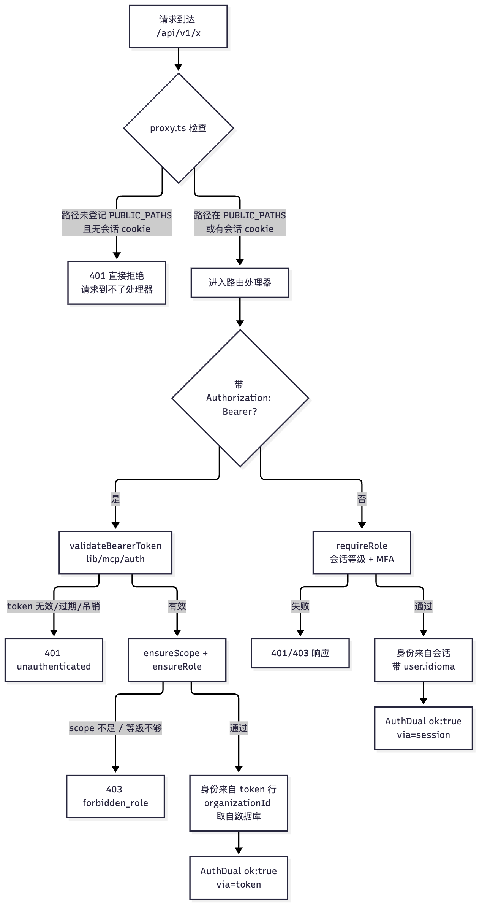
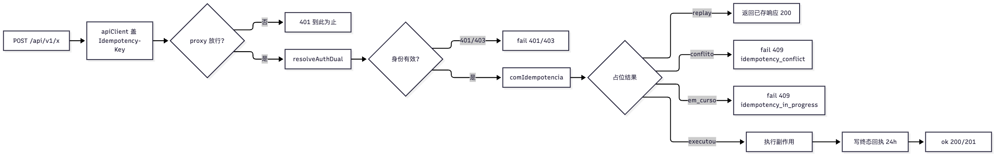

# 06 REST API：版本、双重鉴权、幂等与错误码

[返回母文档](../README.md) · [上一章](05.md) · [下一章](07.md)

**本章目标：**理解集成请求的身份、响应和重复提交处理。

## 实现详解

本页面描述 pi-native-crm 中 `/api/v1/*` 的对外契约骨架。它不重复讲某个业务端点的字段，而是回答四个贯穿所有端点的问题：**路径怎么版本化、请求带着什么身份进来、重复提交会不会做两遍、失败时客户端能读到什么**。仓库把这些答案固化在 `lib/api/` 下的一小组模块里，并要求每条路由都从这里取语义；任何绕过这些模块的写法，都会在评审或 invariant 测试里暴露出来。

读本页之前需要具备的前提认知：项目使用 Next.js App Router，路由处理器位于 `app/api/**/route.ts`，PostgREST/Supabase 客户端（`lib/supabase/*`）已封装会话与 service-role 两种连接。接下来四条主线——版本化路径、双重鉴权、幂等键、错误码——正好对应服务端的四个切面：路由匹配、身份解析、写入前的原子占位、响应封装。

### 契约骨架：谁管什么

`lib/api/README.md` 明确写下所有 `/api/v1/*` 路由的义务：**每条路由必须调用 `ok()` / `fail()`，而不是直接返回 `NextResponse`**，以保证三件事同时成立——响应体形状统一（`{ data, meta? }` 或 `{ error: { code, message, details? } }`）、响应头带 `X-Request-Id` 与审计日志关联、状态码落在约定集合内（200/201/204/400/401/403/404/409/422/429/500）。README 同时把身份解析（`auth.ts`）、幂等（`idempotency.ts`）、限流、分页、审计、CORS 列成"待补齐"的共享模块——后续真正落地的是 `auth-dual.ts` 与 `idempotency.ts`，这份清单记录的是契约演进的方向，而非全部现状。<br>Sources: [README.md](https://github.com/helsome/AiNativeCrm/blob/679e09e80878dff7b1c79b8537317b2b9e355331/lib/api/README.md#L1)

| 关注点 | 唯一真源 | 关键导出 | 职责边界 |
| --- | --- | --- | --- |
| 响应封装 | `lib/api/wrappers.ts` | `ok` / `fail` / `noContent`、`ApiSuccess` / `ApiError` | 只负责"把结果包成 HTTP"，不碰身份、不碰业务 |
| 错误码词表 | `lib/api/errors.ts` | `ApiErrorCodes` / `ApiErrorCode` | 错误码的**注册表**；新增码必须先在此登记 |
| 身份解析 | `lib/api/auth-dual.ts` | `resolveAuthDual` | 会话 cookie **或** Bearer token 的统一入口 |
| 写入幂等 | `lib/api/idempotency.ts` | `comIdempotencia`、`hashDoCorpo` | 原子占位 + replay + 冲突 |
| 浏览器客户端 | `lib/api/client.ts` | `apiClient` | 统一超时/重试/错误包装，随写操作自动盖章幂等键 |
| 代理放行名单 | `lib/auth/public-paths.ts` | `PUBLIC_PATHS` / `isPublicPath` | 决定 `proxy.ts` 是否放行到路由处理器 |

Sources: [wrappers.ts](https://github.com/helsome/AiNativeCrm/blob/679e09e80878dff7b1c79b8537317b2b9e355331/lib/api/wrappers.ts#L1), [errors.ts](https://github.com/helsome/AiNativeCrm/blob/679e09e80878dff7b1c79b8537317b2b9e355331/lib/api/errors.ts#L1), [auth-dual.ts](https://github.com/helsome/AiNativeCrm/blob/679e09e80878dff7b1c79b8537317b2b9e355331/lib/api/auth-dual.ts#L1), [idempotency.ts](https://github.com/helsome/AiNativeCrm/blob/679e09e80878dff7b1c79b8537317b2b9e355331/lib/api/idempotency.ts#L1), [client.ts](https://github.com/helsome/AiNativeCrm/blob/679e09e80878dff7b1c79b8537317b2b9e355331/lib/api/client.ts#L1), [public-paths.ts](https://github.com/helsome/AiNativeCrm/blob/679e09e80878dff7b1c79b8537317b2b9e355331/lib/auth/public-paths.ts#L1)

### 响应封装：`ok` / `fail` 的统一形状

所有成功响应都收敛到 `ApiSuccess<T>`：必有 `data` 字段，可选 `meta`。`meta` 的内建部分是分页游标（`cursor` / `has_more` / `total`），同时允许透传任意附加键。错误响应是 `ApiError`：`error.code`（机器可读的错误码）、`error.message`（可读文案）、可选 `error.details`（结构化补充）。

`ok(data, opts)` 支持 `status`（200/201/204）、`meta`、`requestId`、自定义 `headers`。无论传不传 `requestId`，包装器都会在响应上设置 `X-Request-Id`头——没传时用 `randomUUID()` 现生成。`fail(code, message, status, opts)` 组装错误体，`details` 只在显式提供时才写入（用条件展开避免出现 `details: undefined` 噪声），同样无条件设置 `X-Request-Id`。`noContent()` 用于 204，同样带 `X-Request-Id`。这个头是客户端与服务端串联审计日志、排查问题的唯一关联键，`lib/api/client.ts` 在读响应时会优先取回服务端的 `X-Request-Id`。<br>Sources: [wrappers.ts](https://github.com/helsome/AiNativeCrm/blob/679e09e80878dff7b1c79b8537317b2b9e355331/lib/api/wrappers.ts#L18), [client.ts](https://github.com/helsome/AiNativeCrm/blob/679e09e80878dff7b1c79b8537317b2b9e355331/lib/api/client.ts#L285)

```ts
// 典型路由写法：成功走 ok()，失败走 fail()，都不直接碰 NextResponse
import { ok, fail } from "@/lib/api/wrappers";
import { ApiErrorCodes } from "@/lib/api/errors";

export async function GET(req: Request) {
  const data = await fetchSomething();
  if (!data) return fail(ApiErrorCodes.not_found, "Lead não encontrado", 404);
  return ok(data, { meta: { cursor: nextCursor, has_more: true } });
}
```

Sources: [README.md](https://github.com/helsome/AiNativeCrm/blob/679e09e80878dff7b1c79b8537317b2b9e355331/lib/api/README.md#L9)

### 版本化路径：`/api/v1/*` 与对外入口

所有业务 REST 路由都挂在 `app/api/v1/<recurso>/…` 下（Next App Router 的文件即路径）。当前稳定前缀是 `/api/v1`，没有任何 `/api/v2` 目录——但版本迁移的规则已经写死在 `errors.ts` 的头注释里：**不重命名既有错误码；若将来需要破坏性变更，就新开 `/api/v2/`**。因此 `/api/v1` 的隐含承诺是"冻结的契约面"，路径一旦发布，错误码与语义不再原地修改。

除了带版本前缀的 `/api/v1/*`，`app/api` 下还有三棵**不带业务语义的辅助树**，它们在契约上与 `/api/v1` 分属不同身份边界：

- `app/api/internal/**` —— 内部（host↔app）通道，配合 `INTERNAL_SECRET` / `INTERNAL_CRON_SECRET` 使用；
- `app/api/mcp/**` —— MCP 协议端点；
- `app/api/v1/system/agent`、`/api/v1/cron/**`、`/api/v1/system/relogio/tick`、`/api/v1/tenants/provision`、`/api/v1/agenda/google/callback` 等 —— 虽然在 `/api/v1` 下，但**不在同一套浏览器会话鉴权下**，它们的身份在各自路由内部校验。

`lib/auth/public-paths.ts` 的 `PUBLIC_PATHS` 是这条"路径放行"策略的注册表，一个正则数组，按数组顺序匹配、首个命中即放行（first match wins）。它对应的不是"无鉴权"，而是**"让 `proxy.ts` 不做决定、把判断交给路由自身"**——注释反复强调这一点。下面这张表把 `app/api` 下的入口按这条原则分类。

Sources: [errors.ts](https://github.com/helsome/AiNativeCrm/blob/679e09e80878dff7b1c79b8537317b2b9e355331/lib/api/errors.ts#L1), [public-paths.ts](https://github.com/helsome/AiNativeCrm/blob/679e09e80878dff7b1c79b8537317b2b9e355331/lib/auth/public-paths.ts#L1)

| 路径族 | 鉴权方式 | 在 `PUBLIC_PATHS`？ | 说明 |
| --- | --- | --- | --- |
| `/api/v1/<recurso>`（绝大多数） | 浏览器会话 cookie，经 `requireRole` | 否 | 走默认会话门 |
| `/api/v1/contacts`、`/api/v1/messages` 等 | 会话 **或** Bearer `dsk_…`，经 `resolveAuthDual` | 是 | 服务器到服务器发送需要；锚定 `$` 精确到路径 |
| `/api/v1/cron/**` | 路由内校验 cron secret | 是 | 定时任务，无会话 |
| `/api/v1/webhooks/**`、`/api/v1/anuncios/google/*` | 路由内签名 /落地页 | 是 | 入站回调与广告落地 |
| `/api/v1/agenda/google/callback` 等 | 路由内校验签名 `state`（HMAC + nonce） | 是 | OAuth 回跳无会话，靠签名而非 cookie |
| `/api/mcp/**`、`/api/internal/**` | Bearer / 内部密钥 | 是 | 独立协议通道 |

Sources: [public-paths.ts](https://github.com/helsome/AiNativeCrm/blob/679e09e80878dff7b1c79b8537317b2b9e355331/lib/auth/public-paths.ts#L14), [auth-dual.ts](https://github.com/helsome/AiNativeCrm/blob/679e09e80878dff7b1c79b8537317b2b9e355331/lib/api/auth-dual.ts#L19)

#### `proxy.ts` 与"公开"的真实含义

这是整个契约里最容易被误读的一层。`auth-dual.ts` 的顶部注释点明：**`proxy.ts` 在任何路由处理器之前运行，且它只认会话 cookie**。所以，即使一条路由内部实现了"会话或 Bearer 双鉴权"，只要该路径没有在 `PUBLIC_PATHS` 里登记，所有 Bearer 请求都会在到达处理器之前就被 `proxy` 判401。换言之，`PUBLIC_PATHS` 里的"公开"意思是"**代理层不替这条路径做决定**"，绝不是"这条路径不做鉴权"。绝大多数带 Bearer 的路由都用 `$` 锚定正则（如 `/^\/api\/v1\/messages$/`），避免未来子路径"搭便车"意外变成公开。<br>Sources: [auth-dual.ts](https://github.com/helsome/AiNativeCrm/blob/679e09e80878dff7b1c79b8537317b2b9e355331/lib/api/auth-dual.ts#L19), [public-paths.ts](https://github.com/helsome/AiNativeCrm/blob/679e09e80878dff7b1c79b8537317b2b9e355331/lib/auth/public-paths.ts#L59)

### 双重鉴权：`resolveAuthDual`

`resolveAuthDual(req, { requestId, resource, role, scope })` 是"同一个端点既服务浏览器又服务服务器"的统一入口。它有两条互斥的分支，返回**同一种形状**（`AuthDual`），让调用方不必关心身份从哪条路进来：

```ts
export type AuthDual =
  | { ok: true; organizationId: string; actor: Actor; supabase: SupabaseClient;
      idioma?: Idioma; via: "session" | "token" }
  | { ok: false; response: Response };
```

两条分支各自的可信来源是：**会话模式**走 `requireRole(role, …)`——与其他 `/api/v1/*` 完全同一个门（取数据库里的有效等级与会话 MFA），成功后拿到 `organizationId`、`actor = { type:"user", id }`、用户 `idioma`；**Token 模式**（`Authorization: Bearer dsk_…`）走 `validateBearerToken()`（来自 `lib/mcp/auth.ts`，与 MCP server同一个 `api_tokens` 校验器），随后用 `ensureScope` 校验 scope、`ensureRole` 校验等级，通过后取 `auth.organizationId`。关键安全约定：**`organization_id` 永远来自 token 在数据库的那一行，绝不来自 query 或请求体**——因此不存在"用 A组织的 Bearer 去写 B 组织"的路径。`via` 字段记录身份来源，供审计与错误文案使用。<br>Sources: [auth-dual.ts](https://github.com/helsome/AiNativeCrm/blob/679e09e80878dff7b1c79b8537317b2b9e355331/lib/api/auth-dual.ts#L38), [handlers/types.ts](https://github.com/helsome/AiNativeCrm/blob/679e09e80878dff7b1c79b8537317b2b9e355331/lib/api/handlers/types.ts#L1)

鉴权失败有明确的分层语义：**token 缺失/无效/被吊销/过期一律关闭在 401**（`McpAuthError.httpStatus === 401`映射为 `unauthenticated`）；**token 有效但 scope 不足或等级不够关闭在 403**（`forbidden` 或 `forbidden_role`）。两条失败路径都不记录 header 内容，也不记录 token 明文。注释还指出，scope 与最低等级是**参数**而不是每路由复制粘贴的副本——这正是本模块从 `app/api/v1/contacts/route.ts` 的内联实现抽取出来的原因。<br>Sources: [auth-dual.ts](https://github.com/helsome/AiNativeCrm/blob/679e09e80878dff7b1c79b8537317b2b9e355331/lib/api/auth-dual.ts#L80)



#### `Actor`：身份的类型判别

`HandlerCtx.actor` 是一个**判别联合**，把"谁在动"编码进类型系统，这直接决定了写库时 `*_by_user_id` 该不该落值、以及 `pre_go_live` 这类门是否放行。核心变体有五种：

- `user` —— 真人操作者（会话），带 `id`；
- `ai_agent` —— 智能体，必须区分 `id`（run/关联 id，仅用于审计关联）与 `agent_id`（`ai_agents` 表的行 id，唯一能进带 FK 的列如 `crm_lead_activities.actor_agent_id`）；混淆二者会让活动记录丢失、INSERT 撞 FK；
- `api_token` —— 无 agent 作用域的服务端 token（集成而非人）。之所以从 `"user"` 拆出来：其一，写 `…_by_user_id` 时 token 的 id 不是 user id，会撞外键（`POST /api/v1/messages` 实测过，agenda/contacts/leads/conversations/messages 等九处同型）；其二，`messages/_handler.ts` 会在 `actor.type === "user"` 时跳过 `pre_go_live` 校验（人工发送不该受 AI 测试模式约束），若 token 伪装成 user，就能绕过渠道模式保护；
- `webhook_source` —— 自动化规则触发（可带 `textoEscritoPelaIA` 标记，用来区分"谁写的"与"谁触发的"）。

Sources: [handlers/types.ts](https://github.com/helsome/AiNativeCrm/blob/679e09e80878dff7b1c79b8537317b2b9e355331/lib/api/handlers/types.ts#L17)

### 幂等键：占位、replay、冲突与"进行中"

幂等契约定义在 `docs/specs/01-spec-platform-base.md` §7.3 与 `CLAUDE.md`：POST 创建类端点接受 `Idempotency-Key: <uuid>`；同键同体返回已存响应；同键异体返回 409 `idempotency_conflict`；窗口 24h。仓库曾有两套互不相通的实现（`admin/tenants` 走事务 RPC，`lgpd/requests/[id]/approve` 在处理器里自己读写），`lib/api/idempotency.ts` 是**第一版可复用**的统一实现。

`comIdempotencia(entrada)` 的关键参数是 `{ db, organizationId, endpoint, chave, corpo, executar, agora? }`——`corpo` 是已校验的请求体，它与 `organizationId`/`endpoint`/`chave` 一起定义"这是哪一次操作"，`executar` 是只有占位成功者才会被调用的副作用。返回值 `DesfechoIdempotente<T>` 是四态判别：

| 状态 | 含义 | 路由层动作 |
| --- | --- | --- |
| `executou` | 首次占位并执行成功 | 返回结果 |
| `replay` | 同键同体且已有终态回执 | 原样返回已存响应，**不重执行** |
| `conflito` | 同键但请求体不同（hash 不匹配） | 409 `idempotency_conflict`（键错了） |
| `em_curso` | 同键同体、首次执行仍在进行、终态回执未落 | 409 `idempotency_in_progress`（键没错，稍后重试即可） |

`conflito` 与 `em_curso` 是**两个不同码**，因为收件人的补救动作相反：冲突要换键，进行中只要重试。<br>Sources: [idempotency.ts](https://github.com/helsome/AiNativeCrm/blob/679e09e80878dff7b1c79b8537317b2b9e355331/lib/api/idempotency.ts#L17), [idempotency.ts](https://github.com/helsome/AiNativeCrm/blob/679e09e80878dff7b1c79b8537317b2b9e355331/lib/api/idempotency.ts#L152)

#### 身份判定：请求体的有序哈希

"同一次操作"由请求体的 SHA-256 哈希判定（`hashDoCorpo`）。哈希前先对对象做**键排序**（`ordenar` 递归排序 object 的键），因为 `JSON.stringify` 依赖插入顺序——两个语义相同但字段顺序不同的请求体不应被判成冲突。<br>Sources: [idempotency.ts](https://github.com/helsome/AiNativeCrm/blob/679e09e80878dff7b1c79b8537317b2b9e355331/lib/api/idempotency.ts#L104)

`bytea` 列的编码细节被专门处理：写入用 `hashDaColuna`（`\x` + hex，即 PostgREST 与仓库 SQL 函数 `decode(p_hash,'hex')` 用的格式），读取用 `hashLido` 归一化——因为同一个 `bytea` 经 PostgREST 回来是 `\x…` 字面量、经 `pg` driver 回来是 `Buffer`。若把裸 hex写入，Postgres 按 `escape` 解释成 64 个 ASCII 字节，回读永不匹配，导致**所有 replay 都退化成 409**。未知格式 `hashLido` 返回 `null`，而 `null` 不与任何哈希相等——设计上"宁可错向冲突，也不错向 replay"。<br>Sources: [idempotency.ts](https://github.com/helsome/AiNativeCrm/blob/679e09e80878dff7b1c79b8537317b2b9e355331/lib/api/idempotency.ts#L60), [idempotency.ts](https://github.com/helsome/AiNativeCrm/blob/679e09e80878dff7b1c79b8537317b2b9e355331/lib/api/idempotency.ts#L128)

#### 并发竞态如何关闭：先占位，后效果

竞态不靠事务（副作用是应用代码：写库、发邮件、调外部提供商，塞不进回执事务），而靠 `public.idempotency_keys` 的**唯一索引 `idempotency_keys_organization_id_key_endpoint_key` + 先写占位行**。流程是：

1. 读该键的行（限定在有效窗口内，`expires_at > now`）；若存在则分类——哈希不符 → `conflito`；`status_code IS NULL`（占位中）→ `em_curso`；否则 → `replay`。
2. 尝试 **INSERT 占位行**（`status_code`/`response_body` 为 NULL，`expires_at = now + 60s`）。
3. 若 INSERT 撞唯一索引（PG 错误码 `23505`），说明别人先占位：重新读行再分类；若读到的是**已过期行**，则以"读到的 `expires_at` 为票据"做条件更新（`.eq("expires_at", linha.expires_at)`）把它改写为新占位——这个条件更新防止抢走中途被他人取得的占位。
4. 占位成功才执行副作用；执行完把**同一行**更新为终态回执（写 `status_code` + `response_body`，`expires_at = now + 24h`）。

两个窗口长度不同是刻意设计：**占位窗口 `JANELA_DA_RESERVA_MS = 60s`**（副作用的天花板，不是幂等窗口），**回执 TTL `TTL_MS = 24h`**。若请求在写终态回执前死掉，占位 60s 后过期，键归还给后来者；若副作用仍在那60s 内运行，新持有者可能重跑一次——注释明确承认这是已知且声明过的代价，也正是两个数字不等的原因（migration `0321` 让 `status_code`/`response_body` 可空，才让"进行中"这件事有了落点；此前两列为 NOT NULL，两条并发请求都读空、副作用执行两次）。<br>Sources: [idempotency.ts](https://github.com/helsome/AiNativeCrm/blob/679e09e80878dff7b1c79b8537317b2b9e355331/lib/api/idempotency.ts#L39), [idempotency.ts](https://github.com/helsome/AiNativeCrm/blob/679e09e80878dff7b1c79b8537317b2b9e355331/lib/api/idempotency.ts#L202)

#### 失败路径的两个不对称

- **副作用已成功、但写回执失败** → 返回 `executou`（不是错误）。若返回错误，客户端会重试并**重复副作用**，正是幂等要防的事。回执写入是 best-effort。
- **副作用抛错** → 释放占位（把 `expires_at` 置为当前时间使其立即过期）并向上抛。因为失败的请求不该留下 60s 的"进行中"假象，让重试拿到 `em_curso` 却无对应运行；释放后重试会走"过期行"分支重新取键。

Sources: [idempotency.ts](https://github.com/helsome/AiNativeCrm/blob/679e09e80878dff7b1c79b8537317b2b9e355331/lib/api/idempotency.ts#L93), [idempotency.ts](https://github.com/helsome/AiNativeCrm/blob/679e09e80878dff7b1c79b8537317b2b9e355331/lib/api/idempotency.ts#L271)

#### 客户端如何盖章

浏览器侧 `apiClient`（`lib/api/client.ts`）在方法属于 `MUTATING_METHODS`（POST/PATCH/PUT/DELETE）时，**自动给每次请求盖 `Idempotency-Key`**（调用方可通过 `opts.idempotencyKey` 指定，否则用 `randomId()`）。客户端同时坚持一个关键立场：**写操作不做自动重试**（`catch` 里若方法是 mutating 就直接抛）。理由是超时/网络错误对写操作而言是"不知道"而非"没发生"——服务端不会因客户端放弃而取消工作，重试会真的再做一遍，而客户端盖的幂等键"只保护尊重它的路由"。实测过 issue #783："Testar agente" 单次 ~14.5s 超过默认 10s 超时，曾导致一个点击变成三次付费的 LLM 执行。因此写操作的默认超时被抬到 `MUTATION_TIMEOUT_MS = 30_000`（即原本"三次重试共约 30.6s"的墙，作为**一次**尝试交付），读操作维持 `DEFAULT_TIMEOUT_MS = 10_000` 且可重试（GET仍走 3 次尝试，退避 429/503，遵循 `Retry-After`）。<br>Sources: [client.ts](https://github.com/helsome/AiNativeCrm/blob/679e09e80878dff7b1c79b8537317b2b9e355331/lib/api/client.ts#L17), [client.ts](https://github.com/helsome/AiNativeCrm/blob/679e09e80878dff7b1c79b8537317b2b9e355331/lib/api/client.ts#L248), [client.ts](https://github.com/helsome/AiNativeCrm/blob/679e09e80878dff7b1c79b8537317b2b9e355331/lib/api/client.ts#L342)

### 错误码：`ApiErrorCodes` 作为注册表

`lib/api/errors.ts` 里的 `ApiErrorCodes` 是错误码的**唯一权威注册表**。它的存在意义被反复强调：由于 `fail()` 的签名是 `code: ApiErrorCode | (string & {})`，第二个分支接受**任意字符串**——一个在调用点凭空写出的 `"slot_taken"` 会直接变成线上契约，而消费方从不知道它的存在。注释直言："以为联合类型能兜住的人读错了文件"。因此一个错误码**只有在 `ApiErrorCodes` 里登记，才算契约**。

注册表的组织方式是按 HTTP 状态码与语义簇分块，每个新簇都附有"为什么不能并成一个泛型码"的说明：

| 簇 | 典型码 | 语义 |
| --- | --- | --- |
| 400/422 校验 | `invalid_request`、`validation_failed`、`invalid_cursor` | 请求体/参数不合法 |
| 401 鉴权 | `unauthenticated`、`token_expired`、`token_revoked`、`mfa_required`、`unauthorized` | 身份缺失/失效 |
| 403 授权 | `forbidden`、`forbidden_role`、`forbidden_tenant` | 身份有效但权限/租户不足 |
| 409 冲突 | `idempotency_conflict`、`idempotency_in_progress`、`state_conflict`、`contact_exists` | 状态/唯一性冲突 |
| 409/422 业务 | `agenda_horario_indisponivel`、`lead_stage_changed_concurrent`、`pipeline_immutable_use_clone` | 领域语义的不可变更 |
| 422 语义 | `lost_reason_required`、`lost_reason_invalid`、`voice_risco_nao_aceito` | 缺必填语义/需先确认 |
| 415/413 | `unsupported_media_type`、`logo_svg_recusado`、`payload_too_large` | 媒体类型/体积 |
| 429 | `rate_limited` | 限流 |
| 5xx/上游 | `internal_error`、`upstream_unavailable`、`unavailable`、`waha_error`、`ai_provider_error` | 服务端或依赖故障 |

几个设计意图值得单独注意：

- **不可泛化的兄弟码**。例如 `logo_svg_recusado` 不并入 `unsupported_media_type`，因为上传 SVG 的人需要读到"请发 PNG/JPG"而非"类型不支持"；`agenda_listagem_alvo_nao_e_lead` 不并入 `unprocessable_entity`，因为收件人（Agenda 的 `lead_id` 实际传成了 contact id）需要知道"换参数"，而非"当成不可用"。同理，`voice_*` 拆成"组织没开通 / admin 未接受风险 / 安装不提供 / 状态读不出"四个码——分别对应去安全设置开关、确认风险、联系 VPS 管理员、稍后重试四种不同动作，且状态未知（503 `voice_estado_indeterminado`）刻意与"已关闭"区分，避免误导用户去找开关。
- **登记即治理**。`errors.ts` 的注释记录了一次审计：一次 grep 发现 `/api/v1/leads` 家族长期发出十一枚从未进入本注册表的线上错误码（如 `lead_stage_changed_concurrent`、`pipeline_immutable_use_clone`），于是**整族一并补录**，而不是只补当次新增的两枚——因为按实例修补会漏掉"外表互不相同"的姐妹码。

Sources: [errors.ts](https://github.com/helsome/AiNativeCrm/blob/679e09e80878dff7b1c79b8537317b2b9e355331/lib/api/errors.ts#L38), [errors.ts](https://github.com/helsome/AiNativeCrm/blob/679e09e80878dff7b1c79b8537317b2b9e355331/lib/api/errors.ts#L67), [errors.ts](https://github.com/helsome/AiNativeCrm/blob/679e09e80878dff7b1c79b8537317b2b9e355331/lib/api/errors.ts#L63), [errors.ts](https://github.com/helsome/AiNativeCrm/blob/679e09e80878dff7b1c79b8537317b2b9e355331/lib/api/errors.ts#L126), [errors.ts](https://github.com/helsome/AiNativeCrm/blob/679e09e80878dff7b1c79b8537317b2b9e355331/lib/api/errors.ts#L143)

#### 客户端如何消费错误

`lib/api/client.ts` 在收到非 2xx 且非可重试时，读取响应体；若符合 `ApiErrorBody` 形状，就抛出一个携带 `status / code / details / requestId / message` 的 `ApiError` 实例。若响应体不符合该形状（例如上游返回纯文本），则用 `synthesizeCode(status)` 按状态合成一个兜底码（5xx→`internal_error`、429→`rate_limited`、401→`unauthorized`、403→`forbidden`、404→`not_found`），保证调用方永远拿到一个 `ApiError` 而不是裸字符串。`requestId` 优先取响应的 `X-Request-Id`，回退到请求侧生成的那个。<br>Sources: [client.ts](https://github.com/helsome/AiNativeCrm/blob/679e09e80878dff7b1c79b8537317b2b9e355331/lib/api/client.ts#L211), [client.ts](https://github.com/helsome/AiNativeCrm/blob/679e09e80878dff7b1c79b8537317b2b9e355331/lib/api/client.ts#L306)

有一个特例：状态403 且 `code === "no_active_org"` 时，客户端不直接抛错，而是触发**一次**页面重载（`pedirDecisaoAoServidor`）——因为"组织消失"（管理员刚撤销了访问）应跳到撤销访问页，但重定向一次后立刻清理，避免无限刷新循环；同时仍把 `ApiError` 抛出，保证调用链以异常收尾而非挂起。<br>Sources: [client.ts](https://github.com/helsome/AiNativeCrm/blob/679e09e80878dff7b1c79b8537317b2b9e355331/lib/api/client.ts#L71), [client.ts](https://github.com/helsome/AiNativeCrm/blob/679e09e80878dff7b1c79b8537317b2b9e355331/lib/api/client.ts#L306)



### 给集成方的最小清单

若你要新增一条 `/api/v1/*` 路由，按下面对齐契约：

1. **响应**：只用 `ok()` / `fail()` / `noContent()`，让 `X-Request-Id` 与 `{data}`/`{error}` 形状自动就位；
2. **鉴权**：浏览器场景用 `requireRole`；要同时支持服务器 token 用 `resolveAuthDual`，并确认路径已在 `PUBLIC_PATHS` 登记（否则 Bearer 会在 `proxy` 被401 拦下），且正则带 `$` 锚定；
3. **幂等**：创建类 POST 用 `comIdempotencia`，把四态分别映射到 `ok` / `replay` / 409 `idempotency_conflict` / 409 `idempotency_in_progress`；
4. **错误码**：任何新错误码先在 `ApiErrorCodes` 登记并写清"为什么不能并入泛型码"，不要在调用点直接传字面量；
5. **组织来源**：`organization_id` 只从可信来源取（token 行或会话），绝不信任请求体/query。

Sources: [wrappers.ts](https://github.com/helsome/AiNativeCrm/blob/679e09e80878dff7b1c79b8537317b2b9e355331/lib/api/wrappers.ts#L1), [auth-dual.ts](https://github.com/helsome/AiNativeCrm/blob/679e09e80878dff7b1c79b8537317b2b9e355331/lib/api/auth-dual.ts#L38), [idempotency.ts](https://github.com/helsome/AiNativeCrm/blob/679e09e80878dff7b1c79b8537317b2b9e355331/lib/api/idempotency.ts#L152), [errors.ts](https://github.com/helsome/AiNativeCrm/blob/679e09e80878dff7b1c79b8537317b2b9e355331/lib/api/errors.ts#L1)

## 继续阅读

[返回母文档](../README.md) · [上一章](05.md) · [下一章](07.md)

