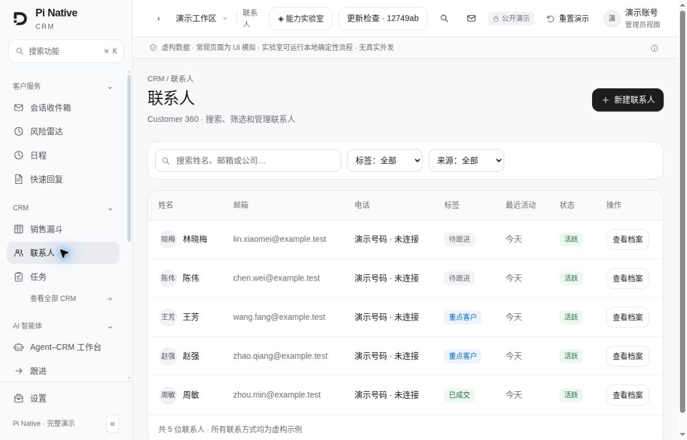
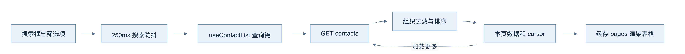
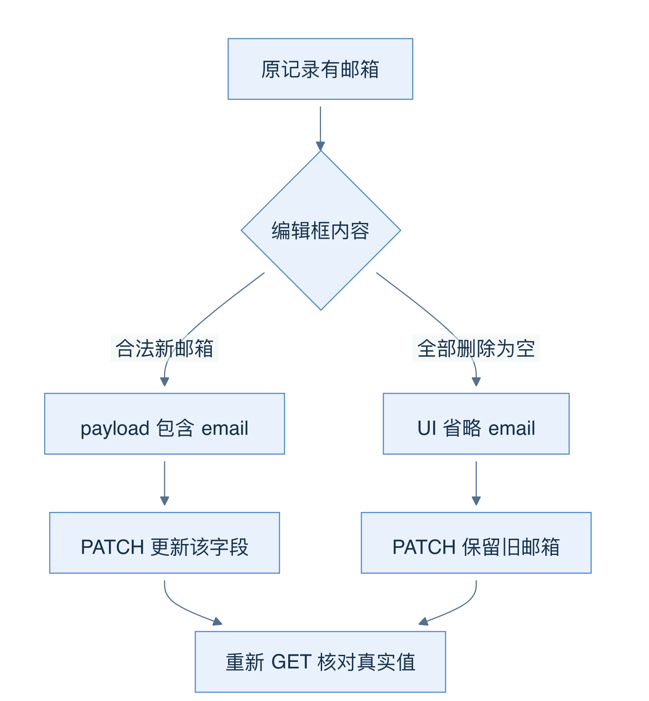
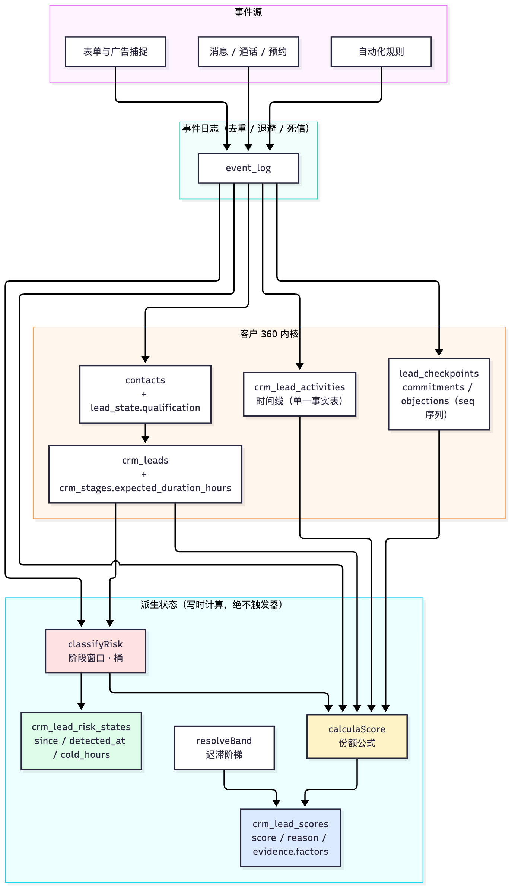

# 07 客户 360：联系人、时间线与风险雷达

[返回母文档](../README.md) · [上一章](06.md) · [下一章](08.md)

**本章目标：**从联系人操作深入线索状态、互动记录和风险评分。

## 业务流程与阅读起点

学习目标：学会把联系人页面拆成输入、缓存、API 契约和数据库写入四层，并识别“显示保存成功”和“想改的值真的改变”之间的差别。

### 当前界面近景



先看页面上的输入与列表，再追下面的查询缓存及 API 路径。此图是静态演示的虚构联系人，不证明真实列表接口已联通。

### 先走一次读路径

ContactsListClient 保存搜索框内容、真正提交的搜索条件、标签、来源、排序和每页数量。搜索框不是每敲一字就立刻查：useEffect 等 250 毫秒后更新 search。useContactList 把这些条件放入 React Query 的 queryKey，转成 URL 参数，调用 GET /api/v1/contacts。切换筛选条件会进入对应查询缓存；“继续加载”则使用上一页返回的 cursor。

后端先解析身份和查询参数，listContactsHandler 再限制当前组织、排除 is_merged_into 不为空的旧档案，按所选字段与 id 排序，多读一行判断 has_more。搜索同时覆盖 name、display_name、email、phone_number；电话还会扩展匹配变体。cursor 在这个 handler 中是 base64url 编码的排序值与 ID，没有 HMAC，不能照通用 API 概述写成“所有游标都已签名”。



图 05-A：实线箭头表示数据依赖；游标回到下一次读取，避免把“加载更多”理解成下载全部联系人。缓存中的 pages 只代表已经取到的页。

### 场景：找到林女士，改邮箱，再回到沟通现场

这里使用虚构客户。目标是修改一条联系人记录。没有任何一步需要给客户发消息。先确定四个数据主人：组件保存输入；React Query 保存读取副本；API 决定合法字段和组织范围；Postgres 保存联系人事实。输入框和缓存都不能代替数据库。


图 05-C：读链可以产生多份副本。写链把修改提交到数据库。返回后的失效箭头要求各视图重新读取，不是把编辑框直接广播给全部组件。

1. **先找记录。** 在列表输入“林”。组件先改 searchInput，250 毫秒后改 search。查询键随过滤条件改变。此时列表只拥有已加载的页；它没有拿到组织的完整联系人表。[源码：[`app/app/contacts/_client.tsx:47-89`](https://github.com/helsome/AiNativeCrm/blob/679e09e80878dff7b1c79b8537317b2b9e355331/app/app/contacts/_client.tsx#L47-L89)；[`hooks/contacts/useContactList.ts:22-44`](https://github.com/helsome/AiNativeCrm/blob/679e09e80878dff7b1c79b8537317b2b9e355331/hooks/contacts/useContactList.ts#L22-L44)]
2. **再读详情。** 点击联系人进入 `/app/contacts/{id}`。useContact 用 `['contact', id]` 读取详情。它与列表的 `['contacts', filters]` 是不同缓存，不能因为列表出现了某个客户就跳过详情的加载或错误状态。[源码：[`hooks/contacts/useContact.ts:12-24`](https://github.com/helsome/AiNativeCrm/blob/679e09e80878dff7b1c79b8537317b2b9e355331/hooks/contacts/useContact.ts#L12-L24)；[`app/app/contacts/[id]/_client.tsx:55-101`](https://github.com/helsome/AiNativeCrm/blob/679e09e80878dff7b1c79b8537317b2b9e355331/app/app/contacts/[id]/_client.tsx#L55-L101)]
3. **建立编辑副本。** 打开 EditContactDialog 时，form.reset 从当前 contact 复制值。键盘输入先改变表单，数据库还没变。提交时，表单会规范化标签、拼出 PATCH，再做 schema 校验。非法邮箱在本地被拒绝；合法请求仍须经过服务端校验。[源码：[`components/contacts/EditContactDialog.tsx:45-95`](https://github.com/helsome/AiNativeCrm/blob/679e09e80878dff7b1c79b8537317b2b9e355331/components/contacts/EditContactDialog.tsx#L45-L95)；[`app/api/v1/contacts/[id]/route.ts:78-116`](https://github.com/helsome/AiNativeCrm/blob/679e09e80878dff7b1c79b8537317b2b9e355331/app/api/v1/contacts/[id]/route.ts#L78-L116)]
4. **写入被允许的字段。** handler 用组织和联系人 ID 查当前记录，检查匿名化状态，再更新 body 中出现的字段。邮箱换成新的合法值会入库；删空邮箱却会在组装 payload 时被省略。后者没有向 API 表达“删除邮箱”。[源码：[`app/api/v1/contacts/_handler.ts:490-550`](https://github.com/helsome/AiNativeCrm/blob/679e09e80878dff7b1c79b8537317b2b9e355331/app/api/v1/contacts/_handler.ts#L490-L550)、[`app/api/v1/contacts/_handler.ts:589-607`](https://github.com/helsome/AiNativeCrm/blob/679e09e80878dff7b1c79b8537317b2b9e355331/app/api/v1/contacts/_handler.ts#L589-L607)]
5. **让读取副本重新收敛。** 成功回调使联系人详情、列表、会话列表、联系人标签建议失效，然后表单关闭。Inbox 侧栏通常从会话列表里的 contacts 子对象读名字和标签，因此会话列表也需要刷新。[源码：[`hooks/contacts/useUpdateContact.ts:8-29`](https://github.com/helsome/AiNativeCrm/blob/679e09e80878dff7b1c79b8537317b2b9e355331/hooks/contacts/useUpdateContact.ts#L8-L29)；[`components/inbox/CRMSidePanel.tsx:458-464`](https://github.com/helsome/AiNativeCrm/blob/679e09e80878dff7b1c79b8537317b2b9e355331/components/inbox/CRMSidePanel.tsx#L458-L464)]

这里还有一个窄边界：Inbox 可通过 `useConversation` 单独读取不在当前列表中的会话。该缓存键是单数 `['conversation', id]`，当前 useUpdateContact 没有让它失效。不能把四个失效调用概括成“所有 Inbox 面板都会立刻更新”。若深链侧栏仍显示旧值，先核对它来自列表缓存还是单条缓存，再重新读取。[源码：[`components/inbox/InboxLayout.tsx:214-257`](https://github.com/helsome/AiNativeCrm/blob/679e09e80878dff7b1c79b8537317b2b9e355331/components/inbox/InboxLayout.tsx#L214-L257)；[`hooks/inbox/useConversation.ts:13-22`](https://github.com/helsome/AiNativeCrm/blob/679e09e80878dff7b1c79b8537317b2b9e355331/hooks/inbox/useConversation.ts#L13-L22)]

#### 失败分支：请求成功，也可能没有完成原意

- **删除邮箱后保存。** 输入框是空值；payload 没有 email；数据库保留旧值。重新 GET 会再次读到旧邮箱。当前表单与 API 都未提供合法清空契约
- **新标签没出现在筛选项。** 标签可能已经存入 contacts；列表建议只来自已加载的页。先核对联系人 GET，不要用下拉选项是否出现来判断写入结果
- **两个人同时改整组标签。** 当前 PATCH 用组织和 ID 条件写入，没有 expected_updated_at。后一次提交可以覆盖前一次标签集合；它不具备第 11 章看板移动的 OCC 保护。consent 虽然按用途合并，也是先读再写，不能因此声称并发修改已经被原子合并
- **事件写入失败。** contact UPDATE 与随后 emit_event 是不同调用。事件错误被记录，已写入的联系人不会回滚。联系人事实成功与异步后续成功需要分别核对

这些判断分别锚定 [`components/contacts/EditContactDialog.tsx:75-82`](https://github.com/helsome/AiNativeCrm/blob/679e09e80878dff7b1c79b8537317b2b9e355331/components/contacts/EditContactDialog.tsx#L75-L82)、[`lib/schemas/contacts.ts:40-65`](https://github.com/helsome/AiNativeCrm/blob/679e09e80878dff7b1c79b8537317b2b9e355331/lib/schemas/contacts.ts#L40-L65)、[`app/app/contacts/_client.tsx:77-89`](https://github.com/helsome/AiNativeCrm/blob/679e09e80878dff7b1c79b8537317b2b9e355331/app/app/contacts/_client.tsx#L77-L89)、[`app/api/v1/contacts/_handler.ts:551-566`](https://github.com/helsome/AiNativeCrm/blob/679e09e80878dff7b1c79b8537317b2b9e355331/app/api/v1/contacts/_handler.ts#L551-L566)、[`app/api/v1/contacts/_handler.ts:589-595`](https://github.com/helsome/AiNativeCrm/blob/679e09e80878dff7b1c79b8537317b2b9e355331/app/api/v1/contacts/_handler.ts#L589-L595)、[`app/api/v1/contacts/_handler.ts:639-667`](https://github.com/helsome/AiNativeCrm/blob/679e09e80878dff7b1c79b8537317b2b9e355331/app/api/v1/contacts/_handler.ts#L639-L667)。本章没有修改这些缺口。

#### 从客户档案进入 Inbox 时，哪些状态会随导航走

联系人表格有两条路径：已有会话时链接到 `/app/inbox?id={conversation_id}`；没有会话但有电话时，先 POST `open-with-contact`，成功后才跳转。路由把 id 交给 InboxLayout 的 initialSelectedId。之后在 Inbox 内点击另一条会话只改 selectedId，不更新这个 URL；浏览器后退不会逐条撤销会话选择。filter 标签页在 URL，搜索等辅助过滤条件仍在本地。定位“返回了错误会话”时，应先区分入口深链、页面内选择与浏览器历史。[源码：[`components/contacts/ContactsTable.tsx:120-142`](https://github.com/helsome/AiNativeCrm/blob/679e09e80878dff7b1c79b8537317b2b9e355331/components/contacts/ContactsTable.tsx#L120-L142)、[`components/contacts/ContactsTable.tsx:245-258`](https://github.com/helsome/AiNativeCrm/blob/679e09e80878dff7b1c79b8537317b2b9e355331/components/contacts/ContactsTable.tsx#L245-L258)；[`app/app/inbox/page.tsx:39-40`](https://github.com/helsome/AiNativeCrm/blob/679e09e80878dff7b1c79b8537317b2b9e355331/app/app/inbox/page.tsx#L39-L40)；[`components/inbox/InboxLayout.tsx:133-163`](https://github.com/helsome/AiNativeCrm/blob/679e09e80878dff7b1c79b8537317b2b9e355331/components/inbox/InboxLayout.tsx#L133-L163)、[`components/inbox/InboxLayout.tsx:271-284`](https://github.com/helsome/AiNativeCrm/blob/679e09e80878dff7b1c79b8537317b2b9e355331/components/inbox/InboxLayout.tsx#L271-L284)]

选择会话也不等于把客户标成已读。Inbox 会在选中会话对象可用后调用 useMarkAsRead；加载、无权限、单条不存在仍有各自分支。不要拿“URL 有 ID”当作“此客户会话已成功打开”。[源码：[`components/inbox/InboxLayout.tsx:253-269`](https://github.com/helsome/AiNativeCrm/blob/679e09e80878dff7b1c79b8537317b2b9e355331/components/inbox/InboxLayout.tsx#L253-L269)、[`components/inbox/InboxLayout.tsx:526-534`](https://github.com/helsome/AiNativeCrm/blob/679e09e80878dff7b1c79b8537317b2b9e355331/components/inbox/InboxLayout.tsx#L526-L534)]

### 新建和修改的不同契约

新建请求经 agent 级别守卫后，组织国家配置决定证件校验方式。handler 自己填写 organization_id、创建者、默认值并规范化电话，然后插入 contacts。若电话唯一约束冲突且能重新找到本组织既有联系人，返回 409 contact_exists 并给出 contact_id。不要把 409 当作服务器故障重试创建；应先打开已有记录核对身份。

联系人创建成功后，会尝试为有电话的联系人建立可用渠道会话；该步骤是 best-effort，失败不撤销已创建联系人。最终响应是 { data: { contact, action: "created" } }，不是 { data: contact }。这两个 envelope 层级值得亲手画一下：错误读取 response.data.id 会得到 undefined。

修改时，PATCH 只处理出现的字段。不存在、无权限或匿名化记录不能当普通编辑处理；其中已匿名化联系人会收到 403 lgpd_anonymization_irreversible。custom_fields 是整体替换，因此删掉自定义字段的键可以清除它；consent 则按用途合并，更新一个用途不能顺手丢掉其他用途。标签是整组替换，新增标签另发 contact.tag_added 事件，供后续业务消费。

### 把“省略”与“清空”看成两个契约

前面的邮箱案例落在同一个规则上：PATCH 中没有 email，就没有删除指令。当前 schema 不接受邮箱 null/空串；name、phone_number 也有相似限制。



图 05-B：上路发送新值；下路省略字段。保存成功只能证明已提交的字段得到处理，不能证明表单未发送的清空意图已完成。

### 标签的三层含义

联系人标签描述这个客户，例如 vip；会话标签描述这段沟通，例如投诉。两者不共用同一个业务对象。normalizarTags 统一去首尾空白、转小写、截到 40 字符、去空值和重复；因此“ VIP ”与“vip”应成为同一标签。

还要分清标签“实际存储”和“下拉建议”。联系人列表当前从已经加载的 contacts pages 收集筛选选项，只有启用客户规则时额外补入 cliente。未加载页面里的稀有标签可能不出现在下拉，但后端 tag 查询仍可匹配它。Inbox 联系人标签建议用另一个接口，最多查看最近 1000 条带标签联系人并返回 200 个标签，也不是完整词典。会话标签接口则合并组织的规范词表与数据库中实际使用的会话标签。

### 用重新读取确认修改

回看图 05-C：联系人详情、列表和 Inbox 侧栏可能读不同缓存。失效要求它们重新读取，不会直接改写所有副本。排查时按“表单值 → 请求 body → HTTP 结果 → 重新 GET 的值”逐层核对；深链侧栏还要检查单条 conversation 缓存是否刷新。

### 源码定位

固定 main：679e09e80878dff7b1c79b8537317b2b9e355331

- 列表状态与已加载标签：[`app/app/contacts/_client.tsx:47-89`](https://github.com/helsome/AiNativeCrm/blob/679e09e80878dff7b1c79b8537317b2b9e355331/app/app/contacts/_client.tsx#L47-L89)
- 查询缓存与分页：[`hooks/contacts/useContactList.ts:22-44`](https://github.com/helsome/AiNativeCrm/blob/679e09e80878dff7b1c79b8537317b2b9e355331/hooks/contacts/useContactList.ts#L22-L44)
- 游标、租户过滤和搜索：[`app/api/v1/contacts/_handler.ts:37-58`](https://github.com/helsome/AiNativeCrm/blob/679e09e80878dff7b1c79b8537317b2b9e355331/app/api/v1/contacts/_handler.ts#L37-L58)、[`app/api/v1/contacts/_handler.ts:90-220`](https://github.com/helsome/AiNativeCrm/blob/679e09e80878dff7b1c79b8537317b2b9e355331/app/api/v1/contacts/_handler.ts#L90-L220)
- 创建守卫和响应：[`app/api/v1/contacts/route.ts:157-207`](https://github.com/helsome/AiNativeCrm/blob/679e09e80878dff7b1c79b8537317b2b9e355331/app/api/v1/contacts/route.ts#L157-L207)、[`app/api/v1/contacts/_handler.ts:376-477`](https://github.com/helsome/AiNativeCrm/blob/679e09e80878dff7b1c79b8537317b2b9e355331/app/api/v1/contacts/_handler.ts#L376-L477)
- 编辑清空缺口：[`components/contacts/EditContactDialog.tsx:69-96`](https://github.com/helsome/AiNativeCrm/blob/679e09e80878dff7b1c79b8537317b2b9e355331/components/contacts/EditContactDialog.tsx#L69-L96)、[`lib/schemas/contacts.ts:40-65`](https://github.com/helsome/AiNativeCrm/blob/679e09e80878dff7b1c79b8537317b2b9e355331/lib/schemas/contacts.ts#L40-L65)
- PATCH、匿名化限制和事件：[`app/api/v1/contacts/_handler.ts:484-681`](https://github.com/helsome/AiNativeCrm/blob/679e09e80878dff7b1c79b8537317b2b9e355331/app/api/v1/contacts/_handler.ts#L484-L681)
- 标签规范化及建议范围：[`lib/contacts/tag-normalizada.ts:30-52`](https://github.com/helsome/AiNativeCrm/blob/679e09e80878dff7b1c79b8537317b2b9e355331/lib/contacts/tag-normalizada.ts#L30-L52)、[`app/api/v1/contact-tags/route.ts:37-86`](https://github.com/helsome/AiNativeCrm/blob/679e09e80878dff7b1c79b8537317b2b9e355331/app/api/v1/contact-tags/route.ts#L37-L86)、[`app/api/v1/conversation-tags/route.ts:25-61`](https://github.com/helsome/AiNativeCrm/blob/679e09e80878dff7b1c79b8537317b2b9e355331/app/api/v1/conversation-tags/route.ts#L25-L61)
- 更新后的缓存失效：[`hooks/contacts/useUpdateContact.ts:8-29`](https://github.com/helsome/AiNativeCrm/blob/679e09e80878dff7b1c79b8537317b2b9e355331/hooks/contacts/useUpdateContact.ts#L8-L29)

## 实现详解

本页描述 Pi Native CRM 中「客户 360」的领域子系统：联系人（contact）、线索/商机（lead）以及二者的活动时间线如何被拼装成一份客户全貌，以及建立在时间线之上的两个派生信号——**风险雷达**（Risk Radar，检测"正在变冷"的商机）和**评分**（Score，带证据的成交概率）。

核心架构主张是：**派生状态必须落库为实体状态，而不是每次读时重算**。`lib/leads/risk-radar.ts` 顶部注释直接引用"活体系统"教义的 C1 分支——"一个开着却已经变冷、且没有下一步保障的需求正在无人看见地死去；雷达让它可见"。但当这个分类只在读路由里跑时，"变冷"就不存在，直到有人打开界面。迁移 `0078` 的头部把这个悖论写成了出发点：**一个只在你去看的时候才生效的可见性机制不是反死亡机制，而是同一种死亡，只是多了一个可选证人**。Sources: [risk-radar.ts](https://github.com/helsome/AiNativeCrm/blob/679e09e80878dff7b1c79b8537317b2b9e355331/lib/leads/risk-radar.ts#L1)、[0078_estado_de_risco_do_negocio.sql](https://github.com/helsome/AiNativeCrm/blob/679e09e80878dff7b1c79b8537317b2b9e355331/supabase/migrations/20260725080000_0078_estado_de_risco_do_negocio.sql#L1)

下面按"数据实体 → 活动时间线 → 风险雷达 → 评分"四层展开，并说明每一层为什么选择当前实现。

---

### 实体分层：联系人、线索与"当前在办的业务"

客户 360 涉及两个主实体，它们的基数关系不是1:1：

- **contact（联系人）**：`lead_state` 以 `contact_id` 唯一，承载 BANT 资格字段（`qualification`）。
- **lead（线索/商机）**：属于某条 `pipeline` 的某个 `stage`，可以 `open` / `won` / `lost`，可以脱离联系人独立存在。

`score-writer.ts` 的连接查询把这种结构摊平了：`crm_leads` 左连 `crm_stages`（取 `expected_duration_hours`）、左连 `lead_state`（取 `qualification`）、用 `left join lateral` 取该联系人**最新一个** `lead_checkpoints`（取 `commitments` / `objections`）、再左连 `crm_lead_scores`（取上一次的 `ai_probability_band` 供迟滞使用）。注意 `left join lateral` 的排序键是 `c.seq desc limit 1`——checkpoints 是一个带序号的历史序列，而不是单条覆盖记录。Sources: [score-writer.ts](https://github.com/helsome/AiNativeCrm/blob/679e09e80878dff7b1c79b8537317b2b9e355331/lib/leads/score-writer.ts#L36)

#### 一个人有多个商机时，谁接收这次活动

harness 把 "lead" 当作**联系人**（入站回合里 `leadId = contact_id`），而 CRM 把 lead 当作**商机**，同一个人可以有 N 个开启中的商机。`lib/leads/active-lead.ts` 是这两个世界之间的指针，其规则是：开启中的商机里，取**最近活动**的那个，优先落在 default pipeline。Sources: [active-lead.ts](https://github.com/helsome/AiNativeCrm/blob/679e09e80878dff7b1c79b8537317b2b9e355331/lib/leads/active-lead.ts#L31)

关键设计是**歧义不等于挑第一个**。当两个商机的 `last_activity_at` 完全相同时，函数返回 `routed: false` + `reason: "ambiguous_open_leads"`，由调用方写入 `event_log` 的 `agent.activity_unrouted`。注释把风险讲得很直接：把客户错误商机的卡片挪走，是本交付中唯一对终端客户可见的 bug——未路由只是日志噪音，路由错了是破坏。Sources: [active-lead.ts](https://github.com/helsome/AiNativeCrm/blob/679e09e80878dff7b1c79b8537317b2b9e355331/lib/leads/active-lead.ts#L41)、[active-lead.ts](https://github.com/helsome/AiNativeCrm/blob/679e09e80878dff7b1c79b8537317b2b9e355331/lib/leads/active-lead.ts#L76)

| 情形 | 返回 | 理由 |
| --- | --- | --- |
| 无开启商机 | `routed:false / no_open_lead` | 无可路由目标 |
| 恰好 1 个开启商机 | `routed:true` | 唯一开启即归属，**不要求**是 default pipeline |
| default pipeline 内恰好 1 个 | `routed:true` | 池内唯一 |
| 最近活动时间并列 | `routed:false / ambiguous_open_leads` | 50% 概率挪错卡片 |
| 候选跨多个 organization | **抛异常** | 调用方 bug，须在开发期爆掉 |

最后一行值得单独强调。纯函数无法自查 tenancy，因此 `assertMesmaOrg` 在候选 ≥2 且组织数 >1 时**抛错而非返回 false**——因为函数结果会写成 `crm_lead_activities` 的外键写入，跨租户泄漏会伪装成"正确的决定"。注释引用 `CLAUDE.md`："tenancy 错误悄悄通过是全仓最贵的错误"。Sources: [active-lead.ts](https://github.com/helsome/AiNativeCrm/blob/679e09e80878dff7b1c79b8537317b2b9e355331/lib/leads/active-lead.ts#L90)

---

### 互动时间线：两条轴共享一个查询层

时间线是客户 360 的中枢。系统里存在**两条**时间线——联系人维度和商机维度——它们共享 `lib/leads/timeline-query.ts` 的列清单、游标分页和 actor 命名解析，但**轴（eixo）不同**。Sources: [timeline-query.ts](https://github.com/helsome/AiNativeCrm/blob/679e09e80878dff7b1c79b8537317b2b9e355331/lib/leads/timeline-query.ts#L1)

#### 编译期列完整性门禁

`TIMELINE_COL_LIST` 用两重机制保证不与类型漂移：`satisfies readonly (keyof TimelineItem)[]` 挡住"请求类型里没有的列"，而下面这个条件类型挡住反方向——**类型里新增了字段但 SELECT 忘了加**：Sources: [timeline-query.ts](https://github.com/helsome/AiNativeCrm/blob/679e09e80878dff7b1c79b8537317b2b9e355331/lib/leads/timeline-query.ts#L28)

```ts
type ColunasPedidas = (typeof TIMELINE_COL_LIST)[number];
type Faltando = Exclude<keyof TimelineItem, ColunasPedidas>;
const _todoCampoDoTipoEstaNoSelect: Faltando extends never
  ? true
  : ["TIMELINE_COL_LIST não pede estes campos de TimelineItem:", Faltando] = true;
```

注释坦承这个门禁是"没有故事就会变成仪式"而被移除过一次。动机案例：迁移 `0071` 加了 `reason` / `actor_kind`，类型与界面都更新了，列清单却落后——因为这两个字段在类型里是**可选的**，`it.reason` 变成 `undefined`，正文回退到 payload 摘要（把 UUID 的 JSON 怼到用户脸上），所有 actor 都显示"未登记"。**全绿编译**：是可选字段的读取让编译器闭嘴。Sources: [timeline-query.ts](https://github.com/helsome/AiNativeCrm/blob/679e09e80878dff7b1c79b8537317b2b9e355331/lib/leads/timeline-query.ts#L31)

#### 时间线的轴：为什么是两个侧的并集

`eixoDoDossie(leadId, contactId)` 定义的成员关系是：Sources: [timeline-query.ts](https://github.com/helsome/AiNativeCrm/blob/679e09e80878dff7b1c79b8537317b2b9e355331/lib/leads/timeline-query.ts#L80)

```ts
return `lead_id.eq.${leadId},and(contact_id.eq.${contactId},lead_id.is.null)`;
```

- **侧 1（`lead_id = 本商机）**：给了"没有联系人"的商机一扇门。在此之前它没有任何门，界面显示"什么都发生过"，而库里有 111 条活动。
- **侧 2（`contact_id = 该联系人 and lead_id is null`**）：保留从**对话**而非从商机出生的活动——旧轴（按联系人）免费保护了这些，换轴就会丢。
- **兄弟商机**天然被排除：它的活动带的是兄弟的 `lead_id`，两个侧都不匹配。

#### Actor 命名：延迟导入不是风格问题

`comNomeDoAtor` 批量取回 agent 名与操作人名，把 `actor_agent_id` / `performed_by_user_id` 解析成可读名字，避免时间线行只写"Agent"。其中 `@/lib/audit` 与 `@/lib/supabase/admin` 之所以是**函数内动态导入**，注释记录了一次真实的 CI 事故：这两个模块都在顶层校验环境变量并抛错，把它们提到文件顶部会导致**仅加载本文件**就需要完整环境；`tests/unit/timeline-eixo.test.ts` 只导入纯函数 `eixoDoDossie`，CI 磁盘上没有 `.env`，于是整条套件在加载阶段就崩了——134 个通过、1 个失败，**没有一条断言执行到**。这是模块级失败，不是测试失败。Sources: [timeline-query.ts](https://github.com/helsome/AiNativeCrm/blob/679e09e80878dff7b1c79b8537317b2b9e355331/lib/leads/timeline-query.ts#L108)

---

### 风险雷达：从纯函数到持久化状态机

#### 分类器（唯一真理源）

`classifyRisk` 是纯逻辑，产出四个桶之一：`critico` / `em_risco` / `em_voo` / `em_dia`。判定顺序本身就是设计：Sources: [risk-radar.ts](https://github.com/helsome/AiNativeCrm/blob/679e09e80878dff7b1c79b8537317b2b9e355331/lib/leads/risk-radar.ts#L74)

```ts
if (agenda?.adiar)                                  bucket = "em_voo";
else if (agenda?.motivo === "presenca_vencida")    bucket = "critico";
else if (hoursSinceActivity < coldHours)           bucket = "em_dia";
else if (inFlight)                                 bucket = "em_voo";
else if (hoursSinceActivity >= criticalHours)      bucket = "critico";
else                                               bucket = "em_risco";
```

注意 `em_dia` 的判断在 `inFlight` 之前——**新鲜的商机根本不进雷达**，"还没到该动的时候"是一种正常状态，不是风险。

#### 窗口来自阶段，不来自全局常量

`resolveStageWindow` 的立论是业务语义："2 天没回"在合同谈判里是正常的，在问诊预约里是流失。Sources: [risk-radar.ts](https://github.com/helsome/AiNativeCrm/blob/679e09e80878dff7b1c79b8537317b2b9e355331/lib/leads/risk-radar.ts#L22)

窗口的来源是 `crm_stages.expected_duration_hours`，而非全局常量 `RISK_COLD_HOURS = 24` / `RISK_CRITICAL_HOURS = 72`。回退只在阶段未配置时生效，保证**从未配置过的租户**雷达照常工作；临界/冰冷的比值固定为 3×，使各阶段间桶的含义不变。代码里留了一条自我注解："它们会变成 pipeline 的 knob（`settings.fields`），如果某个租户要求的话。"

`RiskInput.window` 被**显式设为必填**并附有理由注释：它曾在校迁期是可选的，而"可选"意味着"忘记是静默的"——不传窗口的调用方会退回全局窗口，把诊所的变冷阈值算成合同的。**用类型系统消除了遗忘的可能**。Sources: [risk-radar.ts](https://github.com/helsome/AiNativeCrm/blob/679e09e80878dff7b1c79b8537317b2b9e355331/lib/leads/risk-radar.ts#L46)

#### `since` 是状态起点，不是沉默起点

这是雷达里最容易做错的一处语义。`sinceDoBucket` 的注释直接否定了最初的契约：Sources: [risk-since.ts](https://github.com/helsome/AiNativeCrm/blob/679e09e80878dff7b1c79b8537317b2b9e355331/lib/leads/risk-since.ts#L3)

> 契约写的是 `since = last_activity_at`。那回答的是"沉默了多久"；这一列承诺的是"在这个状态里多久了"。一个窗口 72h、沉默了 100h 的商机，**处于风险状态 28 小时**，不是 100 小时——而这正是有人做分诊时第一个想知道的答案。

因此记录的时刻是**阈值被跨越的瞬间**：`last_activity_at + coldHours`（或 `+ criticalHours`）。沉默本身不会丢失，`last_activity_at` 仍在 lead 上，两者的差值可计算；反之则不可逆——单靠 `last_activity_at` 无法重建窗口何时被改动过。Sources: [risk-since.ts](https://github.com/helsome/AiNativeCrm/blob/679e09e80878dff7b1c79b8537317b2b9e355331/lib/leads/risk-since.ts#L22)

`sinceDoBucket` 还带一个**未来时间截断**（`teto`）：`classifyRisk` 里的两个日程捷径（`adiar`、`presenca_vencida`）会在没有阈值跨越的情况下赋予桶，此时跨越时刻尚未到来，写入它会违反 `check (since <= detected_at)`——而这条约束一违反，**整个租户的观察器都会死**，因为写入发生在循环内部。Sources: [risk-since.ts](https://github.com/helsome/AiNativeCrm/blob/679e09e80878dff7b1c79b8537317b2b9e355331/lib/leads/risk-since.ts#L27)

#### 落库：为什么不放进`crm_leads`

迁移 `0078` 创建了独立表 `crm_lead_risk_states`，主键 `lead_id`，含 `since` / `detected_at` / `cold_hours` 三列。后两个字段各有职责：`since` 让老存量以过去的时刻入场（否则历史会永远说"48 个商机在同一分钟变冷"）；`cold_hours` **随决策一同落库**，因为改动 `expected_duration_hours` 会追溯性地改写所有已存状态的含义，届时无人能解释"那个商机为什么在 24h 变冷，而今天阶段写的是 72h"。Sources: [0078](https://github.com/helsome/AiNativeCrm/blob/679e09e80878dff7b1c79b8537317b2b9e355331/supabase/migrations/20260725080000_0078_estado_de_risco_do_negocio.sql#L39)

**表外设计的两个理由**，注释指回 `0075` 并声明"逐字适用于此"：Sources: [0078](https://github.com/helsome/AiNativeCrm/blob/679e09e80878dff7b1c79b8537317b2b9e355331/supabase/migrations/20260725080000_0078_estado_de_risco_do_negocio.sql#L15)

| 理由 | 机制 | 后果 |
| --- | --- | --- |
| **会撒谎的脉搏** | board 订阅 `crm_leads` | 批量风险扫描会让几十张卡片无新意地闪烁 |
| **幽灵 409** | `trg_crm_leads_updated_at` 使乐观锁失效 | 用户收到"有人改过这个商机"，而没人改过 |

**但该表位于 realtime 发布之内**——与 `crm_lead_scores` 相反。这不是矛盾，是同一条规则："**遥测静默，状态发脉冲**"。score 是遥测（数字自己会动），风险是离散且罕见、**需要人类行动**的状态转换。警告边框因此无需 reload、无需触碰 lead 就出现，而**不触碰 lead** 恰恰是保住上表两个理由的关键。Sources: [0078](https://github.com/helsome/AiNativeCrm/blob/679e09e80878dff7b1c79b8537317b2b9e355331/supabase/migrations/20260725080000_0078_estado_de_risco_do_negocio.sql#L25)

数据库层的防线：`bucket` 枚举 CHECK、`since <= detected_at`、`cold_hours > 0`、全表 RLS 走 `fn_user_org_ids()`，以及 `(organization_id, bucket, since)` 复合索引（服务"本租户谁有风险、按此序"这一查询）。Sources: [0078](https://github.com/helsome/AiNativeCrm/blob/679e09e80878dff7b1c79b8537317b2b9e355331/supabase/migrations/20260725080000_0078_estado_de_risco_do_negocio.sql#L59)

#### 观察者 worker：只在桶变化时写

`lib/leads/risk-worker.ts` 的 `observaTravessias` 是"变冷"这件事**在没人打开任何界面的情况下发生**的执行者。它逐条比对新算出的桶与库中已存桶，`if (de === e.bucket) continue`。Sources: [risk-worker.ts](https://github.com/helsome/AiNativeCrm/blob/679e09e80878dff7b1c79b8537317b2b9e355331/lib/leads/risk-worker.ts#L79)

这个"只在变化时写"的约定是数据库**无法保证**的，只能靠写入者自律——表在 realtime 发布内，一个仅刷新 `detected_at` 的 `update` 会发布出"无状态变化的事件"，board 就会白闪，而防止它的正是整个分离设计的初衷。Sources: [risk-worker.ts](https://github.com/helsome/AiNativeCrm/blob/679e09e80878dff7b1c79b8537317b2b9e355331/lib/leads/risk-worker.ts#L17)

worker 同样**不触碰 `crm_leads`**，直接写也不经触发器——它发出的 `lead_cooled` / `lead_reactivated` 活动**不在** `0079` 的正向清单里，因此不会给 `last_activity_at` 打戳。这就是生产者不会自我摧毁的原因，也是后台跑一个 worker 不会让用户正在拖拽的卡片收到 409 的原因。Sources: [risk-worker.ts](https://github.com/helsome/AiNativeCrm/blob/679e09e80878dff7b1c79b8537317b2b9e355331/lib/leads/risk-worker.ts#L25)

**哪些变化值得写进时间线**由 `narra()` 判定，返回 `null` 表示"改状态但不写时间线"：Sources: [risk-worker.ts](https://github.com/helsome/AiNativeCrm/blob/679e09e80878dff7b1c79b8537317b2b9e355331/lib/leads/risk-worker.ts#L49)

| 从 → 到 | 是否写时间线 | 理由 |
| --- | --- | --- |
| `em_dia`/`null` → `em_risco` | ✅ `lead_cooled` | 越过本阶段预期 |
| `*` → `critico` | ✅ `lead_cooled` | 即便来自 `em_risco`——从"变冷"到"停滞很久"是决定今天打不打电话的那个变化 |
| `em_risco` → `em_dia` | ✅ `lead_reactivated` | 恢复流动 |
| `*` → `em_voo` | ❌ 静默 | 那是 AI 安排了回访，已由安排方记录 |

失败处理模式是**"一行坏行只付一行"**：`throw` 被换成计数 + `logger.error` + `continue`。注释记录了原缺陷——一次失败的 `since`（未来时刻）曾让**整个租户的观察器**死在第一次麻烦的跨越上，后面的商机连评估都没轮到。关键是计数而非吞掉："吞掉会把'停下并尖叫'换成'不做并闭嘴'，而后者没人会发现——比原缺陷更糟。"Sources: [risk-worker.ts](https://github.com/helsome/AiNativeCrm/blob/679e09e80878dff7b1c79b8537317b2b9e355331/lib/leads/risk-worker.ts#L134)

另外两项细节：`detected_at` 被**故意省略**，走数据库 `now()` 默认值（见下节双时钟问题）；`cold_hours` 与桶一同写入；活动以 `actor: { type: "webhook_source", id: "risk-worker" }` 发出，转成 `actor_kind = 'system'`——"与任何不是某人决定而发生的事相同的、**在时间线里被追溯的形式**"。Sources: [risk-worker.ts](https://github.com/helsome/AiNativeCrm/blob/679e09e80878dff7b1c79b8537317b2b9e355331/lib/leads/risk-worker.ts#L111)、[risk-worker.ts](https://github.com/helsome/AiNativeCrm/blob/679e09e80878dff7b1c79b8537317b2b9e355331/lib/leads/risk-worker.ts#L165)

#### 双时钟缺陷：数据库比进程快 2 秒

这是本子系统最值得学习的一处。`risk-seed.ts` 与 `risk-worker.ts` 都**不发送** `detected_at`，让它取数据库 `now()` 默认值。原因：Sources: [risk-seed.ts](https://github.com/helsome/AiNativeCrm/blob/679e09e80878dff7b1c79b8537317b2b9e355331/lib/leads/risk-seed.ts#L31)

> 一次决策里有两个时钟就是缺陷，而且这个花了一笔真实的账：`since` 派生自 `last_activity_at`（由触发器盖上**数据库**的 `now()`），而 `detected_at` 来自 `new Date()`（**进程**时钟）。在本机实测：数据库领先 2 秒。上一次扫描前一刻被触碰的商会产出 `since > detected_at`，INSERT死在 `crm_lead_risk_states_since_no_passado` 上——**worker全体因为两秒钟而中止**。

约束是**对的**：它抓住了作者看不见的不一致。修法是把两个都锚在同一个时钟上，即数据库的，因为**是数据库给决策所依据的事实盖戳的**。注释还给出了一条可推广的判据：进程时钟继续参与**分类**（比较小时级窗口，秒不会改变桶），而 CHECK 比较的是**时刻**（秒会）。**不同量级容忍不同精度，混淆这两者恰恰就是那个缺陷。**Sources: [risk-seed.ts](https://github.com/helsome/AiNativeCrm/blob/679e09e80878dff7b1c79b8537317b2b9e355331/lib/leads/risk-seed.ts#L50)

#### 冷即提案：同一次 tick 内完成

`lead_cooled` 分支里紧接着调用 `propoeReativacao`，注释解释了为什么不做成第二个 worker：那会造出一个"商机已经冷了却没有对应处置"的窗口——**而那正是有人会去看的那个窗口**。提案**故意不带草稿**：若草稿只由 LLM 生成，供应商不可用就会变成沉默，正是这轮要治的病。"还没有草稿"是诚实的状态；"提案没出生"不是状态，是缺席。Sources: [risk-worker.ts](https://github.com/helsome/AiNativeCrm/blob/679e09e80878dff7b1c79b8537317b2b9e355331/lib/leads/risk-worker.ts#L157)

#### 存量入场：零条假活动

`semeiaEstadosDeRisco` / `semeiaEstadosDeRisco` 的三条决定：Sources: [risk-seed.ts](https://github.com/helsome/AiNativeCrm/blob/679e09e80878dff7b1c79b8537317b2b9e355331/lib/leads/risk-seed.ts#L11)

1. **零条时间线活动**——存量商机已经冷了好几天，为每一个发"刚刚变冷"会污染时间线，而"在承诺记录生意生命史的表面上说假话，比缺席更糟"。从首映之后起，只有**真实跨越**才发事件。
2. **`since` 在过去**（见 `risk-since.ts`）。
3. **一个聚合收件箱条目，带负责人和被点名的行动**——不是50 条，也不是 0 条。`event_log` 单独存在只是机器痕迹：它记录发生了，却不让人去做任何事。50 条等价于噪音。"复核这 N 个并决定哪些关闭"才是工作。Sources: [risk-seed.ts](https://github.com/helsome/AiNativeCrm/blob/679e09e80878dff7b1c79b8537317b2b9e355331/lib/leads/risk-seed.ts#L16)

`calculaBucketsAtuais` 被 seed 与 worker **共享**而非复制，理由写得很直白：雷达（`/api/v1/leads/at-risk`）、卡片和这个 seed 必须对同一个商机说**同一句话**；第二份"正在变冷"的定义起初会一模一样，然后在第一次窗口调整时分叉——而分叉会以"卡片说一套、雷达说另一套"的形式呈现，没人能调试。Sources: [risk-seed.ts](https://github.com/helsome/AiNativeCrm/blob/679e09e80878dff7b1c79b8537317b2b9e355331/lib/leads/risk-seed.ts#L24)

**无时钟的商机被显式计数**：`semRelogio` 统计既无 `last_activity_at` 也无 `created_at` 的开启中商机，它们**被排除在雷达外且被计数**。猜一个 `now` 会把它标成刚被触碰，从而**永远**对雷达隐形——静默的洞，胜过可见的洞。Sources: [risk-seed.ts](https://github.com/helsome/AiNativeCrm/blob/679e09e80878dff7b1c79b8537317b2b9e355331/lib/leads/risk-seed.ts#L83)

"在飞"的判定数据源也与雷达一致：`cron_jobs` 中 `kind='at' && enabled=true && next_run_at > now` 且属于该联系人的记录。注释指出，缺了这一条，带跟进预约的商机会在首映时被判为 `critico` 并显示为放弃——与其真实含义正好相反。Sources: [risk-seed.ts](https://github.com/helsome/AiNativeCrm/blob/679e09e80878dff7b1c79b8537317b2b9e355331/lib/leads/risk-seed.ts#L118)

---

### 评分：公式而非模型，证据单源

#### 为什么是公式

`lib/leads/score-formula.ts` 的头部把设计意图写在成本之外：Sources: [score-formula.ts](https://github.com/helsome/AiNativeCrm/blob/679e09e80878dff7b1c79b8537317b2b9e355331/lib/leads/score-formula.ts#L3)

> 用公式，`reason` 就是从计算**推导**出来的：每个改动了数字的份额都出现在句子里，"没有理由的数字"**在构造上**变得不可能。用模型，那句话会与数字**并排生成**，而法律（"没有理由的 score 不被写入"）就只在表面上被满足——约束会接受一个什么都不解释的解释。

这也是评分**可被讨论**的原因：不同意的人可以指出**哪一份份额**错了，而不是与一个神谕争论。

`FatorDoScore` 因此把份额**结构化**：带符号的 `pontos`、可读的 `frase`、以及指向时间点的 `ancora {kind, id}`。理由是卡片需要**分开**渲染证据，从 `reason` 里反向解析意味着把公式刚组装好的文本再解析回去——"句子供人读，结构供机读，两者都需要的就两者都存"。Sources: [score-formula.ts](https://github.com/helsome/AiNativeCrm/blob/679e09e80878dff7b1c79b8537317b2b9e355331/lib/leads/score-formula.ts#L38)

| 常量 | 值 | 作用 |
| --- | --- | --- |
| `BASE` | 30 | 起点 |
| `POR_COMPROMISSO` | +12 | 每个承诺 |
| `POR_OBJECAO` | −8 | 每个开放异议 |
| `POR_CAMPO_BANT` | +5 | 每个 BANT 字段 |
| 上限 | 3 / 3 / 4 | 承诺 / 异议 / BANT |
| `MINIMO_DE_SINAIS` | 2 | 少于两个实质信号则拒绝计算 |

recência（新鲜度）作为**调整项**进入，用的是唯一分类器的桶：`em_dia` +10、`em_voo` 0、`em_risco` −10、`critico` −20。公式**不计算任何时间窗口**——理由写得很清楚：在计算内部写"无响应 N 小时"会造出**藏在算式里的第二个分类器**，而那是可能的最坏位置，因为没人会去那里找。Sources: [score-formula.ts](https://github.com/helsome/AiNativeCrm/blob/679e09e80878dff7b1c79b8537317b2b9e355331/lib/leads/score-formula.ts#L31)、[score-formula.ts](https://github.com/helsome/AiNativeCrm/blob/679e09e80878dff7b1c79b8537317b2b9e355331/lib/leads/score-formula.ts#L101)

#### 拒绝是正常路径

`calculaScore` 在三处主动拒绝输出 `null`（**绝不是0**——0 是一个断言）：Sources: [score-formula.ts](https://github.com/helsome/AiNativeCrm/blob/679e09e80878dff7b1c79b8537317b2b9e355331/lib/leads/score-formula.ts#L69)、[score-formula.ts](https://github.com/helsome/AiNativeCrm/blob/679e09e80878dff7b1c79b8537317b2b9e355331/lib/leads/score-formula.ts#L140)

| `semSinal` | 触发条件 | 设计理由 |
| --- | --- | --- |
| `negocio_fechado` | `status !== "open"` | 已关闭的商机没有成交概率；赢下的商机永远显示"72%"是**不改变任何决策**的数据 |
| `sem_conteudo` | 实质信号 < 2 | **vitality 不计入**：新商机有阶段、有新鲜度，但没有任何关于能否成交的话 |
| `sem_lastro_citavel` | 无 checkpoint | 没有支撑事实的检查点，理由会沦为形容词 |

`status !== "open"` 的检查**排在所有事情之前**：无论有多少信号，问题本身已被回答。

#### 三条拒绝的理由（复述其设计）

- **vitality 不计入最小值**：手工创建五分钟的商机有阶段、有新鲜度，却没有关于成交的内容。没有这条，每个新商机都会带着数字出生，而场景 17 会从内部失败、表面像成功。Sources: [score-formula.ts](https://github.com/helsome/AiNativeCrm/blob/679e09e80878dff7b1c79b8537317b2b9e355331/lib/leads/score-formula.ts#L124)
- **要求可引用的凭据**：没有支撑事实的 checkpoint，理由会变成形容词、证据为空——约束会拒绝写入，且拒绝得有道理。"在这里带着可读的原因拒绝，比在 INSERT 里才发现要好。"Sources: [score-formula.ts](https://github.com/helsome/AiNativeCrm/blob/679e09e80878dff7b1c79b8537317b2b9e355331/lib/leads/score-formula.ts#L126)
- **BANT 刻意不给锚点**：这是**决定**而非遗忘。注释记载该缺口曾"偶然地"存在直到 2026-08-30，代价是一次真实缺陷。BANT 字段来自 `lead_state.qualification`，而锚点格式是 `{kind: "checkpoint" | "message"}`——**假锚点比没有锚点更糟，因为锚点的全部意义就是说明"从哪里来"**。让只含 BANT 的商机拿到分需要新增一个 `kind`，那是产品契约决定，不是缺陷修复。Sources: [score-formula.ts](https://github.com/helsome/AiNativeCrm/blob/679e09e80878dff7b1c79b8537317b2b9e355331/lib/leads/score-formula.ts#L170)、[score-formula.ts](https://github.com/helsome/AiNativeCrm/blob/679e09e80878dff7b1c79b8537317b2b9e355331/lib/leads/score-formula.ts#L204)

#### 最后一道路径守卫：因素级而非检查点级

顶部守卫在"完全没有 checkpoint"时拒绝——必要但不充分。**只有承诺和异议因子拿到锚点**；一个内容仅为 BANT 的商机能通过那道守卫、有两个实质信号、产出的因子却**没有一个带锚点**——而数据库约束要求 `evidence @? '$.factors[*].ancora'`。Sources: [score-formula.ts](https://github.com/helsome/AiNativeCrm/blob/679e09e80878dff7b1c79b8537317b2b9e355331/lib/leads/score-formula.ts#L215)

实测后果（生产路径 `recalculaScoreDoLead` 打真 Postgres，不变式 `score-escritor-real-satisfaz-a-constraint`）：worker内部 `23514`，商机**完全没有分数**——界面空白，症状只在日志里。头部早已承诺反面（"在这里拒绝，好过在 INSERT 里发现"）。**承诺写着，验证却停在 checkpoint 是否存在，而非某个因子是否真的用了它的锚点。**Sources: [score-formula.ts](https://github.com/helsome/AiNativeCrm/blob/679e09e80878dff7b1c79b8537317b2b9e355331/lib/leads/score-formula.ts#L225)

守卫生效在 `relevantes` 而非 `fatores` 上，因为进 `evidence` 的是 `relevantes`，零分因子在到达前已被过滤——**检查错误的列表会让同一行从另一条路溜过去**：Sources: [score-formula.ts](https://github.com/helsome/AiNativeCrm/blob/679e09e80878dff7b1c79b8537317b2b9e355331/lib/leads/score-formula.ts#L233)

```ts
if (!relevantes.some((f) => f.ancora)) {
  return { score: null, reason: "", evidence: {}, band: null, semSinal: "sem_lastro_citavel" };
}
```

#### 句子必须能加出这个数

最多三条具名份额（契约承诺的数量），其余聚合成一行而非消失；**截断而不说明会破坏句子的可重建性**，而一个加不出自身数字的理由正是 C1 所禁的另一种伪装。Sources: [score-formula.ts](https://github.com/helsome/AiNativeCrm/blob/679e09e80878dff7b1c79b8537317b2b9e355331/lib/leads/score-formula.ts#L247)

**钳位必须出现在句子里**：它是唯一一处份额之和≠显示数字的情况，而一个与自身分数对不上的理由，与被生成的理由无法区分。说"上限为 0"花四个词，换来每个读它的人都能验证这笔账。Sources: [score-formula.ts](https://github.com/helsome/AiNativeCrm/blob/679e09e80878dff7b1c79b8537317b2b9e355331/lib/leads/score-formula.ts#L262)

#### 迟滞：让区间而不是点成为边界

连续分数在按阈值取整时会**震荡**：59、61、58、62 变成 温、热、温、热——卡片每次重算都在闪。**会闪的信号是用户不再看的信号，而那时分数就成了装饰。** Sources: [score-band.ts](https://github.com/helsome/AiNativeCrm/blob/679e09e80878dff7b1c79b8537317b2b9e355331/lib/kanban/score-band.ts#L3)

解法是迟滞：升档需越过 `阈值 + 死区`，降档需跌破 `阈值 − 死区`，中间保持原档。Sources: [score-band.ts](https://github.com/helsome/AiNativeCrm/blob/679e09e80878dff7b1c79b8537317b2b9e355331/lib/kanban/score-band.ts#L35)

| 档位 | 显示范围（下限–上限） |
| --- | --- |
| `quente`（热） | 65 – 100 |
| `morno`（温） | 35 – 75 |
| `frio`（冷） | 0 – 45 |

这些是**可达**范围而非原始阈值，因为 `quente` 从70 起可达但保持到 65（迟滞正是这么做的）——所以 CHECK 的下限是 65 而非 70：**存 `'quente'` 且分数 67 是合法的**（商机正在下降但尚未确认），存 40 则不可能。数据库里的 CHECK 与 UI 绘制用的是**同一组数字**，因为"看起来是派生值的持久化字段可能与源头分叉，而同一个切点的第三份副本，会在这轮为消灭手写清单而生的一轮里长出第四份清单。"Sources: [score-band.ts](https://github.com/helsome/AiNativeCrm/blob/679e09e80878dff7b1c79b8537317b2b9e355331/lib/kanban/score-band.ts#L48)

迟滞被实现为**沿阶梯逐级行走**，而非一次性判断"是否换了档"——因为迟滞是每条**边界**的属性，不是整档的属性。注释记载的两个真实缺陷：Sources: [score-band.ts](https://github.com/helsome/AiNativeCrm/blob/679e09e80878dff7b1c79b8537317b2b9e355331/lib/kanban/score-band.ts#L77)

| 输入 | 旧实现（错） | 新实现 | 后果 |
| --- | --- | --- | --- |
| `resolveBand(36, "quente")` | 返回 `"quente"` | `"morno"` | 测的是**粗档**边界，而非正在跨越的那条 |
| `resolveBand(70, "frio")` | 返回 `"frio"` | `"morno"` | 未确认进入 `quente`（需 75），又没停在**已确认**的 `morno` |

两例都会存下与分数不相容的档位、被数据库 CHECK 拒绝——**缺陷只会在生产中出现，在那个震荡剧烈的商机上**。逐级走阶梯消除的是整类问题，而不是两个已知洞。Sources: [score-band.ts](https://github.com/helsome/AiNativeCrm/blob/679e09e80878dff7b1c79b8537317b2b9e355331/lib/kanban/score-band.ts#L97)

#### 证据单源：三步收紧

| 迁移 | 动作 | 解决的问题 |
| --- | --- | --- |
| `0074` | `lead_score` 加证据列 | 最初无出处 |
| `0075` | score 移出 `crm_leads` 进 `crm_lead_scores` | 脉搏撒谎 + 幽灵 409（同0078） |
| `0076` | 要求**锚点且** `factors` | 两者可以**不一致** |
| `0077` | 锚点**移入每个 factor 内部** | 两份清单的**分歧** |

`0077` 的立论尤其锋利：把可见缺陷变成不可见缺陷，比不修更糟。所以 id 数组键**从 score 的 evidence 中移除**——锚点迁入每个 factor 内部，而那正是 UI 已在读的位置。Sources: [0077](https://github.com/helsome/AiNativeCrm/blob/679e09e80878dff7b1c79b8537317b2b9e355331/supabase/migrations/20260725070000_0077_evidencia_do_score_uma_fonte_so.sql#L1)

最终约束要求：分数非空 ⟹ `reason` 非空**且** `factors` 长度 > 0**且** `evidence @? '$.factors[*].ancora'`。—— **可读**（hover 揭示什么）与**可追溯**（点击通向何处）缺一不可：Sources: [0077](https://github.com/helsome/AiNativeCrm/blob/679e09e80878dff7b1c79b8537317b2b9e355331/supabase/migrations/20260725070000_0077_evidencia_do_score_uma_fonte_so.sql#L38)

```sql
add constraint crm_lead_scores_needs_reason check (
  ai_probability is null
  or (
    ai_probability_reason is not null and btrim(ai_probability_reason) <> ''
    and coalesce(jsonb_array_length(ai_probability_evidence -> 'factors'), 0) > 0
    and ai_probability_evidence @? '$.factors[*].ancora'
  )
);
```

清理在加约束**之前**执行，且**只清空 score，不伪造锚点**——"伪造的锚点指向一个什么都不支撑的记录，与真锚点不可区分。"Sources: [0077](https://github.com/helsome/AiNativeCrm/blob/679e09e80878dff7b1c79b8537317b2b9e355331/supabase/migrations/20260725070000_0077_evidencia_do_score_uma_fonte_so.sql#L28)

`0077` 附带一条防御未来的警告：这里的格式与 `crm_lead_activities.evidence` **有意不同**。活动引用的是**来自 N 张表的事实**（所以每表一个 id 数组）；score 引用的是**一次计算的份额**，每份带权重、句子和目的地。强行统一格式正是当初制造 `0076` 分歧的原因——**在含义不同的事物之间追求形式统一，是偶然的相似，不是内聚**；后来的开发者会看到两个格式，以为发现了待修的不一致。Sources: [0077](https://github.com/helsome/AiNativeCrm/blob/679e09e80878dff7b1c79b8537317b2b9e355331/supabase/migrations/20260725070000_0077_evidencia_do_score_uma_fonte_so.sql#L21)

#### 写入端：撤销优于留旧

`recalculaScoreDoLead` 绝不走触发器——"会算分的触发器会让任何消息的 INSERT 等待计算，而本仓教义禁止在写事务里放 HTTP / 重规则。" Sources: [score-writer.ts](https://github.com/helsome/AiNativeCrm/blob/679e09e80878dff7b1c79b8537317b2b9e355331/lib/leads/score-writer.ts#L14)

当公式拒绝时，writer **抹除**而非保留旧值：`ai_probability`、`_reason`、`_evidence`、`_at`、`_band`、`_band_since` 全部置空。注释：**失去凭据的分数比没有分数更糟**——它会继续以"当前"的姿态留在界面上，而已关闭的商机正是这个显然的情形。Sources: [score-writer.ts](https://github.com/helsome/AiNativeCrm/blob/679e09e80878dff7b1c79b8537317b2b9e355331/lib/leads/score-writer.ts#L94)

`band_since` 只在档位**变化**时移动，这正是"已经热了两天"能被说出来而无需重算的原因——**重算同一个分数不会重置时钟**（`case when ... is distinct from ... then now() else ... end`）。Sources: [score-writer.ts](https://github.com/helsome/AiNativeCrm/blob/679e09e80878dff7b1c79b8537317b2b9e355331/lib/leads/score-writer.ts#L112)

---

### 整体数据流



图的形状说明了两条不可违反的边界。**红色与黄色两个节点不订阅任何事件表，也不被任何触发器调用**——它们只由 worker 主动拉取调用。绿色与蓝色两张派生表**不在 `crm_leads` 上**，因此不会污染 board 的实时脉搏，也不会使拖拽中的乐观锁失效；而绿色那张**在 realtime 发布内**，所以"变冷"能即时抵达界面。Sources: [risk-worker.ts](https://github.com/helsome/AiNativeCrm/blob/679e09e80878dff7b1c79b8537317b2b9e355331/lib/leads/risk-worker.ts#L17)、[0078](https://github.com/helsome/AiNativeCrm/blob/679e09e80878dff7b1c79b8537317b2b9e355331/supabase/migrations/20260725080000_0078_estado_de_risco_do_negocio.sql#L15)

---

### 给开发者的工程约束清单

以下每条都对应本子系统里一处**曾经真实发生**的缺陷，可作为修改时的守门条件。

| 约束 | 依据 |
| --- | --- |
| 不在计算内部藏第二个分类器 | 公式只接收 `RiskBucket`，不接收时间窗 [score-formula.ts](https://github.com/helsome/AiNativeCrm/blob/679e09e80878dff7b1c79b8537317b2b9e355331/lib/leads/score-formula.ts#L31) |
| 一次决策只用数据库时钟做落库时刻 | 两时钟导致 `since > detected_at`，worker 全体中止 [risk-seed.ts](https://github.com/helsome/AiNativeCrm/blob/679e09e80878dff7b1c79b8537317b2b9e355331/lib/leads/risk-seed.ts#L50) |
| 只在桶**变化**时写 `crm_lead_risk_states` | 仅刷 `detected_at` 会发布无变化事件，board 白闪 [risk-worker.ts](https://github.com/helsome/AiNativeCrm/blob/679e09e80878dff7b1c79b8537317b2b9e355331/lib/leads/risk-worker.ts#L17) |
| 绝不用触发器写风险或分数 | 任何消息的 INSERT 都要等计算 [score-writer.ts](https://github.com/helsome/AiNativeCrm/blob/679e09e80878dff7b1c79b8537317b2b9e355331/lib/leads/score-writer.ts#L14) |
| `RiskInput.window` 保持必填 | 可选意味着"忘记是静默的" [risk-radar.ts](https://github.com/helsome/AiNativeCrm/blob/679e09e80878dff7b1c79b8537317b2b9e355331/lib/leads/risk-radar.ts#L56) |
| 保留迟滞的逐级阶梯实现 | 一次性换档判断产生分数/档位不相容的写入 [score-band.ts](https://github.com/helsome/AiNativeCrm/blob/679e09e80878dff7b1c79b8537317b2b9e355331/lib/kanban/score-band.ts#L96) |
| 证据守卫建在 `relevantes` 上 | 零分因子被过滤后，只有相关因子进 evidence [score-formula.ts](https://github.com/helsome/AiNativeCrm/blob/679e09e80878dff7b1c79b8537317b2b9e355331/lib/leads/score-formula.ts#L233) |
| 纯模块不得在顶层引入 `lib/env` 链 | CI 无 `.env`，整条套件在加载阶段崩 [timeline-query.ts](https://github.com/helsome/AiNativeCrm/blob/679e09e80878dff7b1c79b8537317b2b9e355331/lib/leads/timeline-query.ts#L119) |
| 歧义的活动路由不猜 | 挪错卡片是唯一对终端可见的 bug [active-lead.ts](https://github.com/helsome/AiNativeCrm/blob/679e09e80878dff7b1c79b8537317b2b9e355331/lib/leads/active-lead.ts#L41) |
| 分数与档位的极限值只定义一份 | 同一阈值出现第三份副本即漂移 [score-band.ts](https://github.com/helsome/AiNativeCrm/blob/679e09e80878dff7b1c79b8537317b2b9e355331/lib/kanban/score-band.ts#L48) |

---

## 继续阅读

[返回母文档](../README.md) · [上一章](06.md) · [下一章](08.md)

