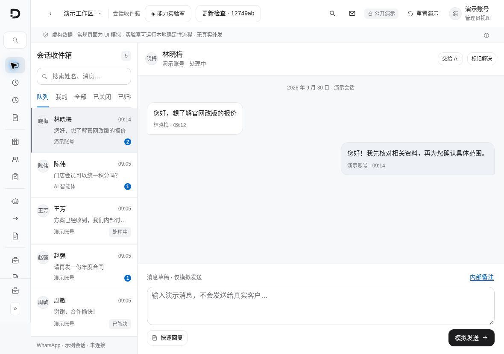
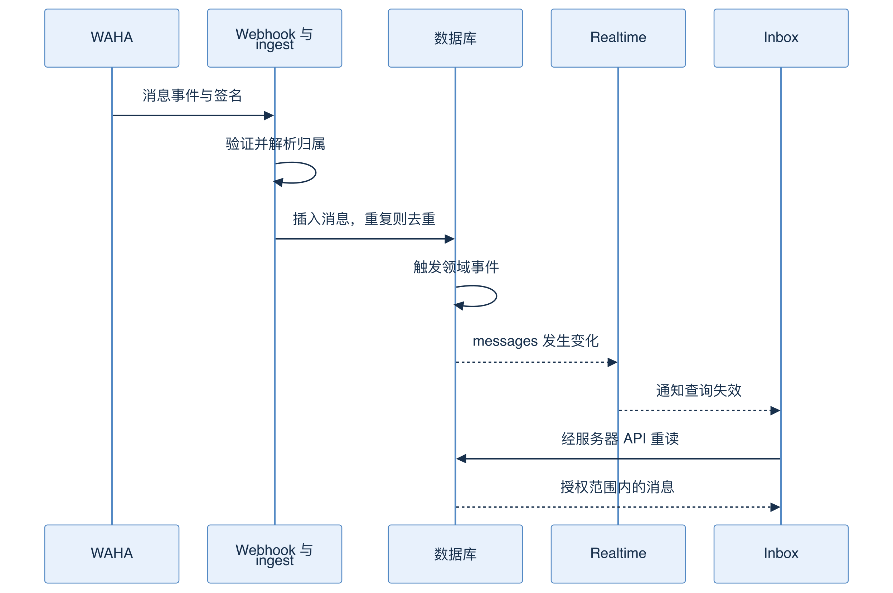
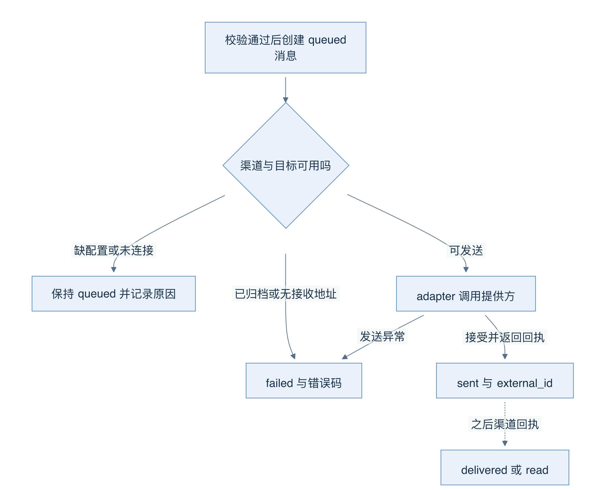
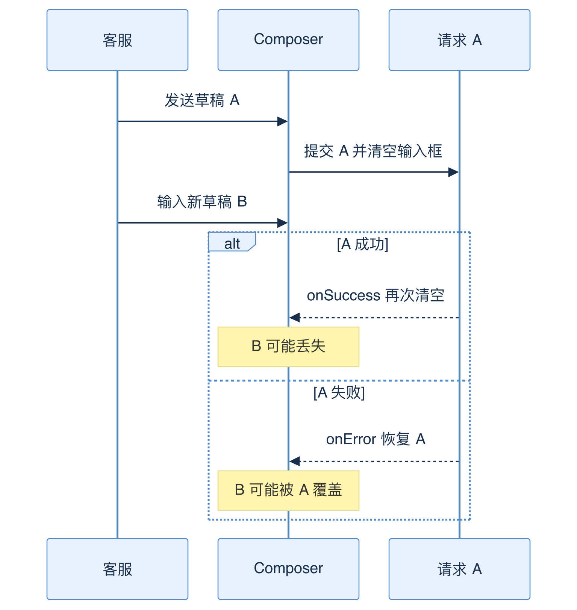
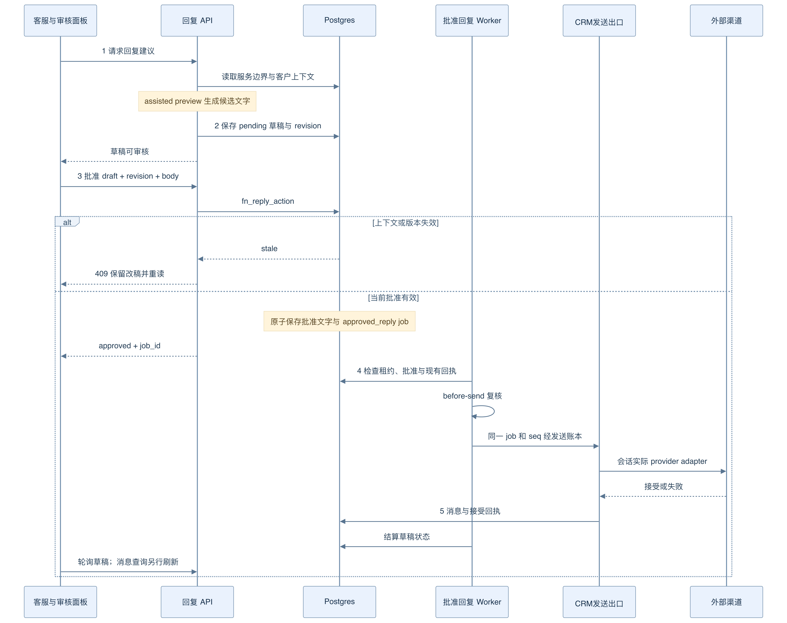
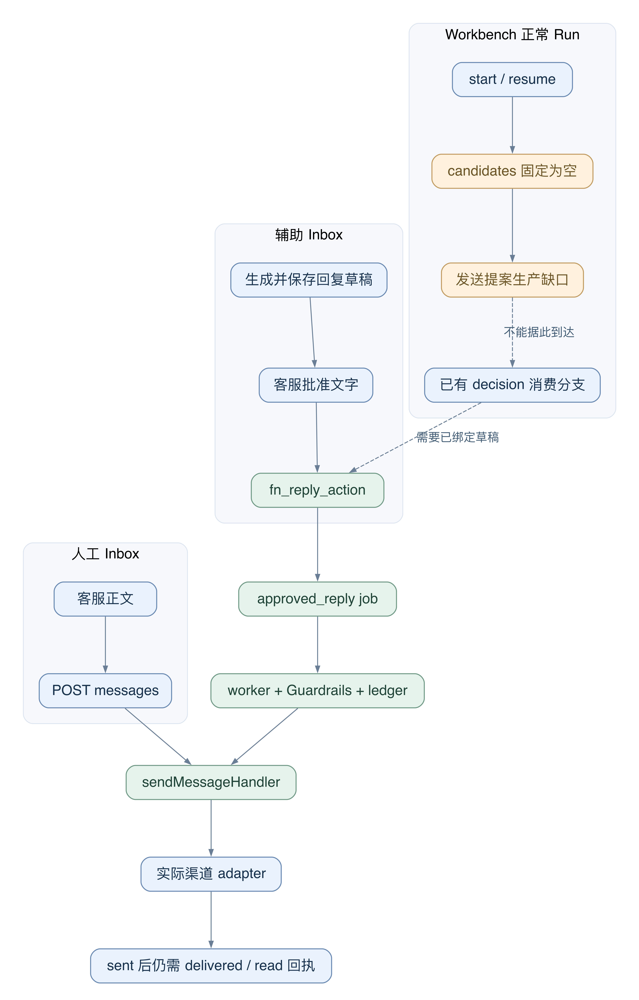

# 08 Inbox：一条消息怎样进入、发送和刷新

[返回母文档](../README.md) · [上一章](07.md) · [下一章](09.md)

**本章目标：**跟踪消息入站、草稿、发送回执与页面刷新。

## 业务流程与阅读起点

学习目标：区分会话、消息、内部备注与发送回执；沿着 UI → API → 渠道 → 数据库 → UI 的回路判断真实结果。本章讲既有客服 Inbox，不把它当作新 Workbench 的任务聊天窗口。

### 当前界面近景

图中是当前中文演示界面。页面保留未连接和模拟发送提示；下面讲解真实消息契约时，仍以固定 main 源码为依据。

### 页面不是一张会话表

InboxLayout 协调会话列表、ChatThread、Composer 和 CRM 侧栏。当前标签页写在 URL 的 filter 中，搜索等辅助条件留在本地状态。“我的”表示分配给我且未结束，“归档”只查 archived，“自动处理”按谁在控制对话过滤，而不只是查 status='ai_handling'。这解释了为什么不能拿一个状态字段重建全部导航语义。

选中 conversation_id 后，useMessagesRealtime 经服务器 API 分页读取消息。收到 messages 表的 Realtime 变化时，它使消息查询和会话列表失效，重新读取；回到浏览器标签页时也会重取，并有安全刷新机制。Realtime 是“有变化，请同步”的信号，不是另一份永远正确的业务数据库。

### 入站消息的路径

WAHA webhook 先按路径 token 找到渠道，再交给 webhook 身份守卫：有签名时检查 HMAC，是否拒绝无签名请求还取决于安装策略。通过后才分派给共享 ingest。ingest 解析联系人和会话、写 messages；重复 external_id 通过唯一约束和 23505 分支处理。收到消息后的领域事件由数据库触发器产生，ingest 特意不再重复发 message.received。fromMe 还要分清 CRM 自己发送后的回声，与客服直接从手机发出的消息，否则界面会出现两个气泡。

图 06-A：前半段是数据写入，后半段是通知后重读。图中数据库才保存消息事实；Realtime 箭头不代表消息已经被人阅读。

### 点击发送时，先出现的是乐观气泡

Composer 读取并 trim 草稿，立即清空输入框，再调用 useSendMessage。对普通文本，hook 会先在缓存加入临时 ID、queued 状态的乐观消息。临时气泡只是反馈“正在提交”，不是外部渠道回执；请求结束后重新拉取真实记录。

POST /api/v1/messages 接受浏览器会话或具有写 scope 的服务器 token，最低角色是 agent。共用 sendMessageHandler 按 conversation_id 加 organization_id 查会话，拒绝被阻止联系人、越界媒体路径和不属于本会话的引用消息。它先创建 queued 消息，再根据会话实际 provider 选择 adapter，处理渠道配置、连接状态和发送动作。媒体走 Storage 签名地址，不能把任意文件路径当作已获授权的附件。

图 06-B：箭头表示此 handler 的主要分支，不是所有 worker 的完整状态机。缺配置或渠道未 WORKING 会保留 queued；归档渠道或无接收地址会失败；提供方接受后才记录 sent 和 external_id。之后的 delivered/read 需要对应渠道回执，不能从一次 HTTP 响应推出来。

这里有一个关键契约：路由返回 HTTP 201 代表拿到了已建立的消息记录，记录本身仍可能是 queued 或 failed。调用者应检查 data.status、error_code、queued_reason。审计事件名 message.sent 也携带 status，不能只数事件名字就声称真实送达。源码存在这些路径，不等于本次阅读完成了真实 WhatsApp 验收。

### 内部备注与客户回复不同

Composer 的 note 模式调用 useCreateNote，不经过外发消息接口。渠道的 24 小时窗口关闭时，客户回复可被挡住，但内部备注仍应可用；联系人被阻止等状态有另一个独立控制。把所有禁用原因揉成一个布尔值，会误伤仍然合法的操作。

当前草稿还存在竞态：发送 A 后允许继续输入 B，但 A 成功回调再次 setText("")，会清掉 B；A 失败回调 setText(A) 则可能覆盖 B。下面是根据当前控制流确认的风险，不是修复后的理想行为。

图 06-C：时间从上到下。回调属于请求 A，却写入共享输入状态；缺少草稿版本或内容比对，导致 B 不被保护。定位此类问题要控制响应先后顺序，而不只测“点击发送成功”。

### 场景：同一条客户问题，人工回复与辅助回复如何分工

假设林女士询问交付时间。客服可以自己写一条回复，也可以请求 Agent 提建议。两条路径最终都要走真实渠道，但它们的“批准对象”和持久化位置不同。

人工 Composer 的草稿属于组件；消息记录属于 messages。辅助回复的草稿属于 ai_reply_drafts；面板中的 edits 只是按 draft ID 保存的本地改稿。只有明确批准的文字进入 approved_reply 队列。拒绝建议不会发送；批准文字也不会顺带批准建议中的 CRM 写入或预约。

图 06-D：第一次 HTTP 请求生成草稿；第二次请求批准文字。worker 才执行批准后的发送。中途收到新消息或权限变化时，旧上下文不能因为已经显示过批准按钮而继续有效。

1. **生成建议。** ReplyReviewPanel POST `/api/v1/conversations/{id}/draft-reply`。路由确认角色和组织内会话，再调用 generateReplyDraft。它读取当前服务边界、已发布 Agent、客户上下文、内部备注和近期反馈，然后以 assisted preview 运行。结果写入 ai_reply_drafts；生成期间上下文变化会让结果变 stale，空文字会变 failed。[源码：[`components/inbox/composer/ReplyReviewPanel.tsx:30-60`](https://github.com/helsome/AiNativeCrm/blob/679e09e80878dff7b1c79b8537317b2b9e355331/components/inbox/composer/ReplyReviewPanel.tsx#L30-L60)；[`app/api/v1/conversations/[id]/draft-reply/route.ts:16-29`](https://github.com/helsome/AiNativeCrm/blob/679e09e80878dff7b1c79b8537317b2b9e355331/app/api/v1/conversations/[id]/draft-reply/route.ts#L16-L29)、[`app/api/v1/conversations/[id]/draft-reply/route.ts:44-75`](https://github.com/helsome/AiNativeCrm/blob/679e09e80878dff7b1c79b8537317b2b9e355331/app/api/v1/conversations/[id]/draft-reply/route.ts#L44-L75)；[`lib/agent-engine/agent/reply-drafts.ts:40-119`](https://github.com/helsome/AiNativeCrm/blob/679e09e80878dff7b1c79b8537317b2b9e355331/lib/agent-engine/agent/reply-drafts.ts#L40-L119)]
2. **只批准当前文字。** 客服可编辑 body，再把 draft ID、revision、action 和 body 提交到 `/api/v1/ai/replies/{id}`。面板显示 proposals，但要求对这些其他动作另行授权。不能把“批准并发送”解释成提高 Agent 自主权。[源码：[`components/inbox/composer/ReplyReviewPanel.tsx:63-95`](https://github.com/helsome/AiNativeCrm/blob/679e09e80878dff7b1c79b8537317b2b9e355331/components/inbox/composer/ReplyReviewPanel.tsx#L63-L95)、[`components/inbox/composer/ReplyReviewPanel.tsx:126-170`](https://github.com/helsome/AiNativeCrm/blob/679e09e80878dff7b1c79b8537317b2b9e355331/components/inbox/composer/ReplyReviewPanel.tsx#L126-L170)；[`app/api/v1/ai/replies/[id]/route.ts:9-34`](https://github.com/helsome/AiNativeCrm/blob/679e09e80878dff7b1c79b8537317b2b9e355331/app/api/v1/ai/replies/[id]/route.ts#L9-L34)]
3. **数据库固定批准事实。** fn_reply_action 锁定服务与草稿，检查 revision、pending 状态和当前上下文。通过后，它在同一次数据库函数调用中新增 approved_reply job，并保存 approved_body、批准人和 send_job_id。同一人重复批准同一已批准文字会返回既有 job。过期草稿得到 409，不能靠重复点击恢复旧授权。[源码：[`supabase/baseline.sql:21787-21814`](https://github.com/helsome/AiNativeCrm/blob/679e09e80878dff7b1c79b8537317b2b9e355331/supabase/baseline.sql#L21787-L21814)；[`app/api/v1/ai/replies/[id]/route.ts:35-56`](https://github.com/helsome/AiNativeCrm/blob/679e09e80878dff7b1c79b8537317b2b9e355331/app/api/v1/ai/replies/[id]/route.ts#L35-L56)]
4. **worker 在出口复核。** agent-worker 注册 approved_reply handler。handler 检查队列租约、服务边界、当前批准策略和 before-send 规则，然后经 runtime channel、send ledger、sendMessageHandler 到会话实际 provider。它直接调用共享 handler，不再绕一遍公开 POST 路由。批准时通过，不代表执行时仍可发送。[源码：[`workers/agent-worker/main.ts:739`](https://github.com/helsome/AiNativeCrm/blob/679e09e80878dff7b1c79b8537317b2b9e355331/workers/agent-worker/main.ts#L739)；[`lib/agent-engine/agent/approved-reply.ts:17-81`](https://github.com/helsome/AiNativeCrm/blob/679e09e80878dff7b1c79b8537317b2b9e355331/lib/agent-engine/agent/approved-reply.ts#L17-L81)；[`lib/channels/runtime.ts:8-17`](https://github.com/helsome/AiNativeCrm/blob/679e09e80878dff7b1c79b8537317b2b9e355331/lib/channels/runtime.ts#L8-L17)；[`lib/agent-engine/edge/channel/waha-adapter.ts:45-59`](https://github.com/helsome/AiNativeCrm/blob/679e09e80878dff7b1c79b8537317b2b9e355331/lib/agent-engine/edge/channel/waha-adapter.ts#L45-L59)；[`lib/agent-engine/edge/crm/send-message.ts:118-145`](https://github.com/helsome/AiNativeCrm/blob/679e09e80878dff7b1c79b8537317b2b9e355331/lib/agent-engine/edge/crm/send-message.ts#L118-L145)]
5. **分别读取发送状态与界面状态。** 审核面板每 4 秒读取草稿状态；消息区靠自己的查询及 Realtime 重读 messages。approved、sending、sent 是审核/发送进度，delivered/read 还需要渠道回执。两个 UI 区块短暂不同步，不等于它们拥有两份独立消息事实。[源码：[`components/inbox/composer/ReplyReviewPanel.tsx:30-37`](https://github.com/helsome/AiNativeCrm/blob/679e09e80878dff7b1c79b8537317b2b9e355331/components/inbox/composer/ReplyReviewPanel.tsx#L30-L37)、[`components/inbox/composer/ReplyReviewPanel.tsx:97-105`](https://github.com/helsome/AiNativeCrm/blob/679e09e80878dff7b1c79b8537317b2b9e355331/components/inbox/composer/ReplyReviewPanel.tsx#L97-L105)；[`hooks/inbox/useMessagesRealtime.ts:15-73`](https://github.com/helsome/AiNativeCrm/blob/679e09e80878dff7b1c79b8537317b2b9e355331/hooks/inbox/useMessagesRealtime.ts#L15-L73)]

#### 失败时先找批准、job 和回执，不先创建新发送

- **生成失败。** 查看草稿 error_code 和生成接口错误。此时没有因为“生成过文字”就取得发送权
- **批准返回 409。** 面板保留按 draft ID 保存的 edits，并重新读取。核对新会话，再生成和审核新建议。这里的保留逻辑属于 ReplyReviewPanel，不能推导人工 Composer 的草稿竞态已修复
- **worker 等待或拒绝。** before-send 可将任务延后，或将草稿结算为 failed/stale。恢复依据是当前策略、错误码和批准文字，不是把状态直接改为 sent
- **渠道接受后，本地响应丢失。** handler 先读取持久发送账本；找到已接受记录就结算为 sent。落库异常保留同一个 job 的恢复机会。不能新建一条发送来验证上一条是否到达

失败分支锚定 [`components/inbox/composer/ReplyReviewPanel.tsx:83-95`](https://github.com/helsome/AiNativeCrm/blob/679e09e80878dff7b1c79b8537317b2b9e355331/components/inbox/composer/ReplyReviewPanel.tsx#L83-L95)、[`lib/agent-engine/agent/approved-reply.ts:82-135`](https://github.com/helsome/AiNativeCrm/blob/679e09e80878dff7b1c79b8537317b2b9e355331/lib/agent-engine/agent/approved-reply.ts#L82-L135)、[`lib/ai/replies/delivery.ts:83-114`](https://github.com/helsome/AiNativeCrm/blob/679e09e80878dff7b1c79b8537317b2b9e355331/lib/ai/replies/delivery.ts#L83-L114)。这是恢复代码的边界说明，不是真实渠道故障演练记录。

### Workbench 的发送批准器存在，但正常 Run 的上游尚未接通

图 06-E：实线是本快照可追到的调用。橙色断点是正常 Workbench Run 到发送提案的缺口；虚线只表示下游具备消费能力。它不是“接好配置就能通”的承诺。

当前 start 路径把 result.candidates 固定为空数组，然后只从 candidates 生成 send_message 提案。resume 路径也把 candidates 固定为空，后续只保存 result.proposals。MCP 组装又过滤 crm_send_whatsapp_message；给 crm_request_human_handoff 开放的例外不覆盖这个发送工具。因此不能用“模型在最终回答里写了建议回复”证明正式发送提案已产生。[源码：[`lib/ai/agents/workbench-start-job.ts:545-550`](https://github.com/helsome/AiNativeCrm/blob/679e09e80878dff7b1c79b8537317b2b9e355331/lib/ai/agents/workbench-start-job.ts#L545-L550)、[`lib/ai/agents/workbench-start-job.ts:591-598`](https://github.com/helsome/AiNativeCrm/blob/679e09e80878dff7b1c79b8537317b2b9e355331/lib/ai/agents/workbench-start-job.ts#L591-L598)；[`lib/ai/agents/run-resumed-workbench-turn.ts:327-332`](https://github.com/helsome/AiNativeCrm/blob/679e09e80878dff7b1c79b8537317b2b9e355331/lib/ai/agents/run-resumed-workbench-turn.ts#L327-L332)、[`lib/ai/agents/run-resumed-workbench-turn.ts:350-379`](https://github.com/helsome/AiNativeCrm/blob/679e09e80878dff7b1c79b8537317b2b9e355331/lib/ai/agents/run-resumed-workbench-turn.ts#L350-L379)；[`lib/agent-engine/edge/crm/mcp-tools.ts:62-75`](https://github.com/helsome/AiNativeCrm/blob/679e09e80878dff7b1c79b8537317b2b9e355331/lib/agent-engine/edge/crm/mcp-tools.ts#L62-L75)；[`lib/mcp/tools/ferramentas-do-harness.ts:36-47`](https://github.com/helsome/AiNativeCrm/blob/679e09e80878dff7b1c79b8537317b2b9e355331/lib/mcp/tools/ferramentas-do-harness.ts#L36-L47)]

下游代码确实存在：Workbench decision 路由能找到绑定的 ai_reply_drafts，调用 fn_reply_action，再恢复 Run 的后续观察与 job。找不到匹配草稿时返回 reply_draft_missing，且不创建发送任务。批准决定落库后续跑失败，又有单独的恢复错误分支。**这些消费分支不能填补正常 Run 的提案生产缺口。** 本章所讲 Inbox 辅助回复有独立 generateReplyDraft 入口，应单独判断。[源码：[`app/api/v1/ai/workbench/runs/[id]/proposals/[proposalId]/decision/route.ts:207-283`](https://github.com/helsome/AiNativeCrm/blob/679e09e80878dff7b1c79b8537317b2b9e355331/app/api/v1/ai/workbench/runs/[id]/proposals/[proposalId]/decision/route.ts#L207-L283)]

### 草稿、HTTP 结果和渠道结果要分开排查

Composer 的错误恢复只覆盖请求进入 onError 的情况。若 POST 返回 HTTP 201，但 data.status 是 failed，useSendMessage 仍进入成功回调，输入框不会自动恢复旧正文。再叠加“发送 A 后继续写 B”的竞态，A 的成功可清除 B，A 的失败可用 A 覆盖 B。因此“有 onError”不等于草稿不会丢。[源码：[`components/inbox/Composer.tsx:121-155`](https://github.com/helsome/AiNativeCrm/blob/679e09e80878dff7b1c79b8537317b2b9e355331/components/inbox/Composer.tsx#L121-L155)；[`hooks/inbox/useSendMessage.ts:36-38`](https://github.com/helsome/AiNativeCrm/blob/679e09e80878dff7b1c79b8537317b2b9e355331/hooks/inbox/useSendMessage.ts#L36-L38)；[`app/api/v1/messages/route.ts:51-62`](https://github.com/helsome/AiNativeCrm/blob/679e09e80878dff7b1c79b8537317b2b9e355331/app/api/v1/messages/route.ts#L51-L62)；[`app/api/v1/messages/_handler.ts:968-978`](https://github.com/helsome/AiNativeCrm/blob/679e09e80878dff7b1c79b8537317b2b9e355331/app/api/v1/messages/_handler.ts#L968-L978)]

InboxLayout 当前给 Composer 传 conversationId，但没有 key，也没有在此处接入 onDraftChange。Composer 的 text 由初始值创建，未按 conversationId 自动重置。按 React 组件复用语义，这里还存在切换会话时沿用本地草稿的风险。它是静态控制流风险，不能写成已完成跨会话草稿隔离。排查时要同时测试“请求未返回”“写下一条”“切换会话”。[源码：[`components/inbox/InboxLayout.tsx:514-524`](https://github.com/helsome/AiNativeCrm/blob/679e09e80878dff7b1c79b8537317b2b9e355331/components/inbox/InboxLayout.tsx#L514-L524)；[`components/inbox/Composer.tsx:68-99`](https://github.com/helsome/AiNativeCrm/blob/679e09e80878dff7b1c79b8537317b2b9e355331/components/inbox/Composer.tsx#L68-L99)]

### 阅读与验证顺序

先看请求是否创建记录，再看记录最终状态，再看提供方回执；如有未知结果，不应重复发送来“确认”。2026-10-03 验收材料明确保留外部发送批准、拒绝及失败恢复的上线边界，不能用本章流程图代替这些证明。

### 源码定位

固定 main：679e09e80878dff7b1c79b8537317b2b9e355331

- Inbox 标签语义和状态：[`components/inbox/InboxLayout.tsx:69-155`](https://github.com/helsome/AiNativeCrm/blob/679e09e80878dff7b1c79b8537317b2b9e355331/components/inbox/InboxLayout.tsx#L69-L155)
- 发送与草稿回调：[`components/inbox/Composer.tsx:86-156`](https://github.com/helsome/AiNativeCrm/blob/679e09e80878dff7b1c79b8537317b2b9e355331/components/inbox/Composer.tsx#L86-L156)
- 乐观缓存与请求结束同步：[`hooks/inbox/useSendMessage.ts:33-103`](https://github.com/helsome/AiNativeCrm/blob/679e09e80878dff7b1c79b8537317b2b9e355331/hooks/inbox/useSendMessage.ts#L33-L103)
- 消息分页及 Realtime：[`hooks/inbox/useMessagesRealtime.ts:15-97`](https://github.com/helsome/AiNativeCrm/blob/679e09e80878dff7b1c79b8537317b2b9e355331/hooks/inbox/useMessagesRealtime.ts#L15-L97)
- 发送授权和 HTTP 201：[`app/api/v1/messages/route.ts:17-68`](https://github.com/helsome/AiNativeCrm/blob/679e09e80878dff7b1c79b8537317b2b9e355331/app/api/v1/messages/route.ts#L17-L68)
- 会话归属与校验：[`app/api/v1/messages/_handler.ts:352-472`](https://github.com/helsome/AiNativeCrm/blob/679e09e80878dff7b1c79b8537317b2b9e355331/app/api/v1/messages/_handler.ts#L352-L472)、[`app/api/v1/messages/_handler.ts:565-601`](https://github.com/helsome/AiNativeCrm/blob/679e09e80878dff7b1c79b8537317b2b9e355331/app/api/v1/messages/_handler.ts#L565-L601)
- queued 分支和渠道选择：[`app/api/v1/messages/_handler.ts:603-763`](https://github.com/helsome/AiNativeCrm/blob/679e09e80878dff7b1c79b8537317b2b9e355331/app/api/v1/messages/_handler.ts#L603-L763)
- 回执、失败与事件：[`app/api/v1/messages/_handler.ts:887-1057`](https://github.com/helsome/AiNativeCrm/blob/679e09e80878dff7b1c79b8537317b2b9e355331/app/api/v1/messages/_handler.ts#L887-L1057)
- WAHA 入口与去重：[`app/api/v1/webhooks/waha/[token]/route.ts:82-140`](https://github.com/helsome/AiNativeCrm/blob/679e09e80878dff7b1c79b8537317b2b9e355331/app/api/v1/webhooks/waha/[token]/route.ts#L82-L140)、[`lib/waha/ingest.ts:678-714`](https://github.com/helsome/AiNativeCrm/blob/679e09e80878dff7b1c79b8537317b2b9e355331/lib/waha/ingest.ts#L678-L714)、[`lib/waha/ingest.ts:760-779`](https://github.com/helsome/AiNativeCrm/blob/679e09e80878dff7b1c79b8537317b2b9e355331/lib/waha/ingest.ts#L760-L779)
- 验收边界：[`docs/testing/system-acceptance-fixes-2026-10-03.md:69-71`](https://github.com/helsome/AiNativeCrm/blob/679e09e80878dff7b1c79b8537317b2b9e355331/docs/testing/system-acceptance-fixes-2026-10-03.md#L69-L71)

## 继续阅读

[返回母文档](../README.md) · [上一章](07.md) · [下一章](09.md)

