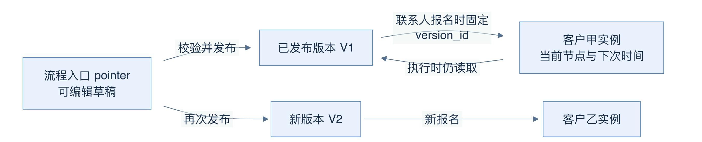
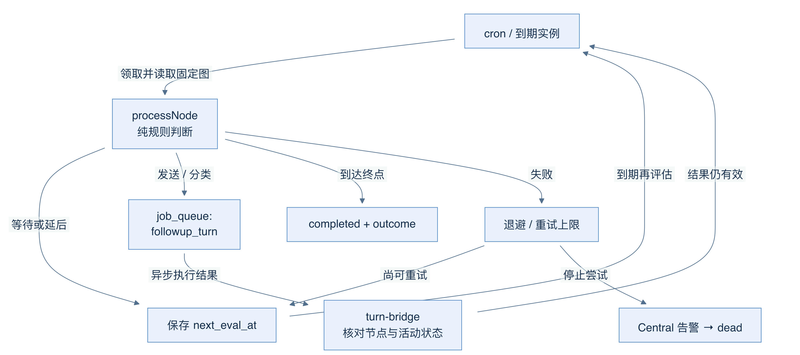
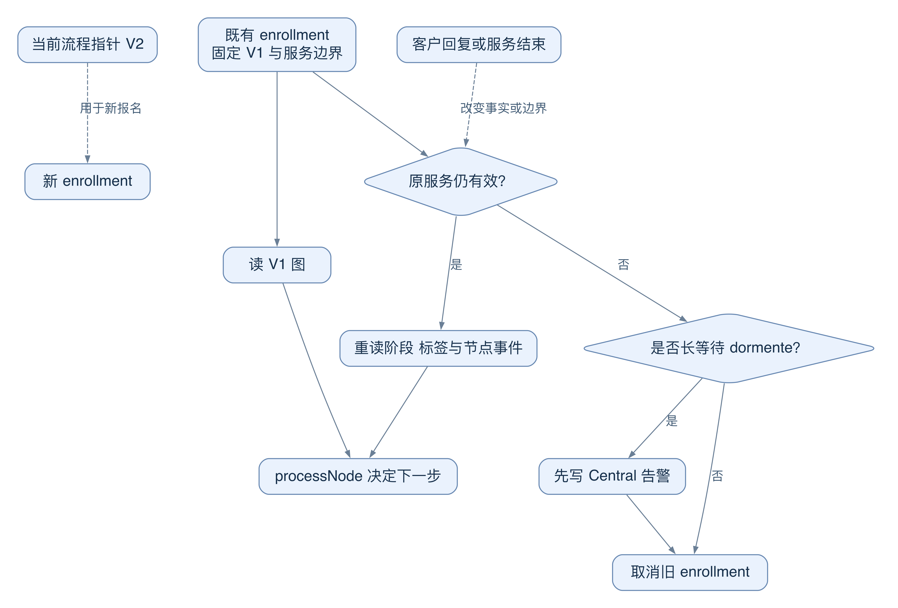
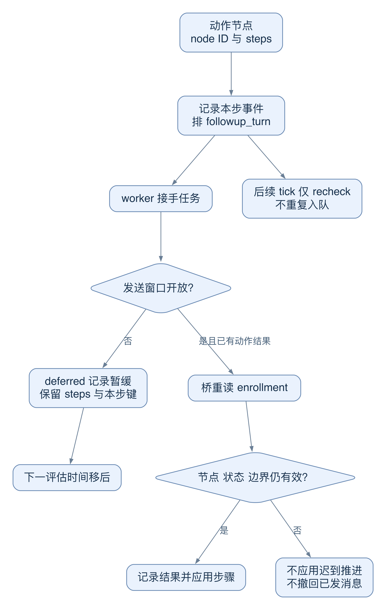
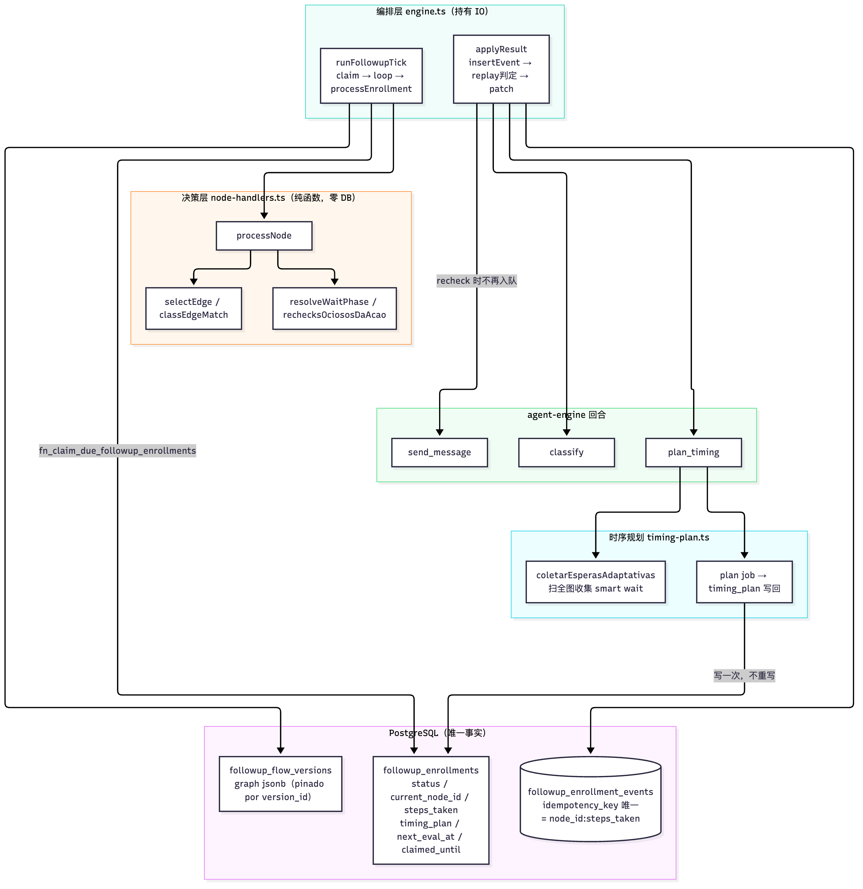
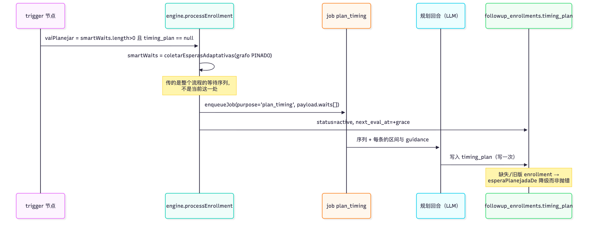

# 09 跟进引擎：流程图、时序计划与人工干预

[返回母文档](../README.md) · [上一章](08.md) · [下一章](10.md)

**本章目标：**理解流程发布、每个客户的执行状态及暂停、跳过和推后。

## 业务流程与阅读起点

学习目标：分清“流程定义”“已发布版本”“客户运行实例”和“一次性承诺”，能沿源码解释为什么某次跟进尚未发送、被暂停或停止尝试。

本章讲的是既有 `/app/ai/followups` 图形化跟进模块，不是把新 chat-first Workbench 的一次聊天自动理解成已发布流程。以下行为为固定快照中的代码确认；本章没有运行客户消息发送。

### 先把四个名词放到正确的位置

设想业务员为询价客户设计“等待 → 问候 → 判断回复 → 结束”。这只是教学情境，不是已配置的真实业务规则。`followup_flow_pointers` 是流程的可编辑入口，保存名称、草稿与当前启用版本；`followup_flow_versions` 保存发布后的图；`followup_enrollments` 才是某位联系人的进度单。它记录 `current_node_id`、`next_eval_at`、状态及固定的 `version_id`。因此，改草稿和推进客户是两件事：正在运行的实例按自己的版本读图，而非每次读取最新草稿。

“我明天下午再联系你”也可能来自另一种机制。队列 API 将 enrollment 与 `cron_jobs` 中的 `schedule_followup` 承诺合并展示；后者满足 `kind='at'`、`job_kind='followup_turn'`。页面同列不代表底层同表，查问题时先看 `source` 是 `enrollment` 还是 `promise`。

源码定位：[`lib/followup/enroll.ts:47-88`](https://github.com/helsome/AiNativeCrm/blob/679e09e80878dff7b1c79b8537317b2b9e355331/lib/followup/enroll.ts#L47-L88)、[`lib/followup/enroll.ts:114-132`](https://github.com/helsome/AiNativeCrm/blob/679e09e80878dff7b1c79b8537317b2b9e355331/lib/followup/enroll.ts#L114-L132)；[`lib/followup/engine.ts:8-10`](https://github.com/helsome/AiNativeCrm/blob/679e09e80878dff7b1c79b8537317b2b9e355331/lib/followup/engine.ts#L8-L10)、[`lib/followup/engine.ts:100-106`](https://github.com/helsome/AiNativeCrm/blob/679e09e80878dff7b1c79b8537317b2b9e355331/lib/followup/engine.ts#L100-L106)；[`app/api/v1/ai/followups/queue/route.ts:1-22`](https://github.com/helsome/AiNativeCrm/blob/679e09e80878dff7b1c79b8537317b2b9e355331/app/api/v1/ai/followups/queue/route.ts#L1-L22)、[`app/api/v1/ai/followups/queue/route.ts:82-93`](https://github.com/helsome/AiNativeCrm/blob/679e09e80878dff7b1c79b8537317b2b9e355331/app/api/v1/ai/followups/queue/route.ts#L82-L93)。

图中“发布”箭头改变流程入口指向的版本；“报名”箭头才创建客户实例。V1 实例继续读取 V1 的箭头解释了版本固定：发布 V2 不等于把已开始的客户进度改写为 V2。

### 从配置到第一次执行

创建流程要求 manager，读列表只要求 viewer。发布也要求 manager：先核对触发器确有执行器，再检查图与被引用的阶段，最后通过发布函数创建版本并启用 pointer。当前允许的触发器包括手动、webhook、沉默、阶段变化、人工确认的爽约以及案件打开；不能因数据库里出现新字符串就认定它可执行。不存在或归档的阶段会被拒绝，避免界面显示“active”而永远没有客户进入。

报名时，服务端依次核对本组织的 active pointer、联系人、版本及可选 agent，建立服务边界，再插入实例。尚未发布返回 `flow_not_active`；不属于当前组织的对象不会因提交 UUID 而被接受；命中正在跟进的唯一性约束返回 409。这里的防重复不是“一个联系人永远只能有一条历史记录”：长等待 `dormente` 特意不占同一活跃防重复槽位。

源码定位：[`app/api/v1/ai/followup-flows/route.ts:21-43`](https://github.com/helsome/AiNativeCrm/blob/679e09e80878dff7b1c79b8537317b2b9e355331/app/api/v1/ai/followup-flows/route.ts#L21-L43)；[`app/api/v1/ai/followup-flows/[id]/publish/route.ts:43-83`](https://github.com/helsome/AiNativeCrm/blob/679e09e80878dff7b1c79b8537317b2b9e355331/app/api/v1/ai/followup-flows/[id]/publish/route.ts#L43-L83)、[`app/api/v1/ai/followup-flows/[id]/publish/route.ts:91-159`](https://github.com/helsome/AiNativeCrm/blob/679e09e80878dff7b1c79b8537317b2b9e355331/app/api/v1/ai/followup-flows/[id]/publish/route.ts#L91-L159)；[`lib/followup/enroll.ts:47-72`](https://github.com/helsome/AiNativeCrm/blob/679e09e80878dff7b1c79b8537317b2b9e355331/lib/followup/enroll.ts#L47-L72)、[`lib/followup/enroll.ts:91-148`](https://github.com/helsome/AiNativeCrm/blob/679e09e80878dff7b1c79b8537317b2b9e355331/lib/followup/enroll.ts#L91-L148)；[`lib/followup/node-handlers.ts:13-28`](https://github.com/helsome/AiNativeCrm/blob/679e09e80878dff7b1c79b8537317b2b9e355331/lib/followup/node-handlers.ts#L13-L28)。

### 时间到了，不等于消息已经送达

cron 调用 `runFollowupTick`，领取到期实例，加载固定版本与客户事实，再交给纯函数 `processNode` 决定下一步。纯函数不访问数据库；引擎负责持久化与排队。这种拆分让“规则判断错了”和“数据库/worker 没工作”能分别测试。

动作节点需要发送或分类时，写入 `job_queue` 的 `followup_turn`；异步回合完成后，经 `turn-bridge` 回写结果。事件幂等键包含节点与步数，重放不能再排同一动作。桥还检查当前节点和状态，迟到的结果不能把已暂停实例重新推走。固定文本有 cron 补充消费路径，但 AI 生成文本仍需要 agent worker；不能看到 cron 成功就宣称所有跟进已发出。

源码定位：[`lib/followup/node-handlers.ts:1-5`](https://github.com/helsome/AiNativeCrm/blob/679e09e80878dff7b1c79b8537317b2b9e355331/lib/followup/node-handlers.ts#L1-L5)；[`lib/followup/engine.ts:366-375`](https://github.com/helsome/AiNativeCrm/blob/679e09e80878dff7b1c79b8537317b2b9e355331/lib/followup/engine.ts#L366-L375)、[`lib/followup/engine.ts:427-452`](https://github.com/helsome/AiNativeCrm/blob/679e09e80878dff7b1c79b8537317b2b9e355331/lib/followup/engine.ts#L427-L452)、[`lib/followup/engine.ts:726-755`](https://github.com/helsome/AiNativeCrm/blob/679e09e80878dff7b1c79b8537317b2b9e355331/lib/followup/engine.ts#L726-L755)；[`lib/followup/turn-bridge.ts:80-95`](https://github.com/helsome/AiNativeCrm/blob/679e09e80878dff7b1c79b8537317b2b9e355331/lib/followup/turn-bridge.ts#L80-L95)；[`app/api/v1/cron/followup-flow-worker/route.ts:43-53`](https://github.com/helsome/AiNativeCrm/blob/679e09e80878dff7b1c79b8537317b2b9e355331/app/api/v1/cron/followup-flow-worker/route.ts#L43-L53)、[`app/api/v1/cron/followup-flow-worker/route.ts:143-151`](https://github.com/helsome/AiNativeCrm/blob/679e09e80878dff7b1c79b8537317b2b9e355331/app/api/v1/cron/followup-flow-worker/route.ts#L143-L151)。

图中返回队列的箭头表示设置下一次评估时间，不是原地忙等；异步结果箭头必须通过“节点仍相同、实例仍可前进”的检查。失败箭头通向退避，超过实例的重试上限才进入 `dead` 并通知人。

### 状态与人工介入怎么读

- `active` 表示流程可继续；`waiting_reply` 表示正在等回复；到终点写入 `completed`，并另记 `outcome`，例如 `replied` 或 `exhausted`。流程结束不是“成交”的同义词
- `dormente` 是不被普通回复提前打断的长等待，仍有到期时间。普通消息不唤醒它，退订处理会把它也纳入停止范围
- 手动暂停使用 `paused_manual`，恢复时保留尚余等待时长；handoff 使用独立状态 `paused_handoff`，不能混为一谈
- 暂停、恢复、延后和跳过都要防止与 worker 并发。被领取中的实例不能被悄悄覆盖，冲突返回 409；多出口节点“跳过”须明确选择出口

源码定位：[`lib/followup/engine.ts:455-461`](https://github.com/helsome/AiNativeCrm/blob/679e09e80878dff7b1c79b8537317b2b9e355331/lib/followup/engine.ts#L455-L461)；[`lib/followup/node-handlers.ts:13-30`](https://github.com/helsome/AiNativeCrm/blob/679e09e80878dff7b1c79b8537317b2b9e355331/lib/followup/node-handlers.ts#L13-L30)；[`lib/followup/reactivity.ts:64-84`](https://github.com/helsome/AiNativeCrm/blob/679e09e80878dff7b1c79b8537317b2b9e355331/lib/followup/reactivity.ts#L64-L84)；[`lib/followup/intervencao.ts:11-31`](https://github.com/helsome/AiNativeCrm/blob/679e09e80878dff7b1c79b8537317b2b9e355331/lib/followup/intervencao.ts#L11-L31)、[`lib/followup/intervencao.ts:46-64`](https://github.com/helsome/AiNativeCrm/blob/679e09e80878dff7b1c79b8537317b2b9e355331/lib/followup/intervencao.ts#L46-L64)、[`lib/followup/intervencao.ts:71-111`](https://github.com/helsome/AiNativeCrm/blob/679e09e80878dff7b1c79b8537317b2b9e355331/lib/followup/intervencao.ts#L71-L111)、[`lib/followup/intervencao.ts:124-158`](https://github.com/helsome/AiNativeCrm/blob/679e09e80878dff7b1c79b8537317b2b9e355331/lib/followup/intervencao.ts#L124-L158)。

### 深入一层：哪些状态固定，哪些事实必须刷新

设想林女士报名了“询价后回访”V1。经理次日发布 V2。第三天，林女士已经回复，客服也可能已结束本次服务。到期时，引擎要回答三个不同问题：按哪张图走、客户现在怎样、原任务是否仍有资格影响当前服务。一个“最新版本”字段无法回答这三件事。

图 07-C：实线表示读取或校验。虚线表示后来发生的变化。V2 改变新报名所用的图，不自动改变既有实例。客户回复会改变事实，但不直接重写流程版本。

1. 报名函数读取 active pointer，把 `active_version_id` 写入 enrollment 的 `version_id`。它还捕获 `service_boundary`。前者回答“执行哪份流程”，后者回答“这项工作起源于哪次服务”
2. 每次评估先校验服务边界和预约保护，再按 enrollment 的 `version_id` 读图。随后重新读取客户阶段、标签与节点事件。这是“固定执行定义，刷新业务事实”
3. 如果服务仍有效，`processNode` 按新事实做出下一步决定。例如已有合适回复，就不必把客户当作仍沉默
4. 如果服务已经结束、替换或 revision 不匹配，旧任务不能靠读取新边界获得新授权。引擎取消 enrollment。若它处于 `dormente`，引擎先写 Central 告警，让人知道原定回访未执行
5. 普通“暂时不能发”走另一分支。预约保护可设置下一次评估时间。它保留任务，不把暂缓误记为服务过期

为什么这样设计？固定图让同一客户的步骤语义保持稳定。重读事实让判断跟上客户行为。服务边界则限制旧工作能影响哪个服务。代价是跨数周的回访可能因原服务结束而取消。当前代码明确拒绝在 tick 或 retry 中自动重新建立服务。不要把这个缺口写成“系统会自动迁移回访”。

边界还有一处细节：跟进校验允许“原来没有需求 → 同一 service_revision 下出现首个需求”。它仍拒绝关闭或替换服务。第 22 章的 checkpoint 读取采用完整身份相等，不能直接借用这个较宽的持续性判断。两者分别保护“旧任务能否继续”与“这份摘要属于哪个确切服务”。

源码定位：[`lib/followup/enroll.ts:114-130`](https://github.com/helsome/AiNativeCrm/blob/679e09e80878dff7b1c79b8537317b2b9e355331/lib/followup/enroll.ts#L114-L130)；[`lib/followup/engine.ts:527-590`](https://github.com/helsome/AiNativeCrm/blob/679e09e80878dff7b1c79b8537317b2b9e355331/lib/followup/engine.ts#L527-L590)；[`lib/atendimento/fronteira.ts:24-71`](https://github.com/helsome/AiNativeCrm/blob/679e09e80878dff7b1c79b8537317b2b9e355331/lib/atendimento/fronteira.ts#L24-L71)；[`lib/agent-engine/agent/customer-memory.ts:27-35`](https://github.com/helsome/AiNativeCrm/blob/679e09e80878dff7b1c79b8537317b2b9e355331/lib/agent-engine/agent/customer-memory.ts#L27-L35)、[`lib/agent-engine/agent/customer-memory.ts:93-115`](https://github.com/helsome/AiNativeCrm/blob/679e09e80878dff7b1c79b8537317b2b9e355331/lib/agent-engine/agent/customer-memory.ts#L93-L115)。

### 深入一层：异步结果为何不能直接推进实例

“时间到了”“任务入队”“内容已发送”“实例已推进”是四个不同事实。把其中一个替代另外三个，会造成重复发送或把人工暂停覆盖掉。

图 07-D：只有有效的动作完成结果可消费本步幂等键。发送窗口关闭走下方暂缓分支，不能提前宣称动作完成。

1. 引擎为动作生成 `node_id:steps_taken`。它记录事件并将 `source_step_key` 放进 job payload。重放看到已有本步事件，就不再按初次路径排同一动作
2. job 仍在运行时，后续 tick 返回 `recheck`。它只更新下一次检查时间，不另建一个发送任务。持有 job 的 worker 负责完成该次发送
3. 如果发送窗口关闭，turn 返回 `deferred`。桥记录包含 job 身份的暂缓键，保留 `steps_taken`，并把 `next_eval_at` 移到窗口开启之后。询问节点还加完整回复宽限期
4. worker 完成后，桥重读 enrollment。它检查当前节点，且只允许 `active`、`waiting_reply` 前进。人工暂停、取消或换到其他节点，都使迟到结果停止应用
5. 应用前，桥再查 service boundary。生产适配器可用 `applyEnrollmentStep` 将事件与步骤变更一起应用；兼容路径则先写事件，再更新 enrollment。不能把所有适配器写成同一种原子保证

有意义的失败例：15:00 的 job 已生成回访文本，15:01 人工暂停，15:02 结果返回。桥不应把实例改回 active。它丢弃推进结果，是在保存较新的人工决定。它也不能撤回 15:00 已完成的外部发送，所以排队幂等、状态校验与渠道发送回执仍要分别检查。

源码定位：[`lib/followup/engine.ts:366-401`](https://github.com/helsome/AiNativeCrm/blob/679e09e80878dff7b1c79b8537317b2b9e355331/lib/followup/engine.ts#L366-L401)、[`lib/followup/engine.ts:420-452`](https://github.com/helsome/AiNativeCrm/blob/679e09e80878dff7b1c79b8537317b2b9e355331/lib/followup/engine.ts#L420-L452)；[`lib/followup/turn-bridge.ts:80-135`](https://github.com/helsome/AiNativeCrm/blob/679e09e80878dff7b1c79b8537317b2b9e355331/lib/followup/turn-bridge.ts#L80-L135)、[`lib/followup/turn-bridge.ts:143-191`](https://github.com/helsome/AiNativeCrm/blob/679e09e80878dff7b1c79b8537317b2b9e355331/lib/followup/turn-bridge.ts#L143-L191)。发送渠道的实际结果仍按第 10 章查证。

### 先看证据，再诊断“为什么没发”

按“触发配置 → enrollment → 当前节点/时间 → job → 消息结果”查，而不是先改提示词。`claim_falhou=true` 表示领取失败，不能把 `claimed=0` 当作“没有到期任务”。节点失败会记录错误并退避；停止尝试前先写 Central 告警，再写 `dead`，避免任务无声死亡。禁用流程只改 pointer；回滚只改版本指针，不把 disabled 流程自动启用，更不是撤回已经发出的消息。

还有一处值得亲手比对的差异：导航将 Follow-ups 标记为 manager 才可见，但页面只用 `canWrite` 限制编辑，流程与队列 GET 都允许 viewer。**“菜单看不到”与“读取 API 禁止”在本快照并不一致**，不能拿前端导航当后端权限证明。

源码定位：[`lib/followup/engine.ts:278-328`](https://github.com/helsome/AiNativeCrm/blob/679e09e80878dff7b1c79b8537317b2b9e355331/lib/followup/engine.ts#L278-L328)、[`lib/followup/engine.ts:726-745`](https://github.com/helsome/AiNativeCrm/blob/679e09e80878dff7b1c79b8537317b2b9e355331/lib/followup/engine.ts#L726-L745)；[`app/api/v1/ai/followup-flows/[id]/disable/route.ts:46-56`](https://github.com/helsome/AiNativeCrm/blob/679e09e80878dff7b1c79b8537317b2b9e355331/app/api/v1/ai/followup-flows/[id]/disable/route.ts#L46-L56)；[`app/api/v1/ai/followup-flows/[id]/rollback/route.ts:3-13`](https://github.com/helsome/AiNativeCrm/blob/679e09e80878dff7b1c79b8537317b2b9e355331/app/api/v1/ai/followup-flows/[id]/rollback/route.ts#L3-L13)；[`lib/navigation/catalogo.ts:406-413`](https://github.com/helsome/AiNativeCrm/blob/679e09e80878dff7b1c79b8537317b2b9e355331/lib/navigation/catalogo.ts#L406-L413)；[`app/app/ai/followups/page.tsx:24-35`](https://github.com/helsome/AiNativeCrm/blob/679e09e80878dff7b1c79b8537317b2b9e355331/app/app/ai/followups/page.tsx#L24-L35)；[`app/api/v1/ai/followups/queue/route.ts:134-139`](https://github.com/helsome/AiNativeCrm/blob/679e09e80878dff7b1c79b8537317b2b9e355331/app/api/v1/ai/followups/queue/route.ts#L134-L139)。

自测：发布新版本、取消一个实例、暂停另一个实例，分别改变哪个对象？为什么“队列里有下一次时间”仍不足以证明真实 WhatsApp 送达？2026-10-03 的修复报告明确：受控发送只证明本地流程与台账，真实 WhatsApp 与 Workbench 外部提案恢复仍不能由它替代。定位：[`docs/testing/system-acceptance-fixes-2026-10-03.md:61-71`](https://github.com/helsome/AiNativeCrm/blob/679e09e80878dff7b1c79b8537317b2b9e355331/docs/testing/system-acceptance-fixes-2026-10-03.md#L61-L71)。

固定 main：679e09e80878dff7b1c79b8537317b2b9e355331

## 实现详解

跟进（follow-up）引擎是本仓库里唯一把「一段跟进的业务逻辑」表达为**可验证图结构**、并由**纯函数决策层 + 数据库编排层**共同驱动的子系统。它不只是一个定时发送器：它同时承载命名分支路由、自适应等待的全局时序规划、免回复免疫的长等待、多类触发器（三类来源：人工建流、对话回复、CRM 阶段推进），以及一套完整的人工干预与死信路径。本页聚焦这五层结构及其边界契约。

阅读本页前，建议先掌握 [分层视图：应用、数据库、鉴权、实时、事件队列与边缘中间件](03.md)（理解 job 队列如何承载 `enqueue_turn`）与 [事件日志驱动的工作进程：声明、去重、退避与死信](16.md)（理解 dead-letter 收口的通用惯例）。

---

### 整体架构：图是数据，不是代码

引擎的第一性事实是：**一段跟进流程就是一份 JSON 图**，它存在 `followup_flow_versions.graph` 里，被 Zod schema 完整描述，并在读取时被逐字解析。节点、边、配置全部是数据；没有可执行表达式、没有 eval。这意味着图的每一次读取都要过一次 `flowGraphSchema.parse`，任何越界形状在进入引擎之前就被拒绝。

图 schema 定义了 8 种节点类型（`trigger`、`wait`、`condition`、`ai_classify`、`match_reply`、`repeat`、`action`、`end`）和边条件的一个判别联合（`always` / `class_match` / `cond_result` / `branch`）。每个节点是 `strictObject`，因此多余键直接报错——这让「未知字段」不可能被静默持久化。 Sources: [graph-schema.ts](https://github.com/helsome/AiNativeCrm/blob/679e09e80878dff7b1c79b8537317b2b9e355331/lib/followup/graph-schema.ts#L9) [graph-schema.ts](https://github.com/helsome/AiNativeCrm/blob/679e09e80878dff7b1c79b8537317b2b9e355331/lib/followup/graph-schema.ts#L318) [graph-schema.ts](https://github.com/helsome/AiNativeCrm/blob/679e09e80878dff7b1c79b8537317b2b9e355331/lib/followup/graph-schema.ts#L406)

**为什么拆成两层**：`node-handlers.ts` 是纯函数，明确声明「不给定节点与事实，不决定下一步」，因此可以在没有 Postgres 的环境下被穷举测试；`engine.ts` 只负责取数、落库与异常编排。这条边界不是风格偏好——它让 `tests/invariants/followup-*.test.ts` 里的大量断言可以在裸 Postgres 上跑通，而不需要 PostgREST。 Sources: [node-handlers.ts](https://github.com/helsome/AiNativeCrm/blob/679e09e80878dff7b1c79b8537317b2b9e355331/lib/followup/node-handlers.ts#L1) [engine.ts](https://github.com/helsome/AiNativeCrm/blob/679e09e80878dff7b1c79b8537317b2b9e355331/lib/followup/engine.ts#L8)

#### 积分（积分）与租约

一次 tick 的生命周期固定为：`claimDueEnrollments(limit=20, lease=120s)` → 对每条 enrollment 调 `processEnrollment` → `applyResult` 写事件 + patch 行。所有 enrollment 共享一条失败隔离线：任何一条抛错只会让它自己走 `applyHandlerFailure`，绝不会掀掉整个批次；即使失败写入本身也失败（DB 中途挂了），也只是让它留着租约等租约过期。 Sources: [engine.ts](https://github.com/helsome/AiNativeCrm/blob/679e09e80878dff7b1c79b8537317b2b9e355331/lib/followup/engine.ts#L46) [engine.ts](https://github.com/helsome/AiNativeCrm/blob/679e09e80878dff7b1c79b8537317b2b9e355331/lib/followup/engine.ts#L713)

`applyHandlerFailure` 是一条30s→1h 的五档退避阶梯（`BACKOFF_MS`），越界后转 `markDead`。而 claim本身失败被**显式区分**于「无到期项」：`summary.claim_falhou = true` 并 `logger.error`，绝不抛出——抛出会杀掉整个 worker，静默则会让「claim 永远失败」退化成「没有症状的症状」。 Sources: [engine.ts](https://github.com/helsome/AiNativeCrm/blob/679e09e80878dff7b1c79b8537317b2b9e355331/lib/followup/engine.ts#L305) [engine.ts](https://github.com/helsome/AiNativeCrm/blob/679e09e80878dff7b1c79b8537317b2b9e355331/lib/followup/engine.ts#L715)

---

### 图结构的两代方言与命名分支

这是引擎里最容易被误解的部分，也是唯一一个**格式代际并存**的子系统。核心结论先说：**分支（branch）属于节点，不属于边**。v1 时代，一个 `ai_classify` 节点的每个输出直接用「类名字符串」当路由键，于是重命名类名会静默断开连线。v2 引入稳定 `branch_id`，边通过 `branch_id` 引用；重命名只改标签，路由不动。 Sources: [graph-schema.ts](https://github.com/helsome/AiNativeCrm/blob/679e09e80878dff7b1c79b8537317b2b9e355331/lib/followup/graph-schema.ts#L21)

| 维度 | v1 拼写 | v2 拼写 | 兼容保证 |
| --- | --- | --- | --- |
| `ai_classify` 输出 | `class_match: { value: "hot" }`（类名即 id） | `branch: { branch_id: "b_quente" }`，标签另存于 `branches[].label` | `classes[]` 保留为 `branches[].label` 的**受校验镜像**，两者漂移时 refine 直接拒绝 |
| `condition` 输出 | `cond_result: { value: true/false }` | `branching: 'per_check'` 时每条 check 一个 `branch_id` | `combined`（含缺省）仍产出 v1 条件，已发布流程不被重写 |
| 边引用目标 | 字符串值 | 不透明 id（≤64 字符，禁止占用保留字） | `branchIdForCondition` 同时接受两种拼写 |
| catch-all | `{ type: 'always' }` | 同左（**永不**写成 branch） | `else` 是保留 id，边上必须写成 `always` |

`ai_classify` 的 `classes` 不是可以随手写的第二份真相：schema 层的 refine 要求 `branches.length === classes.length` 且逐项 `label === classes[i]`，因此「镜像」不可能腐烂。没有 `branches` 的节点即 v1 节点，其类名字符串本身就是分支 id——这恰恰就是那个重命名 bug，但 v1 节点在构建器迁移前保持旧行为，不被「顺手修好」。 Sources: [graph-schema.ts](https://github.com/helsome/AiNativeCrm/blob/679e09e80878dff7b1c79b8537317b2b9e355331/lib/followup/graph-schema.ts#L180)

`condition` 的 `branching: 'per_check'` 允许每条 check 拥有独立出口，`combinator` 在该模式下不被读取（一条规则不再投票，它变成路由）；refine 强制该模式下每条 check 都必须带 `id`，因为那正是边所引用的东西。 Sources: [graph-schema.ts](https://github.com/helsome/AiNativeCrm/blob/679e09e80878dff7b1c79b8537317b2b9e355331/lib/followup/graph-schema.ts#L262)

#### 单一读取口：`nodeBranches()`

所有下游——画布手柄、边面板、发布校验、引擎路由——都必须经由 `nodeBranches(node)`，绝不直接读原始形状。兼容成本因此只付一次。该函数返回每个节点的全部出口，顺序即构建器绘制手柄的顺序，且**强制把 catch-all 放在最后**。 Sources: [graph-schema.ts](https://github.com/helsome/AiNativeCrm/blob/679e09e80878dff7b1c79b8537317b2b9e355331/lib/followup/graph-schema.ts#L504) [graph-schema.ts](https://github.com/helsome/AiNativeCrm/blob/679e09e80878dff7b1c79b8537317b2b9e355331/lib/followup/graph-schema.ts#L569)

| 节点类型 | 出口（按顺序） | catch-all 标签 |
| --- | --- | --- |
| `trigger` / `wait` / `action` / `end` | 仅 fallback | 「Sempre」（永远） |
| `condition`（combined） | `true`「Sim」、`false`「Não」、fallback | 「Outros casos」（其他情况） |
| `condition`（per_check） | 每条 check 一个 id（`label` 可为 null）、fallback | 「Nenhuma delas」（都不满足） |
| `ai_classify` | 各类分支 + `no_reply`「Sem resposta」、fallback | 「Outros casos」 |
| `match_reply` | 各文本规则 + `no_reply`、fallback | 「Outros casos」 |
| `repeat` | `body`「Próxima volta」、`done`「Acabou」、fallback | 「Outros casos」 |

三个 fallback 标签刻意不同：单出口节点的「Sempre」说明**总是**走这里；而带具体出口的节点用「Outros casos」/「Nenhuma delas」——因为引擎只在没有其他出口匹配时才用它，绝不会让同一个 lead 同时走两条路，把「Sempre」摆在「Interessado」旁边会诱使搭建者把面向所有人的消息接在它上面。

`per_check` 分支的 `label` 允许为 `null`：句子由 `check` 组合而成，而组合葡语措辞是词汇表（`vocabulario.ts` 的 `fraseDaCondicao`）的职责，契约文件不允许长出第二套词表。 Sources: [graph-schema.ts](https://github.com/helsome/AiNativeCrm/blob/679e09e80878dff7b1c79b8537317b2b9e355331/lib/followup/graph-schema.ts#L534) [graph-schema.ts](https://github.com/helsome/AiNativeCrm/blob/679e09e80878dff7b1c79b8537317b2b9e355331/lib/followup/graph-schema.ts#L543)

#### 图完整性闸门

`flowGraphSchema` 的 `superRefine` 是节点/边之间的**完整性**关卡（`strictObject` 只做各自校验）：重复节点 id、重复边 id、边指向不存在的 source/target，全部被拒绝。这道闸门对所有消费者是同一扇门——保存草稿、加载版本（引擎、turn-bridge、enroll、silence-sweep、干预）、发布都一样。已经持有损坏草稿的用户会收到带具体 id 的报错，而不是一个只会在中途某次触发时才崩的图；草稿迁移被明确记录为「不做」，见 issue #699。 Sources: [graph-schema.ts](https://github.com/helsome/AiNativeCrm/blob/679e09e80878dff7b1c79b8537317b2b9e355331/lib/followup/graph-schema.ts#L440)

#### ⚠️ 半迁移节点：一个已知的静默陷阱

给一个**已有连线**的节点补上 `branches`，不是改配置而已。`branchIdForCondition` 在 v2 节点上接受按**标签**匹配的遗留 `class_match` 边，好让画布继续画半迁移节点而不丢线；但**路由没有这份客气**：`classEdgeMatch` 返回 `{type:'branch'}`，`selectEdge` 不匹配旧边，落到 `always`。结果是「屏幕正确、路由错误」，且没有任何东西会抱怨。因此给已有边的节点加 `branches`，必须在同一瞬间重写那些边——这是画布层的原子操作；`ClassifyForm` 至今仍故意输出 v1，就是这个原因。 Sources: [graph-schema.ts](https://github.com/helsome/AiNativeCrm/blob/679e09e80878dff7b1c79b8537317b2b9e355331/lib/followup/graph-schema.ts#L496) [node-handlers.ts](https://github.com/helsome/AiNativeCrm/blob/679e09e80878dff7b1c79b8537317b2b9e355331/lib/followup/node-handlers.ts#L239)

---

### 决策层：一次 tick 如何在纯函数里前进

`processNode` 接收节点、边、enrollment 行、lead 事实以及一组**从事件历史推导出的相位标志**，返回 `NodeResult`。结果只有7 种，每种都直接映射到一种 enrollment 状态迁移。 Sources: [node-handlers.ts](https://github.com/helsome/AiNativeCrm/blob/679e09e80878dff7b1c79b8537317b2b9e355331/lib/followup/node-handlers.ts#L84) [engine.ts](https://github.com/helsome/AiNativeCrm/blob/679e09e80878dff7b1c79b8537317b2b9e355331/lib/followup/engine.ts#L182)

| `NodeResult.kind` | 语义 | `status` 迁移 | 事件类型 |
| --- | --- | --- | --- |
| `advance` | 前进到下一节点（可带 `repeat` 或 `reason: 'plan_timeout'`） | `active` | `node_advanced` / `timing_plan_desistido` |
| `wait` | 留在本节点计时 | `active` / `waiting_reply` / `dormente` | `wait_started` |
| `enqueue_turn` | 入队一个 agent回合 | `active` / `waiting_reply` | `turn_enqueued` / `classify_enqueued` |
| `recheck` | action 回合在飞：原地等待，**不入队** | `active` | `action_recheck` |
| `dead` | dead-man 触发 | `dead`（走 `markDead`） | `flow_dead`（不入事件表） |
| `complete` | 抵达 `end` | `completed` | `flow_completed` |
| `fail` | 处理失败 | 退避重试 | `node_failed`（不入事件表） |

`plan_timeout` 之所以要独立的事件类型而非埋进 `node_advanced`：放弃时序计划是操作员必须能直接读到的后果——流程里所有等待都退到各自上限；埋掉原因等于把动机藏起来。 Sources: [engine.ts](https://github.com/helsome/AiNativeCrm/blob/679e09e80878dff7b1c79b8537317b2b9e355331/lib/followup/engine.ts#L168)

#### 事件即状态：`resolveWaitPhase`

`wait` 节点会被进入两次——一次启动计时器（写通用步骤事件），一次在 `next_eval_at` 到期后前进。两次都看到**同一个节点**（`current_node_id` 不变）而 `steps_taken` 恰好 +1，因此「这次等待是否已经启动过」精确等价于「本节点上**上一步**的事件是否存在」：`resolveWaitPhase` 检查的正是幂等键 `${nodeId}:${stepsTaken - 1}` 是否存在。 Sources: [node-handlers.ts](https://github.com/helsome/AiNativeCrm/blob/679e09e80878dff7b1c79b8537317b2b9e355331/lib/followup/node-handlers.ts#L292) [node-handlers.ts](https://github.com/helsome/AiNativeCrm/blob/679e09e80878dff7b1c79b8537317b2b9e355331/lib/followup/node-handlers.ts#L288)

引擎因此把「相位判定」全部下沉到事件历史，而非 enrollment 行上的冗余布尔：

| 派生量 | 来源函数 | 语义 |
| --- | --- | --- |
| `waitElapsed` | `resolveWaitPhase` | 本节点上一步是否已写过事件 |
| `wokeEarly` | 同键 + `:wake` 后缀 | 入站消息是否已把本节点叫醒 |
| `occupancyEventCount` | 连续同节点事件计数 | 该节点上的统计占用（用于 `match_reply` 确认已入队的情形） |
| `actionEnqueued` | `resolveWaitPhase` | 本次停留是否已入队过发送回合 |
| `actionCompleted` | `actionTurnCompleted` | `action_sent` 是否已落库 |
| `actionRecheckCount` | `rechecksOciososDaAcao` | 见下文 dead-man |
| `last_outcome` | `ultimoDesfechoDe` | 最近一次 `ai_classified` 事件的类 |
| `repeatTaken` / `repeatTotal` | `repeat*FromEvents` | 循环状态存于事件，不存于节点 |

`last_outcome` 值得单独说明：它曾是一个**只有契约、没有数据**的字段——`engine.ts` 把 `LeadFacts.last_outcome` 硬编码为 `null`，于是用「上一步的 Desfecho」写的条件是纯装饰；而在 `neq` 下更糟，因为 `null !== "x"` 恒为真，流程会把**所有** lead 送进否定分支。修复方式是引擎在读完事件后再填这个字段，并让 `condition` 也进入 `precisaEventos` 集合。 Sources: [engine.ts](https://github.com/helsome/AiNativeCrm/blob/679e09e80878dff7b1c79b8537317b2b9e355331/lib/followup/engine.ts#L612) [engine.ts](https://github.com/helsome/AiNativeCrm/blob/679e09e80878dff7b1c79b8537317b2b9e355331/lib/followup/engine.ts#L617) [node-handlers.ts](https://github.com/helsome/AiNativeCrm/blob/679e09e80878dff7b1c79b8537317b2b9e355331/lib/followup/node-handlers.ts#L336)

还有一个数值陷阱：`steps_taken` 在 schema 里是数字，但表单曾长期把用户**输入的文本**存进去。于是 `"3"` 让 `gte` 永假、`neq` 恒真——规则在卡片上看着正常，却自己决定了走向。`valorDePassos` 现在读取人写的数字，非数字文本原样保留（由发布校验拒绝）。 Sources: [node-handlers.ts](https://github.com/helsome/AiNativeCrm/blob/679e09e80878dff7b1c79b8537317b2b9e355331/lib/followup/node-handlers.ts#L338)

#### action 的 dead-man：为什么不能只数 rechecks

`action` 节点在等一个**在飞的回合**。若回合永不回来，enrollment 会永远卡住，因此需要一个上界。但纯计数的上界曾经是 `5 × 5min`，它**杀死整晚所有 follow-up**：`MAX_ACTION_RECHECKS` 无法区分「worker 死了」和「worker 活着、发送正停在反封禁窗口（默认 7h–22h）之外」。落在 22h 的触达会在 recheck 里耗约 25 分钟，然后带着 `action_turn_never_completed` 死掉——lead 从未收到，**记录的理由是假的**（生产实测 2026-08-18）。

解法不是调大数字（注释明确警告：那只是去买时间，而等待时长无上界——按渠道的 anti-ban 窗口、agent 自己的发送时段可达 159h），而是引入**存活证明**：`EVENTO_ACAO_ADIADA`（`action_deferred`）。回合每写一次「我把发送推迟到一个已知时刻（窗口关闭，不是缺陷）」，`rechecksOciososDaAcao` 就从后往前扫描并**在该事件处停住**，只统计它之后的空闲次数。没有 adiamento 时它与 `occupancyEventCount` 完全相同，所以 worker 真死时 dead-man 依旧一样严厉。配合从 5min 翻倍到 1h 封顶的 `atrasoDoRecheck`，预算覆盖约 11 小时。 Sources: [node-handlers.ts](https://github.com/helsome/AiNativeCrm/blob/679e09e80878dff7b1c79b8537317b2b9e355331/lib/followup/node-handlers.ts#L126) [node-handlers.ts](https://github.com/helsome/AiNativeCrm/blob/679e09e80878dff7b1c79b8537317b2b9e355331/lib/followup/node-handlers.ts#L167) [node-handlers.ts](https://github.com/helsome/AiNativeCrm/blob/679e09e80878dff7b1c79b8537317b2b9e355331/lib/followup/node-handlers.ts#L109)

`plan_timing` 的 dead-man 走的是**相反的结局**：`MAX_PLAN_RECHECKS = 3`（约 15 分钟）后流程**继续前进**，而不是死亡。时序规划器不可用不能杀死跟进——没有它流程依然完整（各等待退回上限，也就是引入该特性前的行为）；杀掉 enrollment 会把「降级」换成「丢失」。 Sources: [node-handlers.ts](https://github.com/helsome/AiNativeCrm/blob/679e09e80878dff7b1c79b8537317b2b9e355331/lib/followup/node-handlers.ts#L217)

---

### 时序计划：整条序列一次性决策

`smart` 模式的 `wait` 节点只声明一个区间 `[min_ms, max_ms]` 和一段 guidance。**具体的间隔不由节点决定**，而由 `plan_timing` 回合一次性决定并写入 `enrollment.timing_plan`（migration 0144），此后整个流程的每一次等待都从这份计划里读。 Sources: [graph-schema.ts](https://github.com/helsome/AiNativeCrm/blob/679e09e80878dff7b1c79b8537317b2b9e355331/lib/followup/graph-schema.ts#L87) [engine.ts](https://github.com/helsome/AiNativeCrm/blob/679e09e80878dff7b1c79b8537317b2b9e355331/lib/followup/engine.ts#L58)

关键设计：`waits` 传给规划器的是**整条流程的等待序列**，各带区间与指导语——因为「第一次等待决策得当、第三次决策失当」不构成一个计划。`coletarEsperasAdaptativas` 从**钉住（pinned）的图**收集，而非从 trigger 节点读取：trigger 根本不认识那些等待，而且模型的 payload 永远不能决定间隔。 Sources: [engine.ts](https://github.com/helsome/AiNativeCrm/blob/679e09e80878dff7b1c79b8537317b2b9e355331/lib/followup/engine.ts#L238) [engine.ts](https://github.com/helsome/AiNativeCrm/blob/679e09e80878dff7b1c79b8537317b2b9e355331/lib/followup/engine.ts#L611)

`timing_plan` 在 enrollment 上的类型是 `unknown`（因为它是 jsonb，克隆里可能有任意东西），读取方 `esperaPlanejadDe` **降级而不是抛错**；字段缺失或为 `null` 表示「该特性之前的 enrollment」，即回到旧行为。这条降级路径同时是 `clampEspera` 的意义所在。 Sources: [node-handlers.ts](https://github.com/helsome/AiNativeCrm/blob/679e09e80878dff7b1c79b8537317b2b9e355331/lib/followup/node-handlers.ts#L36) [node-handlers.ts](https://github.com/helsome/AiNativeCrm/blob/679e09e80878dff7b1c79b8537317b2b9e355331/lib/followup/node-handlers.ts#L10)

---

### 触发器：三条独立的入口

跟进流程的启动不只有一条路。引擎把三种触发形态统一收敛到同一份图上，而它们共享 `aplicarRespostaInbound` / `avancarEnrollmentAtivo` 这两个**绕过全局 claim** 的入口——因此「对话里来了条消息」不会把另一个 lead 的 `waiting_reply` 当成超时处理。 Sources: [engine.ts](https://github.com/helsome/AiNativeCrm/blob/679e09e80878dff7b1c79b8537317b2b9e355331/lib/followup/engine.ts#L494)

| 触发器 | 模块 | 入口函数 | 语义 |
| --- | --- | --- | --- |
| 人工建流 / 规则选中 | `gatilho-etapa.ts` + `gatilho-etapa.handler.ts` | 选中模型 → 建 enrollment | CRM 阶段推进到某一步时启动该流程；每条 check 可产出**独立的**出口路径 |
| 对话中的人工预约 | `gatilho-caso.ts` + `gatilho-caso.handler.ts` | 直接对 enrollment 调 `aplicarRespostaInbound` | 把本次 WhatsApp 入站文本直接作为判定输入，不等 claim/cron |
| 客服在队列里标记 | `gatilho-presenca.handler.ts` | 同上 | 客服存在性信号触发 |

触发器与图的关系有一条硬边界：一旦流程开始运行，**图就被钉住**（`version_id`），`processEnrollment` 只从 `loadFlowGraph(orgId, enrollment.version_id)` 读图，绝不读草稿、绝不读 pointer 的最新版本。这是「已发布的流程不会被后续编辑中途改变」这一保证的实现方式。 Sources: [engine.ts](https://github.com/helsome/AiNativeCrm/blob/679e09e80878dff7b1c79b8537317b2b9e355331/lib/followup/engine.ts#L556) [engine.ts](https://github.com/helsome/AiNativeCrm/blob/679e09e80878dff7b1c79b8537317b2b9e355331/lib/followup/engine.ts#L797)

`inboundBodyOverride` 还有一个刻意的限制：只有当当前节点是 `match_reply` 或 `wait` 时才被采纳，否则 `processEnrollment` 直接返回而不推进——一条不该唤醒本流程的入站消息，不能顺手把图往前推。 Sources: [engine.ts](https://github.com/helsome/AiNativeCrm/blob/679e09e80878dff7b1c79b8537317b2b9e355331/lib/followup/engine.ts#L563) [engine.ts](https://github.com/helsome/AiNativeCrm/blob/679e09e80878dff7b1c79b8537317b2b9e355331/lib/followup/engine.ts#L650)

#### `match_reply`：不调模型的文本匹配

`match_reply` 与 `ai_classify` 一样会停在 `waiting_reply`，但它**不调用模型**：它按入站正文路由，因此天然可在毫秒级完成。`save_to` 支持写 `contact_name` 或 lead 自定义字段（键名可用 `{{volta}}`），`if_exists` 三态：`skip` / `overwrite` / `confirm`（后者靠 `ehConfirmacao` 的正则识别「sim / s / yes / ok / isso / correto / confirmo / pode」及「isso mesmo」）。 Sources: [graph-schema.ts](https://github.com/helsome/AiNativeCrm/blob/679e09e80878dff7b1c79b8537317b2b9e355331/lib/followup/graph-schema.ts#L146) [node-handlers.ts](https://github.com/helsome/AiNativeCrm/blob/679e09e80878dff7b1c79b8537317b2b9e355331/lib/followup/node-handlers.ts#L162)

写入时机被放在**流程已前进之后**，且失败只 `logger.warn`：先前进再写数据，意味着数据写失败不会把流程卡在原地，代价只是丢一个字段——反过来则会让一个次要副作用阻塞主流程。 Sources: [engine.ts](https://github.com/helsome/AiNativeCrm/blob/679e09e80878dff7b1c79b8537317b2b9e355331/lib/followup/engine.ts#L479)

---

### 人工干预：暂停、跳过、推后，以及不干预的那次

介入（`intervencao.ts`）是引擎外部写 `followup_enrollments` 的一组操作，与引擎自身共享同一份事件历史，因此人工动作在时间线上与自动步骤**同构可见**（`lib/followup/eventos-legiveis.ts` 负责把它们翻译成操作员读得懂的事件文案）。 Sources: [intervencao.ts](https://github.com/helsome/AiNativeCrm/blob/679e09e80878dff7b1c79b8537317b2b9e355331/lib/followup/intervencao.ts) [eventos-legiveis.ts](https://github.com/helsome/AiNativeCrm/blob/679e09e80878dff7b1c79b8537317b2b9e355331/lib/followup/eventos-legiveis.ts)

介入产生的事件类型遵循同一套命名法：暂停产生 `paused_handoff`状态，推后产生 `:wake` 幂等键后缀事件——后者正是 `wokeEarly` 的探测依据。 Sources: [engine.ts](https://github.com/helsome/AiNativeCrm/blob/679e09e80878dff7b1c79b8537317b2b9e355331/lib/followup/engine.ts#L640) [node-handlers.ts](https://github.com/helsome/AiNativeCrm/blob/679e09e80878dff7b1c79b8537317b2b9e355331/lib/followup/node-handlers.ts#L14)

#### 免回复免疫的长等待

`wait` 节点的 `immune_to_reply`（仅 `fixed` 模式；`strictObject` 会直接拒绝 smart 模式携带该键）是整套设计里最反直觉的一处。它让等待**既不缩短也不取消**于联系人发消息：否则 `reactivity.ts` 要么取消订阅（`cancel_on_reply`），要么记 `inbound_woke` 并砍掉定时器——两种结局都会杀死28 天维护回访这类长节奏。这正是「返回规则」当初只能活在 agent prompt 里调 `crm_schedule_followup` 的原因。 Sources: [graph-schema.ts](https://github.com/helsome/AiNativeCrm/blob/679e09e80878dff7b1c79b8537317b2b9e355331/lib/followup/graph-schema.ts#L92)

运行时它变成 enrollment 的 `dormente` 状态。`dormente` **有**时钟（`next_eval_at` 照样叫醒它），但被排除在 `reactivity.ts` 的 `LIVE_STATUSES` 之外（消息不取消它、不砍定时器），也被排除在唯一索引之外（联系人睡眠期间仍可进入别的节奏）。 Sources: [node-handlers.ts](https://github.com/helsome/AiNativeCrm/blob/679e09e80878dff7b1c79b8537317b2b9e355331/lib/followup/node-handlers.ts#L14)

**但免免疫的等待不能死得无声。** 冻结在注册时创建的服务边界（service boundary）会在对话关闭、需求关闭或 `service_revision` 变更时变为 stale——在一个跨周的回访里这几乎必然发生，而这恰恰是「回访」的定义：发起它的服务已经结束。重新锚定边界目前不是选项（`beginServiceAtOrigin` 明确规定「从不被 job/tick/retry 使用」，而空边界是被故意拒绝的）。因此 `processEnrollment` 捕获 `StaleServiceBoundaryError` 时：若状态为 `dormente`，先写一条死信收件箱项（标题「Um retorno programado não pôde ser enviado」，正文说明原因并建议改走别的路径），再取消订阅；非 `dormente` 则直接取消。 Sources: [engine.ts](https://github.com/helsome/AiNativeCrm/blob/679e09e80878dff7b1c79b8537317b2b9e355331/lib/followup/engine.ts#L525)

#### 静默清扫

`silence-sweep.ts` 处理另一类边界：入站静默超出某个时长后把 enrollment 推到终态。它在 `processEnrollment` 的多处被调用（读图、读计划、推进），且明确不惩罚已关闭的对话。 Sources: [silence-sweep.ts](https://github.com/helsome/AiNativeCrm/blob/679e09e80878dff7b1c79b8537317b2b9e355331/lib/followup/silence-sweep.ts)

---

### 一致性设计：三条写入顺序规则

引擎的正确性大量依赖「**先写可见信号，再改状态**」这一条不变式。三处应用同一推理：

**1. `markDead`：先死信收件箱，后 `status='dead'`。** 若中途崩溃，enrollment 仍是 active/waiting_reply、仍可被 claim，下一个 tick 会从头重跑 `markDead`——最坏情况是一条**可见的**重复死信；而反序的风险是状态已死而**警告永不发出**，一个静默死掉的 enrollment。注释直接写明取舍：「可见的重复 > 静默丢失」。 Sources: [engine.ts](https://github.com/helsome/AiNativeCrm/blob/679e09e80878dff7b1c79b8537317b2b9e355331/lib/followup/engine.ts#L263)

**2. `complete`：同理**，「恢复已耗尽」告警写在 `status='completed'` 之前，由 migration 0224 的唯一索引保证重复执行是 no-op。 Sources: [engine.ts](https://github.com/helsome/AiNativeCrm/blob/679e09e80878dff7b1c79b8537317b2b9e355331/lib/followup/engine.ts#L465)

**3. 幂等键 `${node.id}:${enrollment.steps_taken}`。** 每次应用步骤先插入事件，唯一冲突（23505）即视为 replay。关键在于 replay 之后**还要再看一眼**：`insertEnrollmentEvent` 返回 `{inserted:false}` 时，引擎重读事件，若同键已存在的事件**类型不同**，就不套用本次 patch。这是真实竞态——`completeTurn` 写 `action_sent` 并前进，而并行的 tick/inbound 拿着同键尝试 `action_recheck`，输了 insert 却仍然会把 `current_node_id` 改回 action。唯一的例外是 `advance` 撞上 `action_sent`：那说明 `completeTurn` 的 update丢了，此时只补上前进一步而不臆造新事件。 Sources: [engine.ts](https://github.com/helsome/AiNativeCrm/blob/679e09e80878dff7b1c79b8537317b2b9e355331/lib/followup/engine.ts#L336)

`enqueue_turn` 是 `isReplay` 时**唯一被完全抑制**的动作（`if (!isReplay)` 包住 `enqueueJob`），而 `recheck` 从设计上就不入队——它存在的全部意义就是「发送回合已在飞，别再排一个」。 Sources: [engine.ts](https://github.com/helsome/AiNativeCrm/blob/679e09e80878dff7b1c79b8537317b2b9e355331/lib/followup/engine.ts#L426) [node-handlers.ts](https://github.com/helsome/AiNativeCrm/blob/679e09e80878dff7b1c79b8537317b2b9e355331/lib/followup/node-handlers.ts#L88)

---

### 发布闸门

图的最后一关是 `validate-publish.ts`（含739 行测试），它与 schema 闸门分工明确：schema 保证**结构**不变量（id 唯一、边指向存在的节点、classes 镜像 branches），publish 校验保证**语义**可执行——可达性、出口完整性、`per_check` 的 id 齐备等。`branchIdForCondition` 在源节点已不存在规则时返回 `null` 而**不抛错**，注释明确分工：让半成品草稿仍可保存，由发布校验把问题呈上，而不是在解析期就拒收。 Sources: [graph-schema.ts](https://github.com/helsome/AiNativeCrm/blob/679e09e80878dff7b1c79b8537317b2b9e355331/lib/followup/graph-schema.ts#L681) [validate-publish.ts](https://github.com/helsome/AiNativeCrm/blob/679e09e80878dff7b1c79b8537317b2b9e355331/lib/followup/validate-publish.ts)

发布后运行时读取的是 `followup_flow_versions` 的行；未发布时排布保存在 `draft_graph`，两者经 `lib/graph-version.ts` 与 `publish.ts` 分离。这条「草稿可变、版本不可变」的分离是上一节钉住保证的前提。 Sources: [publish.ts](https://github.com/helsome/AiNativeCrm/blob/679e09e80878dff7b1c79b8537317b2b9e355331/lib/followup/publish.ts) [graph-version.ts](https://github.com/helsome/AiNativeCrm/blob/679e09e80878dff7b1c79b8537317b2b9e355331/lib/graph-version.ts)

---

### 扩展点与阅读路径

若要修改本子系统，按以下依赖顺序定位：

| 想做的事 | 首要文件 | 连带影响 |
| --- | --- | --- |
| 新增节点类型 | [graph-schema.ts](https://github.com/helsome/AiNativeCrm/blob/679e09e80878dff7b1c79b8537317b2b9e355331/lib/followup/graph-schema.ts#L9) + `nodeBranches()` 默认分支 | `processNode` 判别联合、`eventTypeFor` 穷举检查 |
| 新增边条件拼写 | [graph-schema.ts](https://github.com/helsome/AiNativeCrm/blob/679e09e80878dff7b1c79b8537317b2b9e355331/lib/followup/graph-schema.ts#L406) + `selectEdge` + `EdgeMatch` + `branchIdForCondition` | 四处必须同步，编译器会抓住前三处 |
| 调整等待/退避常数 | [node-handlers.ts](https://github.com/helsome/AiNativeCrm/blob/679e09e80878dff7b1c79b8537317b2b9e355331/lib/followup/node-handlers.ts#L108) | `ACTION_RECHECK_MS` 同时被 engine 的 `next_eval_at` 使用 |
| 新增触发源 | 新 `gatilho-*.handler.ts` → 复用 `aplicarRespostaInbound` / `avancarEnrollmentAtivo` | 不要绕过 claim 直接改行 |
| 改时序规划契约 | [timing-plan.ts](https://github.com/helsome/AiNativeCrm/blob/679e09e80878dff7b1c79b8537317b2b9e355331/lib/followup/timing-plan.ts) + `esperaPlanejadaDe` | 必须保持「降级而非抛错」 |
| 改人工介入 | [intervencao.ts](https://github.com/helsome/AiNativeCrm/blob/679e09e80878dff7b1c79b8537317b2b9e355331/lib/followup/intervencao.ts) + [eventos-legiveis.ts](https://github.com/helsome/AiNativeCrm/blob/679e09e80878dff7b1c79b8537317b2b9e355331/lib/followup/eventos-legiveis.ts) | 事件文案必须同步，否则操作员看到裸事件名 |

延伸阅读：[客户360：线索、联系人、互动时间线与风险雷达评分](07.md)（`condition` 节点读取的 `lead_stage` / `tags` / `custom_fields` 从哪来）、[智能体工作台：持久化事件流、取消、预算与人工确认恢复](14.md)（`enqueue_turn` 之后回合侧发生什么）、[事件日志驱动的工作进程：声明、去重、退避与死信](16.md)（admitir-dead-letter 的通用惯例，本页的三条写入顺序规则是它在 follow-up 上的具体化）。

## 继续阅读

[返回母文档](../README.md) · [上一章](08.md) · [下一章](10.md)

