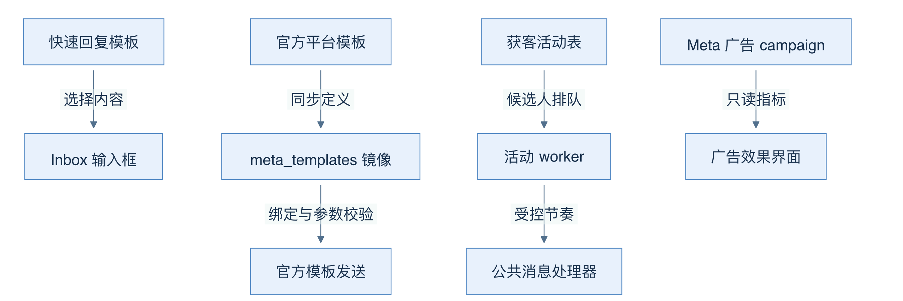
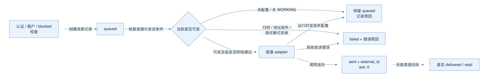
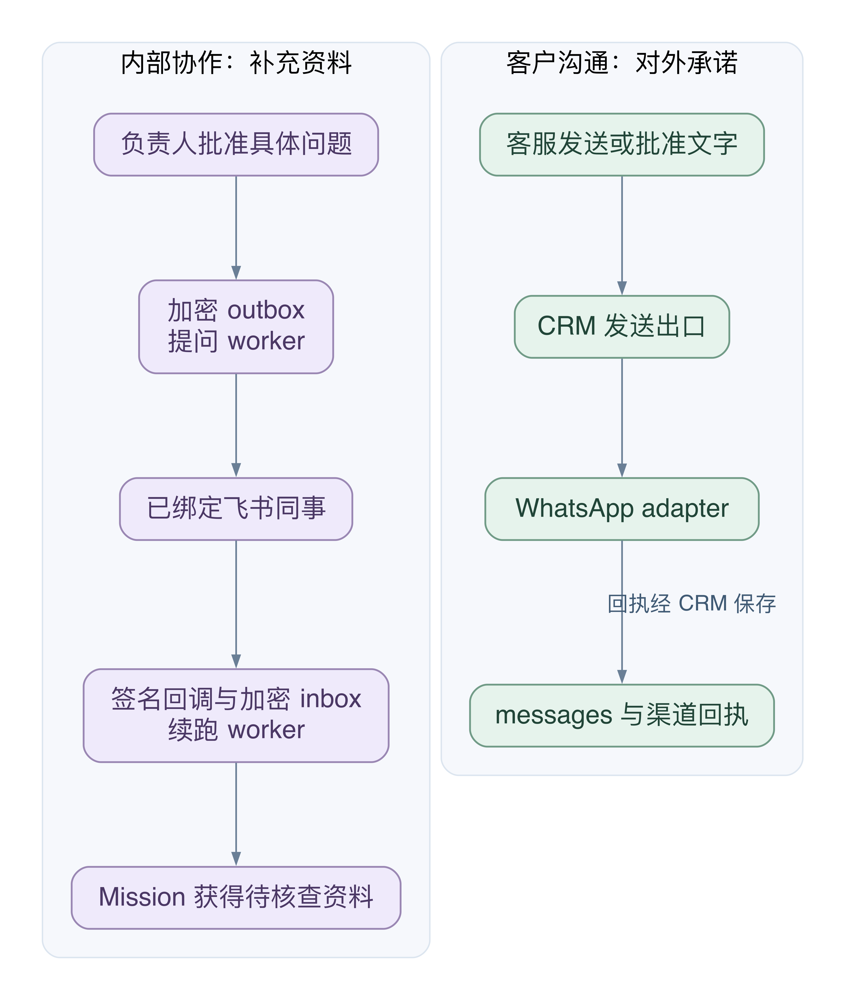
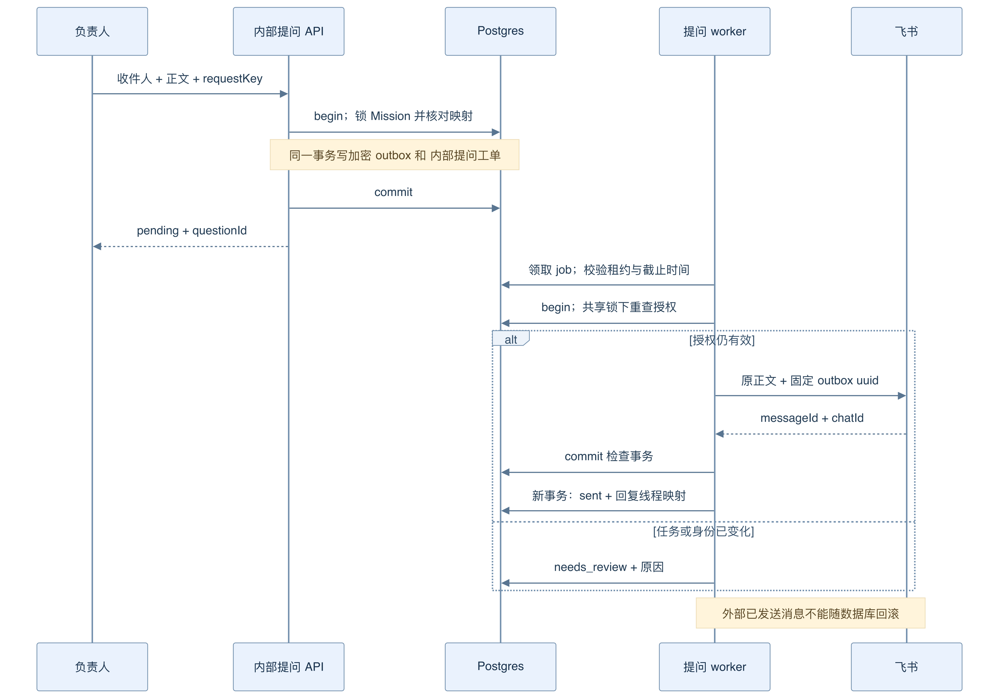
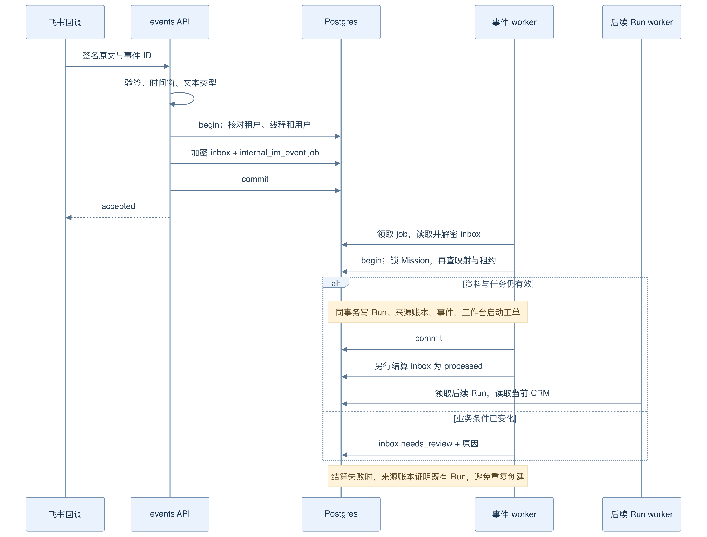
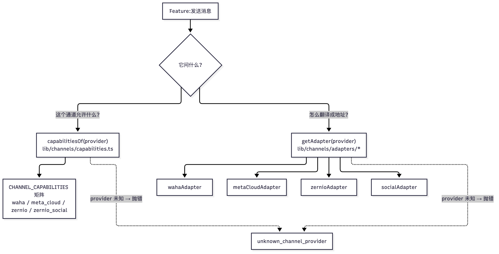
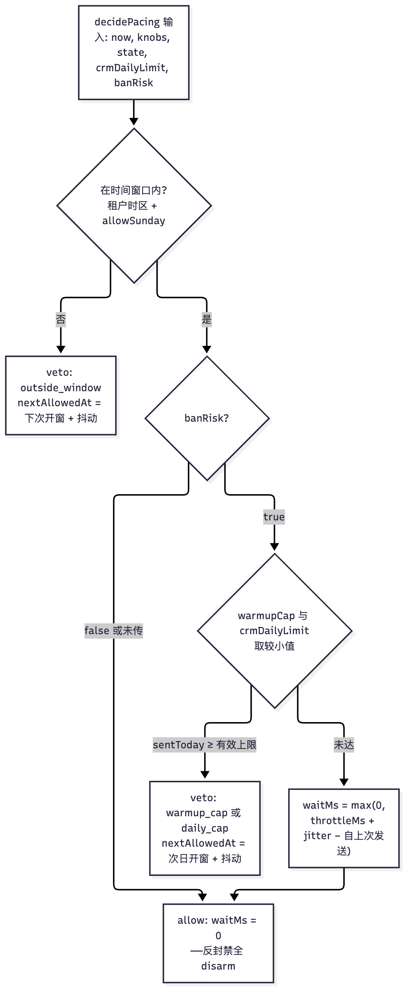

# 10 渠道：WhatsApp 接入与飞书内部协作

[返回母文档](../README.md) · [上一章](09.md) · [下一章](11.md)

**本章目标：**理解渠道抽象、签名、节流、会话和内部协作边界。

## 业务流程与阅读起点

学习目标：追踪 WhatsApp 客户消息与飞书内部资料的不同链路；区分模板、连接、批准、队列和回执；指出哪些数据库写入原子提交，哪些失败需要单独恢复。

### 先纠正一个容易误读的目录结论

本快照没有独立 `/app/campaigns` 页面，但不能因此说“没有活动”。存在两类不同业务：`/app/ads/meta` 读取 Meta 广告 campaign 与 insights，相关 GET 要求 manager，属于广告效果观察；`/app/prospecting` 则有真正的获客活动，管理 `prospecting_campaigns` 与 `prospecting_candidates`，要求 admin，可搜索、启动、暂停和恢复。二者不是一个通用群发模块，也不是新 chat-first Workbench 中一句“帮我推广”已经获得的外发授权。

获客活动配置明确包含 agent、渠道 session、初始/合格阶段、指导语、每日上限、发送间隔与 `legal_basis_ref`。这些字段把“找谁、由谁发、从哪里发、进入哪条漏斗”连起来；保存了依据字符串也不能自动证明现实世界的合规或客户同意。API 会按渠道能力过滤可选连接，不是所有 WhatsApp 接入都能使用同一主动文本路径。

源码定位：[`app/api/v1/ads/meta/campaigns/route.ts:1-16`](https://github.com/helsome/AiNativeCrm/blob/679e09e80878dff7b1c79b8537317b2b9e355331/app/api/v1/ads/meta/campaigns/route.ts#L1-L16)、[`app/api/v1/ads/meta/campaigns/route.ts:69-95`](https://github.com/helsome/AiNativeCrm/blob/679e09e80878dff7b1c79b8537317b2b9e355331/app/api/v1/ads/meta/campaigns/route.ts#L69-L95)；[`app/app/prospecting/page.tsx:8-12`](https://github.com/helsome/AiNativeCrm/blob/679e09e80878dff7b1c79b8537317b2b9e355331/app/app/prospecting/page.tsx#L8-L12)；[`app/api/v1/prospecting/route.ts:34-78`](https://github.com/helsome/AiNativeCrm/blob/679e09e80878dff7b1c79b8537317b2b9e355331/app/api/v1/prospecting/route.ts#L34-L78)、[`app/api/v1/prospecting/route.ts:85-145`](https://github.com/helsome/AiNativeCrm/blob/679e09e80878dff7b1c79b8537317b2b9e355331/app/api/v1/prospecting/route.ts#L85-L145)；[`lib/prospecting/schema.ts:3-38`](https://github.com/helsome/AiNativeCrm/blob/679e09e80878dff7b1c79b8537317b2b9e355331/lib/prospecting/schema.ts#L3-L38)。

箭头表达消费者与用途：快速回复送到输入框，官方模板先同步定义再供发送器使用，获客活动由 worker 消费，广告指标供界面读取。它们没有“保存内容就群发”的共同箭头。

### 两种 template，不能互换

`/app/templates` 的标题其实是“Respostas rápidas”，即快速回复。它读取 `message_templates`：个人模板的 `owner_user_id` 是本人，共享模板为 null；读/建模板要求 agent，共享创建额外要求 manager。Inbox 的斜杠菜单按标题或快捷词筛选并交给 `onPick`，用途是减少重复打字。这里的 template ID 也可被跟进动作引用为固定内容，不能据此推断它是平台批准的 HSM。

官方渠道模板则来自 `meta_templates`。`/api/v1/channels/templates` 的 GET 读本地镜像，POST 同步 Graph API，均要求 admin；返回名称、语言、状态、原始组件及派生参数 slots。底层 `sendTemplate` 先用 `bindingState` 核对模板存在性、批准状态及绑定 hash，再用 `missingSlots` 检查参数，最后构建平台请求。但要继续追调用者：即时发送的 `sendTemplateForSession` 从同一份镜像构造两侧 hash，此处 hash 比较不会检测历史配置过期，只能据当前定义校验存在、批准与参数。不能把底层有 `stale` 分支夸成所有业务入口都已覆盖旧绑定迁移。

源码定位：[`app/app/templates/page.tsx:25-34`](https://github.com/helsome/AiNativeCrm/blob/679e09e80878dff7b1c79b8537317b2b9e355331/app/app/templates/page.tsx#L25-L34)；[`app/api/v1/message-templates/route.ts:28-40`](https://github.com/helsome/AiNativeCrm/blob/679e09e80878dff7b1c79b8537317b2b9e355331/app/api/v1/message-templates/route.ts#L28-L40)、[`app/api/v1/message-templates/route.ts:45-68`](https://github.com/helsome/AiNativeCrm/blob/679e09e80878dff7b1c79b8537317b2b9e355331/app/api/v1/message-templates/route.ts#L45-L68)、[`app/api/v1/message-templates/route.ts:85-95`](https://github.com/helsome/AiNativeCrm/blob/679e09e80878dff7b1c79b8537317b2b9e355331/app/api/v1/message-templates/route.ts#L85-L95)；[`components/inbox/composer/TemplateMenu.tsx:5-10`](https://github.com/helsome/AiNativeCrm/blob/679e09e80878dff7b1c79b8537317b2b9e355331/components/inbox/composer/TemplateMenu.tsx#L5-L10)、[`components/inbox/composer/TemplateMenu.tsx:21-27`](https://github.com/helsome/AiNativeCrm/blob/679e09e80878dff7b1c79b8537317b2b9e355331/components/inbox/composer/TemplateMenu.tsx#L21-L27)、[`components/inbox/composer/TemplateMenu.tsx:37-43`](https://github.com/helsome/AiNativeCrm/blob/679e09e80878dff7b1c79b8537317b2b9e355331/components/inbox/composer/TemplateMenu.tsx#L37-L43)；[`components/inbox/Composer.tsx:159-168`](https://github.com/helsome/AiNativeCrm/blob/679e09e80878dff7b1c79b8537317b2b9e355331/components/inbox/Composer.tsx#L159-L168)；[`lib/followup/engine.ts:83-87`](https://github.com/helsome/AiNativeCrm/blob/679e09e80878dff7b1c79b8537317b2b9e355331/lib/followup/engine.ts#L83-L87)、[`lib/followup/engine.ts:248-252`](https://github.com/helsome/AiNativeCrm/blob/679e09e80878dff7b1c79b8537317b2b9e355331/lib/followup/engine.ts#L248-L252)；[`app/api/v1/channels/templates/route.ts:80-110`](https://github.com/helsome/AiNativeCrm/blob/679e09e80878dff7b1c79b8537317b2b9e355331/app/api/v1/channels/templates/route.ts#L80-L110)、[`app/api/v1/channels/templates/route.ts:150-186`](https://github.com/helsome/AiNativeCrm/blob/679e09e80878dff7b1c79b8537317b2b9e355331/app/api/v1/channels/templates/route.ts#L150-L186)；[`lib/channels/meta/send-template.ts:56-81`](https://github.com/helsome/AiNativeCrm/blob/679e09e80878dff7b1c79b8537317b2b9e355331/lib/channels/meta/send-template.ts#L56-L81)；[`lib/channels/meta/send-template-for-session.ts:10-14`](https://github.com/helsome/AiNativeCrm/blob/679e09e80878dff7b1c79b8537317b2b9e355331/lib/channels/meta/send-template-for-session.ts#L10-L14)、[`lib/channels/meta/send-template-for-session.ts:94-117`](https://github.com/helsome/AiNativeCrm/blob/679e09e80878dff7b1c79b8537317b2b9e355331/lib/channels/meta/send-template-for-session.ts#L94-L117)。

### channel session 是连接，adapter 是翻译器

`/app/connections` 管理连接，页面要求 admin（另有平台管理员分支）。`channel_sessions` 的记录描述某个组织使用的具体连接；`provider` 决定如何发送。`getAdapter` 将 WAHA、Meta Cloud 等映射为适配器，未知 provider 直接报错，不偷偷改用另一个号码。

业务代码应询问能力，例如能否在回复窗口外发自由文本、是否要求官方模板、是否存在节奏限制，而不是到处判断 provider 名字。代码中的能力矩阵给 WAHA 标记了自由文本与封禁风险；Meta Cloud 要求窗口外使用模板。这里描述的是本快照的实现策略，不是对外部平台政策的永久保证。官方窗口按客户最近一次 inbound 计算；发出模板不等于客户回复，不能把模板发送当成窗口已经重新打开。

源码定位：[`app/app/connections/page.tsx:12-18`](https://github.com/helsome/AiNativeCrm/blob/679e09e80878dff7b1c79b8537317b2b9e355331/app/app/connections/page.tsx#L12-L18)、[`app/app/connections/page.tsx:30-38`](https://github.com/helsome/AiNativeCrm/blob/679e09e80878dff7b1c79b8537317b2b9e355331/app/app/connections/page.tsx#L30-L38)；[`lib/channels/index.ts:15-29`](https://github.com/helsome/AiNativeCrm/blob/679e09e80878dff7b1c79b8537317b2b9e355331/lib/channels/index.ts#L15-L29)；[`lib/channels/types.ts:31-56`](https://github.com/helsome/AiNativeCrm/blob/679e09e80878dff7b1c79b8537317b2b9e355331/lib/channels/types.ts#L31-L56)、[`lib/channels/types.ts:110-120`](https://github.com/helsome/AiNativeCrm/blob/679e09e80878dff7b1c79b8537317b2b9e355331/lib/channels/types.ts#L110-L120)；[`lib/channels/capabilities.ts:20-44`](https://github.com/helsome/AiNativeCrm/blob/679e09e80878dff7b1c79b8537317b2b9e355331/lib/channels/capabilities.ts#L20-L44)、[`lib/channels/capabilities.ts:60-68`](https://github.com/helsome/AiNativeCrm/blob/679e09e80878dff7b1c79b8537317b2b9e355331/lib/channels/capabilities.ts#L60-L68)；[`lib/channels/janela.ts:1-27`](https://github.com/helsome/AiNativeCrm/blob/679e09e80878dff7b1c79b8537317b2b9e355331/lib/channels/janela.ts#L1-L27)。

### 顺着一条消息，走完入口与出口

入口以 WAHA 为例：按会话名或专属 path token 找到组织连接，进行 webhook 鉴权、记录接收信息，然后交给共享 ingest。不要把 path token 当作 HMAC。`authenticateWahaWebhook` 对已有签名必须校验；没有可用密钥也不能让已签名请求蒙混过关。但“未签名一律拒绝”并非当前代码的无条件事实：它取决于安装级签名要求，未要求时可返回 `signatureVerified:false`。

出口由 `/api/v1/messages` 调用 `sendMessageHandler`。入口支持浏览器会话或具备 `mcp:write` 的服务器 token，组织来自认证结果，不来自 body。处理器先检查联系人是否 blocked，再创建 `queued` 消息记录，随后解析连接与收件地址、经过发送前校验，调用渠道 adapter。AI 自动发送还会在出口重新检查渠道测试模式，避免生成文本期间的配置变化被忽略。

源码定位：[`app/api/v1/webhooks/waha/route.ts:2-11`](https://github.com/helsome/AiNativeCrm/blob/679e09e80878dff7b1c79b8537317b2b9e355331/app/api/v1/webhooks/waha/route.ts#L2-L11)；[`app/api/v1/webhooks/waha/[token]/route.ts:2-10`](https://github.com/helsome/AiNativeCrm/blob/679e09e80878dff7b1c79b8537317b2b9e355331/app/api/v1/webhooks/waha/[token]/route.ts#L2-L10)、[`app/api/v1/webhooks/waha/[token]/route.ts:84-98`](https://github.com/helsome/AiNativeCrm/blob/679e09e80878dff7b1c79b8537317b2b9e355331/app/api/v1/webhooks/waha/[token]/route.ts#L84-L98)；[`lib/waha/webhook-auth.ts:51-80`](https://github.com/helsome/AiNativeCrm/blob/679e09e80878dff7b1c79b8537317b2b9e355331/lib/waha/webhook-auth.ts#L51-L80)；[`app/api/v1/messages/route.ts:23-35`](https://github.com/helsome/AiNativeCrm/blob/679e09e80878dff7b1c79b8537317b2b9e355331/app/api/v1/messages/route.ts#L23-L35)、[`app/api/v1/messages/route.ts:51-62`](https://github.com/helsome/AiNativeCrm/blob/679e09e80878dff7b1c79b8537317b2b9e355331/app/api/v1/messages/route.ts#L51-L62)；[`app/api/v1/messages/_handler.ts:449-458`](https://github.com/helsome/AiNativeCrm/blob/679e09e80878dff7b1c79b8537317b2b9e355331/app/api/v1/messages/_handler.ts#L449-L458)、[`app/api/v1/messages/_handler.ts:603-626`](https://github.com/helsome/AiNativeCrm/blob/679e09e80878dff7b1c79b8537317b2b9e355331/app/api/v1/messages/_handler.ts#L603-L626)、[`app/api/v1/messages/_handler.ts:677-691`](https://github.com/helsome/AiNativeCrm/blob/679e09e80878dff7b1c79b8537317b2b9e355331/app/api/v1/messages/_handler.ts#L677-L691)。

图中“未就绪”箭头保留排队及原因；“禁止发送”箭头记录明确失败，不能伪装成继续等待。通向 sent 的箭头只代表发送调用完成并记录外部 ID；右侧虚线提醒读者继续查看渠道回执，而非把 HTTP 201 当成客户已阅读。

### 飞书负责内部取证，WhatsApp 负责客户沟通

飞书内部协作不是 WhatsApp 的另一套客服 Inbox。这里的收件人是已绑定的同事，数据写入内部提问 outbox、事件 inbox 和 Mission（跨 Run 保存业务目标、预算和状态的任务记录） 输入账本。WhatsApp 的收件人是客户，消息事实写入 messages，并受客户沟通的渠道和发送规则约束。两个方向都跨出 CRM 进程，但授权目的不同。

图 08-C：同事的回复只能成为待核查资料。图中没有“同事回复 → 客户发送批准”的箭头。即使文本写着“可以”，也不能代替客户外发批准。

#### 场景上半段：负责人问同事一个具体问题

假设销售 Mission 正在 waiting_internal，负责人要向已绑定的仓库同事确认：“林女士这笔订单最早何时可交付？”下面先走显式负责人 API；它不依赖第 08 章尚未接通的 Workbench 客户发送提案生产路径。

图 08-D：图中 outbox 与 job 使用同一个数据库连接和事务。外部飞书请求在事务提交之间执行；数据库回滚不能撤回平台已经接受的消息。

1. **固定收件人与问题。** POST `/api/v1/ai/missions/{id}/internal-question` 要求 manager。body 包含 CRM recipientUserId、requestKey 和 question。服务端从登录上下文取组织，不从正文猜组织、姓名或飞书账号。[源码：[`app/api/v1/ai/missions/[id]/internal-question/route.ts:17-45`](https://github.com/helsome/AiNativeCrm/blob/679e09e80878dff7b1c79b8537317b2b9e355331/app/api/v1/ai/missions/[id]/internal-question/route.ts#L17-L45)]
2. **在数据库内建立待发送事实。** askFeishuColleague 开启事务，锁住 Mission，复核负责人的成员资格、任务 waiting_internal 状态和期限。相同 requestKey 与相同问题摘要返回既有记录；同一个 key 换收件人或正文会冲突。函数按组织内映射找到 open_id，把问题加密写入 ai_internal_question_outbox，并用同一个 client 新增 internal_im_question job，最后 commit。任何一步失败都 rollback。[源码：[`lib/ai/internal-collaboration/feishu-question.ts:37-78`](https://github.com/helsome/AiNativeCrm/blob/679e09e80878dff7b1c79b8537317b2b9e355331/lib/ai/internal-collaboration/feishu-question.ts#L37-L78)、[`lib/ai/internal-collaboration/feishu-question.ts:92-139`](https://github.com/helsome/AiNativeCrm/blob/679e09e80878dff7b1c79b8537317b2b9e355331/lib/ai/internal-collaboration/feishu-question.ts#L92-L139)]
3. **worker 只消费已保存问题。** agent-worker 按 job.kind 分派给 runFeishuQuestionJob。worker 校验租约、outbox 状态、45 分钟发送截止时间和渠道配置，然后解密正文。它不会重新让模型改写已批准的问题。[源码：[`workers/agent-worker/main.ts:755-756`](https://github.com/helsome/AiNativeCrm/blob/679e09e80878dff7b1c79b8537317b2b9e355331/workers/agent-worker/main.ts#L755-L756)；[`lib/ai/internal-collaboration/feishu-question-job.ts:106-154`](https://github.com/helsome/AiNativeCrm/blob/679e09e80878dff7b1c79b8537317b2b9e355331/lib/ai/internal-collaboration/feishu-question-job.ts#L106-L154)；[`supabase/migrations/20260930040000_0394_ai_internal_question_outbox.sql:25-35`](https://github.com/helsome/AiNativeCrm/blob/679e09e80878dff7b1c79b8537317b2b9e355331/supabase/migrations/20260930040000_0394_ai_internal_question_outbox.sql#L25-L35)]
4. **在实际发送前再次核对身份。** worker 对 Mission、租户映射、同事映射和成员记录取得共享锁，再调用飞书。取消或撤销先提交时，发送不会发生；发送先取得这些锁时，取消要等这个调用退出。请求使用 outbox ID 作为固定 uuid。这里的锁只序列化 CRM 的检查与取消，不能给外部平台建立一个可回滚的数据库事务。[源码：[`lib/ai/internal-collaboration/feishu-question-job.ts:159-199`](https://github.com/helsome/AiNativeCrm/blob/679e09e80878dff7b1c79b8537317b2b9e355331/lib/ai/internal-collaboration/feishu-question-job.ts#L159-L199)；[`lib/ai/internal-collaboration/feishu-send.ts:62-90`](https://github.com/helsome/AiNativeCrm/blob/679e09e80878dff7b1c79b8537317b2b9e355331/lib/ai/internal-collaboration/feishu-send.ts#L62-L90)]
5. **保存可关联的回执。** 收到 messageId 与 chatId 后，finishQuestion 在另一事务里把 outbox 标为 sent，并创建 ai_mission_internal_threads。后者绑定“哪个飞书线程属于哪个 Mission”。sent 表示这次平台调用取得可用回执，不表示同事已读、已回答或销售目标已完成。[源码：[`lib/ai/internal-collaboration/feishu-question-job.ts:40-103`](https://github.com/helsome/AiNativeCrm/blob/679e09e80878dff7b1c79b8537317b2b9e355331/lib/ai/internal-collaboration/feishu-question-job.ts#L40-L103)、[`lib/ai/internal-collaboration/feishu-question-job.ts:200-210`](https://github.com/helsome/AiNativeCrm/blob/679e09e80878dff7b1c79b8537317b2b9e355331/lib/ai/internal-collaboration/feishu-question-job.ts#L200-L210)]

还有一条“Agent 提议问题 → 人批准”的入口。它先锁 Mission、Run、proposal，再原子保存 outbox、job、批准观察和事件。特别留意状态的归属：TS 先将 Run 设为 completed；数据库触发器把 Mission 设为 needs_review；同一事务随后把 Mission 改为 waiting_internal。只读最后一条 UPDATE，会误以为前后的条件矛盾。这里的 Run 完成仅表示“提问已获批准并排队”。[源码：[`lib/ai/internal-collaboration/feishu-question.ts:154-174`](https://github.com/helsome/AiNativeCrm/blob/679e09e80878dff7b1c79b8537317b2b9e355331/lib/ai/internal-collaboration/feishu-question.ts#L154-L174)、[`lib/ai/internal-collaboration/feishu-question.ts:239-314`](https://github.com/helsome/AiNativeCrm/blob/679e09e80878dff7b1c79b8537317b2b9e355331/lib/ai/internal-collaboration/feishu-question.ts#L239-L314)；[`supabase/baseline.sql:36673-36708`](https://github.com/helsome/AiNativeCrm/blob/679e09e80878dff7b1c79b8537317b2b9e355331/supabase/baseline.sql#L36673-L36708)]

#### 场景下半段：同事回复后，怎样安全地继续 Mission

图 08-E：回调返回 accepted 的时间点早于模型运行。inbox 提交、后续 Run 提交、inbox 结算是三个边界。恢复逻辑用来源账本跨过它们，不把三个边界说成一笔全局事务。

1. **验签只证明入口。** `/api/v1/ai/internal-collaboration/feishu/events` 用原始 body 校验签名、5 分钟时间窗口、app_id 和 verification token。这里的签名是 SHA-256(timestamp + nonce + encryptKey + body)，不是 WAHA 的 HMAC。解析器只把符合要求的用户文本回复交给内部资料路径；短于 5 字的文本、没有关联根消息的一般聊天会被忽略。[源码：[`lib/ai/internal-collaboration/feishu-webhook.ts:54-80`](https://github.com/helsome/AiNativeCrm/blob/679e09e80878dff7b1c79b8537317b2b9e355331/lib/ai/internal-collaboration/feishu-webhook.ts#L54-L80)、[`lib/ai/internal-collaboration/feishu-webhook.ts:105-143`](https://github.com/helsome/AiNativeCrm/blob/679e09e80878dff7b1c79b8537317b2b9e355331/lib/ai/internal-collaboration/feishu-webhook.ts#L105-L143)；[`app/api/v1/ai/internal-collaboration/feishu/events/route.ts:19-35`](https://github.com/helsome/AiNativeCrm/blob/679e09e80878dff7b1c79b8537317b2b9e355331/app/api/v1/ai/internal-collaboration/feishu/events/route.ts#L19-L35)]
2. **再证明是谁在答哪件事。** persistFeishuMissionEvent 连接租户、回复线程、平台用户和 CRM 成员映射，核对 tenant_key、chat_id、root_message_id、open_id 及成员资格。验签成功但未绑定时返回 unbound；不能把这个结果解释成 Mission 已接受事实。[源码：[`lib/ai/internal-collaboration/feishu-mission.ts:17-32`](https://github.com/helsome/AiNativeCrm/blob/679e09e80878dff7b1c79b8537317b2b9e355331/lib/ai/internal-collaboration/feishu-mission.ts#L17-L32)、[`lib/ai/internal-collaboration/feishu-mission.ts:53-63`](https://github.com/helsome/AiNativeCrm/blob/679e09e80878dff7b1c79b8537317b2b9e355331/lib/ai/internal-collaboration/feishu-mission.ts#L53-L63)；[`app/api/v1/ai/internal-collaboration/feishu/events/route.ts:54-61`](https://github.com/helsome/AiNativeCrm/blob/679e09e80878dff7b1c79b8537317b2b9e355331/app/api/v1/ai/internal-collaboration/feishu/events/route.ts#L54-L61)]
3. **先持久化，再确认接收。** 同一个事务写加密 ai_internal_event_inbox 和 internal_im_event job，commit 后路由才返回 accepted。重复 provider + tenant_key + event_id 会检查摘要；相同内容返回既有 inbox，不同内容返回 source_conflict。队列 payload 只放 inboxId，不放明文。[源码：[`lib/ai/internal-collaboration/feishu-mission.ts:64-105`](https://github.com/helsome/AiNativeCrm/blob/679e09e80878dff7b1c79b8537317b2b9e355331/lib/ai/internal-collaboration/feishu-mission.ts#L64-L105)；[`supabase/migrations/20260930030000_0393_ai_internal_event_inbox.sql:10-43`](https://github.com/helsome/AiNativeCrm/blob/679e09e80878dff7b1c79b8537317b2b9e355331/supabase/migrations/20260930030000_0393_ai_internal_event_inbox.sql#L10-L43)]
4. **让 worker 承担慢工作。** runFeishuInboxJob 校验租约、期限并解密。submitMissionInternalResponse 在 Mission 锁内再次复核映射与当前成员资格，避免“回调接受后身份被撤销”的竞态。后续 Run 使用原 Mission 负责人的权限上下文；回复同事没有因提供资料而获得 CRM 执行权。[源码：[`lib/ai/internal-collaboration/feishu-inbox-job.ts:74-147`](https://github.com/helsome/AiNativeCrm/blob/679e09e80878dff7b1c79b8537317b2b9e355331/lib/ai/internal-collaboration/feishu-inbox-job.ts#L74-L147)；[`lib/ai/agents/mission-internal-response.ts:180-229`](https://github.com/helsome/AiNativeCrm/blob/679e09e80878dff7b1c79b8537317b2b9e355331/lib/ai/agents/mission-internal-response.ts#L180-L229)、[`lib/ai/agents/mission-internal-response.ts:435-448`](https://github.com/helsome/AiNativeCrm/blob/679e09e80878dff7b1c79b8537317b2b9e355331/lib/ai/agents/mission-internal-response.ts#L435-L448)]
5. **原子建立一次续跑。** continuation 事务写 ai_workbench_runs、ai_mission_internal_inputs、初始 run event，并新增 workbench_start job。输入账本保存来源和摘要；重放命中既有输入时返回同一个 runId。任务文本把同事原文标成待核查资料，要求重读 CRM，禁止直接发给客户。worker 随后另行把 inbox 结算为 processed 并清除密文。[源码：[`lib/ai/agents/mission-internal-response.ts:231-269`](https://github.com/helsome/AiNativeCrm/blob/679e09e80878dff7b1c79b8537317b2b9e355331/lib/ai/agents/mission-internal-response.ts#L231-L269)、[`lib/ai/agents/mission-internal-response.ts:360-368`](https://github.com/helsome/AiNativeCrm/blob/679e09e80878dff7b1c79b8537317b2b9e355331/lib/ai/agents/mission-internal-response.ts#L360-L368)、[`lib/ai/agents/mission-internal-response.ts:435-484`](https://github.com/helsome/AiNativeCrm/blob/679e09e80878dff7b1c79b8537317b2b9e355331/lib/ai/agents/mission-internal-response.ts#L435-L484)；[`lib/ai/internal-collaboration/feishu-inbox-job.ts:28-71`](https://github.com/helsome/AiNativeCrm/blob/679e09e80878dff7b1c79b8537317b2b9e355331/lib/ai/internal-collaboration/feishu-inbox-job.ts#L28-L71)、[`lib/ai/internal-collaboration/feishu-inbox-job.ts:118-136`](https://github.com/helsome/AiNativeCrm/blob/679e09e80878dff7b1c79b8537317b2b9e355331/lib/ai/internal-collaboration/feishu-inbox-job.ts#L118-L136)]

#### 三个失败分支决定不同恢复动作

- **发送响应丢失。** 飞书网络调用异常映射为 delivery_unavailable，交回队列机制处理；重试沿用同一个 outbox uuid，并受 send_deadline_at 限制。若平台返回成功结构却缺少 messageId/chatId，则是 delivery_unconfirmed，outbox 直接进入 needs_review。不能把两种结果都写成“无限自动重发”，也不能宣称分布式 exactly-once
- **回复排队期间权限或任务改变。** 映射撤销、任务状态不再满足条件或业务前置条件失败，会把 inbox 置为 needs_review。资料过期则置为 expired；等待中的 Mission 也获得可见原因。不要通过重新绑定身份或改旧状态绕过这一拒绝
- **续跑已提交，inbox 结算却失败。** 死任务对账先检查 ai_mission_internal_inputs。若已有相同来源的 runId，就将 inbox 修正为 processed；没有证据才转 needs_review。它不靠再建一个 Run 猜测上次是否成功

源码：[`lib/ai/internal-collaboration/feishu-send.ts:62-90`](https://github.com/helsome/AiNativeCrm/blob/679e09e80878dff7b1c79b8537317b2b9e355331/lib/ai/internal-collaboration/feishu-send.ts#L62-L90)；[`lib/ai/internal-collaboration/feishu-question-job.ts:131-154`](https://github.com/helsome/AiNativeCrm/blob/679e09e80878dff7b1c79b8537317b2b9e355331/lib/ai/internal-collaboration/feishu-question-job.ts#L131-L154)、[`lib/ai/internal-collaboration/feishu-question-job.ts:190-210`](https://github.com/helsome/AiNativeCrm/blob/679e09e80878dff7b1c79b8537317b2b9e355331/lib/ai/internal-collaboration/feishu-question-job.ts#L190-L210)；[`workers/agent-worker/main.ts:550-564`](https://github.com/helsome/AiNativeCrm/blob/679e09e80878dff7b1c79b8537317b2b9e355331/workers/agent-worker/main.ts#L550-L564)；[`lib/ai/internal-collaboration/feishu-inbox-job.ts:95-146`](https://github.com/helsome/AiNativeCrm/blob/679e09e80878dff7b1c79b8537317b2b9e355331/lib/ai/internal-collaboration/feishu-inbox-job.ts#L95-L146)、[`lib/ai/internal-collaboration/feishu-inbox-job.ts:181-220`](https://github.com/helsome/AiNativeCrm/blob/679e09e80878dff7b1c79b8537317b2b9e355331/lib/ai/internal-collaboration/feishu-inbox-job.ts#L181-L220)。

这套实现解释了为什么需要 inbox/outbox：外部回调可重复，外部发送与本地提交可分别失败。**明确使用同一 client 的 begin/commit 才能证明某一组数据库写入原子。** enqueueJob 自身只是用传入的 Queryable 执行 SQL；它不会自动把调用者前后的 Run、事件和渠道请求包成事务。不能把飞书这里的局部保证投射到全部 CRM 路径。[源码：[`lib/agent-engine/queue/queue.ts:79-120`](https://github.com/helsome/AiNativeCrm/blob/679e09e80878dff7b1c79b8537317b2b9e355331/lib/agent-engine/queue/queue.ts#L79-L120)]

阅读代码可以证明这些分支存在。本轮没有连真实飞书或 WhatsApp，没有向同事或客户发送消息；接口、受控测试和真实部署分别需要自己的证据。

### 活动 worker 的保护和排错顺序

获客 worker 会核对发送窗口、共享渠道节奏、活动/组织额度和候选人状态，提前记录一次尝试及预算占用，再调用同一消息处理器。失败或送达不明也占尝试额度，避免超时让系统无限补发。这个冷启动路径特意不自动重试不确定发送；它将候选人标为 failed，并提示先看会话再决定是否重发。

排错时先区分三种结果：连接未配置或未 `WORKING` 可以保持 `queued`；号码归档、收件地址缺失或 AI 测试模式拒绝会失败；adapter 返回后记录 `sent`、外部 ID 和 `ack:0`，后续送达仍是另一层证据。若 WAHA 健康查询返回 401/403，应检查凭据问题；反复扫码不能解决错误密钥。不要为了解除队列而绕过 blocked、渠道归档或测试模式。

源码定位：[`lib/prospecting/worker.ts:35-117`](https://github.com/helsome/AiNativeCrm/blob/679e09e80878dff7b1c79b8537317b2b9e355331/lib/prospecting/worker.ts#L35-L117)、[`lib/prospecting/worker.ts:166-187`](https://github.com/helsome/AiNativeCrm/blob/679e09e80878dff7b1c79b8537317b2b9e355331/lib/prospecting/worker.ts#L166-L187)、[`lib/prospecting/worker.ts:241-285`](https://github.com/helsome/AiNativeCrm/blob/679e09e80878dff7b1c79b8537317b2b9e355331/lib/prospecting/worker.ts#L241-L285)；[`app/api/v1/messages/_handler.ts:677-750`](https://github.com/helsome/AiNativeCrm/blob/679e09e80878dff7b1c79b8537317b2b9e355331/app/api/v1/messages/_handler.ts#L677-L750)、[`app/api/v1/messages/_handler.ts:918-933`](https://github.com/helsome/AiNativeCrm/blob/679e09e80878dff7b1c79b8537317b2b9e355331/app/api/v1/messages/_handler.ts#L918-L933)、[`app/api/v1/messages/_handler.ts:955-978`](https://github.com/helsome/AiNativeCrm/blob/679e09e80878dff7b1c79b8537317b2b9e355331/app/api/v1/messages/_handler.ts#L955-L978)；[`lib/channels/adapters/waha.ts:139-168`](https://github.com/helsome/AiNativeCrm/blob/679e09e80878dff7b1c79b8537317b2b9e355331/lib/channels/adapters/waha.ts#L139-L168)。

自测：快速回复保存成功、官方模板同步成功、活动出现 sent，分别能证明什么？2026-10-03 报告明确未向客户发消息，受控 provider 与本地接收器的证明不等于真实 WhatsApp、真实模型或 Workbench 外部提案失败恢复验收；飞书本轮也仅保留接口。这是阅读既有实现与宣称整条生产外联链路可用之间必须保留的边界。定位：[`docs/testing/system-acceptance-fixes-2026-10-03.md:5-7`](https://github.com/helsome/AiNativeCrm/blob/679e09e80878dff7b1c79b8537317b2b9e355331/docs/testing/system-acceptance-fixes-2026-10-03.md#L5-L7)、[`docs/testing/system-acceptance-fixes-2026-10-03.md:61-71`](https://github.com/helsome/AiNativeCrm/blob/679e09e80878dff7b1c79b8537317b2b9e355331/docs/testing/system-acceptance-fixes-2026-10-03.md#L61-L71)。

固定 main：679e09e80878dff7b1c79b8537317b2b9e355331

## 实现详解

本页解释 `lib/channels/` 如何把"WhatsApp"从一个具体产品变成**一个可替换的通道格子**：provider 抽象、能力矩阵、签名校验、反封禁节流与会话管理。当读者读完本页，应该能回答三个问题——业务代码如何不需要知道对面是 WAHA 还是 Meta Cloud API；一个伪造的 webhook 如何被拒绝；一条自动化消息如何在到达 WhatsApp 之前被"延后"而非"丢弃"。

阅读前提：建议先读过 [REST API 契约：版本化路径、双重鉴权、幂等键与错误码](06.md)（理解入口鉴权）与 [Pi Agent Core 回合编排：入站回合、上下文构建与工具定义](20.md)（理解入站回合从哪来）。

---

### 为什么"通道"必须先成为一层抽象

真实渠道的差异不是表面的：WAHA 是自托管的第三方实例，Meta Cloud API 是官方托管且强制24 小时客服窗口，Zernio 是本地 BSP 中介，wacalls 是语音通道。这个仓库的做法是把差异**收进一个矩阵**，让上层只问"这个通道允许什么"。

`lib/channels/capabilities.ts` 的文件头把这条设计写成了硬约束：它是"整个系统里唯一可以知道渠道之间差异的地方"。业务代码不写 `if (provider === 'waha')`，而是读能力；为此 `scripts/lint-channels.ts` 会在 `gov:verify` 阶段拒绝任何在 `lib/channels/` 之外出现 provider 名称的代码。`lib/channels/index.ts` 是这道门的入口，任何 feature 想要发送都必须 `getAdapter(provider)`，而它对未知 provider **fail-closed**：抛错，而不是回落到 WAHA——发错通道比不发更糟。

Sources: [capabilities.ts](https://github.com/helsome/AiNativeCrm/blob/679e09e80878dff7b1c79b8537317b2b9e355331/lib/channels/capabilities.ts#L1), [index.ts](https://github.com/helsome/AiNativeCrm/blob/679e09e80878dff7b1c79b8537317b2b9e355331/lib/channels/index.ts#L14)

Sources: [index.ts](https://github.com/helsome/AiNativeCrm/blob/679e09e80878dff7b1c79b8537317b2b9e355331/lib/channels/index.ts#L1)

这张图的关键在于**两条路径分离**：能力（能不能发）与翻译（怎么发）互不干涉。这条分离不是洁癖，而是防御——如果 adapter 里混进业务判断（"夜间不发"），就会变成第二条平行规则，迟早与主规则分叉。

---

### 能力矩阵：把"限制的物理"写进类型

`ChannelCapabilities` 有八个字段，每一个都对应一个在真实渠道之间测得或文档化的差异，而不是假想的开关。最能说明设计意图的是 `banRisk` 与 `minIntervalMs` 的并置：

| 能力字段 | WAHA（自托管） | Meta Cloud API（官方） | 含义 |
| --- | --- | --- | --- |
| `freeformOutsideWindow` | `true` | `false` | 窗口外能否自由文本 |
| `requiresTemplates` | `false` | `true` | 是否需预审模板 |
| `canManageTemplates` | `false` | `true` | 能否经 API 增改模板 |
| `banRisk` | `true` | `false` | 滥用是否会被封号 |
| `minIntervalMs` | `null` | `6000` | 平台强制的最小间隔 |
| `costPerMessage` | `false` | `true` | 每条是否计费 |

Meta Cloud 的 `minIntervalMs: 6000` 是平台**强制**的间隔，与本仓库自加的反封禁节流（`throttleMs`）性质完全不同：前者违反会被 API 直接拒绝，后者违反只是概率性被封。

Sources: [types.ts](https://github.com/helsome/AiNativeCrm/blob/679e09e80878dff7b1c79b8537317b2b9e355331/lib/channels/types.ts#L38), [capabilities.ts](https://github.com/helsome/AiNativeCrm/blob/679e09e80878dff7b1c79b8537317b2b9e355331/lib/channels/capabilities.ts#L21)

矩阵注释里还记录了一个真实踩坑：`zernio_social` 虽然 `requiresTemplates: false`，但 `freeformOutsideWindow: false` 是**实测**而非推断——自由文本会拿到 200 + wamid，随后被 Meta 以错误码 `131047` 拒收，因为24 小时客服窗口已关。更反直觉的细节是，**发模板并不会打开窗口，只有客户自己回复才会**。把200 当作"已送达"正是很多团队线上翻车的根源。

Sources: [capabilities.ts](https://github.com/helsome/AiNativeCrm/blob/679e09e80878dff7b1c79b8537317b2b9e355331/lib/channels/capabilities.ts#L55)

#### 类型层就把语音挡在外面

矩阵的键类型是 `ProviderDeMensagem = Exclude<ChannelProvider, "wacalls">`，不是 `ChannelProvider`。这是一处刻意的类型设计：`wacalls`（WhatsApp 语音）存在于 `channel_sessions` 表里，但它的物理是"配对、状态、归档"，不是"收发文字"。如果让语音通道进入矩阵，就等于承认"语音通道可以在 24 小时窗口外向客户发自由文本"这个荒谬命题。

`PROVIDERS_DE_MENSAGEM` 与 `PROVIDERS_SEM_MENSAGEM` 两个常量加上一条编译期断言 `ProviderNaoClassificado extends never`，强制新 provider 必须被显式归类——忘记归类不是"可以"，是编译错误。

Sources: [types.ts](https://github.com/helsome/AiNativeCrm/blob/679e09e80878dff7b1c79b8537317b2b9e355331/lib/channels/types.ts#L30), [capabilities.ts](https://github.com/helsome/AiNativeCrm/blob/679e09e80878dff7b1c79b8537317b2b9e355331/lib/channels/capabilities.ts#L120)

---

### 签名校验：从 fail-open 到 fail-closed

这是本页最值得学的部分，因为失败模式极端危险。`lib/waha/webhook-auth.ts` 的注释记录了一个真实的漏洞形态：早期实现是 **fail-open**——取不到密钥时设 `hmacSkipped = true` 并**照常处理事件**。而由于两条创建会话的路由写入的是一个装饰性字节 `Buffer.from([0])` 作为 webhook 密钥，"取不到密钥"不是例外路径，而是**每一台安装的永久常态**。结果是：任何知道 URL 的人都可以往别人的 CRM 注入伪造消息、选择发送方、诱导受害者 WhatsApp 向任意号码回复。作者在 VPS 上用不带任何 header 的 `curl` 复现了这一点。

Sources: [webhook-auth.ts](https://github.com/helsome/AiNativeCrm/blob/679e09e80878dff7b1c79b8537317b2b9e355331/lib/waha/webhook-auth.ts#L1)

修复后确立三条有序规则：

1. **有签名但不匹配 ⇒ 永远拒绝**（`bad_signature`）。不存在"签名错了也放行"的合法场景。
2. **`WAHA_WEBHOOK_REQUIRE_SIGNATURE=true` ⇒ 全量要求有效签名**。默认关闭，因为实测 **WAHA Core 根本不签名**——即使容器里配了 `WHATSAPP_HOOK_HMAC`，真实事件也不带 header。默认打开会打断所有人的消息摄入，"药比病更糟"。跑 WAHA Plus 或签名代理的安装可以开启，获得强校验。
3. **无签名且未强制 ⇒ 接受，但返回 `signatureVerified: false`**，并要求调用方把这个事实写进日志。此前日志对未校验事件却写 `valid_signature = true`。

Sources: [webhook-auth.ts](https://github.com/helsome/AiNativeCrm/blob/679e09e80878dff7b1c79b8537317b2b9e355331/lib/waha/webhook-auth.ts#L32)

密钥优先级是"会话密钥（已解密且长度 ≥ 16）> env 密钥 > 无"，长度下限 16 是为了把占位符和解密失败的垃圾值挡在外面。签名要求本身是**两层**的：安装数据库里的行（管理界面写入）高于 `.env`（从没有人打开过那个界面时的地板）。这条分层与仓库的注册策略同构，且 `.env` 这一层存在的理由被标注为 issue #1034——进程在本生命周期内可能还没读到数据库。

Sources: [webhook-auth.ts](https://github.com/helsome/AiNativeCrm/blob/679e09e80878dff7b1c79b8537317b2b9e355331/lib/waha/webhook-auth.ts#L50), [exigencia-de-assinatura.ts](https://github.com/helsome/AiNativeCrm/blob/679e09e80878dff7b1c79b8537317b2b9e355331/lib/channels/exigencia-de-assinatura.ts#L1)

签名校验之所以住在 `lib/channels/` 而不在 `lib/instalacao/`，是因为 `lib/instalacao/` 是 feature，按教义不允许指名 provider；承载"是否要求签名"这个 env 地板的文件必须落在允许命名的边界内。

#### 不依赖对端会签名的第二道防线

WAHA Core 不会签名，这使"强制签名"无法成为默认。真正的兜底是**网络层**：全局路由（无 token 的那条）不再由 Caddy 对公网发布，因为 WAHA 走的是 Docker内部网络，从未需要过公网入口。这是"减少攻击面"而非"加强校验"的思路——签名做不到的事，用不暴露来做。

Sources: [webhook-auth.ts](https://github.com/helsome/AiNativeCrm/blob/679e09e80878dff7b1c79b8537317b2b9e355331/lib/waha/webhook-auth.ts#L27)

`lib/channels/signed-receipt.ts` 则把"带签名证据的消息回执"固化为一条**内部固定别名**的 SQL 片段（禁止插值任何模型/用户输入），且**其他传输一律 fail-closed** 直到各自实现回执契约。作用域、CRM 消息 ID、外部 ID 与时间检查仍由调用方负责——回执只是证据，不是裁决。

Sources: [signed-receipt.ts](https://github.com/helsome/AiNativeCrm/blob/679e09e80878dff7b1c79b8537317b2b9e355331/lib/channels/signed-receipt.ts#L1)

---

### 反封禁与节流：一条尺子，两种物理

渠道教义把限制分成两族，这是理解整个 pacing 子系统的钥匙：

|  | **自我限制（auto）** | **异质限制（hetero）** |
| --- | --- | --- |
| 谁施加 | 你对自己 | 平台对你 |
| 动机 | 滥用→**封号** | 违规→**拒绝并计费** |
| 违反后果 | 账号静默死亡 | 请求当场报错 |
| 例子 | WAHA：节流、抖动、预热、日上限 | Meta：24h 窗口、模板、6s/收件人 |
| 检测者 | 无人（事后才发现） | API 返回值 |

关键论断是**两族互不为子集**：把反封禁泛化成"限流"会抹掉模板逻辑，把窗口泛化成"能发吗"会抹掉预热。违反后的应对也不同——自我限制违反应当**推迟重试**（窗口会重开、上限零点归零），异质限制违反应当**换消息形态（用模板）或升级人工**（推迟无解，明天窗口只会更关）。

Sources: [restricao-de-canal.md](https://github.com/helsome/AiNativeCrm/blob/679e09e80878dff7b1c79b8537317b2b9e355331/docs/doctrine/restricao-de-canal.md#L13)

#### 纯函数引擎：时钟与随机数可注入

`lib/agent-engine/pacing/engine.ts` 的 `decidePacing` 是一个**零 I/O 的纯函数**：输入（时钟、knobs、该号码今日发送数、激活时间、CRM 日限、rng），输出 `{allow, waitMs}` 或 `{veto, nextAllowedAt, reason}`。评估顺序是：时间窗口（租户时区，周日看 `allowSunday`）→ 日上限（按号码年龄的预热阶跃 + 注入的 CRM 上限）→ 节流加抖动。

Sources: [engine.ts](https://github.com/helsome/AiNativeCrm/blob/679e09e80878dff7b1c79b8537317b2b9e355331/lib/agent-engine/pacing/engine.ts#L1), [engine.ts](https://github.com/helsome/AiNativeCrm/blob/679e09e80878dff7b1c79b8537317b2b9e355331/lib/agent-engine/pacing/engine.ts#L59)

Sources: [engine.ts](https://github.com/helsome/AiNativeCrm/blob/679e09e80878dff7b1c79b8537317b2b9e355331/lib/agent-engine/pacing/engine.ts#L59)

预热阶跃的默认值是一组保守数字：1.2 秒节流、800ms 抖动、7–22 点窗口、年龄0 天→20 条/天，4 天→50，8 天→100，15 天→200，31 天→`null`（视为"已养成"，不再有预热上限，只剩 CRM 上限）。周日在默认配置里是**允许**的——注释给的理由很实际：夜里静默已经足够表达克制，而在客服型 CRM 里，周日发消息的人期待周日得到回复；做主动拓客的人可以按通道关掉它。

Sources: [defaults.ts](https://github.com/helsome/AiNativeCrm/blob/679e09e80878dff7b1c79b8537317b2b9e355331/lib/agent-engine/pacing/defaults.ts#L56), [defaults.ts](https://github.com/helsome/AiNativeCrm/blob/679e09e80878dff7b1c79b8537317b2b9e355331/lib/agent-engine/pacing/defaults.ts#L29)

#### 教义第 3 条在代码里长什么样：veto 而不是冻结默认值

`banRisk === false` 时**只**关掉反封禁相关（预热、日上限、节流加抖动），而时间窗口/周日/时区这些"礼貌性"约束**继续生效**——教义把这一条写成了显式反例：早期的 `PACING_DEFAULTS` 把两族混在一起，若切到官方 API 时把 "pacing" 一起 disarm，营业时间限制会随之消失，AI 会在凌晨 3 点叫醒客户。教义同时给出验证方式：一个测试证明 `banRisk: false` 时节流/预热/上限 disarm 而营业时间/周日/时区仍 armed。仓库里确有 `tests/unit/anti-ban-nao-congela-o-padrao.test.ts`、`atraso-humano-nao-afrouxa-o-anti-ban.test.ts`、`pacing-cortesia-vs-antiban.test.ts` 对应这条约束。

Sources: [restricao-de-canal.md](https://github.com/helsome/AiNativeCrm/blob/679e09e80878dff7b1c79b8537317b2b9e355331/docs/doctrine/restricao-de-canal.md#L63), [engine.ts](https://github.com/helsome/AiNativeCrm/blob/679e09e80878dff7b1c79b8537317b2b9e355331/lib/agent-engine/pacing/engine.ts#L76)

#### 单一尺子：为什么自动化的窗口被删了

`lib/automation/throttle.ts` 顶部记录了一次"删除即正确"的修复：旧的 `withinSendWindow()` 用 `new Date().getHours()` 读取**进程时钟**判窗口，而生产容器是 UTC（`Dockerfile.scheduler` / `docker-compose.prod.yml` 里 `TZ=UTC`），于是配置的 7–22 点变成巴西利亚的 4–19 点——19:30 的自动化消息被压到凌晨 4 点。更糟的是那还是**第二条尺子**：老板在"连接 › 发送保护"里配的时间段对 AI 代理有效、对自动化无效，界面上没有任何提示。现在窗口只有一个来源：`lib/automation/janela-do-canal.ts` 在租户时区求值，复用 `lib/agent-engine/pacing/` 的同一纯规则。

Sources: [throttle.ts](https://github.com/helsome/AiNativeCrm/blob/679e09e80878dff7b1c79b8537317b2b9e355331/lib/automation/throttle.ts#L1)

`throttle.ts` 里还保留了一段"今天不可达、且其中两处错误刻意留着"的注释：`checkDailyLimit` 读 `channel_session_warmup.messages_sent`，但该表在产品里**没有写入方**（真正计数的是 `pacing_ledger`），所以 `sent` 恒为 0、日上限永不触发；它内含的 `retry_at` 用 `setHours` 打在进程时区上，正是这次修复要消灭的病。作者留下它是为了让将来复活该上限的人不会重新植入任何一个错误。

Sources: [throttle.ts](https://github.com/helsome/AiNativeCrm/blob/679e09e80878dff7b1c79b8537317b2b9e355331/lib/automation/throttle.ts#L55)

`espacarEnvio` 用模块级 `Map` 记录每会话上次发送，节流 1200ms + 随机抖动（`AUTOMATED_SEND_SPACING_MS` / `jitterMs`），固定间隔是机器人签名。它被抽成函数而非留在 WhatsApp 动作里，是因为 AI 动作需要**同一个**节流：两份计数器会各有时钟，同一规则的两个动作会对同一号码成串轰击——恰是导致封禁的模式。

Sources: [throttle.ts](https://github.com/helsome/AiNativeCrm/blob/679e09e80878dff7b1c79b8537317b2b9e355331/lib/automation/throttle.ts#L82)

---

### 窗口与节流在发送链上的分工

`lib/agent-engine/guardrails/messaging-window.ts` 给出 24 小时窗口的**纯函数**，并附带一段"为什么没有 `conversation_window_expires_at` 列"的推理（对比 TomikCRM 的做法）：`conversations.last_inbound_at` 已是真相，额外一列意味着第二真相源（需要 cron 过期）、且**虚假地令人安心**（一个未来日期即使与 `last_inbound_at` 矛盾也显得权威）。结论与仓库其它派生契约一致：**可派生的不入库**。函数对 `lastInboundAt === null` 返回 0（fail-closed），使冷拓不会伪装成"回复"；窗口边界是**开区间**的（24h 整即关闭）；时钟歪到未来的入站不会延长窗口。

Sources: [messaging-window.ts](https://github.com/helsome/AiNativeCrm/blob/679e09e80878dff7b1c79b8537317b2b9e355331/lib/agent-engine/guardrails/messaging-window.ts#L1), [messaging-window.ts](https://github.com/helsome/AiNativeCrm/blob/679e09e80878dff7b1c79b8537317b2b9e355331/lib/agent-engine/guardrails/messaging-window.ts#L29)

发送前门（`before-send.ts`）把上述所有闸门串成一条链，每个闸门产出 `pass / veto / skipped`，并把**全部闸门**写进 `before_send_traces`。教义第 4 条要求：不适用时返回 `skipped: 'not_applicable'` 而**非**静默 `pass`，因为"没有回归"和"我能证明没有回归"的区别正好是审计里的这一行。`skipped` 带代码与不带代码是两种语义：带代码=该闸门对本通道不适用；不带=因为前一个闸门已 veto 而未评估。

Sources: [before-send.ts](https://github.com/helsome/AiNativeCrm/blob/679e09e80878dff7b1c79b8537317b2b9e355331/lib/agent-engine/guardrails/before-send.ts#L947), [restricao-de-canal.md](https://github.com/helsome/AiNativeCrm/blob/679e09e80878dff7b1c79b8537317b2b9e355331/docs/doctrine/restricao-de-canal.md#L79)

其中两个闸门直接按能力短路：pacing 闸门在 `caps.freeformOutsideWindow` 为真时记 `skipped`（该通道本就无窗口）；`spinningEnforced === false` 显式关停时也记 `skipped` 而非 `pass`。

Sources: [before-send.ts](https://github.com/helsome/AiNativeCrm/blob/679e09e80878dff7b1c79b8537317b2b9e355331/lib/agent-engine/guardrails/before-send.ts#L699)

---

### 会话管理：组织作用域与两个"身份"陷阱

会话（`channel_sessions`）承载了连接的生命周期，但真正容易出错的是"用哪个字段去定位一行会话"。`OutboundEnvelope` 强制携带 `ChannelTenantScope.organizationId`，理由写得很具体：单独用 `sessionRef` **不能**唯一定位一行——它是**provider侧**的标识（Cloud API 的号码、中介的账号），两organizations 完全可能撞同；而此前解析凭据的人正是在 service-role client（绕过 RLS）上做 `.eq("<ref>", ...)`，两行命中时 `maybeSingle()` 返回 `data: null` **且带错误**（`PGRST116`），错误被丢弃后落入 env 兜底，消息从 `.env` 的账号而非该组织的账号发出（issue #236）。`organizationId` 被设为**必填**正是为了让 typecheck 在每个调用点强制它，值只能来自可信来源（cookie 会话、已定界范围的行、webhook token），**绝不来自外部载荷**。

Sources: [types.ts](https://github.com/helsome/AiNativeCrm/blob/679e09e80878dff7b1c79b8537317b2b9e355331/lib/channels/types.ts#L88), [types.ts](https://github.com/helsome/AiNativeCrm/blob/679e09e80878dff7b1c79b8537317b2b9e355331/lib/channels/types.ts#L108)

第二个陷阱关于对话内引用：`replyToExternalId` 是被引消息的 `external_id`（WhatsApp 即 `wamid`），**不是**本库 `messages.id`——provider 从没见过我们的主键。该字段刻意设为可选：不能引用的通道直接忽略，因为引用是会话的装饰、绝不是发送的前提；"因为不会引用就拒发整条消息"等于用装饰换掉了消息。

Sources: [types.ts](https://github.com/helsome/AiNativeCrm/blob/679e09e80878dff7b1c79b8537317b2b9e355331/lib/channels/types.ts#L155)

---

### 配额契约与可观测面

教义中"模板参数契约"一节规定：平台托管的消息定义**就是** schema，参数契约绝不手写而由纯函数派生。硬规则包括：无人手输参数个数（屏幕、jsonb 都不设"变量数"字段）；一次派生、两个消费者（编辑表单与发送构造器共用）；header 与按钮都计入（只数 body 是生产事故第一诱因）；键是 `(名称, 语言)` 而非仅名称；**按 hash 绑定**而非按名——配置保存时存下当时契约的 hash，hash 不一致即配置过期：不发送、不猜测，变成带 diff 的可见工作；平台返回"参数对不上"是**我方 bug**，进 Sentry 而非作为提示给用户。

Sources: [restricao-de-canal.md](https://github.com/helsome/AiNativeCrm/blob/679e09e80878dff7b1c79b8537317b2b9e355331/docs/doctrine/restricao-de-canal.md#L96)

"每份配置都有界面"这条把上面这些机制落到可操作性上：无屏可看/可改/失败可见的后端机制等于不可运维（issue #144 的 rodízio/可见性模式整套存在于 worker+RLS 却不给界面，贡献者反而开 issue"功能已存在"）；更贵的反例是写路由存在却是**静默 no-op**——只有 `fn_is_platform_admin()` 写 policy 时，manager 经 session client 的 UPDATE 命中 0 行而 PostgREST 返回成功，界面显示"已保存"而什么都没写。因此"从未被界面验证过的写路由不算界面"。

Sources: [restricao-de-canal.md](https://github.com/helsome/AiNativeCrm/blob/679e09e80878dff7b1c79b8537317b2b9e355331/docs/doctrine/restricao-de-canal.md#L120)

---

### 强制手段一览

教义末尾列出全部执行层，可作为扩展新通道时的检查清单：

| 层 | 机制 | 效果 |
| --- | --- | --- |
| Lint | `scripts/lint-channels.ts` | `lib/channels/` 外出现 provider 名即失败 |
| 不变量 | 能力矩阵 × provider 覆盖测试 | 有能力无 provider覆盖即失败（死代码） |
| 不变量 | 冻结旧 provider 的通道测试套件 | 静默回归即失败 |
| Trace | `before_send_traces` 带显式 `skipped` | 不适用可审计而非隐形 |
| 不变量 | 扫描 `lib/channels/` 是否有不带 `organization_id` 按 provider id查会话 | 命中即失败 |
| DB 锁 | migration 0165 部分唯一索引 | 两个活跃通道不能共用同一 provider 标识 |
| 会话门 | Living System Checklist 条目 | 任何通道任务不答此门不闭合 |

Sources: [restricao-de-canal.md](https://github.com/helsome/AiNativeCrm/blob/679e09e80878dff7b1c79b8537317b2b9e355331/docs/doctrine/restricao-de-canal.md#L199)

---

### 阅读建议与后续

理解本页后，可按两条线深入：

- **事件与重试**：消息发出后的回执、失败退避、死信与恢复，见 [事件日志驱动的工作进程：声明、去重、退避与死信](16.md)。
- **发送后的 AI 回合**：节流/窗口否决之后，AI 侧如何排期与恢复，见 [智能体工作台：持久化事件流、取消、预算与人工确认恢复](14.md) 与 [跟进流程引擎：图结构编排、时序计划、触发器与人工干预](09.md)。

若要把本页知识落到实操：本地起一套 WAHA 与外部服务接线见 [本地环境搭建与第一轮验证命令](28.md) 与 [外部服务接入：Supabase、Redis、WAHA、模型与嵌入](29.md)；仓库契约与文档优先级见 [仓库契约与文档优先级：CLAUDE / AGENTS / docs索引](32.md)。

## 继续阅读

[返回母文档](../README.md) · [上一章](09.md) · [下一章](11.md)

