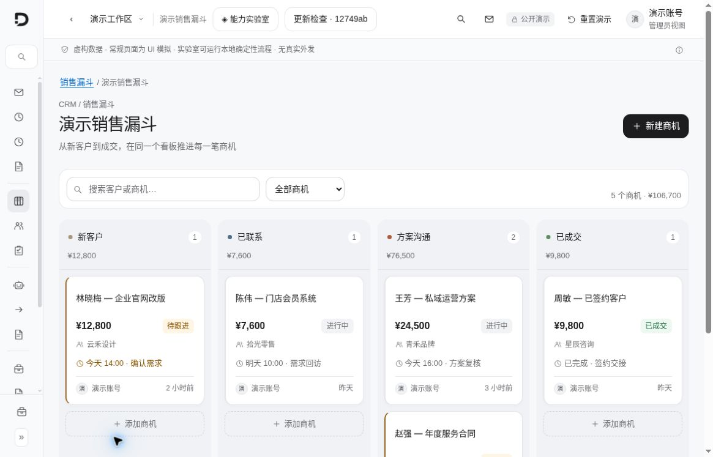
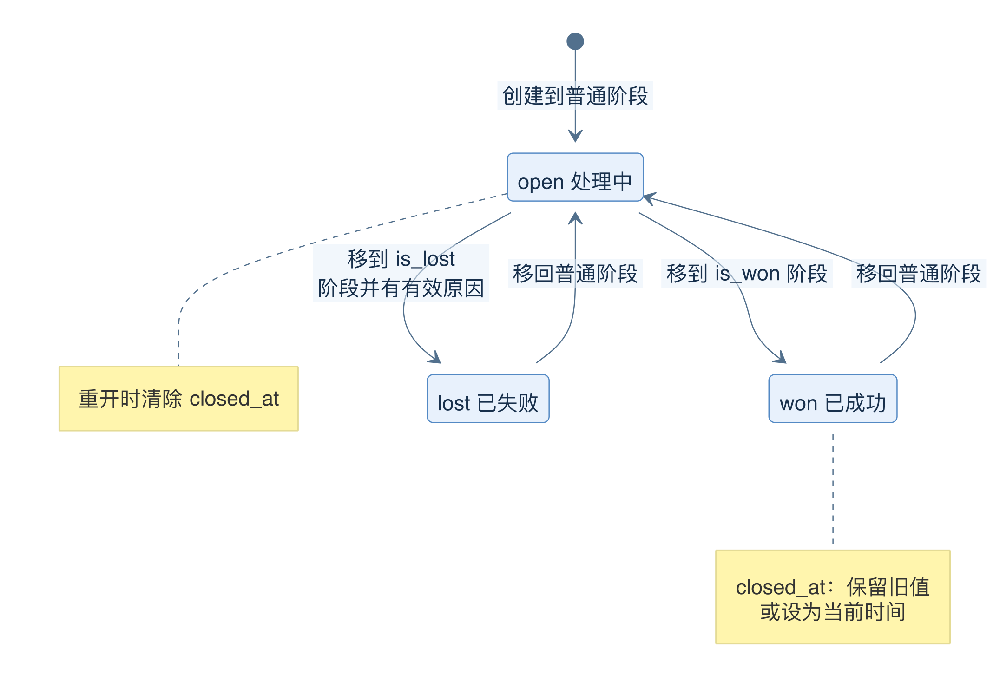
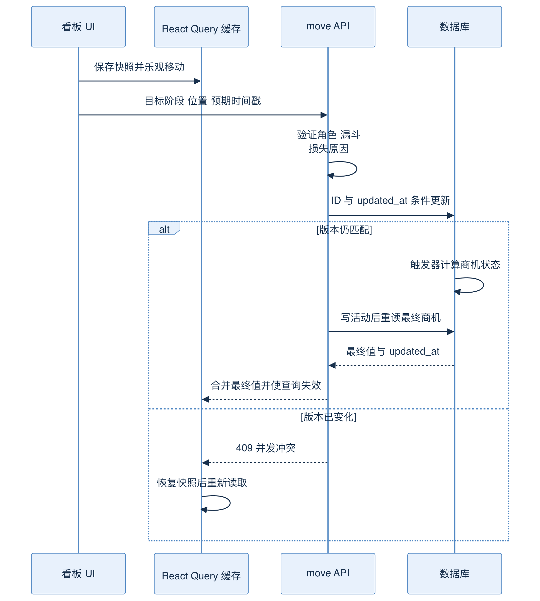
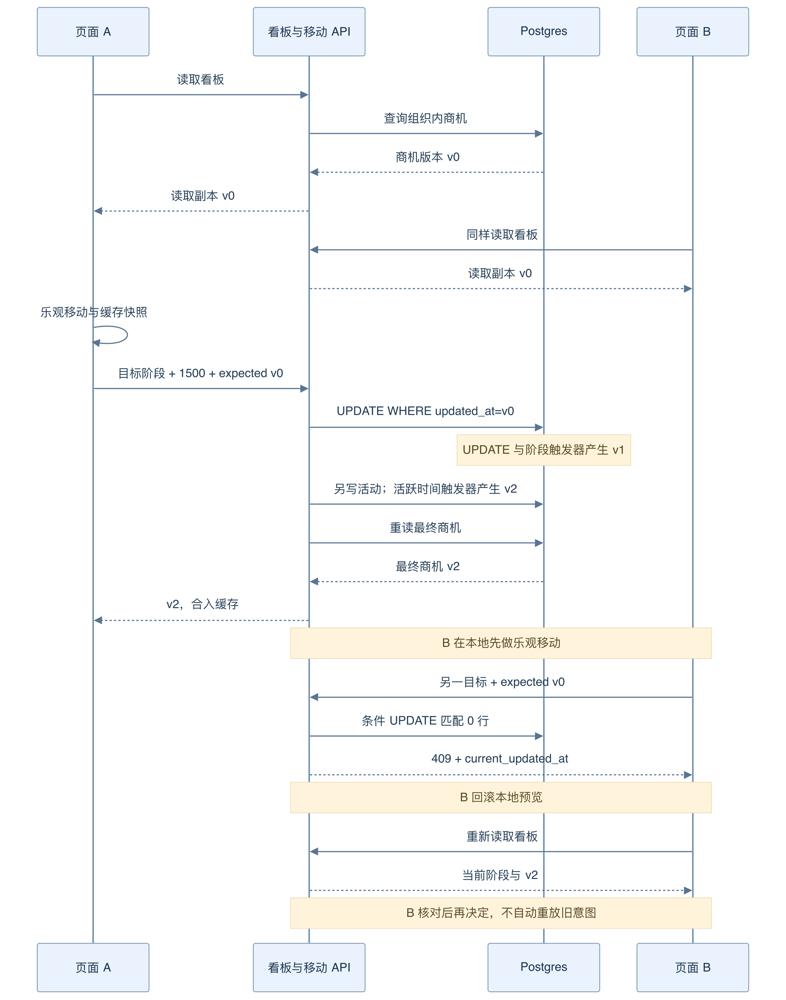
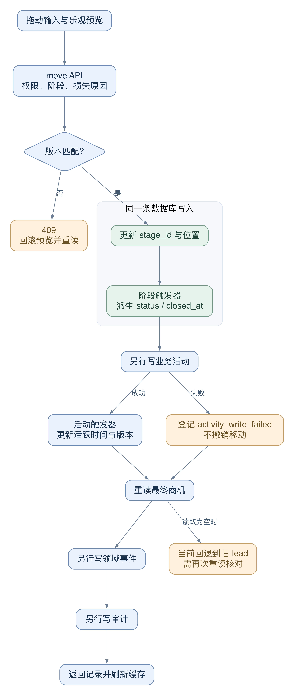

# 11 商机看板：跟踪一次拖动直到数据库

[返回母文档](../README.md) · [上一章](10.md) · [下一章](12.md)

**本章目标：**跟踪阶段变更与并发冲突，不把界面移动当成保存成功。

## 业务流程与阅读起点

学习目标：理解漏斗、阶段、商机生命周期，以及一次 React 操作怎样通过 API、数据库触发器、事件和缓存形成闭环。这一章选真实看板移动作为综合案例，不用理想化伪代码替代仓库实现。

### 当前界面近景

这张图帮助定位阶段、金额、待办和负责人的关系。静态拖拽演练不替代数据库幂等、事件和 operation trace 的验证。

### 先认识销售工作台的数据

漏斗 crm_pipelines 定义一套销售流程；阶段 crm_stages 是其中的列；商机 crm_leads 是卡片。联系人回答“我们在和谁交流”，商机回答“这次需求进展如何”。同一个联系人可以有多个商机，因此不能把“林女士刚回消息”直接解释成某一笔商机成交。

漏斗保存 vocabulary 与 settings：前者影响“商机/订单”等显示词，后者包括自定义字段与损失原因。阶段的 is_won、is_lost 决定它是否是成功或失败出口。新建商机需指定 pipeline_id、stage_id、title，可以关联联系人，金额使用整数 value_cents 加币种；币种省略时由服务端读取组织配置，不应让浏览器默默写死 BRL。人类负责人和 Agent 负责人也不是同一字段，接口会区分 owner_user_id 与 owner_agent_id。

图 09-A：箭头表示阶段变化触发的状态转换。阶段属于流程配置，open/won/lost 属于商机结果；数据库触发器依据阶段计算结果。重新移回普通阶段时，已关闭商机恢复 open 并清除 closed_at。

漏斗管理与操作卡片权限也不同：查看漏斗及看板是读操作，创建、重命名、排序、归档漏斗要求 manager；日常创建或移动商机要求 agent。/app/kanban 先展示漏斗列表，而实际看板通过 useBoard 读取 /api/v1/pipelines/{id}/board。该 hook 走服务端 API，因为会话 cookie 是 HttpOnly，不能假设浏览器 Supabase client 会自动获得同样身份。

### 定位“把咨询卡片移到报价列”的入口

拖动从 KanbanBoard.handleDragEnd 进入 useMoveCard，再 POST `/api/v1/leads/{id}/move`。position_in_stage 是可含小数的位置值，不是数组下标；expected_updated_at 则来自这次读取的商机。下一节用两个页面说明，这两个值分别解决排序与并发问题。

图 09-B：API 返回前的移动只是浏览器预览。条件写入通过后，路由尝试写活动再重读商机；冲突时，hook 回滚预览并刷新。下面沿同一条路径比较三个版本，不把动画当作数据库提交。

### 用两个人、三个版本，解释一次 409

把“林女士咨询单”从咨询列移到报价列。假设目标相邻位置是 1000 和 2000，新位置就是 1500。两个页面开始都读到同一个 updated_at，下面简写为 v0；它仍是时间戳，不是单独的整数版本字段。

图 09-C：B 回滚的是浏览器里的乐观预览，数据库中的 A 操作不被撤销。B 读到新事实后再决定是否仍要移动，不能自动拿新时间戳重放旧意图。

1. **A 先移动。** A 缓存立刻把卡片画到报价列，同时发送 stage_id、position_in_stage=1500、expected_updated_at=v0。请求提交前，useMoveCard 保存了旧看板快照。[源码：[`components/kanban/KanbanBoard.tsx:189-216`](https://github.com/helsome/AiNativeCrm/blob/679e09e80878dff7b1c79b8537317b2b9e355331/components/kanban/KanbanBoard.tsx#L189-L216)；[`hooks/kanban/useMoveCard.ts:21-44`](https://github.com/helsome/AiNativeCrm/blob/679e09e80878dff7b1c79b8537317b2b9e355331/hooks/kanban/useMoveCard.ts#L21-L44)]
2. **数据库接受 A。** UPDATE 的条件是 id 和 updated_at=v0。匹配后，阶段触发器推导 status/closed_at；数据库记录已改变，简写为 v1。路由再写 stage_changed 活动，其触发器更新 last_activity_at，并再次推进 updated_at，简写为 v2。[源码：[`app/api/v1/leads/[id]/move/route.ts:113-126`](https://github.com/helsome/AiNativeCrm/blob/679e09e80878dff7b1c79b8537317b2b9e355331/app/api/v1/leads/[id]/move/route.ts#L113-L126)、[`app/api/v1/leads/[id]/move/route.ts:166-180`](https://github.com/helsome/AiNativeCrm/blob/679e09e80878dff7b1c79b8537317b2b9e355331/app/api/v1/leads/[id]/move/route.ts#L166-L180)；[`supabase/baseline.sql:142-172`](https://github.com/helsome/AiNativeCrm/blob/679e09e80878dff7b1c79b8537317b2b9e355331/supabase/baseline.sql#L142-L172)、[`supabase/baseline.sql:23814-23852`](https://github.com/helsome/AiNativeCrm/blob/679e09e80878dff7b1c79b8537317b2b9e355331/supabase/baseline.sql#L23814-L23852)]
3. **A 获得最终记录。** 路由在活动之后重新 SELECT，A 的 onSuccess 把完整返回记录合入缓存。下一次拖动可使用 v2，不必等待背景 refetch 才拿到新版本。现有回归测试用三个不同时间戳模拟这条路径。[源码：[`app/api/v1/leads/[id]/move/route.ts:194-205`](https://github.com/helsome/AiNativeCrm/blob/679e09e80878dff7b1c79b8537317b2b9e355331/app/api/v1/leads/[id]/move/route.ts#L194-L205)；[`hooks/kanban/useMoveCard.ts:46-58`](https://github.com/helsome/AiNativeCrm/blob/679e09e80878dff7b1c79b8537317b2b9e355331/hooks/kanban/useMoveCard.ts#L46-L58)；[`app/api/v1/leads/[id]/move/route.test.ts:26-42`](https://github.com/helsome/AiNativeCrm/blob/679e09e80878dff7b1c79b8537317b2b9e355331/app/api/v1/leads/[id]/move/route.test.ts#L26-L42)、[`app/api/v1/leads/[id]/move/route.test.ts:114-127`](https://github.com/helsome/AiNativeCrm/blob/679e09e80878dff7b1c79b8537317b2b9e355331/app/api/v1/leads/[id]/move/route.test.ts#L114-L127)]
4. **B 用旧版本移动。** B 仍提交 expected_updated_at=v0。UPDATE 匹配不到行，路由返回 409 lead_stage_changed_concurrent，并附 current_updated_at。它没有覆盖 A 的修改。触发冲突的也可能是同一商机的其他更新，不一定是另一人刚拖过卡片。[源码：[`app/api/v1/leads/[id]/move/route.ts:123-153`](https://github.com/helsome/AiNativeCrm/blob/679e09e80878dff7b1c79b8537317b2b9e355331/app/api/v1/leads/[id]/move/route.ts#L123-L153)]
5. **B 撤销预览，重读事实。** onError 把缓存还原为此次操作前的快照并提示错误；409 会触发失效，onSettled 也会要求重读。快照只是临时 UI 回退。只有重新读取后，B 才知道当前真实阶段和版本。当前 hook 不会拿 current_updated_at 自动重发移动。[源码：[`hooks/kanban/useMoveCard.ts:60-73`](https://github.com/helsome/AiNativeCrm/blob/679e09e80878dff7b1c79b8537317b2b9e355331/hooks/kanban/useMoveCard.ts#L60-L73)]

OCC 在此保护的是**同一商机记录的写入版本**。它不锁住整个看板，也不保证目标列中的所有小数位置全局唯一。两张不同卡片可能基于同一对邻居计算位置；后续相邻位置相等时，midpoint 返回 NaN，看板直接中止。这个限制不能用“有 OCC”掩盖。[源码：[`lib/kanban/fractional-indexing.ts:1-13`](https://github.com/helsome/AiNativeCrm/blob/679e09e80878dff7b1c79b8537317b2b9e355331/lib/kanban/fractional-indexing.ts#L1-L13)；[`components/kanban/KanbanBoard.tsx:197-208`](https://github.com/helsome/AiNativeCrm/blob/679e09e80878dff7b1c79b8537317b2b9e355331/components/kanban/KanbanBoard.tsx#L197-L208)]

### 写入成功、业务记录完整、界面已同步，是三个问题

图 09-D：单条 UPDATE 与其触发器是一组数据库操作。活动、最终重读、领域事件和审计是路由后续调用。图中没有把整个 HTTP handler 包进同一事务，也没有让 Postgres 触发器直接调用外部服务。

Postgres 拥有阶段派生结果。路线只提交 stage_id 和位置，数据库按目标阶段的 is_won/is_lost 设置 status 与 closed_at。这样，通过别的入口写同一字段时也遵守数据库规则。活动拥有“从何阶段到何阶段”的业务解释；event_log 让后续处理器知道变化；audit 保存操作者。React Query 仅保存服务端结果的读取副本。

这一分工有明确代价：主 UPDATE 已提交后，活动写入可能失败。当前路由会另写 crm.activity_write_failed，继续保留移动结果；连失败告警也写不进去时才退到进程日志。emit_event 失败也只记录错误，不回滚卡片。这是可定位的部分成功，不能画成“活动失败 → 整次移动原子回滚”。[源码：[`app/api/v1/leads/[id]/move/route.ts:181-191`](https://github.com/helsome/AiNativeCrm/blob/679e09e80878dff7b1c79b8537317b2b9e355331/app/api/v1/leads/[id]/move/route.ts#L181-L191)、[`app/api/v1/leads/[id]/move/route.ts:207-240`](https://github.com/helsome/AiNativeCrm/blob/679e09e80878dff7b1c79b8537317b2b9e355331/app/api/v1/leads/[id]/move/route.ts#L207-L240)；[`lib/leads/activity-write-failure.ts:48-75`](https://github.com/helsome/AiNativeCrm/blob/679e09e80878dff7b1c79b8537317b2b9e355331/lib/leads/activity-write-failure.ts#L48-L75)]

最终重读也有边界。当前代码只取 fresh，没有检查该 SELECT 的 error；fresh 为空时回退到最初读到的 lead。因此“成功后返回最终版本”描述的是正常路径，不是所有故障下的保证。若响应与刚发生的拖动矛盾，应再次读取看板并核对记录；不要立即把旧响应当作数据库未修改的证据。[源码：[`app/api/v1/leads/[id]/move/route.ts:199-205`](https://github.com/helsome/AiNativeCrm/blob/679e09e80878dff7b1c79b8537317b2b9e355331/app/api/v1/leads/[id]/move/route.ts#L199-L205)]

#### 按状态、原因和下一步查，不按动画查

- **卡片动过又退回，HTTP 409。** 版本条件未通过。等待重读，检查当前阶段，再决定新操作；不要删除 expected_updated_at
- **拖到损失列得到 422。** move hook 没有传 lost_reason，且没有可沿用原因。用“标记丢失”对话框提供原因。这里是业务拒绝，不是并发冲突
- **拖动无请求、无报错。** 先检查目标是否真的变化，再看 midpoint 是否 NaN。当前相同位置碰撞会静默中止，尚无全局重排恢复
- **数据库已移动，时间线没有记录。** 核对 activity_write_failed 和 requestId。这可能是主修改成功、追踪写入失败；重复移动会增加新业务操作，不能补写旧痕迹
- **卡片长时间不刷新。** 看 useBoard 返回的 realtimeStatus 与安全重读状态。Realtime 只通知“该重读”，没有替代 OCC，也没有让失联时的缓存自动成为当前事实

来源：[`hooks/kanban/useMoveCard.ts:25-29`](https://github.com/helsome/AiNativeCrm/blob/679e09e80878dff7b1c79b8537317b2b9e355331/hooks/kanban/useMoveCard.ts#L25-L29)、[`hooks/kanban/useMoveCard.ts:60-73`](https://github.com/helsome/AiNativeCrm/blob/679e09e80878dff7b1c79b8537317b2b9e355331/hooks/kanban/useMoveCard.ts#L60-L73)；[`app/api/v1/leads/[id]/move/route.ts:98-110`](https://github.com/helsome/AiNativeCrm/blob/679e09e80878dff7b1c79b8537317b2b9e355331/app/api/v1/leads/[id]/move/route.ts#L98-L110)；[`components/kanban/KanbanBoard.tsx:177-208`](https://github.com/helsome/AiNativeCrm/blob/679e09e80878dff7b1c79b8537317b2b9e355331/components/kanban/KanbanBoard.tsx#L177-L208)；[`hooks/kanban/useBoard.ts:84-94`](https://github.com/helsome/AiNativeCrm/blob/679e09e80878dff7b1c79b8537317b2b9e355331/hooks/kanban/useBoard.ts#L84-L94)、[`hooks/kanban/useBoard.ts:127-178`](https://github.com/helsome/AiNativeCrm/blob/679e09e80878dff7b1c79b8537317b2b9e355331/hooks/kanban/useBoard.ts#L127-L178)。这些是静态源码推演；双窗口、掉线、活动写入失败还应分别做受控验证。

### 当前限制也要一起学

- 拖动 hook 没有发送 lost_reason。直接拖向损失列而又没有可沿用原因时会被 422 拒绝；使用卡片的“标记丢失”对话框选择原因才有对应输入
- 两个邻居位置相等时 midpoint 返回 NaN，看板当前直接中止；不要声称已经实现全局重排修复
- 跨漏斗是独立 clone 流程，不是篡改 pipeline_id 的普通拖动
- Realtime 会触发重读和远端卡片提示；本地拖动回声被抑制，但这不取代 409 检查

练习：用两个页面打开同一条合成商机，先在一页修改，再让另一页提交旧版本。预期学习点是 409、缓存回滚和重新读取，而不是绕过版本条件让请求“终于变绿”。

### 源码定位

固定 main：679e09e80878dff7b1c79b8537317b2b9e355331

- 漏斗与阶段结构：[`supabase/baseline.sql:1475-1514`](https://github.com/helsome/AiNativeCrm/blob/679e09e80878dff7b1c79b8537317b2b9e355331/supabase/baseline.sql#L1475-L1514)
- 创建/编辑商机契约：[`lib/schemas/leads.ts:92-153`](https://github.com/helsome/AiNativeCrm/blob/679e09e80878dff7b1c79b8537317b2b9e355331/lib/schemas/leads.ts#L92-L153)
- 漏斗入口和管理权限：[`app/app/kanban/page.tsx:14-64`](https://github.com/helsome/AiNativeCrm/blob/679e09e80878dff7b1c79b8537317b2b9e355331/app/app/kanban/page.tsx#L14-L64)
- 看板 API 读取与实时重读：[`hooks/kanban/useBoard.ts:10-28`](https://github.com/helsome/AiNativeCrm/blob/679e09e80878dff7b1c79b8537317b2b9e355331/hooks/kanban/useBoard.ts#L10-L28)、[`hooks/kanban/useBoard.ts:78-94`](https://github.com/helsome/AiNativeCrm/blob/679e09e80878dff7b1c79b8537317b2b9e355331/hooks/kanban/useBoard.ts#L78-L94)、[`hooks/kanban/useBoard.ts:136-148`](https://github.com/helsome/AiNativeCrm/blob/679e09e80878dff7b1c79b8537317b2b9e355331/hooks/kanban/useBoard.ts#L136-L148)
- 拖动与位置计算：[`components/kanban/KanbanBoard.tsx:177-218`](https://github.com/helsome/AiNativeCrm/blob/679e09e80878dff7b1c79b8537317b2b9e355331/components/kanban/KanbanBoard.tsx#L177-L218)、[`lib/kanban/fractional-indexing.ts:1-13`](https://github.com/helsome/AiNativeCrm/blob/679e09e80878dff7b1c79b8537317b2b9e355331/lib/kanban/fractional-indexing.ts#L1-L13)
- 乐观更新、回滚与最终值：[`hooks/kanban/useMoveCard.ts:17-75`](https://github.com/helsome/AiNativeCrm/blob/679e09e80878dff7b1c79b8537317b2b9e355331/hooks/kanban/useMoveCard.ts#L17-L75)
- 移动守卫、跨漏斗与 OCC：[`app/api/v1/leads/[id]/move/route.ts:31-154`](https://github.com/helsome/AiNativeCrm/blob/679e09e80878dff7b1c79b8537317b2b9e355331/app/api/v1/leads/[id]/move/route.ts#L31-L154)
- 时间线、最终重读、事件与审计：[`app/api/v1/leads/[id]/move/route.ts:156-240`](https://github.com/helsome/AiNativeCrm/blob/679e09e80878dff7b1c79b8537317b2b9e355331/app/api/v1/leads/[id]/move/route.ts#L156-L240)
- 阶段派生结果：[`supabase/baseline.sql:142-172`](https://github.com/helsome/AiNativeCrm/blob/679e09e80878dff7b1c79b8537317b2b9e355331/supabase/baseline.sql#L142-L172)
- 损失输入：[`components/kanban/LoseLeadDialog.tsx:88-110`](https://github.com/helsome/AiNativeCrm/blob/679e09e80878dff7b1c79b8537317b2b9e355331/components/kanban/LoseLeadDialog.tsx#L88-L110)、[`app/api/v1/leads/[id]/lose/route.ts:36-64`](https://github.com/helsome/AiNativeCrm/blob/679e09e80878dff7b1c79b8537317b2b9e355331/app/api/v1/leads/[id]/lose/route.ts#L36-L64)
- 最终时间戳回归：[`app/api/v1/leads/[id]/move/route.test.ts:26-42`](https://github.com/helsome/AiNativeCrm/blob/679e09e80878dff7b1c79b8537317b2b9e355331/app/api/v1/leads/[id]/move/route.test.ts#L26-L42)、[`app/api/v1/leads/[id]/move/route.test.ts:114-127`](https://github.com/helsome/AiNativeCrm/blob/679e09e80878dff7b1c79b8537317b2b9e355331/app/api/v1/leads/[id]/move/route.test.ts#L114-L127)

## 继续阅读

[返回母文档](../README.md) · [上一章](10.md) · [下一章](12.md)

