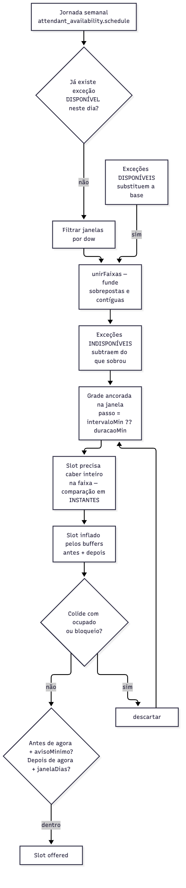
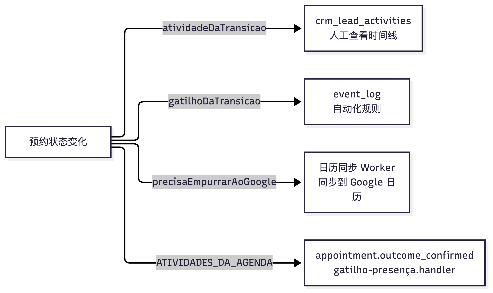

# 12 日程与预约：时段、日历同步和连接健康

[返回母文档](../README.md) · [上一章](11.md) · [下一章](13.md)

**本章目标：**理解可约时段、占用、提醒和外部日历失联的处理。

## 实现详解

日程子系统在 Pi Native CRM 中承担三重职责：把"何时可以约"这件事算成一个可预测的纯函数结果；把已约定的时刻可靠地回写到员工本人的外部日历；同时用一张连接状态表决定"这份外部日程还算不算数"。这三件事共享同一份词汇表（[tipos.ts](https://github.com/helsome/AiNativeCrm/blob/679e09e80878dff7b1c79b8537317b2b9e355331/lib/agenda/tipos.ts)），也因此共享同一批故障模式——状态值的分类错误可能影响后续行为。

本篇按**领域词汇 → 时段计算 → 占用判定 → 提醒与回路 → Google 同步 → 连接健康**的顺序展开，因为后面的每一层都依赖前面一层的分类决策。

---

### 词汇表即契约：一张表驱动整个子系统

`lib/agenda/tipos.ts` 的文件头把设计意图写得很直接：**每个常量都是 migration0176 中对应 CHECK 约束的来源**，发射器只使用常量、绝不使用字面量字符串。这样一个新状态值能在同一个 commit 里同时抵达数据库与 TypeScript，而 `tests/invariants/agenda-vocabulario.test.ts` 会持续测量这条契约是否成立。

关键约束是**声明形态本身是检测仪要求**：词汇提取器只认识 `type X = "a" | "b";` 与 `const X = ["a","b"] as const` 两种形态，遇到对象数组会在第一个 `]` 处停下。因此代码列表与 pt-br 标签被迫分离——标签放进单独的 `Record`，其穷尽性由编译器负责（[tipos.ts](https://github.com/helsome/AiNativeCrm/blob/679e09e80878dff7b1c79b8537317b2b9e355331/lib/agenda/tipos.ts#L36)）。

#### 五张决策表与它们的产物

| 常量 | 语义问题 | 派生量 | 消费者 |
| --- | --- | --- | --- |
| `SITUACAO_SEGURA_O_LEAD` | 这个承诺还"在册"吗？ | `SITUACOES_VIVAS` | 跟进引擎、风险雷达 |
| `CONEXAO_CONTA_COMO_OCUPACAO` | 这份外部日程还算占用吗？ | `CONEXOES_QUE_NAO_CONTAM` | `ocupados.ts` |
| `SITUACOES_DO_AGENDAMENTO` | 承诺处于什么状态？ | `ROTULO_DA_SITUACAO` | 全链路展示 |
| `SITUACOES_EXTERNAS` | Google 侧事件的状态？ | `OCUPA_NO_GOOGLE` | `ocupados.ts` |
| `AUTORES_DO_AGENDAMENTO` | 谁标的？ | `autorParaTimeline()` | 时间线写入 |

**第一处值得注意的工程决策**：原始代码里存在 `["pending","confirmed"]` 这样的字面量数组，团队通过故意"破坏"验证后将其替换为 `Record<SituacaoDoAgendamento, boolean>` 再经 `.filter()` 派生。原因是重叠检测对**生成者**具有毒性：新增 `"reagendado"` 时字面量数组会静默通过，而穷尽 `Record` 会报错并**指名缺失的键**。注释中把教训提炼为"给它一个消费者并不能让它活过来；重要的是它错了之后什么会坏掉"（[tipos.ts](https://github.com/helsome/AiNativeCrm/blob/679e09e80878dff7b1c79b8537317b2b9e355331/lib/agenda/tipos.ts#L125)）。

**第二处**是 `CONEXAO_CONTA_COMO_OCUPACAO` 的语义更正，其判定规则可压缩成一行：**阻止，除非有人类的指令要求停止**（[tipos.ts](https://github.com/helsome/AiNativeCrm/blob/679e09e80878dff7b1c79b8537317b2b9e355331/lib/agenda/tipos.ts#L196)）。

> 决定因素是**谁选择了这个状态**。`estadoDaConexaoApos` 只写入 `token_expired`、`scope_missing`、`error`、`healthy`、`rate_limited`——全部由系统判定，而在所有这些状态下承诺**依然存在于 Google 日历中**：停摆的是更新，不是存在本身。停止计数反而会导致重复预约。唯一由人决定的 `disconnected` 才是停止计数的那一刻——因为有人要求了。

---

### 时段计算：作为纯函数的可用性引擎

`horariosLivres()` 是一个**不读数据库、不读时钟**的纯函数：`agora` 是入参。这是被两次真实事故逼出来的——反滥用窗口曾直接用 `new Date()`裸调用，导致 22 点后 `test:db` 失败；而依赖当天时间的测试在两个方向上同时撒谎（[horarios-livres.ts](https://github.com/helsome/AiNativeCrm/blob/679e09e80878dff7b1c79b8537317b2b9e355331/lib/agenda/horarios-livres.ts#L1)）。



#### `windows` 为空在两处语义相反

这是整个文件最容易出错的地方。同一列 `schedule.windows` 被两个消费者以相反方式解读：

| 读取方 | 空值含义 | 理由 |
| --- | --- | --- |
| `isWithinSchedule`（路由，生产） | 24/7，接受 | 消息随时可达，窗口是用来**限制**的 |
| `horariosLivres`（日程） | 未发布任何时段 ⇒ 零时段 | 24/7 的日程会向患者提供凌晨三点的咨询 |

因此 `janelasDoDia()` 独立实现而不复用路由版本（[horarios-livres.ts](https://github.com/helsome/AiNativeCrm/blob/679e09e80878dff7b1c79b8537317b2b9e355331/lib/agenda/horarios-livres.ts#L212)）。三步顺序固定为：基础取当日周计划 → **可用例外取代基础**（特殊周六*替代*而非叠加）→ 不可用例外从剩余中扣除。"全天封锁"不是特例，就是扣除 `(0, 1440)`，靠通用规则得到空集；早期版本用 `if (algumaIndisponivel) return []` 导致"封锁两小时 = 封锁整天"。

#### 最重要的修复：窗口永不被分割

旧版本把封锁当作**从窗口中减去**，看似等同于从网格中移除，实则不同——**减去会重新切分窗口**，且切分后的后半段从封锁结束处开始。一次 10:30–11:30 的会议让整个下午在 12:30、13:30、14:30 被提供，而完全空闲的 17:00–18:00 消失。同一场会议记录为预约时则不会发生此事——两种表述同一事实，两个结果。

团队先尝试"通过保留锚点跨过切割"来修复（可工作），但架构师的裁决是更好的方案且是一次**删除**：让两条路径一致需要纪律，且会在第一个无人预见的案例上再次分叉；让两者成为同一条路径则无法分叉。

> 这正是 cal.com 的做法（`slotInterval` 与 `offsetStart` 只在固定锚点上有意义），也是日程所有者能够预测的行为：**锚定在已发布窗口上**，被占用的时段只是从中消失（[horarios-livres.ts](https://github.com/helsome/AiNativeCrm/blob/679e09e80878dff7b1c79b8537317b2b9e355331/lib/agenda/horarios-livres.ts#L26)）。

同时，例外封锁与预约**合并为同一机制**（决策 12）——因此"buffer 对封锁生效"是免费获得的。注释记录了具体动机：要求患者间 15 分钟间隔且 12h–14h 封锁午餐的牙医，不希望11:00 有患者，因为**她自己的消毒流程会侵入她的午餐**（[horarios-livres.ts](https://github.com/helsome/AiNativeCrm/blob/679e09e80878dff7b1c79b8537317b2b9e355331/lib/agenda/horarios-livres.ts#L330)）。

#### 重叠需先合并

`unirFaixas()` 是被导出的、命名为可导出的函数：Zod 只在**每条窗口内部**校验 `start < end`，数组只有 `.max(50)`；而两条可用例外因 UNIQUE 建立在 `start_minute` 上（540 ≠ 600）会同时进入。

> **重叠对"测试归属"的消费者无害，对"生成者"有毒。** `isWithinSchedule` 使用 `.some()`，一个 OR 只回答一次 `true`——所以路由层长期与此事共处无症状。日程是第一个**基于 `schedule.windows` 生成**的消费者，因此此函数被命名并导出：下一块生成逻辑若内联重写，就会继承这个洞（[horarios-livres.ts](https://github.com/helsome/AiNativeCrm/blob/679e09e80878dff7b1c79b8537317b2b9e355331/lib/agenda/horarios-livres.ts#L150)）。

#### 声明性限制：什么都不跨越午夜

24:00 之前无任何逻辑跨越午夜——周计划、例外、跨越午夜起止的时段皆然。该限制是**对称的**（不存在一侧可用另一侧不可用），且被显式写下以在有人售卖夜间服务**之前**被找到（[horarios-livres.ts](https://github.com/helsome/AiNativeCrm/blob/679e09e80878dff7b1c79b8537317b2b9e355331/lib/agenda/horarios-livres.ts#L47)）。`paredeDeMinutos()` 通过在 UTC 中位移（UTC 无夏令时）使 `24:00` 自然变为次日午夜，无需特例分支。

---

### 占用判定：失败闭合于动作、开放于信息

`ocupados.ts` 开头声明了支配该文件全部决策的**不对称性**：

> **少提供是可恢复的；覆盖已有预约不是。** 一个被隐藏的时段会在有人改期或重连后回来。患者赴一个不存在的预约，代价是信任，且无法撤销。因此在不确定时，**占用**。这适用于尚不在词汇表中的状态、暂定事件，以及已掉线的 Google 连接（[ocupados.ts](https://github.com/helsome/AiNativeCrm/blob/679e09e80878dff7b1c79b8537317b2b9e355331/lib/agenda/ocupados.ts#L14)）。

#### 掉线的连接继续占用（决策 3.2 修正版）

第一版决策要求停止统计过期日历，理由是"统计一个不响应的源会覆盖真实预约"。**该论证是反的**——停止统计才是造成覆盖的原因。承诺仍然存在于对方的日历中，停摆的是**更新**。

> 我们持有的是最后已知状态。统计它可能阻塞一个实际已空出的时段——此时有人会打电话改期。不统计它则提供一个已被占用的时段——此时患者到了而医生不在。**占用与告知是两个问题**，而在此之前它们共用同一个 `if`（[ocupados.ts](https://github.com/helsome/AiNativeCrm/blob/679e09e80878dff7b1c79b8537317b2b9e355331/lib/agenda/ocupados.ts#L120)）。

#### `pending` 故意不在释放集合中

`LIBERAM_O_HORARIO = {cancelled, no_show}`。`pending` 缺席是**有意为之**：等待确认是**压在该时段上的一个请求**，不统计它会让第二个请求被接受到同一时刻，其中一人白跑一趟。

`OCUPA_NO_GOOGLE` 使用穷尽 `Record` 而非字面量 `Set`，理由与前述一致：`tentative` 占用（"我可能会去"意味着此人正在持有该时段）；`cancelled` 释放（时段真正重新存在）（[ocupados.ts](https://github.com/helsome/AiNativeCrm/blob/679e09e80878dff7b1c79b8537317b2b9e355331/lib/agenda/ocupados.ts#L78)）。

#### `fontesDefasadas`：让界面不说谎的信号

```typescript
// Falha fechada na AÇÃO (o horário fica bloqueado), aberta na INFORMAÇÃO.
fontesDefasadas: SituacaoDaConexao[];
```

连接状态非 `healthy` 即进入此列表，界面据此显示"你的 Google 日程已断开，这些时段可能已过期"，而非在两个方向上撒谎。函数 `agendaConfiavelAgora()` 区分了一个被归一化数据抹平的差异：**"没有 Google"** 与 **"有 Google 但从未被读取过"（`last_sync_at is null`）** 产出同样的空占用列表，而它们是相反的事——后者意味着引擎会提供外科手术的时段（[ocupados.ts](https://github.com/helsome/AiNativeCrm/blob/679e09e80878dff7b1c79b8537317b2b9e355331/lib/agenda/ocupados.ts#L170)）。

---

### 屏幕占用与外部占用的交集裁剪

`ocupacao-externa.ts` 存在的首要原因是**同一份查询曾被复制到两处**（服务端种子与路由响应），两份规则在只有一处修改时静默分叉——issue #525 的成因。

**裁剪是区间交集，不是起点比较。** 引擎的 `fn_agenda_ocupacao_google_do_dono`（migration 0260）使用 `starts_at < fim AND ends_at > inicio`，而屏幕曾只比较 `starts_at >= inicio AND starts_at < fim`，导致**跨越裁剪边界**的预约（昨夜 23:30 至今日 00:30）在网格中消失、却被引擎拒绝预约——屏幕显示空闲的时段正是标记会拒绝的时段（[ocupacao-externa.ts](https://github.com/helsome/AiNativeCrm/blob/679e09e80878dff7b1c79b8537317b2b9e355331/lib/agenda/ocupacao-externa.ts#L16)）。

返回值是**裁剪范围内的可见切片**：`GradeDaAgenda` 按**起始时刻**把每个块归入日期列，返回裁剪前的原始时刻会让昨日开始的块落到所有已绘制列之外。完成于裁剪起点的事件不占用其中任何一分钟，反之亦然——两处比较皆为严格（[ocupacao-externa.ts](https://github.com/helsome/AiNativeCrm/blob/679e09e80878dff7b1c79b8537317b2b9e355331/lib/agenda/ocupacao-externa.ts#L34)）。

#### 权限缺陷：从 embed切换到函数

文件记录了一个真实的不一致：此文件曾通过**会话**读取 `calendar_selected_external_events` 并 `inner` 连接 `calendar_connections`，而该表 RLS 仅放行 `user_id = auth.uid()` 或 `fn_role_at_least(..., 'manager')`。于是对 `viewer` 与 `agent` 角色，同事的连接被隐藏，网格把**店主的全部预约绘制成空闲**；而可用性引擎不受影响（它调用 `security definer` 函数）。结果是接线员看到空位、尝试预约、被拒，而提示语"超出你发布的时间范围"给出的是**错误的原因**（issue #896 第 3 项）。

现在屏幕**问引擎所问之处**。代价被诚实声明：**N 次调用**（每位所有者一次）而非一次查询（[ocupacao-externa.ts](https://github.com/helsome/AiNativeCrm/blob/679e09e80878dff7b1c79b8537317b2b9e355331/lib/agenda/ocupacao-externa.ts#L50)）。`transparent`/`cancelled` 过滤**留在调用方**：函数返回两个字段，由读取方决定——这是与引擎采集相同的规则，在 TypeScript 侧应用，规则只有一份。

---

### 预约回路与提醒

#### 两个发射器回答不同问题

标记时段不是写一行记录，而是一个**必须回流**的事实（Sistema Vivo 不变量 7）：



三条边界**故意不同**，注释给出理由：

- **时间线**：`pending → confirmed` 返回 `null`，因为这是内部操作——承诺在请求时已进入时间线；只改备注的 PATCH 也什么都没变。*带噪声的时间线就是没人读的时间线*，届时不变量 3（可见日志）将死于**过量**而非不足（[laco.ts](https://github.com/helsome/AiNativeCrm/blob/679e09e80878dff7b1c79b8537317b2b9e355331/lib/agenda/laco.ts#L40)）。
- **规则**：`pending → confirmed` 恰恰是**最**有用的钩子——此时预约从"请求"变为"承诺"，正是"向客户发送确认"的时机。复用时间线函数会抹掉三个触发器中最有用的那个（[laco.ts](https://github.com/helsome/AiNativeCrm/blob/679e09e80878dff7b1c79b8537317b2b9e355331/lib/agenda/laco.ts#L64)）。
- **Google推送**：`completed` 与 `no_show` **不推送**——外部事件已发生，在此处登记"该客户到场了"不改变其日历中的任何内容。推送会产生无效果的外部写入，而外部写入是本功能所做的**最昂贵且最危险**的事（[laco.ts](https://github.com/helsome/AiNativeCrm/blob/679e09e80878dff7b1c79b8537317b2b9e355331/lib/agenda/laco.ts#L98)）。

#### 作者词汇表的静默故障

`AUTORES_DO_AGENDAMENTO` 与 `crm_lead_activities.actor_kind` 的 CHECK 在**两个方向**上分歧：`sync` 只存在于日程侧，`rule` 只存在于 CHECK 中。在 fire-and-forget 路径中写入 `sync` 会被 Postgres 以23514 拒绝——**不经过 typecheck、lint、`test:unit` 或 CI**。症状是活动静默不产生（[laco.ts](https://github.com/helsome/AiNativeCrm/blob/679e09e80878dff7b1c79b8537317b2b9e355331/lib/agenda/laco.ts#L110)）。

选择**映射而非扩展 CHECK**，理由是语义：同步者既不是人也不是 AI，而是产品带回的外部事实，这正是 `system` 在时间线中已表达的含义；具体来源不丢失，它保留在 `calendar_appointments.created_by_kind` 中。

#### 提醒：包装边界与守卫接线

数据库保存主台阶于 `reminder_minutes_before`、其余于 `reminder_extra_offsets_minutes`、每个额外台阶的文案于 `reminder_bodies`（分钟 → 短语 的映射）。屏幕不操此语言：它看到 N 张相同卡片。打包/解包**只在此边界发生一次**，而非每个读取方各自重新发明"哪个是主台阶"（[lembretes.ts](https://github.com/helsome/AiNativeCrm/blob/679e09e80878dff7b1c79b8537317b2b9e355331/lib/agenda/lembretes.ts#L1)）。

| 常量 | 值 | 语义 |
| --- | --- | --- |
| `LEMBRETE_MIN_MINUTOS` | 15 | 低于此值 cron 永不触发 |
| `LEMBRETE_MAX_MINUTOS` | 10080（7 天） | 高于此值已不属提醒 |
| `TETO_DE_LEMBRETES_EXTRAS` | 20 | 防**意外循环**（表单重复卡片），非"最多 3 次以免过度打扰" |

`empacotarLembretes()` 去重同一分钟的卡片，并按分钟**降序**排序，`limpos[0]` 成为主台阶。`moldeDoDegrau()` 的模板优先级是：**自带文案的 extra 优先** → 主台阶落 `reminder_body` → 无文案时由调用方使用组织模板或出厂语句；extra **不继承**主台阶的语句，否则"按提醒的消息"会退化回单一字段（[lembretes.ts](https://github.com/helsome/AiNativeCrm/blob/679e09e80878dff7b1c79b8537317b2b9e355331/lib/agenda/lembretes.ts#L96)）。

---

### 连接健康：把 HTTP 失败翻译成系统行为

#### `erros.ts`：为什么必须是表而非 `catch`

**把失败分类错就会产生会删除数据的同步**，文件中给出两个具体且非假设的例子：

- **删除操作中的 `410`**意为"已不存在"——恰是我们想要的状态。当作失败处理会因对方手动删除的事件而永久卡死 CRM 的取消流程。
- **增量同步中的 `410`** 意为**另一件事**：`syncToken` 已死，Google 要求从头开始。当作"事件消失"处理会去删除整个日历的行。

> 同一个编号，**相反的结果**。因此操作是**必填参数**：默认值会在两种解读中静默选中一种，而错误的那种恰恰是破坏数据的（[erros.ts](https://github.com/helsome/AiNativeCrm/blob/679e09e80878dff7b1c79b8537317b2b9e355331/lib/agenda/google/erros.ts#L5)）。

| 结局 | 语义 | 后续动作归属 |
| --- | --- | --- |
| `reautenticar` | 需人类重连，retry 无解 | 调用方标记 `token_expired` |
| `recuar` | 配额/限流，等待并重试 | 调用方决定退避时长 |
| `sem_permissao` | 凭据有效但对该日历无权利 | 调用方 |
| `evento_sumiu` | 事件已不在，引用成为孤儿 | 清理本地行 |
| `calendario_sumiu` | **日历**不存在或账户失去访问权 | **与 `evento_sumiu` 分离**：无物可对账，需重连 |
| `ressincronizar` | `syncToken` 已死 | 清游标、全量重同步 |
| `ja_esta_feito` | 期望状态已成立，**不是失败** | 幂等处理 |
| `transitorio` | 乘客错误（5xx、网络） | 重试 |
| `permanente` | 重试无改变 | 需人类或代码修正 |

**`invalid_grant` 不以 401 到达。** 令牌续期失败返回 **HTTP 400** 与体 `{"error":"invalid_grant"}`——这是 Google 表达"用户已撤销访问"或"该 refresh_token 六个月未使用"的方式。只按状态码分类的人读作"请求格式错误"，永远重试，而客户的日程在无人被告知的情况下断开（[erros.ts](https://github.com/helsome/AiNativeCrm/blob/679e09e80878dff7b1c79b8537317b2b9e355331/lib/agenda/google/erros.ts#L32)）。

提取器的注释记录了一个已被定位的最坏案例：`error.code` 在**顶层**时最关键却曾**缺失**——本仓库无 `googleapis` 依赖，客户端走 `fetch`，而 `await res.json()` 的自然对象是**原始体**。不读取它时，一个格式良好的 Google 错误在无状态无动机的情况下到达，落入保守结局 `transitorio`，变成无限重复；实测最坏案例是一个此形态的 `410 fullSyncRequired` 变成"再试一次"，worker 以**同一个已死的 `syncToken`** 重复同一请求，该日历的同步**永久冻结**——且是静默的（[erros.ts](https://github.com/helsome/AiNativeCrm/blob/679e09e80878dff7b1c79b8537317b2b9e355331/lib/agenda/google/erros.ts#L110)）。

#### OAuth state：签名化并携带人员身份

与 Nuvemshop 的构造相同（HMAC-SHA256、短有效期、恒定时间比较），**但载荷不同**：日程是**按人**的（`unique (organization_id, user_id, provider, account_email)`），因此 Google 的回调必须声明刚被授权的是**谁的**日程。没有 `user_id` 的话回调只能猜测——接线员的日程会登入为另一个人的（[estado.ts](https://github.com/helsome/AiNativeCrm/blob/679e09e80878dff7b1c79b8537317b2b9e355331/lib/agenda/google/estado.ts#L5)）。

两处刻意偏离先例：**密钥是注入的而非从环境读取**（Nuvemshop 版本在 `INTERNAL_SECRET` 过短时落到每进程随机密钥，多副本 VPS 上表现为间歇性"连上了但报错"且日志无线索；此处缺密钥**在签发时抛出**，调用方将其转为指名缺失变量的消息）；**时钟是注入的**（期限只在边界可测）。载荷中的 `.` 被显式拒绝作为字段分隔符的保护。

> 此文件**声明不解决**的部分：`nonce` 被签发并在校验时返回，但**无人焚毁**——在期限内同一 `state` 有效两次。关闭它需要保存已用 nonce（Redis 或表），那是状态，而状态不属于此层。组装回调路由的接收方拿到 nonce 正是为了能焚毁它（[estado.ts](https://github.com/helsome/AiNativeCrm/blob/679e09e80878dff7b1c79b8537317b2b9e355331/lib/agenda/google/estado.ts#L22)）。

---

## 继续阅读

[返回母文档](../README.md) · [上一章](11.md) · [下一章](13.md)

