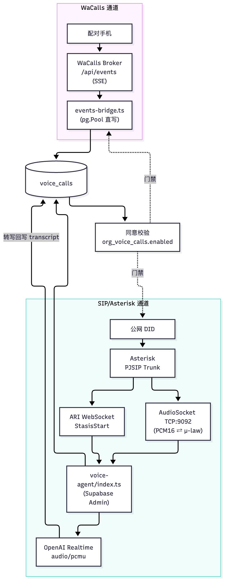

# 13 语音呼叫：SIP、事件桥接、同意与录音

[返回母文档](../README.md) · [上一章](12.md) · [下一章](14.md)

**本章目标：**理解 WaCalls 和 SIP 两条通路如何落库并保留许可与记录。

## 实现详解

语音呼叫栈在 Pi Native CRM 中是一条**双通道**的通路：一条是 WhatsApp 侧的 WaCalls 网关（把手机当耳朵和嘴巴），另一条是自建 SIP/Asterisk 侧（把 DID 当耳朵，配 OpenAI Realtime 当嘴巴）。两条通道最终都落到**同一张 `voice_calls` 表**，由 `provider` 字段区分来源。本页聚焦这条语音链路的四个核心枢纽：**SIP 中继的解析与保护**、**事件桥接（SSE 与 Stasis）**、**同意校验（opt-in 的双重语义）** 与 **录音/转写处理（AudioSocket + μ-law 转码）**。理解了这条线，就理解了为什么 `voice_calls` 里的 `status` 词汇表是"W 来自第三方、不是我们的"，以及为什么通话中 AI 必须闭嘴。 Sources: [events-bridge.ts](https://github.com/helsome/AiNativeCrm/blob/679e09e80878dff7b1c79b8537317b2b9e355331/lib/wacalls/events-bridge.ts#L1) [index.ts](https://github.com/helsome/AiNativeCrm/blob/679e09e80878dff7b1c79b8537317b2b9e355331/workers/voice-agent/index.ts#L1)

### 总体架构：两个提供方，一张表

语音呼入在这套系统里存在两条互不相干的物理通路，但它们共享数据模型与大部分"合规—落地—留痕"的处理逻辑。这是理解全局的第一层事实。

| 维度 | WaCalls（WhatsApp 呼叫） | SIP / Asterisk（自建中继） |
| --- | --- | --- |
| **中介设备** | 配对的手机 App | Asterisk + PJSIP trunk |
| **事件来源** | 单一 SSE 流 `${WACALLS_API_BASE_URL}/api/events` | Asterisk ARI WebSocket（Stasis 事件） |
| **落库方式** | `pg.Pool` 直连 Postgres 的 upsert | Supabase Admin client 的 insert/update |
| **录音/媒体** | 由 WaCalls 网关内部处理（我们不碰 PCM） | AudioSocket（TCP）+ OpenAI Realtime（μ-law） |
| **provider 标记** | `provider='wacalls'` | `provider='sip'` |
| **共用表** | `voice_calls`（migration 0348 统一） | 同一张表 |

两条通道汇入同一个 `voice_calls`，让"通话"这一业务实体有了唯一的事实来源；而 `provider` 让下游能在同一张表上区分"这通电话是走 WhatsApp 还是走中继"。这是 0348 这次迁移刻意换来的东西——此前两张互不通信的通话表，正是 PR #677 三方分诊点名的首要问题。 Sources: [index.ts](https://github.com/helsome/AiNativeCrm/blob/679e09e80878dff7b1c79b8537317b2b9e355331/workers/voice-agent/index.ts#L14) [route.ts](https://github.com/helsome/AiNativeCrm/blob/679e09e80878dff7b1c79b8537317b2b9e355331/app/api/v1/calls/route.ts#L5)

#### 两通路的角色分工（概念关系图）



读这张图时要抓住一个不对称：**WaCalls 通道是"HTTP 喂数据库"（上游 SSE 持续灌入），SIP 通道是"数据库旁挂一个常驻媒体进程"**。二者的运行模型、可失败模式、恢复策略完全不同，但共享同一套数据落地与同意语义。 Sources: [events-bridge.ts](https://github.com/helsome/AiNativeCrm/blob/679e09e80878dff7b1c79b8537317b2b9e355331/lib/wacalls/events-bridge.ts#L4) [index.ts](https://github.com/helsome/AiNativeCrm/blob/679e09e80878dff7b1c79b8537317b2b9e355331/workers/voice-agent/index.ts#L62)

### SIP 中继：endpoint 派生、密码加密与 originate

SIP 中继的入口是一个 REST 路由 `POST /api/v1/calls`。它做了三件有代表性、值得逐一拆开看的事：**三重鉴权**、**从表中取中继配置**、以及 **"先落库再呼叫"来关闭竞态**。

#### 三重门禁与中继来源

路由在做任何事之前先过两道关：一是 `requireSupportWrite()`——纯只读的行政陪同（impersonate）不得代客户发起通话、改中继凭据；二是 `requireRole("manager", ...)`。随后从中继表 `voip_trunk_settings` 按组织取 `endpoint_name`，仅当 `is_active` 为真时才采用，否则回退到环境变量 `VOIP_TRUNK_ENDPOINT`（兼容尚未迁移到界面的部署）。两者都拿不到就以 `trunk_not_configured` 拒绝。 Sources: [route.ts](https://github.com/helsome/AiNativeCrm/blob/679e09e80878dff7b1c79b8537317b2b9e355331/app/api/v1/calls/route.ts#L125)

```typescript
// app/api/v1/calls/route.ts#L154-L170（节选）
const { data: trunkConfig } = await supabase
  .from("voip_trunk_settings")
  .select("endpoint_name, is_active")
  .eq("organization_id", activeOrg.orgId)
  .maybeSingle();
const trunkEndpoint =
  trunkConfig && trunkConfig.is_active ? trunkConfig.endpoint_name : process.env.VOIP_TRUNK_ENDPOINT;
if (!trunkEndpoint) {
  return fail("trunk_not_configured", "Nenhum trunk SIP configurado para esta organização (Configurações > Trunk SIP).", 422, { requestId });
}
```

#### endpoint 名的"派生而非手填"

中继配置由 `guardarTrunk()` 写入，它强制把 `endpoint_name` 派生为 `org-<uuid>-trunk-endpoint`，而不是让管理员手输。理由很硬：这个字符串必须逐字符与 `asterisk/pjsip.conf` 里对应的区块名一致，**任何手填都是两侧发散的唯一途径**；派生把它消灭在源头。密码用 AES-GCM 加密存储，磁盘上只留末 4 位明文，并按组织（`organization_id` 作主键）做 upsert——一个组织一条中继，不是一张列表。 Sources: [guardar-trunk.ts](https://github.com/helsome/AiNativeCrm/blob/679e09e80878dff7b1c79b8537317b2b9e355331/lib/voip/guardar-trunk.ts#L8) [guardar-trunk.ts](https://github.com/helsome/AiNativeCrm/blob/679e09e80878dff7b1c79b8537317b2b9e355331/lib/voip/guardar-trunk.ts#L19)

`guardarTrunk` 还有一个刻意的分支：**首次创建必须给密码**（`senha_obrigatoria_na_criacao`），更新时可省略以保留已加密的密码。这是"更新时缺省不等于清空"的正确语义，避免了一个隐蔽的凭据擦除 bug。 Sources: [guardar-trunk.ts](https://github.com/helsome/AiNativeCrm/blob/679e09e80878dff7b1c79b8537317b2b9e355331/lib/voip/guardar-trunk.ts#L40)

#### originate 的对端格式与"先落库"

`originateCall()` 组装 PJSIP 端点时有两个实战坑，都写进了注释：**dial string 不能带 `+`**（`+` 是 E.164 的存储/显示格式，SIP URI 里会报 `Could not create dialog to invalid URI`），且必须拼成 `PJSIP/<号码>@<端点名>`（`/端点/URI` 这种格式对裸号码会失败，Asterisk 靠 AOR 解析主机端口而非 `/` 之后的内容）。它把通话直接投递到 dialplan 上下文 `voice-agent-out`，**不进 Stasis 应用**——因为实测发现 ARI mixing bridge 配合 externalMedia 永远不会把注入的音频回送中继（只有静音），这是 Asterisk `chan_rtp/externalMedia` 的已知限制而非本项目的 bug，所以改走 dialplan + AudioSocket 纯 TCP。 Sources: [ariClient.ts](https://github.com/helsome/AiNativeCrm/blob/679e09e80878dff7b1c79b8537317b2b9e355331/lib/voip/ariClient.ts#L64) [ariClient.ts](https://github.com/helsome/AiNativeCrm/blob/679e09e80878dff7b1c79b8537317b2b9e355331/lib/voip/ariClient.ts#L120)

"先落库再呼叫"是为了关闭一个真实竞态：`channelId`（一个 UUID）在插入 `voice_calls` 之前就生成，并同时作为 ARI 的 `channelId` 与 AudioSocket 的 UUID 传入。这样 worker 收到的 `StasisStart` 即便先到，也能凭 `asterisk_channel_id` 立刻查到行，不依赖"ARI 返回后再补一次 update"这种希望它来得及的操作。 Sources: [ariClient.ts](https://github.com/helsome/AiNativeCrm/blob/679e09e80878dff7b1c79b8537317b2b9e355331/lib/voip/ariClient.ts#L51) [route.ts](https://github.com/helsome/AiNativeCrm/blob/679e09e80878dff7b1c79b8537317b2b9e355331/app/api/v1/calls/route.ts#L172)

### 事件桥接：SSE（WaCalls）与 Stasis（SIP）的两种循环

这是语音栈中最能体现项目性格的部分——**两种事件循环，一个跑在 worker 进程里直连 Postgres，另一个跑在 ARI WebSocket 上**。

#### WaCalls SSE 桥：状态词汇与方向推断

`events-bridge.ts` 维持一条常驻 SSE 连接。重连采用退避直到 `maxBackoffMs` 上限（反死锁）。关键设计判断有三个：

**其一，`call-status` 是双向的唯一 upsert 事实。** 一通入站电话在同一瞬间会同时触发 `call-status`(ringing) 和 `incoming` 事件（上游同一个 `OnIncoming` 回调），因此 `incoming` 不需要自己写库，只需转发去触发前端的来电横幅。 Sources: [events-bridge.ts](https://github.com/helsome/AiNativeCrm/blob/679e09e80878dff7b1c79b8537317b2b9e355331/lib/wacalls/events-bridge.ts#L9)

**其二，方向不是事件带来的，而是推断的。** `call-status` 的字段里根本没有 `direction`（只有 `call-list` 快照和 REST API 才有）。桥接层用"所有者是否在场"来推断首个事件的方向：从 CRM 拨出的电话天然带 `X-Client-Id`（即已认证会话的 `auth.users.id`）因而带 owner；收到的电话在有人接听前无 owner。于是：**声明的方向**（来自快照）可以改写方向，**推断的方向**只在 INSERT 时生效、冲突路径不改写——避免一个"带 owner 的 connected"把一通入站电话误判成出站。代价也诚实标注了：从 WaCalls 自带网页拨出的电话（CRM 之外）天生无 owner，会在快照纠正前被当作收到。 Sources: [events-bridge.ts](https://github.com/helsome/AiNativeCrm/blob/679e09e80878dff7b1c79b8537317b2b9e355331/lib/wacalls/events-bridge.ts#L254)

**其三，号码要按"两种九位数字写法"匹配。** WhatsApp 传来的 peer 常是缺九位数字的纯数字（`553198966398`），而 `contacts.phone_number` 存的是带 `+` 的 E.164（`+5531998966398`，且有 `contacts_phone_e164_format` 约束保证）。桥接因此用 `phoneLookupVariants` 同时喂入两种写法，并让"与 peer 完全一致"的写法胜出（`order by (phone_number = '+'||peer) desc`），以免两个重复登记里靠运气抽中。 Sources: [events-bridge.ts](https://github.com/helsome/AiNativeCrm/blob/679e09e80878dff7b1c79b8537317b2b9e355331/lib/wacalls/events-bridge.ts#L124)

#### answered_at 与"接通即应答"

`answered_at` 必须在 INSERT 里就处理 `connected`，而不只是等 `ringing→connected` 的更新路径。因为并非每通电话都先经历 `ringing`：出站电话一建立就是 connecting，且桥接带退避重连，它看到的第一个事件就可能是 `connected`。若不在 INSERT 补这一笔，这些电话天生 `answered_at` 为 null，**永远不会被计为已接通**——不进坐席指标、不破"业务静默"判定，出站那通断开时还会在通知中心误报成"未接来电"。 Sources: [events-bridge.ts](https://github.com/helsome/AiNativeCrm/blob/679e09e80878dff7b1c79b8537317b2b9e355331/lib/wacalls/events-bridge.ts#L288)

同样地，冲突路径上 `owner_user_id` 用 `coalesce(已存值, 新值)` 而非直接覆盖：真正知道"谁点了接听"的是接听路由（它在 SSE 事件到达前就写了 owner），后来的一个无 owner 事件不能把它抹掉。 Sources: [events-bridge.ts](https://github.com/helsome/AiNativeCrm/blob/679e09e80878dff7b1c79b8537317b2b9e355331/lib/wacalls/events-bridge.ts#L302)

#### 通话中让 AI 闭嘴：借用人机交接机制

桥接层的道德核心在 `calarIaDuranteALigacao()`：一通电话在通话期间，就复用"人类已接手"的现成机制——写 `conversations.bot_silenced_until`——让 AI 在这通电话期间不参与对话。这是"一个人此刻正在和客户通话，AI 还在上面插嘴是产品能犯的最糟的僭越"这一判断的代码化。 Sources: [events-bridge.ts](https://github.com/helsome/AiNativeCrm/blob/679e09e80878dff7b1c79b8537317b2b9e355331/lib/wacalls/events-bridge.ts#L36)

它刻意**不动** `assignee_kind`（其 CHECK 要求 `assigned_to_user_id`，而用配对手机接听的人不一定是 CRM 用户），也**不动** `contacts.force_human`（那会锁死整个联系人，一通电话不构成封锁）。 Sources: [events-bridge.ts](https://github.com/helsome/AiNativeCrm/blob/679e09e80878dff7b1c79b8537317b2b9e355331/lib/wacalls/events-bridge.ts#L46)

静音设了一个 2 小时上限（`now() + interval '2 hours'`），而不是 `infinity`。理由是反死锁：若 worker 在 `connected` 与 `call-ended` 之间崩溃（这两个事件来自同一条 SSE 流，会一起丢失），`infinity` 会让对话永久沉默且无人知晓原因；有上限时最坏是 AI 沉默两小时，而 `call-ended` 一到就立即恢复声音。写入还有一条"绝不缩短"的谓词——持久的人类交接（`infinity`）胜过这个上限，覆盖写会把人有意接管的对话还给 AI。 Sources: [events-bridge.ts](https://github.com/helsome/AiNativeCrm/blob/679e09e80878dff7b1c79b8537317b2b9e355331/lib/wacalls/events-bridge.ts#L56)

#### SIP 侧：Stasis 只做"过路"，双向汇入 AudioSocket

SIP 通道的 worker（`workers/voice-agent/index.ts`）把 Stasis 当纯粹的过路：入站电话只在 Stasis 里停留到足够解析出组织/坐席、按号码创建 `voice_calls` 行，就 `continueDialplan` 把控制权交回 dialplan，奔向 `[from-trunk-audiosocket]`，那里同样调 `AudioSocket()`。出站电话**根本不进 Stasis**（route 的 `originateCall` 直接投递 `voice-agent-out` 上下文）。两条流程在同一个地方汇合：`startAudioSocketServer()` 接受 TCP 连接、读 UUID 帧、按 `asterisk_channel_id` 找到 `voice_calls` 行、拉起**同一个** `AudioSocketCallBridge`——不分入站出站。 Sources: [index.ts](https://github.com/helsome/AiNativeCrm/blob/679e09e80878dff7b1c79b8537317b2b9e355331/workers/voice-agent/index.ts#L22) [index.ts](https://github.com/helsome/AiNativeCrm/blob/679e09e80878dff7b1c79b8537317b2b9e355331/workers/voice-agent/index.ts#L144)

入站的号码解析有一个诚实处理歧义的分支：单 DID 中继把扩展名 `"s"` 放进 Request-URI 而非被拨号码，此时**只在恰好存在 1 个活跃号码**时才敢解析（无歧义）；一旦将来有第二个就明确拒绝而不是猜。 Sources: [index.ts](https://github.com/helsome/AiNativeCrm/blob/679e09e80878dff7b1c79b8537317b2b9e355331/workers/voice-agent/index.ts#L158)

worker 还会调 `garantirLeadDaConversa` 让"来电即新需求"——不带这步，打进来却无人接听的电话会游离在漏斗和风险雷达之外（两者都基于 `crm_leads` 而非 `voice_calls`）。这与 WhatsApp 的 lead 诞生机制同源，仅换来源标签。 Sources: [index.ts](https://github.com/helsome/AiNativeCrm/blob/679e09e80878dff7b1c79b8537317b2b9e355331/workers/voice-agent/index.ts#L122)

出站则没有闭环的兜底：`handleChannelDestroyed` 只把仍处于 `ringing` 的行标成 `ended/timeout`，因为出站从不进这个 worker 的 Stasis，若不补这个处理器，一通响了没人接的电话会在屏幕上永远停在 `ringing`（实测曾如此）。 Sources: [index.ts](https://github.com/helsome/AiNativeCrm/blob/679e09e80878dff7b1c79b8537317b2b9e355331/workers/voice-agent/index.ts#L349)

### 同意校验：能力 ∧ 许可

语音功能能否使用，取决于两个**互不覆盖**的问题同时为真，这一层是整个栈的"法律闸门"。

| 问题 | 数据源 | 谁回答 | 作用域 |
| --- | --- | --- | --- |
| **服务在跑吗？** | `WACALLS_API_BASE_URL` 存在与否 | 运维 VPS 的人 | 整个安装 |
| **这组织允许吗？** | `org_voice_calls.enabled` | 该组织管理员 | 仅该组织 |

组合方式是逻辑与 `&&`，而不是 `组织选择 ?? 环境默认` 那种"更具体者胜"的 `??`。理由讲得很直白：`??` 的前提是两端回答**同一个**问题（"这层防护跑不跑？"）；这里两端回答不同问题——**组织不能给自己同意一个并未运行的服务，运行中的服务也不能替任何人同意**。若误用 `??`，一个环境变量就会把语音能力一次性发给安装内**所有**组织。 Sources: [opt-in.ts](https://github.com/helsome/AiNativeCrm/blob/679e09e80878dff7b1c79b8537317b2b9e355331/lib/voice/opt-in.ts#L1)

```typescript
// lib/voice/opt-in.ts#L42-L47（节选）
export function chamadaDeVozLigada(escolhaDaOrg: EscolhaDeVoz, instalacaoOferece: boolean): boolean {
  return instalacaoOferece && (escolhaDaOrg ?? false);
}
```

另一条产品级约束是**"无线即视为关"**：语音是新能力，没人有既存决定可保留，`false`（无线=关）是对世界状态的真实读取，而且这是产品负责人的明确条件——**没人靠"升级"就自动获得这项能力**（对照 migration 0142 有意为之的反面）。同时 `instalacaoOfereceVoz` 对 base URL 做 `.trim()`，防止手写 `.env` 时多出的一个空格意外开启功能。 Sources: [opt-in.ts](https://github.com/helsome/AiNativeCrm/blob/679e09e80878dff7b1c79b8537317b2b9e355331/lib/voice/opt-in.ts#L25) [opt-in.ts](https://github.com/helsome/AiNativeCrm/blob/679e09e80878dff7b1c79b8537317b2b9e355331/lib/voice/opt-in.ts#L80)

界面上更进一步：`estadoDaVoz()` 返回的不是一个布尔，而是 `{ ligada, instalacaoOferece, escolhaDaOrg, motivo }` 四元组，`motivo` 区分"安装没提供"与"组织没开"，且**优先报告安装原因**——因为服务没起时，"让你去开某个开关"是误导。这正是"这里点一下"和"去找管服务器的人"的区别。 Sources: [opt-in.ts](https://github.com/helsome/AiNativeCrm/blob/679e09e80878dff7b1c79b8537317b2b9e355331/lib/voice/opt-in.ts#L50)

### 录音与转写：AudioSocket + μ-law 转码

录音侧的处理集中在 worker 与一个纯转码工具之间，链路是 Asterisk 送 PCM16 → 桥接转 μ-law → OpenAI Realtime 消费。

#### 为什么用 AudioSocket 而非 externalMedia

再次强调这个非直觉的架构决策：Asterisk 的 ARI mixing bridge 配 externalMedia **永远不会把注入音频回送到中继**，只发静音——这是实测（多种变体：单/双通道、独立端口、RTP marker bit）确认的 `chan_rtp/externalMedia` 限制。所以媒体走 AudioSocket（纯 TCP，中间无 bridge），由 Asterisk 自己完成转码；worker 用 `channelId` 兼作 AudioSocket 的 UUID（它本就是合法 UUID），这样第一个 UUID 帧一到，worker 立刻知道这根 TCP 对应哪条 `voice_calls`，无需 `StasisStart`、无竞态。 Sources: [ariClient.ts](https://github.com/helsome/AiNativeCrm/blob/679e09e80878dff7b1c79b8537317b2b9e355331/lib/voip/ariClient.ts#L64) [index.ts](https://github.com/helsome/AiNativeCrm/blob/679e09e80878dff7b1c79b8537317b2b9e355331/workers/voice-agent/index.ts#L4)

#### μ-law ↔ PCM16 转码

`lib/voip/ulaw.ts` 是一份位精确的 G.711 μ-law ↔ PCM16 线性实现（与 libsox/ffmpeg/Sun audio 同一套 bias+clip 表，ITU-T G.711 标准）。它的存在理由是格式错配：Asterisk 经 AudioSocket 把通话音频作为 PCM16 线性（SLIN, 8kHz）送来，而 OpenAI Realtime 那边已配置为 `audio/pcmu`（μ-law），所以转换发生在**这一侧**而非 OpenAI 侧。 Samples 方向是双向的：`pcm16ToUlaw` / `ulawToPcm16`。 Sources: [ulaw.ts](https://github.com/helsome/AiNativeCrm/blob/679e09e80878dff7b1c79b8537317b2b9e355331/lib/voip/ulaw.ts#L1) [ulaw.ts](https://github.com/helsome/AiNativeCrm/blob/679e09e80878dff7b1c79b8537317b2b9e355331/lib/voip/ulaw.ts#L45)

#### 转写回写与并行化

通话转写以 `transcript`（`{speaker, text, ts}[]`）累积在内存，结束时由 `finalizeAudioSocketCall()` 一并写回 `voice_calls`（同时按 `answered_at` 手算 `duration_ms`——它不再是生成列）。 Sources: [index.ts](https://github.com/helsome/AiNativeCrm/blob/679e09e80878dff7b1c79b8537317b2b9e355331/workers/voice-agent/index.ts#L208)

桥接受理中还藏着一个性能细节：知识检索（`resolverAcervoDoAgente`/`buscarConhecimento`）**不被 await**，而是以一个 `knowledgeSourceIdsPromise` 与 OpenAI WebSocket 的打开**并行**发起。此前两者是串行（先 await 检索再开 WS），两次往返之和正是客户已经开口、而 AI"还没听见"的延迟来源。 Sources: [index.ts](https://github.com/helsome/AiNativeCrm/blob/679e09e80878dff7b1c79b8537317b2b9e355331/workers/voice-agent/index.ts#L250)

音频侧还有一个纯工程细节：TCP 是连续流不是数据报，UUID 帧后可能已粘着音频字节，`handleAudioSocketConnection` 会在 bridge 监听器挂好之后把 leftover 重新 emit 回 socket。 Sources: [index.ts](https://github.com/helsome/AiNativeCrm/blob/679e09e80878dff7b1c79b8537317b2b9e355331/workers/voice-agent/index.ts#L299)

### 语音通话即业务留痕：接线到 CRM 主干

SIP 与 WaCalls 两条通道最终都不是"孤岛"，它们接进 CRM 的多处主干。

- **呼入=新需求**：SIP worker 用 `garantirLeadDaConversa` 让来电进入漏斗与风险雷达（都基于 `crm_leads`）。 Sources: [index.ts](https://github.com/helsome/AiNativeCrm/blob/679e09e80878dff7b1c79b8537317b2b9e355331/workers/voice-agent/index.ts#L122)
- **未接来电=通知中心条目**：WaCalls 桥对"收到且从未接通"的电话发一条告警；参考点是 `ref_kind='contact'` 而非 `'voice_call'`，因为联系人卡片才是"回拨"按钮所在——打开上下文与执行告警要求合成一次点击。 Sources: [events-bridge.ts](https://github.com/helsome/AiNativeCrm/blob/679e09e80878dff7b1c79b8537317b2b9e355331/lib/wacalls/events-bridge.ts#L388)
- **API 词汇翻译**：`mapStatusParaApi` 把共享的三方 `status`(starting/ringing/connected/ended)+ 自由 `end_reason`，翻译成 SIP 通话界面一向使用的丰富词汇（`in_progress`/`no_answer`/`busy`/`failed`/`canceled`……）。这个翻译放在路由而非数据库，因为 `voice_calls.status` 的 CHECK 是"第三方词汇，不是我们的拿来扩展"。 Sources: [route.ts](https://github.com/helsome/AiNativeCrm/blob/679e09e80878dff7b1c79b8537317b2b9e355331/app/api/v1/calls/route.ts#L42) [index.ts](https://github.com/helsome/AiNativeCrm/blob/679e09e80878dff7b1c79b8537317b2b9e355331/workers/voice-agent/index.ts#L17)

### 值得记住的设计原则

把整页的判断抽出来，语音栈反复在践行几条原则：

1. **先落库，再呼叫。** id 在 INSERT 前生成并贯穿 ARI 与 AudioSocket，用"消除竞态"代替"祈祷 update 来得及"。 Sources: [route.ts](https://github.com/helsome/AiNativeCrm/blob/679e09e80878dff7b1c79b8537317b2b9e355331/app/api/v1/calls/route.ts#L172)
2. **授权与能力用 `&&` 组合，不同语义不互相覆盖。** 组织的许可不等于服务在跑，反之亦然。 Sources: [opt-in.ts](https://github.com/helsome/AiNativeCrm/blob/679e09e80878dff7b1c79b8537317b2b9e355331/lib/voice/opt-in.ts#L42)
3. **绝不静默地缩短他人的占用。** 通话静音让位给持久的人类交接；AI 静默设上限以防 worker 崩溃留下永久哑巴。 Sources: [events-bridge.ts](https://github.com/helsome/AiNativeCrm/blob/679e09e80878dff7b1c79b8537317b2b9e355331/lib/wacalls/events-bridge.ts#L56)
4. **第三方词汇入库，本地词汇翻译。** `voice_calls.status` 保持 W 来自上游的语义，rich 状态由 API 层映射。 Sources: [route.ts](https://github.com/helsome/AiNativeCrm/blob/679e09e80878dff7b1c79b8537317b2b9e355331/app/api/v1/calls/route.ts#L42)
5. **绕开实测无解的路径。** externalMedia 回送静音 → 全面改道 AudioSocket 纯 TCP。 Sources: [index.ts](https://github.com/helsome/AiNativeCrm/blob/679e09e80878dff7b1c79b8537317b2b9e355331/workers/voice-agent/index.ts#L4)

## 继续阅读

[返回母文档](../README.md) · [上一章](12.md) · [下一章](14.md)

