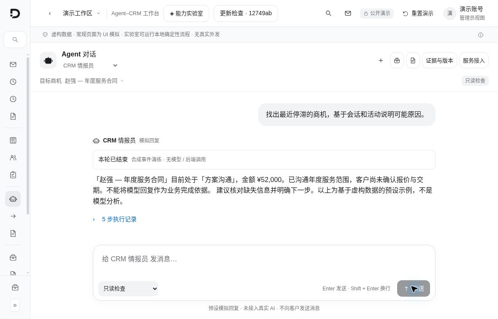
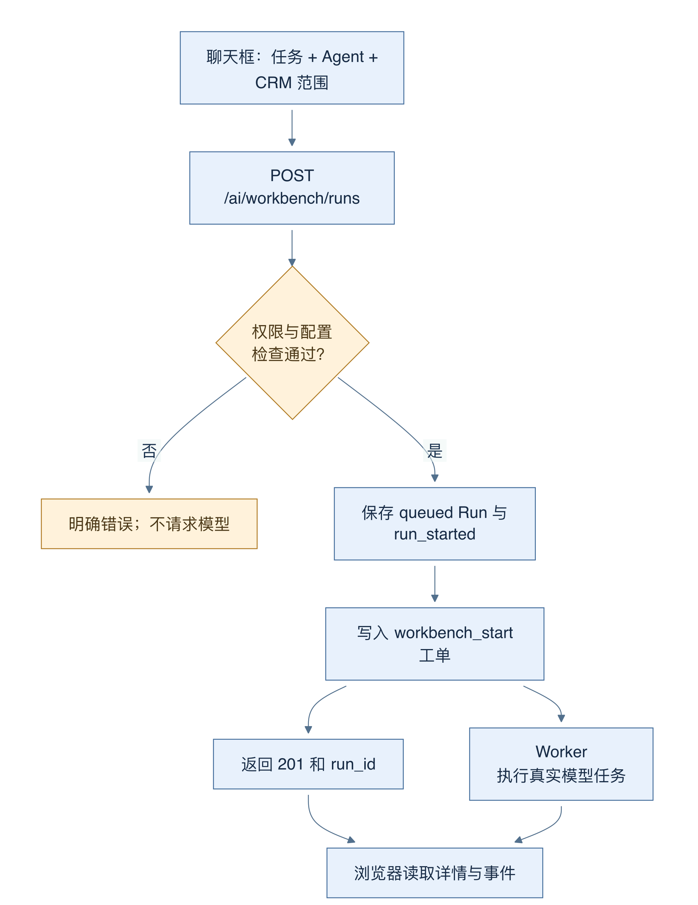
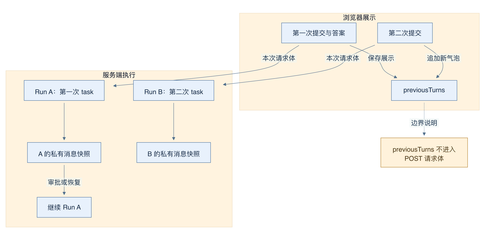
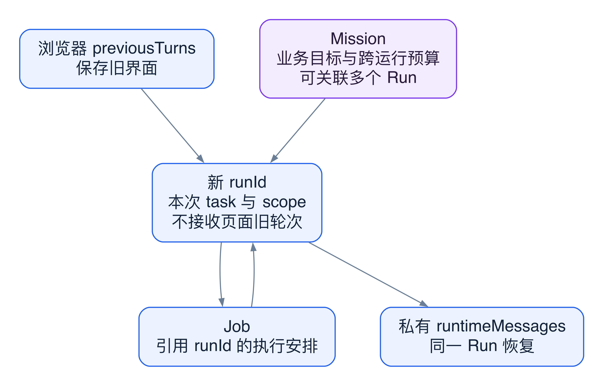

# 14 从聊天入口启动一次独立运行

[返回母文档](../README.md) · [上一章](13.md) · [下一章](15.md)

**本章目标：**理解 Workbench 的只读和行动模式，以及运行与事件记录。

## 业务流程与阅读起点

### 当前界面近景

截图中的内容来自预置只读模拟，未调用真实 Agent。聊天外观、运行记录和真实后端 Run 的关系需继续按本章源码阅读。

### 这一章学什么

Workbench 是人向 CRM Agent 交代任务的工作台。你可以先用一句自然语言提出问题，再展开设置选择 Agent、CRM 对象和运行模式。理解它的关键是分清两件事：界面可以连续显示多轮问答，服务器却为每次提交创建一个独立的 Run。Run 可以理解为有编号、有状态、可追查的一张任务单。

本章与后续运行时章节均以 main 提交 679e09e80878dff7b1c79b8537317b2b9e355331 为源码基准。以下行为由代码确认，不包含尚未合并的界面动效改动。

### 用一个具体问题打开代码

假设你选择“CRM 情报员”，选中客户，再输入“总结这个客户近期的沟通、商机和待办，并列出依据”。普通进入工作台时默认是 inspect，即只读检查；从商机入口带入 initialLead 时，默认值会变为 act，并预选委托任务。委托任务还需要填写业务验收条件，不能只凭一句模糊目标直接开启。

点击提交后，前端发送 agentId、task、mode、scope，必要时附加 mission。scope 是范围，例如 contactId 或 leadId；它帮助服务器确认“这次在谈哪个对象”，不是让浏览器自行决定可访问哪个组织。组织身份仍由服务端认证得到。

图 10-1：实线箭头是一次请求的执行顺序。服务器先核对权限、配置和对象归属，保存 Run 并入队后才返回 201；201 表示已接收，尚未表示模型完成。

服务端要求 manager 权限，拒绝开启模型预览桩的 Workbench 请求；还会检查 Agent 版本、模型是否声明支持工具调用、是否已停用，以及组织能否解析出有效模型凭据。配置失败时会在调用模型之前返回明确错误，不会拿模拟结果填补真实运行。

### 为什么看起来像对话却没有自动继承上一轮

前端的 previousTurns 把上一次详情放进浏览器状态，供页面继续展示。但 POST 的请求体里没有 previousTurns、上一轮消息或“父对话 ID”；服务端每次重新生成 runId。后端首次调用模型时构造的是本次 task 加所选对象范围，不会把屏幕上所有聊天气泡自动拼成模型上下文。

因此，第一次问“分析商机 A”，第二次只说“那下一步呢”，不能假设新 Run 已知道上次完整结论。更可靠的写法是“针对当前选中的商机 A，结合最新记录给出下一步，并核对报价依据”。同一对象可被再次检索，组织记忆也可被重新加载，但这不同于自动继承聊天历史。

图 10-2：上方箭头表示浏览器保留展示记录；下方箭头表示服务器按 runId 保存和恢复模型消息。两条新提交分别进入 Run A 和 Run B，中间没有自动复制历史的箭头。

“恢复 Run”则是另一回事。某次运行执行动作、等待审批或发生可恢复重试时，服务器可以读取 ai_agent_run_states 中该 Run 的消息，继续同一项任务。后文的审批恢复讲的就是这条路径，不能拿它证明不同聊天提交天然共享记忆。

### 如何读懂屏幕上的反馈

前端收到 runId 后，先保存一份 queued 详情，再读取完整详情并连接事件流。这样，即便紧接着的网络读取失败，页面仍记得已创建的任务，避免把“没看到结果”误判成“根本没提交”。活动运行还会串行刷新详情，降低旧响应覆盖新状态的风险。

queued、running、awaiting_confirmation 都会阻止直接启动下一次任务；awaiting_confirmation 需要处理提案。completed、partial、failed、cancelled 则允许你查看结果后开启新 Run。注意：completed 只说明这张运行任务单完成了自己的结果交付，不等于客户已经收到消息，也不等于商机目标已达成。

### 容易踩的坑

- 把“聊天框里的发送”理解为“向客户发送”：这里首先是把任务提交给 Agent
- 把浏览器旧气泡理解为模型上下文：必须检查实际请求体和服务端 messages
- 看到 201 就写“任务成功”：先确认 Run 的终态、结果和证据
- 切到 act 就认为所有动作都会执行：工具分类和审批仍在后端生效

### 深入一层：四种连续性分别由谁保存

先给“继续”加上主语。页面继续展示、队列继续执行、Pi 继续推理、Mission 继续业务目标，保存者和标识都不同。

图 10-3：实线表示代码中的引用或读取关系。浏览器展示历史没有通向新 Run 模型消息的复制箭头。Mission 可以关联多个 Run，但不是聊天历史容器。

1. 页面保存 previousTurns。它解决“用户还看得到旧答案”，不负责服务端任务恢复
2. API 每次生成 runId。Run 保存任务、范围和结果；新提交不会使用上次 Run 的私有消息
3. job_queue 保存执行安排。重领同一个 start Job 是一次执行重试；它没有创建新用户任务
4. ai_agent_run_states 按 run_id 保存消息。Worker 可以从它恢复同一 Run；审批结果也会作为新的观察追加到这里
5. Mission 保存跨运行的目标和预算。创建 Mission 时，API 先插入 Mission，再单独插入初始 Run。若 Run 创建失败，代码尝试把 Mission 标为 needs_review

这个划分解释两个实际问题。关闭网页不会删除已保存的 Job；页面不在线，Worker 仍可工作。反过来，页面还显示旧气泡，也不能补回缺失的运行快照。诊断“怎么没有继续”时，应先确定丢失的是哪一种连续性。

### 对照源码

以下行号固定于 main @ 679e09e80878dff7b1c79b8537317b2b9e355331。

- app/app/ai/workbench/_`components/AgentCrmWorkbench.tsx:229-268`：默认模式、界面历史与选中范围
- app/app/ai/workbench/_`components/AgentCrmWorkbench.tsx:367-446`：每次提交的请求体及先保存 runId
- app/app/ai/workbench/_`components/AgentCrmWorkbench.tsx:638-707`：活动态限制、串行刷新与清空界面
- [`app/api/v1/ai/workbench/runs/route.ts:62-191`](https://github.com/helsome/AiNativeCrm/blob/679e09e80878dff7b1c79b8537317b2b9e355331/app/api/v1/ai/workbench/runs/route.ts#L62-L191)：权限、真实模型与对象前置检查
- [`app/api/v1/ai/workbench/runs/route.ts:218-258`](https://github.com/helsome/AiNativeCrm/blob/679e09e80878dff7b1c79b8537317b2b9e355331/app/api/v1/ai/workbench/runs/route.ts#L218-L258)：新 UUID 和持久化 Run
- [`app/api/v1/ai/workbench/runs/route.ts:294-320`](https://github.com/helsome/AiNativeCrm/blob/679e09e80878dff7b1c79b8537317b2b9e355331/app/api/v1/ai/workbench/runs/route.ts#L294-L320)：入队与 201 语义
- [`lib/ai/agents/workbench-start-job.ts:367-450`](https://github.com/helsome/AiNativeCrm/blob/679e09e80878dff7b1c79b8537317b2b9e355331/lib/ai/agents/workbench-start-job.ts#L367-L450)：本次任务、范围与模型消息

#### 深入阅读的新增定位

- [`app/api/v1/ai/workbench/runs/route.ts:219-265`](https://github.com/helsome/AiNativeCrm/blob/679e09e80878dff7b1c79b8537317b2b9e355331/app/api/v1/ai/workbench/runs/route.ts#L219-L265)：Mission 与初始 Run 分步持久化，失败后尝试标记需要核对
- [`lib/ai/agents/workbench-start-job.ts:100-149`](https://github.com/helsome/AiNativeCrm/blob/679e09e80878dff7b1c79b8537317b2b9e355331/lib/ai/agents/workbench-start-job.ts#L100-L149)：同一 Run 的消息恢复与 resume phase 分流
- [`lib/ai/agents/workbench-state.ts:97-119`](https://github.com/helsome/AiNativeCrm/blob/679e09e80878dff7b1c79b8537317b2b9e355331/lib/ai/agents/workbench-state.ts#L97-L119)：把执行观察追加为 Pi 的下一条 user 消息

## 实现详解

### 聚合根与三类持久化对象

工作台的一次运行（run）由四张表协同承载。`ai_workbench_runs` 保存 `status`、`task`、`mode`、`scope`、`budget` 与 `runtime_state`（JSONB，含 `versionId`、`phase`、`directionRevision`、`replyContextRevision`）；`ai_agent_run_states.messages` 保存完整的 Pi 消息数组，使**重试等于续跑**而不是从头再来；`ai_agent_action_proposals` 保存被暂存的动作提案及其补偿参数；`ai_agent_run_events` 是只追加的事件账本。运行入口从 job 载荷取出 `runId`，按租户过滤读取聚合根，若状态已是 `cancelled`、`queued`/`running` 之外则直接返回——这是幂等重入的第一道闸门。 Sources: [workbench-start-job.ts](https://github.com/helsome/AiNativeCrm/blob/679e09e80878dff7b1c79b8537317b2b9e355331/lib/ai/agents/workbench-start-job.ts#L47)

运行模式只有两种且贯穿全文：`inspect`（只读）与 `act`（可写）。二者的差别不是配置项，而是**工具门控的行为分支**——`inspect` 下任何非 `read` 效果的工具都被替换为返回错误文本的桩函数，绝不触达 CRM副作用。

Sources: [workbench-start-job.ts](https://github.com/helsome/AiNativeCrm/blob/679e09e80878dff7b1c79b8537317b2b9e355331/lib/ai/agents/workbench-start-job.ts#L327)

### 事件流：严格递增序列 + 字段白名单 + 终局投影

事件账本的核心不变式是**序列号必须严格递增**。`appendWorkbenchEvent` 通过"读取当前最大 sequence → +1 → 插入"实现，遇到唯一键冲突（Postgres `23505`）最多重试 4 轮，全败则抛 `workbench_event_sequence_race`——宁可失败也不写出乱序事件。事务内版本 `appendWorkbenchEventTx` 使用 `insert ... select coalesce(max(sequence),0)+1 ... on conflict do nothing`，最多8 轮，用于把事件与状态变更焊进同一个事务。

Sources: [workbench-events.ts](https://github.com/helsome/AiNativeCrm/blob/679e09e80878dff7b1c79b8537317b2b9e355331/lib/ai/agents/workbench-events.ts#L82), [workbench-transaction-events.ts](https://github.com/helsome/AiNativeCrm/blob/679e09e80878dff7b1c79b8537317b2b9e355331/lib/ai/agents/workbench-transaction-events.ts#L7)

事件类型是一个封闭联合，共 23 种，生命周期可归为五段：

| 阶段 | 事件类型 | 触发条件 |
| --- | --- | --- |
| 启动 | `run_started` / `context_loaded` | 读取 scope 与组织记忆后落账，`context_loaded` 带 `memoryResolution: "current_published"` 与记忆修订号 |
| 决策 | `model_decision` | 每个 `turn_end` 记录累计 `toolResultCount`，回合收尾时再记提案数、候选回复数、障碍数与结果恢复状态 |
| 工具 | `tool_started` / `policy_checked` / `tool_proposed` / `tool_completed` / `crm_state_changed` | 只读工具记 started；写工具记 `policy_checked` 并附 `decision` |
| 人工 | `human_confirmation_requested` / `human_confirmation_received` | 需要人确认的动作被暂存或收到裁决 |
| 终局 | `run_completed` / `run_partial` / `run_failed` / `run_cancelled` / `run_resumed` / `usage_reported` | 终态事件写入后会尝试投影到 Langfuse，失败被吞掉——**本地事件永远是权威** |

Sources: [workbench-events.ts](https://github.com/helsome/AiNativeCrm/blob/679e09e80878dff7b1c79b8537317b2b9e355331/lib/ai/agents/workbench-events.ts#L6), [workbench-events.ts](https://github.com/helsome/AiNativeCrm/blob/679e09e80878dff7b1c79b8537317b2b9e355331/lib/ai/agents/workbench-events.ts#L109)

每个事件类型声明自己的**字段白名单**（`EVENT_FIELDS`）。落库前 `redactEventPayload` 先按键名匹配 `api.?key|secret|token|password|credential|authorization` 做递归脱敏，再按白名单裁剪未声明字段。唯一的例外是 `usage_reported` 的 `inputTokens`/`outputTokens`——只有当它们是非负有限数时才允许绕过 token 关键词脱敏，否则用量数字本身会被抹掉。 Sources: [workbench-events.ts](https://github.com/helsome/AiNativeCrm/blob/679e09e80878dff7b1c79b8537317b2b9e355331/lib/ai/agents/workbench-events.ts#L121)

## 继续阅读

[返回母文档](../README.md) · [上一章](13.md) · [下一章](15.md)

