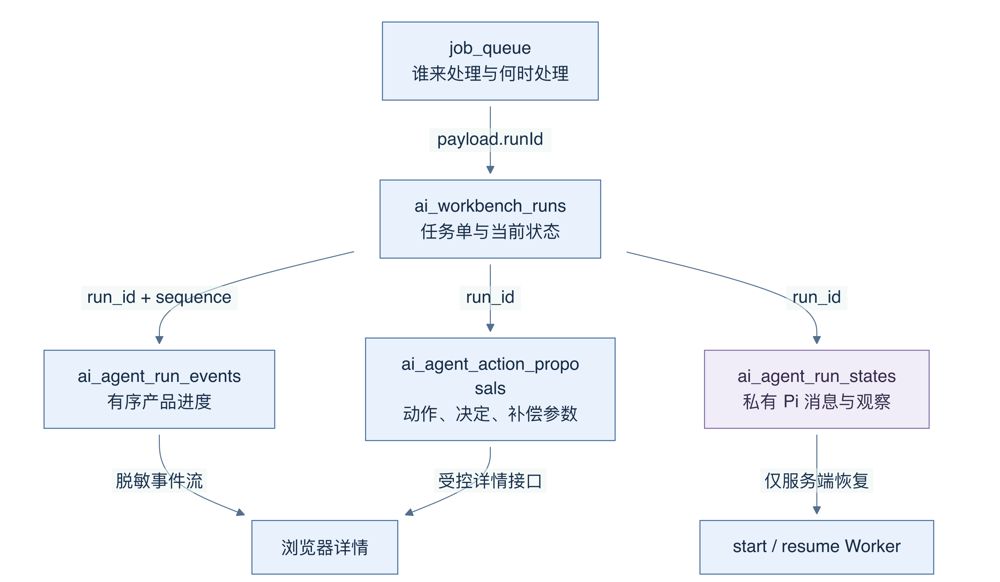
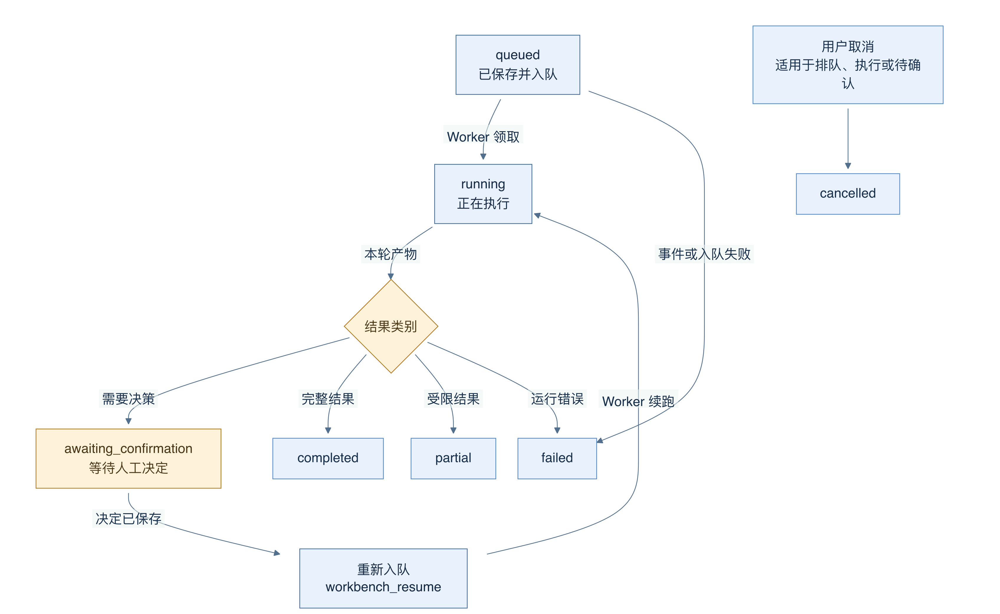
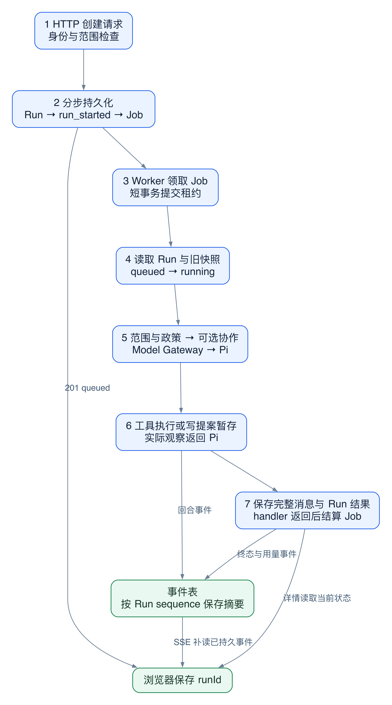
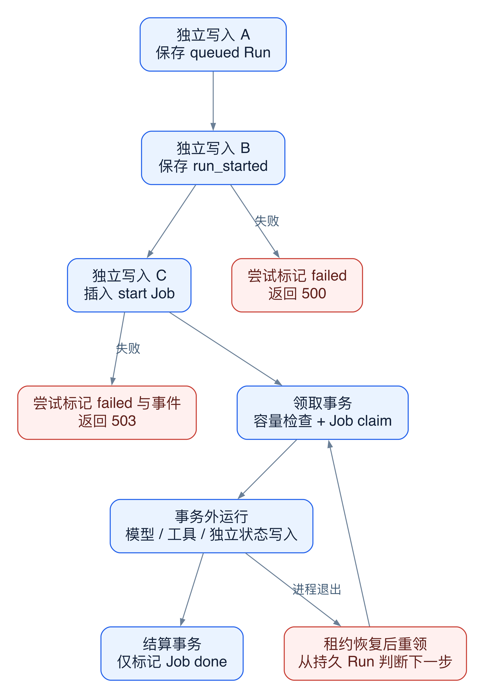

# 15 运行状态、持久队列、取消与恢复

[返回母文档](../README.md) · [上一章](14.md) · [下一章](16.md)

**本章目标：**区分运行状态、队列租约、取消信号与崩溃后的对账。

## 业务流程与阅读起点

### 这一章学什么

长任务不能只存在一个网页请求里。浏览器断网、Worker 重启、模型变慢时，系统仍要回答“这次任务走到哪里了”。AiNativeCrm 用 Run 主记录、事件记录、私有消息快照和 Postgres 队列把这些问题拆开。本章沿用上一章的源码固定版本。

把它想成办事窗口：Run 是申请单，事件是办理进度，消息快照是工作人员继续处理所需的材料，队列是待办工单。它们有关联，却不能互相替代。

### 四种记录各自回答什么

ai_workbench_runs 保存任务、Agent、范围、状态、预算、最终文本和错误码；ai_agent_run_events 保存按 sequence 排序的产品事件；ai_agent_action_proposals 保存拟执行的工具、参数、审批决定与结果；ai_agent_run_states 保存 Pi 续跑需要的完整消息与观察结果。

消息快照特意与可供界面读取的元数据分开。它可能包含 CRM 上下文、工具结果和 provider 续接所需的私有数据，不能因为有一个“运行详情”页面就整包返回。读取快照时也要验证 JSON 结构；损坏或旧格式不会被随意当成可继续执行的状态。

图 11-1：箭头写明关联用途，并非数据从左向右被复制。队列用 runId 找任务，事件用 sequence 排序，私有快照只供服务端恢复；提案保存动作决定。

### 一次任务如何离开 HTTP 请求

创建接口先保存 queued Run，写入 run_started 事件，再把 workbench_start 工单放进 job_queue。Worker 注册的处理函数会调用 runWorkbenchStartJob。它重新从数据库读 Run，核对组织和队列租约，随后用“当前仍是 queued”这一条件把状态改成 running，防止两个执行者都宣称领到了同一任务。

租约可以理解为临时领取凭证，包含 Worker 和领取时间。执行前再次核对，可以在发现领取权失效时停止后续步骤。但检查和后续写入不一定同事务，不能由此宣称全部动作都有原子租约隔离。它与“模型被要求小心”不同，是代码中的具体检查。

队列通过 sourceEventId 去重，并用行锁与 SKIP LOCKED 分派待办。这保证重复投递同一个来源事件时可以复用原工单；它不意味着用户连续点击两次提交会天然变成同一个 Run，因为两次提交可能产生两个不同 UUID。

### 状态是当前结论 事件是发生过程

图 11-2：箭头表示主路径上的状态变化。图中“结果类别”和“重新入队”是检查与处理步骤，不是额外的数据库状态。审批后可从等待确认回到运行；取消可发生在尚未结束的状态。partial 表示有可报告的部分结果或缺口，不应被折叠成成功。

事件不只是动画输入。appendWorkbenchEvent 先插入数据库，再由事件接口读取。sequence 在一个 Run 内递增；遇到唯一键冲突会有限重试。事件字段还经过白名单裁剪和敏感键脱敏，保留“哪个工具开始”“哪个提案待审”等摘要，而非把原始消息正文塞进公开进度。

前端使用 SSE，也就是服务器持续向浏览器送事件的 HTTP 连接。请求带 after 或 Last-Event-ID，服务器只返回更大的 sequence；一段连接结束后可从已有序号继续。当前实现每段最多约 25 秒，无新事件时短暂等待，并在运行停止或等待审批且事件已读完时关闭。连接关闭因此不等于任务失败。

### 用断网场景检验理解

如果模型正在分析，浏览器断网再打开详情，正确步骤是按原 runId 读状态、补齐事件，而不是重新 POST。若审批后需要续跑，workbench_resume 从保存的消息恢复；找不到有效快照时记录 partial 和 resume_state_missing，不会让模型凭空猜测之前做过什么。

取消也需要读清语义：接口把当前运行和活动 specialist 标为取消，并取消 pending 提案；Worker 观察取消信号而终止后续工作。取消不是自动撤销已成功执行的 CRM 写入，撤销有独立的补偿路径。

### 深入一层：沿一次运行标出提交边界

下面继续用“核对商机风险”的只读任务。图中一个方框是职责，不代表一台服务器。Model Gateway 是调用代码，不是另行假设的网络网关。

图 11-3：数字是执行顺序。Worker 产生事件，事件接口再从数据库读给界面；provider 没有直接向产品界面广播业务状态。返回 201 后，HTTP 创建请求已经结束。

1. API 完成身份、Agent、模型和对象检查，生成 runId
2. API 插入 queued Run。随后，它单独插入 run_started 事件，再调用 enqueueJob。三步有先后顺序，但不在同一个事务内
3. Worker 用 claimJobs 领取 Job。这个短事务取得 advisory lock，读取当前 running 数量，再通过行锁和 SKIP LOCKED 领取可运行行。领取事务随后提交；它不覆盖漫长的模型执行
4. start handler 读取 Run。queued Run 通过带旧状态条件的 UPDATE 进入 running。running Run 也可进入恢复检查，因为队列可能正在重试
5. handler 重新解析范围、加载当前组织记忆和 Agent 版本，装配工具。若启用 specialist，它先执行并收集协作结果。随后父调用进入 Model Gateway 和 Pi
6. Pi 调用只读工具。Workbench 的 onEvent 把工具开始、工具结束和回合结束映射为持久产品事件。模型调用返回后，代码才保存该次调用的完整 runtimeMessages
7. handler 保存最终状态和结果，再写终态事件与用量事件。handler 返回后，Worker 单独调用 completeJob，把 Job 标为 done
8. 浏览器按 runId 读详情。SSE 按 sequence 补读事件。详情给当前结论，事件给已记录的过程

为何要强调第 7 步？completeJob 支持把额外 SQL 放进同一个事务，但 Workbench 的调用传入 undefined。不能把这个通用函数的事务能力，套在此前已完成的 Workbench 写入上。

### 四个故障窗口如何改变结论

图 11-4：边界框表示实际提交范围。红色出口表示该阶段失败时的处理；多个相邻方框没有共同的原子提交承诺。

- Run 已保存，起始事件失败：接口尝试把 queued Run 改为 failed，写 start_event_persist_failed，然后返回 500。Run 不是自动回滚消失
- Run 和事件已保存，入队失败：接口尝试标记 start_queue_unavailable，写 run_failed，再返回 503。这里明确存在“任务记录有了，但没有确认入队”的状态
- 模型已调用，完整消息尚未保存：持久事件可能已有工具进度，但它们不能还原完整 provider 消息。重试只能使用最后一次有效快照；只读调查可能重新执行
- Run 已进入终态，Job 尚未标 done：重领 start Job 后，handler 看见 Run 不再是 queued 或 running，会直接返回，再结算队列。这个状态门避免重新启动已收尾的任务

这些失败补记也依赖数据库可用。源码中的 catch 是补救尝试，不是一个“永不出现中间状态”的证明。排错时同时查 Run、事件和 Job，不能只看其中一张表。

### 租约、队列 lane 和恢复各解决什么

assertWorkbenchJobLease 读取 Job 的 locked_by、locked_at 与 Run 状态。领取时间区分同一 Worker 的不同执行尝试。检查已发现租约失效时，代码在下一步前停止。但“先 SELECT 验证，再单独写入”仍有两步之间的竞争窗口。不能把全部 beforeSideEffect 调用描述为写入与租约验证的原子 fencing。

queue 的 lane 按 contact_id 排他；没有 contact_id 的 Job 使用自己的 id 作为 lane。Workbench 创建 start Job 时没有传 enqueueJob 的 leadId 参数，因此不会因为 scope 选了同一客户，就自动获得按客户串行的 lane。入站消息链则传入 contact ID，进入另一种调度语义。参数名 leadId 与实际列 contact_id 不同，必须读 SQL 映射。

同样，“恢复”有三个入口，不能混为一谈：

1. Job 重试：同一个 start Job 重领，读取同一 Run 的状态、已有提案和消息；已有不确定自动写入会进入核对分支
2. 自动写入后继续：start handler 保存实际执行观察，把 phase 改成 resume，再在当前 Job 内调用 runResumedWorkbenchTurn
3. 人审后继续：审批结算事务保存观察并创建 workbench_resume Job；这个 Job 读取已处于 running 的 Run，再接着推理

因此，awaiting_confirmation 可以对应一个已经 done 的 start Job；running 也可以对应一个仍在 pending 的 resume Job。Run 状态说明业务任务，Job 状态说明一次后台执行安排。两种状态不需要逐字一致。

### 用故障定位问题

页面没有更新时，先读 Run 详情；有 Run 而无 Job 时，检查创建接口的入队错误；有 pending Job 时，检查 Worker 和 run_after；有 running Job 时，检查领取时间和对应日志；有工具事件却无最终答复时，检查完整消息保存和结构化结果提交。只有确定原 Run 无法继续且业务允许重新执行，才考虑创建新 Run。

### 对照源码

以下行号固定于 main @ 679e09e80878dff7b1c79b8537317b2b9e355331。

- [`supabase/migrations/20260926010000_0381_builtin_agents_e_model_binding.sql:60-157`](https://github.com/helsome/AiNativeCrm/blob/679e09e80878dff7b1c79b8537317b2b9e355331/supabase/migrations/20260926010000_0381_builtin_agents_e_model_binding.sql#L60-L157)：四张表的基础职责与私有快照权限；后续迁移会扩展结构
- [`app/api/v1/ai/workbench/runs/route.ts:241-320`](https://github.com/helsome/AiNativeCrm/blob/679e09e80878dff7b1c79b8537317b2b9e355331/app/api/v1/ai/workbench/runs/route.ts#L241-L320)：保存 Run、事件与工单
- [`lib/agent-engine/queue/queue.ts:79-153`](https://github.com/helsome/AiNativeCrm/blob/679e09e80878dff7b1c79b8537317b2b9e355331/lib/agent-engine/queue/queue.ts#L79-L153)：工单去重与领取 SQL
- [`workers/agent-worker/main.ts:749-753`](https://github.com/helsome/AiNativeCrm/blob/679e09e80878dff7b1c79b8537317b2b9e355331/workers/agent-worker/main.ts#L749-L753)：两类 Workbench 工单的实际接线
- [`lib/ai/agents/workbench-start-job.ts:47-106`](https://github.com/helsome/AiNativeCrm/blob/679e09e80878dff7b1c79b8537317b2b9e355331/lib/ai/agents/workbench-start-job.ts#L47-L106)：读取、领取与恢复快照
- [`lib/ai/agents/workbench-job-lease.ts:5-39`](https://github.com/helsome/AiNativeCrm/blob/679e09e80878dff7b1c79b8537317b2b9e355331/lib/ai/agents/workbench-job-lease.ts#L5-L39)：执行前租约检查
- [`lib/ai/agents/workbench-events.ts:81-147`](https://github.com/helsome/AiNativeCrm/blob/679e09e80878dff7b1c79b8537317b2b9e355331/lib/ai/agents/workbench-events.ts#L81-L147)：事件序号、持久化与裁剪
- app/api/v1/ai/workbench/runs/[`id]/events/route.ts:11-69`：可恢复 SSE
- [`lib/ai/agents/workbench-resume-job.ts:32-58`](https://github.com/helsome/AiNativeCrm/blob/679e09e80878dff7b1c79b8537317b2b9e355331/lib/ai/agents/workbench-resume-job.ts#L32-L58)：缺失快照时停止续跑
- app/api/v1/ai/workbench/runs/[`id]/cancel/route.ts:23-60`：取消的具体范围

#### 深入阅读的新增定位

- [`app/api/v1/ai/workbench/runs/route.ts:240-319`](https://github.com/helsome/AiNativeCrm/blob/679e09e80878dff7b1c79b8537317b2b9e355331/app/api/v1/ai/workbench/runs/route.ts#L240-L319)：三个独立写入步骤及事件、队列失败分支
- [`lib/agent-engine/queue/queue.ts:89-106`](https://github.com/helsome/AiNativeCrm/blob/679e09e80878dff7b1c79b8537317b2b9e355331/lib/agent-engine/queue/queue.ts#L89-L106)：leadId 参数实际写入 contact_id
- [`lib/agent-engine/queue/queue.ts:130-153`](https://github.com/helsome/AiNativeCrm/blob/679e09e80878dff7b1c79b8537317b2b9e355331/lib/agent-engine/queue/queue.ts#L130-L153)：contact lane 与空 contact Job 的领取条件
- [`lib/agent-engine/queue/queue.ts:220-284`](https://github.com/helsome/AiNativeCrm/blob/679e09e80878dff7b1c79b8537317b2b9e355331/lib/agent-engine/queue/queue.ts#L220-L284)：领取事务与 completeJob 的可选同事务回调
- [`workers/agent-worker/main.ts:481-495`](https://github.com/helsome/AiNativeCrm/blob/679e09e80878dff7b1c79b8537317b2b9e355331/workers/agent-worker/main.ts#L481-L495)：Workbench handler 返回后，队列才独立 complete
- [`workers/agent-worker/main.ts:550-599`](https://github.com/helsome/AiNativeCrm/blob/679e09e80878dff7b1c79b8537317b2b9e355331/workers/agent-worker/main.ts#L550-L599)：重试耗尽及结算本身失败的恢复边界
- [`lib/agent-engine/edge/crm/drain.ts:468-480`](https://github.com/helsome/AiNativeCrm/blob/679e09e80878dff7b1c79b8537317b2b9e355331/lib/agent-engine/edge/crm/drain.ts#L468-L480)：入站消息 Job 明确携带 contact ID
- [`lib/ai/agents/workbench-start-job.ts:151-236`](https://github.com/helsome/AiNativeCrm/blob/679e09e80878dff7b1c79b8537317b2b9e355331/lib/ai/agents/workbench-start-job.ts#L151-L236)：已有提案的恢复检查及不确定自动写入
- [`lib/ai/agents/workbench-start-job.ts:455-502`](https://github.com/helsome/AiNativeCrm/blob/679e09e80878dff7b1c79b8537317b2b9e355331/lib/ai/agents/workbench-start-job.ts#L455-L502)：事件映射与模型返回后的消息保存
- [`lib/ai/agents/workbench-start-job.ts:796-852`](https://github.com/helsome/AiNativeCrm/blob/679e09e80878dff7b1c79b8537317b2b9e355331/lib/ai/agents/workbench-start-job.ts#L796-L852)：自动写入观察与当前 Job 内续跑
- [`lib/ai/agents/workbench-start-job.ts:875-928`](https://github.com/helsome/AiNativeCrm/blob/679e09e80878dff7b1c79b8537317b2b9e355331/lib/ai/agents/workbench-start-job.ts#L875-L928)：Run 收尾和事件、用量的后续写入

## 实现详解

### 取消：轮询看门狗与"副作用前租约断言"

取消既涉及持久化状态，也涉及传给模型调用的中止信号。运行期间启动一个每 800ms 轮询 `ai_workbench_runs.status` 的看门狗，一旦读到 `cancelled` 就 `abortController.abort()`，把中止信号注入模型调用。关键在 `finally` 中置 `watching = false` 并 `await watcher`，确保协程干净收尾。 Sources: [workbench-start-job.ts](https://github.com/helsome/AiNativeCrm/blob/679e09e80878dff7b1c79b8537317b2b9e355331/lib/ai/agents/workbench-start-job.ts#L239), [workbench-start-job.ts](https://github.com/helsome/AiNativeCrm/blob/679e09e80878dff7b1c79b8537317b2b9e355331/lib/ai/agents/workbench-start-job.ts#L983)

但中止模型调用并不足以阻止数据库写入，因此存在第二道防线：`beforeSideEffect()` 闭包在**每一个**副作用之前调用 `assertWorkbenchJobLease`。该断言用一条 SQL 同时校验队列租约（`status='running'`、`locked_by`、`locked_at` 精确匹配）与运行状态（`status<>'cancelled'`）；若运行挂在任务下，还要求任务本身未取消/完成、Agent 处于 active 且未归档未暂停、`operation_mode='automatic'`，并区分 builtin（组织默认模型绑定 + draft 版本）与 user（已发布版本）两条路径。租约丢失即抛 `workbench_job_lease_lost`。 Sources: [workbench-job-lease.ts](https://github.com/helsome/AiNativeCrm/blob/679e09e80878dff7b1c79b8537317b2b9e355331/lib/ai/agents/workbench-job-lease.ts#L6), [workbench-start-job.ts](https://github.com/helsome/AiNativeCrm/blob/679e09e80878dff7b1c79b8537317b2b9e355331/lib/ai/agents/workbench-start-job.ts#L64)

这条不变式是整套取消语义的支点：**先证明我仍拥有这次运行，再写一次数据库**。 Sources: [workbench-start-job.ts](https://github.com/helsome/AiNativeCrm/blob/679e09e80878dff7b1c79b8537317b2b9e355331/lib/ai/agents/workbench-start-job.ts#L5)

### 恢复：三类重入路径

工作台共有三条从持久化状态重新进入执行的路径。

**其一，`resume` 相位的续跑。** 若 `runtime_state.phase === "resume"` 且消息可解析，入口直接调用 `runResumedWorkbenchTurn` 续接，不重新拼接初始任务。当自动写入全部完成且无待确认提案、无预算障碍时，运行会在写回观察后把 `phase` 置为 `resume`、记 `run_resumed`（携带 `afterAutomaticWrites`），然后原地续跑下一回合。 Sources: [workbench-start-job.ts](https://github.com/helsome/AiNativeCrm/blob/679e09e80878dff7b1c79b8537317b2b9e355331/lib/ai/agents/workbench-start-job.ts#L131), [workbench-start-job.ts](https://github.com/helsome/AiNativeCrm/blob/679e09e80878dff7b1c79b8537317b2b9e355331/lib/ai/agents/workbench-start-job.ts#L814)

观察的追加有严格的形态约束：脱敏后序列化，超过 12,000 字符即截断并追加 `…[truncated]`，文案固定为"CRM Harness 执行动作后的观察结果……不要重复已经执行的动作"。 Sources: [workbench-state.ts](https://github.com/helsome/AiNativeCrm/blob/679e09e80878dff7b1c79b8537317b2b9e355331/lib/ai/agents/workbench-state.ts#L98)

**其二，已有提案对账。** 这说明已有发送提案的恢复分支，不补上正常 start/resume 的候选生产断点。若进入时发现已有提案，则不再跑模型，而是逐条核对。`pending` 的 `send_message` 若缺少对应 `ai_reply_drafts` 记录，就用 `fn_reply_workbench_stage` 补建——这用于在崩溃后发现并补建缺失草稿。更严重的是 `pending` 的 `crm_update_lead`：一次自动写可能已经落库，状态却仍是 `pending`，此时无法判定事实，于是统一置为 `failed` 并标记 `result_summary: { outcome: "reconciliation_required", code: "write_may_have_completed" }`，运行收尾为 `partial`。 Sources: [workbench-start-job.ts](https://github.com/helsome/AiNativeCrm/blob/679e09e80878dff7b1c79b8537317b2b9e355331/lib/ai/agents/workbench-start-job.ts#L151)

**其三，结构化结果回收。** `recoverWorkbenchResult` 在模型未走结构化提交口时，用剩余步数与剩余额度做一次受控补采，并把恢复状态写入 `model_decision` 的 `resultRecovery` 字段；若发生了第二次调用，消息状态需再次持久化。 Sources: [workbench-start-job.ts](https://github.com/helsome/AiNativeCrm/blob/679e09e80878dff7b1c79b8537317b2b9e355331/lib/ai/agents/workbench-start-job.ts#L503), [workbench-start-job.ts](https://github.com/helsome/AiNativeCrm/blob/679e09e80878dff7b1c79b8537317b2b9e355331/lib/ai/agents/workbench-start-job.ts#L561)

## 继续阅读

[返回母文档](../README.md) · [上一章](14.md) · [下一章](16.md)

