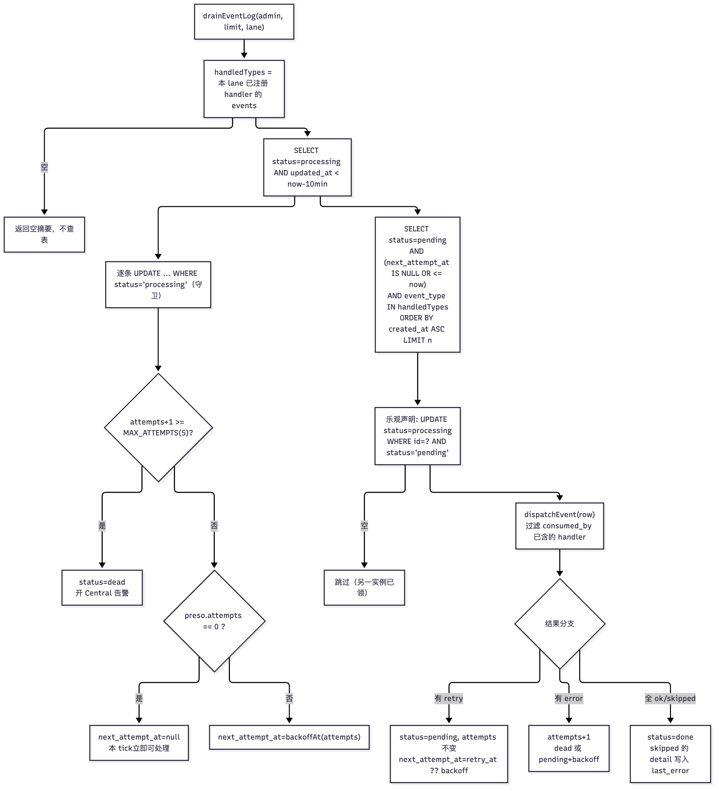
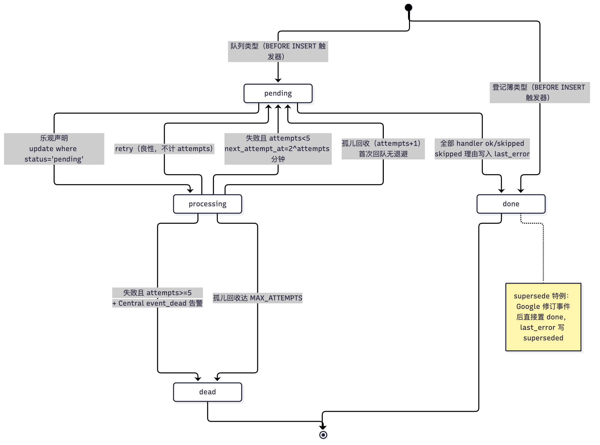

# 16 事件日志 Worker：去重、退避与死信

[返回母文档](../README.md) · [上一章](15.md) · [下一章](17.md)

**本章目标：**沿 event_log 到处理器理解排空、重试和死信通知。

## 实现详解

这张页面讲清楚一件事：**`event_log` 这张表如何被当作内部事件总线使用，以及它前面的"工作进程"（drain）如何把一行事件变成一次有声明、有去重、有退避、有死信的副作用**。它不是某个业务特性的说明，而是所有特性共用的那层骨架——任何模块想在这个系统里"被别处触发"，都从这里开始。

范围：`lib/event-log/` 的注册表（registry）、声明式处理器（handler）、去重语义、退避算法、死信与告警、以及把这一切跑起来的三条驱动路径（cron、worker 内嵌循环、开发期短路）。渠道接入、AI 回合、跟进图、扩展系统各有专页，这里只讲事件总线本身。

---

### 一句话架构：一张表、两个状态字段、一份注册表

`event_log` 是数据库里的表，不是消息队列中间件。写入靠 PostgreSQL 触发器和 Server Action 调用 `emit_event()`，消费靠一个 Node 进程周期性扫描这张表。**没有 broker，没有 push，没有 ack协议**——只有一张带状态机的表和一段"谁负责处理哪类事件"的声明。

表结构的核心是四个字段：[drain.ts](https://github.com/helsome/AiNativeCrm/blob/679e09e80878dff7b1c79b8537317b2b9e355331/lib/event-log/drain.ts#L119) 的驱动逻辑完全建立在其上。

| 字段 | 类型 | 在流程中的作用 |
| --- | --- | --- |
| `id` | `uuid` PK | 乐观声明（claim）的锚点 |
| `organization_id` | `uuid` NOT NULL | 租户边界；所有索引与 RLS 都以它开头 |
| `event_type` | `text`，CHECK `^[a-z][a-z0-9_]*\.[a-z][a-z0-9_]*$` | **分派键**。命名空间必须带点（`message.received`、`media.derive_requested`） |
| `entity_kind` / `entity_id` | `text` / `uuid` | 事件的"锚"；复合索引 `event_log_entity_idx` 用 |
| `payload` / `metadata` | `jsonb` | 事件内容 / 记账信息（origin 等） |
| `consumed_by` | `text[]` 默认 `'{}'` | **去重账本**：已经成功处理过的消费者 key 追加在这里 |
| `attempts` | `smallint` 默认 0 | 退避与死信的计数器 |
| `next_attempt_at` | `timestamptz` 可空 | 退避的下次可抢时间；空 = 立即可抢 |
| `status` | CHECK 仅允许 `pending` / `processing` / `done` / `dead` | 状态机；四个值是硬约束 |
| `created_at` / `updated_at` | `timestamptz` 默认 `now()` | **`created_at` 是事件的"事实时间"**，不是被读到的时间 |

`updated_at` 有专门的 BEFORE UPDATE 触发器 `trg_event_log_touch`，每次更新都会重写——这让"这一行最后一次被谁碰过"成为可信信号，也正是死信回收器的判断依据。

Sources: [baseline.sql](https://github.com/helsome/AiNativeCrm/blob/679e09e80878dff7b1c79b8537317b2b9e355331/supabase/baseline.sql#L1520), [baseline.sql](https://github.com/helsome/AiNativeCrm/blob/679e09e80878dff7b1c79b8537317b2b9e355331/supabase/baseline.sql#L2990)

租户隔离沿用全库统一的手法：`event_log` 开了 RLS，SELECT 策略允许用户看自己组织的行或平台管理员看全部；写入只走 `service_role`（cron 与 worker 都用 admin client）。索引也全部以 `organization_id` 打头，包括专门为死信建的 `event_log_dead_idx (organization_id, created_at DESC) WHERE status='dead'`。

Sources: [baseline.sql](https://github.com/helsome/AiNativeCrm/blob/679e09e80878dff7b1c79b8537317b2b9e355331/supabase/baseline.sql#L4061), [baseline.sql](https://github.com/helsome/AiNativeCrm/blob/679e09e80878dff7b1c79b8537317b2b9e355331/supabase/baseline.sql#L2562)

#### 读这张图之前先确认一件事：区分"队列"与"登记簿"

一个反直觉但关键的细节：**不是所有 `event_log` 行都是待办事项**。有些事件类型是纯登记（例如 `contact.created`、`message.sent`、`ai_agent.run_completed`），写下来只为审计与时间线，没人消费它。数据库用一个 BEFORE INSERT 触发器强制这件事：名单里的类型在插入时如果 `status='pending'`，直接被改写成 `done`。

名单存放在数据库函数 `fn_event_log_e_registro(text)` 里——一个返回 `boolean` 的不可变 SQL 函数，列举了三十余个纯登记类型。理由在迁移注释里写得很直白：issue #753 实测发现626 行永远不会被任何 drain 选中的行卡在 `pending`，与"队列积压"无法区分。

Sources: [baseline.sql](https://github.com/helsome/AiNativeCrm/blob/679e09e80878dff7b1c79b8537317b2b9e355331/supabase/baseline.sql#L24136), [baseline.sql](https://github.com/helsome/AiNativeCrm/blob/679e09e80878dff7b1c79b8537317b2b9e355331/supabase/baseline.sql#L24208)

对开发者的含义是：**如果你新增一个事件类型却忘了写消费者，它不会留在队列里腐烂，而是出生即 `done`**，同时仓库里有一条测试会读这份名单、并与你代码里实际发出的类型对照，把遗漏揪出来。

Sources: [baseline.sql](https://github.com/helsome/AiNativeCrm/blob/679e09e80878dff7b1c79b8537317b2b9e355331/supabase/baseline.sql#L24228)

---

### 声明：处理器契约与注册表

处理器是纯声明式对象，没有基类、没有依赖注入容器，只有四个字段。契约定义在 `dispatcher.ts`。

```ts
export interface EventHandler {
  lane?: "business" | "integration";   // 厂商工作不与前台业务 drain 抢同一批
  key: string;                          // 稳定 key，写进 consumed_by
  events: string[];                     // 消费哪些 event_type
  handle(row: EventRow): Promise<HandlerResult>;
}

export interface HandlerResult {
  consumer_key: string;
  status: "ok" | "skipped" | "error" | "retry";
  retry_at?: string;                    // status="retry" 时必填
  detail?: string;                      // skipped 的理由也靠它存活
}
```

Sources: [dispatcher.ts](https://github.com/helsome/AiNativeCrm/blob/679e09e80878dff7b1c79b8537317b2b9e355331/lib/event-log/dispatcher.ts#L42)

处理器本身通常只是薄薄一层包装，把事件行转交给真正干活的函数。例如 `media.derive_requested` 的处理器就是三行——key 从 worker 里导出，事件名写死，handle 直接指向 `deriveMessageMedia`。

Sources: [media-derive-worker.handler.ts](https://github.com/helsome/AiNativeCrm/blob/679e09e80878dff7b1c79b8537317b2b9e355331/workers/media-derive-worker.handler.ts#L1)

`lane` 是唯一的调度维度。默认是 `business`；只有两个厂商集成的处理器显式声明 `lane: "integration"`（Langfuse 导出、Mem0 同步）。drain 在开头会用 lane 过滤出"本 lane 有 handler 的 event_type"，**没有匹配类型的 lane 直接返回空摘要，不查表**——这条短路让厂商同步永远不会出现在前台 drain 的批量里。

Sources: [langfuse.ts](https://github.com/helsome/AiNativeCrm/blob/679e09e80878dff7b1c79b8537317b2b9e355331/lib/ai/integrations/langfuse.ts#L409), [mem0.ts](https://github.com/helsome/AiNativeCrm/blob/679e09e80878dff7b1c79b8537317b2b9e355331/lib/ai/integrations/mem0.ts#L398), [drain.ts](https://github.com/helsome/AiNativeCrm/blob/679e09e80878dff7b1c79b8537317b2b9e355331/lib/event-log/drain.ts#L133)

注册表是模块级数组加一个 key 集合，`registerHandler` 对同 key 做"热重载友好"的覆盖：先按 key 找到旧条目 splice掉，再 push新的。

Sources: [dispatcher.ts](https://github.com/helsome/AiNativeCrm/blob/679e09e80878dff7b1c79b8537317b2b9e355331/lib/event-log/dispatcher.ts#L61)

`dispatchEvent(row)` 的分派规则只有一句：**事件类型命中，且该 handler 的 key 还不在 `consumed_by` 里**。已经消费过的 handler 不会再被调用一次——这就是事件日志的去重。单个 handler 抛异常不会中断循环，会被捕获成一条 `status: "error"` 的结果，让同一个事件的其它 handler 照常跑完。

Sources: [dispatcher.ts](https://github.com/helsome/AiNativeCrm/blob/679e09e80878dff7b1c79b8537317b2b9e355331/lib/event-log/dispatcher.ts#L83)

所有 handler 在一个地方集中注册，由 `ensureHandlersRegistered()` 保证幂等（模块级 `_registered` 标志）。**注册顺序是有意义的**，注释写明了原因：跟进 reactvity 必须在 LLM 之前（否则 Hobby规格下 drain 在 AI worker 爆栈、match_reply 读不到响应）；而 `avisoDeCasoAoSuporteHandler` 和 `conversaoDeVendaHandler` 排在最后，因为它们走第三方网络，绝不能拖慢直接写库的前置 handler。

Sources: [register-handlers.ts](https://github.com/helsome/AiNativeCrm/blob/679e09e80878dff7b1c79b8537317b2b9e355331/lib/event-log/register-handlers.ts#L28)

注意 `register-handlers.ts` 的导入会一路牵扯到 `@/lib/env`——它在模块顶层 `throw`。这正是下面第四节里 drain 循环要用动态 import 的原因。

---

### 一次 drain tick：声明 → 去重 → 分派

`drainEventLog(admin, { limit, lane })` 是唯一的驱动函数。它分两个阶段。

#### 阶段一：回收卡在`processing` 的孤儿

第一件事不是取待办，而是找**卡住的**：状态是 `processing` 且 `updated_at` 早于 10 分钟前的事件。原因是这行被标记为 `processing` 之后 handler 才跑，而产品里没有任何东西会把它拿回来——进程被 OOM kill、请求外部服务没设 timeout，都会让事件**永久**卡在 `processing`。

Sources: [drain.ts](https://github.com/helsome/AiNativeCrm/blob/679e09e80878dff7b1c79b8537317b2b9e355331/lib/event-log/drain.ts#L138)

10 分钟这个窗口是刻意宽松的：注册表里最慢的 handler 是一个完整的 AI 回合，太早回收会导致两个 worker 同时处理同一事件——把"事件卡住"换成"效果翻倍"。窗口的计时依赖 `updated_at`，而 `trg_event_log_touch` 让它忠实记录 CLAIM 的瞬间。

Sources: [drain.ts](https://github.com/helsome/AiNativeCrm/blob/679e09e80878dff7b1c79b8537317b2b9e355331/lib/event-log/drain.ts#L152)

**孤儿回收计入尝试次数**，且写入时带着 `status = 'processing'` 的守卫。守卫让并发的两个 drain 实例（worker 循环 + cron）即使读到同一行，也只有先到的那次更新生效。这直接堵住了一个实测过的死循环：一次 18 KB 的 PDF 解析把进程打爆，进程死在 handler 返回错误之前，事件回到 `pending` 且 `attempts=0`，被重复领取、重复打爆——`MAX_ATTEMPTS` 只对"体面地报错"的事件有效。

Sources: [drain.ts](https://github.com/helsome/AiNativeCrm/blob/679e09e80878dff7b1c79b8537317b2b9e355331/lib/event-log/drain.ts#L167)

但有一个例外，代码里写明其归属：**`attempts === 0` 的孤儿是"第一次回队"，不收退避，立刻在同一个 tick 被处理**。原因是有一个不变量测试（`tests/invariants/event-log-drain.test.ts` 第 9 例）要求"孤儿事件回到队列且在同一 tick 被处理"——正常部署中途重启留下的孤儿不该为一次本该免费的回归付费。从第二次回队起，它才付 2、4、8 分钟的代价直到 `MAX_ATTEMPTS`。

Sources: [drain.ts](https://github.com/helsome/AiNativeCrm/blob/679e09e80878dff7b1c79b8537317b2b9e355331/lib/event-log/drain.ts#L183)

#### 阶段二：取待办、乐观声明、逐条分派

然后才是主循环：从 `status='pending'` 且 `next_attempt_at` 为空或已到期的事件中，按 `created_at` 升序取最多 `limit`（默认 50）条，且 `event_type` 必须落在本 lane 已注册的处理器类型集合内。

选择携带 `created_at` 的理由写在注释里：消费者需要区分"刚发生的事件"和"在 `pending` 躺了三天的积压"，而 drain 每 tick 取 50 条、**没有按新鲜度做窗口限制**——积压会在部署后的第一个 tick 变成一场数据日期错误的洪水。

Sources: [drain.ts](https://github.com/helsome/AiNativeCrm/blob/679e09e80878dff7b1c79b8537317b2b9e355331/lib/event-log/drain.ts#L233)

处理每一条之前是一次**乐观声明**：`update … set status='processing' where id = ? and status = 'pending'`，返回空数组就跳过。这是多实例安全的核心——cron 和 worker 循环并行跑，永远不会同时处理同一行。

Sources: [drain.ts](https://github.com/helsome/AiNativeCrm/blob/679e09e80878dff7b1c79b8537317b2b9e355331/lib/event-log/drain.ts#L254)

声明成功后调用 `dispatchEvent(row)`，拿到每个 handler 的结果，然后按四选一分支落库。

Sources: [drain.ts](https://github.com/helsome/AiNativeCrm/blob/679e09e80878dff7b1c79b8537317b2b9e355331/lib/event-log/drain.ts#L267)

| 分支 | 触发条件 | status | attempts | next_attempt_at | 计入 summary |
| --- | --- | --- | --- | --- | --- |
| **重排** | 任一 handler 返回 `retry` | `pending` | **不变** | `retry.retry_at` 或按当前 attempts退避 | `retried++` |
| **失败** | 无 retry，但有 `error` | `pending` 或 `dead` | `+1` | 退避（死信则 `null`） | `failed++` / `dead++` |
| **完成** | 全部 `ok` / `skipped` | `done` | 不变 | 不写 | `done++` |

Sources: [drain.ts](https://github.com/helsome/AiNativeCrm/blob/679e09e80878dff7b1c79b8537317b2b9e355331/lib/event-log/drain.ts#L276)

**退避公式**是纯指数：第 n 次失败后等 `2^n` 分钟，即 1、2、4、8 分钟。

Sources: [drain.ts](https://github.com/helsome/AiNativeCrm/blob/679e09e80878dff7b1c79b8537317b2b9e355331/lib/event-log/drain.ts#L33)

`retry` 分支值得单独强调，因为它是唯一**不计尝试次数**的重排。它服务于"良性推迟"，最典型的场景是反封禁发送窗口——handler 判断"现在不是发送的好时机"，于是给出一个 `retry_at` 让 drain稍后再来。即便同一 tick 里另一个 handler 报了 `error`，这里也只保留其 `last_error` 做可观测性，不触发计数——那个 handler 根本没进 `consumed_by`，它会在下个 tick 自然重跑。

Sources: [drain.ts](https://github.com/helsome/AiNativeCrm/blob/679e09e80878dff7b1c79b8537317b2b9e355331/lib/event-log/drain.ts#L276)



Sources: [drain.ts](https://github.com/helsome/AiNativeCrm/blob/679e09e80878dff7b1c79b8537317b2b9e355331/lib/event-log/drain.ts#L119)

---

### 去重的两层含义：handler 级 + 事件级

"去重"在这个系统里其实有三处，需要分开看，否则容易混淆。

**第一层是消费者去重。** `consumed_by` 是一个 `text[]`，每成功消费一次就追加 handler 的 key；分派时过滤掉 key 已在数组里的 handler。效果是：一个事件被 N 个 handler 消费时，**任何一个 handler 重跑都不会重复执行**——只要它成功过一次。这是 `consumed_by` 之所以有 GIN 索引的原因。

Sources: [dispatcher.ts](https://github.com/helsome/AiNativeCrm/blob/679e09e80878dff7b1c79b8537317b2b9e355331/lib/event-log/dispatcher.ts#L84), [drain.ts](https://github.com/helsome/AiNativeCrm/blob/679e09e80878dff7b1c79b8537317b2b9e355331/lib/event-log/drain.ts#L269), [baseline.sql](https://github.com/helsome/AiNativeCrm/blob/679e09e80878dff7b1c79b8537317b2b9e355331/supabase/baseline.sql#L2562)

**第二层是事件级去重**，靠数据库的唯一索引。典型例子是路由事件的"活跃唯一"索引：同一 `organization_id` + `entity_id` 上只能存在一条活跃的 `conversation.routing_requested`，重复插入通过 `ON CONFLICT` 改写 `next_attempt_at`（仅当还是 `pending`）而不新增一行。

Sources: [baseline.sql](https://github.com/helsome/AiNativeCrm/blob/679e09e80878dff7b1c79b8537317b2b9e355331/supabase/baseline.sql#L22343)

**第三层是"跳过也要留证据"。** `skipped` 被计为成功——handler 判定"这不是我的事"是正确的。但它的 `detail` 在旧实现里被直接丢弃，导致排障的人查"我上传了素材但什么都没发生"只看到一行 `done`，没有一个字的解释。现在 `detail` 同时写入行的 `last_error` **和** `summary.pulados`，后者是 CI 唯一能带走的产物（HTTP trace 里能读到响应体）。

Sources: [drain.ts](https://github.com/helsome/AiNativeCrm/blob/679e09e80878dff7b1c79b8537317b2b9e355331/lib/event-log/drain.ts#L319)

还有一条更底层的替代路径：某些事件在写入时就被直接标记为完成，跳过整个队列。例如一条被修订过的 Google 事件，其对应的 `event_log` 行被更新为 `status='done'`，`last_error` 写上 `superseded: Google acompanha a revisão atual do compromisso`——事件没被处理，而是被判定为"已被更新版本取代"，并把这个理由留在行里。

Sources: [baseline.sql](https://github.com/helsome/AiNativeCrm/blob/679e09e80878dff7b1c79b8537317b2b9e355331/supabase/baseline.sql#L21156)

---

### 退避的两个维度：时间退避 vs. lane 退避

容易被忽略的一点：**"退避"在这套系统里有两个完全不同的含义**，一个是算法（指数退避），一个是隔离（lane 分流）。

时间退避只针对失败：`backoffAt(attempts) = now + 2^attempts 分钟`，且**只在 `pending` 状态下写 `next_attempt_at`**；一旦事件死了（`dead`），`next_attempt_at` 写成 `null` 而不是保留时间——死信不该再有任何"下次会来"的错觉。

Sources: [drain.ts](https://github.com/helsome/AiNativeCrm/blob/679e09e80878dff7b1c79b8537317b2b9e355331/lib/event-log/drain.ts#L33), [drain.ts](https://github.com/helsome/AiNativeCrm/blob/679e09e80878dff7b1c79b8537317b2b9e355331/lib/event-log/drain.ts#L305)

lane 退避则是把厂商工作彻底移出前台路径。`integration` lane 的两个 handler（Langfuse 导出、Mem0 同步）有自己的 drain 入口，与 `business` lane 完全隔离——它们再慢也不会让 CRM 前台的事件队列排队。这个 `lane` 参数一路从 drain 函数签名穿透到 SQL 的 `event_type IN (...)` 过滤里。

Sources: [drain.ts](https://github.com/helsome/AiNativeCrm/blob/679e09e80878dff7b1c79b8537317b2b9e355331/lib/event-log/drain.ts#L119)

**节奏退避**是第三种，属于 worker 循环而非 drain 本身。`proximaEspera()` 根据本 tick 的成果决定下次等待：做了事的 tick（`done+retried+failed+dead > 0`）用短间隔 `intervalMs`，空转的 tick 用长间隔 `idleIntervalMs`。注意 `scanned` 被刻意排除在计数外——被别的实例抢先认领的行只算"扫过"不算"做过"，否则每次 cron 抢先都会把循环顶到快速档空转。

Sources: [drain-loop.ts](https://github.com/helsome/AiNativeCrm/blob/679e09e80878dff7b1c79b8537317b2b9e355331/lib/event-log/drain-loop.ts#L184)

```ts
export function proximaEspera(resumo: DrainSummary, knobs: EventLogDrainKnobs): number {
  const feitos = resumo.done + resumo.retried + resumo.failed + resumo.dead;
  return feitos > 0 ? knobs.intervalMs : knobs.idleIntervalMs;
}
```

而循环体本身对"tick 抛异常"也做了节奏退避：`try/catch` 失败时不加速，直接沿用 `idleIntervalMs`——否则数据库一挂，快速档会把瞬时不可用放大成重试风暴。

Sources: [drain-loop.ts](https://github.com/helsome/AiNativeCrm/blob/679e09e80878dff7b1c79b8537317b2b9e355331/lib/event-log/drain-loop.ts#L211)

---

### 死信：MAX_ATTEMPTS 与"必须通知到人的死"

死信有两个硬性常数：`MAX_ATTEMPTS = 5`（累计 5 次尝试即死），`PROCESSING_STALE_MS = 10 分钟`（processing 超过即视为孤儿）。

Sources: [drain.ts](https://github.com/helsome/AiNativeCrm/blob/679e09e80878dff7b1c79b8537317b2b9e355331/lib/event-log/drain.ts#L13)

达到阈值时，除了把 `status` 写成 `dead`，**还必须开一条 Central 告警**（`agent_inbox_items`，`kind='event_dead'`，`severity='critical'`）。函数注释里描述了这个缺口的实测后果：一个 VPS 上四条 `media.derive_requested` 死亡，客户在抱怨"我听不到语音"，而己方毫无察觉——事件死了就是 `status='dead'`，没有告警、没有界面、没有 Sentry。

Sources: [drain.ts](https://github.com/helsome/AiNativeCrm/blob/679e09e80878dff7b1c79b8537317b2b9e355331/lib/event-log/drain.ts#L39)

告警本身做了几件克制的事，都值得学：

- **不带 ref。** `POLITICAS_DE_AVISO.event_dead` 声明 `refs: []`，因为根本没有 event_log 的界面可以跳转——给一个没有落点的 ref，等于给读者一个点不动的按钮。
- **按 `kind` 去重，但排除 AI 告警。** 先查同组织是否有已开的 `event_dead`（用 `title != IA_QUE_NAO_RESPONDEU.titulo` 排除另一个家族）。理由是：一次 pane 会死很多事件，逐条告警会淹掉 Central，而"淹掉的 Central 没人看"等于告警二次死亡。
- **fire-and-forget。** 开告警失败只记日志，绝不让它掀翻整个 drain。

Sources: [drain.ts](https://github.com/helsome/AiNativeCrm/blob/679e09e80878dff7b1c79b8537317b2b9e355331/lib/event-log/drain.ts#L39)

**为什么用标题而不是 kind 做两家族的区分键？** 注释解释得很完整：`agent_inbox_items.kind` 有 CHECK 约束，加一个新 kind 要走一整套 migration + apêndice + pt/es 标签 + 目的地策略，而这两个告警其实是同一段文案的两个变体。用固定标题当分族键已经够——如果将来标题改写，旧的开放告警只会**多**报一条而非**少**报一条，方向是安全的。

Sources: [aviso-de-evento-morto.ts](https://github.com/helsome/AiNativeCrm/blob/679e09e80878dff7b1c79b8537317b2b9e355331/lib/event-log/aviso-de-evento-morto.ts#L45)

告警文案的规则是"**只说界面能兑现的事**"：早期版本让用户去"查看事件日志并重处理"，但根本没有这种界面，dead 事件也不会自动回队。修正后文案只引导三件真实存在的事——策略指引、"标记已解决"按钮（它就是重新武装告警的动作），以及事件本应做的那件事的落地位置。技术细节（事件名、尝试次数、原因）统一放在 `DETALHE_TECNICO` 之后供支持人员排查，且原因不做翻译——翻译数据库报错只会静默地说错话。

Sources: [aviso-de-evento-morto.ts](https://github.com/helsome/AiNativeCrm/blob/679e09e80878dff7b1c79b8537317b2b9e355331/lib/event-log/aviso-de-evento-morto.ts#L11), [aviso-de-evento-morto.ts](https://github.com/helsome/AiNativeCrm/blob/679e09e80878dff7b1c79b8537317b2b9e355331/lib/event-log/aviso-de-evento-morto.ts#L108)

严重级别选 `critical` 而非 `warn`，因为 `agent_inbox_items.severity` 的 CHECK 只接受 info|warn|critical，越界会返回 23514——而越界恰好发生在最需要告警开成的时刻。（`crash` 会违反 CHECK 导致告警永远开不出来，代码注释明确记下了这个坑。）

Sources: [drain.ts](https://github.com/helsome/AiNativeCrm/blob/679e09e80878dff7b1c79b8537317b2b9e355331/lib/event-log/drain.ts#L85)

---

### 三条驱动路径与 worker 内嵌循环

`drainEventLog` 被三个地方调用，这是有意的冗余，也是这套设计里最值得学的运维决策。

#### cron（安全网）

`/api/v1/cron/event-log-drain`（GET/POST），由 scheduler 容器按 `* * * * *` 调度，每 tick 最多 50 条。鉴权走 `Authorization: Bearer <INTERNAL_CRON_SECRET>`（回退 `INTERNAL_SECRET`），`X-Cron-Secret` 头也接受为别名。这条路径**永远存在**，是"worker 挂了不等于事件日志停了"的兜底。

Sources: [event-log-drain/route.ts](https://github.com/helsome/AiNativeCrm/blob/679e09e80878dff7b1c79b8537317b2b9e355331/app/api/v1/cron/event-log-drain/route.ts)

由于 drain 本身用乐观声明（`update … where status='pending'`），**cron 与 worker 并行跑是安全的**——谁先认领谁处理，另一方跳过。

Sources: [drain-loop.ts](https://github.com/helsome/AiNativeCrm/blob/679e09e80878dff7b1c79b8537317b2b9e355331/lib/event-log/drain-loop.ts#L27)

#### worker 内嵌循环（去掉 cron 从关键路径上）

只靠 cron 一分钟一跳在多跳链条上是灾难性的：音频到达 → `media.persist_requested` →（最长 60s 排队）→ `media.derive_requested` →（最长 60s 排队）→ Whisper 转写。实测两次分别 103s 和 188s。而 AI 回合的 drain 最多等 45s 就放弃派发（"听不到语音"），但转写结果半分钟后就到了。3.9s 的 Whisper 证明慢的不是模型，是 cron 排队——45s 比**一个** cron tick 还短，两跳链条错过窗口不是运气，是算术。

Sources: [drain-loop.ts](https://github.com/helsome/AiNativeCrm/blob/679e09e80878dff7b1c79b8537317b2b9e355331/lib/event-log/drain-loop.ts#L11)

`runEventLogDrainLoop` 在 worker 进程内跑一个 `while (!signal.aborted)` 循环，每 tick 调 `drainEventLog`，按 `proximaEspera` 的结论决定睡眠。这条路径把 cron 从关键路径上摘了下来，同时 cron 继续当安全网。

Sources: [drain-loop.ts](https://github.com/helsome/AiNativeCrm/blob/679e09e80878dff7b1c79b8537317b2b9e355331/lib/event-log/drain-loop.ts#L203)

#### 请求内短路（开发态）

`lib/dev/kick-local-pipeline.ts` 把 drain 直接跑在 webhook 请求里，让 follow-up 不必等时钟。但这也带来一个危险：一个走第三方网络的 handler 若在 webhook 里花 5 秒，可能让一条已送达的消息被 WAHA **重投**，而重投又触发 agent。解法是 `origem-do-dreno.ts` 的 `AsyncLocalStorage`——把"我这次 drain 是跑在 HTTP 请求里吗"这个问题绑到**异步上下文**而不是模块级 flag（flag会在并发请求的 await边界上互相污染：并发的 cron 会误以为自己在请求里而永远推迟）。

Sources: [origem-do-dreno.ts](https://github.com/helsome/AiNativeCrm/blob/679e09e80878dff7b1c79b8537317b2b9e355331/lib/event-log/origem-do-dreno.ts#L1), [kick-local-pipeline.ts](https://github.com/helsome/AiNativeCrm/blob/679e09e80878dff7b1c79b8537317b2b9e355331/lib/dev/kick-local-pipeline.ts#L160)

`avisoDeCasoAoSuporteHandler` 读 `origemDoDreno()`，若是 `request` 就把自己推迟（自推迟）。默认值刻意是 `worker`：偏向"不推迟"最坏只是发出一个多余告警，偏向"总是推迟"会让所有 drain 都以为自己在请求里而无限循环推迟，一个告警都发不出。

Sources: [origem-do-dreno.ts](https://github.com/helsome/AiNativeCrm/blob/679e09e80878dff7b1c79b8537317b2b9e355331/lib/event-log/origem-do-dreno.ts#L25), [aviso-ao-suporte.handler.ts](https://github.com/helsome/AiNativeCrm/blob/679e09e80878dff7b1c79b8537317b2b9e355331/lib/escalacao/aviso-ao-suporte.handler.ts#L54)

#### worker加载失败时：可见但不致命

`carregarDepsDoLaco` 用**动态 import** 加载整条链路（`drain` → `register-handlers` → `createAdminClient`），失败时返回 `null` 而不是抛异常。理由是这条链路终止于 `@/lib/env`，而后者在模块加载时校验十几个必填环境变量并 `throw`。如果静态 import，一个 `.env` 精简的部署会让**整个 worker**（包括 durable queue、cron、agent turn）在启动时死掉——为了一个附属循环付出全盘代价。

Sources: [drain-loop.ts](https://github.com/helsome/AiNativeCrm/blob/679e09e80878dff7b1c79b8537317b2b9e355331/lib/event-log/drain-loop.ts#L34), [drain-loop.ts](https://github.com/helsome/AiNativeCrm/blob/679e09e80878dff7b1c79b8537317b2b9e355331/lib/event-log/drain-loop.ts#L127)

加载失败会：`log.error`（不是 `warn`——循环加载不上是事故不是噪音）；如果有 admin client 就往 Central 开一条降级告警（标题固定 `"Processamento rápido de eventos está em modo degradado"`，`kind='other'`，`severity='warn'`），按组织去重；健康时自动 resolve 掉这类开放告警。

Sources: [drain-loop.ts](https://github.com/helsome/AiNativeCrm/blob/679e09e80878dff7b1c79b8537317b2b9e355331/lib/event-log/drain-loop.ts#L146), [aviso-do-laco.ts](https://github.com/helsome/AiNativeCrm/blob/679e09e80878dff7b1c79b8537317b2b9e355331/lib/event-log/aviso-do-laco.ts#L12)

降级告警选 `kind='other'` 而非复用 `event_dead`，因为**快速循环挂掉 ≠ 事件死信**——cron还在每分钟兜底，这是降级不是丢失。这个区分也体现在告警文案里（"O cron de segurança continua processando a fila, mas automações e efeitos derivados podem levar até cerca de 1 minuto a mais"）。

Sources: [aviso-do-laco.ts](https://github.com/helsome/AiNativeCrm/blob/679e09e80878dff7b1c79b8537317b2b9e355331/lib/event-log/aviso-do-laco.ts#L5)

此外 `/healthz` 暴露 `prontidaoDoLacoDeEventLog()`，返回 `{ carregado, motivo }`——因为 **"/healthz 绿"不能证明循环加载成功**（曾经有一个缺陷：`@react-pdf/hyphenate` 只在 tsx 下炸，加载错误被 `log.warn` 吞掉，worker 健康了十天而 event_log 停摆）。日志里埋了契约字符串 `MARCA_LACO_CARREGADO = 'event-log drain: laço carregado'`，被发布门禁、探针脚本和 CI 三处比对，改文案不改比对方会让 CI 变红而不是让门禁静默失明。

Sources: [drain-loop.ts](https://github.com/helsome/AiNativeCrm/blob/679e09e80878dff7b1c79b8537317b2b9e355331/lib/event-log/drain-loop.ts#L71)

---

### 完整状态机

把所有分支拼起来，`event_log` 的行状态机一共有六个状态（`processing` 和四个 CHECK 值，加上"被取代后标 done"这类特例）。



Sources: [drain.ts](https://github.com/helsome/AiNativeCrm/blob/679e09e80878dff7b1c79b8537317b2b9e355331/lib/event-log/drain.ts#L200), [baseline.sql](https://github.com/helsome/AiNativeCrm/blob/679e09e80878dff7b1c79b8537317b2b9e355331/supabase/baseline.sql#L24130)

每次状态迁移都伴随的写入规则值得记牢：`pending→processing` 永不碰 `attempts`；`processing→dead` 时 `next_attempt_at` 写 `null`；`pending→done` 只写 `consumed_by`（+ 可选的 `last_error`），不写 `attempts`；`retry` 分支不写 `attempts` 但更新 `consumed_by`。

Sources: [drain.ts](https://github.com/helsome/AiNativeCrm/blob/679e09e80878dff7b1c79b8537317b2b9e355331/lib/event-log/drain.ts#L259)

---

### 排查手册：面对一行`dead` / `pending` 该看什么

按这个顺序看，可以覆盖绝大多数事件日志问题。

**表被谁写了、写了什么**：`select id, event_type, status, attempts, consumed_by, last_error, created_at, updated_at from event_log where organization_id = '<org>' order by created_at desc;`。`last_error` 现在同时承载真实错误和 `skipped` 的理由（非空不一定是故障）。

**`status='pending'` 一直不动**——四种可能：（a）该 `event_type` 没有注册 handler（但按设计这类型会在插入时被触发器改成 `done`，除非是注册表和 DB名单不同步）；（b）`next_attempt_at` 还在未来（退避中）；（c）该类型的 handler 在另一个 lane（`integration`），前台 drain 看不到它；（d）worker 循环和 cron 都没在跑。

**`status='processing'` 卡住**——孤儿回收器会在 10 分钟后捞它，但前提是 `event_type` 在本 lane 的 `handledTypes` 里；如果同时有两实例在跑，只有先执行 UPDATE 的那个生效（`WHERE status='processing'` 守卫）。

**`status='dead'`**——不要只看 `dead_idx` 指向的行，还要看该组织的 Central 有没有对应的 `event_dead` 开放告警；如果没有，说明是告警写入本身失败（只记在 `logger.error` 里）。

**"事件跑了但什么都没发生"**——查该行的 `last_error`，看是否有 `consumer_key: detail` 形式的 `skipped` 记录（`consumer_key` 前缀就是 handler 的 key，可反查注册表）；CI 场景则看 `DrainSummary.pulados`，它是唯一能穿过 HTTP trace 的产物。

Sources: [drain.ts](https://github.com/helsome/AiNativeCrm/blob/679e09e80878dff7b1c79b8537317b2b9e355331/lib/event-log/drain.ts#L31), [drain.ts](https://github.com/helsome/AiNativeCrm/blob/679e09e80878dff7b1c79b8537317b2b9e355331/lib/event-log/drain.ts#L328)

**Central 被"事件死了"淹没**——这是设计上的取舍（每组织每家族只留一个开放告警）。如果同一组织的事件批量死亡，只会出现一个 `event_dead`；解法是确认该告警并标记为已解决，才会重新武装下一次告警。去重键是标题，所以 `IA_QUE_NAO_RESPONDEU` 的标题和普通事件的标题分开计。

Sources: [drain.ts](https://github.com/helsome/AiNativeCrm/blob/679e09e80878dff7b1c79b8537317b2b9e355331/lib/event-log/drain.ts#L54), [aviso-de-evento-morto.ts](https://github.com/helsome/AiNativeCrm/blob/679e09e80878dff7b1c79b8537317b2b9e355331/lib/event-log/aviso-de-evento-morto.ts#L46)

---

### 给扩展作者：接一个自己的事件处理器

在别的事件总线系统里，消费者要订阅频道；在这里，你要写一个声明对象、给它一个稳定的 `key`、在 `register-handlers.ts` 里注册一行。

最小骨架：

```ts
// handlers/meu.handler.ts
import type { EventHandler } from "@/lib/event-log/dispatcher";

export const meuHandler: EventHandler = {
  key: "meu_modulo.minha_acao",   // 稳定；写进 consumed_by，重复消费靠它挡
  events: ["meu_modulo.acao_pedida"],
  async handle(row) {
    if (/* 不该我处理的条件 */) {
      return { consumer_key: "meu_modulo.minha_acao", status: "skipped", detail: "motivo claro" };
    }
    try {
      await fazOTrabalho(row);
      return { consumer_key: "meu_modulo.minha_acao", status: "ok" };
    } catch (err) {
      return { consumer_key: "meu_modulo.minha_acao", status: "error", detail: String(err) };
    }
  },
};
```

然后在 `register-handlers.ts` 里 `registerHandler(meuHandler);`。

Sources: [dispatcher.ts](https://github.com/helsome/AiNativeCrm/blob/679e09e80878dff7b1c79b8537317b2b9e355331/lib/event-log/dispatcher.ts#L42)

需要遵守的几条契约（都来自代码注释里的实测教训）：

- `key` 一旦上线就不能改。`consumed_by` 里存的是它；改了 key 等于让旧事件被重新消费一次。
- `event_type` 必须匹配 `^[a-z][a-z0-9_]*\.[a-z][a-z0-9_]*$` 的 CHECK，带点命名。
- `skipped` 请**务必带 `detail`**。它会被写进 `last_error` 和 `summary.pulados`，这是排障时唯一能回答"为什么什么都没发生"的字段。
- 不要在 handler 里 `throw`：抛异常虽然会被 dispatcher 捕获成 `error`（drain 照常处理其它 handler），但显式返回 `error` 让你能同时返回 `detail`。
- 如果你的 handler 依赖第三方网络且慢，参照 `avisoDeCasoAoSuporteHandler` 检查 `origemDoDreno()` 并在 `request` 上下文里自推迟——否则在开发态的请求内 drain 里它会拖慢 webhook、诱发上游重投。
- 如果你的 handler 是纯登记（写下来只为审计，无人消费），把 event_type 加进数据库函数 `fn_event_log_e_registro(text)` 的名单里，这样它出生即 `done`，不会伪装成队列积压。

Sources: [drain.ts](https://github.com/helsome/AiNativeCrm/blob/679e09e80878dff7b1c79b8537317b2b9e355331/lib/event-log/drain.ts#L133), [dispatcher.ts](https://github.com/helsome/AiNativeCrm/blob/679e09e80878dff7b1c79b8537317b2b9e355331/lib/event-log/dispatcher.ts#L90), [baseline.sql](https://github.com/helsome/AiNativeCrm/blob/679e09e80878dff7b1c79b8537317b2b9e355331/supabase/baseline.sql#L24150)

---

## 继续阅读

[返回母文档](../README.md) · [上一章](15.md) · [下一章](17.md)

