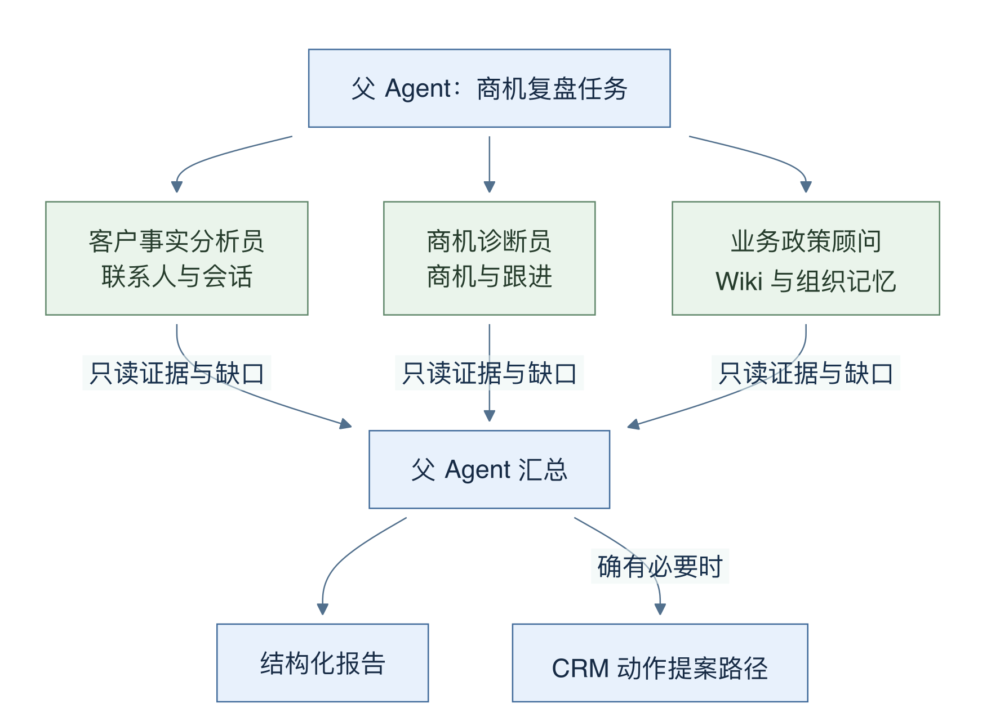
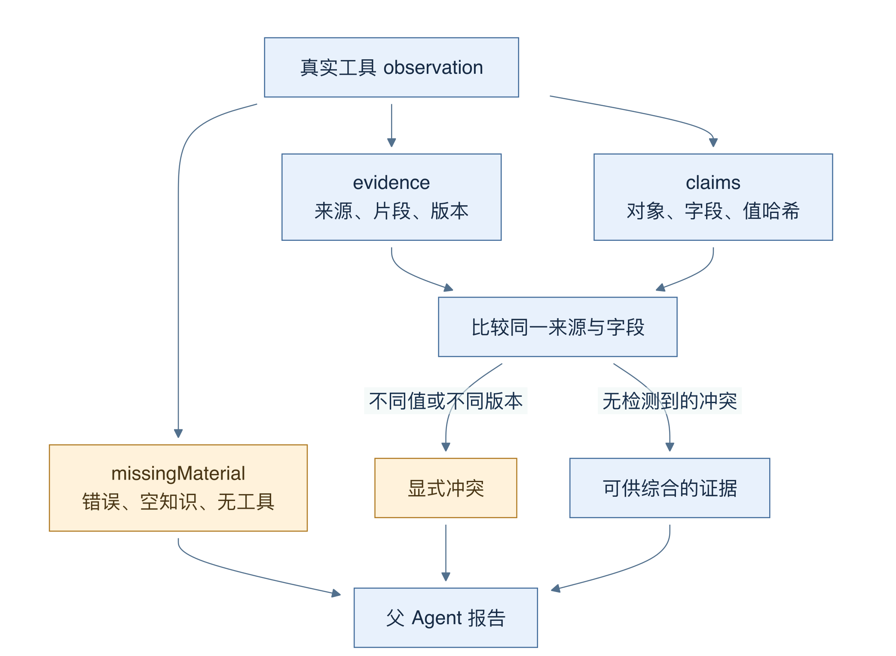
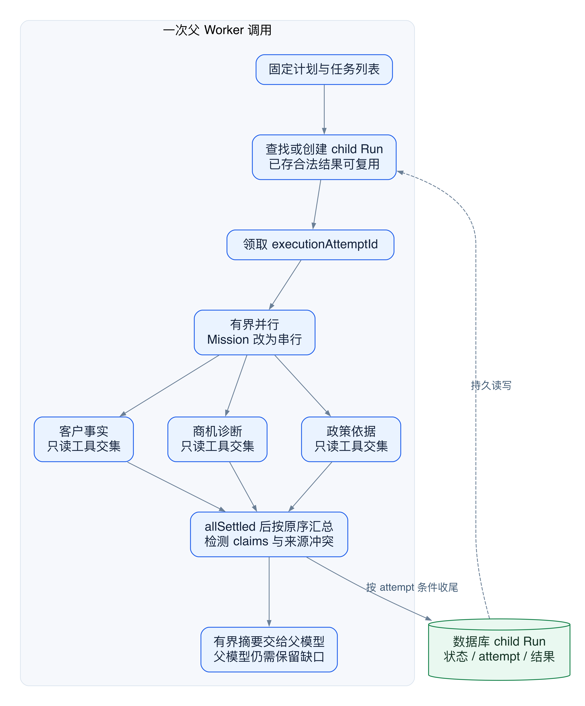
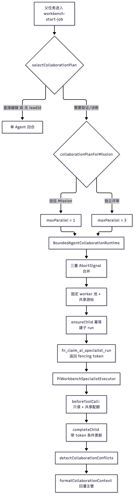

# 17 多 Agent 编排：分工、租约与证据回收

[返回母文档](../README.md) · [上一章](16.md) · [下一章](18.md)

**本章目标：**理解协作计划、只读专职 Agent 和结果回灌。

## 业务流程与阅读起点

### 这一章学什么

“多 Agent”在这里不是若干模型自由聊天。CRM 先决定是否启用一个有边界的协作计划，给 specialist 分配只读工具，再让父 Agent 汇总结论。specialist 是专门负责一个调查角度的子运行；编排器是负责创建、限流、收集和记录这些子运行的代码。

本章以固定 main 的“复盘当前商机风险”为例，区分代码决定的分工与模型在分工内做出的选择。

### 谁决定要不要分工

selectCollaborationPlan 首先要求已选 leadId，且内置角色是销售运营或 CRM 主管，协作未被关闭。然后检查任务文本：纯粹“修改标题”“安排跟进”这样的直接动作通常不需要三个调查员；包含分析、风险、依据、复盘等调查意图时，可以启用 opportunity_review_v1。

这是可读、可测试的确定性规则，不是让模型自己无限生成子 Agent。当前计划最多三路并行、三个 specialist，每位最多三个模型回合，合计工具调用上限 18，超时配置 90 秒。若属于持续 Mission，计划会把并行度改为 1，减少多个子调用同时看到过期预算余额的机会。

图 12-1：箭头向下表示分派只读任务，向上表示返回结果。父 Agent 保留动作提案责任；specialist 没有写 CRM 或发送客户消息的箭头。

三位成员分别是客户事实分析员、商机诊断员和业务政策顾问。前者读联系人及会话，中间读商机与跟进，后者查知识和组织记忆。每位实际可用工具还要与父 Agent 自己获准的 toolIds 取交集，所以计划里列出某个工具不代表本次一定拿得到。

### 工具结果怎样变成可检查的报告

一个 child Run 会保存 parent_run_id、specialist_key 和协作计划版本。恢复时如果该 child 已有完成或部分完成结果，就复用它；需要执行时先取得数据库租约。子模型同样通过 Pi 和统一 Model Gateway 调用，而非绕开凭据、用量和审计。

只读边界有多层：建立 MCP 工具时传入 readOnly；只装配允许名单内的工具；真正调用前再次检查 effect 是否为 read，并领取一次总工具额度。提示词解释“只读”有助于模型理解任务，但这几层代码检查才是执行约束。

图 12-2：实线箭头表示派生和汇总。claims 来自实际工具观察；同一字段的值哈希和版本用于比较，不能把模型摘要直接当成数据库事实。

结果包括 summary、evidence、claims、missingMaterial、用量和状态。evidence 是可定位的材料；claim 是对某个对象字段的断言，带来源和取值哈希。运行时从工具消息提取它们，因此能检查两位 specialist 是否对同一字段读到了不同值，或读到了不同 revision。不同文档段落通常是互补材料，不会仅因摘录不同就一概判定冲突。

### 父 Agent 接到的不是成功通知

协作结果会按原任务顺序整理后加入父模型上下文。父 Agent仍须综合事实、推断和缺失材料。某位 specialist 没拿到必要工具、工具报错、知识为空或摘要不完整时，可能返回 partial。冲突必须显式交给父 Agent 核对，不能通过“多数意见”改写事实。

父模型最终用 submit_workbench_result 提交结构化答案。这个工具是内存中的结果提交口：保存摘要、证据、缺失信息、下一步和建议唤醒条件。其 trust 明确是 model_submitted；它没有读取、修改、批准或独立核验 CRM 动作的权力。

举例说，政策顾问没有查到折扣规则时，正确结论是“缺少已发布政策，暂不能据此承诺折扣”。再多一个善于写作的 Agent，也不能把知识缺口变成授权。客户偏好属于客户事实，也不能升级为公司政策。

### 容易踩的坑

- 用 specialist 数量证明业务质量：先看它们实际读到的工具结果
- 把 partial 子报告当作完整证据：保留缺口和失败原因
- 把父 Agent 的总结当成执行收据：动作要看提案与 CRM 结果
- 以为固定计划适合所有问题：纯查询或直接编辑可能走单 Agent

### 深入一层：协作是一次有界调用，不是一组自治后台服务

持久化 child Run 解决“如何查进度和复用结果”。它不等于“每个 child 都有自己的 job_queue 工单”。当前 runWorkbenchCollaboration 在父 Worker 中创建 store 和 executor，再调用有界运行器。运行器用有限数量的异步 worker 函数处理任务，最后等待 Promise.allSettled。

图 12-3：外框是一次父 Worker 调用。左侧是数据库中的持久 child 记录，右侧是本次调用内的并行执行。图没有为每位 specialist 画独立队列或独立部署。

1. selectCollaborationPlan 先检查 leadId、内置角色和关闭开关。纯直接编辑且没有调查意图时返回 null；其他符合条件的任务可以采用固定计划。它不是必须命中“风险”两个字才分工
2. 运行器按 specialist_key 查找或创建 child Run。已完成或部分完成且保存了合法结果时，直接复用结果
3. 需要执行时，store 通过 RPC 领取 child，生成 executionAttemptId。完成 UPDATE 同时匹配 child、parent、running 状态和这个 attempt ID；旧尝试不能覆盖新尝试的终态
4. executor 为 child 装配“父 Agent 已获准工具 ∩ specialist 工具名单”，并传 readOnly。真正工具调用前，再检查 effect=read，再领取共享工具次数
5. 三个异步 worker 共享本次调用的 claimToolCall 计数器。运行器等它们结束，按原任务顺序整理结果，检测冲突，然后把格式化摘要交给父模型

这个实现有清晰取舍。父进程意外退出后，child 记录仍在；重试可复用已保存结果。未完成的模型内存状态却不会因为 child 表存在就自动接着生成。shared tool counter 也是本次协作调用内的内存计数器，不能当成跨重试的持久全局计数器。

### 三种材料的可信度不同

把客户事实分析员的一份输出拆开看：

- summary 是模型写出的解释。它有信息压缩价值，但也可能截断或误读
- evidence 从实际 tool 消息抽取，保留来源定位或工具调用 ID。它证明报告引用了哪份观察
- claims 从工具消息抽取对象、字段、取值哈希和 revision。冲突检测器据此比较同一字段，而非比较两篇摘要的语气

例如，甲读到商机 value_cents=100000，乙读到同一商机 value_cents=120000。字段键相同而值哈希不同，检测器产生 evidence_disagreement。若两条观察还带不同 revision，它也会产生 stale_state。这说明需要重新读取，不能证明谁“更聪明”。三个 specialist 没有共享一个数据库快照；并行期间 CRM 可以发生变化。

反过来，两位 specialist 分别引用同一政策文件的两个不同段落，不一定冲突。检测器只对同一版本、同一证据项的不同摘录做这类比较。它仍只能发现进入结构化材料的差异，不能保证识别报告里的所有语义矛盾。

### 为什么冲突会返回给父模型，而不是投票

当前 conflictPolicy 是 surface_to_parent。运行器追加 collaboration_conflict 事件，并把冲突描述放进父模型上下文。它没有“少数服从多数”的数据库更新，也没有在这个函数中自动回滚或禁止所有后续提案。父模型需要保留冲突；实际写入还必须通过第 18 章的权限、版本和执行检查。

父模型收到的也不是每位 specialist 的完整消息副本。formatCollaborationContext 放入 child ID、状态、截断上限内的摘要、缺失材料、证据和 claims 数量，以及最多 12 个可引用证据 ID。读到一个数字，并不等于父模型已重新检查所有原始工具结果。

错误处理同样有层次：普通 specialist 执行异常会保存 failed 和 missingMaterial，然后允许收集其他结果；超时或调用方取消会触发共享取消信号；基础设施或 child 生命周期错误可中止整个协作。不能把所有异常都解释成“父 Agent 会自动换专家再试一次”。

### 一个可以练习的阅读题

假设政策顾问没有工具权限，其他两位完成读取。先看 childConfig 的工具交集；再看 missingMaterial 是否含 tool_observations；最后看父上下文是否保留 partial。不要从“计划列了政策顾问”倒推出“这次一定读取过政策”。这条因果链把角色名称、实际能力和证据区分开。

### 对照源码

以下行号固定于 main @ 679e09e80878dff7b1c79b8537317b2b9e355331。

- [`lib/ai/agents/collaboration.ts:108-188`](https://github.com/helsome/AiNativeCrm/blob/679e09e80878dff7b1c79b8537317b2b9e355331/lib/ai/agents/collaboration.ts#L108-L188)：三位角色、预算参数与启用条件
- [`lib/ai/agents/workbench-collaboration.ts:82-173`](https://github.com/helsome/AiNativeCrm/blob/679e09e80878dff7b1c79b8537317b2b9e355331/lib/ai/agents/workbench-collaboration.ts#L82-L173)：持久 child Run 和租约
- [`lib/ai/agents/workbench-collaboration.ts:380-465`](https://github.com/helsome/AiNativeCrm/blob/679e09e80878dff7b1c79b8537317b2b9e355331/lib/ai/agents/workbench-collaboration.ts#L380-L465)：工具交集、只读守门与模型调用
- [`lib/ai/agents/workbench-collaboration.ts:497-545`](https://github.com/helsome/AiNativeCrm/blob/679e09e80878dff7b1c79b8537317b2b9e355331/lib/ai/agents/workbench-collaboration.ts#L497-L545)：从工具观察生成证据、断言与部分完成状态
- [`lib/ai/agents/collaboration-runtime.ts:57-157`](https://github.com/helsome/AiNativeCrm/blob/679e09e80878dff7b1c79b8537317b2b9e355331/lib/ai/agents/collaboration-runtime.ts#L57-L157)：字段、来源版本和摘录冲突
- [`lib/ai/agents/collaboration-runtime.ts:206-350`](https://github.com/helsome/AiNativeCrm/blob/679e09e80878dff7b1c79b8537317b2b9e355331/lib/ai/agents/collaboration-runtime.ts#L206-L350)：子结果复用、失败处理和汇总
- [`lib/ai/agents/workbench-start-job.ts:282-376`](https://github.com/helsome/AiNativeCrm/blob/679e09e80878dff7b1c79b8537317b2b9e355331/lib/ai/agents/workbench-start-job.ts#L282-L376)：协作接入父任务
- [`lib/ai/agents/workbench-result-submission.ts:21-115`](https://github.com/helsome/AiNativeCrm/blob/679e09e80878dff7b1c79b8537317b2b9e355331/lib/ai/agents/workbench-result-submission.ts#L21-L115)：结果结构与 model_submitted 信任标记

#### 深入阅读的新增定位

- [`lib/ai/agents/workbench-collaboration.ts:552-578`](https://github.com/helsome/AiNativeCrm/blob/679e09e80878dff7b1c79b8537317b2b9e355331/lib/ai/agents/workbench-collaboration.ts#L552-L578)：父调用内部创建协作运行器，没有为 child 入队
- [`lib/ai/agents/collaboration-runtime.ts:184-229`](https://github.com/helsome/AiNativeCrm/blob/679e09e80878dff7b1c79b8537317b2b9e355331/lib/ai/agents/collaboration-runtime.ts#L184-L229)：内存工具计数、已存结果复用与 child 领取
- [`lib/ai/agents/collaboration-runtime.ts:244-318`](https://github.com/helsome/AiNativeCrm/blob/679e09e80878dff7b1c79b8537317b2b9e355331/lib/ai/agents/collaboration-runtime.ts#L244-L318)：执行失败、共享取消和 allSettled 收敛
- [`lib/ai/agents/workbench-collaboration.ts:176-203`](https://github.com/helsome/AiNativeCrm/blob/679e09e80878dff7b1c79b8537317b2b9e355331/lib/ai/agents/workbench-collaboration.ts#L176-L203)：child 终态 UPDATE 同时匹配 executionAttemptId
- [`lib/ai/agents/collaboration-runtime.ts:321-360`](https://github.com/helsome/AiNativeCrm/blob/679e09e80878dff7b1c79b8537317b2b9e355331/lib/ai/agents/collaboration-runtime.ts#L321-L360)：有序汇总、冲突事件与协作状态
- [`lib/ai/agents/collaboration-runtime.ts:364-398`](https://github.com/helsome/AiNativeCrm/blob/679e09e80878dff7b1c79b8537317b2b9e355331/lib/ai/agents/collaboration-runtime.ts#L364-L398)：父模型实际接收的有界摘要和引用 ID

## 实现详解

多智能体协作在这套系统里不是"通用 agent 图"，而是一条被刻意收窄的边界：**主管（父 Agent）是唯一的写者，专职 Agent（specialist）只读的证据生产者**。所有并发的正确性都靠三件事兜住：计划层的预算上限、运行层的 `AbortSignal` 与聚合工具配额、以及数据库层的原子租约（fencing token）。本页聚焦这三个层次，外加把协作结果变成可回归评测证据的那条链路。

理解本页之前，建议先读 [Pi Agent Core 回合编排：入站回合、上下文构建与工具定义](20.md) 与 [智能体工作台：持久化事件流、取消、预算与人工确认恢复](14.md)——协作复用工作台的 run / event / budget 基础设施，不另起一套。

Sources: [collaboration.ts](https://github.com/helsome/AiNativeCrm/blob/679e09e80878dff7b1c79b8537317b2b9e355331/lib/ai/agents/collaboration.ts#L1)

### 三层契约：计划、运行时、存储

协作的核心抽象被拆成三个互不依赖的接口，各自有独立的校验与生命周期归属。

| 层 | 接口/类型 | 职责 | 关键不变量 |
| --- | --- | --- | --- |
| 计划 | `AgentCollaborationPlan` | 声明并发度、预算切分、专职名单 | `writer: "parent_only"`、`conflictPolicy: "surface_to_parent"` |
| 运行时 | `BoundedAgentCollaborationRuntime` | 并发调度、聚合工具配额、超时/取消、子 run 生命周期 | 单一 `claimToolCall()` 计数器贯穿所有 worker |
| 存储 | `AgentCollaborationStore` | 子 run 的 ensure/claim/complete/fail/cancel | 写入必须携带 `executionAttemptId` |

`AgentCollaborationPort` 只暴露一个方法 `runReadOnlySpecialists`，意味着 CRM 侧是唯一调用方，运行时不需要知道数据库长什么样。`AgentSpecialistDefinition` 把 `effect: "read"` 写进了类型本身，专职想写也过不了校验。

Sources: [collaboration.ts](https://github.com/helsome/AiNativeCrm/blob/679e09e80878dff7b1c79b8537317b2b9e355331/lib/ai/agents/collaboration.ts#L33), [collaboration-runtime.ts](https://github.com/helsome/AiNativeCrm/blob/679e09e80878dff7b1c79b8537317b2b9e355331/lib/ai/agents/collaboration-runtime.ts#L9)

### 计划校验与"何时不协作"

`validateCollaborationPlan` 在运行前把结构性错误全部变成字符串错误码：并发度越界、每专职回合数为 0、`modelBudgetShare` 落在 `[0, 0.8)` 之外（超出即视为把预算全留给主管的贪婪计划）、写入者不是 `parent_only`、专职键重复、存在非只读专职。

`selectCollaborationPlan` 则是选择**不**协作的入口。两个内置智能体（`sales_operations` 与 `crm_supervisor`）且必须绑定 `leadId` 才会进入协作；随后用两条正则分流任务：只匹配"补一条/新增/创建/安排/add/create…"的直接编辑请求直接返回 `null`；只有当任务**同时**出现诊断或取证意图（复盘、原因、风险、依据、核对、review、evidence…）时才保留协作路径。这是一个刻意的成本闸门——简单有界的 CRM 改动不值得拉起三个专职。

内置计划 `OPPORTUNITY_REVIEW_PLAN`（revision 2）固定为三个专职：客户事实分析员（会话历史 + 联系人）、商机诊断员（lead + followup）、业务政策顾问（知识检索 + 组织记忆），共 18 次聚合工具调用、每专职 3 回合、55% 预算份额、90 秒超时。

`collaborationPlanForMission` 是另一处关键改动：**一旦挂在 Mission 上，`maxParallel` 被强制降为 1**。注释写得很直接——Mission 所有模型调用共享同一份累计预算，并行会让兄弟调用同时通过过期的余额预检；独立评审场景才保持并行。

Sources: [collaboration.ts](https://github.com/helsome/AiNativeCrm/blob/679e09e80878dff7b1c79b8537317b2b9e355331/lib/ai/agents/collaboration.ts#L108)

### 运行时调度与共享工具配额

`runReadOnlySpecialists` 构造三重信号：`AbortSignal.timeout(plan.timeoutMs)`、`runtimeAbort` 与调用方信号经 `AbortSignal.any` 合并，任一触发即全局中止。

并发模型是**固定 worker 池 + 共享游标**：`Array.from({ length: Math.min(plan.maxParallel, tasks.length) })` 拉起若干 `guardedWorker`，每个 worker 在 `while (cursor < tasks.length)` 中自取任务。单个 worker 抛错会记入 `firstWorkerFailure` 并主动 `runtimeAbort.abort(error)` 牵引全局，同时 `Promise.allSettled` 保证其他 worker 有机会收尾。

聚合工具预算由闭包里的 `claimToolCall()` 统一裁决：达到 `plan.maxTotalToolCalls` 即返回 `false`。它被作为回调注入 executor，因此**配额是跨专职共享的**，而不是每个专职各自一份。

结果顺序按 `tasks` 重新对齐（`results.find(...)`），而不是依赖完成顺序——这对确定性回放和评测比对很重要。整体状态由计数推导：全部 `failed` 为 `failed`，有失败或有 `partial` 为 `partial`，否则 `complete`。

Sources: [collaboration-runtime.ts](https://github.com/helsome/AiNativeCrm/blob/679e09e80878dff7b1c79b8537317b2b9e355331/lib/ai/agents/collaboration-runtime.ts#L184)

### 冲突检测：哈希声明而非字段值

`AgentEvidenceClaim` 是这里最微妙的设计。专职对 CRM 字段的断言只保存 `valueHash`（加 `valueType`），**不保存原值**。注释说明原因：综合阶段用专职的摘要即可，而运行时的冲突检测只需要在不把 CRM 字段值复制进父事件或主管可读元数据的前提下比较断言。这是隐私与可比性同时成立的折中。

`detectCollaborationConflicts` 从三个维度产出冲突：

- **specialist_failure**：任一专职 `failed` 即成冲突，提示"未能形成可用结论"。
- **evidence_disagreement**：两个专职对同一 `resource:id:field` 的 `valueHash` 不同。
- **stale_state**：同一对象被读取到不同 `locator.revision`，要求写入前重读。

证据条目（`KnowledgeEvidence`）另走一套：来源级 revision 差异单独判 `stale_state`——因为重新索引会产生新的 chunk ID，只比 chunk 会掩盖"两人读了不同索引"；而同一版本同一 `evidence.id` 的 `excerpt` 不同才算 `evidence_disagreement`。注释明确指出：同一文档的不同段落是互补证据，不是矛盾声明。去重键为 `code:field:排序后的专职键列表`。

Sources: [collaboration.ts](https://github.com/helsome/AiNativeCrm/blob/679e09e80878dff7b1c79b8537317b2b9e355331/lib/ai/agents/collaboration.ts#L46), [collaboration-runtime.ts](https://github.com/helsome/AiNativeCrm/blob/679e09e80878dff7b1c79b8537317b2b9e355331/lib/ai/agents/collaboration-runtime.ts#L57)

### 专职执行：只读边界的四道闸

`PiWorkbenchSpecialistExecutor.execute` 在真正发起模型调用前叠了四层约束。

**工具集裁剪**：`childConfig.toolIds` 被过滤到 `allowedToolIds` 交集，随后 `buildMcpTurnTools` 以 `{ readOnly: true }` 构造，`pipelineIds` 收敛到当前 scope 的单一管道。

**beforeToolCall 硬阻断**：若工具不在允许集、或 `workbenchToolEffect(name).effect !== "read"`，返回 `{ block: true, terminate: true, reason: "specialist_read_only_boundary" }`；配额耗尽则 `reason: "collaboration_tool_budget_exhausted"`。两者都终止整轮，不是跳过。

**shouldStopAfterTurn**：按与创建子 run 时**完全相同**的公式计算分配额度（`tokenBudget * modelBudgetShare / specialists.length`，下限 512），累计 token 触顶即停。

**系统提示约束**：要求至少调用一次工具取得 observation 后再输出、同一范围工具最多调一次、空结果当作事实并说明边界、缺关键字段明确列为缺失材料、报告不超过 800 中文字符、只输出正文不得声称执行了写入。

结果构造上，`missingMaterial` 是从事实推导的：工具报错 → `failed_tool_observations`；`crm_search_knowledge` 返回 `unavailable/empty` 或提到 `published_knowledge_sources` → `published_knowledge_sources`；零工具调用 → `tool_observations`；摘要里出现内部草稿码或疑似截断 → 再追加对应项。**任一缺失或报错即把状态降为 `partial`**。全程消息与观察会被 upsert 进 `ai_agent_run_states`，观察走 `specialistObservationEnvelope(evidence, claims)`。

Sources: [workbench-collaboration.ts](https://github.com/helsome/AiNativeCrm/blob/679e09e80878dff7b1c79b8537317b2b9e355331/lib/ai/agents/workbench-collaboration.ts#L372)

### 租约与围栏：为什么需要数据库原子性

root job 在 worker 崩溃后会被重新抢占。旧 worker 可能仍在完成它的模型调用——如果允许它写回，就会覆盖新 owner 的结果。因此子 run 需要自己的 claim token。

迁移 `0385` 给 `ai_workbench_runs` 增加 `execution_attempt_id uuid` 与 `execution_lease_expires_at timestamptz`，并加了一个形状约束（`ai_workbench_runs_specialist_execution_shape_check`）：root run 的两个字段必须为 NULL；specialist run 在 `running` 时两者必须非 NULL，非 `running` 时租约必须为 NULL。配套的部分索引 `ai_workbench_runs_specialist_lease_idx` 只覆盖 `run_kind='specialist' and status='running'`。

部署时先停 worker 再迁移——迁移会把所有无 fencing token 的在途 specialist 置为 `failed`（`error_code = 'specialist_lease_migration'`），fail closed，交给 root 通过新函数重试。

`fn_claim_ai_specialist_run` 是 `security definer` + 固定 `search_path = public`，仅授权 `service_role`。它在一条 `UPDATE` 里原子完成抢占：条件为同组织、同 parent、`run_kind='specialist'`，且状态属于 `queued/failed/cancelled`，**或** `running` 但租约已过期；返回值即 fencing token。参数校验拒绝 NULL attempt 与 `<30` 或 `>1800` 秒的租约（错误码 `22023`）。

应用侧的配合很严格：`claimChild` 在返回的 token 与本地生成的 UUID 不一致时抛 `specialist_lease_busy`；`completeChild` / `failChild` / `cancelChild` 的 `UPDATE` 全部带 `.eq("status","running").eq("execution_attempt_id", executionAttemptId)`，`.maybeSingle()` 取不到行即抛 `specialist_execution_attempt_stale`。**这保证旧 attempt 只能失败、不能成功**。

`ensureChild` 本身也是幂等的：先按 `(organization_id, parent_run_id, specialist_key)` 查在；插入遇到 `23505` 唯一冲突则递归重试。子 run 创建时预算被预切分（token/cost 按份额除以专职数，`maxToolCalls` 为聚合上限除以专职数），事件里写入 `evalProfile: "specialist_readonly_v1"`。

Sources: [0385_specialist_execution_fencing.sql](https://github.com/helsome/AiNativeCrm/blob/679e09e80878dff7b1c79b8537317b2b9e355331/supabase/migrations/20260928010000_0385_specialist_execution_fencing.sql#L1), [workbench-collaboration.ts](https://github.com/helsome/AiNativeCrm/blob/679e09e80878dff7b1c79b8537317b2b9e355331/lib/ai/agents/workbench-collaboration.ts#L76)

### 结果回灌：协作不是动作

`formatCollaborationContext` 生成的是**上下文文本而非可执行动作**，开头一句写死了语义边界："它们不是已执行的 CRM 动作；请综合它们，显式保留缺失材料与冲突，不要重复调用已经充分覆盖的工具。" 每个专职段落给出 child run id、状态、摘要、缺失材料、证据/工具/claim 计数，以及最多 12 个可引用证据 ID。摘要超过 2400 字符会截断并附上"完整结果保存在 child run {id}"——细节留在持久化的子 run 里，不挤占主管上下文。

Sources: [collaboration-runtime.ts](https://github.com/helsome/AiNativeCrm/blob/679e09e80878dff7b1c79b8537317b2b9e355331/lib/ai/agents/collaboration-runtime.ts#L364)

### 评测证据

协作的产物落进工作台已有的 run / event / usage 表，因此天然进入评测链路：`ai_agent_run_states.observations` 存观察信封，`ai_workbench_events` 记录 `collaboration_started`、`specialist_started`、`specialist_completed`、`specialist_failed`、`collaboration_conflict`、`collaboration_completed` 六类父事件，子 run 各自记录 `run_started` / `tool_started` / `tool_completed` / `model_decision` / `run_completed` / `run_partial` / `run_failed` / `run_cancelled`，并在完成时补一条 `usage_reported`（`calls: 1`）。

评测执行器方面，`lib/ai/evals/` 提供 `evaluate-run.ts`（回合级）与 `evaluate-mission.ts`（任务级），`profiles.ts` 定义档位，`semantic-judge.ts` 做语义判定，`evidence-provenance.ts` 校验证据来源，`saved-semantic-review.ts` 固化判定结果，`contracts.ts` 定义契约。专项证据构造器包括 `mission-delivery-evidence.ts`、`mission-explicit-offer-evidence.ts`、`mission-customer-acceptance.ts`。真实模型下的协作评测入口是 `tests/e2e/agent-multi-agent-eval-real-model.spec.ts`，运行记录归档在 `docs/testing/multi-agent-eval-real-run-2026-09-27.md` 与 `2026-09-28.md`。

Sources: [workbench-collaboration.ts](https://github.com/helsome/AiNativeCrm/blob/679e09e80878dff7b1c79b8537317b2b9e355331/lib/ai/agents/workbench-collaboration.ts#L204), [workbench-collaboration.ts](https://github.com/helsome/AiNativeCrm/blob/679e09e80878dff7b1c79b8537317b2b9e355331/lib/ai/agents/workbench-collaboration.ts#L146)

### 扩展一个新的协作计划

新增专职只需改两处，且不需要碰运行时。在 `AgentCollaborationPlan.specialists` 里加一条定义（`effect` 必须是 `"read"`，否则 `validateCollaborationPlan` 拒绝），并为它写 `objective` 与 `allowedToolIds`——后者必须同时通过 `childConfig.toolIds` 过滤与 `beforeToolCall` 的 `workbenchToolEffect` 只读判定，否则该工具会被 `specialist_read_only_boundary` 终止。调整 `maxTotalToolCalls` 时注意聚合配额是共享的，单个专职吃满会挤掉兄弟；调整 `modelBudgetShare` 时记住 `< 0.8` 的上界，以及 Mission 场景下 `maxParallel` 会被强制降为 1。想要新的专职有独立预算曲线，就得开新的 plan key 而不是改现有 plan 的 revision。

Sources: [collaboration.ts](https://github.com/helsome/AiNativeCrm/blob/679e09e80878dff7b1c79b8537317b2b9e355331/lib/ai/agents/collaboration.ts#L156), [workbench-collaboration.ts](https://github.com/helsome/AiNativeCrm/blob/679e09e80878dff7b1c79b8537317b2b9e355331/lib/ai/agents/workbench-collaboration.ts#L441)

## 继续阅读

[返回母文档](../README.md) · [上一章](16.md) · [下一章](18.md)

