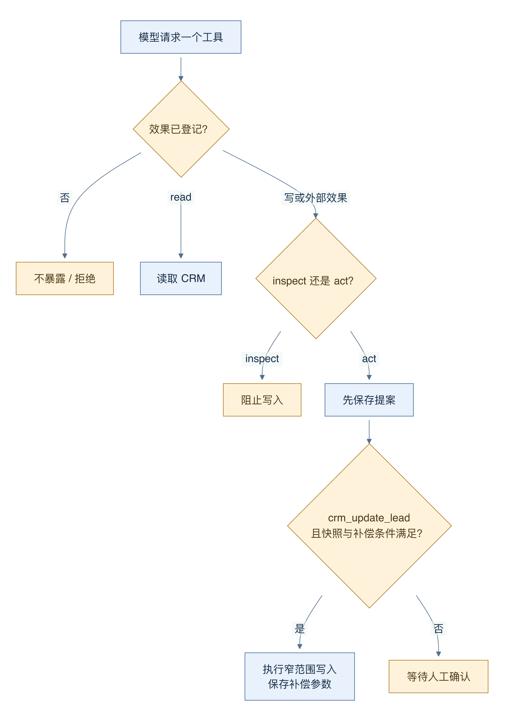
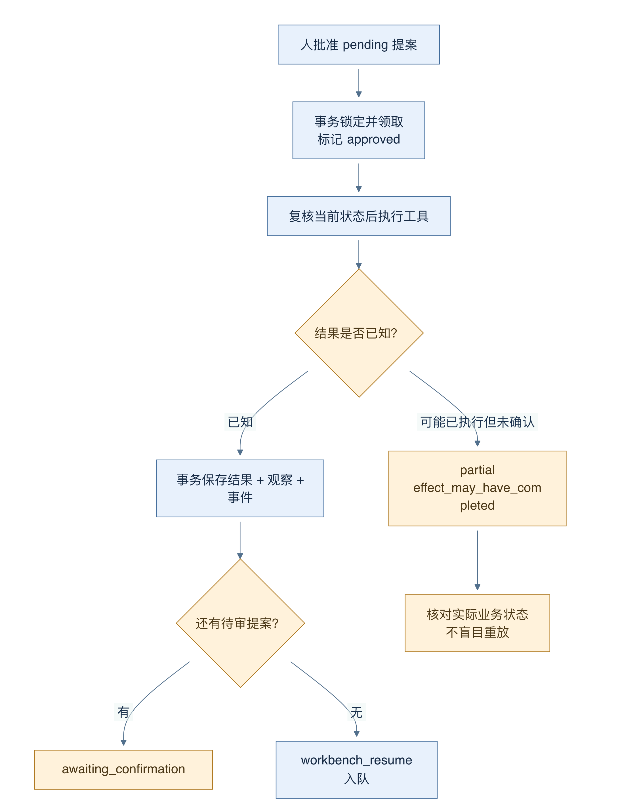
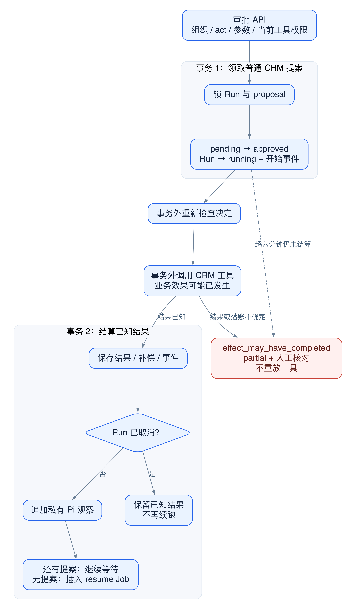
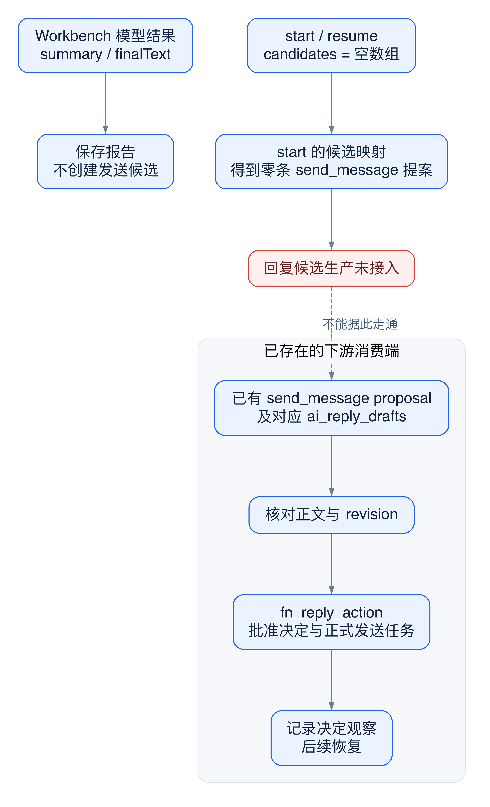

# 18 动作提案、人工审批与安全执行

[返回母文档](../README.md) · [上一章](17.md) · [下一章](19.md)

**本章目标：**区分暂存、批准、执行、补偿与客户外发。

## 业务流程与阅读起点

### 这一章学什么

模型“建议做什么”和 CRM“确实做了什么”之间，需要一段可检查的执行路径。Workbench 把工具按效果分类，再决定只读执行、可补偿写入或等待人审。这里的 Harness 指 CRM 外围控制代码，负责权限、状态、执行和记录；它不是另一位会思考的模型。

> 🛡️ **核心架构铁律：区分“推理起草”与“副作用执行”。** 在 HITL（Human-in-the-Loop）架构中，模型在工作台中生成的分析与回复建议纯属内存中的思考产物；任何涉及外部客户触达或 CRM 核心修改的高危动作，必须显式转化为受控的 Action Proposal，置入 `awaiting_confirmation` 队列，在经过操作员在 UI 点击审批前，系统决不向外部物理世界发出任何网络包。这正是生产级系统防范幻觉破坏的核心防线。

### act 也有分级约束

workbenchToolEffect 把工具分成 read、reversible_write、external 和 irreversible。只有显式登记补偿的 crm_update_lead 被归为可逆写；普通写入默认需要确认，未知工具则不暴露给模型。inspect 模式不执行 CRM 写入；act 模式下，读工具立即调用，写工具先进入 proposalInputs，并向模型返回“已暂存，不能宣称完成”。

图 13-1：箭头表示后端分类后的分流。只有读操作直接走工具执行；可逆写仍需快照与补偿条件；外部动作进入待审提案，未知效果没有执行出口。

例如，用户要求把当前商机标题改成“十月续约”，可逆路径会先读取原商机，保留旧 title，并带 expected_updated_at 写入新值。从更新工具返回值取得新版本，再保存 compensation_args。这样撤销可以检查“自上次写入后是否又被别人改过”，而不是直接覆盖新数据。

可恢复字段是明确的小集合：title、description、contact_id、value_cents、currency、expected_close_date。不能因为工具名叫 crm_update_lead，就认定它所有参数都可自动撤销。字段不支持或无法得到快照时，自动路径不会冒险写入；即使人工批准，批准执行器也不允许把需要补偿的动作降级为裸写入。

### 人审决定如何避免执行两遍

提案接口重新核对当前组织、Run 状态、pending 提案、act 模式、工具效果和参数；普通工具还要检查当前 Agent 版本是否授权。批准并不是跳过这些检查的万能通行证。

claimWorkbenchApprovedAction 在事务内锁定 Run 和提案，把提案从 pending 改为 approved 后，执行器才可以调用具体工具。已知结果会连同事件、Pi 观察和下一个 workbench_resume 工单一起保存。还有其他 pending 提案时，运行继续等人审。

图 13-2：箭头区分“结果已知”和“可能已执行但来不及落账”。后者进入 partial 和人工核对，不自动重放非幂等动作。幂等是重复请求不会重复产生效果的性质，不能仅靠重试按钮获得。

如果进程在外部动作执行后、记账前崩溃，系统可能无法证明动作到底成功没有。markWorkbenchApprovedActionUncertain 会保存 effect_may_have_completed，并停止相关待执行动作。这样虽需要人核对，却能避免为了追求绿色状态而再发一次消息或再创建一条记录。

### 自查问题

看到“executed”时，先问它描述提案处理、发送排队还是最终渠道交付。看到“取消成功”时，再问此前是否已有动作完成。把这些语义分清，比让模型在提示词里反复承诺“安全”更重要。

### 深入一层：普通 CRM 审批有两个事务，中间是动作

下面只讲普通 CRM 工具审批。send_message 和内部提问各有独立分支，不能直接套用这张图。

图 13-3：两个蓝色框是数据库事务。中间的工具执行不在这两个事务里。红色分支保留“效果可能已经发生”的不确定性。

1. 决策 API 重读 Run 与提案，验证组织、状态、act 模式、工具效果和参数。随后重新加载当前 Agent 版本，并确认该版本允许这个工具
2. 领取事务锁 Run 和 proposal。它要求 Run 仍在 awaiting_confirmation，提案仍为 pending。事务把 Run 改成 running，把提案改成 approved，并写审批和工具开始事件
3. 领取提交后，API 再检查决定是否仍有效。随后调用 executeApprovedWorkbenchTool。普通工具是在这次审批 HTTP 请求中执行，不是等 workbench_resume Worker 来执行
4. 结果结算事务锁定相同记录。它保存 executed 或已知安全失败、补偿参数与事件。若 Run 已取消，它保留已知动作结果，并结束，不再推进推理
5. 若 Run 仍可继续，事务读取私有消息，把执行结果追加成 Harness 观察。快照无效时转为 partial，不凭空续跑。若还有 pending 提案，Run 回到 awaiting_confirmation；若没有，事务创建 workbench_resume Job，并写 run_resumed
6. 此时 Run 已是 running，新的 Job 则是 pending。“恢复已排队”不意味着模型已完成下一回合

第 5 步的 Run 结果、观察和新 Job 使用同一个事务，确实比创建 Run 时的三个独立写入更强。但它没有把第 3 步的业务动作包进同一原子操作。数据库事务不能自动撤回一个已经完成的外部副作用。

### 为什么 approved 不能读作 executed

领取成功只证明某个审阅者取得了这次动作的执行权。进程可能在进入工具前退出，也可能在工具成功后、结算前退出。两种情况留下的 approved 状态相同，后续恢复不能仅凭它判断动作发生了没有。

代码宁可保存不确定性。普通未处理异常触发 markWorkbenchApprovedActionUncertain：提案标 failed，但 result_summary 明确写 effect_may_have_completed；活动 Run 标 partial；剩余 pending 提案被取消。后台还会查找超过六分钟仍为 approved 的普通提案，走同一核对路径，而不再次进入 CRM 工具。

因此，“failed 提案”不总是“绝对没有产生效果”。这里的 failed 可以指执行收据无法确认。人工应核对目标记录、版本和业务收据，再决定如何处理。

### 用版本号理解补偿

假设原商机标题是 A，updated_at 是 v1。Harness 读取旧值，使用 expected_updated_at=v1 写成 B。工具返回 v2 后，Harness 保存补偿参数：把标题改回 A，但要求 expected_updated_at=v2。

如果其他用户已把 B 改成 C，当前版本不再是 v2。补偿必须暴露冲突，不能用旧 A 覆盖别人刚完成的 C。这是带业务前提的反向操作，不是时光倒流。一个函数返回 compensationArgs，也不代表写入和补偿收据已经同事务保存；自动路径在实际更新之后，还要单独更新 proposal。

### 验证发送链可达性：先找生产者

图 13-4：上半部分是当前 Workbench 正常 start/resume 的输入。红色节点表示没有接入的候选生产步骤。下半部分只展示已经存在的消费端；它不是端到端可用证明。

1. 先找候选从哪里来。start 明确构造 candidates=[]；finalText 来自结构化摘要或模型文本，代码没有把 finalText 转成 candidates
2. 再找候选如何成为提案。start 的 sendProposals 只对 candidates 做 map；空数组自然产生零条 send_message 提案。resume 同样构造空 candidates，持久化循环直接遍历 result.proposals
3. 再看工具入口。常规 crm_send_whatsapp_message 在 MCP 组装时被排除。四个内置 Agent 的 toolIds 也都没有 crm_start_conversation_and_send；内置版本的同步逻辑使用这些定义。Workbench 装配的特殊结果工具只收报告，不填发送候选，也不批准发送
4. 最后看消费端。decision API 的 send_message 分支要求已有 proposal 和对应 ai_reply_drafts，再核对原正文与 revision，调用 fn_reply_action。这个分支真实存在，但不能替第 1 步生产候选

结论是一个已确认的实现断点：当前正常 Workbench 回复生成未接到这条 send_message 审批桥。它不只是“尚未做真实发送验收”。独立 CRM 辅助回复链可有自己的草稿生产、批准与 approved_reply 消费器；那条链的成功不能补上 Workbench 的缺口。其他名字带 send 的目录工具，也不能被直接当作这条“回复草稿审批桥”已经接通的证据。

仓库验收文档记录过独立辅助回复链在受控 provider 与本地接收器上的交付测试。它证明那条流程的受控账本，不代表真实 WhatsApp 交付，也不能补上上述 Workbench 生产断点。

### 对照源码

以下行号固定于 main @ 679e09e80878dff7b1c79b8537317b2b9e355331。

- [`lib/ai/agents/tool-effects.ts:11-35`](https://github.com/helsome/AiNativeCrm/blob/679e09e80878dff7b1c79b8537317b2b9e355331/lib/ai/agents/tool-effects.ts#L11-L35)：效果分类与未知工具策略
- [`lib/ai/agents/workbench-start-job.ts:322-349`](https://github.com/helsome/AiNativeCrm/blob/679e09e80878dff7b1c79b8537317b2b9e355331/lib/ai/agents/workbench-start-job.ts#L322-L349)：读执行、写暂存
- [`lib/ai/agents/reversible-lead-update.ts:3-70`](https://github.com/helsome/AiNativeCrm/blob/679e09e80878dff7b1c79b8537317b2b9e355331/lib/ai/agents/reversible-lead-update.ts#L3-L70)：可恢复字段、版本检查与补偿快照
- [`lib/ai/agents/approved-workbench-tool.ts:17-46`](https://github.com/helsome/AiNativeCrm/blob/679e09e80878dff7b1c79b8537317b2b9e355331/lib/ai/agents/approved-workbench-tool.ts#L17-L46)：批准不能绕过补偿约束
- [`lib/ai/agents/workbench-approved-action.ts:27-100`](https://github.com/helsome/AiNativeCrm/blob/679e09e80878dff7b1c79b8537317b2b9e355331/lib/ai/agents/workbench-approved-action.ts#L27-L100)：审批领取与执行前复核
- [`lib/ai/agents/workbench-approved-action.ts:103-250`](https://github.com/helsome/AiNativeCrm/blob/679e09e80878dff7b1c79b8537317b2b9e355331/lib/ai/agents/workbench-approved-action.ts#L103-L250)：保存已知结果、续跑及不确定结果
- [`lib/ai/agents/workbench-start-job.ts:545-598`](https://github.com/helsome/AiNativeCrm/blob/679e09e80878dff7b1c79b8537317b2b9e355331/lib/ai/agents/workbench-start-job.ts#L545-L598)：空 candidates 与发送提案映射
- [`lib/ai/agents/run-resumed-workbench-turn.ts:326-335`](https://github.com/helsome/AiNativeCrm/blob/679e09e80878dff7b1c79b8537317b2b9e355331/lib/ai/agents/run-resumed-workbench-turn.ts#L326-L335)：续跑同样没有发送候选生产
- [`lib/agent-engine/edge/crm/mcp-tools.ts:62-75`](https://github.com/helsome/AiNativeCrm/blob/679e09e80878dff7b1c79b8537317b2b9e355331/lib/agent-engine/edge/crm/mcp-tools.ts#L62-L75)：发送工具过滤
- app/api/v1/ai/workbench/runs/[id]/proposals/[`proposalId]/decision/route.ts:67-102`：审批前置检查
- app/api/v1/ai/workbench/runs/[id]/proposals/[`proposalId]/decision/route.ts:207-283`：发送提案消费分支
- app/api/v1/ai/replies/[`id]/route.ts:1-45`：独立回复动作接口
- [`lib/agent-engine/agent/approved-reply.ts:1-81`](https://github.com/helsome/AiNativeCrm/blob/679e09e80878dff7b1c79b8537317b2b9e355331/lib/agent-engine/agent/approved-reply.ts#L1-L81)：正式 approved_reply 消费入口
- [`docs/testing/system-acceptance-fixes-2026-10-03.md:55-71`](https://github.com/helsome/AiNativeCrm/blob/679e09e80878dff7b1c79b8537317b2b9e355331/docs/testing/system-acceptance-fixes-2026-10-03.md#L55-L71)：辅助自治测试与仍未关闭的验收范围

#### 深入阅读的新增定位

- app/api/v1/ai/workbench/runs/[id]/proposals/[`proposalId]/decision/route.ts:295-381`：当前版本权限、审批领取、HTTP 内执行和结果结算
- app/api/v1/ai/workbench/runs/[id]/proposals/[`proposalId]/decision/route.ts:383-409`：安全失败与不确定效果分流
- [`lib/ai/agents/workbench-approved-action.ts:103-216`](https://github.com/helsome/AiNativeCrm/blob/679e09e80878dff7b1c79b8537317b2b9e355331/lib/ai/agents/workbench-approved-action.ts#L103-L216)：结果、观察和 resume Job 的真实同事务范围
- [`lib/ai/agents/workbench-approved-action.ts:273-305`](https://github.com/helsome/AiNativeCrm/blob/679e09e80878dff7b1c79b8537317b2b9e355331/lib/ai/agents/workbench-approved-action.ts#L273-L305)：超过六分钟的普通 approved 提案转核对，不重放工具
- [`lib/ai/agents/workbench-start-job.ts:721-744`](https://github.com/helsome/AiNativeCrm/blob/679e09e80878dff7b1c79b8537317b2b9e355331/lib/ai/agents/workbench-start-job.ts#L721-L744)：自动可逆写入与提案结算是相邻独立步骤
- [`lib/ai/agents/run-resumed-workbench-turn.ts:327-359`](https://github.com/helsome/AiNativeCrm/blob/679e09e80878dff7b1c79b8537317b2b9e355331/lib/ai/agents/run-resumed-workbench-turn.ts#L327-L359)：resume 候选为空，实际遍历 result.proposals
- [`lib/mcp/tools/ferramentas-do-harness.ts:36-56`](https://github.com/helsome/AiNativeCrm/blob/679e09e80878dff7b1c79b8537317b2b9e355331/lib/mcp/tools/ferramentas-do-harness.ts#L36-L56)：明确排除的直接发送工具 ID
- [`lib/ai/agents/workbench-result-submission.ts:87-107`](https://github.com/helsome/AiNativeCrm/blob/679e09e80878dff7b1c79b8537317b2b9e355331/lib/ai/agents/workbench-result-submission.ts#L87-L107)：结果工具只有内存提交能力
- [`lib/ai/agents/builtins.ts:38-47`](https://github.com/helsome/AiNativeCrm/blob/679e09e80878dff7b1c79b8537317b2b9e355331/lib/ai/agents/builtins.ts#L38-L47)：CRM 情报员的完整工具列表
- [`lib/ai/agents/builtins.ts:88-100`](https://github.com/helsome/AiNativeCrm/blob/679e09e80878dff7b1c79b8537317b2b9e355331/lib/ai/agents/builtins.ts#L88-L100)：销售运营 Agent 的完整工具列表
- [`lib/ai/agents/builtins.ts:135-141`](https://github.com/helsome/AiNativeCrm/blob/679e09e80878dff7b1c79b8537317b2b9e355331/lib/ai/agents/builtins.ts#L135-L141)：客户沟通 Agent 的完整工具列表
- [`lib/ai/agents/builtins.ts:182-193`](https://github.com/helsome/AiNativeCrm/blob/679e09e80878dff7b1c79b8537317b2b9e355331/lib/ai/agents/builtins.ts#L182-L193)：CRM 主管 Agent 的完整工具列表
- [`lib/ai/agents/ensure-builtins.ts:170-207`](https://github.com/helsome/AiNativeCrm/blob/679e09e80878dff7b1c79b8537317b2b9e355331/lib/ai/agents/ensure-builtins.ts#L170-L207)：内置版本使用 definition.toolIds 同步工具范围

## 实现详解

### 人工确认：效果分级与暂存代替执行

工具效果分为 `read`、`reversible_write`、`external` 与 `irreversible` 四类，决定工作台的执行分支。`workbenchToolEffect(name)` 返回 `{ effect, resource }`；**未知效果直接跳过，永不暴露给 Pi**（fail closed）。`read` 直接放行；`reversible_write` 与 `external` 一律被替换成"暂存"桩：前者返回"已由 CRM Harness 带回审计差异与补偿方案应用，不要宣称完成"，后者返回"已为人工确认暂存，不要执行也不要宣称外部动作已完成"。契约文本在系统提示中再次重申：*Never claim a staged write or external action is complete*。 Sources: [workbench-start-job.ts](https://github.com/helsome/AiNativeCrm/blob/679e09e80878dff7b1c79b8537317b2b9e355331/lib/ai/agents/workbench-start-job.ts#L327), [workbench-start-job.ts](https://github.com/helsome/AiNativeCrm/blob/679e09e80878dff7b1c79b8537317b2b9e355331/lib/ai/agents/workbench-start-job.ts#L444)

提案按 `sequence` 顺序落库到 `ai_agent_action_proposals`，`onConflict: "run_id,sequence"` + `ignoreDuplicates` 保证重试幂等；`preview` 里写明 `requiresHumanConfirmation`，`send_message` 额外标注 `externalEffect: "customer_message"`，内部提问工具标注 `feishu_internal_question` 并附收件人与问题原文。 Sources: [workbench-start-job.ts](https://github.com/helsome/AiNativeCrm/blob/679e09e80878dff7b1c79b8537317b2b9e355331/lib/ai/agents/workbench-start-job.ts#L635)

只有 `crm_update_lead` 会自动执行——它在 `act` 模式下经 `withMissionDirectionWriteFence` 包裹后调用 `executeReversibleLeadUpdate`，成功后把提案置 `executed`、写入 `compensation_args`、并连发 `policy_checked` / `tool_started` / `tool_completed` / `crm_state_changed` 四条事件，其中 `crm_state_changed` 带 `targetId` 与 `changedFields`，构成完整的前后差分。其余一切停留在 `pending`，落 `policy_checked: requires_human_confirmation` 与 `human_confirmation_requested` 两条事件。 Sources: [workbench-start-job.ts](https://github.com/helsome/AiNativeCrm/blob/679e09e80878dff7b1c79b8537317b2b9e355331/lib/ai/agents/workbench-start-job.ts#L703)

这里需要先区分消费端与生产端：固定版本的正常 start/resume 都把 `candidates` 设为空数组，没有把最终回复文字转为发送候选。因此下述 `send_message` 分支是已有消费逻辑，不能证明正常工作台已经接通客户发送。若已有 `send_message` 提案，代码会调用数据库函数 `fn_reply_workbench_stage` 生成 `ai_reply_drafts` 记录，但必须携带 `scope.conversationId` 与 `scope.replyContextRevision`，否则抛 `workbench_send_requires_scoped_conversation`——回复草稿永远绑定一个已校验的会话上下文版本。 Sources: [workbench-start-job.ts](https://github.com/helsome/AiNativeCrm/blob/679e09e80878dff7b1c79b8537317b2b9e355331/lib/ai/agents/workbench-start-job.ts#L685)

## 继续阅读

[返回母文档](../README.md) · [上一章](17.md) · [下一章](19.md)

