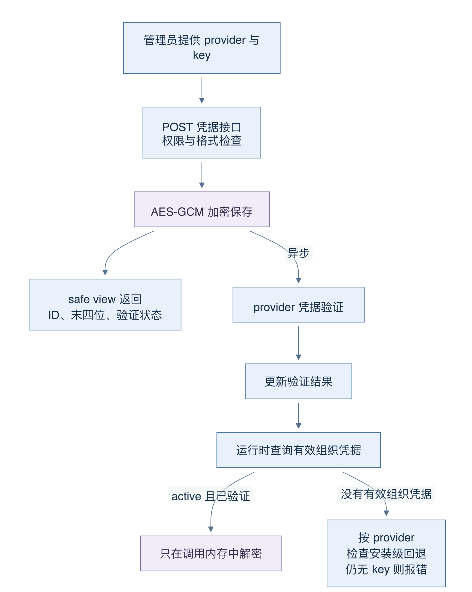
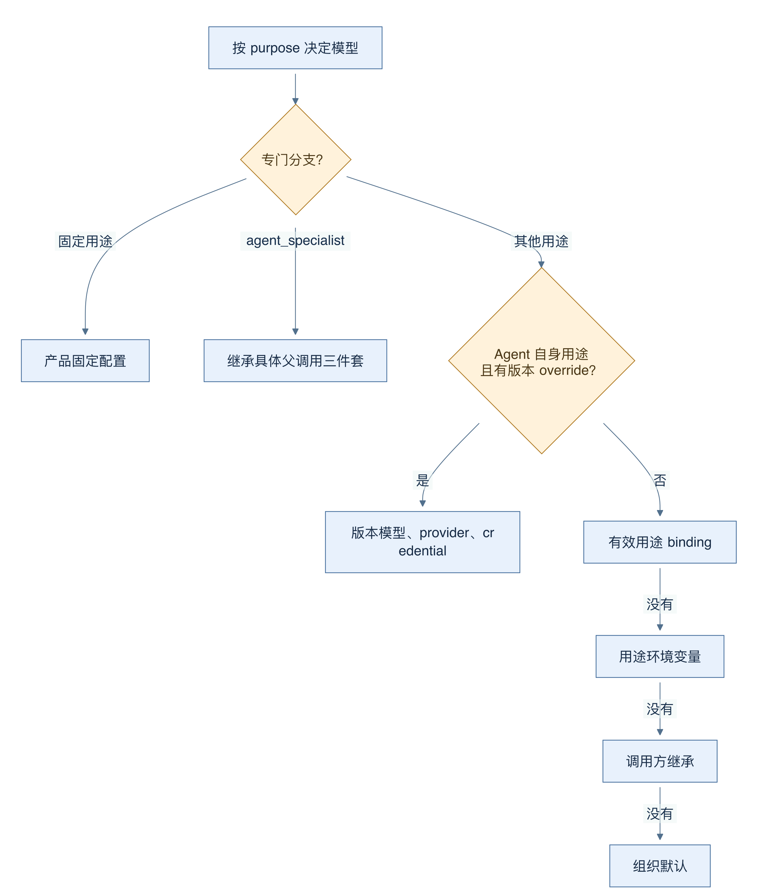
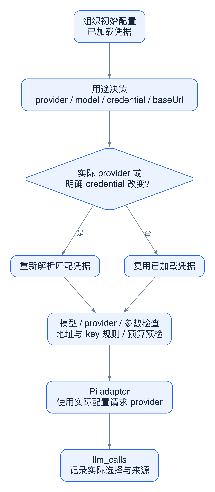
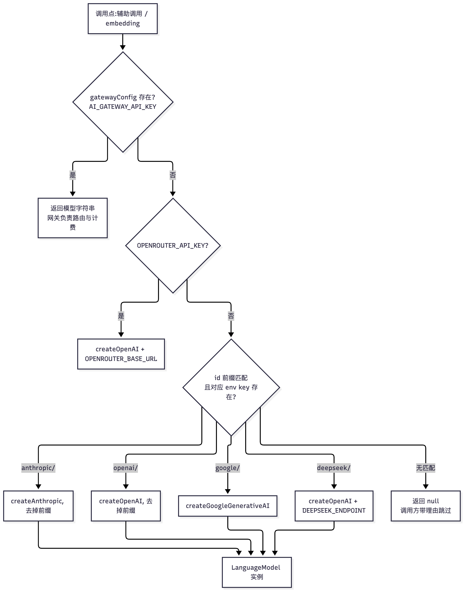
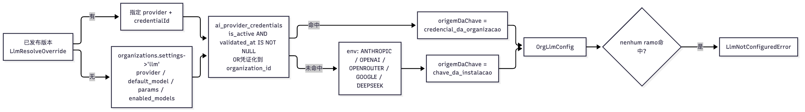

# 19 BYOK 与模型网关：凭据、绑定、成本和审计

[返回母文档](../README.md) · [上一章](18.md) · [下一章](20.md)

**本章目标：**沿凭据解密到模型调用理解绑定优先级、预算和用量。

## 业务流程与阅读起点

### 这一章学什么

BYOK 是 Bring Your Own Key，即组织使用自己提供的模型 API 密钥。它回答“拿谁的凭据访问 provider”；model 回答“使用该服务中的哪个模型”。这两个问题必须一起解决，不能只把模型字符串改成新名字就认为切换完成。

本章解读固定 main 的配置与调用代码，不请求真实 provider，也不展示任何密钥。阅读时把“保存成功”“验证成功”“本次实际采用”当成三个不同状态。

### 一把密钥怎样进入可用状态

凭据 POST 要求 admin 权限，先验证 provider、标签和密钥字段格式，再调用共享保存逻辑。密钥用 AES-GCM 加密后存入 ai_provider_credentials；可展示的末四位与验证状态通过 safe view 读取。保存后会异步验证 provider，因此返回 201 说明记录已创建，不能保证网络验证已经成功。

图 14-1：上方箭头是保存及异步验证流程，下方箭头是一次运行的读取。safe view 返回脱敏列；运行解析器只选 active 且 validated_at 非空的组织凭据。

resolveOrgLlmConfig 每次调用都读组织设置及预算，不需要为了换模型重启服务。它优先按指定 credentialId 查有效凭据，未指定时查该 provider 最近的有效组织凭据；部分 provider 在缺少有效组织凭据时可以回退安装级 key。最终没有可用 key 则报 LlmNotConfiguredError。不能把“BYOK 支持”理解为所有场景都严格只用某个组织 key，排查时应看实际的 key 来源和选择结果。

### 五个配置入口如何避免互相覆盖

统一 Model Gateway 在这里主要落实为 runModelCall。它先加载配置，再调用决定函数，得到 provider、modelId、credentialId、baseUrl 和选择来源。通常优先顺序是：Agent 自身回合的版本配置、用途绑定、旧环境变量、调用方继承、组织默认。purpose 是“这次模型用来做什么”，例如 agent_turn 或 agent_specialist；用途绑定让不同任务可以选不同配置。

图 14-2：向下箭头表示上一级没有适用配置才继续。固定用途和 specialist 先走专门分支；specialist 继承具体父调用的 provider、模型和凭据，不能用页面上的另一个 Agent 猜测。

这里有两个细节。第一，版本优先分支实际覆盖 agent_turn、agent_preview、operator_turn。第二，agent_specialist 是独立特例：继承当前父调用三件套，不自行套一个“专家默认模型”。三件套必须保持一致，否则可能把 OpenAI 的模型名发给另一个 provider，得到无法解释的 model not found。

内置 Agent 在 Workbench 创建时还会从组织 settings.llm 读取默认 provider/model，并检查 ai_models 的 supports_tools 与 deprecated_at。后续 Agent 配置加载和 Model Gateway 才执行真正调用。因此遇到“已配置却不能运行”，按入口检查、有效凭据、实际选择来源的顺序看，比反复保存同一设置更有用。

### 自定义地址还有时间边界

provider adapter 将请求限制在解析出的地址白名单内。主代码另有规则处理“组织自定义 baseUrl 却带安装级 key”的组合：在 2026-10-19 00:00 UTC 之前走警告阶段，之后拒绝。本文固定版本的日期规则必须如实保留，不能笼统写成任何时候都已强制阻止。

这也解释为什么仅从函数顶部注释推断安全性质很危险：真正行为取决于时间函数和调用分支。任何部署都应使用组织自己的凭据配置自定义地址，并在测试中核对实际请求目的地，不能把地址验证与密钥所有权混为一谈。

### 容易踩的坑

- 保存凭据后立即当作已验证：异步验证可能尚未结束或失败
- 只改 model 名字：provider 和 credential 也必须匹配
- 把 safe view 当作密钥找回接口：它只提供脱敏状态
- 用某次历史可用模型证明今天仍可用：目录声明、凭据验证和真实调用各有边界
- 遇到缺少费用价格便当成免费：费用未知应继续保持未知

### 深入一层：让配置决策与实际请求保持一致

把一次选择看成一组绑定值：provider、modelId、credentialId、baseUrl，再加选择来源。来源用于解释“为什么选它”；真正执行必须使用前四项。不能因为日志写着“用途绑定”，就跳过凭据是否匹配的检查。

图 14-3：箭头传递本次已解析的配置。重新解析凭据的判断比较实际 provider 与 credential，不依赖“配置来自哪里”的标签。

1. 网关先读组织配置，再运行用途决策函数。它此时已持有一套初始凭据
2. 如果决定的 provider 不同，或决定了另一把明确的 credentialId，网关重新解析凭据。否则复用已加载的凭据，避免无意义的重复解密
3. 网关检查 model 是否在 enabledModels 内、provider 是否支持、参数是否合法，再处理自定义地址与安装级 key 的组合
4. 预算预检通过后，网关把实际 provider、model、apiKey 和可选 baseUrl 交给 Pi adapter。adapter 负责协议与目的地校验
5. 成功调用把 provider、model、purpose 和 origem_da_escolha 一起写入 llm_calls。排错时比较“期望选择”与“实际入账”，不应把 API key 放进日志

这一层划分让排错更具体。model not enabled 是调用前配置检查；provider 返回鉴权错误是实际调用失败；llm_calls 入账失败又是调用之后的持久化问题。前两者不会因为界面上“保存成功”而自动消失，后者也不能证明 provider 从未收到请求。

### 对照源码

以下行号固定于 main @ 679e09e80878dff7b1c79b8537317b2b9e355331。

- [`app/api/v1/ai/credentials/route.ts:28-65`](https://github.com/helsome/AiNativeCrm/blob/679e09e80878dff7b1c79b8537317b2b9e355331/app/api/v1/ai/credentials/route.ts#L28-L65)：脱敏字段、列表及创建角色
- [`lib/ai/credenciais/guardar.ts:68-127`](https://github.com/helsome/AiNativeCrm/blob/679e09e80878dff7b1c79b8537317b2b9e355331/lib/ai/credenciais/guardar.ts#L68-L127)：加密、审计与异步验证
- [`lib/agent-engine/edge/llm/credentials.ts:296-414`](https://github.com/helsome/AiNativeCrm/blob/679e09e80878dff7b1c79b8537317b2b9e355331/lib/agent-engine/edge/llm/credentials.ts#L296-L414)：组织解析、有效凭据与平台回退
- [`lib/ai/pontos/resolver.ts:114-118`](https://github.com/helsome/AiNativeCrm/blob/679e09e80878dff7b1c79b8537317b2b9e355331/lib/ai/pontos/resolver.ts#L114-L118)：Agent 自身用途集合
- [`lib/ai/pontos/resolver.ts:161-299`](https://github.com/helsome/AiNativeCrm/blob/679e09e80878dff7b1c79b8537317b2b9e355331/lib/ai/pontos/resolver.ts#L161-L299)：实际优先级与 specialist 分支
- [`lib/agent-engine/edge/llm/run-model-call.ts:558-628`](https://github.com/helsome/AiNativeCrm/blob/679e09e80878dff7b1c79b8537317b2b9e355331/lib/agent-engine/edge/llm/run-model-call.ts#L558-L628)：最终选择与运行前检查
- [`app/api/v1/ai/workbench/runs/route.ts:134-181`](https://github.com/helsome/AiNativeCrm/blob/679e09e80878dff7b1c79b8537317b2b9e355331/app/api/v1/ai/workbench/runs/route.ts#L134-L181)：内置 Agent 的组织模型与工具能力预检
- [`lib/agent-runtime/pi/model-adapter.ts:146-173`](https://github.com/helsome/AiNativeCrm/blob/679e09e80878dff7b1c79b8537317b2b9e355331/lib/agent-runtime/pi/model-adapter.ts#L146-L173)：请求地址白名单及凭据注入
- [`lib/agent-engine/edge/llm/run-model-call.ts:631-667`](https://github.com/helsome/AiNativeCrm/blob/679e09e80878dff7b1c79b8537317b2b9e355331/lib/agent-engine/edge/llm/run-model-call.ts#L631-L667)：自定义地址加平台 key 的检查位置
- [`lib/agent-engine/edge/llm/prazo-do-endereco-proprio.ts:36-57`](https://github.com/helsome/AiNativeCrm/blob/679e09e80878dff7b1c79b8537317b2b9e355331/lib/agent-engine/edge/llm/prazo-do-endereco-proprio.ts#L36-L57)：2026-10-19 的阶段切换

#### 深入阅读的新增定位

- [`lib/agent-engine/edge/llm/run-model-call.ts:587-628`](https://github.com/helsome/AiNativeCrm/blob/679e09e80878dff7b1c79b8537317b2b9e355331/lib/agent-engine/edge/llm/run-model-call.ts#L587-L628)：按实际 provider 和 credential 决定是否重载，随后检查模型参数
- [`lib/agent-engine/edge/llm/run-model-call.ts:722-746`](https://github.com/helsome/AiNativeCrm/blob/679e09e80878dff7b1c79b8537317b2b9e355331/lib/agent-engine/edge/llm/run-model-call.ts#L722-L746)：真正传给 Pi 的凭据、provider、模型与地址
- [`lib/agent-engine/edge/llm/run-model-call.ts:774-810`](https://github.com/helsome/AiNativeCrm/blob/679e09e80878dff7b1c79b8537317b2b9e355331/lib/agent-engine/edge/llm/run-model-call.ts#L774-L810)：记录 provider 失败并重新抛出原错误
- [`lib/agent-engine/edge/llm/run-model-call.ts:829-865`](https://github.com/helsome/AiNativeCrm/blob/679e09e80878dff7b1c79b8537317b2b9e355331/lib/agent-engine/edge/llm/run-model-call.ts#L829-L865)：成功入账使用实际调用值和选择来源

## 实现详解

本页拆解 AI Native CRM 中**模型网关**这一层的全部机制：从凭据如何被加密存储与即时解密开始，到模型绑定如何在「组织版本指定 → 组织配置 → 安装级密钥回落」三级阶梯上确定，到预算如何从「状态」与「决策」两条互不重叠的代码路径收敛成一次真实的拒绝，再到定价如何在两张表之间回落、用量如何被记录、以及哪些测量洞被显式声明为产品契约的一部分。

阅读本页前建议先掌握 [Pi Agent Core 回合编排](20.md)——本页讲的是回合**出站前**的那一段：provider 怎么被构造、密钥从哪来、花多少钱、在什么条件下拒绝出门。

---

### 两条并行的模型通路

网关不是一个模块，而是**两条刻意分离的通路**。理解这个分离是理解其余全部设计的前提。

第一条是**辅助通路**（`lib/ai/gateway.ts`）。它的文件头写得很直接：它专门负责 embeddings 与非智能体辅助调用的路由，让调用点只需要写 `"anthropic/claude-sonnet-4-6"` 这样的模型字符串；而「智能体回合走的是 Pi Model Gateway」。该模块还带一条硬性反模式守卫——代码里**永远不** `import Anthropic from "@anthropic-ai/sdk"`，只允许经由形似网关的 `ai` SDK 调用传入模型字符串。Sources: [gateway.ts](https://github.com/helsome/AiNativeCrm/blob/679e09e80878dff7b1c79b8537317b2b9e355331/lib/ai/gateway.ts#L1)

第二条是**智能体通路**，其入口被显式定义为「SEAM ÚNICO」：`runModelCall` 是 harness 中**所有** LLM 调用的唯一通道——智能体回合、辅助分类器与压缩全部走这一个函数，没有任何 call site 自己实例化 provider。文件头同时给出了这条 seam 的完整时序契约：解析组织配置（BYOK + knobs）→ 在**发出第一个字节之前**检查月度预算 → 进入 AgentRuntime/Pi → 把用量与成本写入 `llm_calls`。并加了一条安全约束：组织的密钥**永不**进入 prompt、tool result 或日志，它只在 provider 实例化时越过边界。Sources: [run-model-call.ts](https://github.com/helsome/AiNativeCrm/blob/679e09e80878dff7b1c79b8537317b2b9e355331/lib/agent-engine/edge/llm/run-model-call.ts#L14)

这意味着：改辅助调用（例如换一个 embedding provider）只需要看 `lib/ai/gateway.ts`；改智能体的凭据、模型或预算行为，**必须**看 `lib/agent-engine/edge/llm/` 下的文件。两条通路不共享密钥来源——这一点常被误读。Sources: [gateway.ts](https://github.com/helsome/AiNativeCrm/blob/679e09e80878dff7b1c79b8537317b2b9e355331/lib/ai/gateway.ts#L40)

第三块拼图是 `lib/agent-runtime/model-gateway.ts`，它小到只有 21 行，但它的注释划定了极关键的归属：安装级模型凭据查找。provider 的构造属于 Pi 适配器的职责；本模块**只**暴露安装级凭据供发布与配置流程使用；「租户凭据单独解析，且在租户绑定生效时永不回落到这个 helper」。Sources: [model-gateway.ts](https://github.com/helsome/AiNativeCrm/blob/679e09e80878dff7b1c79b8537317b2b9e355331/lib/agent-runtime/model-gateway.ts#L1)

---

### 辅助通路的解析阶梯

`resolveLanguageModel` 存在的理由在注释里被完整保留：它是为了修复「检查说『有 IA』、执行却不」这种错位——检查用 `ANTHROPIC_API_KEY`（安装器唯一强制要求的密钥）判断「有 IA」，而执行端把 id 当**字符串**传入；在 AI SDK 里带斜杠的字符串会被路由到 Vercel 网关，而网关在没有 `AI_GATEWAY_API_KEY` 时落到匿名套餐并返回 `Unauthenticated. Configure AI_GATEWAY_API_KEY or use a provider module.`。结果是：**在每一个标准 self-host 安装里，情感 worker 都会陷入失败循环**。Sources: [gateway.ts](https://github.com/helsome/AiNativeCrm/blob/679e09e80878dff7b1c79b8537317b2b9e355331/lib/ai/gateway.ts#L51)

解析顺序被刻意定义为「从最具体到最泛化」的三级：Vercel 网关（返回字符串，由网关路由与计费）→ OpenRouter（用 OpenAI 兼容 provider 指向其 endpoint；因为 OpenRouter 的 id 本就是 `provider/modelo` 形态，同一个规范 id 无需翻译即可复用）→ 直连 provider（按 id 前缀选 Anthropic 或 OpenAI）。函数在全空时返回 `null`，让调用方**带着明确理由跳过**，而不是在网络层炸开。Sources: [gateway.ts](https://github.com/helsome/AiNativeCrm/blob/679e09e80878dff7b1c79b8537317b2b9e355331/lib/ai/gateway.ts#L66)

实际代码覆盖五个 provider 分支：`anthropic/`、`openai/`、`google/`（`GOOGLE_API_KEY` 或 `GOOGLE_GENERATIVE_AI_API_KEY` 任一）与 `deepseek/`（复用 OpenAI provider + `DEEPSEEK_ENDPOINT`，因为 DeepSeek 同样说 OpenAI 协议）。Sources: [gateway.ts](https://github.com/helsome/AiNativeCrm/blob/679e09e80878dff7b1c79b8537317b2b9e355331/lib/ai/gateway.ts#L88)

读图时的前提：`gatewayConfig()` 只在 `env.AI_GATEWAY_API_KEY` 存在时非空，且 baseURL 取自 `AI_GATEWAY_BASE_URL`；而 `isAiGatewayConfigured()` 是**另一条**更宽的判断——它把六个 key 中任意一个存在都算作「有 IA」。二者不等价，这正是上面那个失败循环的根源。Sources: [gateway.ts](https://github.com/helsome/AiNativeCrm/blob/679e09e80878dff7b1c79b8537317b2b9e355331/lib/ai/gateway.ts#L40) [gateway.ts](https://github.com/helsome/AiNativeCrm/blob/679e09e80878dff7b1c79b8537317b2b9e355331/lib/ai/gateway.ts#L129)

模型默认值是三层常量：对话默认 `anthropic/claude-sonnet-5`、分类器默认 `anthropic/claude-haiku-4-5`、嵌入默认 `openai/text-embedding-3-small`。而 `ModelId` 类型用 `(string & {})` 保留自动补全的同时，允许任意租户自配字符串。Sources: [gateway.ts](https://github.com/helsome/AiNativeCrm/blob/679e09e80878dff7b1c79b8537317b2b9e355331/lib/ai/gateway.ts#L28)

每一次网关调用都携带两个头：`X-AI-Gateway-Tenant-Id` 让网关面板能按组织切分用量，`X-AI-Gateway-Zero-Retention: 1` 把请求默认排除在提供方的训练语料之外——这是针对租户数据的「默认即隐私」。Sources: [gateway.ts](https://github.com/helsome/AiNativeCrm/blob/679e09e80878dff7b1c79b8537317b2b9e355331/lib/ai/gateway.ts#L117)

---

### BYOK 凭据：加密存储与即时解密

凭据的存储形态是三列分离的密文：`api_key_encrypted` / `api_key_iv` / `api_key_tag`，对应 AES-256-GCM。明文的生命周期被写死在 `lib/ai/credentials.ts` 的文件头：它只活在被返回的对象里——**永不**被记录日志、写入缓存或发送给 Sentry；调用方负责在请求结束时丢弃该引用。Sources: [credentials.ts](https://github.com/helsome/AiNativeCrm/blob/679e09e80878dff7b1c79b8537317b2b9e355331/lib/ai/credentials.ts#L1) [credentials.ts](https://github.com/helsome/AiNativeCrm/blob/679e09e80878dff7b1c79b8537317b2b9e355331/lib/ai/credentials.ts#L86)

解密入口 `loadCredential(id, organizationId)` 返回一个极小的结构：`{ apiKey, provider, label }`。它不抛通用异常，而是抛 `CredentialUnavailableError`，其 `reason` 是一个**封闭枚举**：`not_found` / `inactive` / `not_validated` / `wrong_org` / `decrypt_failed`。Sources: [credentials.ts](https://github.com/helsome/AiNativeCrm/blob/679e09e80878dff7b1c79b8537317b2b9e355331/lib/ai/credentials.ts#L14)

关键的顺序敏感性在函数注释里被点明：404 等价 → 不活跃 → 无 `validated_at` → 组织不匹配。其中 `wrong_org` 被标注为**防御性**检查，理由明确写出：admin client 绕过 RLS，因此程序化过滤是强制性的。这条不可省略——绕过 RLS 意味着数据库不会替你拦截跨租户读取。Sources: [credentials.ts](https://github.com/helsome/AiNativeCrm/blob/679e09e80878dff7b1c79b8537317b2b9e355331/lib/ai/credentials.ts#L46)

| `reason` | 触发条件 | 语义层 |
| --- | --- | --- |
| `not_found` | 查询报错，或行不存在 | 404 等价 |
| `wrong_org` | `organization_id` ≠ 请求组织 | 防御性（admin绕过 RLS） |
| `inactive` | `is_active` 为假 | 停用 |
| `not_validated` | `validated_at` 为 NULL | 尚未与 provider 握手成功 |
| `decrypt_failed` | `decryptKey` 抛错 | 密钥损坏或密文/环境密钥不匹配 |

Sources: [credentials.ts](https://github.com/helsome/AiNativeCrm/blob/679e09e80878dff7b1c79b8537317b2b9e355331/lib/ai/credentials.ts#L46)

---

### 模型绑定：三级阶梯与密钥来源标注

智能体通路的绑定发生在 `resolveOrgLlmConfig(db, cfg, organizationId, override?)`。它的契约是：解析组织 LLM 配置（`organizations.settings->'llm'` 的 knobs + `ai_provider_credentials` 中**最近一条** active/validated 的凭据，用 `aes_gcm` 解密），无 BYOK 时回落到平台 key，无任何可用密钥时抛 `LlmNotConfiguredError`。关键是——**配置每次调用都从 DB 重读**：换模型/换 provider/换预算是一次 UPDATE，在下一个 run 就生效，不需要重启也不需要部署。Sources: [credentials.ts](https://github.com/helsome/AiNativeCrm/blob/679e09e80878dff7b1c79b8537317b2b9e355331/lib/agent-engine/edge/llm/credentials.ts#L280)

组织版本可以带一个 per-turn 的 override（来自 agent 的**已发布版本**）：`LlmResolveOverride` 允许指定 `provider` 与 `credentialId`；没有 override 时才回落到组织配置（settings.llm + 该 provider 最近一条凭据）。注释同时提醒：发布时会校验凭据，但**凭据可能在发布之后被吊销**，因此查询条件里始终保留 `is_active and validated_at is not null`。Sources: [credentials.ts](https://github.com/helsome/AiNativeCrm/blob/679e09e80878dff7b1c79b8537317b2b9e355331/lib/agent-engine/edge/llm/credentials.ts#L286) [credentials.ts](https://github.com/helsome/AiNativeCrm/blob/679e09e80878dff7b1c79b8537317b2b9e355331/lib/agent-engine/edge/llm/credentials.ts#L344)

密钥来源被显式建模为一个字段 `OrigemDaChaveLlm = "credencial_da_organizacao" | "chave_da_instalacao"`，与 embedding 侧使用同一套词汇。注释解释了为什么必须有它：某个用途点的地址（`ai_purpose_bindings.base_url`）是由组织管理员选择的，而**安装级密钥不允许跟着它走**；在这个字段出现之前，想知道这一点只能去比较明文与 `.env` 里的密钥，每个路径各写一次比较逻辑。Sources: [credentials.ts](https://github.com/helsome/AiNativeCrm/blob/679e09e80878dff7b1c79b8537317b2b9e355331/lib/agent-engine/edge/llm/credentials.ts#L166)

阶梯本身是五条并列的 provider 分支，每一条都同时赋值 `apiKey` 与 `origemDaChave`——注释强调「来源是**哪个分支**选了密钥的事实，只有这一点知道而不必猜」。走完所有分支仍无密钥则抛 `LlmNotConfiguredError`，其消息刻意**不含任何值**。Sources: [credentials.ts](https://github.com/helsome/AiNativeCrm/blob/679e09e80878dff7b1c79b8537317b2b9e355331/lib/agent-engine/edge/llm/credentials.ts#L374) [credentials.ts](https://github.com/helsome/AiNativeCrm/blob/679e09e80878dff7b1c79b8537317b2b9e355331/lib/agent-engine/edge/llm/credentials.ts#L138)

读图前提：`settings->'llm'` 是**自由 jsonb**，所以读取走一个 `.passthrough().catch(default)` 的 zod schema——形状错误的字段落到默认值，**绝不**掀翻回合。Sources: [credentials.ts](https://github.com/helsome/AiNativeCrm/blob/679e09e80878dff7b1c79b8537317b2b9e355331/lib/agent-engine/edge/llm/credentials.ts#L205)

安装级配置 `LlmEdgeConfig` 由 `llmEdgeConfigFromEnv` 从一个**显式声明的 env 形状**构造，而不是让 seam 自己去读 `process.env`。注释给出了硬性理由：worker 的 `loadEnv` 会**移除**其 schema 未声明的键，因此 seam 里一次直接 `process.env` 读取在 app 里看似可用，到了真正花钱的 worker 里却会消失。Sources: [credentials.ts](https://github.com/helsome/AiNativeCrm/blob/679e09e80878dff7b1c79b8537317b2b9e355331/lib/agent-engine/edge/llm/credentials.ts#L70) [credentials.ts](https://github.com/helsome/AiNativeCrm/blob/679e09e80878dff7b1c79b8537317b2b9e355331/lib/agent-engine/edge/llm/credentials.ts#L86)

---

### 端点、Egress 与 provider 工厂

`providers.ts` 明确定位为「遗留的辅助操作」的工厂集合——媒体、smoke 与测试；智能体的实际执行走 `lib/agent-runtime/pi/model-adapter.ts`，并附一句「本模块**不是**智能体循环」。Sources: [providers.ts](https://github.com/helsome/AiNativeCrm/blob/679e09e80878dff7b1c79b8537317b2b9e355331/lib/agent-engine/edge/llm/providers.ts#L1)

工厂签名为 `(apiKey, modelId, baseUrl?) => LanguageModel`。第三个参数存在的理由具体而克制：面板上选择的 endpoint（`ai_purpose_bindings.base_url`）要同时容纳两种没有固定 endpoint 的情况——一个架在 OpenRouter 前面的 OpenAI 兼容网关，以及产品路线图上的「跑在客户自己机器上的模型」。它是可选的，规范 provider 会忽略它并继续走各自的内在 endpoint。Sources: [providers.ts](https://github.com/helsome/AiNativeCrm/blob/679e09e80878dff7b1c79b8537317b2b9e355331/lib/agent-engine/edge/llm/providers.ts#L14)

安全设计上有两点值得注意。第一，provider 内部的 `fetch` 也走 egress allowlist（`allowlistedFetch`）——否则 SDK 的出网会**逃出**管控。allowlist = 该 provider 的规范 endpoint + 配置里的额外 host（如企业代理）。第二，OpenRouter 的 `baseUrl` 被**尊重**时，allowlist 也随之**改为它自己的**，而不是「OpenRouter 的 allowlist 加一个洞」——把 egress 钉死在规范 endpoint 会让管控**阻断面板自己提供的配置**，报一个谁也关联不到面板的网络错误。Sources: [providers.ts](https://github.com/helsome/AiNativeCrm/blob/679e09e80878dff7b1c79b8537317b2b9e355331/lib/agent-engine/edge/llm/providers.ts#L138)

OpenRouter 的归属头（`HTTP-Referer` / `X-Title`）被刻意排除出代码，走 `OPENROUTER_APP_URL` / `OPENROUTER_APP_TITLE` 环境变量。理由直指自托管现实：写死在代码里的 URL 会随每个 self-hoster 运行镜像一起发布，把**每个客户**的 OpenRouter 消费归属到一个不属于他的站点；而带产品名字的字面量就是品牌在 resolver 之外泄漏，`tests/unit/branding.test.ts` 的猫鼠会拦下它。无值时两个头都不发——信息层面开失败，因为缺少归属不破坏任何人。Sources: [providers.ts](https://github.com/helsome/AiNativeCrm/blob/679e09e80878dff7b1c79b8537317b2b9e355331/lib/agent-engine/edge/llm/providers.ts#L56)

DeepSeek 的 reasoning 是另一个可复制的旋钮设计。`RaciocinioDeepseek = "provider" | "disabled"`，默认 `"provider"`（即保留 provider 默认，推理**开启**）。之所以要发**两个**字段，是因为 DeepSeek 有两面且各读一个名字：Responses API 认 `reasoning.effort = 'none'`，Chat Completions 认 `thinking.type = 'disabled'`；provider 会**静默忽略**它不认识的东西，所以两个都发，任一路线都能关掉。安装的 SDK 走 Responses API，这个事实被 `deepseek-sem-raciocinio.test.ts` 钉住。关闭是在 SDK 组装好的 `init` **之上**改写 body，不碰 prompt、tools、temperature；非 JSON body 原样放行，因为「调优旋钮绝不该掀翻它来优化的那次调用」。Sources: [providers.ts](https://github.com/helsome/AiNativeCrm/blob/679e09e80878dff7b1c79b8537317b2b9e355331/lib/agent-engine/edge/llm/providers.ts#L81)

---

### 预算：状态、决策与唯一 seam

预算这块代码最重要的一条注解是：**屏幕上显示的数字，就是做决定的那个数字**。历史缺陷是——屏幕读的是 `ai_budgets.current_month_consumed_cents`，一个由触发器 `fn_update_budget_consumption` 物化的计数器，它累加 `NEW.cost_cents` **但不看日期**且**从不归零**。于是在一个三个月没更新的安装里，卡片拿三个月花销去比一个**月度**上限。Sources: [budget/check.ts](https://github.com/helsome/AiNativeCrm/blob/679e09e80878dff7b1c79b8537317b2b9e355331/lib/ai/budget/check.ts#L1)

修正是让读取走**唯一一根尺子** `public.fn_gasto_de_ia_do_mes`——与 gate 在 `SQL_ORCAMENTO` 里调用的是同一个函数。同时声明了降级路径：RPC 失败时（具体案例是某个 clone 的 `update.sh` **没有** `ON_ERROR_STOP`，吞掉了附录因而没有这个函数）回落到物化列并**记录原因**——「这是昨天那个更差的数字，但错误不是」。Sources: [budget/check.ts](https://github.com/helsome/AiNativeCrm/blob/679e09e80878dff7b1c79b8537317b2b9e355331/lib/ai/budget/check.ts#L17)

| 概念 | 承载物 | 位置 |
| --- | --- | --- |
| 预算**状态** | `OrcamentoDaOrg`（modo/tetoCents/efetivoEm/limiarPct） | [credentials.ts](https://github.com/helsome/AiNativeCrm/blob/679e09e80878dff7b1c79b8537317b2b9e355331/lib/agent-engine/edge/llm/credentials.ts#L148) |
| 预算**决策** | `decidirOrcamento` | [run-model-call.ts](https://github.com/helsome/AiNativeCrm/blob/679e09e80878dff7b1c79b8537317b2b9e355331/lib/agent-engine/edge/llm/run-model-call.ts#L47) |
| 唯一 SQL读 | `SQL_ORCAMENTO` | [run-model-call.ts](https://github.com/helsome/AiNativeCrm/blob/679e09e80878dff7b1c79b8537317b2b9e355331/lib/agent-engine/edge/llm/run-model-call.ts#L47) |
| 屏幕快照 | `getBudgetStatus` | [check.ts](https://github.com/helsome/AiNativeCrm/blob/679e09e80878dff7b1c79b8537317b2b9e355331/lib/ai/budget/check.ts#L146) |

`OrcamentoDaOrg` 的文档注释划出了它**唯一**的用途：这些值只服务于**成本捷径**。gate 用它们回答一个问题（「值得为此跑一趟数据库吗？」），然后在 `SQL_ORCAMENTO` 内部重读全部内容，与 inserts 一起看到一个原子快照。「基于这里拷出来的副本做决定，就是基于一个比它自己要开的告警还要旧的数字做决定。」Sources: [credentials.ts](https://github.com/helsome/AiNativeCrm/blob/679e09e80878dff7b1c79b8537317b2b9e355331/lib/agent-engine/edge/llm/credentials.ts#L148)

`LlmBudgetExceededError` 被标注为 **业务层面的永久否决，而非系统事故**——一分钟后重试会得到同样结果，因为花销不会自己降下来。它的 `terminal = true` 标记有个具体后果：队列（`workers/agent-worker/main.ts`）会据此把 job 送去 `cancelJob` 而不是 `failJob`；否则一次阻断会产生 N 个会话 × `max_attempts` 次尝试和 N 条无去重的 CRITICAL `job_dead`，**淹没唯一那个解释真相的 `budget_exceeded` 告警**。Sources: [run-model-call.ts](https://github.com/helsome/AiNativeCrm/blob/679e09e80878dff7b1c79b8537317b2b9e355331/lib/agent-engine/edge/llm/run-model-call.ts#L75)

另两个错误刻意**不**是 terminal：`LlmNotConfiguredError` 与 `LlmModelNotEnabledError` 属配置类错误，队列按递增等待重试——在这个窗口内有人修好配置，会话就得到了回答。Sources: [run-model-call.ts](https://github.com/helsome/AiNativeCrm/blob/679e09e80878dff7b1c79b8537317b2b9e355331/lib/agent-engine/edge/llm/run-model-call.ts#L96)

第三类错误揭示了一条产品级决策：`LlmEnderecoExigeChaveDaEmpresaError` 在「组织自选 endpoint + 安装级密钥」这个组合上**在出网前拒绝**。它**不**是 terminal，注释给出了完整的理由：terminal 会让队列取消 job 而没有 handoff 兜底（预算有），那会让会话既没回答也没人管；而预算类错误的重新指派留给了下一波。作为普通错误它最终会进 `job_dead`，而**它的一行消息会同时抵达三个读者**：Execuções 屏幕（经 `llm_calls.error_message`）、智能体试运行界面、以及队列 `job_dead` 告警正文的 `last_error` 首行。Sources: [run-model-call.ts](https://github.com/helsome/AiNativeCrm/blob/679e09e80878dff7b1c79b8537317b2b9e355331/lib/agent-engine/edge/llm/run-model-call.ts#L114)

同一机制还区分了**警告相**与**拒绝相**：`TITULO_ENDERECO_SEM_CHAVE_PRAZO` 在宽限期到达**之前**就用「A IA **vai deixar de** usar…」措辞，因为此时调用**仍然继续**，说「recusou」在管理界面上是假的。宽限期内调用照常发出，仅落一条去重警告；`TITULO_ENDERECO_SEM_CHAVE_DA_EMPRESA` 是宽限期后的最终拒绝。告警正文**只带 host、不带整条 URL**（URL 可能藏 `https://u:s@host` 的凭据或 query 里的 token，而这段正文是全团队可见的）。Sources: [run-model-call.ts](https://github.com/helsome/AiNativeCrm/blob/679e09e80878dff7b1c79b8537317b2b9e355331/lib/agent-engine/edge/llm/run-model-call.ts#L142)

参数白名单同样是 seam 的职责：`paramsSchema` 接受 `temperature` / `topP` / `topK` / `maxOutputTokens` 并 `.passthrough()`，但在 seam 入口处做校验——「DB 里自由 jsonb → 只有 seam 理解的东西才通过」。Sources: [run-model-call.ts](https://github.com/helsome/AiNativeCrm/blob/679e09e80878dff7b1c79b8537317b2b9e355331/lib/agent-engine/edge/llm/run-model-call.ts#L191)

---

### 定价：两张表之间的一次回落

`computeCost` 把 token 用量折算为**分**（`cents`），并**向上取整**——错误方向被刻意选为「宁可多算而不是白用」。它先查 `ai_pricing`（很少变动的全局表，带 5 分钟内存 TTL缓存，缓存未命中时不崩而是返回空 Map，成本为 0 且该行仍可审计）。Sources: [cost.ts](https://github.com/helsome/AiNativeCrm/blob/679e09e80878dff7b1c79b8537317b2b9e355331/lib/ai/cost.ts#L1) [cost.ts](https://github.com/helsome/AiNativeCrm/blob/679e09e80878dff7b1c79b8537317b2b9e355331/lib/ai/cost.ts#L22) [cost.ts](https://github.com/helsome/AiNativeCrm/blob/679e09e80878dff7b1c79b8537317b2b9e355331/lib/ai/cost.ts#L107)

关键设计在 `precoDoCatalogo`：`ai_pricing` 是一份**手写的短列表，id 不带 provider 前缀**，而 worker 是**带前缀**查询的（`anthropic/claude-…`、`meta-llama/llama-3.3-70b-instruct`），于是精确 `get` 永远落空，成本对 `bot_respond` 和所有 OpenRouter 模型都变成 0——Uso 屏幕与 Execuções 显示 R$ 0,00 而钱正在流走。回落因此查 `ai_models`（`sync-model-catalog` cron 维护的唯一一张能拿到 OpenRouter 真实价格的表），并**同时用两种形态**匹配：原样与去掉首个 `/` 之后的形式，同时偏好**精确匹配**——`llama-3.3-70b-instruct` 可能存在于多个 provider 且价格不同。Sources: [cost.ts](https://github.com/helsome/AiNativeCrm/blob/679e09e80878dff7b1c79b8537317b2b9e355331/lib/ai/cost.ts#L64)

还有一条刻意的不对称：**认识模型但价格为零的目录行不算优于缺失**。返回 0 会等于凭空宣称「免费」，所以该情形返回 `null`，让调用继续走 0 的既有路径而不是编一个数字。Sources: [cost.ts](https://github.com/helsome/AiNativeCrm/blob/679e09e80878dff7b1c79b8537317b2b9e355331/lib/ai/cost.ts#L100)

---

### 用量、审计与被声明的测量洞

用量与审计的落点是 `llm_calls`。预算卡片的 `BudgetStatus` 契约里有一个不能被当作「文档备注」而删除的字段：`gasto_incompleto`——本月存在 `cost_cents IS NULL` 的调用。Sources: [check.ts](https://github.com/helsome/AiNativeCrm/blob/679e09e80878dff7b1c79b8537317b2b9e355331/lib/ai/budget/check.ts#L56)

该字段的注释直白说明了它是「整层防护下面的洞」：定价只按**前缀**匹配三个键（`claude-sonnet-4`、`claude-haiku-4`、`claude-opus-4`），落在它们之外一律返回 `null`——网关形式的 id（`anthropic/claude-sonnet-4-6`）或 OpenRouter 形式的 id（`z-ai/glm-4.7`）都匹配不上。而**那根尺子把 null 成本当作零（coalesce）**，于是这类安装上测得的花费**小于**真实值，极端情况下是零：上限永不触发，卡片显示「US$ 0,00 gastos」而钱在流。根因修法是让引擎查 `ai_models`（目录同步已经写入真实价格），在此之前，屏幕**不能承诺一个不会发生的停止**——这个字段正是它用来在选项旁边说实话的工具。Sources: [check.ts](https://github.com/helsome/AiNativeCrm/blob/679e09e80878dff7b1c79b8537317b2b9e355331/lib/ai/budget/check.ts#L58)

`blocked_now` 同样刻意**不从本页的数字重算**：那会重复 `decidirOrcamento` 的条件，从而在屏幕里制造**第二个决策**，而第二个决策永远与真正执行的那个分歧。它改为查询中央通知里是否有**打开状态**的 `budget_exceeded` 告警——那是「AI 因花费而停下」的唯一真实生产者。注释还记录了旧徽章的错误：它们读 `is_throttled` / `is_disabled`，这两个字段**有读者没有活着的写入者**，于是卡片恰好在 gate 正在拒绝时保持沉默。Sources: [check.ts](https://github.com/helsome/AiNativeCrm/blob/679e09e80878dff7b1c79b8537317b2b9e355331/lib/ai/budget/check.ts#L86)

`enforcement_env` 修的是另一个编号明确的缺陷（issue #1034）：它是**本安装**预算开关的生效值，已在管理界面（`/admin/sistema`）写入的 `platform_settings` 行在上、`.env` 作为地板。屏幕需要它来**不提供**操作者已关掉的保护——「一个进程会忽略的控件比没有控件更糟」。Sources: [check.ts](https://github.com/helsome/AiNativeCrm/blob/679e09e80878dff7b1c79b8537317b2b9e355331/lib/ai/budget/check.ts#L77)

`getBudgetStatus` 的三条查询与三条降级日志构成一组对称结构（预算行、中央告警计数、当月无价调用计数），并且**三处降级都朝宽松侧倒**（无上限、模式 off、无停止），但**绝不静默**——因为「因为查询失败所以显示『无限制』」的卡片，与一个说真话的卡片无法区分，而人正是依据它决定自己是否受保护的。Sources: [check.ts](https://github.com/helsome/AiNativeCrm/blob/679e09e80878dff7b1c79b8537317b2b9e355331/lib/ai/budget/check.ts#L156)

无 `ai_budgets` 行的组织落入一条专门的返回路径：无物化列可供回落，尺子要么回答，要么已知的花费是零——而这**就是**真相，因为 `llm_calls` 的触发器会在第一次付费调用时创建该行。Sources: [check.ts](https://github.com/helsome/AiNativeCrm/blob/679e09e80878dff7b1c79b8537317b2b9e355331/lib/ai/budget/check.ts#L211)

---

### 跨层不变量速查

| 不变量 | 保障机制 | 证据位置 |
| --- | --- | --- |
| 解析器**永不**因 schema 过期抛错 | 一条快路径查询，坏路径才两条；降级为 `off` 且携带 SQLSTATE 原因 | [credentials.ts](https://github.com/helsome/AiNativeCrm/blob/679e09e80878dff7b1c79b8537317b2b9e355331/lib/agent-engine/edge/llm/credentials.ts#L296) |
| NULL 永远是**最宽松**的答案 | 组织缺 `ai_budgets` 行 → 全部 NULL → 归一化为 `off` | [credentials.ts](https://github.com/helsome/AiNativeCrm/blob/679e09e80878dff7b1c79b8537317b2b9e355331/lib/agent-engine/edge/llm/credentials.ts#L331) |
| 用 `left join` 而非 `join` | 没有任何 `organizations` 触发器播种 `ai_budgets`；`join` 会让缺行组织「消失」并被判定为不存在 | [credentials.ts](https://github.com/helsome/AiNativeCrm/blob/679e09e80878dff7b1c79b8537317b2b9e355331/lib/agent-engine/edge/llm/credentials.ts#L229) |
| 明文只活一瞬间 | AES-GCM 三列分离；解密结果不进日志/缓存/Sentry | [credentials.ts](https://github.com/helsome/AiNativeCrm/blob/679e09e80878dff7b1c79b8537317b2b9e355331/lib/ai/credentials.ts#L1) |
| 跨租户读取必须程序化拦截 | admin client 绕过 RLS，故显式比较 `organization_id` | [credentials.ts](https://github.com/helsome/AiNativeCrm/blob/679e09e80878dff7b1c79b8537317b2b9e355331/lib/ai/credentials.ts#L73) |
| 安装级密钥不跟随组织自选地址 | `origemDaChave` 字段 + 出网前拒绝 + 两相告警 | [run-model-call.ts](https://github.com/helsome/AiNativeCrm/blob/679e09e80878dff7b1c79b8537317b2b9e355331/lib/agent-engine/edge/llm/run-model-call.ts#L114) |
| 配置改动即时生效 | 每次调用重读 DB，无需重启/部署 | [credentials.ts](https://github.com/helsome/AiNativeCrm/blob/679e09e80878dff7b1c79b8537317b2b9e355331/lib/agent-engine/edge/llm/credentials.ts#L280) |
| 阻断不能靠噪音传播 | `terminal = true` → `cancelJob`，避免 N×attempts 条 `job_dead` 淹没唯一解释性告警 | [run-model-call.ts](https://github.com/helsome/AiNativeCrm/blob/679e09e80878dff7b1c79b8537317b2b9e355331/lib/agent-engine/edge/llm/run-model-call.ts#L75) |
| 屏幕不承诺不会发生的停止 | `gasto_incompleto` 作为契约字段随快照返回 | [check.ts](https://github.com/helsome/AiNativeCrm/blob/679e09e80878dff7b1c79b8537317b2b9e355331/lib/ai/budget/check.ts#L56) |

---

## 继续阅读

[返回母文档](../README.md) · [上一章](18.md) · [下一章](20.md)

