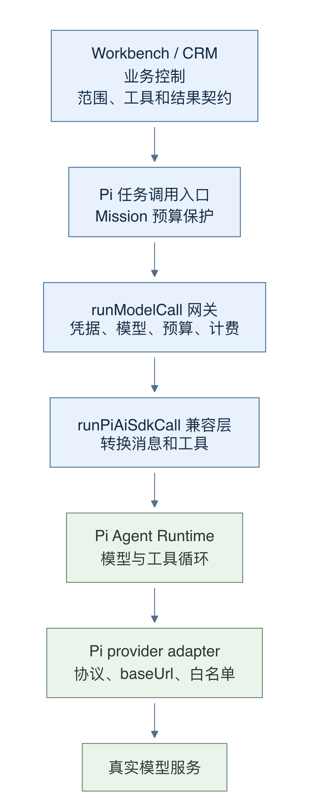
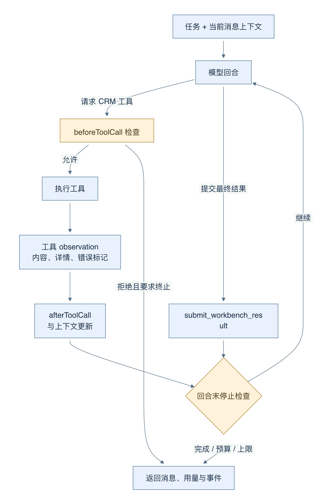
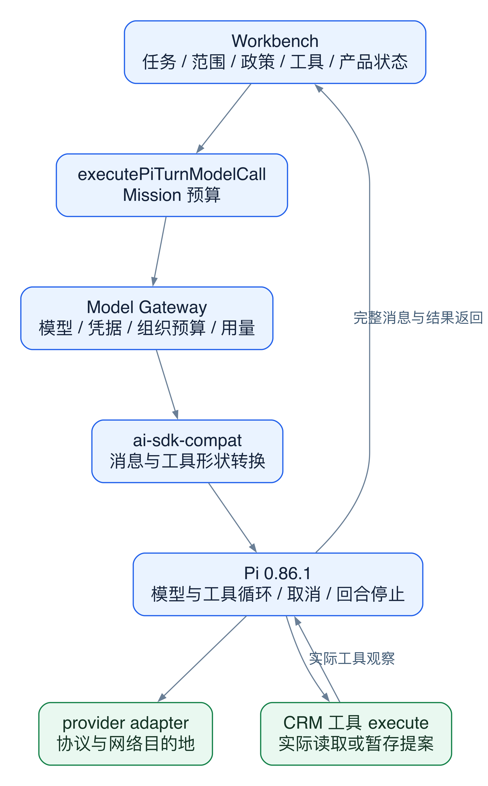
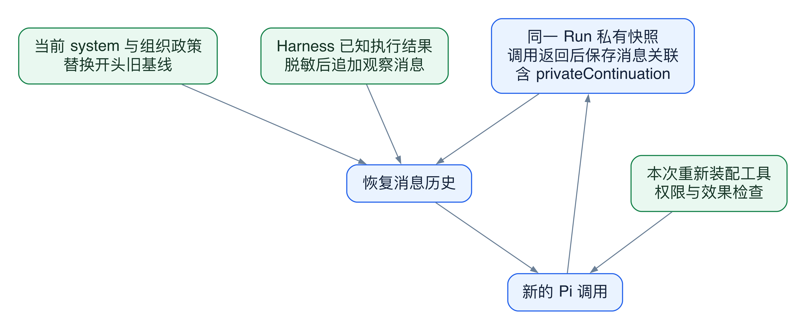

# 20 Pi 运行时：回合、上下文与工具循环

[返回母文档](../README.md) · [上一章](19.md) · [下一章](21.md)

**本章目标：**理解 CRM 回合语义、Pi 循环、上下文裁剪和工具桥接。

## 业务流程与阅读起点

### 这一章学什么

一个 Agent 回合通常不止一次模型请求。模型先决定读取什么，代码执行工具，把结果放回上下文，模型才继续判断。Pi 是这里实际负责这段循环的运行时；CRM 提供业务范围、工具和停止条件。把两层分开，才能知道一个问题应该修在工具策略、模型配置，还是循环本身。

本章沿固定 main 的只读任务“核对商机阶段和客户异议”继续追踪。调用路径里虽然仍有 AI SDK 的消息和工具类型，实际 Agent 循环走 Pi，不应因文件名 ai-sdk-compat 就认定仍由旧 SDK 驱动。

### 从 CRM 请求到 Pi 输入

executePiTurnModelCall 保留 CRM 的业务控制，并把模型调用交给 runModelCall。网关解析组织凭据和用途绑定，检查月度预算，准备稳定前缀，再调用 runPiAiSdkCall。兼容层把工具 schema、消息和回调转换为 AgentRuntime 的统一形状，并将 maxSteps 映射为 maxTurns。



图 15-1：箭头是函数调用和配置传递。业务规则在 CRM 层，模型选择及计费在网关，Pi 负责实际循环；底部 provider adapter 负责具体网络协议。

provider adapter 根据 provider 选择 Pi 的适配器，并确定 API 形式、模型名和 baseUrl。当前源码包含 Anthropic、OpenAI、Google、OpenRouter、OpenCode、DeepSeek 的对应处理；这份代码支持清单不等于每个 provider 的任意模型已经在当前部署验证。

一个容易忽略的保护是：未知模型可以借用 provider 目录首项的结构模板，但必须覆盖 provider 和 api 元数据。否则 OpenRouter 目录首项若来自另一模型家族，就可能把请求发成错误协议。

### 观察一次工具循环

Pi Agent 收到 systemPrompt、历史消息、工具和 streamFn。模型输出工具调用后，beforeToolCall 可检查或阻止；允许时才执行工具，把 content、details、isError 等结果传回。afterToolCall 可再处理结果。下一个模型回合看到的应是实际观察，而不只是“工具调用看起来成功”。



图 15-2：环形箭头表示工具结果重新成为模型上下文。停止检查发生在回合结束；最终通过结构化提交口交付结果，不会把请求工具本身当作已完成业务。

每个回合结束时，Pi 把本轮 usage 累加到本次调用的总 usage，再调用 shouldStopAfterTurn。这个回调给上层的是累计快照。网关必须复制该值，不能再次相加。若三个快照依次为 100、200、300，把它们相加会错误计成 600，进而提前停机并错误记账。这正是验收修复文档保留的历史反例。

Workbench 还提供 submit_workbench_result。模型提交摘要和证据后，停止条件会让循环结束；若缺少结构化提交、最终文本为空或缺失材料未补足，业务层可以标记 partial。文字已经流出，并不代表交付合同满足。

### 续跑为何需要完整消息

兼容层优先使用 runtimeMessages；否则转换传入的普通 messages。末尾 user 消息作为新 prompt，其余作为 history。Pi 的消息转换保留工具调用 ID、工具结果，以及 provider 续接所需字段，避免恢复时丢失关联。

恢复还会把开头旧 system 消息替换成当前解析的 systemPrompt，保留其他上下文。这一点使“可以续跑”与“永远使用旧政策”分离。不过快照只是同一 Run 的执行连续性，仍不是第 14 章所说的新聊天自动记忆。

### 排错从哪个边界开始

如果模型选错，读网关的决策来源；如果不该执行的工具出现，读 Workbench 工具分类与 beforeToolCall；如果工具结果没回到模型，读消息转换和持久快照；如果提前停止，核对累计用量与停止回调。不要把四类问题全部归因于“模型不聪明”。

### 深入一层：每一层只拥有自己的决定

固定基线把 @earendil-works/pi-agent-core 和 @earendil-works/pi-ai 都锁为 0.86.1。以下讲的是这个版本的接线，不推断其他 Pi 版本。



图 15-3：箭头表示调用和返回。Pi 的模型输出必须通过已提供的工具函数；模型没有通向 CRM 数据库的直接写入箭头。

1. Workbench 决定任务、已校验 scope、当前政策、工具清单和业务停止条件。它拥有 Run、提案和结果交付规则
2. executePiTurnModelCall 补上 Mission 预算检查。Model Gateway 解析本次实际模型、凭据、组织预算和用量记录
3. ai-sdk-compat 只转换接口形状。它把 tool schema 变成 RuntimeTool，把 maxSteps 变成 maxTurns；它不是另一套独立 Agent 计划器
4. PiRuntime 创建 Agent 并调用 prompt。它负责模型—工具循环、消息、事件、取消和回合停止。工具真正能做什么，仍由传入的 execute 函数决定
5. provider adapter 把模型绑定转换为具体协议请求。网络访问目的地属于这个边界，不属于工具输出文字
6. 调用返回后，CRM 保存完整消息、处理提案、判定 completed 或 partial。Pi 返回文本，并不会自行完成这些产品状态变更

这也是为什么 beforeToolCall 不是万能权限系统。它是上层可提供的钩子。specialist 在该钩子中检查只读和工具额度；Workbench 父调用主要通过 gatedTools 包装 execute：读工具执行，写工具只暂存。两种调用使用同一 Pi 循环，但上层策略不同。

### 一轮模型输出可能要求多个工具

当前 Agent 构造默认采用 parallel 工具执行，除非调用方另行指定。一次 assistant 消息可包含多个 toolCall；每个调用有自己的 toolCallId。CRM 的工具策略必须在每个执行入口生效，不能假定同一回合的工具必然按模型书写顺序串行。

继续用只读商机核对：

1. 模型收到本次 task、scope、system 和工具 schema
2. 模型提出 crm_get_lead 与 crm_list_followups。Pi 将参数交给各自工具；参数仍是待验证的输入，不是授权
3. 工具返回 content、details 和 isError。工具调用 ID 把结果配回原调用；isError 告诉下一回合这份观察是失败
4. 下一回合读到真实工具观察后，再调用 submit_workbench_result
5. 提交口验证结构并在内存中接受一份结果。shouldStopAfterTurn 检查到已提交，结束循环。后续业务层再落账

文本里的“我已更新”只是一项模型主张。tool_execution_end 也要结合工具包装语义解释：写工具可能只返回“已暂存”。只有 Harness 的真实动作结果和业务记录，才支持“已执行”的结论。

### 快照保存的是执行连续性，不是新的权限



图 15-4：实线表示同一 Run 的恢复输入。旧消息保留调用关联；当前 system 替换开头旧基线；执行观察由 Harness 追加。三者共同进入新调用，但旧文本不会赋予新工具权限。

runtimeMessages 保留 assistant 的工具调用、tool 消息的 toolCallId，以及 provider 继续处理所需的 privateContinuation。仅保存 finalText 会丢失“调用了什么、哪个结果对应哪个调用”的关系。恢复时，Pi 替换开头的旧 system 基线，但保留其他上下文；Workbench 同时重装本次工具与当前组织政策。

审批或自动写入后，Harness 把有界、敏感键脱敏的实际结果追加为 user 观察。这里的 user 是运行时消息角色，不是说用户亲自输入过这段内容。客户消息、记忆和工具返回正文也不能因为进入上下文，就变成高于系统规则的指令。结果提交的 trust=model_submitted 同样只表示来源，不构成 CRM 验证印章。

若模型已经查完资料却没有结构化提交，recoverWorkbenchResult 最多补做一次受限调用：只提供 submit_workbench_result，maxSteps=1，并检查剩余预算。它不重新开放 CRM 工具。有待处理动作时则延后恢复，先等动作观察，以免让模型提前宣称执行成功。这个“小范围补交”与完整 Run 重试是两种机制。

### 对照源码

以下行号固定于 main @ 679e09e80878dff7b1c79b8537317b2b9e355331。

- [`lib/agent-engine/agent/pi-turn-execution.ts:17-56`](https://github.com/helsome/AiNativeCrm/blob/679e09e80878dff7b1c79b8537317b2b9e355331/lib/agent-engine/agent/pi-turn-execution.ts#L17-L56)：CRM 与统一模型调用的接口
- [`lib/agent-engine/edge/llm/run-model-call.ts:678-773`](https://github.com/helsome/AiNativeCrm/blob/679e09e80878dff7b1c79b8537317b2b9e355331/lib/agent-engine/edge/llm/run-model-call.ts#L678-L773)：预算、稳定前缀与 Pi 调用
- [`lib/agent-runtime/pi/ai-sdk-compat.ts:249-316`](https://github.com/helsome/AiNativeCrm/blob/679e09e80878dff7b1c79b8537317b2b9e355331/lib/agent-runtime/pi/ai-sdk-compat.ts#L249-L316)：消息与工具转换、maxTurns、结果返回
- [`lib/agent-runtime/pi/model-adapter.ts:37-95`](https://github.com/helsome/AiNativeCrm/blob/679e09e80878dff7b1c79b8537317b2b9e355331/lib/agent-runtime/pi/model-adapter.ts#L37-L95)：provider 到 API 的映射
- [`lib/agent-runtime/pi/model-adapter.ts:98-173`](https://github.com/helsome/AiNativeCrm/blob/679e09e80878dff7b1c79b8537317b2b9e355331/lib/agent-runtime/pi/model-adapter.ts#L98-L173)：模型模板修正与实际网络适配
- [`lib/agent-runtime/pi/runtime.ts:363-499`](https://github.com/helsome/AiNativeCrm/blob/679e09e80878dff7b1c79b8537317b2b9e355331/lib/agent-runtime/pi/runtime.ts#L363-L499)：工具执行、恢复 system、前后钩子和停止逻辑
- [`lib/agent-runtime/pi/runtime.ts:165-215`](https://github.com/helsome/AiNativeCrm/blob/679e09e80878dff7b1c79b8537317b2b9e355331/lib/agent-runtime/pi/runtime.ts#L165-L215)：持久化消息与 provider 续接字段
- [`lib/agent-runtime/pi/runtime.ts:568-603`](https://github.com/helsome/AiNativeCrm/blob/679e09e80878dff7b1c79b8537317b2b9e355331/lib/agent-runtime/pi/runtime.ts#L568-L603)：取消信号与运行结果
- [`lib/agent-engine/edge/llm/run-model-call.ts:755-767`](https://github.com/helsome/AiNativeCrm/blob/679e09e80878dff7b1c79b8537317b2b9e355331/lib/agent-engine/edge/llm/run-model-call.ts#L755-L767)：累计快照复制，避免二次累加
- [`lib/ai/agents/workbench-result-submission.ts:118-153`](https://github.com/helsome/AiNativeCrm/blob/679e09e80878dff7b1c79b8537317b2b9e355331/lib/ai/agents/workbench-result-submission.ts#L118-L153)：交付条件与结果边界

#### 深入阅读的新增定位

- [`package.json:49-50`](https://github.com/helsome/AiNativeCrm/blob/679e09e80878dff7b1c79b8537317b2b9e355331/package.json#L49-L50)：Pi 两个运行时依赖固定为 0.86.1
- [`lib/agent-runtime/pi/ai-sdk-compat.ts:193-224`](https://github.com/helsome/AiNativeCrm/blob/679e09e80878dff7b1c79b8537317b2b9e355331/lib/agent-runtime/pi/ai-sdk-compat.ts#L193-L224)：工具 schema 与 execute 的适配边界
- [`lib/agent-runtime/pi/runtime.ts:399-465`](https://github.com/helsome/AiNativeCrm/blob/679e09e80878dff7b1c79b8537317b2b9e355331/lib/agent-runtime/pi/runtime.ts#L399-L465)：恢复 system、默认并行工具与 beforeToolCall
- [`lib/ai/agents/workbench-start-job.ts:327-349`](https://github.com/helsome/AiNativeCrm/blob/679e09e80878dff7b1c79b8537317b2b9e355331/lib/ai/agents/workbench-start-job.ts#L327-L349)：父 Workbench 的写工具只暂存
- [`lib/ai/agents/workbench-state.ts:45-111`](https://github.com/helsome/AiNativeCrm/blob/679e09e80878dff7b1c79b8537317b2b9e355331/lib/ai/agents/workbench-state.ts#L45-L111)：解析私有消息与追加有界执行观察
- [`lib/ai/agents/workbench-result-recovery.ts:15-48`](https://github.com/helsome/AiNativeCrm/blob/679e09e80878dff7b1c79b8537317b2b9e355331/lib/ai/agents/workbench-result-recovery.ts#L15-L48)：有待处理动作时延后补交，预算不足时停止
- [`lib/ai/agents/workbench-result-recovery.ts:50-108`](https://github.com/helsome/AiNativeCrm/blob/679e09e80878dff7b1c79b8537317b2b9e355331/lib/ai/agents/workbench-result-recovery.ts#L50-L108)：仅提交工具的一回合恢复及其保守输入预算检查

## 实现详解

本页解释 CRM 智能体一次「回合」（turn）从入站消息到模型收敛的完整编排路径。核心命题有三条：第一，**回合的业务语义由 CRM 侧拥有，而循环执行由 Pi 运行时拥有**——两者通过一个刻意贫血的契约（`AgentRuntime`）解耦；第二，**上下文不是历史，而是被显式裁剪过的证据集合**（checkpoint / rolling summary / lead_state / 记忆索引 / 投影）；第三，**工具定义从目录到模型是一次有损翻译，而治理动作集中在桥接层而非各个 handler**。理解这三层，就理解了为什么扩展一个能力时，改动点几乎总是落在 `context-builder.ts`、`turn-tools.ts` 和 `inbound-turn.ts` 的门控段，而不是散落在业务 handler 里。

Sources: [runtime.ts](https://github.com/helsome/AiNativeCrm/blob/679e09e80878dff7b1c79b8537317b2b9e355331/lib/agent-runtime/pi/runtime.ts#L268) [pi-turn-execution.ts](https://github.com/helsome/AiNativeCrm/blob/679e09e80878dff7b1c79b8537317b2b9e355331/lib/agent-engine/agent/pi-turn-execution.ts#L17)

### 三层结构：契约、适配器、回合

Pi Agent Core 的运行时契约被刻意写成**不依赖任何 Pi、Vercel AI SDK 或 provider SDK** 的价值对象集合。文件顶部的注释把这个意图写死："This file deliberately has no dependency on Pi, Vercel AI SDK, or a provider SDK. The CRM domain supplies messages and tools through these small value objects; a runtime adapter owns execution details." 这意味着 CRM 领域只提供消息与工具，适配器拥有执行细节。

`AgentTurnInput` 是整个编排的单一输入面，值得逐字段辨认其意图：

| 字段 | 角色 | 设计意图 |
| --- | --- | --- |
| `systemPrompt` / `messages` / `prompt` | 输入三件套 | 历史可回放，本轮提示单列 |
| `transformContext` | 上下文重写钩子 | 每次模型请求前可裁剪/替换 transcript |
| `beforeToolCall` / `afterToolCall` | 工具前后门 | 返回 `block` / `terminate` 等裁决 |
| `shouldStopAfterTurn` | 收敛裁决 | 传入的 `usage` 是**本次 run 的累计量，不是单轮增量** |
| `steering.poll()` | 外部干预 | 轮询式注入，而非推送 |
| `contextProbe` | 内存探针 | 证明某段用户文本**真的到达了 LLM 请求**，而非只出现在 transcript |
| `onObservation` | 边界测量 | 只允许 allowlist 字段，禁止原始 prompt/输出 |

`RuntimeSteeringMessage` 的注释揭示了一条重要不变量：**"Durable source identity; polling must not remove a message before the transcript is saved."** —— 轮询式的干预注入必须等到 transcript 落库后才能移除源消息，否则会出现「已消费但未持久化」的丢失窗口。

Sources: [types.ts](https://github.com/helsome/AiNativeCrm/blob/679e09e80878dff7b1c79b8537317b2b9e355331/lib/agent-runtime/types.ts#L1) [types.ts](https://github.com/helsome/AiNativeCrm/blob/679e09e80878dff7b1c79b8537317b2b9e355331/lib/agent-runtime/types.ts#L121)

### 消息双向映射与私有连续态

`messageToPi` 与 `messageFromPi` 构成一对严格对称的转换。其中最值得注意的是 `privateContinuation` 的处理：从 Pi 还原出的 assistant 消息会携带一个 **opaque 的服务端连续态**（`content` / `api` / `provider` / `model` / `usage` / `stopReason` / `timestamp`，外加可选的 `responseModel`、`responseId`、`providerThinkingLevel`、`endTurn`），其类型注解明确写着 "Opaque, service-only provider continuation. Never render or return from a product API."

回灌时这段状态不是被重建、而是被**整体还原**，并且带一层防御性结构校验：任何字段类型不符都会抛出 `pi_assistant_continuation_state_invalid`。这保证续接时不会用伪造的 usage（`input: 0, output: 0`）去污染上游对 provider 语义的判断。

Sources: [runtime.ts](https://github.com/helsome/AiNativeCrm/blob/679e09e80878dff7b1c79b8537317b2b9e355331/lib/agent-runtime/pi/runtime.ts#L100) [runtime.ts](https://github.com/helsome/AiNativeCrm/blob/679e09e80878dff7b1c79b8537317b2b9e355331/lib/agent-runtime/pi/runtime.ts#L191) [types.ts](https://github.com/helsome/AiNativeCrm/blob/679e09e80878dff7b1c79b8537317b2b9e355331/lib/agent-runtime/types.ts#L27)

### 历史重放时系统提示的接管

回合构造时有一段容易被忽略但影响很大的逻辑：当传入历史的**第一条**是 system 消息时，运行时不会原样回放它，而是替换为当前调用刚解析出的 `systemPrompt`。

```ts
if (history?.[0]?.role === "system") {
  history[0] = { ...history[0], content: input.systemPrompt };
}
```

注释解释了原因：Pi 引擎给「重放的首条 system 消息」高于 `systemPrompt` 的优先级。而 CRM 每次调用都已**重新解析当前策略**（权限、边界、预算窗口都可能已变），因此只替换这一条基线，同时保留增量的 system 更新、工具结果与私有连续态，且**不修改调用方的数组**。这是一条典型的「陈旧上下文不得反超当前策略」的一致性规则。

Sources: [runtime.ts](https://github.com/helsome/AiNativeCrm/blob/679e09e80878dff7b1c79b8537317b2b9e355331/lib/agent-runtime/pi/runtime.ts#L399)

### 五个内建回调构成编排的骨架

Pi `Agent` 构造时被注入五个 CRM 回调，它们共同定义了回合的行为形态：

**`transformContext`** — 把 Pi 的 `AgentMessage[]` 转回 `RuntimeMessage[]`、交给 CRM 的裁剪函数、再转回去。无法转换的消息被 `flatMap` 静默丢弃（转成 `[]`），这是私有连续态等非标准消息不污染裁剪逻辑的手段。

**`convertToLlm`** — 这是整段代码里最微妙的一段，注释直接点出其必要性：*"Pi calls convertToLlm after transformContext and immediately before constructing the provider request. The transcript alone is weaker: a future context transform may remove the manager's instruction."* 也就是说，仅检查 transcript 不足以证明某条指令**真的进了这一次 LLM 请求**，因为下游的 `transformContext` 可能把它删掉。此处做两件事：其一，扫描最终模型消息数组判断 `contextProbe.userText` 是否在位，置位 `contextProbeSeenInCurrentModelRequest`；其二，对每个已进入 Pi transcript 的 steering id，检查其 marker 是否出现在最终请求中，命中的加入 `steeringSentToModel`。

**`beforeToolCall`** — 把每次工具调用的 `{id, name, arguments}` 记入 `calls`，即使对应工具不在字典或 CRM 未提供回调也会记录（因此 `toolCalls` 是完整账本，而不只是已授权调用的子集）；随后才委托给 CRM 的门控。

**`afterToolCall`** — 把 Pi 的裁决形状翻译回契约形状：`terminate` / `isError` / `content` / `details` 按需覆盖，`undefined` 则整体放行。

**`shouldStopAfterTurn`** — 累加 `turns`、累加 assistant 消息的 usage（通过 `addUsage` 五字段逐项相加），再把累计 usage 传给 CRM 的裁决；最终 `requested === true || turns >= maxTurns`。

Sources: [runtime.ts](https://github.com/helsome/AiNativeCrm/blob/679e09e80878dff7b1c79b8537317b2b9e355331/lib/agent-runtime/pi/runtime.ts#L407) [runtime.ts](https://github.com/helsome/AiNativeCrm/blob/679e09e80878dff7b1c79b8537317b2b9e355331/lib/agent-runtime/pi/runtime.ts#L452)

### 事件映射：只搬运可证明的事实

`runtimeEvent` 把 Pi 的 `AgentEvent` 收敛为 `AgentRuntimeEvent`，其字段选择本身是一种信息边界声明：

| Pi 事件 | 映射数据 | 缺失的信息 |
| --- | --- | --- |
| `agent_start` / `turn_start` | `{}` | 无 |
| `agent_end` | `message_count` | 不含消息内容 |
| `turn_end` | `tool_result_count` + `stop_reason` | 不含文本 |
| `message_start/update/end` | `role` | 不含增量内容 |
| `tool_execution_start` | `tool_call_id` / `tool_name` / `args` | — |
| `tool_execution_update` | `+ partial_result` | — |
| `tool_execution_end` | `+ is_error` | 不含结果体 |

注意 `turn_end` 的 `stop_reason` 只在 `event.message.role === "assistant"` 时取，否则为 `null`——工具轮次不贡献停机原因。这条规则在 steering 消费逻辑里被复用（见下节）。

Sources: [runtime.ts](https://github.com/helsome/AiNativeCrm/blob/679e09e80878dff7b1c79b8537317b2b9e355331/lib/agent-runtime/pi/runtime.ts#L225)

### 转向注入（Steering）的三重确认

`queuePendingSteering` 实现了一条**三段式确认链**，把「入队」「进入 Pi transcript」「真正到达 LLM 请求」区分成三个独立事实：

1. **入队** — `poll()` 结果先做批量与字段校验（批量 > 8 抛 `pi_steering_batch_invalid`；id 非字符串 / 超 200 字符 / 空白，content 非字符串 / 超 20000 字符 / 空白，抛 `pi_steering_message_invalid`）。同一批次内相同 id 携带不同内容抛 `pi_steering_source_conflict`。随后用 `agent.steer(message)` 注入，消息前缀 `[crm-steering-id:<encodeURIComponent(id)>]` marker，并发 `steering_queued` 事件。已入队的 id 直接 `continue`，保证幂等。
2. **进入 transcript** — 订阅回调在 `message_end` 时把该消息对象映射回 steering id，加入 `steeringInModelContext`。
3. **真正到达 LLM** — `convertToLlm` 按 marker 在最终模型消息中匹配，命中者加入 `steeringSentToModel`。

消费确认只发生在 `turn_end` 且 `stopReason` 既非 `error` 也非 `aborted` 时：遍历 `steeringSentToModel` 逐个发 `steering_consumed`，然后清空两个集合。若本轮是错误或取消，**集合不清空**——未确认的转向会留待下一次正常轮次。`contextProbe` 的 `model_context_consumed` 事件遵循同一条件，且带 `!contextProbeAcknowledged` 单次闩锁。

轮询时机在 `turn_end` 之后另有三个提前返回：模型出错/被中止、`abortSignal` 已触发、或 `turns + 1 >= maxTurns`——即「即将耗尽回合预算时不再接新指令」。此外，`prompt()` 之前会先 `queuePendingSteering()` 一次，因为 *"Pi checks its steering queue before the first model request. A command accepted just before this worker starts must not wait for a second turn."*

Sources: [runtime.ts](https://github.com/helsome/AiNativeCrm/blob/679e09e80878dff7b1c79b8537317b2b9e355331/lib/agent-runtime/pi/runtime.ts#L56) [runtime.ts](https://github.com/helsome/AiNativeCrm/blob/679e09e80878dff7b1c79b8537317b2b9e355331/lib/agent-runtime/pi/runtime.ts#L427) [runtime.ts](https://github.com/helsome/AiNativeCrm/blob/679e09e80878dff7b1c79b8537317b2b9e355331/lib/agent-runtime/pi/runtime.ts#L503) [runtime.ts](https://github.com/helsome/AiNativeCrm/blob/679e09e80878dff7b1c79b8537317b2b9e355331/lib/agent-runtime/pi/runtime.ts#L534)

### 可观测性：旁路且不可失败

`observedStream` 对 `resolved.streamFn` 做包装，仅在 `input.onObservation` 存在时启用（`streamFn: input.onObservation ? observedStream : resolved.streamFn`）。三个设计约束值得记录：

其一，`stream.result()` **不消费流**，Pi 仍是唯一的 token 消费者——观测是搭便车而非竞争读取。<br>其二，状态映射由 `stopReason` 决定：`aborted → cancelled`、`error → error`、其余 `ok`；构造阶段抛错时再按 `input.abortSignal?.aborted` 二次判定。<br>其三，所有观测投递都被包成 `Promise.resolve().then(...).then(ok, ok)`——两个空处理器吞掉异常，注释写明 *"Observability is a separate side effect: it must never repeat or fail a CRM action."*

`finally` 块给这些待定 Promise 一个 1500ms 的 `Promise.race` 上界，避免观测拖住回合结束。

Sources: [runtime.ts](https://github.com/helsome/AiNativeCrm/blob/679e09e80878dff7b1c79b8537317b2b9e355331/lib/agent-runtime/pi/runtime.ts#L290) [runtime.ts](https://github.com/helsome/AiNativeCrm/blob/679e09e80878dff7b1c79b8537317b2b9e355331/lib/agent-runtime/pi/runtime.ts#L385) [runtime.ts](https://github.com/helsome/AiNativeCrm/blob/679e09e80878dff7b1c79b8537317b2b9e355331/lib/agent-runtime/pi/runtime.ts#L577)

### 取消的双重保障

回合一进来第一件事是 `input.abortSignal?.throwIfAborted()`，注释解释了为什么不能只依赖 Pi：*"Pi attaches the signal to the active stream, but a signal that was already aborted before prompt() can otherwise still produce one model request. The CRM contract promises cancellation at the runtime boundary, so reject before constructing the loop as well."* 即：已经中止的信号在进入循环构造前就被拒绝。

随后 `abort` 闭包以 `{ once: true }` 挂到信号上，并在 `finally` 中解绑。`prompt()` 之前还有第二次 `throwIfAborted()`，覆盖「steering 入队期间被取消」这一窗口。

Sources: [runtime.ts](https://github.com/helsome/AiNativeCrm/blob/679e09e80878dff7b1c79b8537317b2b9e355331/lib/agent-runtime/pi/runtime.ts#L275) [runtime.ts](https://github.com/helsome/AiNativeCrm/blob/679e09e80878dff7b1c79b8537317b2b9e355331/lib/agent-runtime/pi/runtime.ts#L568)

### 上下文探针与 steering 的入参校验

`run()` 在构造循环前对 `contextProbe` 做硬校验：`id` 必须非空白且 ≤ 200 字符，`userText` 必须非空白且 ≤ 20000 字符，否则抛 `pi_context_probe_invalid`。探针类型注释强调 *"In-memory proof only: never include userText in events or product traces."*——事件里只出现 `probeId`，`userText` 永远不离开内存。

返回值上，`finalText` 取转录中**最后一条** assistant 消息的文本（`[...messages].reverse().find(...)`），而非累积所有 assistant 输出；`toolCalls` 返回的是 `beforeToolCall` 中记录的完整账本。

Sources: [runtime.ts](https://github.com/helsome/AiNativeCrm/blob/679e09e80878dff7b1c79b8537317b2b9e355331/lib/agent-runtime/pi/runtime.ts#L281) [runtime.ts](https://github.com/helsome/AiNativeCrm/blob/679e09e80878dff7b1c79b8537317b2b9e355331/lib/agent-runtime/pi/runtime.ts#L592)

### 回合层的适配缝

`executePiTurnModelCall` 是回合与通用模型调用之间的**接缝**，其文档把分工写得很清楚：CRM 回合仍然拥有围绕调用的业务策略（上下文、工具结果、检查点校验、handoff、持久化），而通用的模型调用管道住在这里，好让回合不沦为第二个运行时——provider 解析、预算、用量审计与 Pi 循环都留在模型网关与注入的 `AgentRuntime` 契约之后。

其上叠加的**任务预算守卫**逻辑值得注意：当 `workbenchRunId` 存在时加载 mission budget，先用 `missionBudgetBlockReason` 做一次性闸门（超限抛 `MissionBudgetExceededError`），再用剩余额度**改写 `shouldStopAfterTurn`**——在 CRM 自己的裁决之外追加三个终止条件：`totalTokens >= remainingTokens`、`costCents === null`、或 `costCents >= remainingCostCents`。注意这是守卫**收紧**而非放宽：CRM 说停就停，预算说停也停。

Sources: [pi-turn-execution.ts](https://github.com/helsome/AiNativeCrm/blob/679e09e80878dff7b1c79b8537317b2b9e355331/lib/agent-engine/agent/pi-turn-execution.ts#L26)

### 上下文构建：ritual 作为不变量

`ritualBlocks` 被显式设计为**四种回合共用**（inbound、follow-up、case-reply、escalação 续接），注释说得很清楚：*"Só o CABEÇALHO e o RODAPÉ mudam entre os dois tipos de turn."* 这就是为什么「承诺/日程块」是最后一个可选参数而不是默认开启——*"Ligar os quatro de uma vez daria tokens a turnos que talvez nunca falem de horário."*

块的顺序本身承载语义，注释给出了理由：checkpoint 块置于**最前**，因为 *"Este é o PRIMEIRO bloco do prompt, acima do histórico — posição que um modelo lê como 'a instrução mais recente'."* 而它的标题直接是 `## Checkpoint anterior — escrito ANTES da última mensagem do cliente`，紧跟一句仲裁规则 `'(Se o histórico abaixo já responde o que este bloco pede, o histórico manda.)'`。这是**位置-权威反转**的显式矫正：模型天然把靠上的系统块当最新指令，但这里必须让历史胜出。

存储后缀块（记忆索引、承诺块）刻意注入在**可缓存前缀之后**，与 F2-17 的前缀缓存策略对齐——静态内容在前、变化内容在后。

Sources: [context-builder.ts](https://github.com/helsome/AiNativeCrm/blob/679e09e80878dff7b1c79b8537317b2b9e355331/lib/agent-engine/agent/context-builder.ts#L12) [context-builder.ts](https://github.com/helsome/AiNativeCrm/blob/679e09e80878dff7b1c79b8537317b2b9e355331/lib/agent-engine/agent/context-builder.ts#L54)

### 空值与投影：两种抑制幻觉的手段

上下文构建里有两处条件性抑制，都遵循「只在确实有害时才加例外」的思路。

**邮箱未确认**是条件性抑制：`context.contact?.email == null` 时插入一段提醒——「未确认不意味着客户没给过，历史里可能已经有了，先查再问」。注释明确：*"A ressalva é CONDICIONAL de propósito — pô-la sempre ensinaria o modelo a duvidar de dado bom, que é o defeito espelhado."* 根因是 `contact.email: null` 作为事实抵达模型时具有「注册权威」，会压过客户**刚刚在历史里输入的**邮箱，而又没有写入路径，导致请求无限重复。

**投影**是第二道防线：`JSON.stringify(projeta ? projetarContexto(context) : context)`。`lead_id` / `conversation_id` / `media_storage_path` 裸露进提示词被实测为客户可见泄露（*"UUID cru na tela do cliente foi MEDIDO"*），投影关闭第三扇门。它只在没有目录类工具的回合启用——注释解释：*"Ela só arma quando o turno não tem ferramenta de catálogo (ver `turnoProjeta`), porque é aí que esses ids não têm uso nenhum. Nos demais, quem cobre é o gate de saída."*

Sources: [context-builder.ts](https://github.com/helsome/AiNativeCrm/blob/679e09e80878dff7b1c79b8537317b2b9e355331/lib/agent-engine/agent/context-builder.ts#L90)

### 开场消息：当前入站消息的优先级

`buildOpeningMessage` 把「消息 atual」提到最高优先级，措辞是制度性的：*'Responda a ESTA mensagem agora. Ela prevalece sobre checkpoint, resumo e qualquer registro anterior.'* 并附一条防幻觉约束：*'Como ela contém texto, NUNCA diga que veio vazia, em branco ou que não foi recebida.'*

它支持 `currentInboundText` 覆盖，注释说明理由：*"Mensagem canônica do job inbound; vence uma leitura concorrente do histórico."* 当缺少覆盖时回退为「历史里最后一条 inbound」。若无任何可用文本，则换成另一套文案：*'Não há texto utilizável na mensagem mais recente. Consulte o histórico antes de responder.'*

块尾还有一处**能力撤销的治愈逻辑**：`entregues` 列表里的工具名不仅被从工具集移除，其**提示词引用也被一并删掉**。注释的措辞很重——*"Remover a ferramenta e manter a instrução produziria o pior dos dois mundos: o modelo tentaria chamar o que não existe, gastaria passo com o erro, E o NOME continuaria no contexto — que é exatamente por onde o vazamento voltou quando limparam só a descrição (`crm_list_webhook_sources`, medido)."*

Sources: [context-builder.ts](https://github.com/helsome/AiNativeCrm/blob/679e09e80878dff7b1c79b8537317b2b9e355331/lib/agent-engine/agent/context-builder.ts#L116)

### 空消息误诉检测的正则工程

`claimsCurrentInboundIsEmpty` 是在「唯一会说话到渠道的路径」上加的发送前检测。它的正则构造带有明确的取舍记录：

`emptyClaim = '(?:em\\s+branco|vazi[ao]|sem\\s+texto)'` —— 刻意**排除代词 `ela`**，因为在实测语料中，作为代词它会匹配任何阴性主语，而「vazio」在预约语境里是常用词。注释给出的代价权衡是明确的：*'o preço de tirá-la é não pegar a frase falsa escrita SÓ com pronome; o preço de mantê-la era barrar atendimento legítimo, e esse é o lado que cala o cliente.'* 六条合法语句被写进测试并具名，任何想放宽的人都会与它们冲突。

检测通过两个方向的有界窗口实现：`消息引用词 … (0..90 字符) … 空值声明`，或其逆序。`messageReference` 被刻意限定为 `(?:mensagem|texto|recado|última\s+mensagem)` 四项。

Sources: [context-builder.ts](https://github.com/helsome/AiNativeCrm/blob/679e09e80878dff7b1c79b8537317b2b9e355331/lib/agent-engine/agent/context-builder.ts#L186) [context-builder.ts](https://github.com/helsome/AiNativeCrm/blob/679e09e80878dff7b1c79b8537317b2b9e355331/lib/agent-engine/agent/context-builder.ts#L198)

### 工具桥接：治理集中在边界，而非 handler

`wrapMcpTool` 的文件头说明了整个设计：运行时**不走 `/api/mcp` 往返**，而是从同一目录（`lib/mcp/tools/index.ts`）拉取工具定义并包装成 AI SDK 的 `Tool`。审计、角色/scope 校验与 PII 脱敏保持完全一致，因为复用了同样的 `auditMcpToolCall`、`ensureRole`/`ensureScope`。

**六道关卡按固定顺序排列在 execute 内部**：

1. **UUID 哨兵清洗** — `higienizarUuidsDeAterro` 在边界统一处理，而非逐个 handler。注释记录了真实事故：模型在可选字段填了 `00000000-…`，`?? default` 因值非 `undefined` 而不生效，返回空日历，患者没约上，审计里却是 `success: true`——**没有错误可查**。目录里有 28 个接受缺省的 uuid 字段全部同样泄露，「按 handler 修就是按实例修，第 29 个会从修复范围外出生」。
2. **`ensureScope` / `ensureRole`** — 按目录声明校验。
3. **漏斗范围** — `podeChamarFerramenta` 放在桥接层，理由是 `moveLeadHandler` 同时服务 agent、HTTP 会话路由与自动化；写在 handler 里会误伤那些**由人类故意选漏斗**的自动化和执行本职工作的客服。「Este ponto sabe que quem age é o AGENTE — é o que torna a restrição aplicável sem atingir quem não deve ser atingido.」
4. **数据库错误必须 throw 而非返回 null** — 注释强调：把查询失败翻译成「超出范围」会**教会模型这个卡片不属于他**，从而永久放弃；查询错误必须变成 `indisponivel`。
5. **handoff 信号捕获** — `crm_request_human_handoff` 被调用时把 `triggered/reason/urgency` 写入可变 `handoffSignal`，供 `runAgent` 每步检查。
6. **「没找到」不是成功** — 目录用 `motivoDoVazio` 显式声明空结果；声明后审计记 `success: false` 并把 `desfecho: "sem_resultado"` 与原因写进 `metadata`。只影响主动声明者。

范围拒绝返回 `{ permitido: false, motivo, mensagem }` 而**非抛异常**，注释说明理由：抛出会变成执行错误并**杀死整个回合**——对客户而言就是助理突然失声。

Sources: [tools.ts](https://github.com/helsome/AiNativeCrm/blob/679e09e80878dff7b1c79b8537317b2b9e355331/lib/ai/runtime/tools.ts#L1) [tools.ts](https://github.com/helsome/AiNativeCrm/blob/679e09e80878dff7b1c79b8537317b2b9e355331/lib/ai/runtime/tools.ts#L74) [tools.ts](https://github.com/helsome/AiNativeCrm/blob/679e09e80878dff7b1c79b8537317b2b9e355331/lib/ai/runtime/tools.ts#L163)

### 工具选择：声明必须产生运行时效果

`pickToolsFromMcp` 里有一段关于**声明与效果分离**的复盘，注释写道：*"A marca era declaração sem efeito no runtime: eu a criei no catálogo e não a apliquei aqui. Não montar é o que faz a declaração valer."*

具体规则：`apenasHumano` 标记的能力**不挂载**到 agent 回合（除非在 proposal-only 预览/批准集合中）。测得的失败模式是：`crm_create_stage` 在面板显示「1 次尝试，1 次失败」，而实际发生的是——所有者在屏幕开启能力，桥接挂载工具，模型**消耗一次调用**，服务端才以角色拒绝。防护（`requiresRole`）存在，但只在尝试**之后**生效；模型靠犯错学到边界，面板记录了没有缺陷的地方。

`handoffToolEnabled` 会**自动注入** handoff 工具，即使不在 `toolIds` 中；同时 `effect`/`resource` 分类不由工具名猜测，而是从 CRM 目录 `workbenchToolEffect` 搬运——注释解释："Shadow/evaluation policy must not guess from a tool name: a renamed or localized tool must keep the same side-effect classification." 只有 `reversible_write` 的工具才获得 `compensate` 实现，补偿参数直接复用 execute。

Sources: [tools.ts](https://github.com/helsome/AiNativeCrm/blob/679e09e80878dff7b1c79b8537317b2b9e355331/lib/ai/runtime/tools.ts#L252) [tools.ts](https://github.com/helsome/AiNativeCrm/blob/679e09e80878dff7b1c79b8537317b2b9e355331/lib/ai/runtime/tools.ts#L277)

### 回合循环的固定仪式

`inbound-turn.ts` 文件头把「runtime 强加而非模型选择」的仪式写成三条（对应工具目录里的 F2-08/09/10）：

**① 打开** — playbook（system，经指针桥）+ `lead_checkpoints` 上一个 checkpoint（承诺/异议/next_action + rolling summary）+ `lead_state`（漏斗阶段）+ 最近 N 条消息（经 `get_lead_context`）。

**② 模型自由决定工具** — `get_lead_context`（重读）、`send_message`（**发送永远是 tool call**，模型直接文本**永不被转成消息，会被丢弃**）、`update_lead_state`。状态机在代码中校验推进，推进会镜像回 CRM（`crm_move_lead_stage`），**镜像失败不回滚 harness**（harness 是真相源），而是转成日志 + inbox_items。

**③ 关闭** — 第二次模型调用（purpose `checkpoint`）只返回 checkpoint JSON，经 Zod 校验后持久化。选择理由明确：*"mecanismo escolhido por ser imposto pelo runtime (tool update_checkpoint dependeria de o modelo lembrar de chamá-la; a chamada de fechamento sempre acontece)."*

失败处理分层：CRM 传输/工具失败**变成给模型的教学消息**（在 run 中途）**并且**最终变成 job 错误（队列重试，ledger 挡住重复）；`is_blocked` 的 veto 以 `JobSettledError` 永久取消 job（`main.ts` 既不完成也不重试）；PII 永不进入日志或 job 错误。

隔离性由架构保证：*"Cada job vira uma sessão FRESCA do motor LLM (via seam F2-23 — provider instanciado POR CHAMADA, nunca cache por lead em memória de processo): TODO o estado do run (seq de envio, outcomes, mensagens) vive no closure desta invocação — isolamento entre leads por construção (acceptance 3)."*

Sources: [inbound-turn.ts](https://github.com/helsome/AiNativeCrm/blob/679e09e80878dff7b1c79b8537317b2b9e355331/lib/agent-engine/agent/inbound-turn.ts#L7)

### 回合模块导出的公共词汇

`inbound-turn.ts` 顶部集中再导出了一批符号，构成回合层的公共接口面：`buildOpeningMessage` / `claimsCurrentInboundIsEmpty` / `inboundsNaoRespondidos` / `ritualBlocks`（来自 `context-builder`）、`CASES_SYSTEM_BLOCK` 与 `TRANSPARENCIA_SYSTEM_BLOCK`（来自 `resident-system-blocks`）、`AGENT_TOOL_DEFS`（来自 `tool-definitions`）。把常驻 system 块与工具定义集中在模块顶部，让「回合里到底给模型看了什么」成为一次可枚举的检查。

模块内还定义了若干回合级常量与守卫：`MAX_VETOS_DE_VOCABULARIO_INTERNO`、`MAX_VETOS_DE_FALSO_VAZIO`、`DEFAULT_MAX_SENDS_PER_TURN = 3`，以及 `HANDOFF_REASON_ORCAMENTO` 与其配套的 `RESUMO_DO_HANDOFF_POR_ORCAMENTO` / `TITULO_DO_HANDOFF_POR_ORCAMENTO`——后者固定为 `"Teto de gasto com IA atingido — assumir a conversa"`。围绕预算耗尽的交接被包装成泛型 `comHandoffSeOrcamentoAcabar`，使任何可能触及 `LlmBudgetExceededError` 的调用点都能统一转成接管卡片。`JobSettledError` 则是「不再重试」的信号类。

Sources: [inbound-turn.ts](https://github.com/helsome/AiNativeCrm/blob/679e09e80878dff7b1c79b8537317b2b9e355331/lib/agent-engine/agent/inbound-turn.ts#L71) [inbound-turn.ts](https://github.com/helsome/AiNativeCrm/blob/679e09e80878dff7b1c79b8537317b2b9e355331/lib/agent-engine/agent/inbound-turn.ts#L162) [inbound-turn.ts](https://github.com/helsome/AiNativeCrm/blob/679e09e80878dff7b1c79b8537317b2b9e355331/lib/agent-engine/agent/inbound-turn.ts#L215) [inbound-turn.ts](https://github.com/helsome/AiNativeCrm/blob/679e09e80878dff7b1c79b8537317b2b9e355331/lib/agent-engine/agent/inbound-turn.ts#L545)

### 日历工具与常驻块的联动

回合层存在一整套围绕 agenda 工具的条件逻辑：`agendaSystemBlock`、`blocosDeAgendaResidentes`、`temFerramentaDeMarcacao`、`temFerramentaDeAgenda`、`ferramentasDeAgendaDoAgente`、`blocoResidenteDaAgenda`，以及两个块常量 `AGENDA_CONSULTA_SYSTEM_BLOCK` / `AGENDA_CADEIA_SYSTEM_BLOCK` 和一个 `AGENDA_TOOL_NAMES` 集合。

这一族函数体现了同一个原则的重复应用：**常驻提示块按工具集条件装配**。没有 agenda 工具的 agent 不该为日历流程付出 token；有标记工具但没有查询工具的 agent 应得到查询块；两者皆有才拿到链式块。工具集是唯一的判据，块是判据的函数。

Sources: [inbound-turn.ts](https://github.com/helsome/AiNativeCrm/blob/679e09e80878dff7b1c79b8537317b2b9e355331/lib/agent-engine/agent/inbound-turn.ts#L284) [inbound-turn.ts](https://github.com/helsome/AiNativeCrm/blob/679e09e80878dff7b1c79b8537317b2b9e355331/lib/agent-engine/agent/inbound-turn.ts#L435) [inbound-turn.ts](https://github.com/helsome/AiNativeCrm/blob/679e09e80878dff7b1c79b8537317b2b9e355331/lib/agent-engine/agent/inbound-turn.ts#L457) [inbound-turn.ts](https://github.com/helsome/AiNativeCrm/blob/679e09e80878dff7b1c79b8537317b2b9e355331/lib/agent-engine/agent/inbound-turn.ts#L490)

### 回合输入与运行入口

`AgentTurnInput`（回合层的自有接口，区别于运行时的同名契约）连同 `InboundTurnKnobs`、`InboundTurnDeps`、`DispatchOptions` 风格的可选旋钮，共同构成配置面。入口层级清晰：`runAgentTurn` → `turnoVaiFalarComOLead(job)`（判定本回合是否真的会与 lead 对话）→ `executarTurnoDoAgente`（主体）→ `createInboundTurnHandler(deps)`（handler 工厂）→ `runAgentPreview`（预览路径，与真实回合共用上述构件）。

支撑函数中，`latestCheckpoint` 与 `checkpointDoJob` 分离「取最近检查点」与「取本 job 对应的检查点」——后者是幂等与重复投递正确性的基础；`insertCheckpoint` 负责写入；`decidirSeEnfileiraOperador` 决定是否把回合交给 Operator 角色处理。

Sources: [inbound-turn.ts](https://github.com/helsome/AiNativeCrm/blob/679e09e80878dff7b1c79b8537317b2b9e355331/lib/agent-engine/agent/inbound-turn.ts#L783) [inbound-turn.ts](https://github.com/helsome/AiNativeCrm/blob/679e09e80878dff7b1c79b8537317b2b9e355331/lib/agent-engine/agent/inbound-turn.ts#L873) [inbound-turn.ts](https://github.com/helsome/AiNativeCrm/blob/679e09e80878dff7b1c79b8537317b2b9e355331/lib/agent-engine/agent/inbound-turn.ts#L902) [inbound-turn.ts](https://github.com/helsome/AiNativeCrm/blob/679e09e80878dff7b1c79b8537317b2b9e355331/lib/agent-engine/agent/inbound-turn.ts#L941) [inbound-turn.ts](https://github.com/helsome/AiNativeCrm/blob/679e09e80878dff7b1c79b8537317b2b9e355331/lib/agent-engine/agent/inbound-turn.ts#L979) [inbound-turn.ts](https://github.com/helsome/AiNativeCrm/blob/679e09e80878dff7b1c79b8537317b2b9e355331/lib/agent-engine/agent/inbound-turn.ts#L1025) [inbound-turn.ts](https://github.com/helsome/AiNativeCrm/blob/679e09e80878dff7b1c79b8537317b2b9e355331/lib/agent-engine/agent/inbound-turn.ts#L1091) [inbound-turn.ts](https://github.com/helsome/AiNativeCrm/blob/679e09e80878dff7b1c79b8537317b2b9e355331/lib/agent-engine/agent/inbound-turn.ts#L1137) [inbound-turn.ts](https://github.com/helsome/AiNativeCrm/blob/679e09e80878dff7b1c79b8537317b2b9e355331/lib/agent-engine/agent/inbound-turn.ts#L2844) [inbound-turn.ts](https://github.com/helsome/AiNativeCrm/blob/679e09e80878dff7b1c79b8537317b2b9e355331/lib/agent-engine/agent/inbound-turn.ts#L2885)

### 转录裁剪与压缩

上下文并非无限增长：`maybeCompact`、`renderCompactedSummary`、`trimTranscriptToBudget`（连同 `CompactionKnobs`）与 `pruneToolResults`（连同 `PruneToolResultsKnobs`）共同承担转录治理。前者负责在预算边界上压缩并渲染摘要，后者单独负责工具结果体的裁剪——把这两件事分开，意味着「工具输出过长」不会被误当成「对话太长」而触发对话级摘要。

阶段一致性由 `classifyStage` / `recordStageDivergenceCandidate` / `renderStageHint` 承担；`loadPlaybook` 提供系统提示的来源；`promessasEmAberto` 提供未兑现承诺的清单。

Sources: [inbound-turn.ts](https://github.com/helsome/AiNativeCrm/blob/679e09e80878dff7b1c79b8537317b2b9e355331/lib/agent-engine/agent/inbound-turn.ts#L107)

## 继续阅读

[返回母文档](../README.md) · [上一章](19.md) · [下一章](21.md)

