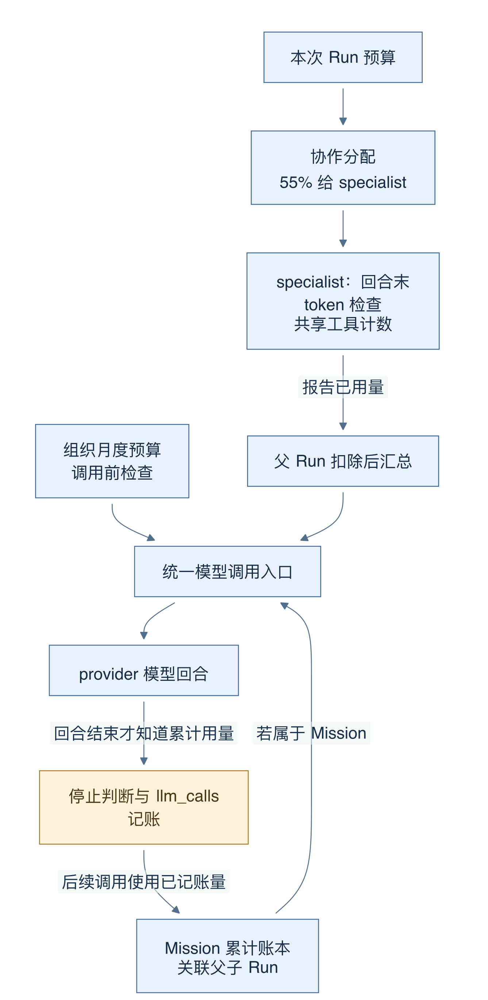
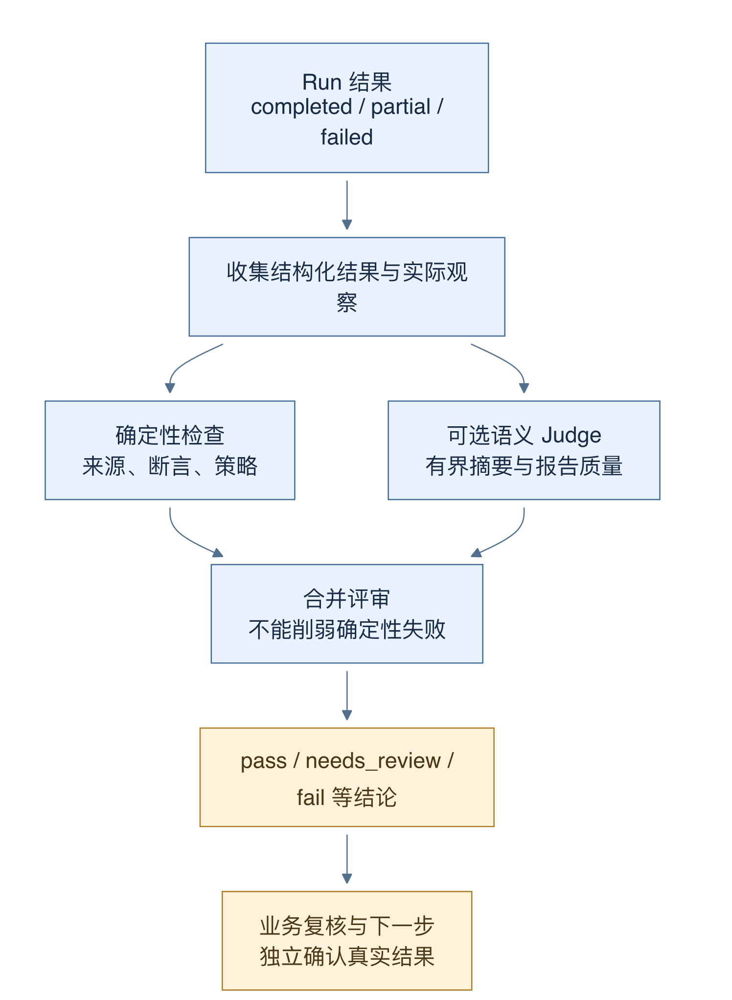
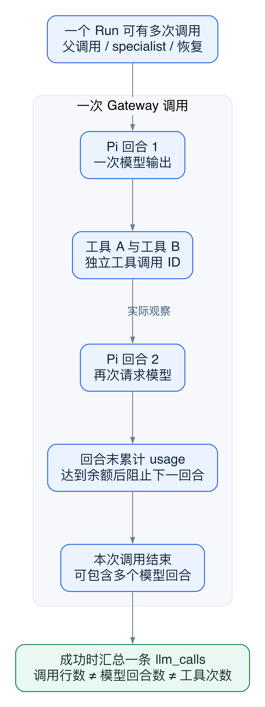

# 21 预算、评审与失败：何时停止，怎样收尾

[返回母文档](../README.md) · [上一章](20.md) · [下一章](22.md)

**本章目标：**理解 token、费用、未知成本、部分完成和失败边界。

## 业务流程与阅读起点

### 这一章学什么

多 Agent 的质量不能靠“最后有一段报告”判断，预算也不能只看一个 token 数字。本章把资源控制、结果状态和业务评审放到同一张图里。重点是读出 main 已实施的保护，以及它尚未保证的性质。

本章没有运行真实模型。引用的外部服务分数均来自仓库中 2026-10-03 已录制的本机连接验收，不是这份教程刚做的在线验证。

### 预算有不同的作用范围

组织月度预算约束整个组织，Run 预算约束一次工作台任务，协作计划再把一部分分给 specialist。Mission 还有跨关联运行累计的预算，不能把它们合并成一个无条件全局上限。

商机复盘计划将 55% 模型预算分给三位 specialist。子运行记录 token 和成本分配，父运行在汇总前扣除已统计的子用量。specialist 的执行回调实际按 token 分配停止，工具总次数由同一次协作调用的共享计数器限制；不能因为子记录写了 costBudgetCents，就断言这一层已经按成本严格截断每个子模型请求。

图 16-1：箭头表示预算传递和用量汇总。模型回合结束才获得累计使用量，底部回传箭头不是调用前预留额度，因此单次请求仍可能越过剩余额度。

对于 Mission，调用入口先从 llm_calls 聚合关联父子运行的已记账输入、输出和费用；费用未知也可阻断后续调用。Mission specialist 改为串行，减少兄弟调用同时通过旧余额预检。但这依旧不是对未来 token 的原子预留，更不保证一个进行中的 provider 请求不超预算。

独立 Run 续跑有额外边界：它按关联 job 的历史 llm_calls 计算已用量，用调用行数检查 maxSteps，而新 Pi 调用的 maxSteps 又来自原配置；调用条数、模型回合数和工具次数不是同一个单位。cache token 和跨子运行累计也需要单独核对。因此应描述为多层限制与回合末停止，不能宣传为严格全局硬封顶。

### 累计用量修复究竟证明了什么

Pi 回调返回累计快照，网关已经改成 Object.assign。100、200、300 三个快照正确对应总量 300，不能累加成 600。这个修复避免重复计量和提前停止，但不会自动修好所有预算范围：停止时机、缓存口径、续跑口径仍是独立问题。

费用还可能为 null。aggregateWorkbenchLlmUsage 对成功但未定价的调用保留未知状态，而不是以 0 伪装免费。看到免费模型记录的 0 与未知费用的 null，必须区别对待。

### 运行状态与评审结论是两把尺

图 16-2：向右箭头表示读取证据并评审，不改变先前动作是否发生。确定性检查与语义 Judge 分别检查可程序验证的约束和报告质量；最终 needs_review 仍需人判断。

Run 可以完成结构化交付，却仍被评审标为 needs_review。确定性检查检查结构、来源、断言及执行边界；语义 Judge 是模型辅助评审，只消费有界摘要。它不能把未观察来源变成真实证据，也不能凭一句满意结论覆盖确定性失败。

仓库最后一次三 specialist 商机复盘记录为 partial：13 次 CRM 工具、0 工具错误、71 条工具事实 claims、7 条 Wiki 证据；语义 Judge 80，总评 79，needs_review。仍有报价及阶段政策缺口，Judge 也指出摘要截断和 specialist partial 说明不足。工具零错误仅说明调用层面没报错，不证明业务答案完备。

同次记忆查询记录 completed、Judge 92、总评 89 / needs_review，更直观地说明“完成运行”与“业务证据足够”不是同一个结论。录制 JSON 的 tools/modelCalls 主要是父运行，Eval.summary 包含 specialist 汇总；Langfuse observations 又可能包含结果提交和 Judge，三组数字不能混算。

### 失败时应留下什么

超时或取消要停止活动子运行；普通子执行异常要记为 failed 并带 missingMaterial；可用但不完整的子结果保留 partial。父报告应写明哪些材料缺失、哪个结论只是推断、下一步需要谁提供依据。遇到不确定的副作用结果则暂停核对，不能自动重放来“修好”分数。

验收文档还明确保留：真实可逆写入补偿、Workbench 外部发送恢复、Wiki 硬生成预算、备份恢复与部署矩阵等未关闭事项。只读成功样本和静态演示页面都不能替代这些证明。

### 深入一层：先统一计量单位，再讨论上限

这里至少有五个不同计数：Run 数、Job 尝试数、Gateway 调用行数、Pi 模型回合数、工具调用数。它们都可能出现在“次数”标签旁，但不是同一个量。

图 16-3：外框是一条成功 Gateway 调用对应的 llm_calls 记录。里面可以发生多个 Pi 回合，每个回合又可包含多个工具。一个 Run 可包含 specialist、父调用和后续恢复，因此也可对应多条 llm_calls。

1. 一次 runModelCall 可以让 Pi 循环多个回合，最后汇总写一条 llm_calls。不能用该表行数直接代表 provider 请求次数
2. Pi 的 turnCount 从 turn_end 事件数得到。maxSteps 在适配层映射为该次调用的 maxTurns
3. specialist 共享的 maxTotalToolCalls=18 是工具入口计数；它不会限制父模型所有工具，也不是数据库永久计数
4. 队列 attempts 在领取 Job 时递增。Job 重试一次可能再次进入模型；它与一个模型回合没有固定比例
5. Run 的 completed、partial 是交付状态。它们不提供“这次花费一定在预算内”的数学证明

### 用一组数读出当前预算行为

假设某 Run 配置 30,000 token。三位 specialist 的计划份额各为 floor(30,000 × 0.55 ÷ 3)=5,500。代码还设了每位至少 512 的下限，因此极小预算下，不能机械地认为三位总分配必然严格等于 55%。

假设 specialist 甲在回合结束时报告累计 5,900。停止回调会阻止继续下一回合，但已经产生的这 5,900 不会倒退成 5,500。父调用会从已统计子用量扣减余额；若父调用开始前 token 或已知费用余额已用尽，Run 返回 partial。这里的“分配”主要规定停止时机，并没有在 provider 请求前原子预留本轮最大消耗。

maxSteps 也要看具体分支。首次父调用将已发生的 specialist modelTurns 从配置中扣除，但 Math.max(1, ...) 至少保留一个父回合；只有 token 或费用检查会在该段提前退出。续跑则用历史 llm_calls 行数比较 maxSteps，再把原 maxSteps 交给新的 Pi 调用。假设一个旧调用包含三个模型回合，在这项历史检查中仍只是一行。不能把它写成“整个 Run 最多 N 个模型回合”。

这项续跑查询按 job_queue.payload.runId 关联历史调用。specialist 使用 rootJobId，所以同一父 Job 下的 specialist 调用也可被纳入，不能反过来说“续跑完全不算子调用”。真正的限制是计量单位和关联范围不同，且恢复没有统一的持久回合余额。

### Token 口径和未知费用也要分开

Pi 保存 input、output、cacheRead、cacheWrite 和 totalTokens。回合末停止读取累计 totalTokens；当前 Mission SQL 与 Workbench 历史汇总主要相加 input_tokens 和 output_tokens。缓存量有独立列，但这些预算 SQL 没有一并相加。不同 provider 的 usage 语义也需要核对，不能把这些字段默认视作完全同口径。

费用 null 表示无法得出完整费用，不是 0。aggregateWorkbenchLlmUsage 发现成功调用未定价时保留 unknownCostCalls 和 costCents=null。Mission 预检会因未知费用阻止后续调用；有费用预算的独立续跑也会停止。specialist 自己的停止回调则只检查 token 分配，并没有使用子记录中的 costBudgetCents 做独立成本截断。

### 三种恢复只修各自的问题

- 累计快照修复：Object.assign 避免把 100、200、300 加成 600。它修正计数，没有让回合末停止变成调用前硬封顶
- 结果补交：只开放提交工具的一回合修复缺少结构化结果；它不能补造缺失证据，不能替代审批
- 队列重试：恢复暂时失败的后台执行；它可能重复只读调用，也可能新增费用，不能代替业务副作用对账

遇到预算投诉，应沿这三步调查：先列出该 Run 及 child 对应的 llm_calls；再用 turn_end 事件计算模型回合，并区分工具次数；最后核对缓存量、未知费用和实际停止点。只有单位一致，预算数字才可比较。

### 评审应回答另一组问题

执行层问“是否交付了结构化结果”；确定性检查问“引用、字段和执行状态是否匹配可观察记录”；语义 Judge 问“报告是否清楚、完整且符合任务”。这些检查相互补充。模型评审不能把 pending 动作评成已执行，也不能以高分补上没有读取过的来源。

因此，第 21 章的正确结论不是“预算无效”或“评审保证正确”。当前代码提供多层预检、回合末停止、有界协作和结果核对；硬总额预留、统一跨恢复回合计数与所有生产副作用验收仍要分别证明。

### 对照源码

以下行号固定于 main @ 679e09e80878dff7b1c79b8537317b2b9e355331。

- [`lib/ai/agents/collaboration.ts:108-153`](https://github.com/helsome/AiNativeCrm/blob/679e09e80878dff7b1c79b8537317b2b9e355331/lib/ai/agents/collaboration.ts#L108-L153)：协作预算分配与 Mission 串行
- [`lib/ai/agents/workbench-collaboration.ts:103-120`](https://github.com/helsome/AiNativeCrm/blob/679e09e80878dff7b1c79b8537317b2b9e355331/lib/ai/agents/workbench-collaboration.ts#L103-L120)：子预算记录
- [`lib/ai/agents/workbench-collaboration.ts:439-465`](https://github.com/helsome/AiNativeCrm/blob/679e09e80878dff7b1c79b8537317b2b9e355331/lib/ai/agents/workbench-collaboration.ts#L439-L465)：实际工具和 token 停止条件
- [`lib/ai/agents/workbench-start-job.ts:377-427`](https://github.com/helsome/AiNativeCrm/blob/679e09e80878dff7b1c79b8537317b2b9e355331/lib/ai/agents/workbench-start-job.ts#L377-L427)：父运行扣除子用量与预算耗尽结果
- [`lib/ai/agents/run-resumed-workbench-turn.ts:88-118`](https://github.com/helsome/AiNativeCrm/blob/679e09e80878dff7b1c79b8537317b2b9e355331/lib/ai/agents/run-resumed-workbench-turn.ts#L88-L118)：续跑历史用量与调用行数检查
- [`lib/ai/agents/run-resumed-workbench-turn.ts:220-238`](https://github.com/helsome/AiNativeCrm/blob/679e09e80878dff7b1c79b8537317b2b9e355331/lib/ai/agents/run-resumed-workbench-turn.ts#L220-L238)：新 Pi 调用的回合上限与剩余用量检查
- [`lib/ai/agents/mission-budget.ts:19-87`](https://github.com/helsome/AiNativeCrm/blob/679e09e80878dff7b1c79b8537317b2b9e355331/lib/ai/agents/mission-budget.ts#L19-L87)：Mission 父子记账聚合和未知费用处理
- [`lib/agent-engine/agent/pi-turn-execution.ts:35-52`](https://github.com/helsome/AiNativeCrm/blob/679e09e80878dff7b1c79b8537317b2b9e355331/lib/agent-engine/agent/pi-turn-execution.ts#L35-L52)：调用前检查与回合末停止
- [`lib/agent-engine/edge/llm/run-model-call.ts:755-827`](https://github.com/helsome/AiNativeCrm/blob/679e09e80878dff7b1c79b8537317b2b9e355331/lib/agent-engine/edge/llm/run-model-call.ts#L755-L827)：累计快照、实际入账与费用计算
- [`lib/ai/agents/workbench-usage.ts:16-40`](https://github.com/helsome/AiNativeCrm/blob/679e09e80878dff7b1c79b8537317b2b9e355331/lib/ai/agents/workbench-usage.ts#L16-L40)：未知费用不当作免费
- [`lib/ai/evals/run-evaluation.ts:1-76`](https://github.com/helsome/AiNativeCrm/blob/679e09e80878dff7b1c79b8537317b2b9e355331/lib/ai/evals/run-evaluation.ts#L1-L76)：语义评审不削弱确定性结果
- [`docs/testing/fixtures/acceptance-fix-multi-2026-10-03.json:1-10`](https://github.com/helsome/AiNativeCrm/blob/679e09e80878dff7b1c79b8537317b2b9e355331/docs/testing/fixtures/acceptance-fix-multi-2026-10-03.json#L1-L10)：最后复盘 Run 的 partial 状态
- [`docs/testing/system-acceptance-fixes-2026-10-03.md:29-49`](https://github.com/helsome/AiNativeCrm/blob/679e09e80878dff7b1c79b8537317b2b9e355331/docs/testing/system-acceptance-fixes-2026-10-03.md#L29-L49)：录制验收结果与计数范围
- [`docs/testing/system-acceptance-fixes-2026-10-03.md:69-71`](https://github.com/helsome/AiNativeCrm/blob/679e09e80878dff7b1c79b8537317b2b9e355331/docs/testing/system-acceptance-fixes-2026-10-03.md#L69-L71)：未关闭的上线边界

#### 深入阅读的新增定位

- [`lib/agent-runtime/pi/ai-sdk-compat.ts:249-316`](https://github.com/helsome/AiNativeCrm/blob/679e09e80878dff7b1c79b8537317b2b9e355331/lib/agent-runtime/pi/ai-sdk-compat.ts#L249-L316)：单次 Gateway 调用可包含多个 turn_end，maxSteps 仅映射当前调用
- [`lib/agent-runtime/pi/runtime.ts:69-86`](https://github.com/helsome/AiNativeCrm/blob/679e09e80878dff7b1c79b8537317b2b9e355331/lib/agent-runtime/pi/runtime.ts#L69-L86)：input、output、cache 与 totalTokens 分别累计
- [`lib/agent-engine/edge/llm/run-model-call.ts:817-854`](https://github.com/helsome/AiNativeCrm/blob/679e09e80878dff7b1c79b8537317b2b9e355331/lib/agent-engine/edge/llm/run-model-call.ts#L817-L854)：成功调用汇总成一条 llm_calls
- [`lib/ai/agents/workbench-start-job.ts:377-394`](https://github.com/helsome/AiNativeCrm/blob/679e09e80878dff7b1c79b8537317b2b9e355331/lib/ai/agents/workbench-start-job.ts#L377-L394)：减去子回合后至少保留一个父回合
- [`lib/ai/agents/workbench-collaboration.ts:413-439`](https://github.com/helsome/AiNativeCrm/blob/679e09e80878dff7b1c79b8537317b2b9e355331/lib/ai/agents/workbench-collaboration.ts#L413-L439)：specialist 使用 rootJobId，但保留自己的 workbenchRunId
- [`lib/ai/agents/collaboration-runtime.ts:188-193`](https://github.com/helsome/AiNativeCrm/blob/679e09e80878dff7b1c79b8537317b2b9e355331/lib/ai/agents/collaboration-runtime.ts#L188-L193)：18 次共享工具额度是本次运行器的内存计数
- [`lib/agent-engine/queue/queue.ts:150-153`](https://github.com/helsome/AiNativeCrm/blob/679e09e80878dff7b1c79b8537317b2b9e355331/lib/agent-engine/queue/queue.ts#L150-L153)：attempts 在 Job 领取时递增

## 实现详解

### 预算：三层额度与 fail-closed 判定

预算有三个来源，且是**递减**的：任务级 `maxSteps`、token额度 `tokenBudget`、费用额度 `costBudgetCents`。启动时先扣掉协作阶段已消耗的量（`collaboration.usage` 的 `modelTurns`/`inputTokens`/`outputTokens`/`costCents`），得到 `remainingMaxSteps`、`remainingTokenBudget`、`remainingCostBudget`。若剩余额度已 ≤0，运行直接以 `partial` + `error_code="collaboration_budget_exhausted"` 收尾，并照常补记 `run_partial` 与 `usage_reported`——**预算耗尽是一个有证据的终态，不是异常**。 Sources: [workbench-start-job.ts](https://github.com/helsome/AiNativeCrm/blob/679e09e80878dff7b1c79b8537317b2b9e355331/lib/ai/agents/workbench-start-job.ts#L377)

运行中通过 `shouldStopAfterTurn` 在**回合边界**而不是 token 边界停止：已收到结构化提交、或累计 token 达额度、或费用达额度，都会终止多步循环。 Sources: [workbench-start-job.ts](https://github.com/helsome/AiNativeCrm/blob/679e09e80878dff7b1c79b8537317b2b9e355331/lib/ai/agents/workbench-start-job.ts#L451)

任务级预算之上还有一道**任务（mission）级预算**，以 `MissionBudgetExceededError` 表达。`loadMissionBudgetUsage` 聚合根运行与所有子运行的 `llm_calls`，不读取任何 provider 消息原文；`missionBudgetBlockReason` 的判定顺序刻意把 `unknown_cost_calls > 0` 放在最前——**只要有一次成功调用没记录到成本，就判定为不可知并阻断**，因为"算不清"绝不能被当作"没超"。 Sources: [mission-budget.ts](https://github.com/helsome/AiNativeCrm/blob/679e09e80878dff7b1c79b8537317b2b9e355331/lib/ai/agents/mission-budget.ts#L20), [mission-budget.ts](https://github.com/helsome/AiNativeCrm/blob/679e09e80878dff7b1c79b8537317b2b9e355331/lib/ai/agents/mission-budget.ts#L83)

预算耗尽的错误处理走独立分支：把运行置为 `partial`、写入 `error_code`（`mission_budget_tokens` / `_cost` / `_unknown_cost`）、补记 `run_partial` 后静默返回，不进入重试。

Sources: [workbench-start-job.ts](https://github.com/helsome/AiNativeCrm/blob/679e09e80878dff7b1c79b8537317b2b9e355331/lib/ai/agents/workbench-start-job.ts#L947)

### 终局判定

收尾状态由三个布尔量与一个函数共同决定：是否有 `pending` 提案、是否预算耗尽（`token_budget_exhausted` / `cost_budget_exhausted`）、最终答案是否非法（`unsafe_internal_draft` / `answer_likely_truncated`）。`workbenchResultPartialReason` 给出 `partial` 的具体原因，最终 `status` 取 `awaiting_confirmation` / `partial` / `completed` 三者之一。写入时用 `.in("status", ["queued","running"])` 做乐观并发保护——这让并发的人工取消不会被迟到的收尾覆盖。 Sources: [workbench-start-job.ts](https://github.com/helsome/AiNativeCrm/blob/679e09e80878dff7b1c79b8537317b2b9e355331/lib/ai/agents/workbench-start-job.ts#L855)

异常处理同样分层：运行已被取消则静默返回；方向围栏错误交由 `stopMissionRunAfterDirectionFence` 收敛；预算超限转 `partial`；只有 `job.attempts >= job.max_attempts` 时才判定 `failed` 并记 `run_failed`，其余错误**重新抛出交给队列退避重试**。 Sources: [workbench-start-job.ts](https://github.com/helsome/AiNativeCrm/blob/679e09e80878dff7b1c79b8537317b2b9e355331/lib/ai/agents/workbench-start-job.ts#L929)

## 继续阅读

[返回母文档](../README.md) · [上一章](20.md) · [下一章](22.md)

