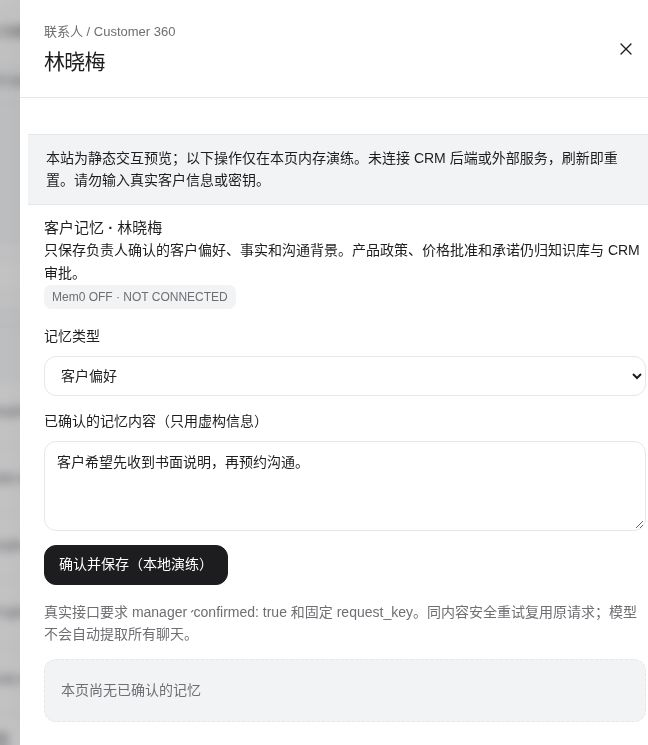
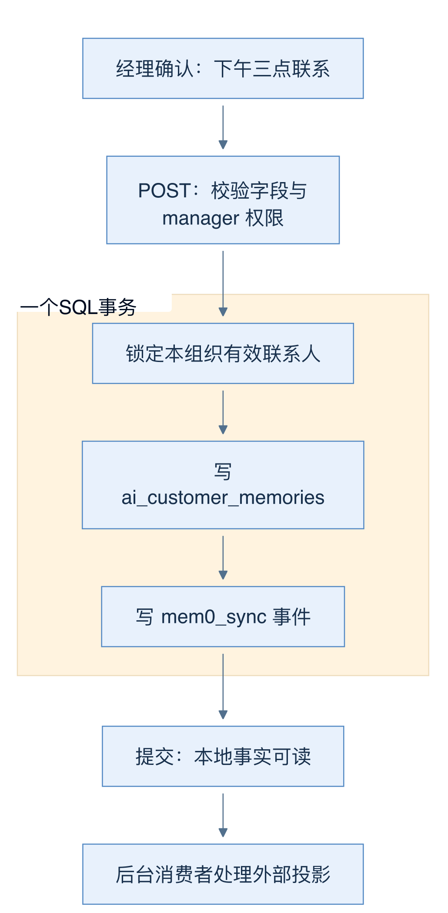
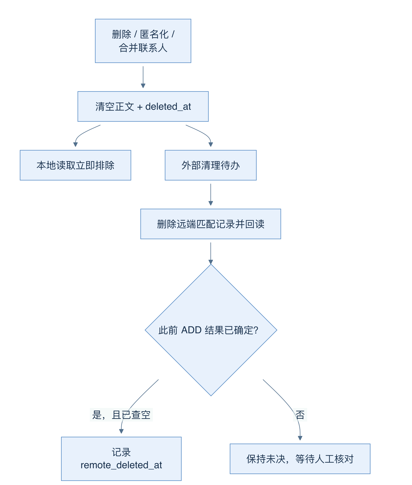
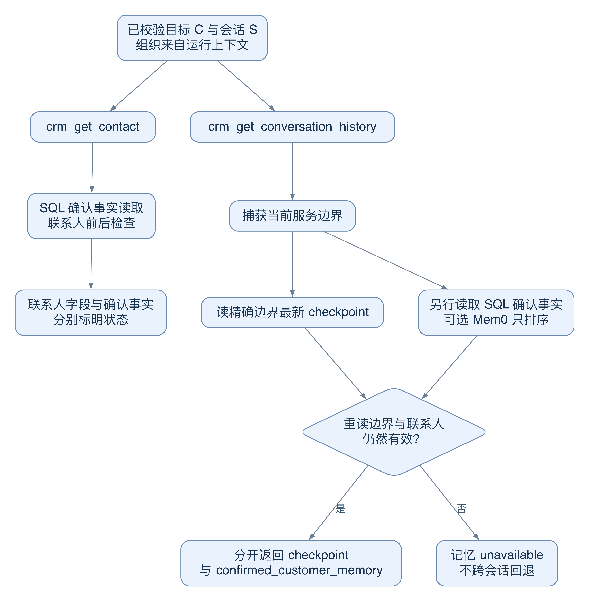

# 22 客户记忆：把偏好变成有责任人的事实

[返回母文档](../README.md) · [上一章](21.md) · [下一章](23.md)

**本章目标：**理解客户事实的确认、来源、撤回和有效期。

## 业务流程与阅读起点

### 当前界面近景

这是联系人级别的记忆入口。画面明确显示 Mem0 未连接；仅查看表单，没有保存、同步或删除客户记忆。

### 学习目标

读完本章，你应能解释：谁能确认一条客户记忆，它怎样进入 SQL，删除为何有两个完成时刻，以及它与会话检查点有什么区别。

### 从一条偏好走完整条链

假设联系人林女士说：“请下午三点联系，先给书面说明。”这是客户偏好，不是公司营业时间，也不是发送消息的授权。当前实现不自动把全部聊天交给模型提炼成长期记忆。经理在联系人界面确认后，POST 接口才接受它。

请求包含 contact_id、request_key、category、body 和 confirmed:true。类别只允许 preference、confirmed_fact、communication_context；正文最多 2000 字符。confirmed 是调用契约，不能代替权限：接口还检查 manager 角色和支持人员写入限制，组织 ID 从认证上下文取得，不让请求正文指定租户。

保存函数开启数据库事务，锁定该组织中未匿名化、未合并的联系人。然后计算内容哈希，写入 ai_customer_memories，并在同一事务写入 mem0_sync 事件。这里的 outbox 是“先把待办和业务事实一起存下来，再由后台送出”的可靠投递做法；SQL 事务不等待外部 HTTP。即使 Mem0 关闭，本地确认事实仍可读取。

图 17-A：实线表示实际处理顺序；事务框中的两次写入一起提交，外部同步位于事务之外。

request_key 是重试身份证。同键同内容会返回原记录，不新增事实或重复事件；同键不同内容、已删除记录或无效联系人会被拒绝。如果客户端没收到提交回执，应沿用原键和原内容重试。换一个新键，相当于提交另一件事，可能制造重复。

### 记住客户，也必须会停止读取

客户记忆不是普通便签。读取入口会在访问前后检查联系人是否匿名化、是否被合并。删除接口先清空正文并写 deleted_at，同时排入远端清理事件。这样本地检索立即停止使用该事实，不必等外部服务恢复。

数据库触发器也覆盖联系人匿名化、合并和物理删除。物理删除后保留不含正文的清理回执，避免连“还有什么需要删”都失去。组织删除会被未验证的外部清理挡住。远端清理要再读一次确认；若先前 ADD 的结果未知，暂时搜不到并不能证明它以后不会迟到落库。

图 17-B：上路完成“当前检索不可见”，下路才验证“远端当前记录已删除”；两者不是同一承诺。

### 会话检查点是另一种记忆

lead_checkpoints 保存 rolling_summary、commitments、objections、next_action，用来接上当前服务。读取时同时匹配组织、联系人、会话、service_revision 和需求 ID/版本，按 seq 取最新项。不能因为同一联系人在别的渠道有旧摘要，就跨边界补回来。

接口可同时返回检查点和 confirmed_customer_memory，但两者没有被合成一张“万能记忆表”。读取结束还会重读服务边界；期间发生转接或需求版本变化，就返回 unavailable，而不是交付可能串线的上下文。seq 表示观察到的检查点版本，也不授予 Workbench 写回检查点的能力。

### 完整读例：先读林女士，再决定能引用哪份记忆

教学任务是：“查看林女士的沟通偏好，并说明这次询价接下来应做什么。”我们只分析读链，不调用真实模型，也不发送客户消息。假设当前组织为 O、联系人为 C、会话为 S；经理已确认“下午三点联系，先给书面说明”。这些符号只代表教学身份，不是实际记录。

图 17-C：两条读链可以返回同一条确认事实，但只有会话读链会加载当前服务的 checkpoint。箭头不会把客户事实升级为组织政策。

1. Workbench 先解析所选对象，给任务附上已校验的 contact、lead、conversation 等精确 ID。工具的组织 ID 来自运行上下文。模型选择工具参数，不能用参数另选组织
2. `crm_get_contact(C)` 先读联系人，再调用 `readConfirmedCustomerMemory(O,C)`。它返回姓名、标签等联系人字段，以及独立的 `confirmed_customer_memory`。即使 Mem0 未连接，SQL 中已确认的偏好仍可返回为 local
3. “接下来做什么”还取决于本次服务。`crm_get_conversation_history(S)` 返回分页消息，并调用会话记忆加载器。加载器先读服务边界，再按组织、联系人、会话、service revision、需求 ID/版本精确选择最新 `seq` 的 checkpoint
4. 加载器另读确认客户事实，随后重读服务边界和联系人资格。如果中途发生合并、匿名化或边界变化，它不给出刚才取得的记忆。它不会退回该客户另一个渠道的旧摘要
5. 成功时，两类记忆仍分开：偏好有 `content_hash` revision、confirmed 标记和 `customer_context_only`；checkpoint 有 `seq`、承诺、异议、下一动作与滚动摘要。模型应把它们作为带范围、带时间的材料解释
6. 如果没有 checkpoint，但有确认客户事实，外层状态仍可为 available。如果确认记忆读取失败，联系人工具可正常返回联系人，并把记忆部分标为 unavailable。不能把这一状态翻译成“客户没有偏好”

把例子再走到输出：假设 checkpoint 的下一动作是“等客户确认型号”，但随后一条客户消息已经确认“A 标准版”。此时可以向业务员解释：“CRM 已确认她偏好下午三点沟通并先看书面说明；最新消息已确认型号，不应再重复询问。现有记忆还不足以给出获批价格。”这是教学期望输出，不是本次真实模型结果。它把偏好、时间较早的摘要和时间较晚的消息分开，也指出下一步需要查产品或报价材料。

入站引擎对此有明确的提示词处理：它注明 checkpoint 写在最新消息之前，并让本次客户消息优先于旧摘要。Workbench 的具体入口不同，不能据此声称它拥有同一段自动开场文字；但读者必须保留这些时间与来源，才可能识别矛盾。源码定位：[`lib/agent-engine/agent/context-builder.ts:55-63`](https://github.com/helsome/AiNativeCrm/blob/679e09e80878dff7b1c79b8537317b2b9e355331/lib/agent-engine/agent/context-builder.ts#L55-L63)、[`lib/agent-engine/agent/context-builder.ts:135-149`](https://github.com/helsome/AiNativeCrm/blob/679e09e80878dff7b1c79b8537317b2b9e355331/lib/agent-engine/agent/context-builder.ts#L135-L149)。

这条链的关键失败分支是“读取期间服务变了”。在教学例中，第一次读取看到服务 revision 7，第二次看到 8。加载器返回 `service_boundary_changed`，不交付 revision 7 的 checkpoint。下一步应重新读当前会话，而不是拿旧摘要继续推导当前承诺。

这个检查不是整个数据库的事务快照。消息列表与记忆加载分别执行；确认客户事实也有自己的前后复查。代码减少并发变化导致的错误暴露，但不能证明返回后数据永远不变。准备外部动作时，仍需该动作自己的当前状态校验。

源码定位：[`lib/ai/agents/workbench-start-job.ts:90-108`](https://github.com/helsome/AiNativeCrm/blob/679e09e80878dff7b1c79b8537317b2b9e355331/lib/ai/agents/workbench-start-job.ts#L90-L108)、[`lib/ai/agents/workbench-start-job.ts:367-375`](https://github.com/helsome/AiNativeCrm/blob/679e09e80878dff7b1c79b8537317b2b9e355331/lib/ai/agents/workbench-start-job.ts#L367-L375)；[`lib/mcp/tools/contacts.ts:70-107`](https://github.com/helsome/AiNativeCrm/blob/679e09e80878dff7b1c79b8537317b2b9e355331/lib/mcp/tools/contacts.ts#L70-L107)；[`lib/mcp/tools/conversations.ts:173-210`](https://github.com/helsome/AiNativeCrm/blob/679e09e80878dff7b1c79b8537317b2b9e355331/lib/mcp/tools/conversations.ts#L173-L210)；[`lib/agent-engine/agent/customer-memory.ts:75-167`](https://github.com/helsome/AiNativeCrm/blob/679e09e80878dff7b1c79b8537317b2b9e355331/lib/agent-engine/agent/customer-memory.ts#L75-L167)；[`lib/ai/integrations/mem0.ts:312-394`](https://github.com/helsome/AiNativeCrm/blob/679e09e80878dff7b1c79b8537317b2b9e355331/lib/ai/integrations/mem0.ts#L312-L394)。

### 把本例中的责任边界说完整

经理确认的偏好可以影响措辞和建议联系时间。它不能创建跟进 job、批准报价或证明客户同意所有未来联系。checkpoint 的“下一动作”描述上次服务留下的工作，不是最新消息的替代物。第 24 章会把这两类材料与组织规则、Wiki、RAG 一起放进模型上下文图中。

还要区分旧引擎的 `lead_notes`。它允许模型经 `save_lead_note` 写入笔记，先给模型短标题索引，需要时再读正文；这条链不等于本章的人工确认客户事实。看到源码中存在自动笔记工具，不能推断全部会话都自动成为 `ai_customer_memories`。

源码定位：[`lib/agent-engine/agent/context-builder.ts:55-81`](https://github.com/helsome/AiNativeCrm/blob/679e09e80878dff7b1c79b8537317b2b9e355331/lib/agent-engine/agent/context-builder.ts#L55-L81)、[`lib/agent-engine/agent/context-builder.ts:135-149`](https://github.com/helsome/AiNativeCrm/blob/679e09e80878dff7b1c79b8537317b2b9e355331/lib/agent-engine/agent/context-builder.ts#L135-L149)；[`lib/agent-engine/agent/lead-notes.ts:1-24`](https://github.com/helsome/AiNativeCrm/blob/679e09e80878dff7b1c79b8537317b2b9e355331/lib/agent-engine/agent/lead-notes.ts#L1-L24)、[`lib/agent-engine/agent/lead-notes.ts:85-113`](https://github.com/helsome/AiNativeCrm/blob/679e09e80878dff7b1c79b8537317b2b9e355331/lib/agent-engine/agent/lead-notes.ts#L85-L113)。上图中的 checkpoint 只表示当前服务读取，本段没有为旧笔记新增一条确认事实写入路径。

### 常见误区与自测

- confirmed:true 说明走过人工确认入口，不证明正文客观正确；把报价政策塞入客户偏好仍是分类错误
- DELETE 返回 hidden:true、external_cleanup:pending_verification，不能说远端及所有备份已彻底擦除
- 读不到检查点不等于没有客户事实；反过来，客户事实存在也不能替代当前服务检查点

自测：联系人刚合并，旧会话还有摘要，模型该继续读吗？沿两次联系人检查与边界复查走一遍，答案应是停止暴露旧记忆。

### 源码定位

本章固定 main@679e09e80878dff7b1c79b8537317b2b9e355331；以下为仓库相对路径与行号。

- [`app/api/v1/ai/customer-memory/route.ts:16-60`](https://github.com/helsome/AiNativeCrm/blob/679e09e80878dff7b1c79b8537317b2b9e355331/app/api/v1/ai/customer-memory/route.ts#L16-L60)：确认入口、权限与同键重试提示
- [`lib/ai/integrations/mem0.ts:10-18`](https://github.com/helsome/AiNativeCrm/blob/679e09e80878dff7b1c79b8537317b2b9e355331/lib/ai/integrations/mem0.ts#L10-L18)：输入契约；[`lib/ai/integrations/mem0.ts:59-129`](https://github.com/helsome/AiNativeCrm/blob/679e09e80878dff7b1c79b8537317b2b9e355331/lib/ai/integrations/mem0.ts#L59-L129)：事务保存与本地墓碑
- [`supabase/migrations/20261002031000_0406_ai_customer_memories.sql:1-65`](https://github.com/helsome/AiNativeCrm/blob/679e09e80878dff7b1c79b8537317b2b9e355331/supabase/migrations/20261002031000_0406_ai_customer_memories.sql#L1-L65)：表权限、隐私触发器、组织删除保护
- [`lib/agent-engine/agent/customer-memory.ts:38-167`](https://github.com/helsome/AiNativeCrm/blob/679e09e80878dff7b1c79b8537317b2b9e355331/lib/agent-engine/agent/customer-memory.ts#L38-L167)：联系人资格、检查点边界和读取后复查
- [`docs/integrations/agent-services.md:90-118`](https://github.com/helsome/AiNativeCrm/blob/679e09e80878dff7b1c79b8537317b2b9e355331/docs/integrations/agent-services.md#L90-L118)：远端清理及备份边界

## 继续阅读

[返回母文档](../README.md) · [上一章](21.md) · [下一章](23.md)

