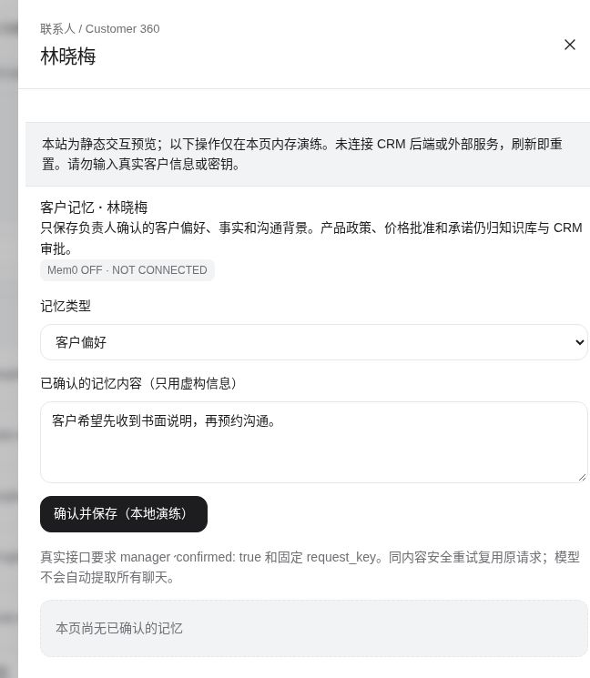
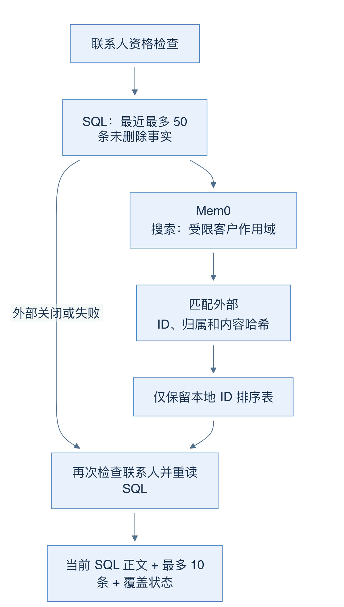
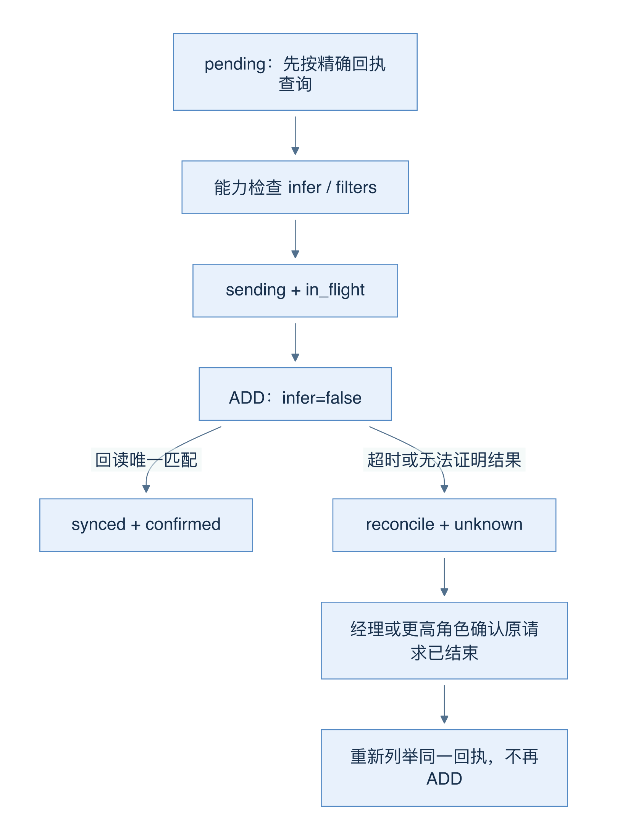
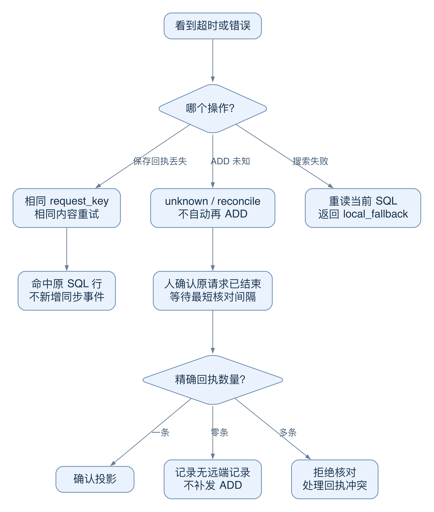

# 23 Mem0：排序与 SQL 事实如何分工

[返回母文档](../README.md) · [上一章](22.md) · [下一章](24.md)

**本章目标：**理解外部记忆排序与 CRM 内部事实权威的边界。

## 业务流程与阅读起点

### 当前界面近景

界面里服务关闭与客户记忆的 SQL 权威是不同层次。不要把可见表单或本地演练解释为远端 Mem0 已同步。

### 学习目标

读完本章，你应能追踪一次 Mem0 查询，解释外部结果为什么不能直接进入模型，以及网络超时后为什么不能马上再 ADD。

### 先分清事实与搜索辅助

Mem0 是可选的外部记忆检索服务。本仓库让它帮助排列客户偏好和已确认事实的相关性；CRM 的 SQL 行始终是事实来源。外部返回一段漂亮文字，不会自动变成公司政策、客户承诺或审批决定。

这条边界写在 readConfirmedCustomerMemory 里。函数先检查联系人，再读取该组织与联系人最近最多 50 条未删除事实。只有存在合法服务器 binding 且组织启用集成，才调用 Mem0 /search。user_id 是组织与联系人组成的散列标识，run_id 是组织与记忆 ID 组成的散列标识。这些值减少直接标识暴露，但筛选参数本身不是访问控制；部署仍需隔离服务凭据和访问范围。

图 18-A：外部结果只影响顺序，不能沿箭头替换正文；结束前再次读取 SQL，防止旧远端内容复活。

搜索结果必须匹配客户作用域、external_id、记忆作用域以及 content_hash，才可把对应本地 ID 放进排序表。远端 memory 字段不作为答案正文。之后再次检查联系人并重读 SQL，再按命中 ID 排序，最多输出 10 条，附 revision、confirmed:true、时间与 authority:customer_context_only。

### 三种状态怎样读

没有启用服务时，status 为 local、providerStatus 为 disabled；服务可用时是 mem0/connected；远端失败则是 local_fallback/unavailable。三种情况都可以返回有效 SQL 事实。因此“Mem0 没配，所以没有客户记忆”是错误推断。

coverage、returnedCount、readLimit 则解释读取范围。它最多在最近 50 条里选择 10 条；存在超过 10 条候选时标 partial。即使显示 complete，也应结合 readLimit 理解，不能宣称已扫描客户全部历史。超时降级不等于空事实，更不等于可以让模型自由补写。

### 为什么同步需要一个小型状态机

人工确认事务提交后，后台先按精确回执查远端。准备首次 ADD 前，会检查服务 OpenAPI 是否支持 infer 与 filters；写入使用 infer:false，直接投影已确认正文，不让 Mem0 再调用模型推断事实。不过 embedding 仍可能产生费用。

同步先把“正在写入”持久化，再判断外部结果。下图先给出状态概览。随后用一次超时，逐步说明为什么 unknown 需要核对，不能直接重放。

图 18-B：unknown 表示“可能已写入”。完整处理条件见下一节编号步骤。

### 深入一层：一次超时会留下哪种不确定性

同一个“重试”按钮可能面对三种状态：SQL 提交回执没收到、Mem0 写入结果未知、Mem0 搜索失败。恢复策略必须跟随状态所有者。它们不能共用“再发一次”的处理方法。

图 18-C：左侧回执问题由 SQL 唯一键解决；中间外部结果未知由核对解决；右侧只读搜索失败可降级。三条分支保护的是不同事实。

1. 经理提交偏好，SQL 已提交，但 HTTP 回执丢失。沿用相同 `request_key` 和相同内容重试。数据库唯一键命中原行；哈希相同且记录未删除，函数返回原 ID，并且不再添加第二个同步事件
2. 后台首次发送 Mem0 ADD 前，把本地写入状态改成 `in_flight`。这样进程即使在网络请求之后退出，后来的消费者也知道可能已有外部效果
3. ADD 超时后，本地记为 unknown。再次读取恰好一条匹配回执，仍不能自动宣布先前请求已经结束；同步函数要求 reconciliation。经理须先确认远端原请求已结束，再通过专用接口核对
4. 核对接口要求至少经过 60 秒，只按精确回执列举，不再 ADD。匹配一条可确认同步；零条可记录“原请求已结束但没有远端记录”；多条则拒绝并要求处理冲突。零条不是自动补写的授权
5. 读查询超时的代价不同。只读 Mem0 搜索失败会保留 local_fallback；函数再次查 SQL，并把当前确认事实返回。它没有不确定的外部写入需要补偿

为什么宁可暂时少一份外部投影，也不立刻补发？假设第一次 ADD 已到服务端，客户端只是在等待响应时超时。第二次 ADD 可能成功创建另一份投影。幂等请求键只约束 CRM 保存，并没有自动变成第三方的幂等保证。

删除让这个问题更明显。删除先隐藏 SQL 正文，随后清理远端。如果原 ADD 仍为 unknown，即使清理后搜索为空，代码仍保持未决。否则迟到的 ADD 可能在“删除完成”之后重新出现。人工核对解决的是这次请求的结束证据，不是承诺清除供应商备份、日志或已送入模型的旧上下文。

源码定位：[`lib/ai/integrations/mem0.ts:78-109`](https://github.com/helsome/AiNativeCrm/blob/679e09e80878dff7b1c79b8537317b2b9e355331/lib/ai/integrations/mem0.ts#L78-L109)、[`lib/ai/integrations/mem0.ts:214-262`](https://github.com/helsome/AiNativeCrm/blob/679e09e80878dff7b1c79b8537317b2b9e355331/lib/ai/integrations/mem0.ts#L214-L262)、[`lib/ai/integrations/mem0.ts:265-309`](https://github.com/helsome/AiNativeCrm/blob/679e09e80878dff7b1c79b8537317b2b9e355331/lib/ai/integrations/mem0.ts#L265-L309)、[`lib/ai/integrations/mem0.ts:421-457`](https://github.com/helsome/AiNativeCrm/blob/679e09e80878dff7b1c79b8537317b2b9e355331/lib/ai/integrations/mem0.ts#L421-L457)；[`app/api/v1/ai/customer-memory/route.ts:46-59`](https://github.com/helsome/AiNativeCrm/blob/679e09e80878dff7b1c79b8537317b2b9e355331/app/api/v1/ai/customer-memory/route.ts#L46-L59)、[`app/api/v1/ai/customer-memory/route.ts:93-125`](https://github.com/helsome/AiNativeCrm/blob/679e09e80878dff7b1c79b8537317b2b9e355331/app/api/v1/ai/customer-memory/route.ts#L93-L125)。

### 沿读取步骤检查排序的能力上限

按图 18-A，从左向右走完一次成功读取：

1. 第一次 SQL 读取给出最近 50 条候选，外部搜索给出最多 10 个排名候选。默认搜索词是固定的客户偏好与沟通上下文说明；`crm_get_contact` 没有把用户的任意问题作为单独 query 传入
2. 代码将远端 user scope、external ID、CRM memory scope、content hash 对到第一次 SQL 结果。匹配只赋予“参与排序”的资格。远端正文没有进入返回材料
3. 第二次 SQL 读取决定最终正文和记录是否仍存在。已经删除的行不会因远端命中重新出现。新出现但没有远端排名的行仍可作为本地候选
4. 有合格排名时，命中 ID 排在前面，其余保持本地候选顺序；没有合格排名时，直接使用新 SQL 结果。最后取 10 条并报告 coverage
5. 返回 `mem0/connected` 只说明搜索调用成功，不保证它贡献了一个有效排名。格式合法但全都不匹配的结果，同样可能落回本地顺序

因此，这一设计选择了“已确认事实的安全、可用读取”，没有承诺搜索客户全部历史。超过最近 50 条的事实不会因 Mem0 命中被补回本次结果。`complete` 也只描述当前有界候选，不是“完整读遍所有记忆”。

失败分支：Mem0 返回另一组织的 ID、旧哈希或只存在于远端的正文。代码不采用这些结果排序，不使用远端正文补充答案。若本地数据库本身读取失败，上层工具会报告记忆 unavailable；这时不能继续声称发生了正常 SQL fallback。

源码定位：[`lib/ai/integrations/mem0.ts:316-394`](https://github.com/helsome/AiNativeCrm/blob/679e09e80878dff7b1c79b8537317b2b9e355331/lib/ai/integrations/mem0.ts#L316-L394)；[`lib/mcp/tools/contacts.ts:88-93`](https://github.com/helsome/AiNativeCrm/blob/679e09e80878dff7b1c79b8537317b2b9e355331/lib/mcp/tools/contacts.ts#L88-L93)。图 18-A 已包含本段的远端过滤与 SQL 重读关系。

### 常见误区与自测

- 200 响应不等于能力兼容；缺 infer/filters 的旧服务会被拒绝
- 外部命中率高不等于事实可靠；SQL 所有权与哈希匹配才决定能否用
- 临时关闭 Mem0 不会删除 CRM 确认记忆，也不表示远端历史已清理

自测：远端返回同 ID、旧哈希的“上午联系”，本地已是“下午联系”，该用哪条？此候选不能参与排序；正文只能来自当前 SQL。

### 源码定位

本章固定 main@679e09e80878dff7b1c79b8537317b2b9e355331。

- [`lib/ai/integrations/mem0.ts:19-21`](https://github.com/helsome/AiNativeCrm/blob/679e09e80878dff7b1c79b8537317b2b9e355331/lib/ai/integrations/mem0.ts#L19-L21)：作用域散列；[`lib/ai/integrations/mem0.ts:312-394`](https://github.com/helsome/AiNativeCrm/blob/679e09e80878dff7b1c79b8537317b2b9e355331/lib/ai/integrations/mem0.ts#L312-L394)：本地权威读取和覆盖信息
- [`lib/ai/integrations/mem0.ts:148-309`](https://github.com/helsome/AiNativeCrm/blob/679e09e80878dff7b1c79b8537317b2b9e355331/lib/ai/integrations/mem0.ts#L148-L309)：协议检查、精确回执、infer:false、未知结果
- [`lib/ai/integrations/mem0.ts:397-457`](https://github.com/helsome/AiNativeCrm/blob/679e09e80878dff7b1c79b8537317b2b9e355331/lib/ai/integrations/mem0.ts#L397-L457)：消费者处理与人工核对
- [`lib/ai/integrations/config.ts:36-95`](https://github.com/helsome/AiNativeCrm/blob/679e09e80878dff7b1c79b8537317b2b9e355331/lib/ai/integrations/config.ts#L36-L95)：合法 binding 与组织启用双重条件
- [`app/api/v1/ai/customer-memory/route.ts:93-128`](https://github.com/helsome/AiNativeCrm/blob/679e09e80878dff7b1c79b8537317b2b9e355331/app/api/v1/ai/customer-memory/route.ts#L93-L128)：核对接口的确认契约

## 继续阅读

[返回母文档](../README.md) · [上一章](22.md) · [下一章](24.md)

