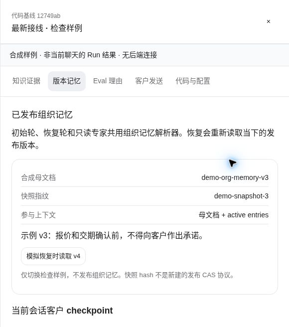
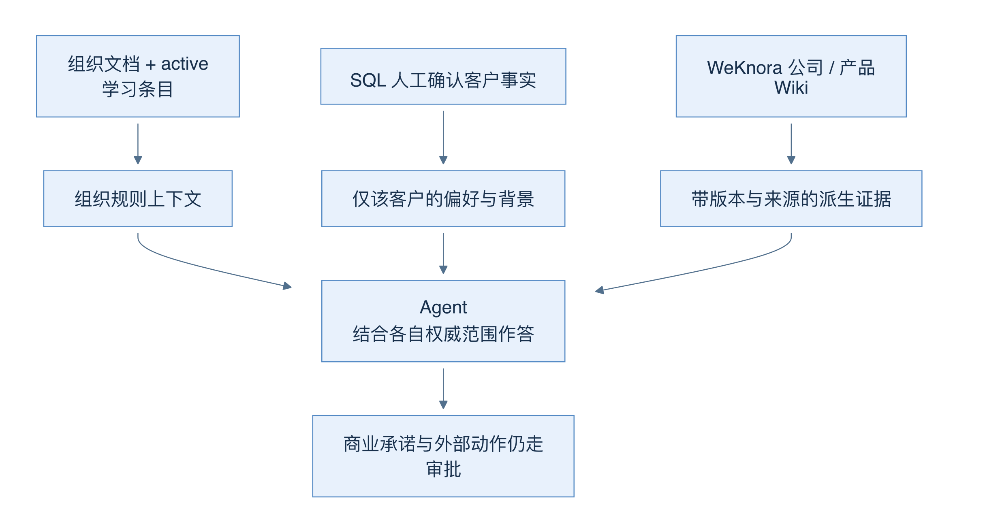
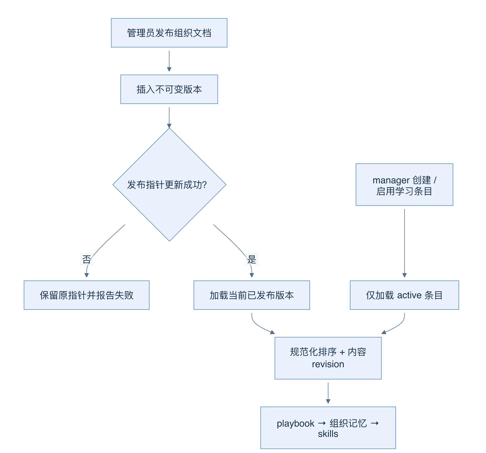
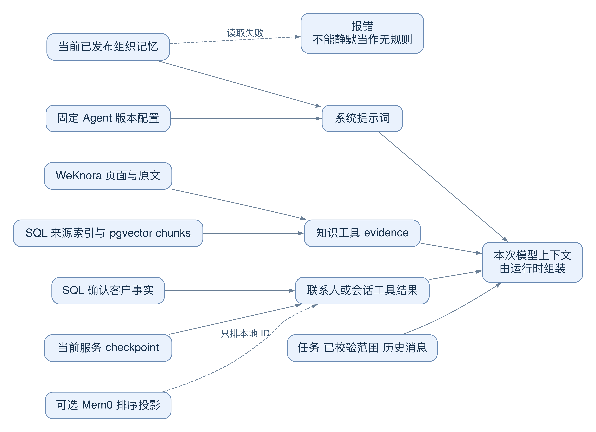
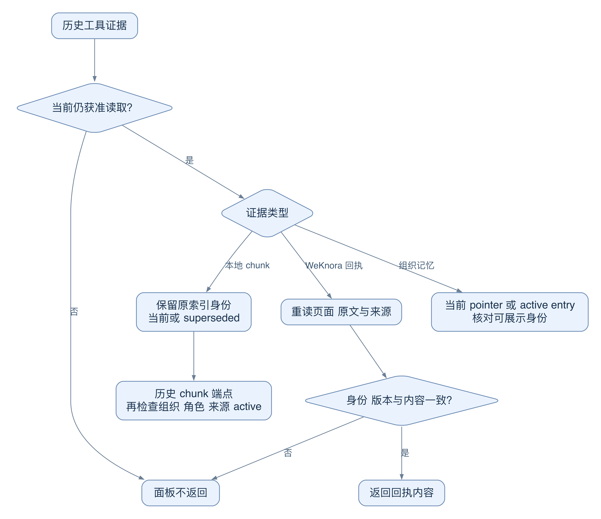

# 24 Wiki、组织记忆与上下文投影

[返回母文档](../README.md) · [上一章](23.md) · [下一章](25.md)

**本章目标：**理解信息来源、组织发布版本和回合输入之间的关系。

## 业务流程与阅读起点

### 当前界面近景

这是当前演示的合成检查面板，不是当前聊天 Run 的真实读取结果。图中母文档、快照指纹和 active entries 用来定位版本；客户 checkpoint 的权限和范围仍按下方固定源码说明。

### 学习目标

读完本章，你应能把产品知识、组织规则和客户偏好放到正确位置，并解释“投影有来源”为什么仍不等于“业务承诺已获批准”。

### 三类知识，三种权威范围

“产品可退换的条件”适合公司/产品知识库；“所有接待都先核实订单”属于已发布的组织规则；“林女士偏好下午三点沟通”属于人工确认的客户记忆。三者都会影响回答，但不能相互升级权限。

源码中的真实模块分别是 WeKnora Wiki 适配器、org_memory_versions/entries、ai_customer_memories。它没有另一个名为“Memory Wiki”的独立服务。本章把“记忆 Wiki”仅作为便于学习的组织方式：把记忆来源、版本和状态展示给人看。这样的阅读投影不能成为新的事实源。

投影可以理解为“从已有记录制作的可读副本或视图”。Mem0 保存用于检索的外部投影；Workbench 展示证据投影；WeKnora 页面则是由原始资料生成的派生知识。判断能否用时，要回到对应来源及权限，不能只看它写得是否完整。

图 19-A：三条箭头表示不同消费用途；底部提醒共同边界，不能把客户偏好或生成页面当成动作批准。

### 组织记忆怎样成为运行上下文

管理员发布组织文档时，先新增不可变版本，再移动 org_memory_pointers 发布指针；经理还可创建直接 active 的手工学习条目，或归档、重新启用条目。运行端只读已发布文档与 active 条目，不把 proposed 内容混进去。

加载器校验组织和版本身份，按固定顺序排列条目，再对规范化内容算 SHA-256 revision。pg 与 Supabase 两个入口使用同一结果形状；后者分页读取，避免 PostgREST 单次上限悄悄截断规则。系统提示词顺序是 playbook → 组织记忆 → skills 索引。

这里有两个重要限制。第一，版本插入成功而指针更新失败，旧规则仍有效，接口会报发布失败，不能说“已上线”。第二，文档和条目分别查询，revision 标识本次读到的内容，不保证跨表事务快照。源码还注明版本号 max+1 存在并发发布限制。

图 19-B：只有发布指针指向的版本被消费；失败分支保留原指针，不能拿“版本已保存”替代发布成功。

### 产品 Wiki 从“搜到”到“可引用”

接入 WeKnora 不是让模型任意访问一个 URL。服务器 binding 限定组织与 KB 白名单；管理员确认整个 KB 具有统一的组织可见范围，再登记为 ai_knowledge_sources。Agent 还必须选择这个来源，并发布其配置版本。混合不同 ACL 的文档不能先生成一页，再靠过滤引用补救，因为正文可能早已泄露。

搜索摘要只是候选。适配器继续读取当前 published 页面、全部 source_refs 对应文档，检查 KB、解析状态、启用状态和更新时间。原文档比页面更新，就丢弃过时派生页；下载期间撤权或来源变化也会被复查发现。

通过后，CRM 将页面内容与 manifest 存入 ai_wiki_evidence。manifest 记录页面版本、内容哈希、来源文档身份和时间、可用文件哈希与 chunk_refs。回执是当时观察的证据，不是所有原文的完整快照，也不是逐句真实性证明。后来打开证据链接，还会复核当前来源；撤回或变更的内容不能从旧回执继续回放。

### 总图：谁保存状态，谁只把状态交给模型

延续林女士询价的例子。一次回答可能同时需要客户偏好、当前服务进度、组织规则与产品资料。不要先问“都存进哪个向量库”，先问“谁负责更新这项状态，它能影响什么”。

图 19-C：各存储框是不同状态所有者。右侧模型输入是运行时组装结果。它没有一条箭头可以反向确认客户事实、发布组织政策或批准外部动作。

1. CRM 的 `ai_customer_memories` 保存人工确认的客户事实。Mem0 保存外部检索投影，只给这些 SQL ID 排序。客户偏好回答“怎样与这位客户沟通”
2. `lead_checkpoints` 保存某次服务的续接状态。它回答“这次服务已经讨论过什么”。加载器精确匹配服务身份，不按姓名寻找一个看起来相似的旧摘要
3. `org_memory_versions`、发布 pointer 与 active entries 形成组织规则。它回答“这个组织目前要求所有服务怎样处理”。运行端按当前已发布状态加载，不用客户偏好覆写组织规则
4. WeKnora 保存和生成产品 Wiki；CRM 读取当前发布页，检查来源后保存证据回执。本地 pgvector 路径则从来源的当前索引检索 chunks。两路都回答“本次产品说明有什么资料依据”
5. Workbench 启动时，代码按固定 Agent 版本读取配置，同时重新加载当前组织记忆，组合系统提示词。用户任务、已校验对象范围、历史消息和随后产生的工具结果，分别进入运行上下文
6. Pi 运行时再把支持的消息类型转换为模型请求。因此，“检索到一篇文档”“保存了一段工具结果”“这段结果出现在本次模型输入里”是不同观察点。源文件本身不会自动等同于整个 prompt

为什么分开？规则变动频率、隐私边界和失败后允许的行为都不同。Mem0 失败可降级为 SQL 客户事实。组织规则读取失败不能静默装成“没有规则”。产品证据过期就需要重新检索，不能靠保留标题继续引用。

恢复执行也不是复用旧政策的同义词。`runResumedWorkbenchTurn` 保留先前运行消息，但重新加载当前已发布组织记忆。Pi 若发现历史首条为 system，会用本次 system prompt 替换这条基线，同时保留工具结果等其余历史。这使新规则进入恢复后的调用；它不自动刷新历史里每一份旧知识证据。旧工具结果仍要按用途重新核对。

源码定位：[`lib/ai/agents/workbench-start-job.ts:258-272`](https://github.com/helsome/AiNativeCrm/blob/679e09e80878dff7b1c79b8537317b2b9e355331/lib/ai/agents/workbench-start-job.ts#L258-L272)、[`lib/ai/agents/workbench-start-job.ts:367-375`](https://github.com/helsome/AiNativeCrm/blob/679e09e80878dff7b1c79b8537317b2b9e355331/lib/ai/agents/workbench-start-job.ts#L367-L375)、[`lib/ai/agents/workbench-start-job.ts:436-445`](https://github.com/helsome/AiNativeCrm/blob/679e09e80878dff7b1c79b8537317b2b9e355331/lib/ai/agents/workbench-start-job.ts#L436-L445)；[`lib/ai/agents/run-resumed-workbench-turn.ts:137-160`](https://github.com/helsome/AiNativeCrm/blob/679e09e80878dff7b1c79b8537317b2b9e355331/lib/ai/agents/run-resumed-workbench-turn.ts#L137-L160)；[`lib/agent-runtime/pi/ai-sdk-compat.ts:249-261`](https://github.com/helsome/AiNativeCrm/blob/679e09e80878dff7b1c79b8537317b2b9e355331/lib/agent-runtime/pi/ai-sdk-compat.ts#L249-L261)；[`lib/agent-runtime/pi/runtime.ts:399-450`](https://github.com/helsome/AiNativeCrm/blob/679e09e80878dff7b1c79b8537317b2b9e355331/lib/agent-runtime/pi/runtime.ts#L399-L450)；[`lib/agent-engine/agent/org-memory.ts:109-172`](https://github.com/helsome/AiNativeCrm/blob/679e09e80878dff7b1c79b8537317b2b9e355331/lib/agent-engine/agent/org-memory.ts#L109-L172)。

### 引用有两个时间：当时读到什么，现在还可不可以打开

一条引用需要保存当时读到的身份，也要服从现在的访问边界。否则，“为了审计保留旧证据”就可能变成绕过撤权的读取通道。

图 19-D：历史证据进入 UI 前先重新授权。两条知识路径的旧版本行为不同，不应给它们写同一种永久引用承诺。

1. 本地 RAG 证据记录 `sourceId + index_version_id + chunk_id`。来源重建后，旧引用仍指向原 chunk。它不能换成新索引 ID 来冒充最新证据
2. Workbench 再打开证据面板时，先读取运行保存的证据，再读取 Agent 当前可访问的来源。来源不再可读，就不返回该证据。旧本地索引仍可读时，面板把它标为 `superseded`；没有 revision 时标为 `unknown`
3. 本地 chunk URL 允许 manager 指定历史 version 和 chunk。只要来源仍 active，就可以查看原片段，并用 `is_current_index` 区分它是否还是当前索引。这个端点检查组织、角色和来源状态；它不等同于 Workbench 的 Agent 当前来源集合校验
4. WeKnora 回执要求更严格。打开时，代码重查当前来源、当前页面身份/版本/内容哈希、来源文档集合与 chunk refs，再比较文档元数据。如果页面更新或源文档撤回，旧回执不能继续回放，即使 CRM 仍保存着那段内容
5. 组织记忆证据也经当前 pointer 或 active entry 检查。历史母文档不再是当前发布版本就不进入该面板。对仍 active 的 entry，这里主要核对 ID 与状态，没有重新按正文计算旧摘录是否仍为当前内容。不要把这条投影描述为所有旧摘录都经过全文新鲜度校验

失败例：昨天的 Wiki 页面 V3 曾有合法回执；今天原文档更新，V3 的文字尚未重建。搜索会跳过落后于原文的页面，旧引用打开也会拒绝返回。缺失的是“当前可验证的派生页面”，不意味着原材料完全不存在。排查应查原文更新时间、页面版本和来源状态。

这些机制限制今后的读取。它们没有擦除此前已经返回的工具消息，也没有证明模型输出的每一句都由某个 source_ref 逐句支持。把 manifest 称为“观察回执”更准确：它固定观察身份，帮助复核，不能代替原文真实性与商业审批。

源码定位：[`lib/ai/agents/workbench-observed-evidence.ts:9-34`](https://github.com/helsome/AiNativeCrm/blob/679e09e80878dff7b1c79b8537317b2b9e355331/lib/ai/agents/workbench-observed-evidence.ts#L9-L34)、[`lib/ai/agents/workbench-observed-evidence.ts:53-145`](https://github.com/helsome/AiNativeCrm/blob/679e09e80878dff7b1c79b8537317b2b9e355331/lib/ai/agents/workbench-observed-evidence.ts#L53-L145)；[`app/api/v1/ai/knowledge/sources/[id]/trechos/route.ts:45-103`](https://github.com/helsome/AiNativeCrm/blob/679e09e80878dff7b1c79b8537317b2b9e355331/app/api/v1/ai/knowledge/sources/[id]/trechos/route.ts#L45-L103)；[`lib/ai/integrations/weknora.ts:158-230`](https://github.com/helsome/AiNativeCrm/blob/679e09e80878dff7b1c79b8537317b2b9e355331/lib/ai/integrations/weknora.ts#L158-L230)、[`lib/ai/integrations/weknora.ts:247-304`](https://github.com/helsome/AiNativeCrm/blob/679e09e80878dff7b1c79b8537317b2b9e355331/lib/ai/integrations/weknora.ts#L247-L304)。

### 常见误区与自测

- Wiki 页面标注 published，只表明知识页发布；它没有自动批准价格、合同或交期
- 组织记忆的规则范围覆盖组织，不应偷偷放入某位客户的个人偏好
- 有来源哈希意味着可以核对版本，不能证明来源本身正确

自测：客户偏好“先看报价”，Wiki 只有产品介绍。可以给出偏好与产品依据，但应明确缺少获批报价材料；不能由两者拼出一个承诺价格。

### 源码定位

本章固定 main@679e09e80878dff7b1c79b8537317b2b9e355331。

- [`lib/ai/memoria-da-org.ts:20-67`](https://github.com/helsome/AiNativeCrm/blob/679e09e80878dff7b1c79b8537317b2b9e355331/lib/ai/memoria-da-org.ts#L20-L67)：新增版本、移动指针及失败区分
- [`app/api/v1/ai/memory/route.ts:87-131`](https://github.com/helsome/AiNativeCrm/blob/679e09e80878dff7b1c79b8537317b2b9e355331/app/api/v1/ai/memory/route.ts#L87-L131)：管理员发布；[`app/api/v1/ai/memory/entries/route.ts:24-69`](https://github.com/helsome/AiNativeCrm/blob/679e09e80878dff7b1c79b8537317b2b9e355331/app/api/v1/ai/memory/entries/route.ts#L24-L69)：经理手工条目
- [`lib/agent-engine/agent/org-memory.ts:74-172`](https://github.com/helsome/AiNativeCrm/blob/679e09e80878dff7b1c79b8537317b2b9e355331/lib/agent-engine/agent/org-memory.ts#L74-L172)：统一加载与 revision；[`lib/agent-engine/agent/org-memory.ts:175-232`](https://github.com/helsome/AiNativeCrm/blob/679e09e80878dff7b1c79b8537317b2b9e355331/lib/agent-engine/agent/org-memory.ts#L175-L232)：证据与提示词顺序
- [`app/api/v1/ai/integrations/wiki/sources/route.ts:10-75`](https://github.com/helsome/AiNativeCrm/blob/679e09e80878dff7b1c79b8537317b2b9e355331/app/api/v1/ai/integrations/wiki/sources/route.ts#L10-L75)：整库可见确认与来源登记
- [`lib/ai/integrations/weknora.ts:122-244`](https://github.com/helsome/AiNativeCrm/blob/679e09e80878dff7b1c79b8537317b2b9e355331/lib/ai/integrations/weknora.ts#L122-L244)：检索、原文复查、证据回执；[`lib/ai/integrations/weknora.ts:247-304`](https://github.com/helsome/AiNativeCrm/blob/679e09e80878dff7b1c79b8537317b2b9e355331/lib/ai/integrations/weknora.ts#L247-L304)：打开证据时重新授权
- [`docs/integrations/agent-services.md:120-141`](https://github.com/helsome/AiNativeCrm/blob/679e09e80878dff7b1c79b8537317b2b9e355331/docs/integrations/agent-services.md#L120-L141)：整库 ACL 与派生证据的明确边界

## 继续阅读

[返回母文档](../README.md) · [上一章](23.md) · [下一章](25.md)

