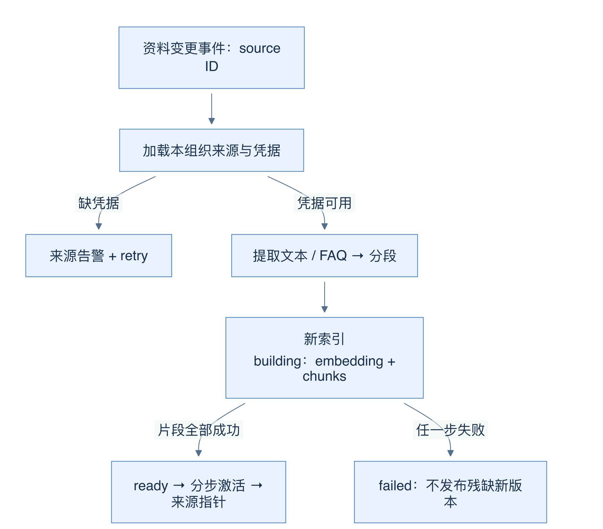
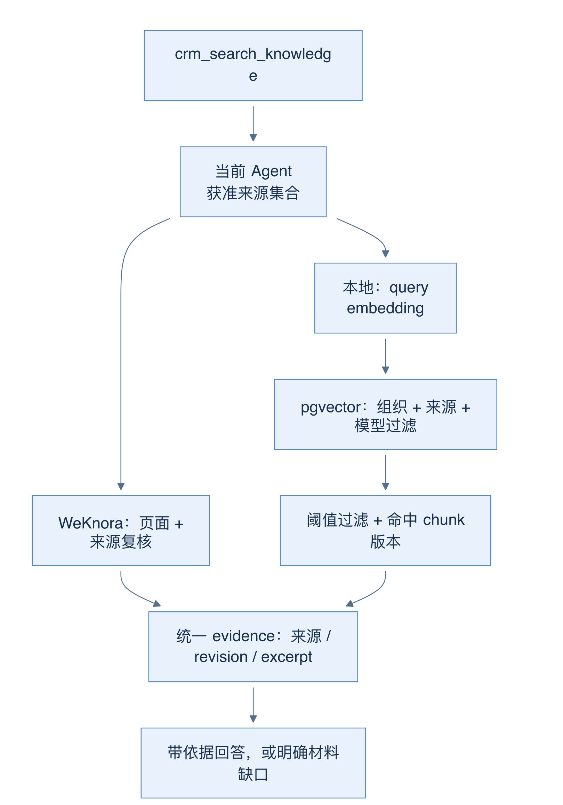
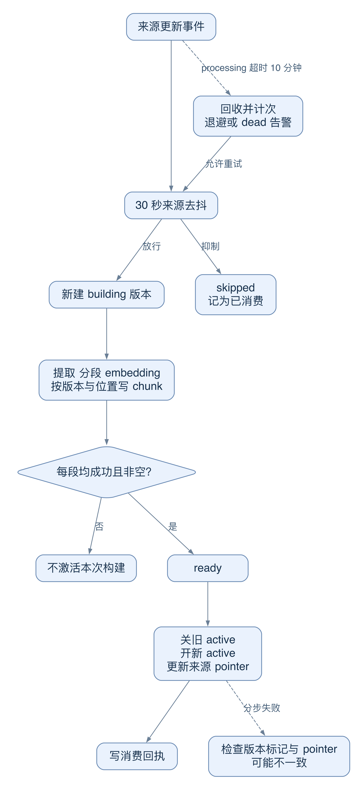
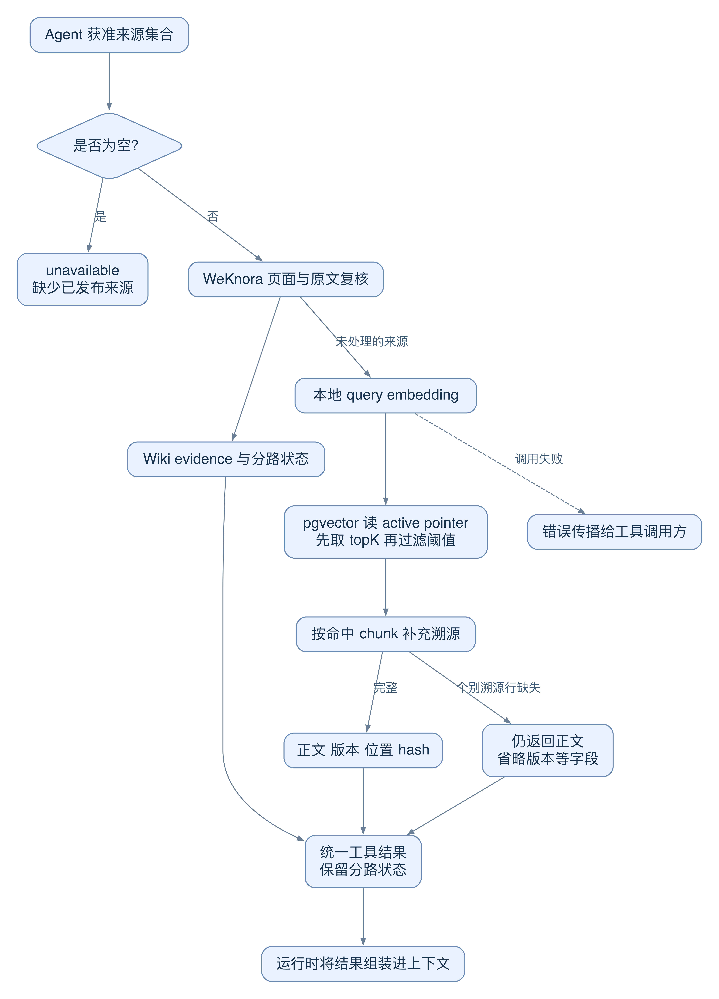
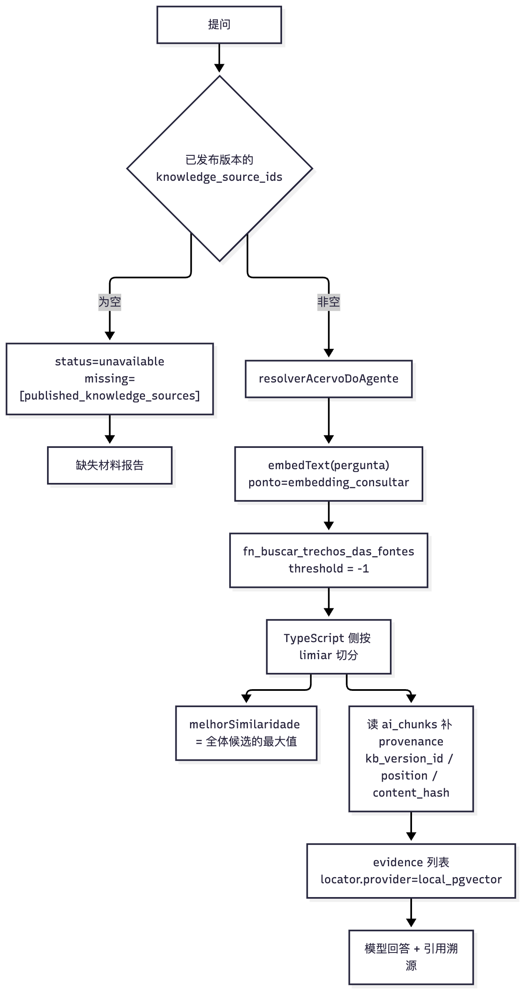

# 25 RAG：索引、检索、版本引用与证据缺口

[返回母文档](../README.md) · [上一章](24.md) · [下一章](26.md)

**本章目标：**理解资料入库、租户检索、版本溯源和证据不足的呈现。

## 业务流程与阅读起点

### 当前界面近景

截图显示当前界面的知识证据投影入口，价格、来源和摘录均为合成样例。它不证明真实文档已入库、索引已更新，或商业报价已获批准。

### 学习目标

读完本章，你应能从上传资料追到检索结果，区分来源、索引版本与 chunk，并判断“检索为空”到底缺在哪一层。

### 先建索引，再谈检索

RAG 是“先检索资料，再让模型据此作答”。embedding 把文本变成向量，用来找语义相近的片段；chunk 是参与检索的一段文本。向量相近只是候选筛选，不是内容正确性的证明。

本地资料由来源 ai_knowledge_sources 管理。knowledge_source.updated 事件交给 rag-indexer；商品同步事件也可触发相应来源的索引。Worker 按事件指定的来源工作，不再凭组织挑一个默认 Agent。因此两位 Agent 可选择不同资料，同一份 FAQ 也不用复制两套。

以售后 PDF 为例：文件保存在私有 ai-policy bucket；Worker 下载、提取文本、分段、生成 embedding，写入新的 ai_knowledge_versions 与 ai_chunks。每段保存来源 ID、版本 ID、位置、正文哈希与向量。FAQ 尽量保持一个问答完整；文档采用目标 1600 字符、200 字符重叠，保留跨段上下文。提取器支持 pdf、md、txt、csv，不直接读 Excel，也不能把纯扫描图片自动当成可搜索文字。

图 20-A：建新版本与激活分开；提取、embedding 或片段写入失败，不能把残缺新索引当成可用资料。

Worker 会先建完整新索引，再标 ready 并调用激活。任一片段写入失败会标 failed，不发布这个不完整版本；空内容也不会激活。没有 embedding 凭据时，来源显示 sem_credencial，中央通知解释原因，事件进入 retry，补好凭据后仍有任务可处理。

不要把上述流程理解成“整个发布事务绝不会中断”。activateVersion 实际分步关闭旧版本、打开新版本、更新来源指针；其中失败会抛错，需要检查版本和指针状态。重建期间保留旧材料的设计，不等于激活步骤已经具备跨请求原子切换保证。

### 一次知识工具调用怎样走

crm_search_knowledge 先确定当前 Agent 可读的来源。运行上下文已给知识源时用它；否则解析 Agent 的发布版本，并保留旧配置的兼容路径。没有发布资料时，返回 unavailable 与 published_knowledge_sources 缺口，模型应报告缺材料，而不是反复重试网络。

WeKnora 来源走第 24 章的页面与来源复核；剩余本地来源走 pgvector。只有本地来源需要 query embedding，外部 Wiki 已处理的来源不额外调用 embedding。两路产物统一为 evidence，但不把不同引擎分数硬排在同一把尺子上。

图 20-B：箭头代表来源分流与结果合并；权限集合先确定，检索不能靠模型提供任意租户或 KB 来扩张。

本地查询调用 fn_buscar_trechos_das_fontes，携带可信组织 ID、来源集合、query 向量、topK 和 embedding 模型。代码先获取候选，再用 0.4 默认阈值过滤，并保留 melhor_similaridade。于是“没有任何候选”和“有一点相似但不足以用”能被区分。

结果还读取命中 chunk 的版本与哈希，而不是读取来源当前指针：检索后可能刚好发生重建，用新指针给旧片段背书会错配证据。溯源信息完整时，引用可定位来源、index_version_id、chunk_id 和位置；个别溯源行缺失时仍可能返回正文，详见下方失败分支。

### 深入一层：重复事件、进程退出和版本发布分别怎样恢复

“幂等入库”必须说清楚幂等单位。来源事件、一次索引版本、一个 chunk 和索引激活，分别拥有不同的键与状态。本实现没有把整个链包进一个跨网络事务。

图 20-C：上方是一次构建；下方是事件恢复。恢复会再次进入构建入口，不代表从上次 chunk 位置原地继续。

1. dispatcher 用 `consumer_key` 与 `event_log.consumed_by` 跳过已经确认完成的消费者。drain 先将 pending 改为 processing，再调用 handler。业务效果与消费回执之间仍可能发生进程退出
2. rag-indexer 对“组织 + 来源 + 事件类型”做 30 秒 debounce。Redis 可用时用 `SET NX EX`；没配置时退回进程内 Map；已配置但连接失败或超过 2 秒时，直接放行。它宁可允许多一次构建，也不让去抖依赖阻断入库
3. 每次实际构建创建一个新的 `ai_knowledge_versions` 行。chunk 的去重键是“来源 + 版本 + position”。`content_hash` 记录正文指纹，不是跨所有构建复用 embedding 的缓存键。重试新建版本，仍可能重新支付 embedding 成本
4. 所有片段成功后才把版本标 ready。embedding 失败或任意片段写失败都会阻止该次激活。空内容也不激活。这里保障的是“不把本次残缺构建作为新索引发布”
5. 激活依次关闭其他版本的 active 标记、打开新版本标记、更新来源 pointer。它们是分开请求。若第三步失败，新版本标记与来源 pointer 可暂时不一致。当前查询 RPC 以来源 pointer 为准，并不要求版本行的 is_active=true；旧 pointer 仍可能读到旧 chunks。排查必须同时读版本和 pointer，不能只看一盏 ready 灯
6. processing 超过 10 分钟的事件会被 drain 回收；回收也增加 attempts。第一次回收可在同一 tick 重试，后续回收有退避；达到 5 次进入 dead 并通知 Central。正常 `error` 也计次，`retry` 不计次，`skipped` 会记为已消费

有意义的失败例：索引刚激活，进程在写消费回执前退出。10 分钟后，事件可被回收并再次构建，产生另一版本。这是“恢复尚未确认完成的工作”，不是“全链恰好一次”。旧 chunk 的唯一键不会去重另一新版本里的相同正文。

还有一个新鲜度边界。第二个来源更新事件若在 debounce 窗口内被 skipped，就按已消费处理。handler 没有在 TTL 到期后补一个必跑的尾随任务，也没有在激活前核对“输入来源 revision 是否仍是最新”。所以不能只凭有 debounce 宣称最后一次编辑必然已入库。若资料连续变化，应核对最后修改、last_indexed_at 和实际 chunk 内容。这是当前代码的能力边界，不是要求在本章修改 worker。

注意源码注释的时间性：`lib/ai/rag/debounce.ts` 开头还描述过“event_log 没有回收器”的旧故障；当前 `drain.ts` 已有回收逻辑。本章以上述实际分支为准。

源码定位：[`lib/event-log/dispatcher.ts:78-103`](https://github.com/helsome/AiNativeCrm/blob/679e09e80878dff7b1c79b8537317b2b9e355331/lib/event-log/dispatcher.ts#L78-L103)；[`lib/event-log/drain.ts:13-16`](https://github.com/helsome/AiNativeCrm/blob/679e09e80878dff7b1c79b8537317b2b9e355331/lib/event-log/drain.ts#L13-L16)、[`lib/event-log/drain.ts:159-225`](https://github.com/helsome/AiNativeCrm/blob/679e09e80878dff7b1c79b8537317b2b9e355331/lib/event-log/drain.ts#L159-L225)、[`lib/event-log/drain.ts:258-349`](https://github.com/helsome/AiNativeCrm/blob/679e09e80878dff7b1c79b8537317b2b9e355331/lib/event-log/drain.ts#L258-L349)；[`workers/rag-indexer.ts:55-58`](https://github.com/helsome/AiNativeCrm/blob/679e09e80878dff7b1c79b8537317b2b9e355331/workers/rag-indexer.ts#L55-L58)、[`workers/rag-indexer.ts:374-455`](https://github.com/helsome/AiNativeCrm/blob/679e09e80878dff7b1c79b8537317b2b9e355331/workers/rag-indexer.ts#L374-L455)、[`workers/rag-indexer.ts:566-597`](https://github.com/helsome/AiNativeCrm/blob/679e09e80878dff7b1c79b8537317b2b9e355331/workers/rag-indexer.ts#L566-L597)；[`lib/ai/rag/debounce.ts:102-129`](https://github.com/helsome/AiNativeCrm/blob/679e09e80878dff7b1c79b8537317b2b9e355331/lib/ai/rag/debounce.ts#L102-L129)；[`lib/ai/rag/version.ts:140-196`](https://github.com/helsome/AiNativeCrm/blob/679e09e80878dff7b1c79b8537317b2b9e355331/lib/ai/rag/version.ts#L140-L196)。

### 深入一层：空结果、弱结果、旧证据和服务失败不一样

继续问“林女士询价的产品有什么售后条件”。客户偏好只影响沟通方式；下面的知识工具寻找售后材料。用相似度猜承诺、用空列表猜没有政策，都会跳过真实缺口。

图 20-D：Wiki 与本地查询有不同失败边界。合并证据数组不代表两种分数、两种版本和两种服务状态已经统一。

1. 工具先取得 Agent 可读来源。集合为空时，它返回 `published_knowledge_sources` 缺口。先补可访问且已发布的材料，再谈查询质量；重复同一搜索不会自己创建资料
2. WeKnora 路径验证页面和原文。成功处理的 Wiki 来源从本地列表移除。适配器 disabled 或整体异常时，`handledSourceIds` 为空，工具可能把原来源留给本地查询。这不保证本地有一份 Wiki 镜像；若没有索引，仍然没有可用内容
3. 本地路径生成 query embedding，调用只读取指定来源 active pointer 所指 chunks 的 SQL 函数。SQL 也检查组织、来源 active/ready 和 embedding 模型匹配；旧版索引的模型字段为 null 时仍有兼容通道
4. 代码先取 topK 候选，再用 0.4 阈值过滤。最高候选分数保留下来。零候选表示没有拿到可用候选；弱候选表示有接近材料但未达当前标准。两者需要不同排查，不能一律降低阈值
5. 命中后，代码按实际 chunk ID 再读 version、position 和 hash。查询失败会报 provenance 错误。但是个别 chunk 溯源行缺失或 source ID 不匹配时，当前代码仍返回检索正文，只省略这些溯源字段。这是证据不完整，不能写成“所有返回材料都已完整验明版本”
6. 返回对象同时带 `evidence`、`trechos`、`wiki_status` 与 `melhor_similaridade`。顶层 `retrieval.status=complete` 在这里表示“至少得到一项证据”，不保证覆盖所有来源。Wiki 失败但本地有结果时，仍可能 complete；应结合分路状态解释

失败例：Wiki 已处理两个获准来源，但全部候选页面已过期。返回可以是 Wiki empty。工具不会将这些已处理来源再自动转成另一份本地知识。另一个失败例是本地 embedding 调用失败：这里的本地查询没有同等的外层 catch，错误会向工具调用方传播。旧入站引擎的 `searchKnowledge` 则会返回 `ok:false` 和教学错误。不要把旧引擎的降级契约套到所有 MCP 查询上。

最后看清“检索资料”和“模型上下文”：上图只产出工具结果。第 24 章图 19-C 才显示它怎样与系统规则、任务和历史组装。看到一个 chunk 出现在数据库，不足以证明模型读过它；看到模型读过它，也不足以证明已经取得对外承诺或执行动作的许可。

源码定位：[`lib/mcp/tools/evolucao.ts:69-133`](https://github.com/helsome/AiNativeCrm/blob/679e09e80878dff7b1c79b8537317b2b9e355331/lib/mcp/tools/evolucao.ts#L69-L133)；[`lib/ai/knowledge/busca.ts:66-134`](https://github.com/helsome/AiNativeCrm/blob/679e09e80878dff7b1c79b8537317b2b9e355331/lib/ai/knowledge/busca.ts#L66-L134)；[`supabase/migrations/20260826140000_0181_o_acervo_e_da_organizacao.sql:433-465`](https://github.com/helsome/AiNativeCrm/blob/679e09e80878dff7b1c79b8537317b2b9e355331/supabase/migrations/20260826140000_0181_o_acervo_e_da_organizacao.sql#L433-L465)；[`lib/ai/integrations/weknora.ts:135-143`](https://github.com/helsome/AiNativeCrm/blob/679e09e80878dff7b1c79b8537317b2b9e355331/lib/ai/integrations/weknora.ts#L135-L143)、[`lib/ai/integrations/weknora.ts:233-244`](https://github.com/helsome/AiNativeCrm/blob/679e09e80878dff7b1c79b8537317b2b9e355331/lib/ai/integrations/weknora.ts#L233-L244)；[`lib/agent-engine/agent/search-knowledge.ts:147-168`](https://github.com/helsome/AiNativeCrm/blob/679e09e80878dff7b1c79b8537317b2b9e355331/lib/agent-engine/agent/search-knowledge.ts#L147-L168)。

### 常见误区与自测

- 上传成功或来源 status=ready，不能替代 last_index_status、片段数量和实际检索验证
- chunk 大小是分段目标，当前算法依段落与英文句点切分，不是所有语言下的严格字符上限
- 客户会话另有获准、已解决、匿名化和残余个人信息检查的批处理；没有“全部聊天自动入库”的通道

自测：FAQ 昨天能搜到，今天 PDF 重建失败，应先查新版本、来源指针和错误，不要立刻调低相似度阈值去掩盖索引问题。

### 源码定位

本章固定 main@679e09e80878dff7b1c79b8537317b2b9e355331。

- [`workers/rag-indexer.handler.ts:11-17`](https://github.com/helsome/AiNativeCrm/blob/679e09e80878dff7b1c79b8537317b2b9e355331/workers/rag-indexer.handler.ts#L11-L17)：事件入口；[`workers/rag-indexer.ts:170-221`](https://github.com/helsome/AiNativeCrm/blob/679e09e80878dff7b1c79b8537317b2b9e355331/workers/rag-indexer.ts#L170-L221)：FAQ/文档提取
- [`workers/rag-indexer.ts:305-457`](https://github.com/helsome/AiNativeCrm/blob/679e09e80878dff7b1c79b8537317b2b9e355331/workers/rag-indexer.ts#L305-L457)：新版本构建；[`workers/rag-indexer.ts:531-647`](https://github.com/helsome/AiNativeCrm/blob/679e09e80878dff7b1c79b8537317b2b9e355331/workers/rag-indexer.ts#L531-L647)：来源状态、凭据与重试
- [`lib/ai/rag/ingest/documento.ts:29-39`](https://github.com/helsome/AiNativeCrm/blob/679e09e80878dff7b1c79b8537317b2b9e355331/lib/ai/rag/ingest/documento.ts#L29-L39)：格式；[`lib/ai/rag/ingest/documento.ts:82-147`](https://github.com/helsome/AiNativeCrm/blob/679e09e80878dff7b1c79b8537317b2b9e355331/lib/ai/rag/ingest/documento.ts#L82-L147)：下载和 PDF 失败
- [`lib/ai/rag/chunker.ts:18-83`](https://github.com/helsome/AiNativeCrm/blob/679e09e80878dff7b1c79b8537317b2b9e355331/lib/ai/rag/chunker.ts#L18-L83)：切段与重叠；[`lib/ai/rag/version.ts:140-196`](https://github.com/helsome/AiNativeCrm/blob/679e09e80878dff7b1c79b8537317b2b9e355331/lib/ai/rag/version.ts#L140-L196)：分步激活
- [`lib/mcp/tools/evolucao.ts:45-133`](https://github.com/helsome/AiNativeCrm/blob/679e09e80878dff7b1c79b8537317b2b9e355331/lib/mcp/tools/evolucao.ts#L45-L133)：统一工具、两路证据与默认阈值
- [`lib/ai/knowledge/busca.ts:66-134`](https://github.com/helsome/AiNativeCrm/blob/679e09e80878dff7b1c79b8537317b2b9e355331/lib/ai/knowledge/busca.ts#L66-L134)：向量查询与 chunk 溯源；[`lib/ai/knowledge/busca.ts:150-189`](https://github.com/helsome/AiNativeCrm/blob/679e09e80878dff7b1c79b8537317b2b9e355331/lib/ai/knowledge/busca.ts#L150-L189)：来源授权解析
- [`lib/ai/rag/ingest/conversations.ts:1-19`](https://github.com/helsome/AiNativeCrm/blob/679e09e80878dff7b1c79b8537317b2b9e355331/lib/ai/rag/ingest/conversations.ts#L1-L19)：会话知识的独立隐私处理链

## 实现详解

本页面解释 CRM 中知识检索的完整链路：谁拥有知识、按什么粒度隔离租户、检索时如何切阈值并把「没找到」与「找到了但不够好」区分开、引用如何溯源到具体的索引版本与内容哈希，以及当证据不足时系统如何生成一份「缺失材料报告」而不是含糊其辞。核心代码集中在 `lib/ai/knowledge/`（检索与证据契约）、`lib/mcp/tools/evolucao.ts`（能力出口）、`lib/ai/evals/`（证据溯源评测）与 `supabase/migrations/20260826140000_0181_o_acervo_e_da_organizacao.sql`（把「智能体拥有知识」翻转为「组织拥有知识」的架构反转）。理解本页前，建议先阅读 [Pi Agent Core 回合编排：入站回合、上下文构建与工具定义](20.md) 理解工具如何在回合中被调用，以及 [多智能体协作：主管并行调度、专职执行租约与评测证据](17.md) 理解专职智能体如何产出本页面所述的证据与缺失材料。

### 一条必须先讲清的历史：知识曾经属于智能体

早期设计中，识库 `ai_knowledge_sources.agent_id` 是 `NOT NULL` 且带 `ON DELETE CASCADE`，一个智能体只能挂一个标量的 `active_kb_version_id`。0181 迁移把这一整套反过来：来源改为**组织的资产**，智能体的 `agent_id` 降级为「这份材料当初由哪个智能体创建」的历史记录并改为 `ON DELETE SET NULL`；索引指针从「每智能体一个」变成「每来源一个」；谁读哪份材料，改由已发布版本上的 `ai_agent_versions.knowledge_source_ids`（`uuid[]`）决定。迁移注释直接点明了动机：两个团队用同一本换票手册不该被迫上传两次，任何第二个 PDF 都会撞上 `(agent_id, source_type)` 唯一索引，而「最后索引的人会悄悄清掉别人的知识库」正是 FAQ worker 与对话索引 worker 互相 `activate_kb_version` 造成的。

选择 `uuid[]` 而不是连接表也有明确理由：运行时在一次无缓存查询里读取智能体配置（`agent-config.ts` 通过 `published_version_id` join `ai_agent_versions`），加一列 `v.knowledge_source_ids` 是零额外往返，而连接表会让每个被服务的回合多一次查询。这与 `pipeline_ids`（0125）沿用同一个「作用域住在已发布版本里」的模型。

Sources: [20260826140000_0181_o_acervo_e_da_organizacao.sql](https://github.com/helsome/AiNativeCrm/blob/679e09e80878dff7b1c79b8537317b2b9e355331/supabase/migrations/20260826140000_0181_o_acervo_e_da_organizacao.sql#L14)

### 所有权反转后的四张表与两个指针

| 表/列 | 语义（0181 之后） | 关键约束 |
| --- | --- | --- |
| `ai_knowledge_sources` | 组织拥有的材料 | `agent_id` 可空、`ON DELETE SET NULL`；`(organization_id, lower(btrim(name))) where is_active` 唯一；归档时 `is_active` 必须为 false |
| `ai_knowledge_versions` | 某一材料的一次索引 | `agent_id` 可空；`knowledge_source_id` 可空（0181 之前是历史多来源）；`embedding_model` / `embedding_dims` 记录向量出处；`ai_kbv_uma_ativa_por_fonte` 部分唯一索引 |
| `ai_chunks` | 实际被检索的片段 | `kb_version_id` 级联删除，`knowledge_source_id` 指向来源 |
| `ai_agent_versions.knowledge_source_ids` | 该智能体可读的材料清单 | 空数组 = **失败闭合**：智能体照常对话，但搜索工具从回合里消失 |

`last_index_status` 的检查约束在同一次迁移里补齐了两个产品早已产生、界面却无法表达的状态：`indexando`（正在索引，界面上曾显示为中性的「未索引」，与从未尝试过不可区分）与 `sem_credencial`（因缺少 embedding 密钥而未索引，此前只写进 worker 日志，来源行永远停在 `ready`）。`source_type` 的 CHECK 被整体移除，词汇表移交给 `lib/ai/rag/tipos-de-fonte.ts`，沿用 0127 对 `provider` 列的先例。

Sources: [20260826140000_0181_o_acervo_e_da_organizacao.sql](https://github.com/helsome/AiNativeCrm/blob/679e09e80878dff7b1c79b8537317b2b9e355331/supabase/migrations/20260826140000_0181_o_acervo_e_da_organizacao.sql#L200)

### 租户隔离：四张表在同一次迁移里补上 RBAC

0181 之前，这四张 RAG 表一直停留在「仅租户隔离的 `ALL` 策略 + `GRANT ALL ... TO anon`」的状态——PostgREST 按构造暴露给浏览器，一个 `viewer` 角色的成员用他自己的 JWT 就能删除本组织的 `ai_chunks`，完全绕开要求 `manager` 的应用路由。0181 把它们收进 0150 确立的格式：**读仍是仅租户隔离**（否则界面崩溃），**写分两层**——界面会编辑的 `ai_knowledge_sources` 与 `ai_faq_items` 要求 `manager`，只有引擎写入的 `ai_chunks` 与 `ai_knowledge_versions` 要求 `admin`；三张表额外允许平台管理员。

检索 RPC `fn_buscar_trechos_das_fontes` 是 `SECURITY DEFINER`，它在函数体内做两件事：当 `auth.uid()` 非空时校验调用者是否真是该组织的活跃成员（`fn_role_at_least(..., 'viewer')`，否则抛 `caller_not_authorized_for_org`），然后用写死的 `c.organization_id = p_organization_id` 做程序化过滤。这条设计有一个容易被忽略的前提：引擎以 `bypassrls` 运行且从不 `set role`，所以成员校验对它不生效，它的安全性完全落在手写的 `organization_id` 条件上。函数在 `public` schema 新建时会被两条路径暴露（Postgres 对函数的 `PUBLIC` 默认授权，以及基线里的 `ALTER DEFAULT PRIVILEGES ... TO anon`），因此迁移显式 `revoke` 掉 `public, anon` 再只 `grant` 给 `authenticated, service_role`。

Sources: [20260826140000_0181_o_acervo_e_da_organizacao.sql](https://github.com/helsome/AiNativeCrm/blob/679e09e80878dff7b1c79b8537317b2b9e355331/supabase/migrations/20260826140000_0181_o_acervo_e_da_organizacao.sql#L408) [20260826140000_0181_o_acervo_e_da_organizacao.sql](https://github.com/helsome/AiNativeCrm/blob/679e09e80878dff7b1c79b8537317b2b9e355331/supabase/migrations/20260826140000_0181_o_acervo_e_da_organizacao.sql#L505)

### 检索管线的形状

调用方永远需要显式传入 `organizationId`，且 `busca.ts` 的文件头注释把这一点写成契约：租户来自令牌/cookie 等可信来源，绝不来自请求体。当 `knowledgeSourceIds` 为空时函数直接返回空结果，不发起 embedding 调用。Sources: [busca.ts](https://github.com/helsome/AiNativeCrm/blob/679e09e80878dff7b1c79b8537317b2b9e355331/lib/ai/knowledge/busca.ts#L1) [busca.ts](https://github.com/helsome/AiNativeCrm/blob/679e09e80878dff7b1c79b8537317b2b9e355331/lib/ai/knowledge/busca.ts#L68)

### 阈值为什么放在 TypeScript 而不是 RPC 里

这是本子系统最核心的一个设计决定。`fn_buscar_trechos_das_fontes` 默认阈值是 0.40，但 `buscarConhecimento` **始终传 `-1`**（余弦相似度的真实下界：`1 - distance`，`distance ∈ [0,2]`），然后在 TypeScript 侧按调用方的 `limiar` 过滤。这样做的唯一目的是拿到「最好但被淘汰的那个候选」的相似度数字。

代码注释把这个理由讲得非常直接：没有这个数字，「知识库没有这条信息」与「知识库有相近内容但不够好」会以完全相同的形式到达提问者——而这两种情况的补救动作恰好相反，前者应当转人工，后者应当调整阈值或换措辞。`ResultadoDaBusca` 因此把 `melhorSimilaridade` 作为独立字段存在，即使没有任何片段通过阈值它也会被填充。

阈值统一由 `lib/mcp/tools/evolucao.ts` 中的 `LIMIAR_PADRAO = 0.4` 提供，与数据库 0097 迁移起的默认值一致。此前产品对同一批材料存在**三个阈值**：RPC 里 0.40、智能体回合里 0.72、MCP 能力里 0.72——两个人问同一个问题却因为入口不同得到不同答案的能力，被这次统一消除。

Sources: [busca.ts](https://github.com/helsome/AiNativeCrm/blob/679e09e80878dff7b1c79b8537317b2b9e355331/lib/ai/knowledge/busca.ts#L32) [busca.ts](https://github.com/helsome/AiNativeCrm/blob/679e09e80878dff7b1c79b8537317b2b9e355331/lib/ai/knowledge/busca.ts#L86) [evolucao.ts](https://github.com/helsome/AiNativeCrm/blob/679e09e80878dff7b1c79b8537317b2b9e355331/lib/mcp/tools/evolucao.ts#L39)

### 嵌入模型不匹配：静默的召回失败

0181 在 `ai_knowledge_versions` 上新增 `embedding_model` 与 `embedding_dims`，理由写在迁移注释里：「索引时用模型 A、查询时用模型 B」正是 AI 调用记录所描述的那类静默故障——检索照常返回，只是给出错误的片段。`fn_buscar_trechos_das_fontes` 的 `p_embedding_model` 参数处理方式是**排除而非报错**：当参数非空时，剔除 `v.embedding_model` 非空且不等于该模型的版本；`embedding_model` 为空的版本（0181 之前的旧索引）保留参与。取舍写在注释里：recall 静默崩坏比「多返回一个外部来源」更难察觉，因此宁缺毋滥。

同时 `ai_models` 表第一次拥有 embedding 模型（`text-embedding-3-small`，1536 维），此前提供商面板根本无从为 `embedding_indexar` / `embedding_consultar` 两个用途提供密钥，因为没有可列举的模型。

Sources: [20260826140000_0181_o_acervo_e_da_organizacao.sql](https://github.com/helsome/AiNativeCrm/blob/679e09e80878dff7b1c79b8537317b2b9e355331/supabase/migrations/20260826140000_0181_o_acervo_e_da_organizacao.sql#L242) [20260826140000_0181_o_acervo_e_da_organizacao.sql](https://github.com/helsome/AiNativeCrm/blob/679e09e80878dff7b1c79b8537317b2b9e355331/supabase/migrations/20260826140000_0181_o_acervo_e_da_organizacao.sql#L478)

### 溯源：读片段版本，而不是活动指针

`buscarConhecimento` 在拿到候选片段之后会做第二次查询，从 `ai_chunks` 读取 `id, knowledge_source_id, kb_version_id, position, content_hash`。注释解释了为什么必须读片段自身携带的 `kb_version_id` 而不是来源上的活动指针：**一次并发的重新索引可能已经在向量检索之后换掉了那个指针**。并且只有当片段的 `knowledge_source_id` 与 RPC 返回的一致时才附带这些字段，不一致则静默省略——避免把来源错配的溯源信息传播出去。

这套三元组（`kb_version_id` + `position` + `content_hash`）构成了引用可追溯到具体字节的锚点：即使同一份材料被重新切分、重新嵌入，历史引用依然指向当时那个版本里的那个位置和那段内容的哈希。

Sources: [busca.ts](https://github.com/helsome/AiNativeCrm/blob/679e09e80878dff7b1c79b8537317b2b9e355331/lib/ai/knowledge/busca.ts#L101)

### 证据契约：产品自有、供应商无关

`lib/ai/knowledge/contracts.ts` 定义了一组刻意与供应商解耦的类型，文件头写明：提供者可能是本地 pgvector 语料、组织 wiki、Skill，或未来的远端系统；智能体代码只消费这套证据形状，绝不依赖厂商响应或 Pi 的类型。核心结构包括：

| 类型 | 作用 |
| --- | --- |
| `AgentKnowledgePolicy` | 每个命名空间的检索时机（`on_demand` / `required_before_answer`）、引用模式、最小证据条数、以及不可用时的行为（`partial_result` / `report_missing` / `fail_run`） |
| `KnowledgeEvidence` | 单条证据：`namespace`、`kind`、`title`、`excerpt`、`locator`（provider + sourceId + revision + uri）、可选 `score` 与 `metadata` |
| `KnowledgeRetrievalResult` | 状态四态 `complete / partial / empty / unavailable` + `missingNamespaces` + `warnings` |
| `AgentKnowledgeCatalogPort` | **目录与检索刻意分离**，文件注释说明原因：「这样智能体才能报告缺失的数据」 |

最后一行是整个「证据缺失报告」的设计起点：只有当「有哪些语料可用」与「这次查到了什么」是两个独立端口时，agent 才能区分「我没查」和「查了，没有」。

Sources: [contracts.ts](https://github.com/helsome/AiNativeCrm/blob/679e09e80878dff7b1c79b8537317b2b9e355331/lib/ai/knowledge/contracts.ts#L1) [contracts.ts](https://github.com/helsome/AiNativeCrm/blob/679e09e80878dff7b1c79b8537317b2b9e355331/lib/ai/knowledge/contracts.ts#L25) [contracts.ts](https://github.com/helsome/AiNativeCrm/blob/679e09e80878dff7b1c79b8537317b2b9e355331/lib/ai/knowledge/contracts.ts#L60) [contracts.ts](https://github.com/helsome/AiNativeCrm/blob/679e09e80878dff7b1c79b8537317b2b9e355331/lib/ai/knowledge/contracts.ts#L96)

### 证据归一化：不把模型文本当 URL

`lib/ai/knowledge/evidence.ts` 处理两个风险。其一是**绝不把任意工具负载直接复制到界面**：`normalizeKnowledgeEvidence` 只接受 `organization_wiki` 与 `organization_memory` 两个命名空间，要求 `id`、`locator.sourceId`、`locator.provider`、`title`、`excerpt` 全部为字符串，否则整条丢弃；`kind` 由命名空间与字段值推导而非直接信任。

其二是**URL 由已校验的 ID 拼装，绝不从模型或工具文本中采信**。`knowledgeEvidenceUri` 用正则 `^[0-9a-f]{8}-…$` 校验 UUID、要求 `revision` 为 64 位十六进制（仅对 `provider === "weknora"`）或 UUID（本地 pgvector），否则返回 `null` 而非拼接。组织记忆的证据固定指向 `/app/ai/memory`。

`observedKnowledgeEvidence` 则从回合消息流中回收已被模型实际调用过的证据，键为 `namespace:id:revision`，天然去重。

Sources: [evidence.ts](https://github.com/helsome/AiNativeCrm/blob/679e09e80878dff7b1c79b8537317b2b9e355331/lib/ai/knowledge/evidence.ts#L12) [evidence.ts](https://github.com/helsome/AiNativeCrm/blob/679e09e80878dff7b1c79b8537317b2b9e355331/lib/ai/knowledge/evidence.ts#L54) [evidence.ts](https://github.com/helsome/AiNativeCrm/blob/679e09e80878dff7b1c79b8537317b2b9e355331/lib/ai/knowledge/evidence.ts#L72)

### 证据缺失报告：三个产生缺口的判据

专职智能体执行结束后，`missingMaterial` 由三条独立的判据拼装：

| 缺失标记 | 触发条件 | 语义 | |---|---|---| | `failed_tool_observations` | 本次存在 `is_error` 的工具调用 | 观察不完整 | | `published_knowledge_sources` | 某个 `crm_search_knowledge` 结果文本匹配 `"status":"unavailable|empty"` 或 `published_knowledge_sources` | 智能体没有已发布材料可读 | | `tool_observations` | `toolCalls === 0` | 智能体一次工具都没调，没有任何观察 | | `safe_specialist_summary` / `complete_specialist_summary` | 抽取出的答案含内部草稿码 /疑似被截断 | 报告本身不可信 |

只要 `toolErrors > 0` 或 `missingMaterial` 非空，专职结果状态即为 `partial` 而非 `complete`。这段逻辑与系统提示中的要求一一对应：提示词明确要求「如果工具返回空结果，应把空结果作为事实并说明边界；如果没有可用工具或关键字段，应明确列为缺失材料」，并要求报告保留「引用来源、缺失材料与冲突」。

Sources: [workbench-collaboration.ts](https://github.com/helsome/AiNativeCrm/blob/679e09e80878dff7b1c79b8537317b2b9e355331/lib/ai/agents/workbench-collaboration.ts#L511) [workbench-collaboration.ts](https://github.com/helsome/AiNativeCrm/blob/679e09e80878dff7b1c79b8537317b2b9e355331/lib/ai/agents/workbench-collaboration.ts#L423)

### 「没有查到」不等于「不确定」

`.changes/conversa-nao-trava-por-falta-de-citacao.md` 记录了一次修复：当智能体回复时压根没有调用知识库——一句问候、一次感谢、任何超出已索引范围的话题——系统曾把它理解为「智能体没把握」，于是扣住回复不发并把会话推入人工队列，客户就在等待中收不到任何答复。修复后的语义是：未查询知识库属于**没有度量**，而不是**低分**；智能体在自称没把握时仍然转人工，在检索到的材料确实薄弱时也仍然转人工。

`toolEvidence` 中一个不起眼的分支实现了这个区分：对 `crm_search_knowledge` 与 `crm_get_org_memory`，若归一化后证据为空，只有前者（即确实发起了检索但无结果）返回空数组；后者回落到通用工具证据，换句话说——「查了但没查到」被记录为「无可用证据」，而「没去查」被记录为「一次带摘要的工具观察」。两种情况不再被折叠成同一个信号。

Sources: [conversa-nao-trava-por-falta-de-citacao.md](https://github.com/helsome/AiNativeCrm/blob/679e09e80878dff7b1c79b8537317b2b9e355331/.changes/conversa-nao-trava-por-falta-de-citacao.md#L1) [workbench-collaboration.ts](https://github.com/helsome/AiNativeCrm/blob/679e09e80878dff7b1c79b8537317b2b9e355331/lib/ai/agents/workbench-collaboration.ts#L333)

### 引用在类型、消息与评测三处的落法

**类型层** `lib/ai/citations/types.ts` 定义了 `Citation`，携带 `chunk_id`、`knowledge_source_id`、`source_type`、`source_anchor`、`score`、`snippet`/`text` 双字段回退与 `metadata`；`extractCitations` 只做最薄的一层校验（数组 + 对象），不解析模型文本。

**能力层** `crm_search_knowledge` 返回的结构是本页面契约的最终形态：`trechos`（原始 RAG 结果）、`evidence`（统一证据形状，本地片段在此被映射为 `namespace: organization_wiki`、`kind` 由 `metadata.source_type === "wiki"` 决定是 `wiki_page` 还是 `document`、`locator.provider: "local_pgvector"`，并把 `revision_kind: "index_version"`、`position`、`content_hash` 一并放进 `metadata`）、`retrieval`（含 `wiki_status`、`status`、`missing`）以及 `melhor_similaridade`。

值得注意的是该能力同时支持本地 pgvector 与外部组织 wiki（Weknora）两个来源：外部绑定的检索结果先进 `wiki.evidence`，其 `handledSourceIds` 中的来源会从本地检索列表中剔除，两边证据合并返回给模型。`retrieval.status` 在两侧皆空时为 `empty`。而当智能体没有任何已发布材料时，返回的不是错误而是 `status: "unavailable"` 加 `missing: ["published_knowledge_sources"]` 加 `aviso: "assistente_sem_acervo_publicado"`——注释给的理由是：返回失败会让模型当成 bug 去重试，而不是如实说自己不知道。

**评测层** `lib/ai/evals/evidence-provenance.ts` 与 `evaluate-run.ts` 把「是否引用」与「引用了什么」当作可测指标，`evaluate-run.ts` 直接按 `toolName === "crm_search_knowledge"` 统计工具事件。

Sources: [types.ts](https://github.com/helsome/AiNativeCrm/blob/679e09e80878dff7b1c79b8537317b2b9e355331/lib/ai/citations/types.ts#L1) [evolucao.ts](https://github.com/helsome/AiNativeCrm/blob/679e09e80878dff7b1c79b8537317b2b9e355331/lib/mcp/tools/evolucao.ts#L58) [evolucao.ts](https://github.com/helsome/AiNativeCrm/blob/679e09e80878dff7b1c79b8537317b2b9e355331/lib/mcp/tools/evolucao.ts#L140)

### 证据声明：只传哈希，不传原值

在多智能体协作路径中，`lib/ai/agents/evidence-claims.ts` 把工具观察转换为「可寻址的声明」，其文件级注释说明了原则：**原始字段值绝不进入协作契约或父事件日志**。实现方式是逐字段规范化为 `sha256` 哈希：`canonical()` 对键排序、对数组排序后拼接，`valueHash` 取 `sha256(canonical(value))`，声明 ID 再把 `specialistKey` 混入哈希。`REVISION_FIELDS`（`revision`、`version`、`updated_at`、`updatedAt`、`modified_at`）被单独抽出作为 `locator.revision`，且在 `scalarFields` 中被跳过以免重复计入哈希。`crm_search_knowledge` 在 `TOOL_RESOURCE` 中映射为 `knowledge_evidence`，即知识检索结果的 `sourceId` 形如 `knowledge_evidence:<chunkId>`。每次观察的声明数上限为 128，字段递归深度上限为 2。

Sources: [evidence-claims.ts](https://github.com/helsome/AiNativeCrm/blob/679e09e80878dff7b1c79b8537317b2b9e355331/lib/ai/agents/evidence-claims.ts#L1) [evidence-claims.ts](https://github.com/helsome/AiNativeCrm/blob/679e09e80878dff7b1c79b8537317b2b9e355331/lib/ai/agents/evidence-claims.ts#L48) [evidence-claims.ts](https://github.com/helsome/AiNativeCrm/blob/679e09e80878dff7b1c79b8537317b2b9e355331/lib/ai/agents/evidence-claims.ts#L75) [evidence-claims.ts](https://github.com/helsome/AiNativeCrm/blob/679e09e80878dff7b1c79b8537317b2b9e355331/lib/ai/agents/evidence-claims.ts#L126)

### 组织 Wiki 证据通道

当组织配置了 `weknora` 绑定，`crm_search_knowledge` 会先调用 `searchCompanyWiki`，其证据的 `locator.provider` 为 `weknora`，其 URL 指向 `/api/v1/ai/integrations/wiki/evidence/{id}`——需要 `sourceId` 与 `id` 都是 UUID 且 `revision` 是 64 位十六进制才拼装成功。这与本地 pgvector 的 URL 形态（`/api/v1/ai/knowledge/sources/{sourceId}/trechos?version_id={revision}&chunk_id={id}`）并列，构成两个并列的证据提供者，而模型侧看到的 `KnowledgeEvidence` 形状完全一致。

Sources: [evolucao.ts](https://github.com/helsome/AiNativeCrm/blob/679e09e80878dff7b1c79b8537317b2b9e355331/lib/mcp/tools/evolucao.ts#L96) [evidence.ts](https://github.com/helsome/AiNativeCrm/blob/679e09e80878dff7b1c79b8537317b2b9e355331/lib/ai/knowledge/evidence.ts#L54)

### 不变量测试：这一页背后的护栏

| 测试 | 守护的命题 |
| --- | --- |
| `tests/invariants/rag-acervo-da-organizacao.test.ts` | 知识库归属组织，智能体只选择读哪些 |
| `tests/invariants/o-agente-indexa-mais-de-um-material.test.ts` | 索引指针是每来源一个 |
| `tests/unit/rag-indexer-grava-a-causa-da-extracao.test.ts` | 抽取失败必须落成可诊断的状态 |
| `tests/unit/rag-nao-ativa-versao-incompleta.test.ts` | 不完整的索引版本不得被激活 |
| `tests/unit/evidencia-citada.test.ts` | 引用在链路上真实存在 |
| `tests/unit/rag-csv-extractor.test.ts` | CSV 材料抽取 |
| `tests/unit/busca-vazia-nao-e-sucesso.test.ts` / `mcp-servidor-busca-vazia-nao-e-sucesso.test.ts` | 空检索不是成功 |

Sources: [rag-acervo-da-organizacao.test.ts](https://github.com/helsome/AiNativeCrm/blob/679e09e80878dff7b1c79b8537317b2b9e355331/tests/invariants/rag-acervo-da-organizacao.test.ts) [evidencia-citada.test.ts](https://github.com/helsome/AiNativeCrm/blob/679e09e80878dff7b1c79b8537317b2b9e355331/tests/unit/evidencia-citada.test.ts)

### 小结：四条不可让步的规则

第一，**知识属于组织，智能体只选择读什么**——作用域住在已发布版本上，空清单意味着失败闭合。第二，**租户由可信来源提供，且在数据库内二次校验**——RPC 是 `SECURITY DEFINER`，同时对有 `auth.uid()` 的调用者做成员校验、对引擎做写死的组织过滤，四张表补齐了 `manager` / `admin` 分层 RBAC。第三，**阈值判断留在 TypeScript**，以便同时产出「通过的结果」与「最好的被淘汰候选」两个数字，这是区分「没有」与「不够好」的唯一前提。第四，**溯源读片段而非指针**，因为并发重索引会在检索与读取之间换掉活动指针，而 `kb_version_id` + `position` + `content_hash` 才是能扛住重新切分的锚点。

延伸阅读：[Pi Agent Core 回合编排：入站回合、上下文构建与工具定义](20.md) 讲回合如何消费这些证据；[多智能体协作：主管并行调度、专职执行租约与评测证据](17.md) 讲专职智能体如何产出上述缺失材料报告；[租户隔离体系：organization_id、RLS 辅助函数与服务端越权防线](05.md) 讲 `fn_role_at_least`、`fn_user_org_ids` 这些本页反复调用的辅助函数。

## 继续阅读

[返回母文档](../README.md) · [上一章](24.md) · [下一章](26.md)

