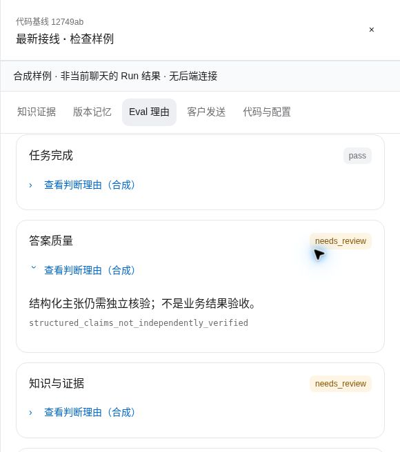
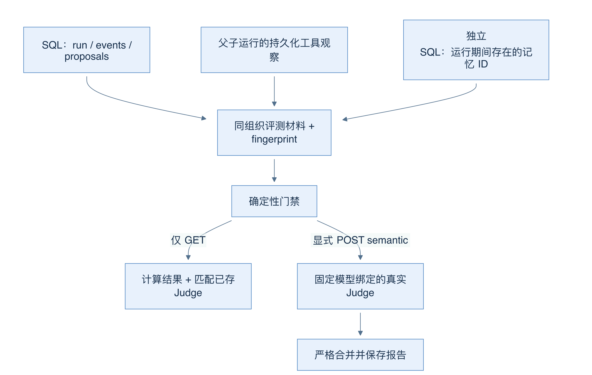
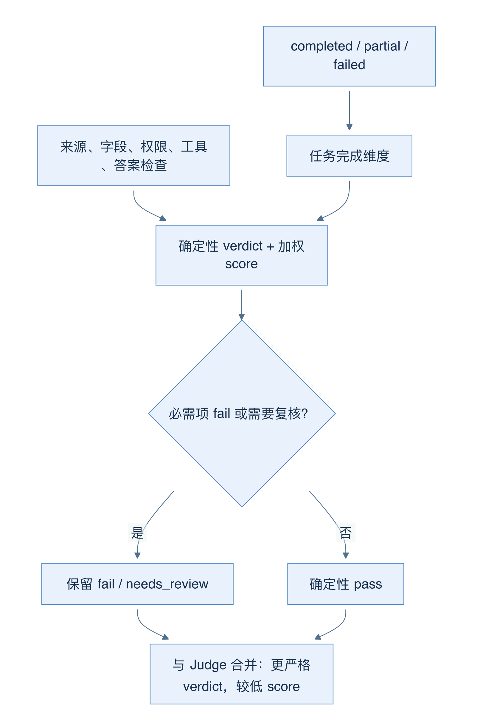

# 26 Eval：把跑完拆成可检查的结论

[返回母文档](../README.md) · [上一章](25.md) · [下一章](27.md)

**本章目标：**区分确定性门禁、Judge 评分和真实业务验收。

## 业务流程与阅读起点

### 当前界面近景

图中「结构化主张仍需独立核验」解释 needs_review 的含义。这是无模型质量分数的合成面板，没有运行生产 evaluator 或付费语义 Judge。

### 学习目标

读完本章，你应能分开运行状态、确定性门禁、语义 Judge 和总评分，并用真实证据解释为什么 completed 仍可能 needs_review。

### Eval 从哪里拿材料

Harness 是运行外层的控制与检查框架；Eval 是它对一次运行的评测。这里没有只把最终答案交给另一模型打分的捷径。评测路由先按组织读取 ai_workbench_runs，再读取事件、动作提案、持久化模型观察和 specialist 子运行。completed/partial 运行缺少观察，或子运行状态无法解析，会拒绝生成可信评分。

对成功 crm_get_contact 观察过的联系人，还做独立 SQL 存在性检查：只取该组织当前允许读取、运行开始前已存在且运行期间未删除的确认记忆 ID，不读正文，不用运行后新增数据给历史运行判错。这能抓住“数据库有记忆，工具却说没有”的覆盖问题。

图 21-A：确定性检查在 Judge 之前；材料读取不完整会阻止可信评测，不能补一个默认满分。

### 确定性门禁检查什么

固定 profile 定义任务完成、答案质量、知识与证据、工具可靠性、策略合规、效率及协作维度，并设置权重和必需项。运行未终结是 not_run；partial 需要复核；completed 且有最终文本只通过“任务完成”这一项，不能自动放行其他项。

答案检查会查结构化结果 schema、内部草稿泄漏、截断、重复段落和缺失材料。证据审核只承认成功工具观察或持久化协作记录中真正出现的来源 ID，并逐项比对允许的标量字段。比如 expected_close_date 实际为 JSON null，不能在 assertion 中写字符串“/”。编造 UUID 或把没读到的字段写进结论，会失败或标不可验证。

来源匹配不等于所有自然语言声明已获证明。代码明确保留这层边界，所以已有引用仍可 needs_review。必需维度 fail 会把总 verdict 判 fail；数值分数则按参与评分的维度加权，二者不是同一开关。

### Judge 增加什么，又不能改变什么

语义 Judge 是一次真实模型调用，检查 task_fit、factual_support、missing_material_honesty、actionability。它经过同一模型网关，使用运行固定的 Agent 版本模型绑定，优先通过 schema 校验的 submit_semantic_evaluation 工具提交结果。对不支持该工具的 provider，代码保留 JSON 文本兼容解析；解析后的结果仍须通过同一 schema。

GET evaluation 只做确定性计算并读取匹配的已存 Judge 报告，不调用模型。POST semantic 才显式启动或复用语义评测；POST deterministic_export 只保存、排队投递确定性报告。缓存以材料 fingerprint、profile revision、rubric revision 和模型身份区分，材料变化后不能沿用旧分数。

Judge 的判定只能更严格：合并 verdict 取严重者，分数取确定性与语义分数较低者；Judge 失败时，确定性失败和 needs_review 仍保留；原本的确定性 pass 则降为 needs_review。系统不会用无法完成的语义审查确认通过。它只看最多最后 24 条工具摘要，每条最多 1600 字符，最终答案也有长度边界，因此不能宣称理解了无限长完整轨迹。

图 21-B：箭头表示评测合并规则；高 Judge 分不能抵消权限、来源或工具错误。

### 用已记录复验练习读结果

仓库 2026-10-03 本机联调报告记录：客户记忆运行 completed，Judge 92，总评 89 / needs_review；多 Agent 状态为 partial，已有最终报告与 7 条 Wiki 证据，Judge 80，总评 79 / needs_review，仍报告商业报价与阶段政策缺失。这里引用历史报告，不是本书重新执行的实测。

这组结果的意义是链路能工作且缺口被保留。不能把 92 解释成客户偏好有 92% 概率正确，也不能把 71 条 claims 当成 71 次独立业务核验。父运行 tools/modelCalls、含子运行的 Eval.summary、含 Judge 的遥测数量口径不同。

### 沿一个结果走完判断链

对照图 21-B，按以下顺序读已有记忆样本。这里的数字来自前述历史复验。

1. 先读 Run.status=completed。这个状态只回答执行是否结束，不能替其他维度作答
2. 读确定性报告。程序检查观察、来源、结构和必需门禁。能定位的证据与自然语言的充分支持是两层问题
3. 读显式启动的 Judge 报告。该样本为 92 分。Judge 只审查收到的有界材料，没有独立重跑客户业务
4. 读合并结果。样本 overall=89，verdict=needs_review。分数取较低值，结论保留更严格的状态，因此高语义分不会抹去复核要求
5. 决定下一步。先看具体缺口和理由，再补充验证。不要为了刷新面板重复调用付费 Judge；GET 会读取已有匹配报告

失败分支：如果评测所需的持久观察缺失，接口可以拒绝评测。此时先查材料完整性，不应补一个看起来合理的分数。若 fingerprint 已变，旧 Judge 报告也不能继续代表新材料。源码：evaluation/route.ts 的完整路径见下方，重点读 169–258、300–429；[`lib/ai/evals/run-evaluation.ts:20-76`](https://github.com/helsome/AiNativeCrm/blob/679e09e80878dff7b1c79b8537317b2b9e355331/lib/ai/evals/run-evaluation.ts#L20-L76) 说明合并与异常。

### 常见误区与自测

- 为了拿 pass 隐去缺失材料，会破坏评测目的
- completed 是执行状态，pass 是评测结论，业务验收还需独立结果证据
- 付费 Judge 不是读页面的副作用；GET 不应暗中触发它

自测：Judge 给 95，但引用了从未读取的事件 UUID，会通过吗？不会，更严格的确定性失败仍保留。

### 源码定位

本章固定 main@679e09e80878dff7b1c79b8537317b2b9e355331。

- app/api/v1/ai/workbench/runs/[`id]/evaluation/route.ts:59-258`：评测材料和指纹；app/api/v1/ai/workbench/runs/[`id]/evaluation/route.ts:300-429`：GET/POST、缓存与保存
- [`lib/ai/evals/evaluate-run.ts:71-205`](https://github.com/helsome/AiNativeCrm/blob/679e09e80878dff7b1c79b8537317b2b9e355331/lib/ai/evals/evaluate-run.ts#L71-L205)：完成与答案检查；[`lib/ai/evals/evaluate-run.ts:445-510`](https://github.com/helsome/AiNativeCrm/blob/679e09e80878dff7b1c79b8537317b2b9e355331/lib/ai/evals/evaluate-run.ts#L445-L510)：权重、必需门禁与汇总
- [`lib/ai/evals/evidence-provenance.ts:73-138`](https://github.com/helsome/AiNativeCrm/blob/679e09e80878dff7b1c79b8537317b2b9e355331/lib/ai/evals/evidence-provenance.ts#L73-L138)：观察来源与字段断言核验
- [`lib/ai/evals/semantic-judge.ts:65-75`](https://github.com/helsome/AiNativeCrm/blob/679e09e80878dff7b1c79b8537317b2b9e355331/lib/ai/evals/semantic-judge.ts#L65-L75)：有界观察；[`lib/ai/evals/semantic-judge.ts:148-225`](https://github.com/helsome/AiNativeCrm/blob/679e09e80878dff7b1c79b8537317b2b9e355331/lib/ai/evals/semantic-judge.ts#L148-L225)：真实 Judge 调用和结果提交
- [`lib/ai/evals/run-evaluation.ts:20-76`](https://github.com/helsome/AiNativeCrm/blob/679e09e80878dff7b1c79b8537317b2b9e355331/lib/ai/evals/run-evaluation.ts#L20-L76)：严格合并与失败回退
- [`docs/testing/system-acceptance-fixes-2026-10-03.md:29-40`](https://github.com/helsome/AiNativeCrm/blob/679e09e80878dff7b1c79b8537317b2b9e355331/docs/testing/system-acceptance-fixes-2026-10-03.md#L29-L40)：最新结果；[`docs/testing/system-acceptance-fixes-2026-10-03.md:69-71`](https://github.com/helsome/AiNativeCrm/blob/679e09e80878dff7b1c79b8537317b2b9e355331/docs/testing/system-acceptance-fixes-2026-10-03.md#L69-L71)：尚未闭环的验收边界
- [`docs/testing/fixtures/acceptance-fix-multi-2026-10-03.json:1-7`](https://github.com/helsome/AiNativeCrm/blob/679e09e80878dff7b1c79b8537317b2b9e355331/docs/testing/fixtures/acceptance-fix-multi-2026-10-03.json#L1-L7)：多 Agent partial 状态；[`docs/testing/fixtures/acceptance-fix-multi-2026-10-03.json:271-329`](https://github.com/helsome/AiNativeCrm/blob/679e09e80878dff7b1c79b8537317b2b9e355331/docs/testing/fixtures/acceptance-fix-multi-2026-10-03.json#L271-L329)：记录的总评与 Judge

## 继续阅读

[返回母文档](../README.md) · [上一章](25.md) · [下一章](27.md)

