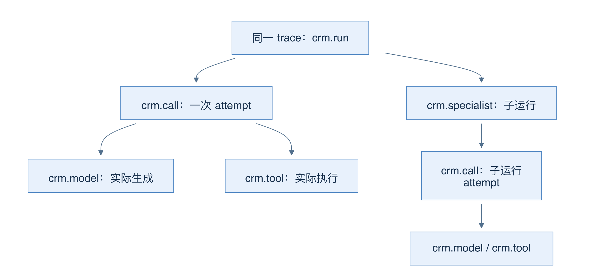
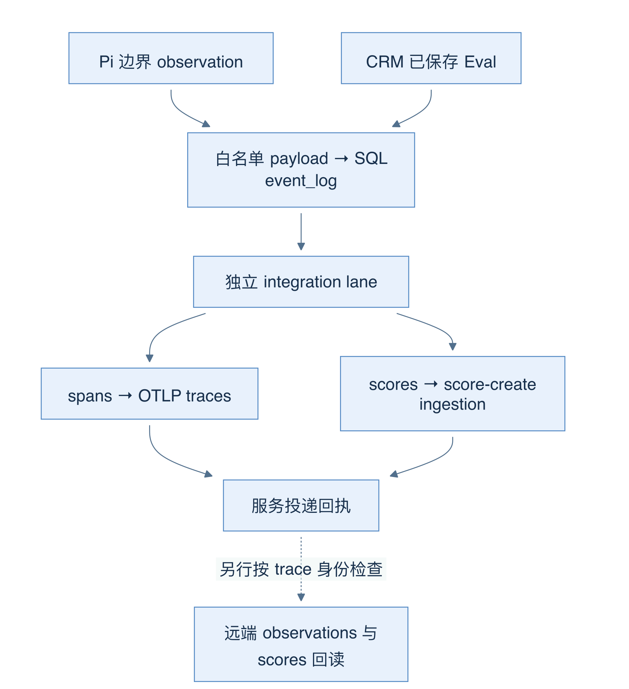

# 27 Trace：SQL 记录、Langfuse 与 OTLP 投递

[返回母文档](../README.md) · [上一章](26.md) · [下一章](28.md)

**本章目标：**沿本地运行证据追踪远端观测失败和延迟。

## 业务流程与阅读起点

### 学习目标

读完本章，你应能画出 run、call、model、tool 的关系，追踪 Langfuse 的真实投递路径，并区分“已排队”“服务接受”和“远端回读确认”。

### 从实际执行边界采集

Trace 是把一次任务的多段活动串在一起的记录；span 是其中一段带起止时间的活动。这个仓库的 Langfuse 集成不只是一个环境变量开关，也不是从页面上估算工具次数。Pi runtime 直接包装模型 streamFn 和实际 tool.execute，记录开始、结束、状态、模型/提供商、消息数量与 usage。

模型流的 result() 只观察完成结果，不争抢 Pi 的 token 流。工具在 finally 中记录 observation，失败或取消也有边界记录。观察回调是隔离副作用，失败不能让已执行的 CRM 动作再跑一次。

网关 beginLangfuseCall 将观察关联到 SQL Workbench run。一次模型网关调用有新的 attempt ID；同一调用中的 generation/tool span 是它的子项。specialist 使用父 run 的 trace ID，同时保留自己的 run span。重试或恢复是新 attempt，不能把两次执行混成一次。

图 22-A：箭头表示 span 的父子关系，不表示这些活动一定串行执行。

### 先写 SQL 待办，再走 OTLP

finish 把实际 observation 转成受 schema 限定的 spans，分批写 event_log。稳定事件 ID 配合 on conflict do nothing，保证模糊数据库回执后重试不会随意制造新投递身份。SQL 终态另投影 crm.run/crm.specialist，定时 reconciliation 补齐事务内结束但尚未投影的运行。

外部投递用独立 integration lane。ai-integration-drain 每次最多排出一个事件，再做有界生命周期核对，避免 Langfuse 不可达占满普通业务 drain。关闭集成时事件保持 retry；投递错误进入既有重试/失败处理，不把业务运行改为失败。

spans 真正发送至 /api/public/otel/v1/traces，采用 OTLP/HTTP JSON、项目密钥 Basic 鉴权和 ingestion version 4。Eval 分数另走 score-only /api/public/ingestion，保留原事件时间；返回 successes 必须覆盖每个 ID 且没有 errors。导出器只映射 CRM 已有评测，不在后台偷偷新增 Judge。

图 22-B：排队、HTTP 接受、远端回读是三层证据；虚线强调最后一步需要独立查询，不能从 done 推导出来。

### 能看见什么，刻意不送什么

payload 白名单允许模型身份、耗时、状态、token 用量、工具名和脱敏关联标识，不允许 system prompt、客户消息正文、工具参数/结果、隐藏推理、私有续跑内容、凭据或任意异常文本。组织与运行标识经过散列，但散列不是授权；配置还禁止不同 CRM 组织复用同一个 Langfuse origin/public-key 项目组合。

这也解释了调试方式：Langfuse 帮你定位“哪次调用慢、哪个工具失败、花了多少 token”；业务事实和完整运行状态仍应在受权限控制的 CRM SQL 中核对。Langfuse 无权把 Mission 标完成。

仓库本机复验记录两条新 trace 已通过鉴权 API 回读，input/output 为空；记忆 trace 有 9 observations、7 scores，多 Agent 有 36 observations、9 scores。它们包含结果提交和 Judge，不能直接当成 CRM 业务工具计数。这是已有报告中的验证，不是本章重新调用服务。

### 场景：Eval 已保存，远端仍没有分数

按图 22-B 从左向右检查。每一步都先确认前一步的产物，不靠重复运行任务碰运气。

1. 在受权限控制的 SQL 中确认 Eval 报告及其 runId。没有保存报告，就没有这份报告的投递事实
2. 检查对应 event_log 记录。已排队说明系统记下投递工作，尚未证明请求已经离开服务器
3. 检查独立消费者、组织启用状态和重试状态。关闭集成或远端不可达可以留下积压；业务 Run 已结束仍可以与积压并存
4. 检查 ingestion 回执。导出器要求每个 ID 都有成功回执，且没有 errors。一次 HTTP 请求完成与所有条目被接受仍有差别
5. 按同一 trace 身份回读远端 observations 与 scores。只有这一步能回答记录现在是否可查询

失败分支：如果第 3 步失败，先恢复投递前提，再按稳定事件身份重试。不要新建一次 Judge 来“补分数”。那会新增模型调用和新的评测材料，却未解决旧事件为何没有投递。源码：[`lib/ai/integrations/langfuse.ts:348-446`](https://github.com/helsome/AiNativeCrm/blob/679e09e80878dff7b1c79b8537317b2b9e355331/lib/ai/integrations/langfuse.ts#L348-L446) 与 [`app/api/v1/cron/ai-integration-drain/route.ts:14-40`](https://github.com/helsome/AiNativeCrm/blob/679e09e80878dff7b1c79b8537317b2b9e355331/app/api/v1/cron/ai-integration-drain/route.ts#L14-L40)。

### 常见误区与自测

- configured 只表示配置字段就绪；组织 enable、网络可达和远端权限是不同条件
- drain=done 不能证明异步存储已可查，应按 trace 身份核对 observations 和 scores
- 删除远端 trace 前需处理暂停与积压，否则 outbox 重放可能把它重新创建；当前没有完整 Langfuse 擦除协调器

自测：CRM 已保存 Eval，但页面没出现 score。先查是否启用、是否排队、消费者回执，再查远端；不要重复运行付费 Judge来“刷新”。

### 源码定位

本章固定 main@679e09e80878dff7b1c79b8537317b2b9e355331。

- [`lib/agent-runtime/pi/runtime.ts:290-397`](https://github.com/helsome/AiNativeCrm/blob/679e09e80878dff7b1c79b8537317b2b9e355331/lib/agent-runtime/pi/runtime.ts#L290-L397)：实际 stream/tool 边界观察
- [`lib/agent-engine/edge/llm/run-model-call.ts:707-777`](https://github.com/helsome/AiNativeCrm/blob/679e09e80878dff7b1c79b8537317b2b9e355331/lib/agent-engine/edge/llm/run-model-call.ts#L707-L777)：网关挂接观察与异常结束
- [`lib/ai/integrations/langfuse.ts:22-104`](https://github.com/helsome/AiNativeCrm/blob/679e09e80878dff7b1c79b8537317b2b9e355331/lib/ai/integrations/langfuse.ts#L22-L104)：严格 payload 白名单；[`lib/ai/integrations/langfuse.ts:140-255`](https://github.com/helsome/AiNativeCrm/blob/679e09e80878dff7b1c79b8537317b2b9e355331/lib/ai/integrations/langfuse.ts#L140-L255)：稳定 outbox 与 call spans
- [`lib/ai/integrations/langfuse.ts:257-345`](https://github.com/helsome/AiNativeCrm/blob/679e09e80878dff7b1c79b8537317b2b9e355331/lib/ai/integrations/langfuse.ts#L257-L345)：run 和 Eval 投影；[`lib/ai/integrations/langfuse.ts:348-446`](https://github.com/helsome/AiNativeCrm/blob/679e09e80878dff7b1c79b8537317b2b9e355331/lib/ai/integrations/langfuse.ts#L348-L446)：OTLP、分数回执与生命周期核对
- [`app/api/v1/cron/ai-integration-drain/route.ts:14-40`](https://github.com/helsome/AiNativeCrm/blob/679e09e80878dff7b1c79b8537317b2b9e355331/app/api/v1/cron/ai-integration-drain/route.ts#L14-L40)：鉴权与独立有界队列
- [`lib/ai/integrations/config.ts:56-61`](https://github.com/helsome/AiNativeCrm/blob/679e09e80878dff7b1c79b8537317b2b9e355331/lib/ai/integrations/config.ts#L56-L61)：组织项目隔离
- [`docs/testing/system-acceptance-fixes-2026-10-03.md:42-49`](https://github.com/helsome/AiNativeCrm/blob/679e09e80878dff7b1c79b8537317b2b9e355331/docs/testing/system-acceptance-fixes-2026-10-03.md#L42-L49)：实际回读证据；[`docs/integrations/agent-services.md:166-176`](https://github.com/helsome/AiNativeCrm/blob/679e09e80878dff7b1c79b8537317b2b9e355331/docs/integrations/agent-services.md#L166-L176)：删除与保留边界

## 继续阅读

[返回母文档](../README.md) · [上一章](26.md) · [下一章](28.md)

