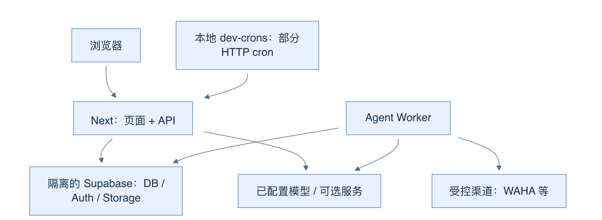
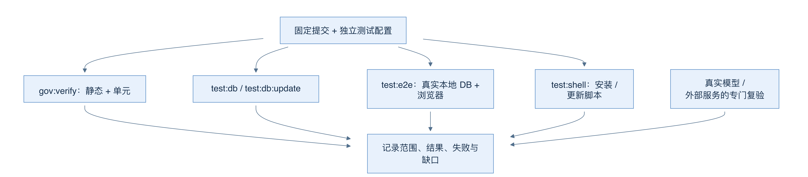
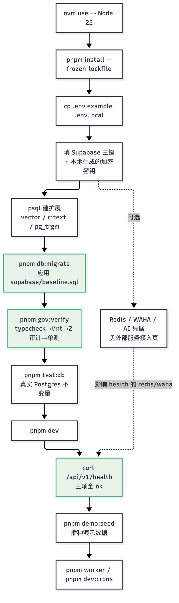

# 28 本地运行与验证：环境、命令与证据范围

[返回母文档](../README.md) · [上一章](27.md) · [下一章](29.md)

**本章目标：**理解本地启动和第一轮检查各自证明什么。

## 业务流程与阅读起点

### 学习目标

读完本章，你应能区分录制演示、真实应用、后台 Worker 与外部服务，并为一次改动选择正确测试，而不是把一个绿色命令当成全部验收。

### 先选学习模式，再启动服务

最快的阅读入口是 node scripts/serve-agent-demo.mjs。README 指向 127.0.0.1:3008 的录制演示：“真实模型录制”回放过去的脱敏运行，不会重新调用模型和工具，其他交互有本地模拟标识。它适合理解界面与流程，但不能验证今天的凭据、数据库或渠道。

真实应用要求 Node.js 22 及以上，package.json 固定 pnpm 9.15.9。按模板准备独立本地配置后，pnpm install 安装依赖，pnpm dev 启动 Next 页面与 API。数据库、Auth、Storage 由另行准备的 Supabase 提供；模型调用需要系统内的有效凭据，消息发送另需渠道配置。切勿把示例复制步骤理解成数据库和所有服务已自动就绪。

pnpm worker 启动 Agent Worker；pnpm dev:crons 是另一条命令，用于本地指定的 HTTP cron。Next dev 自己不会定时调用这些路由；当前 dev-crons 只列 prospecting、event-log-drain、followup-flow-worker，不能假设它覆盖生产所有 cron。两者都可能消费真实数据库任务，因此必须先确认数据库属于隔离测试环境。



图 23-A：箭头表示进程间访问；浏览器地址是 localhost，并不能证明数据库或出站渠道也是本地。

默认 docker-compose.yml 实际定义 WAHA 和 worker，不含 Supabase。文件开头“只启动 WAHA”的旧注释不能覆盖下面的服务定义。Mem0、WeKnora、Langfuse 更是可选适配器，需要另行部署、服务器 binding 和组织启用；应用启动不会替你部署三个厂商平台。

### 测试要覆盖改动所在层

pnpm gov:verify 串联 typecheck、lint、渠道规则、role-rank 和单元测试。它没有自动包含 test:db、test:e2e、test:shell，也没有包含 build。Vitest 明确排除数据库 invariants、浏览器 e2e 和 journeys；“所有单测通过”不能代替数据库隔离证明。

数据库或 RLS 改动要走 test:db，升级已有数据还要 test:db:update；用户流程要跑 Playwright；Docker、安装更新脚本要跑 test:shell。E2E 需独立 .env.e2e 和本地 Supabase；配置缺失或指向非本地 Supabase URL 会拒绝启动，避免测试回退到生产配置。测试会种数据、改变状态，不是只读探针。



图 23-B：不同分支回答不同问题；所有结果最后都要带上提交、配置、范围与失败记录。

建议先固定源码树，再按环境资源分批运行。报告中曾出现测试期间改代码、并行争抢磁盘、残留 fixture 造成的失败。有效恢复是重现问题、修好前提、清理本轮精确数据并重新执行；不是扩大超时或删断言去换绿灯。

### 部署还要验证真实入口

生产镜像发布由 publish-image 工作流的手动 workflow_dispatch 触发，再由 VPS 拉取相同版本的 app、worker、scheduler 镜像。PR 检查只构建验证，不发布镜像；push 或 tag 也不会在这个工作流中自动发布。已有 Traefik 的环境需要生产 compose 与对应 override 同时使用；遗漏 override 可能丢失路由标签，容器 healthy 但域名返回 404。部署后既查容器，也查真实域名与业务入口，不能只看内部 TCP 健康探针。

数据库变更按仓库规则同时维护新 migration、baseline 和 MANIFEST；已应用迁移不回写。正式更新前后仍需备份与恢复方案。教程不应为了完成安装而要求清卷、打印密钥或临时放开隔离。

### 已验证与尚未证明

2026-10-03 修复报告记录 12,916 项单测、2,229 项数据库测试通过，各另有既有 expected fail/skip；关键浏览器 28/28 通过，不是全量 Playwright。真实记忆与多 Agent 的总 Eval 仍 needs_review，受控自治接收器也不等于真实 WhatsApp。它们是该报告特定环境和提交的结果，本书没有重新执行这些测试。

剩余边界包括外部发送失败恢复、真实可逆写入及补偿、Wiki 硬生成预算、备份恢复演练、VPS/多数据库矩阵。源码已具备很多链路，与无人值守上线条件齐备是两件不同的事。

### 常见误区与自测

- 页面打开不证明 Worker 在消费任务；任务排队时先找消费者和数据库目标
- 录制中的绿色结果不证明当前机器健康；要看真实请求、配置与后置状态
- README 中历史“评审分支”措辞不替代本书固定 main 的源码；上线结论仍服从最新具体证据

自测：只改数据库 trigger，gov:verify 全绿，可以合并发布吗？还缺相应数据库与带数据升级证明，且发布授权不能由测试命令替代。

### 源码定位

本章固定 main@679e09e80878dff7b1c79b8537317b2b9e355331。

- [`README.md:42-56`](https://github.com/helsome/AiNativeCrm/blob/679e09e80878dff7b1c79b8537317b2b9e355331/README.md#L42-L56)：本地应用与录制入口；[`package.json:6-43`](https://github.com/helsome/AiNativeCrm/blob/679e09e80878dff7b1c79b8537317b2b9e355331/package.json#L6-L43)：命令与运行版本；[`package.json:138-138`](https://github.com/helsome/AiNativeCrm/blob/679e09e80878dff7b1c79b8537317b2b9e355331/package.json#L138-L138)：pnpm 版本
- [`docker-compose.yml:19-85`](https://github.com/helsome/AiNativeCrm/blob/679e09e80878dff7b1c79b8537317b2b9e355331/docker-compose.yml#L19-L85)：实际 WAHA/worker 服务；[`scripts/dev-crons.ts:1-18`](https://github.com/helsome/AiNativeCrm/blob/679e09e80878dff7b1c79b8537317b2b9e355331/scripts/dev-crons.ts#L1-L18)：当前 cron 范围；[`docker-compose.yml:48-56`](https://github.com/helsome/AiNativeCrm/blob/679e09e80878dff7b1c79b8537317b2b9e355331/docker-compose.yml#L48-L56)：数据库风险提示
- [`vitest.config.ts:42-56`](https://github.com/helsome/AiNativeCrm/blob/679e09e80878dff7b1c79b8537317b2b9e355331/vitest.config.ts#L42-L56)：单测排除范围；[`playwright.config.ts:5-37`](https://github.com/helsome/AiNativeCrm/blob/679e09e80878dff7b1c79b8537317b2b9e355331/playwright.config.ts#L5-L37)：E2E 本地配置保护
- [`.github/workflows/publish-image.yml:21-26`](https://github.com/helsome/AiNativeCrm/blob/679e09e80878dff7b1c79b8537317b2b9e355331/.github/workflows/publish-image.yml#L21-L26)：显式手动发布触发器
- [`docs/runbooks/deploy.md:9-72`](https://github.com/helsome/AiNativeCrm/blob/679e09e80878dff7b1c79b8537317b2b9e355331/docs/runbooks/deploy.md#L9-L72)：反向代理 override、入口核验与镜像路径
- [`AGENTS.md:147-158`](https://github.com/helsome/AiNativeCrm/blob/679e09e80878dff7b1c79b8537317b2b9e355331/AGENTS.md#L147-L158)：测试边界；[`AGENTS.md:236-239`](https://github.com/helsome/AiNativeCrm/blob/679e09e80878dff7b1c79b8537317b2b9e355331/AGENTS.md#L236-L239)：迁移三件套；[`CLAUDE.md:42-52`](https://github.com/helsome/AiNativeCrm/blob/679e09e80878dff7b1c79b8537317b2b9e355331/CLAUDE.md#L42-L52)：租户与事件原则
- [`docs/testing/system-acceptance-fixes-2026-10-03.md:51-71`](https://github.com/helsome/AiNativeCrm/blob/679e09e80878dff7b1c79b8537317b2b9e355331/docs/testing/system-acceptance-fixes-2026-10-03.md#L51-L71)：完整统计、失败记录及未关闭边界

## 实现详解

本页回答一个刚拿到仓库的人最先遇到的两个问题：**怎样把这份代码在本地跑起来**，以及**跑起来之后，用哪几条命令确认环境是干净的**。这里不做服务商的注册向导——那是 [外部服务接入：Supabase、Redis、WAHA、模型与嵌入](29.md) 的内容——而是聚焦"最小可启动闭环"和"第一轮验证的证据标准"。

在深入之前，先记住本仓库的一条硬性纪律：**架构与业务事实以代码和迁移文件为准，文档是解释层**。`docs/doctrine/` 下的原则与 `tests/unit/` 下以葡语命名的断言（`pnpm test:unit` 会执行它们）是裁决者，本页所有命令都服务于"让这些裁决者在你的机器上真实跑一遍"。

---

### 启动前的四件事：先确认环境本身

#### Node 22 是硬要求，不是建议

`.nvmrc` 里只有一行 `22`，`package.json` 的 `engines` 写死 `"node": ">=22"`，CI 的 composite action 也把 `node-version` 钉在 22。三处一致，因此**低于 22 不会被软化**：测试套件会实例化 Supabase 客户端，而它依赖全局 `WebSocket`——这个 API 在 Node 22 之前不是原生的。这意味着选错 Node 版本得到的不是"降级运行"，而是"整片测试红掉，且红得莫名其妙"。仓库文档对此有明确表述：[SETUP.md](https://github.com/helsome/AiNativeCrm/blob/679e09e80878dff7b1c79b8537317b2b9e355331/docs/SETUP.md#L40)。

```bash
node -v        # 期望 v22.x 或更高
nvm use        # 读 .nvmrc，自动切到 22
```

Sources: [.nvmrc](https://github.com/helsome/AiNativeCrm/blob/679e09e80878dff7b1c79b8537317b2b9e355331/.nvmrc#L1), [package.json](https://github.com/helsome/AiNativeCrm/blob/679e09e80878dff7b1c79b8537317b2b9e355331/package.json#L6)

#### pnpm 版本被`packageManager` 锁死

`package.json` 声明 `"packageManager": "pnpm@9.15.9"`。这不是建议，是 CI 的安装脚本 `preparar-node` 会**从 package.json 里用正则抠出这个版本**，抠不到就直接报错退出；随后执行 `pnpm install --frozen-lockfile`——锁文件必须被逐字遵守，否则依赖解析会漂移。该 action 的注释还记录了一个被实测过的教训：npm 的 self-installer 曾经因为慢（p90 达 424 秒）把整个 verify job 拖死，所以 CI 特意给 npm 缓存加了 `prefer-offline`。本地你不受此限，但**版本必须对得上**。

```bash
corepack enable   # 若用 corepack 管理
pnpm -v           # 期望 9.15.9
```

Sources: [package.json](https://github.com/helsome/AiNativeCrm/blob/679e09e80878dff7b1c79b8537317b2b9e355331/package.json#L138), [action.yml](https://github.com/helsome/AiNativeCrm/blob/679e09e80878dff7b1c79b8537317b2b9e355331/.github/actions/preparar-node/action.yml#L72)

#### 环境变量的分层：哪些必须、哪些可空

`lib/env.ts` 用 Zod 在 Next 启动时（模块 import 阶段）做校验，**缺关键变量时在应用起来之前就抛错**。它的分层逻辑是本仓库最需要先理解的一条：

| 分类 | 判定函数 | 开发环境 | 生产环境 |
| --- | --- | --- | --- |
| 恒必 | `requiredAlways()` | 必填 | 必填 |
| 条件必 | `required()` | 默认空串 | 必填且非空 |
| 独立可选 | `.optional().default(...)` | 有默认值 | 有默认值 |

`NEXT_PUBLIC_SUPABASE_URL`、`NEXT_PUBLIC_SUPABASE_ANON_KEY`、`SUPABASE_SERVICE_ROLE_KEY` 三项属于 `requiredAlways`——**即使在 dev 也必须填**。这是设计上的硬边界：Supabase 同时承载 Postgres、Auth、Storage 和 Realtime，缺它整个产品没有事实来源。**注意 URL 还额外挂了 `.url()`**，而 `WAHA_API_BASE_URL` 与 `UPSTASH_REDIS_REST_URL` 只是 `required()` 纯校验、不校验格式——这个不对称会直接反映在健康检查的报错文案里，后面"故障速查"一节会展开。

还有一条对自托管特别重要的宽容规则：构建阶段（`NEXT_PHASE=phase-production-build`）会自动注入占位符，**让 `next build` 能在不携带运行时密钥的情况下产出 Docker 镜像**。否则每个密钥都得作为 build ARG 传进去，它们会永久留在镜像层里。

Sources: [lib/env.ts](https://github.com/helsome/AiNativeCrm/blob/679e09e80878dff7b1c79b8537317b2b9e355331/lib/env.ts#L1), [lib/env.ts](https://github.com/helsome/AiNativeCrm/blob/679e09e80878dff7b1c79b8537317b2b9e355331/lib/env.ts#L29), [lib/env.ts](https://github.com/helsome/AiNativeCrm/blob/679e09e80878dff7b1c79b8537317b2b9e355331/lib/env.ts#L63)

#### 复制模板，然后认清它有多大

```bash
pnpm install
cp .env.example .env.local
```

`.env.example` 共 **609 行**，是全仓库最长的一份配置文件。里面大量条目是**被注释掉的**，因为可选依赖面很宽（飞书协作、演示模式、VoIP、Google Calendar、SMTP/Resend 邮件、Nuvemshop……）。阅读它不需要逐行读，需要的是认得三种标记：`NEXT_PUBLIC_` 前缀会打进浏览器 bundle（**绝不放密钥**）、`# ---` 分节标题、以及结尾的注释警告。

`.env.local` 已在 `.gitignore` 中，`git status` 应始终看不到它。仓库还并列提供了 `.env.hostgator.example`（VPS 自托管）和 `.env.voip.example`（语音栈）两份变体——本地开发只需要 `.env.example`。<br>Sources: [README.md](https://github.com/helsome/AiNativeCrm/blob/679e09e80878dff7b1c79b8537317b2b9e355331/README.md#L39)

---

### 数据库：为什么不能用`supabase db push`

这是新手最容易踩、且**踩了不会立刻报错**的坑，必须单独讲。

`supabase/migrations/` 下的前几条文件是历史存根——migrations `0001`–`0009` 与 `0013` 实质只是 `SELECT 1;`。真正的 schema 从未落在迁移链里。直接 `supabase db push` 会**顺利通过、零报错**，却给你留下一个空库；你会在很久之后遇到一个完全不指向这里的错误。而 `supabase/baseline.sql` 才是真正的 schema，它也正是 `hostgator-setup-kit/install.sh` 在 VPS 上应用的那一份——**新建库和更新库走两条路，这不是冗余，是刻意的**。

`pnpm db:migrate` 背后的 `scripts/db-migrate.sh` 因此非常克制：它从 `SUPABASE_DB_URL` 环境变量或 `.env.local`/`.env` 中读取连接串，若缺失或 `psql` 不在 PATH 就立即退出；随后**先启用扩展**（`vector`、`citext`、`pg_trgm`，缺任一个 baseline 都会停在 `type public.vector does not exist`），最后才应用 baseline。全程 `-v ON_ERROR_STOP=1`，任何一步失败即整体失败。

```bash
# 新建库前先手动开启扩展（新建的 Supabase 项目默认不开）
psql "$SUPABASE_DB_URL" -v ON_ERROR_STOP=1 -c \
  'create extension if not exists vector with schema public;
   create extension if not exists citext with schema public;
   create extension if not exists pg_trgm with schema public;'

pnpm db:migrate
```

对**已有**数据库的升级，迁移链仍然是事实来源。判断标准很简单：建库用 baseline，改库用 migrations。<br>Sources: [db-migrate.sh](https://github.com/helsome/AiNativeCrm/blob/679e09e80878dff7b1c79b8537317b2b9e355331/scripts/db-migrate.sh#L1), [SETUP.md](https://github.com/helsome/AiNativeCrm/blob/679e09e80878dff7b1c79b8537317b2b9e355331/docs/SETUP.md#L133)

---

### 第一轮验证：命令清单及其真正证明的东西

#### 一次跑通全部结构守卫

```bash
pnpm gov:verify
```

它展开是 `typecheck → lint → lint:channels → lint:role-rank → test:unit`。**不要把它当成五个步骤的清单，而要当成一道门**：它覆盖了静态类型、代码规范、渠道商中立性、角色权限审计和单元测试五个维度。`lint:channels` 检查受控 TypeScript 业务代码中的具体渠道供应商命名，维护渠道抽象；它不扫描 Markdown 文档，也不是禁止文档介绍 AI 模型服务。其匹配规则见 `scripts/lint-channels.pattern.ts`，扫描逻辑见 `scripts/lint-channels.ts`。<br>Sources: [package.json](https://github.com/helsome/AiNativeCrm/blob/679e09e80878dff7b1c79b8537317b2b9e355331/package.json#L33)

#### 按 CI 的原始顺序逐条跑

CI 的顺序不是随意的，它把**只读文件的守卫放在最前面**，因为它们秒级完成，不占测试预算；把重头戏放在后面：

| 顺序 | 命令 | 验证对象 | 典型耗时 |
| --- | --- | --- | --- |
| 1 | `pnpm cercas` | 只读文件的不变量：baseline 与迁移链一致性、MANIFEST、anon 扫描、文档、workflow | 秒级 |
| 2 | `pnpm typecheck` | `tsc --noEmit`，独立 tsconfig | 中等 |
| 3 | `pnpm lint` | ESLint 全量 | 中等 |
| 4 | `pnpm lint:channels` | 受控 TypeScript 业务代码遵循渠道供应商命名限制 | 秒级 |
| 5 | `pnpm lint:role-rank` | 阻止 `lib/auth/` 外的直接角色比较（绕开 MFA 与 `requireRole()` 门） | 秒级 |
| 6 | `pnpm checar:colisao-de-migration` | 迁移编号在**远端 base** 上是否已被抢占 | 秒级 |
| 7 | `pnpm test:unit` | Vitest 全量单测 | 最重 |
| 8 | `pnpm test:shell` | 自托管 bash kit，含 `install.sh` 的 163 个校验用例 | ~15 秒 |

`pnpm cercas` 之所以单列，是因为 `pnpm test:unit` 内部会跳过它们——CI 里是先跑 cercas、再让单测用 `--project produto` 排除 cercas，避免同一批断言跑两遍。

值得注意的 `checar:colisao-de-migration`：它不是校验本地文件，而是 `git fetch` 远端 base 后用 `git ls-tree` 比对，**专门捕捉"你开 PR 时编号空闲，合并时已被别人占用"**这一类冲突。本地 hook 无法覆盖这个时间差，因为 `core.hooksPath` 是本地配置、fork 不会执行。<br>Sources: [ci.yml](https://github.com/helsome/AiNativeCrm/blob/679e09e80878dff7b1c79b8537317b2b9e355331/.github/workflows/ci.yml#L168)

#### 数据库相关的命令（需要真实 Postgres）

```bash
pnpm test:db        # = bash scripts/test-db.sh，也等于 test:invariants
pnpm test:db:update # 带数据的自更新验证
```

`tests/invariants/` 下是 `pnpm test:db` 的主体，也是仓库里最有价值的一类测试——它们验证 RLS 完整性、租户隔离、LLGPD 匿名化级联、followup 引擎、事件日志排空。这些**无法靠 mock 伪造**，因为它们测的就是数据库里真实生效的策略。同一目录下还有 `pg-como-supabase.test.ts` 这样的文件，标题直译就是"Postgres 扮演 Supabase"——这是自托管路线的核心手法。

#### 启动应用

```bash
pnpm dev     # = next dev
```

`pnpm dev:webpack` 是同一份命令的显式 Webpack 别名（`package.json` 里 `dev` 和 `dev:webpack` 字符串完全相同，保留两个名字是为切换编译器的过渡期留的）。**访问地址以终端输出为准**，而不是假定 3000。<br>Sources: [package.json](https://github.com/helsome/AiNativeCrm/blob/679e09e80878dff7b1c79b8537317b2b9e355331/package.json#L10)

---

### 健康检查：把"跑起来了"升级为"环境是对的"

`pnpm dev` 成功只证明进程没崩。要确认外部依赖真的接上了，看：

```bash
curl http://localhost:3000/api/v1/health
```

响应结构：

```json
{
  "data": {
    "status": "healthy",
    "version": "desconhecido",
    "timestamp": "...",
    "checks": {
      "supabase": { "status": "ok", "latency_ms": 12 },
      "redis":    { "status": "ok", "latency_ms": 30 },
      "waha":     { "status": "ok", "latency_ms": 8 }
    }
  }
}
```

三个检查并发发出，各有独立的三秒超时：

| 检查 | 打的请求 | 判为 ok 的条件 |
| --- | --- | --- |
| supabase | `GET /rest/v1/organizations?select=id&limit=1`，带 `Accept-Profile: public` | 200 / 401 / 403 都算——能连上、key 有效即通过 |
| redis | `POST` 到 REST 根，body 为 `["PING"]` | `res.ok`。**不存在 GET /ping**，那在自建 SRH 上会 404 |
| waha | `GET /api/sessions` | `res.ok`。**WAHA Core 不暴露 /api/health** |

`Accept-Profile: public` 这一行值得记住。代码注释解释了原因：这个 `fetch` 是裸请求，会落到 PostgREST 的 schema 默认值上，而"默认值是 public"只是新项目的惯例，不是 Supabase 的保证。在一个已有自定义 schema 排在首位的项目里，探针会去查 `<outro>.organizations`，收到 `404 PGRST205`，然后**在 CRM 一切正常的情况下宣告数据库宕机**——而 `update.sh` 以 `wait_app_healthy` 收尾，非零退出会触发 `agent.sh` 回滚镜像。一次好更新会被 CRM 无法控制的面板配置撤销。

同样值得记住的是 `version` 字段在本地会显示 `"desconhecido"`：它读的是 `APP_VERSION`（镜像构建时注入的 ARG），fallback 刻意是字符串而不是 `0.1.0`——**一个自信地答错数值的字段比一个缺失的字段更糟**。<br>Sources: [route.ts](https://github.com/helsome/AiNativeCrm/blob/679e09e80878dff7b1c79b8537317b2b9e355331/app/api/v1/health/route.ts#L1), [route.ts](https://github.com/helsome/AiNativeCrm/blob/679e09e80878dff7b1c79b8537317b2b9e355331/app/api/v1/health/route.ts#L60)

---

### 零密钥通路：在没有 Supabase 的情况下先看见界面

对于只想确认"前端渲染正常"的人，仓库提供了一条不碰任何外部服务的路径：

```bash
node scripts/serve-agent-demo.mjs
# 打开 http://127.0.0.1:3008/#/app/ai/workbench
# 点击"真实模型录制"
```

这是**预先录制的真实轨迹回放**，不会再次调用模型、也不会执行任何工具；其他交互场景都带有明确的本地模拟标识。这条通路的价值在于：它把"UI 能不能跑"与"外部服务配没配"彻底解耦。<br>Sources: [README.md](https://github.com/helsome/AiNativeCrm/blob/679e09e80878dff7b1c79b8537317b2b9e355331/README.md#L53)

与之配套的播种命令：

```bash
pnpm demo:seed   # = tsx --env-file=.env.local scripts/seed-demo.ts
```

注意脚本使用 `tsx --env-file=.env.local`，直接读取本地配置文件。演示模式本身受 `CRM_DEMO_MODE` 控制，且 `lib/env.ts` 的注释明确：**开发环境 + loopback Supabase 才会自动进入演示账号，生产环境永不启用**。

工作台之外的另一个本地进程是工作进程与本地时钟：

```bash
pnpm worker      # workers/agent-worker/main.ts，消费 event_log
pnpm dev:crons   # 本地定时器，只打 NEXT_PUBLIC_APP_URL，不装 crontab
```

`dev:crons` 的注释里有一条警告值得照做：**不要对着 VPS 同一个 Supabase 跑本地时钟**——两者会争抢同一条事件队列。<br>Sources: [package.json](https://github.com/helsome/AiNativeCrm/blob/679e09e80878dff7b1c79b8537317b2b9e355331/package.json#L41), [.env.example](https://github.com/helsome/AiNativeCrm/blob/679e09e80878dff7b1c79b8537317b2b9e355331/.env.example#L27)

---

### 故障速查：症状 → 根因

| 症状 | 根因 | 处理 |
| --- | --- | --- |
| 启动即报 `Variáveis de ambiente inválidas` | `lib/env.ts` 的 Zod 在 import 阶段拒绝 | 看它打印的具体变量名 |
| `Error: supabaseUrl is required` | `NEXT_PUBLIC_SUPABASE_URL` 缺失，或 `=` 前后有空格 / 多余引号 | 逐字核对这一行 |
| `Invalid JWT` | anon key 或 service role key 被截断粘贴（Supabase JWT 约 200 字符） | 回 dashboard 用 Copy 按钮 |
| baseline 停在 `type public.vector does not exist` | 扩展未启用 | 跑上面那条 `create extension` |
| WAHA 返回 401 | **`WAHA_API_KEY` 被填成了 hash** | 应用发明文到 `X-Api-Key`；hash 只进 `WAHA_API_KEY_SHA512` |
| WAHA webhook 不通 | ngrok 未运行 / URL 变更 / 改完 `.env.local` 未重启 `pnpm dev` | 环境变量只在 boot 时读取 |
| 端口被占 | 3000 已被占用 | `lsof -ti:3000 \\| xargs kill -9`，或 `pnpm dev -- -p 3001` |
| `RESEND_API_KEY is undefined`（但应用能起） | 两个邮件通道都未配置 | 预期行为，邮件降级为 `console.log` |
| health 里 Redis `degraded` | 单纯没配（`nao_configurado`） | 正常，无需处理 |
| health 里 Redis `down` 且 `reason: configuracao_invalida` | **URL/Token 格式错误，且错误发生在发请求之前** | 检查 `.env` 是否残留引号 |

最后一行是本仓库诊断设计里最精细的一处。`validarConfigRedisRest` 会在**网络往返之前**先校验值的形态，把"`.env` 里引号没删"和"Redis 容器真的挂了"区分开——因为这两种读法会把运维者引向完全相反的地方：前者该去改编辑器，后者该去重启一个本来好好在跑的服务。`reason` 字段（见 `lib/net/alcance`）承担的就是"告诉人去哪改"的职责。

同时要注意 `target`（协议+主机+端口）**只在 `?verbose=1` 且携带内部密钥时才返回**。这条路由是公开的，否则等于向扫描互联网的人公布客户 WhatsApp 依赖的两个服务的精确地址。

```bash
# 带密钥的详细模式
curl -H "Authorization: Bearer $INTERNAL_SECRET" \
  "http://localhost:3000/api/v1/health?verbose=1"
```

Sources: [route.ts](https://github.com/helsome/AiNativeCrm/blob/679e09e80878dff7b1c79b8537317b2b9e355331/app/api/v1/health/route.ts#L125), [SETUP.md](https://github.com/helsome/AiNativeCrm/blob/679e09e80878dff7b1c79b8537317b2b9e355331/docs/SETUP.md#L537)

---

### 启动顺序全景



读图提示：绿色三格是**这一页真正的交付物**——schema 正确、结构守卫全绿、健康检查三项全 `ok`。虚线分支是可选增强：Redis 与 WAHA 未配置时，health 里对应项显示 `degraded`，**这不是失败**，而是"没人签约的集成"。只有 `down` 才代表故障。

---

### 目录结构速览

理解"东西放在哪"比记住每条命令更有长期价值：

```text
.
├── .nvmrc                    # Node 22 的唯一声明
├── package.json              # packageManager 锁 pnpm@9.15.9；所有脚本的单一来源
├── .env.example              # 609 行，全仓最长的配置模板
├── .env.hostgator.example    # VPS 自托管变体
├── supabase/
│   ├── baseline.sql          # ★ 新建库的唯一真实 schema
│   └── migrations/           # 存量库的升级链（开头几条是历史存根）
├── scripts/
│   ├── db-migrate.sh         # 基线应用器：先开扩展，再上 baseline
│   ├── serve-agent-demo.mjs  # 零密钥录制回放，端口 3008
│   ├── dev-crons.ts          # 本地时钟（不装 crontab）
│   └── seed-demo.ts          # 演示数据播种
├── lib/env.ts                # Zod 分层校验，启动时执行
├── app/api/v1/health/        # 三服务健康检查，公开但遮蔽地址
├── tests/
│   ├── unit/                 # pnpm test:unit / cercas
│   ├── invariants/           # pnpm test:db，需要真实 Postgres
│   └── shell/                # pnpm test:shell，bash kit
└── docs/doctrine/            # 架构原则，与代码同为裁决依据
```

Sources: [scripts/](https://github.com/helsome/AiNativeCrm/tree/679e09e80878dff7b1c79b8537317b2b9e355331/scripts), [tests/](https://github.com/helsome/AiNativeCrm/tree/679e09e80878dff7b1c79b8537317b2b9e355331/tests), [docs/doctrine/](https://github.com/helsome/AiNativeCrm/tree/679e09e80878dff7b1c79b8537317b2b9e355331/docs/doctrine)

---

### 第一步之后

现在你应该能拿到绿色的 `pnpm gov:verify` 和 `/api/v1/health`。接下来按目的分岔：

**要理解系统在做什么** — 先读 [项目总览：把 CRM 当作智能体的业务事实底座](01.md)，理解为什么"业务事实底座"是本项目的核心命题，再看 [仓库契约与文档优先级：CLAUDE / AGENTS / docs索引](32.md) 明确冲突时听谁的。

**要把外部服务接全** — 进入 [外部服务接入：Supabase、Redis、WAHA、模型与嵌入](29.md)。本地的 key 与线上 key 不同，注意 WAHA 那个 plaintext/hash 的经典陷阱。

**想先看到完整的产品形态** — 直接跳到 [免密钥的真实录制演示与演示数据播种](30.md)，它把本页第三节的 `serve-agent-demo.mjs` 和 `demo:seed` 展开成完整流程。

**要把这份代码放到服务器上** — 本页的 schema 决策在那里同样成立：`install.sh` 应用的正是 `supabase/baseline.sql`。见 [自托管安装套件：install.sh、update.sh 与健康检查](31.md)。

**准备提第一个 PR** — 先读 [内置助手技能与贡献流程、发布切版流程](33.md)。CI 里那些看起来冗余的步骤（比如 `checar:colisao-de-migration`、`.changes/` 配额检查）在提交前都会变成你的问题。

---

### 三条不要越过的线

1. **不要用 `supabase db push` 建新库。** 它会成功，然后给你一个空库。
2. **不要提交 `.env.local` 或任何 `.env*` 真实文件。** 已在 `.gitignore`，但 push 前用 `git status` 确认一次。
3. **不要在生产环境启用 `CRM_DEMO_MODE`。** 演示密码在 `.env.example` 里是公开明文。

第三条不是教条：`lib/env.ts` 里演示账号的默认值就写死在源码中（`demo@example.invalid` / `PiNativeDemo!2026`），Schema 层面对它没有任何强制约束——**保护它的只有环境配置本身**。

## 继续阅读

[返回母文档](../README.md) · [上一章](27.md) · [下一章](29.md)

