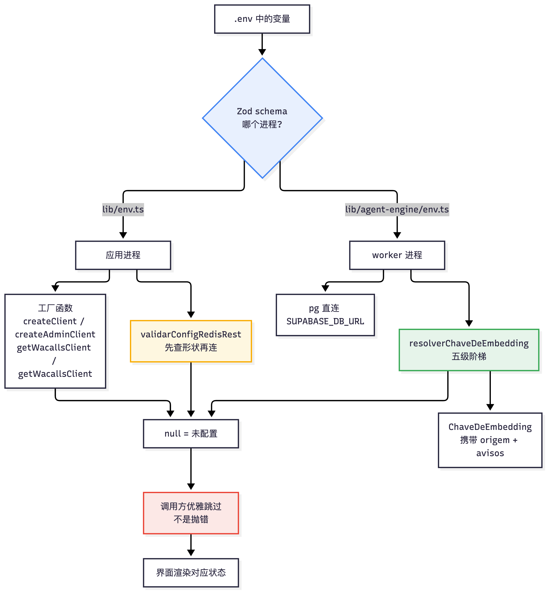

# 29 外部服务接入：Supabase、Redis、WAHA 与嵌入

[返回母文档](../README.md) · [上一章](28.md) · [下一章](30.md)

**本章目标：**按变量、客户端和失败行为定位服务连接问题。

## 实现详解

本页面回答一个具体的安装期问题：**当一个自托管部署接入外部服务时，每个依赖到底由哪个变量打开、缺了会怎样、代码在哪一层判定它"可用"**。这里不重复[分层视图：应用、数据库、鉴权、实时、事件队列与边缘中间件](03.md) 的整体拓扑，也不展开模型网关的 BYOK 语义（见[模型网关：BYOK 凭据、模型绑定、预算定价、用量与审计](19.md)），WAHA 的协议细节见[渠道抽象与 WhatsApp 接入](10.md)。本页只负责**接入层契约**：变量、工厂函数、失败模式。

贯穿全页的核心模式是：**接入不是"配置即生效"，而是"配置 → 校验 → 工厂函数 → 运行时降级"四段式**。这个仓库反复出现的一个反模式是——界面承诺某能力可用，但工厂函数返回 `null` 而调用方没有接住，能力静默失效。下面的每一节都以这条主线展开。

### 环境变量契约：`lib/env.ts` 与 `lib/agent-engine/env.ts`

两个 Zod schema 分工明确。`lib/env.ts` 服务**应用进程**（Server Components、Route Handlers、Server Actions），在 Next 的 import 阶段隐式执行，缺变量时在应用启动前抛出明确错误；`lib/agent-engine/env.ts` 服务**worker 进程**（队列消费、followup 引擎、watchdog）。二者读同一份 `.env`，但 schema 独立，**这是一个已知的故障家族**：schema 未声明的变量会被 Zod 从 `parsed.data` 中移除，于是"键明明在 `.env` 里却在 boot 时消失"。[env.ts](https://github.com/helsome/AiNativeCrm/blob/679e09e80878dff7b1c79b8537317b2b9e355331/lib/env.ts#L1)

`lib/agent-engine/env.ts` 顶部三段注释记录了这个家族的三、四、五次复发——`OPENAI_API_KEY`、`OPENROUTER_API_KEY`、`AI_BUDGET_ENFORCEMENT` 都曾在 `.env` 中存在却因 schema 未声明而从未到达 worker。修复 OpenAI 却漏掉 OpenRouter 的模式被明确警告："修改这里时，请一次确认三个"。这不是风格问题而是结构事实：Zod 的 object schema 默认剥离未声明键。[env.ts](https://github.com/helsome/AiNativeCrm/blob/679e09e80878dff7b1c79b8537317b2b9e355331/lib/agent-engine/env.ts#L20)

三档严格度构成了一套"失败面"设计：

| 档位 | 定义 | 行为 | 适用 |
| --- | --- | --- | --- |
| `requiredAlways()` | `z.string().min(1)` | 任何环境都强制，缺失即抛 | Supabase 三件套 |
| `required()` | 生产强制，dev 默认 `""` | 生产缺失即抛，dev 容错 | WAHA、Redis、内网出口 |
| `optional().default()` | 可选 + 默认 | 永不抛 | OpenRouter、Anthropic、SMTP |

Supabase 是唯一一组 `requiredAlways()` 的——即使本地开发也不允许空值，因为没有它整个应用无意义。[env.ts](https://github.com/helsome/AiNativeCrm/blob/679e09e80878dff7b1c79b8537317b2b9e355331/lib/env.ts#L73)

#### 一条贯穿全文件的元规则：`safeParse` 会抛

`lib/env.ts` 中最反直觉的设计是：**大量本可以用 `z.coerce.number()` 的旋钮刻意退化为 `z.string()`**，并在注释里给出同一段论证。原因是这个文件的 `safeParse` 在 schema 拒绝时**抛出**，而它在 Next 中发生于第一次请求——由于健康检查只是 TCP 探测，容器会保持 `healthy` 状态同时 100% 请求返回 500。

这影响所有紧急操作杠杆：`AI_BUDGET_ENFORCEMENT`（AI 停摆时的 kill switch）、`JOB_QUEUE_RETENTION_DAYS`、`AUDIT_LOG_RETENTION_DAYS`、`CASE_CHAT_RETENTION_DAYS`、`PASSAGEM_RETENTION_DAYS`、`CASE_ALERT_RETENTION_DAYS`。注释中的原则是"**失败闭合于动作，对信息失败开放**"：无效值不生效（保持旧行为），但应用能启动并大声告知它忽略了什么。合法值解析与警告文本的归属则下沉到 `lib/retencao/politica.ts` 与 `normalizarChaveDeOrcamento`。[env.ts](https://github.com/helsome/AiNativeCrm/blob/679e09e80878dff7b1c79b8537317b2b9e355331/lib/env.ts#L240) [env.ts](https://github.com/helsome/AiNativeCrm/blob/679e09e80878dff7b1c79b8537317b2b9e355331/lib/env.ts#L350)

`AI_BUDGET_ENFORCEMENT` 因此被写成裸 `z.string()` 而**永不** `z.enum`。它的语义是单调的——只能放松不能收紧：`on`（默认）不开启任何东西，只表示"尊重每个组织在界面上选的东西"；`avisar` 把任何封锁降级为警告；`off|false|0|no|nao|não|disabled` 关闭整个保护。这正是 kill switch 该有的性质。[env.ts](https://github.com/helsome/AiNativeCrm/blob/679e09e80878dff7b1c79b8537317b2b9e355331/lib/env.ts#L240)

同类形状的还有 `diasDeRetencao()`：`.positive()` 对 `=0` 抛错，而 `=0` 正是 VPS 运维想关闭清理时写下的值。这里用 `.catch()` 把非法值解析回默认值并打印警告——"关掉清理不是这件事：如果它要存在，就是产品决策，带自己的名字，而不是 schema 拒绝的一个零"。[env.ts](https://github.com/helsome/AiNativeCrm/blob/679e09e80878dff7b1c79b8537317b2b9e355331/lib/env.ts#L35)

#### 构建期放宽

`next build` 期间（`NEXT_PHASE=phase-production-build`）运行时密钥尚不存在，只有 `NEXT_PUBLIC_*` 会被打进 bundle。这个阶段放宽校验以便生成 Docker 镜像而不必把密钥作为 `ARG` 传递——那会在镜像层泄漏。放宽**只发生在解析层**，验证器保持 Zod 类型稳定，否则 `z.infer` 会把 `env.*` 退化成 `{}`、破坏 `.url()`。真实启动仍然索取真值。[env.ts](https://github.com/helsome/AiNativeCrm/blob/679e09e80878dff7b1c79b8537317b2b9e355331/lib/env.ts#L14)

### Supabase：四个互不相同的客户端工厂

Supabase 在本仓库不是"一个 SDK 调用"，而是**四个语义不同的工厂**，各自受不同的密钥与 RLS 约束支配：

| 工厂 | 文件 | 密钥 | RLS | 允许的调用场景 |
| --- | --- | --- | --- | --- |
| `createClient()` | `lib/supabase/server.ts` | anon key | 受限 | Server Components / Route Handlers / Server Actions |
| `createAdminClient()` | `lib/supabase/admin.ts` | service role | **绕过** | Webhook、Cron/worker、显式管理操作、健康检查 |
| `createClient()` (browser) | `lib/supabase/browser.ts` | anon key | 受限 | Client Components |
| `pg` 直连 | `lib/agent-engine/env.ts` | `SUPABASE_DB_URL` | 直连 | agent-engine 的 `FOR UPDATE SKIP LOCKED`、advisory lock、FTS |

admin 客户端的文档头部就是一条硬规则：使用它的 handler **必须**手动过滤 `organization_id`，且来源必须可信（cookie、已验证 JWT、webhook secret、path token），**绝不能**来自 request body。明确列出的禁止用途包括"任何由最终用户在正常流程中触发的路由"和"出于方便替代 auth"。[admin.ts](https://github.com/helsome/AiNativeCrm/blob/679e09e80878dff7b1c79b8537317b2b9e355331/lib/supabase/admin.ts#L1)

server 客户端绑定 canonical cookie 名 `sb-pi-native-auth`（`sameSite: strict`、`httpOnly`、`secure` 由 `cookieSecure()` 决定），与中间件对齐；文档明确要求永远用 `getUser()`（后端验证 JWT），**永不** `getSession()`（信任本地 cookie 不重新验证）。[server.ts](https://github.com/helsome/AiNativeCrm/blob/679e09e80878dff7b1c79b8537317b2b9e355331/lib/supabase/server.ts#L1)

#### 运行时注入的公共环境

browser 工厂有一处 self-host 特有的设计：URL 与 key 优先读 `window.__PUBLIC_ENV__`，回落到 `process.env.NEXT_PUBLIC_*`。这就是**同一镜像服务任意 Supabase 项目而无需重建**的机制——公共值由 `<PublicEnvScript/>` 在运行时注入。[browser.ts](https://github.com/helsome/AiNativeCrm/blob/679e09e80878dff7b1c79b8537317b2b9e355331/lib/supabase/browser.ts#L120)

#### Realtime token：一个被依赖升级打断两次的修复

`lib/supabase/browser.ts` 中最长的注释记录了实时订阅 token 的来源问题。会话 cookie 是 httpOnly，浏览器侧的 supabase-js 看不到会话，`auth.getSession()` 返回 null，SDK 的默认回调 `_getAccessToken()` 终止于 `?? this.supabaseKey`——**socket 用 anon key 签名**。频道返回 SUBSCRIBED，RLS 在对端过滤，什么都收不到：静默死亡，因为所有可用信号都说"健康"。[browser.ts](https://github.com/helsome/AiNativeCrm/blob/679e09e80878dff7b1c79b8537317b2b9e355331/lib/supabase/browser.ts#L14)

关键在于**为什么修正在 `setAuth()` 而不是这里**。仓库此前通过 `supabase.realtime.setAuth(token)` 修正，这在一个没有任何一行自己代码改动的依赖升级后**停止工作**：从 realtime-js 2.112.x 起，回调优先于手动 token，SDK 在 `setAuth` 文档中明说了——"the callback is the source of truth: the client remains in callback mode and continues to refresh from it on heartbeat, even after a bootstrap/override `setAuth(token)` call"。实测：用户 token 在 `setAuth` 后存活约 2ms，随后约 30s 的 heartbeat 用 anon key 替换它。[browser.ts](https://github.com/helsome/AiNativeCrm/blob/679e09e80878dff7b1c79b8537317b2b9e355331/lib/supabase/browser.ts#L32)

现在的解法是**替换回调**（通过 `settings.realtime.accessToken`，一个公开的 `RealtimeClientOptions` 选项）——这是受支持的路径，且优于仅 `setAuth` 的理由与该 bug 无关：socket 在每次 heartbeat 和每次重连都会重新调用它，1小时的 token 不再是定时炸弹。另有一处精妙细节：**从不跨请求 memoize Promise**，因为瞬态失败（会话建立中、cookie 续期中）会判定整个加载为匿名频道；缓存的是好的 token 并带期限，失败不缓存。判据不是"出错了吗"，而是"被缓存的结果是期望的结果吗"。[browser.ts](https://github.com/helsome/AiNativeCrm/blob/679e09e80878dff7b1c79b8537317b2b9e355331/lib/supabase/browser.ts#L52)

### Redis：形状校验先于成为客户端

`lib/redis-config.ts` 是全仓库"接入校验"模式的范本。它的文档标题就是"**Redis 配置在变成客户端之前被检查**"。[redis-config.ts](https://github.com/helsome/AiNativeCrm/blob/679e09e80878dff7b1c79b8537317b2b9e355331/lib/redis-config.ts#L1)

存在的理由是具体的失败形态。`UPSTASH_REDIS_REST_URL` 与 `UPSTASH_REDIS_REST_TOKEN` 在 `lib/env.ts` 中是纯 `required()`——没有 `.url()`，任何文本都能通过 Zod。而最常见的错误形状不是打字，而是 self-host 的 `.env` 把值周围的东西一起带进来：

```text
UPSTASH_REDIS_REST_URL="https://srh:80"           → 引号进入值
UPSTASH_REDIS_REST_TOKEN=UPSTASH_REDIS_REST_TOKEN=abc  → 整行进入值
UPSTASH_REDIS_REST_TOKEN=abc\n                    → heredoc 带来的换行
```

这三种今天都不被任何人拒绝。前两种变成无效 HTTP header；第三种视 runtime 而定，在构造 `fetch` 时就抛。**症状始终相同——Redis"没有响应"——而它指向那个其实健在的容器。**。[redis-config.ts](https://github.com/helsome/AiNativeCrm/blob/679e09e80878dff7b1c79b8537317b2b9e355331/lib/redis-config.ts#L7)

`validarConfigRedisRest()` 分离两个此前被混同的状态：`nao_configurado`（没人签约的集成）与 `configuracao_invalida`（一个要编辑的文件）。注释明确了这个区分的操作意义——前者是没人接入的集成，后者是要打开编辑器的文件；这个混淆的代价是"重启一个健康的容器"与"打开编辑器"的差别，代码库在一次 VPS 安装 QA 中已经为此付过一次账。[redis-config.ts](https://github.com/helsome/AiNativeCrm/blob/679e09e80878dff7b1c79b8537317b2b9e355331/lib/redis-config.ts#L22)

校验器还有一个容易漏掉的检查：token 以 `UPSTASH_REDIS_REST_TOKEN=` 开头、或 URL 以 `UPSTASH_REDIS_REST_URL=` 开头时拒绝。注释解释了原因：**没有这一行，整行粘贴的值会当作不透明 token 通过——而这正是 token 看起来的样子。**[redis-config.ts](https://github.com/helsome/AiNativeCrm/blob/679e09e80878dff7b1c79b8537317b2b9e355331/lib/redis-config.ts#L71)

校验的正向控制点同样重要：测试显式包含"接受 self-host 套件的容器地址，带端口且无 TLS"（`http://srh:80`）。注释说明理由——"没有它，一个'安全'到拒绝一切的校验器会让下面所有案例保持绿色，并击倒所有 VPS 安装"。[redis-config.test.ts](https://github.com/helsome/AiNativeCrm/blob/679e09e80878dff7b1c79b8537317b2b9e355331/lib/redis-config.test.ts#L19)

**范围边界被显式说出**：这只校验值的**形状**，从不校验它是否工作。格式良好但主机不存在、token 格式良好但已吊销的值会通过校验并在网络上失败——而那正是这两件事被发现的地方。收益是把"连试都不该试"与"试了但不行"分开。[redis-config.ts](https://github.com/helsome/AiNativeCrm/blob/679e09e80878dff7b1c79b8537317b2b9e355331/lib/redis-config.ts#L34)

### WAHA：客户端、tier能力与信息边界

`lib/waha/client.ts` 是精简 REST 客户端，其 `getWahaClient()` 在环境未配置时返回 `null`，让调用方优雅地渲染"Docker 没起来"的横幅而不是崩溃。认证方式被明确记录：容器接收 SHA512 hex，`X-Api-Key` 接收明文密钥。[client.ts](https://github.com/helsome/AiNativeCrm/blob/679e09e80878dff7b1c79b8537317b2b9e355331/lib/waha/client.ts#L1)

#### 在源头丢弃四类会话

`CONVERSAS_IGNORADAS` 是一个**成本决策**，用生产数据库的实测数字支撑。WAHA 送来的每个事件都完整归档到 `webhook_events_log`。2026/08/20 按来源拆分消息类事件：

| 来源 | 事件数 | 体积 |
| --- | --- | --- |
| states / 广播 | 23,010 | 271 MB |
| 群组 | 17,970 | 89 MB |
| 频道 / newsletter | 1,818 | 16 MB |
| 一对一对话 | 4,739 | 19 MB ← 业务 |

**395 MB 中的 376 MB 是 CRM 接收、完整存储、然后丢弃的对话。** `handleInbound` 已经忽略一切非一对一的——钱花在决定之前，花在传输和归档上。[client.ts](https://github.com/helsome/AiNativeCrm/blob/679e09e80878dff7b1c79b8537317b2b9e355331/lib/waha/client.ts#L14)

放在 WAHA 侧而非本地 `if` 的理由是文档层面的：它的 `ignore` 阻止"event processing AND database storage"——既不处理也不存储。我们这边的过滤器会来得太晚：消息已经穿过网络、占用了容器的 CPU、进入了它自己的数据库。**在源头截断是唯一同时省下这三件事的版本。**[client.ts](https://github.com/helsome/AiNativeCrm/blob/679e09e80878dff7b1c79b8537317b2b9e355331/lib/waha/client.ts#L31)

`groups: true` 不改变产品：`CLAUDE.md` 要求聊天以 `@g.us` 结尾时跳过 CRM 绑定，今天也没有任何群组消息变成对话、联系人或线索。可见行为有无这一行完全相同，变化的只是不再为它们付费。[client.ts](https://github.com/helsome/AiNativeCrm/blob/679e09e80878dff7b1c79b8537317b2b9e355331/lib/waha/client.ts#L39)

#### 两个时钟上限

`TETO_PADRAO_MS = 15_000` 不是本地发明的数字，而是 `docs/specs/03-spec-whatsapp-waha.md` 第 636 行已经规定的值——**同一量纲的两把标尺在第一次变更时就会分叉**。昂贵的失败模式不是立即拒绝（那会当场返回 `ECONNREFUSED`），而是 socket 接受连接却不响应：没有上限时 Server Action 或路由会一直卡到 runtime 极限。[client.ts](https://github.com/helsome/AiNativeCrm/blob/679e09e80878dff7b1c79b8537317b2b9e355331/lib/waha/client.ts#L57)

`TETO_DE_MIDIA_MS = 30_000` 更大且理由可测量：`lib/waha/media-send.ts:28,31` 在 `sendVideo` 与 `sendVoice` 上发 `convert: true`，WAHA 会运行 ffmpeg 并**先下载 Storage 的 URL** 才响应。按 `sendText` 校准的单一上限会砍掉合法的音频发送——超时修复会变成一个更难看见的新缺陷，因为消息只是发不出去。[client.ts](https://github.com/helsome/AiNativeCrm/blob/679e09e80878dff7b1c79b8537317b2b9e355331/lib/waha/client.ts#L71)

#### 错误消息的边界

`WahaSessionError` 的 message 是 `waha_${operation}_${httpStatus}`，**永远不是 WAHA 返回的响应体**。这一约束的推导值得完整阅读，因为它解释了为何"只记日志不传播"也不是出路：八个点曾把异常构造为 `waha_<acao>_<status>: <前 200 字节的响应体>`，而该消息不只进日志——三条会话路由把它返回给 HTTP 客户端，而 `wahaFriendlyError` 对 `classificarFalhaDeAlcance` 不认识的一切都会追加响应体，也就是**第三方服务的响应体穿过了我们的 API 抵达浏览器**。[client.ts](https://github.com/helsome/AiNativeCrm/blob/679e09e80878dff7b1c79b8537317b2b9e355331/lib/waha/client.ts#L86)

但保留响应体只写结构化日志也被 `lib/logger.ts` 的头部关闭："Never log secrets, raw tokens, message bodies, CPF, or phone numbers"。WAHA 的错误响应体按构造就是一个可能包含这五者之一的信封——它关于的会话内容就是客户对话。**来源未知的内容既不成为响应，也不成为日志行。**[client.ts](https://github.com/helsome/AiNativeCrm/blob/679e09e80878dff7b1c79b8537317b2b9e355331/lib/waha/client.ts#L105)

保留下来的信息是 HTTP status——它正是区分"配置/凭据"（4xx）与"WAHA 坏了"（5xx）的东西，以及带目标的 `waha_timeout`。需要完整响应体的人去读 WAHA 自己容器的日志，那既是它出生的地方，也是它此前唯一有主人的地方。[client.ts](https://github.com/helsome/AiNativeCrm/blob/679e09e80878dff7b1c79b8537317b2b9e355331/lib/waha/client.ts#L114)

#### tier 能力：只承认实测过的结论

`lib/channels/waha-server.ts` 的 `describeWahaServer()` 用一个严格限长的 Zod schema 解析 `server/version`，只提取 `version`、`engine`、`tier`——"不含凭据、不含自由格式错误体"。[waha-server.ts](https://github.com/helsome/AiNativeCrm/blob/679e09e80878dff7b1c79b8537317b2b9e355331/lib/channels/waha-server.ts#L1)

`multipleSessions` 的判定是唯一的具体值：`version === "2026.7.2" && engine === "NOWEB"` 才返回 `supported`，否则 `unknown`。注释说明了原因——"本地证据 qa-waha-core：只到两个 SCAN_QR_CODE，没有配对也没有发送。**没有任何未测量的组合收到基于 tier 或年龄的封锁。**"[waha-server.ts](https://github.com/helsome/AiNativeCrm/blob/679e09e80878dff7b1c79b8537317b2b9e355331/lib/channels/waha-server.ts#L19)

`lib/waha/README.md` 复述了同一立场：`tier=CORE` **不**意味着单会话限制；2026.7.2/NOWEB 的证据只到两个 SCAN_QR_CODE，没有配对也没有发送。[README.md](https://github.com/helsome/AiNativeCrm/blob/679e09e80878dff7b1c79b8537317b2b9e355331/lib/waha/README.md)

### 模型与嵌入：一条五级阶梯

模型接入在这套系统里是**两条独立的路径**，容易混淆但分工明确：

| 路径 | 入口 | 覆盖 | 模型是否可选 |
| --- | --- | --- | --- |
| **辅助网关**（compat gateway） | `lib/ai/gateway.ts` | 嵌入、非智能体辅助调用 | 路由时可选，模型字符串是租户可配的 |
| **Pi 模型网关** | `lib/agent-runtime/` | 智能体回合 | 是（详见[模型网关](19.md)） |

`lib/ai/gateway.ts` 的头部注释直接说明了自己的边界："Agent turns use the Pi Model Gateway instead"，以及一条硬反模式——"我们永不 `import Anthropic from "@anthropic-ai/sdk"`，只通过网关形状的 `ai` SDK 调用传模型字符串"。[gateway.ts](https://github.com/helsome/AiNativeCrm/blob/679e09e80878dff7b1c79b8537317b2b9e355331/lib/ai/gateway.ts#L1)

它采用**惰性初始化**：`AI_GATEWAY_API_KEY`（或 `ANTHROPIC_API_KEY` 兜底）缺失时**刻意不在 import 时抛**，让 `isAiGatewayConfigured()` 允许调用方优雅跳过。[gateway.ts](https://github.com/helsome/AiNativeCrm/blob/679e09e80878dff7b1c79b8537317b2b9e355331/lib/ai/gateway.ts#L6)

#### `resolveLanguageModel()` 为什么存在

这个函数的文档记录了一个具体的失配：`isAiGatewayConfigured()` 声称"有 AI"（基于 `ANTHROPIC_API_KEY`，也是 `install.sh` 唯一要求的那个），但真正执行的代码把 id 当**字符串**传入，而在 AI SDK 中带斜杠的字符串会被路由到 Vercel 网关——没有 `AI_GATEWAY_API_KEY` 时落入匿名计划并返回：

```text
Unauthenticated. Configure AI_GATEWAY_API_KEY or use a provider module.
```

也就是说：**在每一个默认 self-host 安装中，情感 worker 都在循环失败。** 注释指出这正是 `embed.ts` 已为嵌入记录并解决过的同一个陷阱；聊天路径此前没有等价物。[gateway.ts](https://github.com/helsome/AiNativeCrm/blob/679e09e80878dff7b1c79b8537317b2b9e355331/lib/ai/gateway.ts#L48)

解析顺序从最具体到最通用：

1. **Vercel 网关** → 直接返回字符串，由网关路由与计费
2. **OpenRouter** → OpenAI 兼容 provider 指向其端点；其 id 本就是 `provider/modelo`，所以同一个规范 id 无需翻译
3. **直接 provider** → 按 id 前缀选 Anthropic / OpenAI / Google / DeepSeek

全部未配置时返回 `null`，让调用方**带着明确理由跳过**而不是在深处抛出网络错误。[gateway.ts](https://github.com/helsome/AiNativeCrm/blob/679e09e80878dff7b1c79b8537317b2b9e355331/lib/ai/gateway.ts#L62)

#### 嵌入的五级阶梯

`lib/ai/embeddings/chave.ts` 的文档标题就是问题本身："**你的材料由哪把钥匙索引和查询**"。[chave.ts](https://github.com/helsome/AiNativeCrm/blob/679e09e80878dff7b1c79b8537317b2b9e355331/lib/ai/embeddings/chave.ts#L1)

它存在的理由同样具体。`embed.ts` 曾经只读 `process.env`，意味着"**在界面上录入 OpenAI 密钥并不能启用知识库**"——只有编辑安装的 `.env` 才能。这比看上去更糟，因为产品在**两个用户先读到的位置**承诺了相反的事：`lib/ai/pontos/provedores.ts` 把 OpenAI 描述为"转录音频和**索引你的材料**所必需"，`/app/ai/providers` 面板把 `embedding_indexar` 与 `embedding_consultar` 列为组织级的 AI 接入点。[chave.ts](https://github.com/helsome/AiNativeCrm/blob/679e09e80878dff7b1c79b8537317b2b9e355331/lib/ai/embeddings/chave.ts#L6)

失败还是静默的：没有密钥时 worker 返回 `skipped: openai_key_missing`，drain 把 `skipped` 当作成功，来源行永远保持 `status='ready'`。[chave.ts](https://github.com/helsome/AiNativeCrm/blob/679e09e80878dff7b1c79b8537317b2b9e355331/lib/ai/embeddings/chave.ts#L19)

`resolverChaveDeEmbedding()` 的五级阶梯，从最具体到最通用：

| 级别 | 来源 | 表 | 语义 |
| --- | --- | --- | --- |
| 1 | 面板上对点的显式绑定 | `ai_purpose_bindings` | 运维看得见的表面，所以它胜出 |
| 2 | 组织的 OpenAI 凭据（已激活并验证） | `ai_provider_credentials` | 让"我在界面录入密钥，它就能用了"成为真相，无需理解什么是绑定 |
| 3 | 安装的网关 | `AI_GATEWAY_API_KEY` | 当安装把一切路由经它 |
| 4 | 安装的密钥 | `OPENAI_API_KEY` | `install.sh` 会问的那个 |
| 5 | 无 | — | "无"是合法答案，调用方需要能**展示**它而非吞掉它 |

决策**连同来源一起返回**。注释强调这不是装饰——正是它让界面能回答"正在用密钥 X，**因为**……"，而不是让业务所有者去猜索引为什么不动。[chave.ts](https://github.com/helsome/AiNativeCrm/blob/679e09e80878dff7b1c79b8537317b2b9e355331/lib/ai/embeddings/chave.ts#L23)

`resolverChaveDeEmbedding` 要求 `organizationId` 必填，理由是结构性的：一个接受可选组织的解析器最终会在最要紧的路径上被无组织调用，从而应用了谁的配置都不算的配置。[chave.ts](https://github.com/helsome/AiNativeCrm/blob/679e09e80878dff7b1c79b8537317b2b9e355331/lib/ai/embeddings/chave.ts#L88)

第 1 级中有一条"**信息上的开放失败**"：若面板为该点指定的 `model_id` 不匹配 `/embed/i`，调用继续使用契约模型，但附加一条警告告知配置者他的字段未被遵守。第 2 级中若组织有多个 OpenAI 密钥而未指定，警告告知用的是哪一个，并建议在 Provedores 中固定。[chave.ts](https://github.com/helsome/AiNativeCrm/blob/679e09e80878dff7b1c79b8537317b2b9e355331/lib/ai/embeddings/chave.ts#L101)

读库一律用 admin client 且**始终程序化过滤组织**——service role 绕过 RLS，这是仓库明令的反模式之一。[chave.ts](https://github.com/helsome/AiNativeCrm/blob/679e09e80878dff7b1c79b8537317b2b9e355331/lib/ai/embeddings/chave.ts#L186)

#### 模型不是选择

`MODELO_DE_EMBEDDING = "openai/text-embedding-3-small"` 与 `DIMENSOES_DO_EMBEDDING = 1536` 是**契约 pin**，两侧相同。文档给出的理由决定了整个设计的形状：索引与查询是同一张地图的两个坐标——只改一侧不产生任何错误，智能体只是停止找到它自己的内容。正因如此，这里的绑定治理的是**密钥而非模型**，而索引版本会记录计算时使用的模型（`ai_knowledge_versions.embedding_model`）。[chave.ts](https://github.com/helsome/AiNativeCrm/blob/679e09e80878dff7b1c79b8537317b2b9e355331/lib/ai/embeddings/chave.ts#L41)

`embedText()` 每次调用都断言维度：维度偏离会**静默破坏召回**（向量不再可比），而一次被拒绝的调用远好过一个以高置信度回答错误问题的知识库。[embed.ts](https://github.com/helsome/AiNativeCrm/blob/679e09e80878dff7b1c79b8537317b2b9e355331/lib/ai/embed.ts#L94)

`embed.ts` 中还有一个与 `resolveLanguageModel` 同源的分支：**有网关**时传字符串 `openai/text-embedding-3-small`（网关从 process.env 读密钥）；**无网关**时必须是显式的 OpenAI provider——传带斜杠的字符串不会落到 OpenAI 直连，在 AI SDK 中带斜杠的 id 仍由 Vercel 网关解析，进入匿名计划，其上限返回 `GatewayRateLimitError` 并击倒知识库搜索。[embed.ts](https://github.com/helsome/AiNativeCrm/blob/679e09e80878dff7b1c79b8537317b2b9e355331/lib/ai/embed.ts#L70)

缺少密钥被定义为**租户的状态而非事故**：`SemChaveDeEmbeddingError` 是独立错误类型（`code = "embedding_sem_chave"`），让调用方能展示正确的界面而不是重复一个泛化错误。[embed.ts](https://github.com/helsome/AiNativeCrm/blob/679e09e80878dff7b1c79b8537317b2b9e355331/lib/ai/embed.ts#L46)

`EmbedOptions.chave` 的存在是为了让索引器解析**一次**并嵌入 N 个分块——没有它，一份 200 段的文档会解密 200 次凭据。[embed.ts](https://github.com/helsome/AiNativeCrm/blob/679e09e80878dff7b1c79b8537317b2b9e355331/lib/ai/embed.ts#L31)

#### 网关请求头

`gatewayHeaders()` 为每次网关调用附加租户标识 `X-AI-Gateway-Tenant-Id`（让网关面板按组织切分用量）与 `X-AI-Gateway-Zero-Retention: 1`（把请求排除在提供方的训练语料之外，即租户数据的默认隐私）。[gateway.ts](https://github.com/helsome/AiNativeCrm/blob/679e09e80878dff7b1c79b8537317b2b9e355331/lib/ai/gateway.ts#L117)

### 一张图：接入的通用解剖

四类外部服务共享同一个四段式骨架，只是失败面的宽窄不同：



三条判据可以跨服务迁移：

**判据一——`null` 是合法答案，但必须被展示。** `getWacallsClient()` 无配置时返回 `null`；`resolverChaveDeEmbedding()` 第五级返回 `null`；`resolveLanguageModel()` 无 provider 时返回 `null`。三者都让调用方**带着明确理由跳过**，而不是让网络错误从深处抛出。`tempSemChaveDeEmbeddingError` 把"无密钥"从事故升级为可展示的租户状态。[embed.ts](https://github.com/helsome/AiNativeCrm/blob/679e09e80878dff7b1c79b8537317b2b9e355331/lib/ai/embed.ts#L46)

**判据二——校验形状，把"连试都不该试"与"试了但不行"分开。** `validarConfigRedisRest()` 只做前者，注释明确划出边界；正向控制测试（`http://srh:80` 通过）防止"安全到拒绝一切"的校验器击倒所有 VPS 安装。[redis-config.ts](https://github.com/helsome/AiNativeCrm/blob/679e09e80878dff7b1c79b8537317b2b9e355331/lib/redis-config.ts#L34) [redis-config.test.ts](https://github.com/helsome/AiNativeCrm/blob/679e09e80878dff7b1c79b8537317b2b9e355331/lib/redis-config.test.ts#L19)

**判据三——无效输入绝不能让紧急杠杆变成停机开关。** `z.enum` 在这个会抛异常的文件里就是产品风险：一个在凌晨尝试关闭清理的运维者不应该让健康检查标记为 `healthy` 的容器开始返回 500。因此所有紧急杠杆退化为 `z.string()`，把解释权交给下游模块。[env.ts](https://github.com/helsome/AiNativeCrm/blob/679e09e80878dff7b1c79b8537317b2b9e355331/lib/env.ts#L240)

### 诊断路径：按症状定位

| 症状 | 首先检查 | 为什么 |
| --- | --- | --- |
| 容器 `healthy` 但全部请求 500 | `lib/env.ts` 的 `required()` 变量 | Zod 拒绝在 import 时抛，TCP 健康检查看不出来 |
| worker 说"没有凭据"但 `.env` 里有 | 该键是否在 `lib/agent-engine/env.ts` 的 schema 中 | Zod 剥离未声明键——已发生过四次 |
| 知识库检索报 `GatewayRateLimitError` | 是否配了 `AI_GATEWAY_API_KEY` | 带斜杠的模型 id 被匿名网关接管 [embed.ts](https://github.com/helsome/AiNativeCrm/blob/679e09e80878dff7b1c79b8537317b2b9e355331/lib/ai/embed.ts#L74) |
| 实时频道 SUBSCRIBED 但无数据 | realtime-js 版本 ≥ 2.112.x | 回调优先于 `setAuth` [browser.ts](https://github.com/helsome/AiNativeCrm/blob/679e09e80878dff7b1c79b8537317b2b9e355331/lib/supabase/browser.ts#L32) |
| "Redis 没有响应"但容器在跑 | `.env` 是否带引号/整行/换行 | 症状指向容器，病因在文件 [redis-config.ts](https://github.com/helsome/AiNativeCrm/blob/679e09e80878dff7b1c79b8537317b2b9e355331/lib/redis-config.ts#L7) |
| WAHA 请求401 | 是否同时配了 base URL 与 key | 只配 URL 会得到每调必 401 的客户端 [env.ts](https://github.com/helsome/AiNativeCrm/blob/679e09e80878dff7b1c79b8537317b2b9e355331/lib/env.ts#L178) |
| 多会话能力显示 `unknown` | 是否为 2026.7.2 + NOWEB | 其他组合**刻意不判定** [waha-server.ts](https://github.com/helsome/AiNativeCrm/blob/679e09e80878dff7b1c79b8537317b2b9e355331/lib/channels/waha-server.ts#L19) |

## 继续阅读

[返回母文档](../README.md) · [上一章](28.md) · [下一章](30.md)

