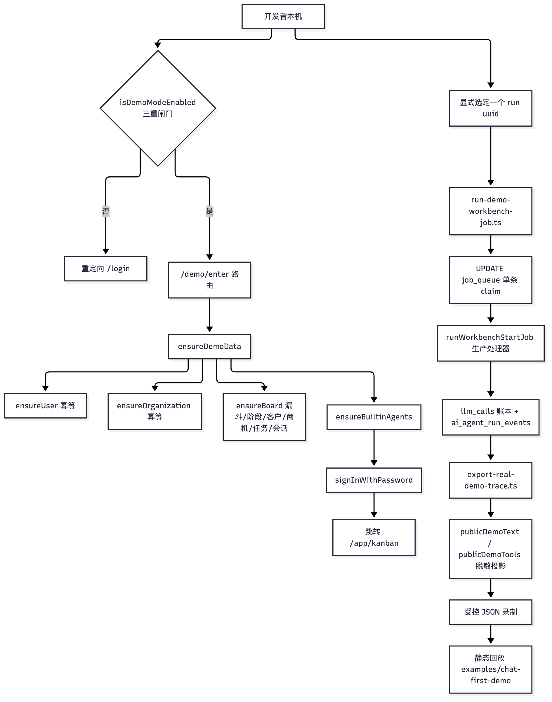
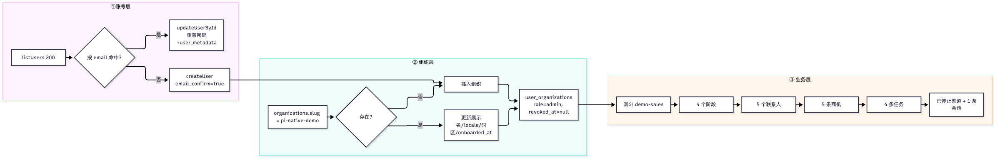

# 30 演示、录制回放与数据播种

[返回母文档](../README.md) · [上一章](29.md) · [下一章](31.md)

**本章目标：**区分静态模拟、历史回放、开发库播种和受控真实调用。

## 实现详解

这一页解决一个具体的上手问题：**你不准备申请任何模型 API Key、不接 WhatsApp、不连 Mem0/WeKnora/Langfuse，能不能先把这个 CRM 跑起来、点起来，并且看到"真实模型跑过"的可信证据？**

答案是可以，但必须先分清仓库里**两套完全不同性质**的"免密钥演示"。一套是脱离后端的静态浏览器回放（零依赖、零网络、纯只读），另一套是在本机 loopback 上真实播种数据、真实调用模型的受控验证。把两者混为一谈，是这个项目最容易犯的演示事故——项目自身文档反复强调"不要在没有验证过的范围内声称已联通"。

Sources: [README.md](https://github.com/helsome/AiNativeCrm/blob/679e09e80878dff7b1c79b8537317b2b9e355331/examples/chat-first-demo/README.md#L1), [package.json](https://github.com/helsome/AiNativeCrm/blob/679e09e80878dff7b1c79b8537317b2b9e355331/examples/chat-first-demo/package.json#L1), [config.ts](https://github.com/helsome/AiNativeCrm/blob/679e09e80878dff7b1c79b8537317b2b9e355331/lib/demo/config.ts#L1)

### 两层演示的边界对照

在动手之前先建立这张表。判断"我现在看到的现象属于哪一层"，决定了后面的操作是启动服务还是直接开浏览器。

| 维度 | 第一层：静态录制回放 | 第二层：本机真实播种与真实模型 |
| --- | --- | --- |
| 代码位置 | `examples/chat-first-demo/` | `lib/demo/`、`scripts/seed-demo.ts`、`scripts/run-demo-workbench-job.ts` |
| 需要数据库 | 不需要 | 需要本机 Supabase/PostgreSQL |
| 需要模型 Key | 不需要（回放已录制的 JSON） | 真实运行时需要（凭据留在本机加密凭据库） |
| 是否发起网络请求 | 零 HTTP传输（测试有 tripwire 断言） | 会发起模型请求，但只限被显式选中的那一个 run |
| 数据真实性 | 合成客户 + 真实模型历史输出的脱敏投影 | 本机真实写入的合成数据，模型真实执行 |
| 启动方式 | `node scripts/serve-agent-demo.mjs`（127.0.0.1:3008） | `pnpm demo:seed` + `/demo/enter` |
| 能否当作生产验收 | **不能**，它不启动 Next.js/Supabase/worker | **不能**，它只覆盖指定范围，未验证项需单独验收 |

Sources: [serve-agent-demo.mjs](https://github.com/helsome/AiNativeCrm/blob/679e09e80878dff7b1c79b8537317b2b9e355331/scripts/serve-agent-demo.mjs#L1), [seed-demo.ts](https://github.com/helsome/AiNativeCrm/blob/679e09e80878dff7b1c79b8537317b2b9e355331/scripts/seed-demo.ts#L1), [agent-services-real-run-2026-10-03.md](https://github.com/helsome/AiNativeCrm/blob/679e09e80878dff7b1c79b8537317b2b9e355331/docs/testing/agent-services-real-run-2026-10-03.md#L1)

理解这张表前，先说清 Mermaid 图里每个节点的含义：**"闸门"**指 `isDemoModeEnabled()` 的三重判定；**"Admin Client"**指绕过 RLS 用 service role 直连的 Supabase 客户端；**"单任务领取"**指只 claim 一条 job_queue记录而非启动常驻 worker。



Sources: [route.ts](https://github.com/helsome/AiNativeCrm/blob/679e09e80878dff7b1c79b8537317b2b9e355331/app/demo/enter/route.ts#L8), [seed.ts](https://github.com/helsome/AiNativeCrm/blob/679e09e80878dff7b1c79b8537317b2b9e355331/lib/demo/seed.ts#L325), [run-demo-workbench-job.ts](https://github.com/helsome/AiNativeCrm/blob/679e09e80878dff7b1c79b8537317b2b9e355331/scripts/run-demo-workbench-job.ts#L11), [export-real-demo-trace.ts](https://github.com/helsome/AiNativeCrm/blob/679e09e80878dff7b1c79b8537317b2b9e355331/scripts/export-real-demo-trace.ts#L20)

### 第一道闸门：演示模式的三重判定

演示模式是开发便利，**不是鉴权后门**。`isDemoModeEnabled()` 只有三个条件同时成立才返回 `true`：`NODE_ENV` 不是 `production`、`CRM_DEMO_MODE` 字面等于 `"true"`、并且 `NEXT_PUBLIC_SUPABASE_URL` 的主机名解析后属于 `localhost` / `127.0.0.1` / `::1`。任何一项不满足即返回 `false`；URL 解析抛异常时同样返回 `false`（失败关闭）。

这条设计的意义在于：即使有人把 `CRM_DEMO_MODE=true` 遗留在生产环境变量里，生产环境也永远不会点着演示账号；而演示账号的密码在 `.env.example` 里是公开明文，它的安全性只绑定在"必须是本机 loopback"这一个事实上。

Sources: [config.ts](https://github.com/helsome/AiNativeCrm/blob/679e09e80878dff7b1c79b8537317b2b9e355331/lib/demo/config.ts#L6)

对应的三个环境变量在 `lib/env.ts` 里用 Zod 定义，其中密码有最小长度约束（下限 12 位），邮箱必须是合法格式。默认值与 `.env.example` 保持一致。

| 变量 | 类型约束 | 默认值 | 用途 |
| --- | --- | --- | --- |
| `CRM_DEMO_MODE` | `"true"` \| `"false"` | `"true"` | 演示模式总开关 |
| `CRM_DEMO_EMAIL` | 合法邮箱 | `demo@example.invalid` | 演示账号登录名（`.invalid` 保留域，不可路由） |
| `CRM_DEMO_PASSWORD` | ≥ 12 字符 | `PiNativeDemo!2026` | 演示账号密码 |

Sources: [env.ts](https://github.com/helsome/AiNativeCrm/blob/679e09e80878dff7b1c79b8537317b2b9e355331/lib/env.ts#L66), [.env.example](https://github.com/helsome/AiNativeCrm/blob/679e09e80878dff7b1c79b8537317b2b9e355331/.env.example#L32)

### 第二层：幂等的演示数据播种

`pnpm demo:seed` 对应的脚本 `scripts/seed-demo.ts` 只是一个薄壳：它先调用 `isDemoModeEnabled()`，失败就**直接抛错退出**，绝不静默降级；成功则调用 `ensureDemoData()` 并打印演示账号、密码与组织 id。脚本用 `tsx --env-file=.env.local` 运行，因此直接读取本地配置文件而无需额外导出环境变量。

Sources: [seed-demo.ts](https://github.com/helsome/AiNativeCrm/blob/679e09e80878dff7b1c79b8537317b2b9e355331/scripts/seed-demo.ts#L5), [package.json](https://github.com/helsome/AiNativeCrm/blob/679e09e80878dff7b1c79b8537317b2b9e355331/package.json#L12)

`ensureDemoData()` 的核心是**幂等**：所有写入都是"先按自然键查询 → 命中就更新 → 未命中才插入"。这意味着你可以反复执行 `pnpm demo:seed` 而不会产生重复组织、重复客户或重复商机，演示数据永远是可重建的固定状态。



Sources: [seed.ts](https://github.com/helsome/AiNativeCrm/blob/679e09e80878dff7b1c79b8537317b2b9e355331/lib/demo/seed.ts#L10), [seed.ts](https://github.com/helsome/AiNativeCrm/blob/679e09e80878dff7b1c79b8537317b2b9e355331/lib/demo/seed.ts#L33), [seed.ts](https://github.com/helsome/AiNativeCrm/blob/679e09e80878dff7b1c79b8537317b2b9e355331/lib/demo/seed.ts#L84)

各层的具体内容与设计意图如下。

**账号层**用 `auth.admin.listUsers({ perPage: 200 })` 一次性列举，再按小写邮箱匹配。命中时调用 `updateUserById` **重置密码**，并把 `user_metadata` 合并写入 `full_name: "演示账号"`、`locale: "zh-CN"`、`demo: true`。未命中时 `createUser` 并置 `email_confirm: true`，这样免去邮箱确认步骤。

**组织层**固定 slug 为 `pi-native-demo`（与 `lib/demo/config.ts` 的 `DEMO_ORG_SLUG` 同源），组织名为"演示工作区"，locale `zh-CN`、时区 `Asia/Shanghai`。随后无条件写入一条 `role: "admin"` 的 `user_organizations` 成员关系，并把 `revoked_at` 置空——**每次执行都会把被撤销的绑定重新激活**，这是刻意的。

**业务层**是数据量最大的一段。

| 对象 | 数量 | 关键字段与设计意图 |
| --- | --- | --- |
| `crm_pipelines` | 1（`demo-sales`） | `is_default: true`；自带中文 `vocabulary`（客户/商机/已成交/已流失/阶段）与 `canonical_tags: ["重点"]` |
| `crm_stages` | 4 | `new` / `contacted` / `proposal` / `won`，其中 `won` 兼容回退到按 `is_won = true` 查找已有阶段 |
| `contacts` | 5 | 全部 `source: "demo"`，邮箱使用 `example.test` 保留测试域 |
| `crm_leads` | 5 | 覆盖四个阶段分布；金额用 `value_cents` 整数分 + `currency: "CNY"`；`won` 那条带 `closed_at` |
| `crm_tasks` | 4 | 刻意混合**逾期/进行中/未来/已完成**四种真实任务状态 |
| `conversations` | 1 | 归属第 1 个联系人，渠道为上面那个已停止的合成渠道 |

Sources: [seed.ts](https://github.com/helsome/AiNativeCrm/blob/679e09e80878dff7b1c79b8537317b2b9e355331/lib/demo/seed.ts#L84), [seed.ts](https://github.com/helsome/AiNativeCrm/blob/679e09e80878dff7b1c79b8537317b2b9e355331/lib/demo/seed.ts#L209), [seed.ts](https://github.com/helsome/AiNativeCrm/blob/679e09e80878dff7b1c79b8537317b2b9e355331/lib/demo/seed.ts#L249), [seed.ts](https://github.com/helsome/AiNativeCrm/blob/679e09e80878dff7b1c79b8537317b2b9e355331/lib/demo/seed.ts#L302)

任务数组的注释解释了为什么不用 Agent 执行来造数据：首页消费的是普通 CRM 任务，用一组可重复的静态任务就能表达真实任务状态，而不必伪造智能体执行记录。

Sources: [seed.ts](https://github.com/helsome/AiNativeCrm/blob/679e09e80878dff7b1c79b8537317b2b9e355331/lib/demo/seed.ts#L245)

#### 已停止的合成渠道

会话不能凭空存在，必须挂在一个 `channel_sessions` 行上。`ensureStoppedDemoChannelSession()` 解决的正是"给 CRM 一条真实可查的会话，但不接 WhatsApp、不发消息"这个矛盾。它创建的行 `status: "STOPPED"`，`waha_session_name` 固定为 `crm-workbench-demo-stopped`，`webhook_secret_encrypted` 写死为 `"\\x00"`（占位字节，不可解出真实密钥），并且**永不启动**。

这个文件还体现了渠道抽象的价值：它通过 `queryTolerantToMissingArchived()`兼容尚未迁移出 `archived_at` 列的旧库结构，演示与 CRM 功能因此不依赖某个传输层实现的 schema。

Sources: [demo-session.ts](https://github.com/helsome/AiNativeCrm/blob/679e09e80878dff7b1c79b8537317b2b9e355331/lib/channels/demo-session.ts#L1)

创建会话时把 `assigned_to_user_id` 在插入时就一并写入，注释说明了原因——**这样可以避免触发普通的"未分配会话"路由事件**，演示数据不会污染真实的路由与队列行为。会话还带 `metadata: { demo: true, no_external_channel: true }` 与 `unread_count_for_assignee: 1`。

Sources: [seed.ts](https://github.com/helsome/AiNativeCrm/blob/679e09e80878dff7b1c79b8537317b2b9e355331/lib/demo/seed.ts#L302)

#### 免密钥进入：`/demo/enter`

`app/demo/enter/route.ts` 是"免密钥"的字面实现：访客访问这个路由，服务端替他完成播种并用演示账号登录。

流程是五步：先用 `safeNext()` 清洗 `next` 参数（默认落到 `/app/kanban`，防止开放重定向）；闸门不通过就重定向 `/login`；已登录用户直接跳到目标页；对未登录用户**在本次请求内**调用 `ensureDemoData()`；最后 `signInWithPassword` 成功即跳转，失败则回到 `/login?error=demo&next=...`。

Sources: [route.ts](https://github.com/helsome/AiNativeCrm/blob/679e09e80878dff7b1c79b8537317b2b9e355331/app/demo/enter/route.ts#L8)

### 第一层：静态录制回放

`scripts/serve-agent-demo.mjs` 是一个 18 行的静态文件服务器，只服务 `examples/chat-first-demo/dist/` 目录，监听 `127.0.0.1:3008`，启动后打印 `http://127.0.0.1:3008/#/app/ai/workbench`。它做了两件值得学的事：路径解析后校验必须仍位于根目录内（否则403），防目录穿越；响应统一带 `cache-control: no-store` 与 `x-content-type-options: nosniff`。

Sources: [serve-agent-demo.mjs](https://github.com/helsome/AiNativeCrm/blob/679e09e80878dff7b1c79b8537317b2b9e355331/scripts/serve-agent-demo.mjs#L1)

该示例的测试套件共 9 个文件，顺序执行；其中 `test:engine` 可单独跑不依赖任何安装包的引擎测试，`test:recordings` 单独跑录制隐私测试。依赖只有 `jsdom` 与 `css-tree` 两个 devDependencies，Node ≥ 22。

| 测试文件 | 覆盖内容 |
| --- | --- |
| `smoke.cjs` | CRM / Agent / Mission 状态行为 |
| `full-smoke.cjs` | 62 条路由、导航、处理器、状态迁移与路由覆盖率 |
| `chat-dom.cjs` | 真实 DOM 交互、多轮对话、键盘与 IME、转义、抽屉焦点、委派、取消、CSS 解析 |
| `runtime-lab.cjs` | 可执行引擎、全部门禁、重载检查点、不重复建任务、缺 Wiki 恢复、失败对照、重置隔离 |
| `runtime-lab-dom.cjs` | 工作流/重载/重置、trace 与回放控制、传输调用 tripwire |
| `inspection-dom.cjs` | 代码对齐的新面板、来源撤销、客户边界脱敏、Eval 缺材料拒绝 |
| `agent-services-dom.cjs` | 默认关闭 / 未连接状态、凭据控件禁用、零传输零持久化 |
| `visual-style.cjs` | 中性视觉令牌 |
| `real-recordings.cjs` | 录制隐私与零网络回放 |

Sources: [package.json](https://github.com/helsome/AiNativeCrm/blob/679e09e80878dff7b1c79b8537317b2b9e355331/examples/chat-first-demo/package.json#L9)

需要清醒认识这份 README 自陈的局限：它是**无构建步骤的独立浏览器示例**，不启动真实 Next.js、Supabase、Agent worker、模型或消息集成；所有客户、价格、日期、审批与本地任务均为虚构；它**不是像素级生产构建**，也不验证像素布局、触摸滚动或真机键盘。

Sources: [README.md](https://github.com/helsome/AiNativeCrm/blob/679e09e80878dff7b1c79b8537317b2b9e355331/examples/chat-first-demo/README.md#L10)

### 可选：一次受控的真实模型运行

如果本机已有真实凭据与队列，`scripts/run-demo-workbench-job.ts` 允许你**只跑一条**被显式选中的演示任务。

它的约束非常密集：run id 必须是合法 UUID；`SUPABASE_DB_URL` 主机名必须在 `["127.0.0.1", "localhost", "[::1]"]` 内，否则抛 `demo_requires_loopback_db`；`workerId` 每次运行用 `randomUUID()` 重新生成。领取 job 的那条 `UPDATE` 同时要求 run属于 `pi-native-demo` 组织、`mode='inspect'`、任务文本以特定前缀开头、run 处于 `queued`、job 为 `pending` 且 `kind='workbench_start'`，并且必须恰好命中一行，否则抛 `one_pending_demo_job_required`。

Sources: [run-demo-workbench-job.ts](https://github.com/helsome/AiNativeCrm/blob/679e09e80878dff7b1c79b8537317b2b9e355331/scripts/run-demo-workbench-job.ts#L11)

这条设计避免了项目文档中反复出现的一个风险：**不启动会消费其他遗留任务的全局 24/7 worker**。脚本执行的是生产处理器 `runWorkbenchStartJob` 本身，因此走的是真实代码路径，但不构成对完整调度守护进程的长期验证。

失败处理同样谨慎：异常时调用 `failJob`，但**绝不打印异常内容**——注释写明"Provider exception strings may contain sensitive request material"，只输出通用提示并引导去看受限范围内的 CRM run 与服务端日志。凭据始终留在加密凭据库中，脚本任何时候都不打印。

Sources: [run-demo-workbench-job.ts](https://github.com/helsome/AiNativeCrm/blob/679e09e80878dff7b1c79b8537317b2b9e355331/scripts/run-demo-workbench-job.ts#L28)

### 证据导出：宽名单、脱敏投影与最终答案边界

`scripts/export-real-demo-trace.ts` 把一次真实运行导出成最小化 JSON。它从不写文件、从不调用模型，只往 stdout 打印——文件头注释明确要求"打印前先审查 stdout，绝不导出生产或客户运行"。

它有三重前置门：run uuid 必须在硬编码的六个已策展 id 列表内（否则抛 `curated_public_recording_required`，注释说得很直白——"一个标记本身不构成发布任意客户答案的同意"）；数据库必须是 loopback；run 必须属于演示组织、`mode='inspect'`、任务前缀匹配，且终态属于 `completed/partial/failed` 之一。

Sources: [export-real-demo-trace.ts](https://github.com/helsome/AiNativeCrm/blob/679e09e80878dff7b1c79b8537317b2b9e355331/scripts/export-real-demo-trace.ts#L12)

第四道门是内容边界：`inspectProductFinalAnswer(run.final_text).internalDraftCodes.length` 非空即抛 `unsafe_answer_boundary`。`inspectProductFinalAnswer` 定义了五类内部草稿特征码——`internal_final_answer_instruction`、`internal_language_instruction`、`internal_style_instruction`、`internal_analysis_leak`、`internal_working_notes`——同时还独立检测五类截断迹象（未闭合标点、未完成连接词、未闭合代码围栏、未闭合粗体标记、未完成列表项）。其存在理由是：某些 OpenAI 兼容供应商会把私有草稿正文和产品答案放在同一个 assistant 文本块里。

Sources: [final-answer.ts](https://github.com/helsome/AiNativeCrm/blob/679e09e80878dff7b1c79b8537317b2b9e355331/lib/ai/agents/final-answer.ts#L1), [export-real-demo-trace.ts](https://github.com/helsome/AiNativeCrm/blob/679e09e80878dff7b1c79b8537317b2b9e355331/scripts/export-real-demo-trace.ts#L24)

真正的脱敏发生在 `lib/ai/agents/demo-trace.ts`。`publicDemoText()` 用四条正则依次遮蔽：形如 `sk-` 开头的密钥、邮箱、UUID、以及电话号码。`publicDemoTools()` 只接受匹配 `^crm_[a-z_]+$` 的工具名，把 `contact_id` / `conversation_id` / `lead_id` / `pipeline_id` 一律替换为占位符，`query` 只保留"林晓梅"这一个白名单搜索词，其余一律替换；观察值只暴露计数（`contactsCount`、`messagesCount` 等）与客户记忆的覆盖率摘要，**不输出原始工具正文**。

Sources: [demo-trace.ts](https://github.com/helsome/AiNativeCrm/blob/679e09e80878dff7b1c79b8537317b2b9e355331/lib/ai/agents/demo-trace.ts#L1)

导出的 JSON 带一个 `boundaries` 块自我声明：`syntheticCustomer: true`、`credentialsIncluded: false`、`hiddenReasoningIncluded: false`、`rawToolBodiesIncluded: false`，以及 mem0/weknora/langfuse 三个 `"not_measured_by_export"`。**导出工具主动声明自己无法测量什么**，这比省略这些字段更诚实。

Sources: [export-real-demo-trace.ts](https://github.com/helsome/AiNativeCrm/blob/679e09e80878dff7b1c79b8537317b2b9e355331/scripts/export-real-demo-trace.ts#L46)

### 演示能证明什么、不能证明什么

这张表来自项目自身的真实运行验证报告，是本页最重要的产出。

| 演示覆盖 | 结论强度 |
| --- | --- |
| 免密钥静态回放可见、零网络、隐私脱敏正确 | 强（测试断言） |
| 本机播种幂等、租户隔离、会话不触发真实路由 | 强（定向回归 + 真实 PostgreSQL） |
| 真实模型回合、工具调用、持久化事件、Eval 入库 | 强（真实 Provider 实测） |
| Mem0 / WeKnora / Langfuse 端到端联通 | **未验证**——本机无绑定、无服务端 |
| 完整业务上线验收、无人值守稳定性、断电后恢复 | **未验证**，需单独验收 |
| 终态 `partial` 是否等于任务成功 | **不等于**，须看缺失材料声明 |

Sources: [agent-services-real-run-2026-10-03.md](https://github.com/helsome/AiNativeCrm/blob/679e09e80878dff7b1c79b8537317b2b9e355331/docs/testing/agent-services-real-run-2026-10-03.md#L1), [agent-services-real-run-2026-10-03.md](https://github.com/helsome/AiNativeCrm/blob/679e09e80878dff7b1c79b8537317b2b9e355331/docs/testing/agent-services-real-run-2026-10-03.md#L120)

那份报告里最值得学的是**修复前后的对照方法**：同一个真实模型、同一批合成客户，旧运行被判 pass/88，新 rubric 重新评审识别出 `confirmed_memory_contradicted`、`absence_stated_as_fact`、`confirmed_memory_not_observed` 三类问题，降级为 fail/32。也就是说，**证据的价值在于能被复算和被推翻，而不是分数好看**。

Sources: [agent-services-real-run-2026-10-03.md](https://github.com/helsome/AiNativeCrm/blob/679e09e80878dff7b1c79b8537317b2b9e355331/docs/testing/agent-services-real-run-2026-10-03.md#L28)

### 故障排查

| 现象 | 根因 | 处理 |
| --- | --- | --- |
| `pnpm demo:seed` 抛"演示 seed 只允许在 development + 本地 Supabase 上运行" | 三重闸门任一不满足 | 确认 `NODE_ENV` 非 production、`CRM_DEMO_MODE=true`、Supabase URL 是 loopback |
| `/demo/enter` 跳回 `/login` 且无报错 | 闸门返回 `false`，静默重定向 | 这是设计行为，不是 bug；检查上面三项 |
| `/demo/enter` 跳到 `/login?error=demo` | 播种成功但密码登录失败 | 检查 `CRM_DEMO_PASSWORD` 是否 ≥ 12 位；重跑 `pnpm demo:seed` 强制重置密码 |
| `run-demo-workbench-job.ts` 抛 `demo_requires_loopback_db` | `SUPABASE_DB_URL` 指向远端 | 换成 loopback 地址，脚本不接受远程数据库 |
| 抛 `one_pending_demo_job_required` | 没有恰好一条符合条件的 pending job | 确认 run 是 `queued`、job 是 `pending` 且 `kind='workbench_start'` |
| `export-real-demo-trace.ts` 抛 `curated_public_recording_required` | run id 不在六个已策展 id 内 | 这是安全门，不要绕过；先完成人工策展与审查 |
| 抛 `unsafe_answer_boundary` | 最终答案里混入了内部草稿特征码 | 该次运行不可公开导出；查看受限 run 状态 |
| 静态示例404 | `examples/chat-first-demo/dist/` 未就绪 | `serve-agent-demo.mjs` 只服务 dist，不做构建 |

Sources: [config.ts](https://github.com/helsome/AiNativeCrm/blob/679e09e80878dff7b1c79b8537317b2b9e355331/lib/demo/config.ts#L11), [seed-demo.ts](https://github.com/helsome/AiNativeCrm/blob/679e09e80878dff7b1c79b8537317b2b9e355331/scripts/seed-demo.ts#L5), [route.ts](https://github.com/helsome/AiNativeCrm/blob/679e09e80878dff7b1c79b8537317b2b9e355331/app/demo/enter/route.ts#L11), [run-demo-workbench-job.ts](https://github.com/helsome/AiNativeCrm/blob/679e09e80878dff7b1c79b8537317b2b9e355331/scripts/run-demo-workbench-job.ts#L13), [export-real-demo-trace.ts](https://github.com/helsome/AiNativeCrm/blob/679e09e80878dff7b1c79b8537317b2b9e355331/scripts/export-real-demo-trace.ts#L14)

### 目录结构速览

```text
lib/demo/
├── config.ts        # 三重闸门 + 三个 CRM_DEMO_* 常量
└── seed.ts          # ensureUser / ensureOrganization / ensureBoard / ensureDemoData
lib/channels/
└── demo-session.ts  # 已停止的合成渠道行
app/demo/enter/
└── route.ts         # 免密钥登录入口
scripts/
├── seed-demo.ts             # pnpm demo:seed 的入口
├── serve-agent-demo.mjs     # 静态回放服务器 127.0.0.1:3008
├── run-demo-workbench-job.ts# 单条真实模型 job└── export-real-demo-trace.ts# 受控脱敏导出
lib/ai/agents/
├── demo-trace.ts     # publicDemoText / publicDemoTools 脱敏投影
└── final-answer.ts   # 内部草稿与截断检测
examples/chat-first-demo/
├── README.md, package.json, artifact-manifest.json
└── tests/            # 9 个 .cjs 测试
docs/testing/
├── agent-services-real-run-2026-10-03.md
└── fixtures/agent-services-real-2026-10-03.json
```

Sources: [config.ts](https://github.com/helsome/AiNativeCrm/blob/679e09e80878dff7b1c79b8537317b2b9e355331/lib/demo/config.ts#L1), [seed.ts](https://github.com/helsome/AiNativeCrm/blob/679e09e80878dff7b1c79b8537317b2b9e355331/lib/demo/seed.ts#L325), [package.json](https://github.com/helsome/AiNativeCrm/blob/679e09e80878dff7b1c79b8537317b2b9e355331/examples/chat-first-demo/package.json#L1)

## 继续阅读

[返回母文档](../README.md) · [上一章](29.md) · [下一章](31.md)

