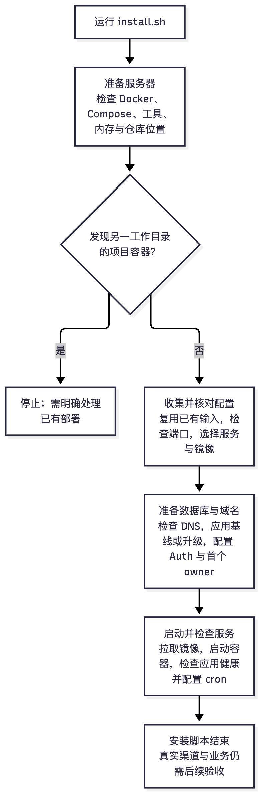
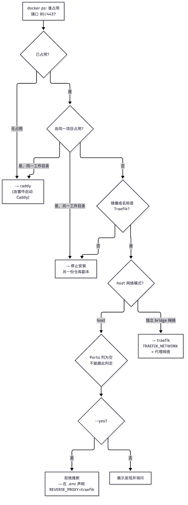
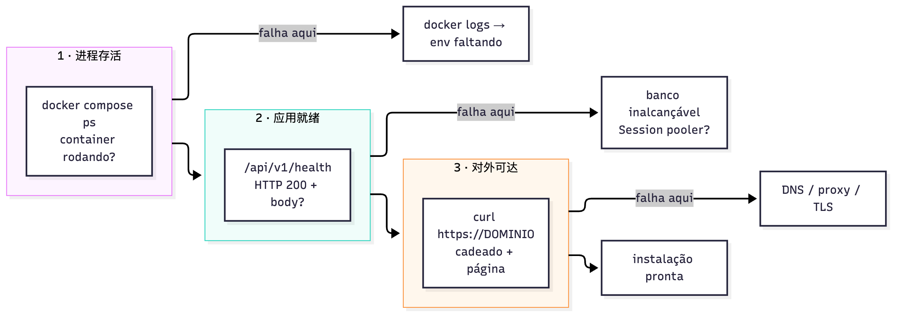

# 31 自托管：安装、升级与健康检查

[返回母文档](../README.md) · [上一章](30.md) · [下一章](32.md)

**本章目标：**理解 VPS 套件的安装阶段、数据库准备和升级边界。

## 实现详解

`hostgator-setup-kit/` 是 Pi Native CRM 面向 VPS 的**交付层**：一组 Bash 脚本，负责在服务器上装配应用、数据库连接、渠道和自动化服务；是否可用于生产还需要实际环境与业务验收。它不含任何产品代码——Next.js 应用在 `app/`，数据库 schema 在 `supabase/baseline.sql`，脚本只负责**在宿主机上把这些东西正确地装配起来，并且可重复地做第二次**。这一页拆解这套套件的设计：四个阶段的安装编排、反向代理的自诊断决策、数据库的"新库致命 / 老库宽容"双模契约、升级的停服换镜像事务，以及健康检查的分层语义。

Sources: [install.sh](https://github.com/helsome/AiNativeCrm/blob/679e09e80878dff7b1c79b8537317b2b9e355331/hostgator-setup-kit/install.sh#L1)

### 套件构成与职责边界

整套件共 16 个脚本，超过一万行。它们不是平级的——而是分成了**四层**，每层只依赖向下：

| 层次 | 脚本 | 职责 |
| --- | --- | --- |
| 入口/向导 | `comecar.sh`、`install.sh` | 首次装配：从零到可用 |
| 生命周期 | `update.sh`、`agent.sh`、`backup.sh`、`restore.sh`、`extensao.sh`、`manutencao.sh` | 升级、后台自动升级、备份恢复、模块维护 |
| 运维工具 | `healthcheck.sh`、`diagnostico.sh`、`marca-emails.sh`、`reset-password.sh`、`reset-mfa.sh`、`supabase-provision.sh` | 单点排障与凭据修复 |
| 共享库 | `_common.sh`（1503 行） | 所有脚本 `source` 的函数库 |

关键架构决策在 `_common.sh` 的体量上：Docker compose 封装、反向代理网络判定、数据库连接、镜像 tag 钉住、cron 写入、版本比较——这些**都不允许在 `install.sh` 和 `update.sh` 里各写一份**。两处脚本共用同一份实现，是整套件唯一保证"安装出来的形态"和"升级后保持的形态"一致的方式。`install.sh` 顶部只有两处例外，它刻意保持 standalone（因为它要在 clone 之前运行），并显式标注了这对"双胞胎函数"必须同步修改：

> `install.sh` 顶部注释明确写道，该脚本是**故意 standalone** 的（"roda antes do clone, então não dá para usar o _common.sh"），其 `dc()` 与 `dc_files()` 是 `_common.sh` 同名函数的孪生副本——"se mexer numa, mexa na outra"。

Sources: [_common.sh](https://github.com/helsome/AiNativeCrm/blob/679e09e80878dff7b1c79b8537317b2b9e355331/hostgator-setup-kit/_common.sh#L514), [install.sh](https://github.com/helsome/AiNativeCrm/blob/679e09e80878dff7b1c79b8537317b2b9e355331/hostgator-setup-kit/install.sh#L29)

### install.sh：四阶段旅程编排

安装器最重要的设计决定是**放弃给技术步骤编号，改给"旅程阶段"编号**。理由写在源码里：技术步骤（`step`）数量多且条件分支严重，编号会得到一个随安装路径变化的"第 7 步 / 共 11 步"——同一个人第二次装看到的是另一个数字。于是脚本用 `FASE_TOTAL=4` 固定了四个阶段：

```text
Fase 1/4 · Preparando o servidor   (preflight)
Fase 2/4 · Suas informações        (配置采集)
Fase 3/4 · Banco de dados e domínio (DNS + schema + 首个 admin)
Fase 4/4 · Colocando o CRM no ar   (拉镜像 + 健康等待 + cron)
```

Sources: [install.sh](https://github.com/helsome/AiNativeCrm/blob/679e09e80878dff7b1c79b8537317b2b9e355331/hostgator-setup-kit/install.sh#L81)



Sources: [install.sh](https://github.com/helsome/AiNativeCrm/blob/679e09e80878dff7b1c79b8537317b2b9e355331/hostgator-setup-kit/install.sh#L772), [install.sh](https://github.com/helsome/AiNativeCrm/blob/679e09e80878dff7b1c79b8537317b2b9e355331/hostgator-setup-kit/install.sh#L2110)

#### Preflight：拒绝伤人的幂等性

第 1 阶段做三件事：装 Docker、验依赖、**挡住一份可能覆盖线上安装的 clone**。最后一条是这套件里最重要的一行防御。

`recusar_projeto_de_outra_arvore` 来自 `_common.sh`，它按**项目目录树**而非容器名来判断归属。源码注释里记录了这个守卫被补上的原因——`update.sh` 和 `agent.sh` 早有此守卫，`install.sh` 却没有，"a porta por onde o incidente entrou"。在一个真实 VPS 上量到的后果是：某次安装因为走到这一步，用自己 `.env`（另一个数据库、另一些密钥）重建了生产 CRM 的容器，生产环境的密码"停止工作"，WhatsApp 连接掉线。

注释还列出了为什么这个守卫**不能放在 preflight 里**，只能放在仓库定位之后：它要比较 `PROJECT_DIR`，那个变量要到 `cd` 进 repo 之后才存在。它也说明了三个不会误伤的情况——全新安装（项目容器不在运行，函数返回空）、在**同一目录**重跑（同一棵树）、以及 `PI_NATIVE_ASSUMIR_PROJETO=1` 这个刻意的搬迁出口。

Sources: [install.sh](https://github.com/helsome/AiNativeCrm/blob/679e09e80878dff7b1c79b8537317b2b9e355331/hostgator-setup-kit/install.sh#L846), [_common.sh](https://github.com/helsome/AiNativeCrm/blob/679e09e80878dff7b1c79b8537317b2b9e355331/hostgator-setup-kit/_common.sh#L352)

Docker 缺失时的处理也体现了同一原则：**交互模式下先问，`--yes` 模式下直接装**。注释说得很直接——"instalar coisa no servidor de alguém sem avisar é abuso de confiança"。安装输出被写进临时 log 而非 `/dev/null`，失败时 tail 最后 15 行，因为"silenciar o stderr também deixava a falha MUDA"——磁盘满、apt 锁死、无对应架构包都会退化成同一句泛泛的话。

Sources: [install.sh](https://github.com/helsome/AiNativeCrm/blob/679e09e80878dff7b1c79b8537317b2b9e355331/hostgator-setup-kit/install.sh#L776)

#### 输入验证：唯一一次能便宜地拒绝坏数据的窗口

`install.sh` 用了一整套命名一致的验证器（`v_domain`、`v_email`、`v_sb_key`、`v_db_url`、`v_anthropic`、`v_openrouter`、`v_openai`、`v_password`…），每个都返回**葡语解释**而非 shell 错误。注释点明了它的位置价值："Rodam ANTES de o valor entrar no .env — é o único momento em que a pessoa ainda pode corrigir sem desfazer nada."

`ask_one` 封装了"问一项、校验、接受 `voltar`"的循环，返回码 `0` 接受 / `2` 用户要求回退。它有一个专门针对密钥粘贴的启发式：如果输入是偶数长度且前后两半完全相同，就判定为"被连贴了两次"并拒收——因为 secret 字段不回显，用户看不到粘没粘上，倾向于"为保险再粘一次"，而没有分隔符的两段会拼成一个被折叠的值。

Sources: [install.sh](https://github.com/helsome/AiNativeCrm/blob/679e09e80878dff7b1c79b8537317b2b9e355331/hostgator-setup-kit/install.sh#L156), [install.sh](https://github.com/helsome/AiNativeCrm/blob/679e09e80878dff7b1c79b8537317b2b9e355331/hostgator-setup-kit/install.sh#L397)

### 反向代理：套件里最有意思的一段工程

默认形态是 Caddy（自动 HTTPS）。但 Hostinger / Coolify / Dokploy 这类 VPS 自带一个占着 80/443 的 Traefik。安装器的处理方式是整套件里**推理链条最长**的一段，值得单独拆。

**第一步：不问"是不是 Traefik"，而问"谁能发布端口"。** 旧版本只认 Traefik，导致一个 Caddy（甚至就是同一台 VPS 上另一份 pi-native-crm 的 Caddy）被判为入侵者。新版本从 `docker ps --format` 解析谁发布了 `:80->` 或 `:443->`，分隔符用 `|` 而不是 TAB——因为 TAB 是 IFS空白字符，连续两个 TAB 会让中间空字段消失，`docker run` 起的无 label 代理就会丢失镜像名。

**第二步：可发布性靠"试"而不是"推断"。** `porta_publicavel()` 直接跑 `docker run --rm -p <porta>:<porta> alpine:3.20 --entrypoint /bin/true`。注释承认所有基于 `docker port` 或 `ss` 的启发式"都双端出错"——要么中止一次好安装，要么把端口冲突留到最后一刻。试探用"撒谎式发布"，用的正是 Caddy 稍后要用的同一套机制。



Sources: [install.sh](https://github.com/helsome/AiNativeCrm/blob/679e09e80878dff7b1c79b8537317b2b9e355331/hostgator-setup-kit/install.sh#L555), [install.sh](https://github.com/helsome/AiNativeCrm/blob/679e09e80878dff7b1c79b8537317b2b9e355331/hostgator-setup-kit/install.sh#L594)

三处工程细节值得单独记住：

**同名项目不等于同一安装。** 项目名是目录的 basename，而每份 repo clone 都叫 `pi-native-crm`。`/root/pi-native-crm` 和 `/root/apagar7/pi-native-crm` 会在同一个项目名上相撞，于是 `decide_proxy` 曾把一份复制品判成另一份的重跑。注释里记了实测后果与日期（2026-08-24）：一堂课用的安装从这里走过去，用它自己的 `.env` 重建了 CRM 容器，把生产安装的数据库换掉了，没有任何警告。区分两者的是**树**（`dono_dir != meu_dir`）。当树未知时，函数刻意退回旧行为——"não dá para AFIRMAR cópia irmã, e fechar no escuro quebraria a re-execução legítima que o kit ensina"。

**Traefik 的网络：两个相反的结论，都曾经是唯一实现。** `rede_do_traefik()` 的分支由实测支撑：Traefik v3.3 在**自有 bridge** 上时，label 必须指向**代理自己的网络**——指向项目网络时即使容器同时在两张网里，请求仍然是 HTTP 000 超时。Traefik 在 **host 模式**时结论相反：必须用一张**我们自己创建的 bridge**。原因有二，都是实测的——(1) compose 会拒绝 `external` 指向它自己要创建的网络（全新安装时报 `network <projeto>_internal declared as external, but could not be found`）；(2) 项目的 `_internal` 网络上有**无密码的 Redis**，而代理网络是唯一可能混入外部容器的网络。

**证据强度决定动作强度。** 由发布端口选出的 Traefik 手上有证据（Ports 列写着 `:80->`）；由 `--network host` 选出的只有怀疑——host 模式下 Ports 列对**所有人**都是空的，这个扫描回答的是"机器上是否恰好有一个 host 模式的 Traefik"，不是"它在占端口"。一个原生 nginx 占着 80/443 加上一个 host 模式 Traefik 服务别的东西，就会得到"装好了但站点没反应"。于是 `confianca_no_dono_das_portas` 在**动作上收紧、信息上放宽**：交互模式问（并说明发现了什么），`--yes` 模式直接拒绝并给出出路（自己在 `.env` 里声明 `REVERSE_PROXY=traefik`），而显式声明永远被尊重——"ali a escolha é de quem instala, não um chute do instalador"。

Sources: [install.sh](https://github.com/helsome/AiNativeCrm/blob/679e09e80878dff7b1c79b8537317b2b9e355331/hostgator-setup-kit/install.sh#L659), [install.sh](https://github.com/helsome/AiNativeCrm/blob/679e09e80878dff7b1c79b8537317b2b9e355331/hostgator-setup-kit/install.sh#L714)

### 数据库：新库致命，老库宽容

应用 schema 的方式有两条通道，来自 `_common.sh` 的 `url_do_schema()`：**应用用的连接串**（可能是一个被有意降权的 role）和 `SUPABASE_DB_ADMIN_URL`（仅在自建 Supabase 时提供，不写进容器 `.env`）。建扩展、灌 baseline、提升首个 owner都需要**数据库属主**，云端 Supabase 两者相同，自建时不同。

Sources: [install.sh](https://github.com/helsome/AiNativeCrm/blob/679e09e80878dff7b1c79b8537317b2b9e355331/hostgator-setup-kit/install.sh#L1799), [_common.sh](https://github.com/helsome/AiNativeCrm/blob/679e09e80878dff7b1c79b8537317b2b9e355331/hostgator-setup-kit/_common.sh#L704)

baseline 之前必须先开三个扩展——`vector`、`citext`、`pg_trgm`。原因是 baseline.sql 是一份 `pg_dump`，它**引用** `public.vector` / `public.citext` / `gin_trgm_ops` 但**不创建**它们，而 Supabase 默认不在 `public` schema 里启用它们，缺了就会在半途炸掉（`type public.vector does not exist`）。

真正的分支在这里：**同一个文件，两种失败契约**。

| 库状态 | 判定查询 | 失败处理 | 理由 |
| --- | --- | --- | --- |
| 新库 | `organizations` 表不存在 | `ON_ERROR_STOP=1`，首个 "already exists" 即 `die` | schema 半截 = **app 无 RLS**，不能上线 |
| 已有库 | `organizations` 表存在 | `reaplicar_baseline`（宽容模式），预期内的 "已存在" 记日志 | 重跑是安装器**推荐的修复路径**，不能因此中断 |

Sources: [install.sh](https://github.com/helsome/AiNativeCrm/blob/679e09e80878dff7b1c79b8537317b2b9e355331/hostgator-setup-kit/install.sh#L1828)

应用之后还有一次**实证验证而非意愿验证**：数 `information_schema.tables` 里的表数，≥30 视为通过（当前 migration链已达 400+ 编号），否则警告并指向 `baseline-apply.log`。

### 健康检查的三层语义

「健康」在套件里不是一个布尔值，而是三个层次，各自回答不同的问题。理解这三层的区别，是正确使用 `healthcheck.sh` 的前提。



第三层是这套件独有的判别力来源：`/api/v1/health` 返回 200 但域名打不开，说明问题在 DNS 或反向代理，而不在应用；反过来域名开了但 health 挂，说明是数据库连接串。`_common.sh` 里的 `app_health_probe()` 与 `wait_app_healthy()` 承担第二层，`install.sh` 第 10 步直接复用它们。

Sources: [_common.sh](https://github.com/helsome/AiNativeCrm/blob/679e09e80878dff7b1c79b8537317b2b9e355331/hostgator-setup-kit/_common.sh#L545), [install.sh](https://github.com/helsome/AiNativeCrm/blob/679e09e80878dff7b1c79b8537317b2b9e355331/hostgator-setup-kit/install.sh#L2146)

### update.sh：停服换镜像的事务

升级脚本的骨架是一条**有明确顺序的事务**，它借用 `_common.sh` 里同一批原语，因此"升级后的形态"和"安装时的形态"不会漂移：

- **版本比较**：`veredito_da_imagem_do_app` 对比目标版本与已安装版本，决定是走 GHCR 拉取还是在本地构建。
- **停服**：`_common.sh` 里有成对的 `pausar_o_que_fala_com_o_banco` / `religar_o_supabase` / `restaurar_servicos`——**与数据库对话的服务先停**，避免换镜像期间有写入落到旧 schema 上。
- **镜像钉住**：`pin_incompleto` 检测 `.env` 里缺失或仍指向浮动 tag（如 `latest` / `stable`）的 `*_IMAGE`；`completar_pin_ausente` 与 `gravar_imagens` 负责补全和写入。这是"客户安装必须钉在某个版本号"这条业务规则在脚本层的落点。
- **更新后再补两件事**：cron 复查（每次升级都重跑一次事件 drain 的注册，`cron_merge` 保证**不会重复行**）和 emails/secret 的完整性检查。

Sources: [_common.sh](https://github.com/helsome/AiNativeCrm/blob/679e09e80878dff7b1c79b8537317b2b9e355331/hostgator-setup-kit/_common.sh#L149), [_common.sh](https://github.com/helsome/AiNativeCrm/blob/679e09e80878dff7b1c79b8537317b2b9e355331/hostgator-setup-kit/_common.sh#L987), [_common.sh](https://github.com/helsome/AiNativeCrm/blob/679e09e80878dff7b1c79b8537317b2b9e355331/hostgator-setup-kit/_common.sh#L1225)

配套的 `agent.sh` 做**无人值守升级**：它把 `update.sh` 的输出重定向到日志，并用 `esc()` 逐字节剥掉 ANSI 转义才能读 heartbeat——这正是 `install.sh` 顶部那段关于 `COLOR` 的注释解释"关掉颜色要在源头修"的原因：只在 `agent.sh` 里过滤是治标，`COLOR` 只在真 TTY 下开启才是治本。

Sources: [install.sh](https://github.com/helsome/AiNativeCrm/blob/679e09e80878dff7b1c79b8537317b2b9e355331/hostgator-setup-kit/install.sh#L47)

### 幂等性与退出契约

三个跨脚本的硬约束：

**1. 没有静默退出。** `install.sh` 顶部装了 `trap 'rc=$?; [ "$rc" -ne 0 ] && show_recovery; exit $rc' EXIT`，任何非零退出都会打印一段编号的恢复步骤（`rm -f .env` → `docker compose ... down -v` → 重跑安装器 → 必要时清空 schema）。注释记录了触发它的一次真实失败：一个 connection string 错误的 `psql` 在命令替换里退出码 2，`set -e` 让脚本无声死掉。**安装是用户对产品的第一次接触，无声死亡就是失去用户。**

**2. 回答被保存，中断可续。** `save_partial()` 把每个已接受的字段写进 `PARTIAL_FILE`，重跑时先加载 `.env`、**再**加载 partial——顺序是刻意的，"se as duas fontes têm a chave, a mais recente é esta"。Supabase token 明确不进 partial（"ele é de conta e nunca entra no rascunho"），会被重新问一次。

Sources: [install.sh](https://github.com/helsome/AiNativeCrm/blob/679e09e80878dff7b1c79b8537317b2b9e355331/hostgator-setup-kit/install.sh#L133), [install.sh](https://github.com/helsome/AiNativeCrm/blob/679e09e80878dff7b1c79b8537317b2b9e355331/hostgator-setup-kit/install.sh#L878)

**3. 恢复靠重跑安装器，而不是删文件重来。** `CLAUDE.md` 的负面清单里写死了这条：**不要**跑 `docker compose down -v`，**不要**删 `.env` 来"重来"——重跑安装器，它会按编号续上并纠正。

Sources: [CLAUDE.md](https://github.com/helsome/AiNativeCrm/blob/679e09e80878dff7b1c79b8537317b2b9e355331/hostgator-setup-kit/CLAUDE.md#L88)

### 环境约束速查

| 约束 | 值 | 出处 |
| --- | --- | --- |
| 架构 | 仅 `x86_64/amd64`（镜像未多架构） | `arquitetura_suportada_pelo_kit` |
| 宿主依赖 | 仅 `docker`、`docker compose` v2、`git`、`openssl`、`curl`；psql 走容器 | install.sh 头部 |
| 端口 | 80 / 443 / SSH（SSH 端口可能不是 22） | `uname -a` / `ss -tlnp \\| grep sshd` |
| RAM | 启动 2GB 可用，**运行推荐 4GB**（7 容器，WAHA 每会话 ~150MB） | `ram_abaixo_do_recomendado` |
| 令牌 | `SUPABASE_ACCESS_TOKEN` 只读环境、**从不落盘** | `sb_carrega_credenciais` |

Sources: [_common.sh](https://github.com/helsome/AiNativeCrm/blob/679e09e80878dff7b1c79b8537317b2b9e355331/hostgator-setup-kit/_common.sh#L22), [README.md](https://github.com/helsome/AiNativeCrm/blob/679e09e80878dff7b1c79b8537317b2b9e355331/hostgator-setup-kit/README.md#L100)

## 继续阅读

[返回母文档](../README.md) · [上一章](30.md) · [下一章](32.md)

