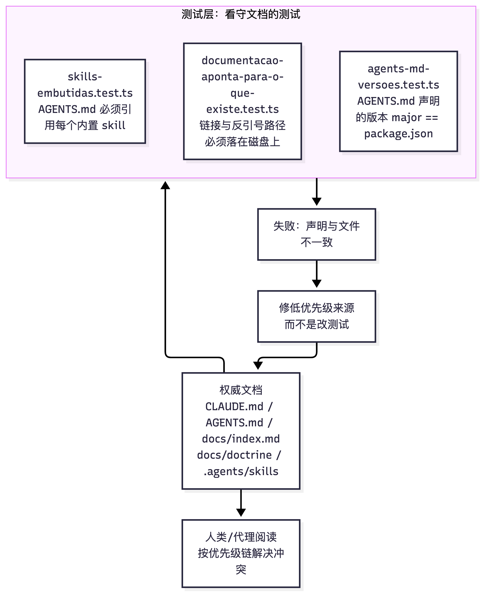

# 32 仓库文档契约与阅读优先级

[返回母文档](../README.md) · [上一章](31.md) · [下一章](33.md)

**本章目标：**理解 CLAUDE、AGENTS、文档索引和门禁的关系。

## 实现详解

本页回答一个新手开发者最先遇到的问题：**这个仓库的规则写在哪里？冲突时听谁的？** 它是「快速开始」系列的第三站——在你已经[把本地环境跑通](28.md)、并[接上外部服务](29.md)之后、准备[写第一行代码或提第一个 PR](33.md)之前，先建立这份「文档地图」。这个仓库的特殊之处在于：**它不只有一份 README，它的文档本身被测试门禁强制维护**——所以理解契约，不只是读文件，还要读懂那些「看守文档的测试」。

Sources: [AGENTS.md](https://github.com/helsome/AiNativeCrm/blob/679e09e80878dff7b1c79b8537317b2b9e355331/AGENTS.md#L1)

---

### 三层契约：一个权威，两个派生

仓库的顶层契约由三个文件构成，职责是**单向派生**而非平级并列。

| 文件 | 定位 | 谁读它 | 变更触发 |
| --- | --- | --- | --- |
| `CLAUDE.md` | **教义（doutrina）**，最终权威 | 所有编码代理 | 规则源头 |
| `AGENTS.md` | **可移植契约**，由 CLAUDE 派生 | Codex / Cursor / Copilot / OpenCode 等任意编码代理 | CLAUDE 变更时**必须同步核对** |
| `docs/index.md` | **149+ 篇文档的索引**与冲突仲裁规则 | 人与代理，在「扫 docs/ 之前」 | 文档树变化时 |

`CLAUDE.md` 开篇即自我声明：「**Este arquivo é a doutrina — a autoridade final sobre convenção e anti-pattern**」（本文件即教义——关于约定与反模式的最终权威），并列出它的补充材料顺序：`AGENTS.md`（同一契约的可移植形态，「**É derivado deste arquivo, não o substitui**」由本文件派生，而非替代它）、「Ao mudar doutrina aqui, verifique se `AGENTS.md` desatualizou」（在此修改教义时，请检查 AGENTS.md 是否已过时）、`docs/index.md`、`docs/current-state.md`、`docs/harness-audit.md` 与 `docs/threat-model.md`。

Sources: [CLAUDE.md](https://github.com/helsome/AiNativeCrm/blob/679e09e80878dff7b1c79b8537317b2b9e355331/CLAUDE.md#L1)

`AGENTS.md` 则反向确认这条派生关系：它是「Contrato portável para **qualquer** agente de código」，并把完整且不可谈判的教义**指回** `CLAUDE.md`（「A doutrina completa e não-negociável vive em `CLAUDE.md`」），同时给出全文档地图在 `docs/index.md`。它还在开头直接写出了**冲突时的优先级链**。

Sources: [AGENTS.md](https://github.com/helsome/AiNativeCrm/blob/679e09e80878dff7b1c79b8537317b2b9e355331/AGENTS.md#L1)

---

### 冲突仲裁：一条五级优先级链

`docs/index.md` 用一个加粗段落定义了全局仲裁规则，这是整个文档体系的收敛点：

> **Regra de precedência quando dois docs discordam:** `CLAUDE.md` (doutrina) > `docs/specs/` (contrato técnico) > `docs/prd/` (intenção) > `HANDOFF-*.md` (estado de sessão) > README. **Se achou divergência, corrija a fonte de menor precedência e registre.**

翻译成可操作的决策表：

| 级别 | 来源 | 回答哪类问题 | 冲突时 |
| --- | --- | --- | --- |
| 1（最高） | `CLAUDE.md` | 该**怎么做**（约定、反模式、DoD） | 其他文档与它冲突 = 其他文档错 |
| 2 | `docs/specs/` | **技术契约**（SQL schema、精确 payload） | 低于教义，高于意图 |
| 3 | `docs/prd/` | **为什么做**（意图、范围、KPI） | 最低的稳定依据 |
| 4 | `HANDOFF-*.md` | **当前会话状态**（易变） | 视为状态而非契约 |
| 5（最低） | `README.md` | 上手入口 | 发现分歧就改它并记录 |

Sources: [docs/index.md](https://github.com/helsome/AiNativeCrm/blob/679e09e80878dff7b1c79b8537317b2b9e355331/docs/index.md#L20)

`AGENTS.md` 复述了同一条链（`CLAUDE.md` > `docs/specs/` > `docs/prd/` > `HANDOFF-*.md` > `README.md`），这说明**优先级本身也是被刻意冗余声明的**——因为这份链子太重要，不能只存在于一个文件里。

Sources: [AGENTS.md](https://github.com/helsome/AiNativeCrm/blob/679e09e80878dff7b1c79b8537317b2b9e355331/AGENTS.md#L5)

---

### 索引的存在理由与自我校正

`docs/index.md` 的开头解释了它为什么存在：文档是在**没有入口**的情况下增长的——「Existe porque a documentação cresceu sem ponto de entrada: sem este índice, humano e agente não acham o que já foi decidido e reescrevem por cima」（它存在，是因为文档在没有入口的情况下增长：没有这个索引，人和代理都找不到已经做过的决定，然后在上面重写）。

这个索引带着**可审计的元数据头**（`type`、`status`、`last_updated`、`generated_by`、`confidence`、`audited_against`），其中 `confidence` 明确区分了**已确认**与**推断**：「alta (inventário de arquivos é CONFIRMADO; agrupamento temático é INFERIDO)」（高：文件清单已确认；主题归类为推断）。末尾还有一节「**Lacunas conhecidas deste índice**」（本索引已知缺口），公开列出它**没有**收录的内容（`docs/diagrams/` 无 md 未盘点、`docs/growth/` 与 `docs/brand/` 仅按目录名分类所以是推断）。这种「主动声明自己不可靠之处」的做法，和仓库整体的文档哲学一致。

Sources: [docs/index.md](https://github.com/helsome/AiNativeCrm/blob/679e09e80878dff7b1c79b8537317b2b9e355331/docs/index.md#L1)

索引按九个主题分节，每节是一张表：**Comece por here**（先看这里）→ **Produto e intenção**（PRD、业务规则）→ **Contrato técnico**（specs 01–19 + extensions + reconciliation log）→ **Doutrina e arquitetura**（doctrine/adr/architecture）→ **Design system** → **Operar e instalar**（SETUP、deploy、runbooks）→ **Testes e QA** → **Execução**（handoffs、plan、loop——明确标注「**Alta rotatividade; trate como estado, não como contrato**」高易变，当状态而非契约）→ **Grafo de conhecimento**。

Sources: [docs/index.md](https://github.com/helsome/AiNativeCrm/blob/679e09e80878dff7b1c79b8537317b2b9e355331/docs/index.md#L32)

注意第 8 节的「约定观察」给出了一条实用信号：**活着的 epic 把 HANDOFF 放在仓库根目录，已结束的归档到 `handoffs/`**——「Use isso para saber o que está em voo」（用这个来知道什么在飞）。这是判断某份 HANDOFF 是否仍然有效的经验法则。

Sources: [docs/index.md](https://github.com/helsome/AiNativeCrm/blob/679e09e80878dff7b1c79b8537317b2b9e355331/docs/index.md#L167)

---

### 守门测试：文档契约如何被强制执行

这是本页最关键的架构洞察：**文档优先级不是口头约定，而是有测试代码在执行的**。仓库用至少三道 Vitest 门禁把「文档必须指向真实存在的东西」变成可执行约束。

Sources: [tests/unit/documentacao-aponta-para-o-que-existe.test.ts](https://github.com/helsome/AiNativeCrm/blob/679e09e80878dff7b1c79b8537317b2b9e355331/tests/unit/documentacao-aponta-para-o-que-existe.test.ts#L36)

#### 门禁一：文档指针不许指向虚空

`documentacao-aponta-para-o-que-existe.test.ts` 守卫「文档指向的文件必须真实存在」。它的文件头记录了这道门禁要防的**两种真实缺陷**（都在 2026-08-14 被测量到）：

1. **Ponteiro para o vazio（指向虚空的指针）**——`CLAUDE.md` 和 `AGENTS.md` 曾让读者去找 `.github/workflows/imagens.yml` 里的 `imagens-ok` job，但那个文件从不存在；job 实际住在 `publish-image.yml`。「Um path citado em documento de autoridade se lê como prova」（权威文档里提到的路径会被当成证据），跟着走的人会得出「这东西不存在」的结论。
2. **Nota de pendência que sobreviveu à pendência（活过 pendency 的待办注记）**——同一段 packaging 教义**两次**在同一事实说谎、方向相反：先以现在时断言 `imagens-ok` 是强制的（当时不是），后改成「还不是」却在激活之后仍这么说。「Ninguém volta para trocar um 'ainda não' por um 'já'」（没人会回来把「还不是」改成「已经是」）——待办注记是**有到期日、却没有催收人的债**。

Sources: [tests/unit/documentaco-oponta-para-o-que-existe.test.ts](https://github.com/helsome/AiNativeCrm/blob/679e09e80878dff7b1c79b8537317b2b9e355331/tests/unit/documentacao-aponta-para-o-que-existe.test.ts#L8)

门禁的**范围是刻意收窄**的——只覆盖「有人读它是为了**做决定**」的权威文档。`docs/stories/`、`docs/handoffs/`、`docs/specs/` 被**故意排除**：它们是规划和历史，满是描述「将会被构建什么」的路径，把它们纳入会让门禁一出生就带 384 处违规、然后第一周被关掉。这是「**Dívida congelada, defeito novo reprovado**」（冻结旧债，新缺陷一律拒绝）的策略。权威清单 `AUTORIDADE` 包含 `CLAUDE.md`、`AGENTS.md`、`CONTRIBUTING.md`、`ARCHITECTURE.md`、`README.md`、`SECURITY.md`、`docs/index.md`、`docs/current-state.md`、`docs/harness-audit.md`、`docs/threat-model.md`、`docs/doctrine/`、`docs/runbooks/`、`docs/adr/`、`triagem/` 以及 `.agents/skills/`。

Sources: [tests/unit/documentacao-aponta-para-o-que-existe.test.ts](https://github.com/helsome/AiNativeCrm/blob/679e09e80878dff7b1c79b8537317b2b9e355331/tests/unit/documentacao-aponta-para-o-que-existe.test.ts#L22)

该测试有三个断言块：(a) 相对链接解析后必须落在磁盘上；(b) 反引号包裹的路径也必须存在；(c) **没有「关于已激活 gate 的待办注记」残留**——后者用一个 `FRASES_MORTAS` 字面量列表匹配历史上真实存在过、且误导过人的错误措辞。第三块还有个精妙设计：它用**位置性豁免**而非整行过滤——引用错误的人把标记放在短语**之前**（「o arquivo dizia…」），断言的人把短语放**最前**；正则 `(já disse|dizia|...)[^"“«]{0,60}$` 只看短语**之前**的 60 个字符，从而放过「引用旧错误」而拦住「在生效的错误断言」。

Sources: [tests/unit/documentacao-aponta-para-o-que-existe.test.ts](https://github.com/helsome/AiNativeCrm/blob/679e09e80878dff7b1c79b8537317b2b9e355331/tests/unit/documentacao-aponta-para-o-que-existe.test.ts#L108)

门禁还留了一个**诚实的例外**：`PONTEIROS_MORTOS_ACEITOS` 显式登记一个已知死指针（`docs/runbooks/ai-credentials-rotation.md::scripts/rotate-ai-cred-aes-key.ts`），理由是「o runbook cita o script e, na mesma frase, declara que ele ainda não existe」（runbook 引用该脚本，并在同一句里声明它还不存在）——「Congelado com justificativa em vez de silenciado — se um dia o script nascer, esta entrada sai」（带理由冻结而非静默；哪天脚本出生，这条就移除）。

Sources: [tests/unit/documentacao-aponta-para-o-que-existe.test.ts](https://github.com/helsome/AiNativeCrm/blob/679e09e80878dff7b1c79b8537317b2b9e355331/tests/unit/documentacao-aponta-para-o-que-existe.test.ts#L58)

#### 门禁二：AGENTS.md 的版本声明必须与 package.json 一致

`agents-md-versoes.test.ts` 解决 issue #66：`AGENTS.md` 手写声明库版本，手写就会过时——文件诞生时在 zod 4 的仓库里写着「Zod 3」，还在一个标着 CONFIRMADO 的小节里。

这道门禁的规则演变本身就是一堂「如何设计可持续 gate」的课：早期版本尊重文档自选的精度（「Zod 4」比 major，「Playwright 1.62」比 minor），结果**对 bot 不可满足**——实测在 f9abedd0、像 Dependabot `minor-and-patch` 那样一次 bump 一个包时，8 个里有 5 个在每次 minor bump 都卡死 `verify`（next、react、typescript、tailwindcss、@playwright/test）。修复手段竟是要手改 markdown 文案来解锁一次依赖合并（历史里真有这个 commit：`docs(agents): AGENTS.md acompanha o next 16.3 do bump`，人肉做的）。最终 gate 只收 **major**——「a major é onde o IDIOMA muda」（major 才是语言变化的地方），minor 不改语言。同一 commit 里 `AGENTS.md` 也被调整为**只声明 major**，使「Gate e doc medem a mesma coisa」（门禁和文档测量同一件事）。

Sources: [tests/unit/agents-md-versoes.test.ts](https://github.com/helsome/AiNativeCrm/blob/679e09e80878dff7b1c79b8537317b2b9e355331/tests/unit/agents-md-versoes.test.ts#L1)

测试代码里还有一道**抗空洞守卫**：它要求 `AGENTS.md` 声明的版本字符串本身必须是纯数字 major，否则报错并解释「escreva só a MAJOR. A minor não é coberta por este gate (issue #235), e declarar o que ninguém verifica é como o 'Zod 3' da #66 entrou」（只写 major；minor 不被这道 gate 覆盖，声明没人验证的东西正是 #66 的 'Zod 3' 进来的方式）。覆盖的库包括 next、react、typescript、tailwindcss、zod、vitest、@playwright/test、@sentry/nextjs。

Sources: [tests/unit/agents-md-versoes.test.ts](https://github.com/helsome/AiNativeCrm/blob/679e09e80878dff7b1c79b8537317b2b9e355331/tests/unit/agents-md-versoes.test.ts#L38)

#### 门禁三：内置 skill 必须被引用

`AGENTS.md` 的 Embedded Assistant Guides 一节要求加载与请求匹配的 skill，并说明 `tests/unit/skills-embutidas.test.ts` **强制该文件引用每一个内置 skill**。它同时给出一张「五个是强制 check」的表（以 2026-08-14 @ `741c4ec8` 为准），覆盖安装、客户配置、指标、prompt 调优、贡献、扩展与「写或审代码」。页面 [内置助手技能与贡献流程、发布切版流程](33.md) 深入这些 skill 本身。

Sources: [AGENTS.md](https://github.com/helsome/AiNativeCrm/blob/679e09e80878dff7b1c79b8537317b2b9e355331/AGENTS.md#L191)

---

### 文档里的「可验证而非可引用」原则

新手最容易忽略的一点：这个仓库的文档被刻意写成**自带测量命令**的形态，以防「陈述性数字」腐烂。

`docs/index.md` 记录了它自己的一次自我校正：声称149 篇 / 24 个子目录的两个数字**当时都是错的**（真值 154 / 20），且第二个测量命令当时根本不存在——「É a mesma classe que `audits/2026-08-14-afirmacoes-de-estado.md` cataloga」（与该审计所catalog的同一类问题）。修复方式是**贴出可复算的量规**（`git ls-files 'docs/**/*.md' | wc -l`），而不仅改数字。

Sources: [docs/index.md](https://github.com/helsome/AiNativeCrm/blob/679e09e80878dff7b1c79b8537317b2b9e355331/docs/index.md#L13)

`AGENTS.md` 把这条原则推得更远，并在多处**拒绝写死数字**，附上替代命令。例如路由 handler数量：「**reconte, não cite**」（去重数，别引用）并给命令；E2E 覆盖数：「**Não há número aqui de propósito**」（这里故意没有数字）——「esta linha já afirmou uma contagem exata de specs e 'a única de fora', e as duas envelheceram」（这行曾断言过一个精确 spec 数和「唯一在外的那条」，两者都过期了）。

Sources: [AGENTS.md](https://github.com/helsome/AiNativeCrm/blob/679e09e80878dff7b1c79b8537317b2b9e355331/AGENTS.md#L76)

`CLAUDE.md` 的 QA Visual 节同样示范：对强制 check 的说明处，它贴出复算命令（`gh api ... branches/main/protection --jq '.required_status_checks.contexts|join(", ")'`）并说「**Reconfica na fonte antes de confiar em qualquer lista aqui**」（引用这里任何列表前，先在源头复算）。

Sources: [CLAUDE.md](https://github.com/helsome/AiNativeCrm/blob/679e09e80878dff7b1c79b8537317b2b9e355331/CLAUDE.md#L469)

---

### 给新手的落地读法

综合以上契约体系，一条可执行的阅读与工作纪律是：

1. **先读 `CLAUDE.md`**——它是唯一教义来源，含 Definition of Done 与反模式清单。
2. **用 `AGENTS.md` 导航**——它是精炼的可移植导航，`Development Commands` / `Code Conventions` / `Key Directories` 三节最实用，但它每个结论都指回 `CLAUDE.md`。
3. **改规则时，先改 `CLAUDE.md`，再同步 `AGENTS.md`**——派生关系是单向的；CLAUDE.md 明说「Ao mudar doutrina aqui, verifique se `AGENTS.md` desatualizou」。
4. **动代码前扫 `docs/index.md`**——它告诉你主题归属与冲突时谁赢，并公开自己的缺口。
5. **发现文档分歧时，修低优先级的那一份并记录**——这是 `docs/index.md` 给的唯一冲突处理动作。
6. **提交前跑那三道门禁**（它们属于 `pnpm test:unit`），别用「grep 数」代替它们。

Sources: [CLAUDE.md](https://github.com/helsome/AiNativeCrm/blob/679e09e80878dff7b1c79b8537317b2b9e355331/CLAUDE.md#L7), [docs/index.md](https://github.com/helsome/AiNativeCrm/blob/679e09e80878dff7b1c79b8537317b2b9e355331/docs/index.md#L20)

如果你要在这些契约之上真正动手，下一步可以顺序推进：回到[本地环境搭建与第一轮验证命令](28.md)确认命令，跑通[免密钥的真实录制演示](30.md)看产品，再按 [内置助手技能与贡献流程、发布切版流程](33.md)走第一条 PR；理解架构全貌则从[项目总览](01.md)进入。

## 继续阅读

[返回母文档](../README.md) · [上一章](31.md) · [下一章](33.md)

