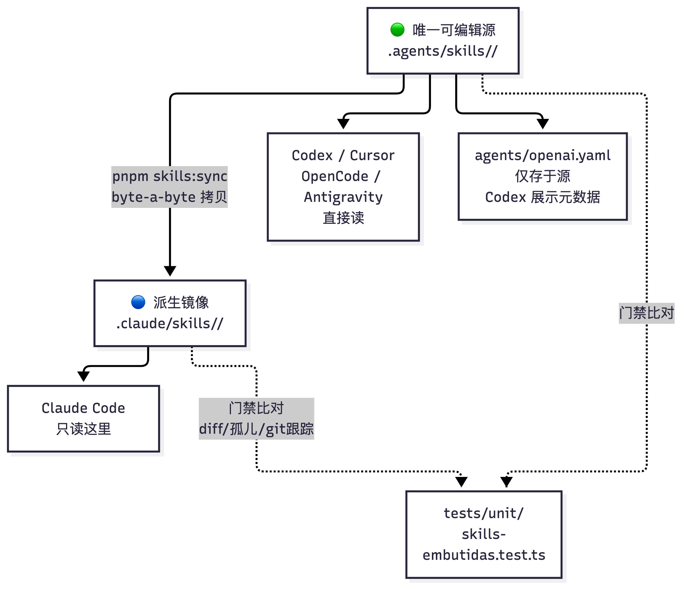
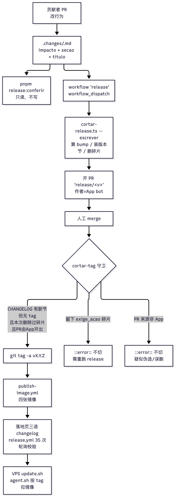

# 33 内置开发技能、贡献流程与发布切版

[返回母文档](../README.md) · [上一章](32.md) · [下一章](34.md)

**本章目标：**理解知识技能分发、贡献检查和版本碎片发布。

## 实现详解

本页讲两件互相咬合的事：**`.agents/skills/` 里那八份内置助手技能**如何在五个不同 CLI 里保持同一份内容，以及**贡献者如何把一次改动变成一个可发布的版本号**。前者是"知识如何随仓库分发"，后者是"版本如何从碎片里算出来、而不是由人敲键盘决定"。两者共享同一个设计哲学：*唯一事实源 + 受监督的派生副本 + 会拒绝错误形状的闸门*。

---

### 八份内置技能：一份源、一个镜像

仓库把"安装、配客户、看指标、调提示词、写扩展、贡献"这类隐性知识做成了**技能包（Skill）**。技能不是运行时模块，而是随仓库分发的知识目录——每个目录含一份 `SKILL.md`（带 `name` / `description` 前言的 Markdown），可带 `references/`、`scripts/`、`assets/`。AI 助手在匹配到 `description` 时才加载对应目录，这解决了"用户根本不知道有这个指南"的冷启动问题。

顶层入口是仓库根的两份文档与两份规则：`AGENTS.md`（Codex / OpenCode / Cursor 读取的可移植契约）、`CLAUDE.md`（完整教义）、`.agents/rules/pi-native-guias.md`（触发方式 `trigger: always_on` 的路由规则）和 `.cursor/rules/pi-native-guias.mdc`（同内容的 Cursor 版）。规则里显式列出了每个场景该加载哪份技能，并特别提示贡献前先跑 `quem-sou.sh`，若判定为 `mantenedor`（维护者）则让技能保持沉默。

Sources: [.agents/rules/pi-native-guias.md](https://github.com/helsome/AiNativeCrm/blob/679e09e80878dff7b1c79b8537317b2b9e355331/.agents/rules/pi-native-guias.md#L1)

#### 八份技能的职责边界

| 技能 | 触发场景 | 内含结构 |
| --- | --- | --- |
| `pi-native-instalar` | VPS 安装、升级、域名、Supabase、WhatsApp 不连 | 6 份 references（含域名 DNS、Supabase、安装套件脚本说明、常见坑） |
| `pi-native-cliente-novo` | 给新客户/垂直行业配 CRM：代理、路由、跟进、知识库 | 5 份 references（细分行业、从界面配置、按文件、代理提示词、分诊） |
| `pi-native-metricas` | 表现、转化、AI 成本、漏斗、"代理在卖吗" | 3 份 references（访问与 LGPD、查询语句、标尺与陷阱） |
| `pi-native-prompt` | 代理答错、全转人工、不用日程、改提示词 | 2 份 references（解剖与反模式、诊断） |
| `pi-native-extensao` | 做扩展 / 插件 / 垂直模块；"这属于核心还是扩展？" | 6 份 references + 1 个校验脚本、示例包 JSON |
| `pi-native-contribuir` | 贡献、修 bug、开/更 PR、写 migration、解冲突 | 4 份 references + **可执行脚本**（身份判定、装 hooks、pre-voo 预检） |
| `pi-native-doutrina` | 写代码时最容易付出代价的规则 | 仅 SKILL.md |
| `sistema-vivo` | 系统类需求（lead / 代理 / 跟进 / 界面 / worker / 指标） | 仅 SKILL.md |

其中 `pi-native-contribuir` 是唯一带完整脚本链的技能——它把贡献流程做成了**可在本机执行的测量工具**，而不只是散文。

Sources: [.agents/skills/pi-native-contribuir/SKILL.md](https://github.com/helsome/AiNativeCrm/blob/679e09e80878dff7b1c79b8537317b2b9e355331/.agents/skills/pi-native-contribuir/SKILL.md#L1) [.agents/skills/pi-native-contribuir/references/pre-voo.md](https://github.com/helsome/AiNativeCrm/blob/679e09e80878dff7b1c79b8537317b2b9e355331/.agents/skills/pi-native-contribuir/references/pre-voo.md)

#### 一份源 + 一个镜像：为什么是受监督的拷贝

技能放在 `.agents/skills/<name>/`（开放 Agent Skills 标准的目录，Codex、Cursor、OpenCode、Antigravity 直接读），但 **Claude Code 只读 `.claude/skills/<name>/`**。因此仓库采用"源 + 镜像"结构：`.agents/skills/` 是**唯一可编辑的源**，`.claude/skills/` 是由 `pnpm skills:sync` 生成的**镜像**。

选择**拷贝而非符号链接**是有代价权衡的结论。`scripts/skills-embutidas/espelho.ts` 记录了原因：两份手工拷贝曾经分叉 35 天（Claude 那份被改写，Codex 那份仍在教过时的 `snake_case` 与相对导入，且隐式调用是关的），而当时**没有任何测试比对二者**。符号链接能解决分叉，但会引入新分叉——git 只在 `core.symlinks` 开启时复现链接，Windows 上（安装器默认关闭）链接会变成一个内含路径的**文本文件**，技能在 Claude Code 里**静默消失、无报错**。拷贝是唯一能在任意克隆中一致落地的格式，代价是需要闸门，而闸门就存在于 `tests/unit/skills-embutidas.test.ts`。

同步脚本 `scripts/sincronizar-skills.ts` 提供两种模式：`pnpm skills:sync` 重写全部镜像，`pnpm skills:sync --check` 只列出差异并在有差异时 `exit 1`。它还会检测"镜像里有、源里没有"的**孤儿目录**（只查 git 已跟踪的，因为 `.claude/skills/` 也容纳克隆者自带的本地技能）。

Sources: [scripts/skills-embutidas/espelho.ts](https://github.com/helsome/AiNativeCrm/blob/679e09e80878dff7b1c79b8537317b2b9e355331/scripts/skills-embutidas/espelho.ts#L1) [scripts/sincronizar-skills.ts](https://github.com/helsome/AiNativeCrm/blob/679e09e80878dff7b1c79b8537317b2b9e355331/scripts/sincronizar-skills.ts#L1)



#### 闸门：技能必须符合五个 CLI 共同接受的形状

`tests/unit/skills-embutidas.test.ts` 显式列出它要抓的**五个已测量过的缺陷**，每个断言都对应一个真实事故：

1. **镜像分叉**——逐技能断言 `divergencias()` 为空，失败信息直接告诉开发者跑 `pnpm skills:sync`。
2. **技能被 `.gitignore` 藏起来**——`.claude/skills/*` 是带白名单的忽略规则，所以测试**问 git**（`git ls-files`）而非问磁盘，确保两份副本都被跟踪。
3. **CLI 拒绝的头部**——开放标准要求 `name` 等于目录名（全小写连字符）、`description` 长度 1–1024；测试还额外检查头部是**严格 YAML 解析器也能接受**的（禁止未加引号的 `: `、` #`、YAML 保留字符开头），否则 Claude Code 会容忍但其他 CLI **静默丢弃**该技能。
4. **Codex 描述预算爆表**——Codex 最多用窗口的 2%（或 8000 字符）列技能，爆表后会**先截断再删除描述**，导致没有技能能自动触发。仓库把所有 `description` 总和限制在 **6000 字符**内。
5. **技能混进 Docker 镜像**——断言 `.dockerignore` 排除了 `.claude/.agents/.codex/.cursor/.opencode`，避免 worker 镜像 `COPY . .` 携带整个 harness。

此外还有三组结构性断言：`description` 在一行内、`SKILL.md` 正文 ≤ 500 行（更多内容下沉到 `references/`）、`agents/openai.yaml` 存在且**未**设 `allow_implicit_invocation: false`（关掉它就废掉了"为不知道它存在的人内置技能"的意义）、`SKILL.md` 中引用的每个 `references/ scripts/ assets/` 路径都真实存在。还有"触发门"——`AGENTS.md`、`CLAUDE.md`、两份规则文件**每个都必须提到每一个 `pi-native-*` 技能**，保证新技能不会只进文件夹而对新手隐形。

Sources: [tests/unit/skills-embutidas.test.ts](https://github.com/helsome/AiNativeCrm/blob/679e09e80878dff7b1c79b8537317b2b9e355331/tests/unit/skills-embutidas.test.ts#L1) [.agents/skills/pi-native-doutrina/SKILL.md](https://github.com/helsome/AiNativeCrm/blob/679e09e80878dff7b1c79b8537317b2b9e355331/.agents/skills/pi-native-doutrina/SKILL.md)

---

### 贡献流程：把"验收标尺"从 PR 之后搬到 PR 之前

贡献技能的核心主张是：**贡献者几乎不因能力失败，而因不知道标尺失败**——而标尺原本散在三个文档里、且由维护者**事后**施加。`pi-native-contribuir` 把同一把标尺**事前**搬到贡献者一侧。技能的自我定位是"验收（triagem）的镜像"：它事前测量维护者事后要测的东西。

技能声明它的行为准则（"如何行动"）有四条：**只劝告、不阻塞**（只有 git hooks 阻断，且只阻断不可逆的事——往 `main` 推、缺三件套的 migration）；**在源头测量、绝不照抄数字**（每个断言都附产出它的命令）；**声明没测的部分**；**先破坏再宣称"已测"**。

Sources: [.agents/skills/pi-native-contribuir/SKILL.md](https://github.com/helsome/AiNativeCrm/blob/679e09e80878dff7b1c79b8537317b2b9e355331/.agents/skills/pi-native-contribuir/SKILL.md#L14)

#### 贡献者脚本链

`pi-native-contribuir` 是唯一带可执行脚本的技能：

| 脚本 | 作用 |
| --- | --- |
| `scripts/quem-sou.sh` | 判定当前是 `mantenedor` / `contribuidor` / `NÃO MEDIDO`，并**解释原因**（如 gh账户、origin 是 fork） |
| `scripts/armar-hooks.sh` | 一次性装配三个 git hook（见下） |
| `scripts/pre-voo.sh` | **pre-voo 预检**：打印维护者将要测的一切 |
| `scripts/hooks/pre-commit` / `pre-push` / `sessao.sh` / `avisar-identidade.sh` / `check-migration-triple.sh` | 钩子实现 |

Sources: [.agents/skills/pi-native-contribuir/scripts/pre-voo.sh](https://github.com/helsome/AiNativeCrm/blob/679e09e80878dff7b1c79b8537317b2b9e355331/.agents/skills/pi-native-contribuir/scripts/pre-voo.sh) [.agents/skills/pi-native-contribuir/scripts/armar-hooks.sh](https://github.com/helsome/AiNativeCrm/blob/679e09e80878dff7b1c79b8537317b2b9e355331/.agents/skills/pi-native-contribuir/scripts/armar-hooks.sh)

**身份判定（Passo 0）刻意排在拉取 `main`（Passo 1）之前**，因为它必须在一个早于 2026-09-10 的 fork 里也能工作——那种克隆还没有该脚本，指南也可能来自全局安装。技能给出一段可从任意子目录粘贴的 shell：先从 `git rev-parse --show-toplevel` 定位克隆根、在根的 `.agents/skills` 与三处全局目录（`~/.claude/skills`、`~/.agents/skills`、`~/.gemini/config/skills`）中查找 `quem-sou.sh`，找不到就**报错退出**并指向 README 的单行安装命令。三种输出对应三条路径：判为 `mantenedor` 则本指南保持安静（维护者有 `loop/hooks` 里的自有仪式）；判为 `contribuidor` 则继续；判为 `NÃO MEDIDO` 则**不要**把任何人默认为维护者。

Sources: [.agents/skills/pi-native-contribuir/SKILL.md](https://github.com/helsome/AiNativeCrm/blob/679e09e80878dff7b1c79b8537317b2b9e355331/.agents/skills/pi-native-contribuir/SKILL.md#L36)

#### 三个 git hook：只阻断不可逆的事

`armar-hooks.sh` 装配三个守卫，且仅此三个：

- **`pre-commit`**：拒绝"新增 migration 但同 commit 里既无 `baseline.sql` 追加、也无 `MANIFEST.md` 行"的提交；并拒绝复用在 `origin/main` 或本地分支已用过的编号（`NNNN` 或时间戳）。
- **`pre-push`**：拒绝往 `main` 推送。
- **`avisar-identidade.sh`**：当提交以 `root@…` 身份签名或无邮箱时**告警但不阻断**——这类工作不会出现在作者 GitHub 档案里。

脚本还会**拒绝覆盖维护者自有的 hooks**（`loop/hooks`）。

Sources: [.agents/skills/pi-native-contribuir/SKILL.md](https://github.com/helsome/AiNativeCrm/blob/679e09e80878dff7b1c79b8537317b2b9e355331/.agents/skills/pi-native-contribuir/SKILL.md#L84) [scripts/pi-native-contribuir 脚本目录](https://github.com/helsome/AiNativeCrm/tree/679e09e80878dff7b1c79b8537317b2b9e355331/.agents/skills/pi-native-contribuir/scripts)

#### Passo 4：pre-voo 预检与必须全绿的闸门

`pre-voo.sh` 打印维护者会测的每一项（每项附测量命令）：分支相对 `origin/main` 的**落后与重叠**、diff 中**不属于产品**的文件（品牌、`.env`、fork 配置）、diff 中的**密钥**、新增 `console.log`（lint 只告警）、**新 migration 及其三件套**、`CHANGELOG.md` 里**手写的版本段**（阻断项——发布切割是自动的）、`.changes/` 里的**发布碎片**、被触碰的**权威文档**、提交身份。

之后是 CI 自动跑的闸门，贡献者应**跑整套而不是挑自己记得的**：`rm -f tsconfig*.tsbuildinfo; pnpm typecheck`、`pnpm lint`、`pnpm lint:channels`、`pnpm test:unit`（不带路径，脚本覆盖整个仓库）、必要时 `pnpm test:shell`（碰了 `hostgator-setup-kit/`、`Dockerfile*` 或 compose）与 `pnpm test:db`（碰了 schema/RLS/RBAC，需 Docker）、最后 `pnpm build`。

Sources: [.agents/skills/pi-native-contribuir/SKILL.md](https://github.com/helsome/AiNativeCrm/blob/679e09e80878dff7b1c79b8537317b2b9e355331/.agents/skills/pi-native-contribuir/SKILL.md#L106) [package.json](https://github.com/helsome/AiNativeCrm/blob/679e09e80878dff7b1c79b8537317b2b9e355331/package.json#L40)

#### Passo 5–8：从"破坏验证"到 PR

- **Passo 5（测试必须先红）**：改了行为就必须有"移除你的改动就变红"的测试；若没有就写一个。然后**先提交、再破坏**——只回退修复的那一行（不撤销 commit），预判会掉几个用例、跑、核对计数、再恢复。PR 正文里写"预计掉 N 个中的1 个，与预测一致"。技能指出：在 commit 之前破坏已经在此让团队损失过不止一次工作。
- **Passo 6（界面证明）**：本仓库教义是"curl 不能证明体验"——需要 Playwright 驱动前端、在 `baseline.sql` 的全新库上跑、且**可选环境变量保持缺席**（新安装的真实状态）。没 Docker 没时间就**如实上交手测的部分**并声明界面证明留给维护者。
- **Passo 7（发布碎片，而非 CHANGELOG）**：改了 VPS 运营者能感知的事就写 `.changes/<kebab>.md`；**绝不**在 `CHANGELOG.md` 手写 `## [1.x.y]`。改了技能指南要跑 `pnpm skills:sync` 并提醒 PR：落地页的技能页需同步。
- **Passo 8（PR）**：标题用祈使句、以使用者视角（`fix(agenda): a consulta remarcada não some do dia`）；正文含"改了什么给使用者 / Closes #N / 你测了什么（附命令与输出）/ **一个"你没测什么"区块**"。后者是**区分"测量"与"转述"的字段**。贡献者永不做的清单包括 `reset --hard`、`push --force`、重写已发布提交、编辑已应用的 migration、动别人脏树的工作区、以及把品牌常量 / 界面标题 / `.env` 改成"你的安装"（那属于数据库与设置界面，在 PR 里就是泄漏）。

Sources: [.agents/skills/pi-native-contribuir/SKILL.md](https://github.com/helsome/AiNativeCrm/blob/679e09e80878dff7b1c79b8537317b2b9e355331/.agents/skills/pi-native-contribuir/SKILL.md#L133)

---

### 发布切版：号码是算出来的，不是敲出来的

发布体系的唯一律条在 `docs/doctrine/versionamento.md`，而核心模块在 `lib/release/`（纯函数、可被 typecheck 覆盖——因为 `tsconfig.typecheck.json` 排除 `scripts/**`，所以决定逻辑全放在 `lib/`）。CLI 层 `scripts/cortar-release.ts` 是薄 I/O 壳。

#### 决定 bump 的不是"代码改了什么"，而是"VPS 主人要做什么"

决定版本号的根问题不是"什么变了"（一切都变，这问题什么也分不开），而是：**"已经在这台 VPS 上跑的人需要做什么？"** 数字是给**运营者**的**运营承诺**，不是作者的努力度量。规尺是一张三行表：无需动手且无功能变化 → **patch**；无需动手但获得新能力 → **minor**；**需要动手**（改 `.env`、跑命令、既有东西消失/变形）→ **major**。一句话自测就是写出运营者在更新界面会读到的那句话。该教义明确指出旧规尺"行为可见 = minor"是错的——**修 bug 按定义就改变可见行为**，导致30 天里 6 个 minor 2 个 patch、`v1.4.0`→`v1.6.0` 只用三天。

Sources: [docs/doctrine/versionamento.md](https://github.com/helsome/AiNativeCrm/blob/679e09e80878dff7b1c79b8537317b2b9e355331/docs/doctrine/versionamento.md) [lib/release/fragmento.ts](https://github.com/helsome/AiNativeCrm/blob/679e09e80878dff7b1c79b8537317b2b9e355331/lib/release/fragmento.ts#L1)

#### 发布碎片`.changes/<name>.md`

每个改变行为的 PR 都要带一个 `.changes/` 下的 Markdown 文件，用前言声明**影响**与**标题**，正文是运营者视角的一段散文：

```markdown
---
impacto: capacidade_nova        # nada_mudou | capacidade_nova | exige_acao
secao: adicionado               # adicionado | alterado | corrigido
titulo: O que muda, na voz de quem usa
---
Um parágrafo do ponto de vista do operador.
```

关键设计：**作者声明的是"效果"，不是号码**。`impacto` 只有三个值且**以问题形式命名**（"什么都没变 / 新能力 / 需要动手"），号码是后果，由 `BUMP_DO_IMPACTO` 表从效果派生。要求作者写 `impacto: minor` 会把"回答答案"这件事又请回来；反过来问"运营者需要动手吗"则**无法被答错**。

Sources: [docs/doctrine/versionamento.md](https://github.com/helsome/AiNativeCrm/blob/679e09e80878dff7b1c79b8537317b2b9e355331/docs/doctrine/versionamento.md) [.agents/skills/pi-native-contribuir/SKILL.md](https://github.com/helsome/AiNativeCrm/blob/679e09e80878dff7b1c79b8537317b2b9e355331/.agents/skills/pi-native-contribuir/SKILL.md#L148)

`lib/release/fragmento.ts` 用 zod 校验前言，并施加几条**从屏幕解析器的实测行为**反推的禁令（每个禁令都注明出处）：正文中不得有 `^#` 开头行（`VERSION_HEADING` 按 `^##\s+\[` 切整节、`findAttentionRange` 在首个 `^#{2,4}\s` 处收尾，一处正文标题会**斩断别人的版本节**）；不得含 `⚠`（真正发注意力标题的是生成器，且只发一次）；不得有中途的链接引用行；`**` 必须在同一行闭合（渲染器是单行正则）。还有两条**交叉校验**：`exige_acao` 必须带 `## Requer atenção` 块（否则运营者不知道该做什么），有注意力块却非 `exige_acao` 也拒绝。`calcularBump()` 对全部碎片取**最大严重度**（patch<minor<major），无碎片则抛错而非返回 patch；`proximaVersao()` 只接受 `X.Y.Z` 整数并计算下一版。

Sources: [lib/release/fragmento.ts](https://github.com/helsome/AiNativeCrm/blob/679e09e80878dff7b1c79b8537317b2b9e355331/lib/release/fragmento.ts#L60)

#### 切割：把碎片装配成版本节

`lib/release/montar-secao.ts` 把碎片装配成 CHANGELOG 的一节。三条护栏都源自"本产品的 CHANGELOG **就是屏幕**"——`lib/system/changelog.ts` 抽取某版本节，系统路由把它投给 VPS 主人。**注意力块排在最前**（不只因美观：宿主 agent 会在发送前按字节切 CHANGELOG，`findAttentionRange` 在任何位置都能找到该块，置前能让告警在正文被截断时仍存活）；**所有告警共用一个 heading**（两个会让 `findAttentionRange` 只认第一个、第二个漏进"变更内容"）；条目渲染成 `- **标题** 首行` + 续行缩进两格且**永不重排换行**（`markdownParaTextoSimples` 用单行正则转 `**...**`，跨行加粗会在屏幕上留字面星号）。`aplicarNoChangelog()` 把新节插在 `## [Não lançado]` 锚点之下，并**顺带更新链接引用脚注**（脚注靠手工维护、已经腐烂过：文件缺 `[1.6.0]:` 行、`[Não lançar]` 还在与 `v1.5.0` 比较，整整落后一版；手写的人会忘，装配的不会）。它用**替换函数而非字符串**（因为 `$&`/`$'`/`$`` 是替换参数里的特殊序列，而手写散文常含 shell 与正则）。

Sources: [lib/release/montar-secao.ts](https://github.com/helsome/AiNativeCrm/blob/679e09e80878dff7b1c79b8537317b2b9e355331/lib/release/montar-secao.ts#L1) [lib/release/montar-secao.ts](https://github.com/helsome/AiNativeCrm/blob/679e09e80878dff7b1c79b8537317b2b9e355331/lib/release/montar-secao.ts#L95)

CLI `scripts/cortar-release.ts` 读取 `.changes/` 下所有 `.md`（`.gitkeep` 等非 `.md` 忽略）、解析、以 CHANGELOG 中**最新一节 `## [X.Y.Z]`** 为基线（不是最大 tag——仓库带 `v1.1.1-jmpo.1` 等 fork 标签正是为不与本仓编号冲突）、计算 bump 与新版本、打印每个碎片，然后据 `--escrever` 决定是否写入。日期用**本地时间而非 UTC**（给巴西时区运营者读的，21 点后 `toISOString` 会退到前一天）。`--versao-do-changelog` 只打印版本号（供 workflow 用 `$(...)` 捕获）。当目录已空且版本号 ≠ 最新 tag 时，它给**第三个良性结局**——"已切割，等 tag"——而非报错，因为切割后 `--escrever` 的正常状态就是这样。`--escrever` 会写 CHANGELOG 并删除已消费碎片，但**不建 tag**（"tag 在 CI 里、由 release PR 的 merge 诞生"）。

Sources: [scripts/cortar-release.ts](https://github.com/helsome/AiNativeCrm/blob/679e09e80878dff7b1c79b8537317b2b9e355331/scripts/cortar-release.ts#L1) [scripts/cortar-release.ts](https://github.com/helsome/AiNativeCrm/blob/679e09e80878dff7b1c79b8537317b2b9e355331/scripts/cortar-release.ts#L80) [scripts/cortar-release.ts](https://github.com/helsome/AiNativeCrm/blob/679e09e80878dff7b1c79b8537317b2b9e355331/scripts/cortar-release.ts#L145)



#### tag 与镜像：身份守卫与"检验后果"

`docs/doctrine/versionamento.md` 确立的不变量包括：**没人手输号码**（从声明的碎片计算，这正是让并行会话不撞号的性质）；**tag 在 CI 诞生、只从含于 `main` 的 commit**；**已发布版本不可变**（修正是 `X.Y.Z+1`，永不重发同号）；**任何 bump 不得要求手工改 VPS 文件**（若要求就是 major 且带迁移计划）；**每个改行为的 PR 都带碎片**。

tag 必须由 CI 诞生的三条实测理由：tag 是**所有** VPS 的更新触发器（`agent.sh` 跑 `git fetch --tags`，`update.sh` **按号码**拉镜像——tag 错就是每个 VPS 下载选择器错）；任意 `v*` tag 都会移动 `stable` 通道（发布 workflow 不测 commit 是否在 `main`）；移动已发布 tag 会破坏 VPS 并谎报原因（`update.sh` 的 `git fetch --tags` 拒绝被移动的 tag 并报 `would clobber existing tag`，脚本却把它复述成"连不上 GitHub"）。

`.github/workflows/release.yml` 只保留**手动触发**（`workflow_dispatch`）——`main` 的 push 不执行它、不建 tag、不发镜像。它把工作拆成两幕（`abrir-pr-de-release` 与 `cortar-tag`）。**写入永远由 GitHub App 的 token，不用 `GITHUB_TOKEN`**——因为一个被 GitHub 自己文档化的陷阱：由 `GITHUB_TOKEN` 触发的事件不创建新 workflow run，若 tag 由它诞生，`publish-image.yml` 永不运行——tag 存在、无人见错、**没有任何 VPS 收到更新**，直到客户尝试更新才暴露。第二幕因此**不信任**：它等待发布并**到注册表核对四张镜像**，不出现就高声失败。发布出的 GitHub Release 笔记直接由 `extractChangelogSection` 从 CHANGELOG 抽取（含 `⚠️ Requer atenção` 块）。

Sources: [.github/workflows/release.yml](https://github.com/helsome/AiNativeCrm/blob/679e09e80878dff7b1c79b8537317b2b9e355331/.github/workflows/release.yml#L1) [docs/doctrine/versionamento.md](https://github.com/helsome/AiNativeCrm/blob/679e09e80878dff7b1c79b8537317b2b9e355331/docs/doctrine/versionamento.md)

**`cortar-tag` 的守卫是本流程最精密的一段**，它的判据从"名称"演进为"身份"，且每一步都注明了它防住的事故：

- 判据是**三条件合取**而非单一条件。只看"CHANGELOG 宣布了无 tag 的版本"会让**任何** PR 都能切版本——手写一节 `## [1.7.0]` 就跳过整个 release PR 连同三张镜像与 `stable` 通道（PR #354 就带着手写版本节）。
- 正确签名是**"移除了碎片"**而非"目录变空"（issue #472）。曾用"目录空了"是**错的**：并行的普通 PR merge会在切割与 merge 之间留下自己的碎片，所以"变空"对每个与普通 merge 并行的切割都为假——v1.11.1 曾被宣布却**从未成为 tag**，没有 tag / release / 镜像 / `stable`，**没有一台 VPS 收到**，而 workflow 却是 `success`。普通 PR 只**增**碎片从不删，只切割才删，故"有删除"才是签名。
- 第三条件是**身份而非名称**（issue #478）。旧版查 `%an` 等于 `pi-native-release[bot]`，但 `%an` 是作者**名**这个可任意设置的文本字段，`git -c user.name=... commit` 就能复现；且真实切割的提交 `%G? = N` **无签名**可核。问题因此离开 git 转向 API：`commits/{sha}/pulls` 知道哪个 PR 源于此 commit 且由谁开启——这是提交作者选不了的。守卫接受两条**都在 git 之外**的证明：(1) 源 PR 由本 workflow 用的 App bot开启，或 (2) 源 PR 的 head 是**本仓库**的 `release/*` 分支（fork 不算——无上层仓库写权限者在那边既建不了分支也合不了 PR）。
- 若 `.changes/` 中**残留带 `exige_acao` 的碎片**，守卫**高声拒绝切版本**（`::error::`，非 notice）：此时切版会让 `stable` 指向一个要求运营者动手、而他更新前读的 CHANGELOG 却说"没变"的主干——告警被搁置、容器起不来。
- 计数用 `--find-renames --diff-filter=D`：无该 flag 且 `diff.renames=false` 时，被**改名**的碎片（旧名计为 D）会被误算成"已消费"。

Sources: [.github/workflows/release.yml](https://github.com/helsome/AiNativeCrm/blob/679e09e80878dff7b1c79b8537317b2b9e355331/.github/workflows/release.yml#L130) [.github/workflows/release.yml](https://github.com/helsome/AiNativeCrm/blob/679e09e80878dff7b1c79b8537317b2b9e355331/.github/workflows/release.yml#L215)

#### 发布还要"检验后果"：镜像与落地页

失败在这条链上**天然是静默的**——tag 存在、无人见错——所以 workflow **证明后果而非假设**。它**等发布并到注册表核对四张镜像**（`pi-native-crm`、`-worker`、`-scheduler`、`-voice-agent`），且读 **DIGEST 而非状态码**：朴素探针"tag 响应 200？"自1.11.0 起就被常在的 `stable` 通道满足（v1.12.0 就因此带着 app 在1.11.0、另两张在 1.12.0 的**混合公园**出厂，无人察觉，issue #488）。最后一步"这版出现在落地页 changelog 吗？"在三语页面轮询查链接35 次（约半小时），不出现就**让 job 失败**——但失败含义是"橱窗没展示"，不是"版本没出"。镜像可达性探针用**匿名 pull token**（不用 `GITHUB_TOKEN`，因为要证明的是"对没有我们凭据的安装者可达"）。教义还记录了三个让落地页"手工核对"说谎的坑：链接 `href` 带各页自身前缀（不能拿 pt 的链接去另两页找）；`0` 也是不存在页的返回值（404 无 `href`），故要连 `http=` 一起打印；带 `http=200` 时首轮 0 不是判决（落地页每 10 分钟重读 `raw.githubusercontent.com`，版本可迟 ~15 分钟出现）。

Sources: [.github/workflows/release.yml](https://github.com/helsome/AiNativeCrm/blob/679e09e80878dff7b1c79b8537317b2b9e355331/.github/workflows/release.yml#L365) [docs/doctrine/versionamento.md](https://github.com/helsome/AiNativeCrm/blob/679e09e80878dff7b1c79b8537317b2b9e355331/docs/doctrine/versionamento.md)

#### 为什么不用 release-please / semantic-release

教义明确拒绝现成工具，理由属产品而非口味：**本产品的 `CHANGELOG.md` 就是屏幕**——`lib/system/changelog.ts` 抽取版本节、系统路由投给 VPS 主人；那是给没读过 diff 的人看的**葡萄牙语长散文**（平均每版约百行）。没有生成器能从 `fix(scope): ...` 产出它。从这些工具采纳的是**理念**（每 PR 一个碎片、号码派生、按 PR 累积发布），不是文本生成器。另有两个实测理由支撑碎片制：它让**两个并行 PR 各建各的文件、merge 冲突按构造消失**（曾在 8–25/26/08 有 8 次 CHANGELOG 真实冲突）；以及**影响是声明的、不是从 commit 消息推断的**——本仓 94.4% 的非 merge 提交遵循 Conventional Commits，但只有 **2.2% 的 merge** 遵循，且 2639 个提交中**零** breaking change 标注，那会让 major 无法推断。

Sources: [docs/doctrine/versionamento.md](https://github.com/helsome/AiNativeCrm/blob/679e09e80878dff7b1c79b8537317b2b9e355331/docs/doctrine/versionamento.md) [lib/system/changelog.ts](https://github.com/helsome/AiNativeCrm/blob/679e09e80878dff7b1c79b8537317b2b9e355331/lib/system/changelog.ts)

---

### 两者交汇处：技能就是这些流程的可执行投影

回看结构会发现统一：内置技能、贡献流程、发布流程都遵循同一条律条——**知识与决策各有一个唯一事实源，其余皆为受闸门监督的派生**：

| 对象 | 唯一源 | 派生 / 消费端 | 防偏离的闸门 |
| --- | --- | --- | --- |
| 助手技能 | `.agents/skills/<name>/` | `.claude/skills/`（Claude Code 只读此） | `skills-embutidas.test.ts` + `pnpm skills:sync` |
| 版本号 | `.changes/` 中声明的**效果** | CHANGELOG 版本节、tag、镜像、落地页 | `release:conferir` + `cortar-tag` 守卫 + 镜像/落地页探测 |
| 已发布事实 | `v*` tag + CHANGELOG 头 | `agent.sh`/`update.sh` 按 tag 拉镜像 | tag 不可变；guard 按身份放行 |

发布体系同时**反向驱动技能**：Passo 7 规定改了技能就跑 `pnpm skills:sync` 并在 PR 提醒落地页技能页需同步；`release:conferir` 保证碎片形状正确。技能与闸门互为闭环——这正是"贡献前测量、维护者后测量"这一镜像设计的落地形式。

**给读者的下一步**：想理解本仓库的租户隔离与 API 契约（技能里反复引用的"三件套""RLS"底座），读[分层视图](03.md)与[租户隔离体系](05.md)；要为本产品**新客户**按垂直行业配代理/路由/跟进，参考内置 `pi-native-cliente-novo`（其配置面由[客户360](07.md)与[跟进流程引擎](09.md)承接）；要理解 tag 落地到扩展/模块切版（与主版本号平行的另一条版本轴），见[声明式扩展](34.md)。

## 继续阅读

[返回母文档](../README.md) · [上一章](32.md) · [下一章](34.md)

