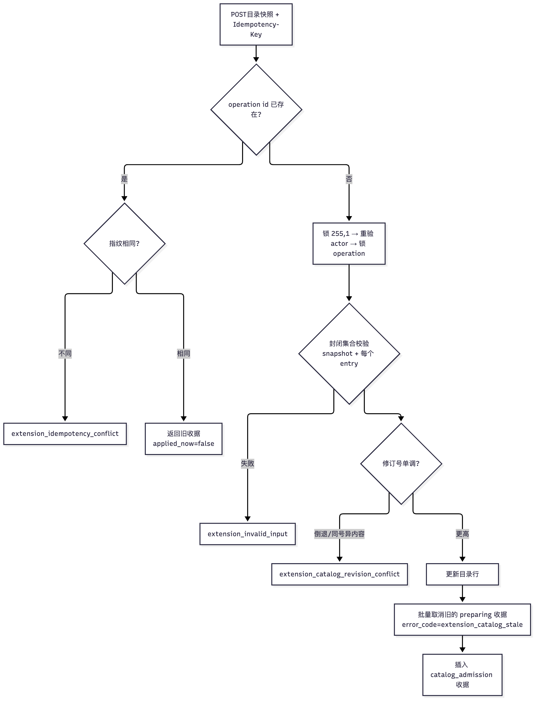
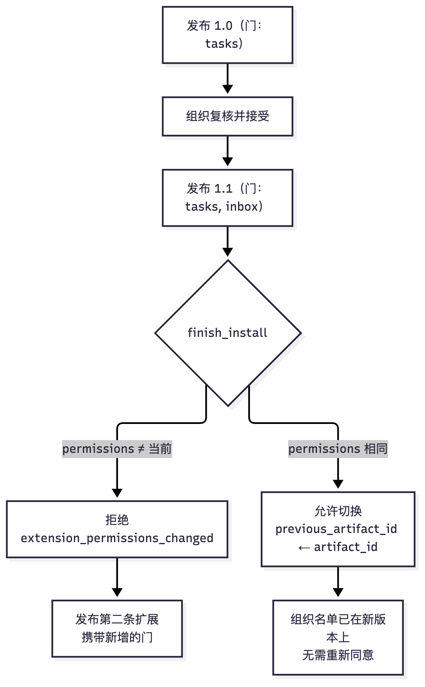
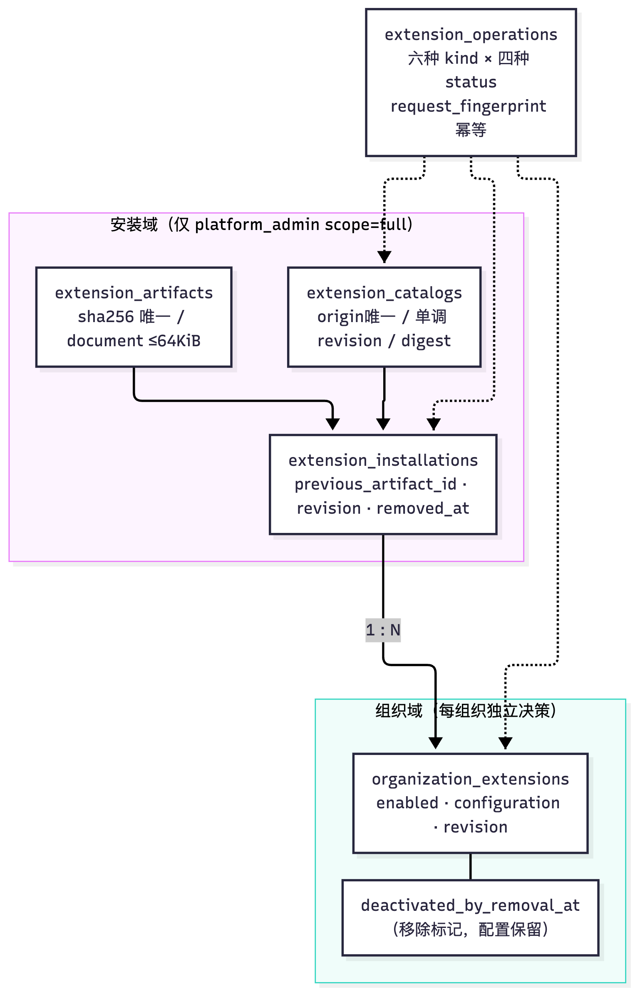
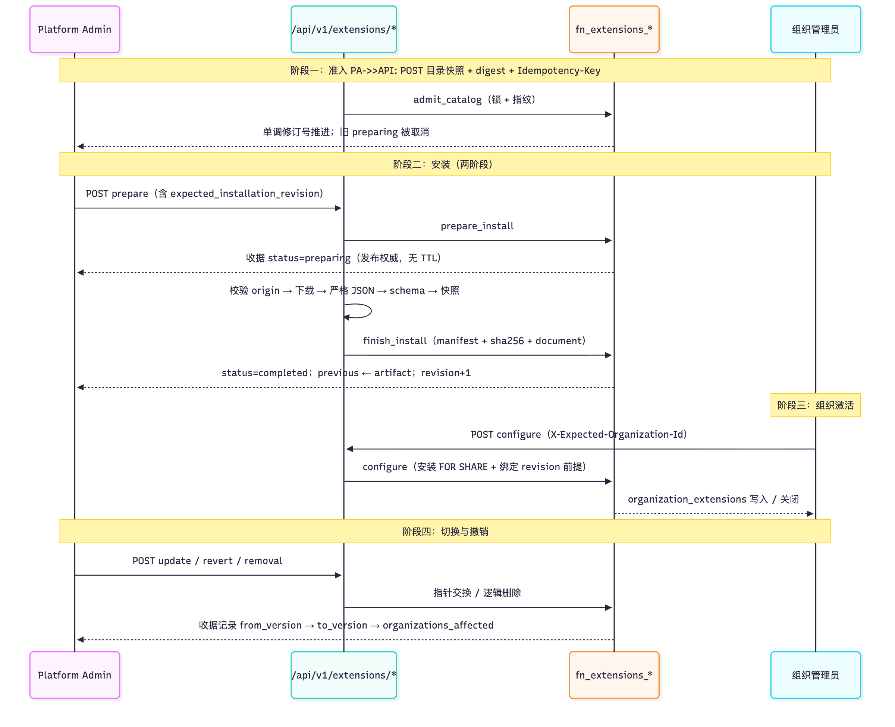

# 34 声明式扩展：准入、版本、租户激活与审计

[返回母文档](../README.md) · [上一章](33.md) · [下一章](35.md)

**本章目标：**理解扩展为何只提供声明，以及准备、切换和收据流程。

## 实现详解

这套系统回答一个具体问题：**如何在不执行任何第三方代码的前提下，让一份"安装包"进入生产 CRM 并影响用户的日常工作？** 答案被压缩成一句话——包只提供**声明**（JSON 文档），宿主只执行**固定词汇表**里的映射。包永远不提供、不拼接、不影响一个地址；包从不携带代码，也从不携带 SQL。

本页覆盖四条主线：**目录准入**（谁能发布什么、按什么顺序发布）、**版本切换**（更新/降级/撤销/移除，以及单向一步历史）、**组织级激活**（安装是全租户的，激活是每租户的）、**审计**（每一次操作都留下带指纹的不可变收据）。前置阅读是 [REST API 契约：版本化路径、双重鉴权、幂等键与错误码](06.md) 与 [租户隔离体系：organization_id、RLS 辅助函数与服务端越权防线](05.md)。

---

### 两种物件的分工：包描述"做什么"，目录描述"是谁"

扩展生态里最容易被误解的一点，是**清单（manifest）与目录条目（catalog entry）不是同一个东西**。`manifest.ts` 的类型定义把这个分工写成了两套结构：清单是完整的、带 `profile`、`data`、`contributions` 的扩展自我描述；目录条目则是 `Pick<..., "publisher"|"name"|"version"|"license"|"host_api"|"display"|"permissions">` 再加上 `sha256` 与 `byte_length`——清单的**子集**。Sources: [manifest.ts](https://github.com/helsome/AiNativeCrm/blob/679e09e80878dff7b1c79b8537317b2b9e355331/lib/extensions/manifest.ts#L37)

关键决策在于：**商店元数据（`publisher_label`、`homepage`、`repository`、`tags`、`published_at`）只存在于目录，永远不在包里**。源码注释给出了完整的理由链：spec 拒绝在包内放 URL（一个由第三方提供、渲染在安装者屏幕上的可点击地址是欺骗入口）；而清单由数据库的封闭集合校验（migration 0271），每加一个字段就要一条 migration；目录则是**我们**在发布前人工审阅过的产物，所以作者身份由审阅者背书，而不是由提交者自称。所有字段皆为可选——早于这些字段写成的目录继续有效。Sources: [manifest.ts](https://github.com/helsome/AiNativeCrm/blob/679e09e80878dff7b1c79b8537317b2b9e355331/lib/extensions/manifest.ts#L67)

`homepage` 与 `repository` 共用一个专门的 URL schema，约束比通用 URL 更紧：`https` 强制、无内嵌凭据、无 fragment。注释写明原因——链接会出现在某个人的屏幕上，里面放一个 `user:senha@` 就是"顶着我们脸的钓鱼"。Sources: [manifest.ts](https://github.com/helsome/AiNativeCrm/blob/679e09e80878dff7b1c79b8537317b2b9e355331/lib/extensions/manifest.ts#L123)

| 维度 | 清单（包内） | 目录条目（我们审阅） |
| --- | --- | --- |
| 字段集 | 13 个必填键，含 `contributions`、`configuration` | 9 个必填键 + 5 个可选商店键 |
| 是否带 URL | 一律拒绝 | `https`，无凭据无 fragment |
| 校验方 | Zod schema（`manifestSchema`） | Zod schema + 数据库 `fn_extensions_admit_catalog` |
| 作者身份 | `publisher` 纯 slug | 额外可有 `publisher_label` 由审阅者背书 |

Sources: [manifest.ts](https://github.com/helsome/AiNativeCrm/blob/679e09e80878dff7b1c79b8537317b2b9e355331/lib/extensions/manifest.ts#L191) / [manifest.ts](https://github.com/helsome/AiNativeCrm/blob/679e09e80878dff7b1c79b8537317b2b9e355331/lib/extensions/manifest.ts#L265)

---

### 能力与权限：封闭词汇表是整个系统的护栏

`capacidades.ts` 是全文件中最能说明设计意图的模块。它的文档注释直接写出了一个被否决的实现方案：廉价的做法是"接受任何以 `/app/` 开头的 href"——那会到达 `/app/settings/api-tokens` 和 `/app/ai/credentials`，两个存放密钥的界面，而且**能通过所有既有测试**，因为那些测试断言的是今天的目的地，而不是规则本身。`tests/unit/extensoes-capacidade-nao-vem-do-pacote.test.ts` 断言的才是规则。Sources: [capacidades.ts](https://github.com/helsome/AiNativeCrm/blob/679e09e80878dff7b1c79b8537317b2b9e355331/lib/extensions/capacidades.ts#L1)

系统里因此有两组各六项的封闭词汇表：`EXTENSION_PERMISSIONS` 是**安装前展示给人看的**东西，`EXTENSION_CAPABILITIES` 是**点击卡片按钮时真正请求的**东西。二者都恰好六项，且能力名到权限名的映射由 `PORTA_DA_CAPACIDADE` 一张穷举 `Record` 固定——注释说明这是刻意的：新增能力而没有对应目的地会**编译失败**，而不是在运行时变成 `undefined` 并落进一个空目的地。Sources: [capacidades.ts](https://github.com/helsome/AiNativeCrm/blob/679e09e80878dff7b1c79b8537317b2b9e355331/lib/extensions/capacidades.ts#L23)

关于"什么才算合法的门"注释里给出了一把尺子：必须是**工作界面**，受点击者常规授权管辖；配置、凭据、计费、webhook 与安装管理一律排除——扩展引导工作，永远不把人带到存放密钥的地方。Sources: [capacidades.ts](https://github.com/helsome/AiNativeCrm/blob/679e09e80878dff7b1c79b8537317b2b9e355331/lib/extensions/capacidades.ts#L16)

`destinoDaCapacidade` 是通往目的地的唯一路径，它接收**已被 schema 验证过**的能力名；词汇表外的值返回 `null`，调用方必须回答"拒绝"——**永不返回兜底目的地**，因为兜底正是这个模块要避免的洞。Sources: [capacidades.ts](https://github.com/helsome/AiNativeCrm/blob/679e09e80878dff7b1c79b8537317b2b9e355331/lib/extensions/capacidades.ts#L78)

---

### 准入的四层防线：字节、大小、形状、快照

清单不是被"读进来"的，是被**逐层拒绝**进来的。

**第一层是传输与体积。** `EXTENSION_LIMITS` 给出了全部上限：包 64 KiB、目录 512 KiB、JSON 深度 12、节点 20 000、每对象属性 32、目录条目 128、卡片 4 个/卡、每卡 8 个区块、版本串 64 字符。Sources: [manifest.ts](https://github.com/helsome/AiNativeCrm/blob/679e09e80878dff7b1c79b8537317b2b9e355331/lib/extensions/manifest.ts#L14) 入站读取 `readExtensionBody` 在此之上再加一层：强制 `content-type: application/json`、拒绝一切非 `identity` 的 `content-encoding`（不许压缩绕过体积）、校验 `content-length`，并且注释强调**天花板作用于实际读到的字节，即使请求头撒谎或缺失**。Sources: [http.ts](https://github.com/helsome/AiNativeCrm/blob/679e09e80878dff7b1c79b8537317b2b9e355331/lib/extensions/http.ts#L136)

**第二层是严格 JSON 解析。** `parseWithSchema` 把字节交给 `parseStrictJson`（带 `maxBytes`/`maxDepth`/`maxNodes`/`maxPropertiesPerObject` 四个预算），再用 Zod `safeParse`；失败一律 `ExtensionError("extension_invalid_package")`，不区分具体原因。Sources: [manifest.ts](https://github.com/helsome/AiNativeCrm/blob/679e09e80878dff7b1c79b8537317b2b9e355331/lib/extensions/manifest.ts#L307)

**第三层是形状。** 所有 schema 用 `.strict()`：多余键是错误，不是被忽略。清单顶层用 `z.literal(1)` 钉住 `format_version`、`z.literal("declarative")` 钉住 `profile`、`z.literal("MIT")` 钉住许可；`dependencies` 固定为 `z.tuple([])`，`data` 固定为 `{ mode: "none" }`——**依赖与数据写入在契约层面不可能**。卡片 id 走 slug schema 并做 `superRefine` 去重，因为"两个同 id 卡片会给出两个相同链接和一个歧义目的地"。Sources: [manifest.ts](https://github.com/helsome/AiNativeCrm/blob/679e09e80878dff7b1c79b8537317b2b9e355331/lib/extensions/manifest.ts#L189)

**第四层是快照结构。** 这是最精妙的一层：`validateSnapshotStructure` 处理的不是原始字节，而是从 JSONB 读回的文档——注释说明 JSONB 已经丢失了字节与数字记法，所以这一层"保守外部解析器的结构限制，而不从 `JSON.stringify` 制造一个新的传输天花板"。它用显式栈遍历 `WeakSet` 检测环，用 `isJsonbSafeString` 拒绝 NUL 与落单代理对，用 `FORBIDDEN_SNAPSHOT_KEYS`（`__proto__`、`prototype`、`constructor`）阻断原型污染，并用 `Object.getPrototypeOf` 要求原型必须是 `Object.prototype` 或 `null`。Sources: [manifest.ts](https://github.com/helsome/AiNativeCrm/blob/679e09e80878dff7b1c79b8537317b2b9e355331/lib/extensions/manifest.ts#L319)

---

### 目录准入：单调修订号 + 摘要，以及"新目录杀死旧准备"

目录准入由 `fn_extensions_admit_catalog` 执行，它同时也是这套系统里**最严格的一段 PL/pgSQL**。签名 `(p_actor, p_operation, p_snapshot, p_digest)`，函数体先构造请求指纹、拿两把事务级 advisory lock（`pg_advisory_xact_lock(255,1)` 是全局串行化，`hashtextextended(p_operation::text,255)` 是按操作串行化），并在**每把锁之后重新断言 actor**——这样"检查授权"与"拿锁"之间发生的权限撤销也能被捕获。Sources: [20260917120000_0271_extensoes_declarativas.sql](https://github.com/helsome/AiNativeCrm/blob/679e09e80878dff7b1c79b8537317b2b9e355331/supabase/migrations/20260917120000_0271_extensoes_declarativas.sql#L148)

准入校验对 `snapshot` 与每个 `entry` 做同样的封闭集合检查：键必须齐全（`?&`）、**不得有多余键**（`- array[...] <> '{}'::jsonb`）、不得有任何 `null` 值（`exists ... where e.value='null'::jsonb`）。Sources: [20260917120000_0271_extensoes_declarativas.sql](https://github.com/helsome/AiNativeCrm/blob/679e09e80878dff7b1c79b8537317b2b9e355331/supabase/migrations/20260917120000_0271_extensoes_declarativas.sql#L167)

**修订号是单调的。** 同一 origin 若带来更小的修订号，或相同修订号但不同摘要/快照，一律 `extension_catalog_revision_conflict`；更高修订号则更新行，**并把所有 `install`/`update` 的 `preparing` 收据批量置为 `cancelled` + `extension_catalog_stale`**。这就是"新目录杀死旧准备"——一个正在准备中的下载，其准入时的 `admission_revision`/`admission_digest` 快照会在完成时被比对并拒绝。Sources: [20260917120000_0271_extensoes_declarativas.sql](https://github.com/helsome/AiNativeCrm/blob/679e09e80878dff7b1c79b8537317b2b9e355331/supabase/migrations/20260917120000_0271_extensoes_declarativas.sql#L205)

准入本身**也写审计**：它插入一条 `kind='catalog_admission'`、`status='completed'` 的操作行，`result` 里装整个目录行。目录总数上限为 8。Sources: [20260917120000_0271_extensoes_declarativas.sql](https://github.com/helsome/AiNativeCrm/blob/679e09e80878dff7b1c79b8537317b2b9e355331/supabase/migrations/20260917120000_0271_extensoes_declarativas.sql#L211)

---

### ADR-0003 的自我修正：数据库必须也认识 v2

0271 迁移在第 194 行写下了一句硬编码：`v_entry->'permissions' <> '["navigation.tasks"]'::jsonb`——**一个固定值**。ADR-0003 曾声称"本 ADR 不改动 schema"，0282 迁移的开头用一段罕见的自省推翻了它：那次结论建立在**部分测量**之上——作者读了清单的校验（0271:356-357），看到它封闭的是**键集合**而非键的内容，却把结论推广到了整个系统；漏读到实际效果。目录的校验做了清单校验不做的一件事（0271:194 与 0271:184），于是**没有这条 migration，v2 目录会被数据库拒绝**——既因为声明了别的权限，也因为携带了商店元数据。Sources: [20260918011500_0282_extensoes_perfil_v2.sql](https://github.com/helsome/AiNativeCrm/blob/679e09e80878dff7b1c79b8537317b2b9e355331/supabase/migrations/20260918011500_0282_extensoes_perfil_v2.sql#L1)

0282 做了三件事，且三个函数都是**整体重写**（注释明确拒绝"运行时读 `prosrc` 做文本替换"那种做法，因为它依赖每个克隆的状态且会静默失败）：引入 `fn_extensions_permissoes_validas` 把权限变成与 `capacidades.ts` 完全一致的封闭集合；把五个商店键加入目录允许集合而**继续在清单中拒绝**；让 `extension_permissions_changed` 真正存在于 update 与 revert 两条路径。Sources: [20260918011500_0282_extensoes_perfil_v2.sql](https://github.com/helsome/AiNativeCrm/blob/679e09e80878dff7b1c79b8537317b2b9e355331/supabase/migrations/20260918011500_0282_extensoes_perfil_v2.sql#L17)

权限变更的拒绝理由写得非常坦率：没有这条防线，`1.0 → 1.1` 就能"不通知任何人就给组织加一门新的门"——而权限清单这个界面存在的全部意义就是让人复核那个列表。**这个洞正是从权限属性本身保证的性质中溜进来的。要改变门集合，那是另一条扩展。** revert 路径同理：回到一个门集合不同的版本，会在无声中改变组织当初接受的东西；需要这种操作的人应当重装并重新激活。Sources: [20260918011500_0282_extensoes_perfil_v2.sql](https://github.com/helsome/AiNativeCrm/blob/679e09e80878dff7b1c79b8537317b2b9e355331/supabase/migrations/20260918011500_0282_extensoes_perfil_v2.sql#L204) / [20260918011500_0282_extensoes_perfil_v2.sql](https://github.com/helsome/AiNativeCrm/blob/679e09e80878dff7b1c79b8537317b2b9e355331/supabase/migrations/20260918011500_0282_extensoes_perfil_v2.sql#L288)

---

### 版本切换的两阶段协议：preparing 是没有 TTL 的收据

安装、更新、降级、重装共用同一个入口 `fn_extensions_prepare_install`。它**只写 `preparing` 收据，不碰 artifact 表**；真正的字节下载与校验发生在下一步 `fn_extensions_finish_install`。Sources: [20260917120000_0271_extensoes_declarativas.sql](https://github.com/helsome/AiNativeCrm/blob/679e09e80878dff7b1c79b8537317b2b9e355331/supabase/migrations/20260917120000_0271_extensoes_declarativas.sql#L238)

**preparing 是唯一的发布权威**，且**没有 TTL**。迁移头注释写明：取消与新准入在**同一把锁下**移除这份权威；封面还有一个刻意的例外——`fn_extensions_core_update_in_progress` 认为"发布超过 15 分钟的 `dispatched` 对应用自身是未知结局，且不阻塞"，注释给出的理由是"没有期限的话，一个死掉的 agent 会永久卡住所有发布"。Sources: [20260917120000_0271_extensoes_declarativas.sql](https://github.com/helsome/AiNativeCrm/blob/679e09e80878dff7b1c79b8537317b2b9e355331/supabase/migrations/20260917120000_0271_extensoes_declarativas.sql#L1) / [20260917120000_0271_extensoes_declarativas.sql](https://github.com/helsome/AiNativeCrm/blob/679e09e80878dff7b1c79b8537317b2b9e355331/supabase/migrations/20260917120000_0271_extensoes_declarativas.sql#L229)

prepare 阶段的防线很密：核心正在更新则拒；目录必须存在；条目必须在快照里；**安装行的 revision 必须等于屏幕展示的 revision**（注释：不带这个前提，一个旧标签页会静默降级版本或撤销一次移除）；同一 catalog+publisher+name 下已有 `preparing` 则拒；同版本不同摘要与当前/前一个 artifact 冲突则拒。安装身份不存在时还会做容量检查（活跃安装 + install 类型的 preparing ≥ 128 则拒）——注释特意说明**update 的 preparing 不计入，因为它不创建身份**。Sources: [20260917120000_0271_extensoes_declarativas.sql](https://github.com/helsome/AiNativeCrm/blob/679e09e80878dff7b1c79b8537317b2b9e355331/supabase/migrations/20260917120000_0271_extensoes_declarativas.sql#L268)

finish 阶段做**四重校验**：字节长度与摘要必须自洽；`p_document::jsonb` 必须等于传入的 manifest；manifest 的封闭键集合、字面量（`format_version=1`、`profile=declarative`、`dependencies=[]`、`data={"mode":"none"}`）、以及"manifest 去掉6 个自有键后必须等于 entry 去掉 2 个哈希键"——这一条把包与目录**逐字段绑定**。Sources: [20260918011500_0282_extensoes_perfil_v2.sql](https://github.com/helsome/AiNativeCrm/blob/679e09e80878dff7b1c79b8537317b2b9e355331/supabase/migrations/20260918011500_0282_extensoes_perfil_v2.sql#L149)

幂等重放被专门处理：已 `completed` 的操作，比较的是**这次完成所发布的 artifact**（通过 `result->>'to_artifact_id'`）而不是当前指针——注释解释：否则"一次后续的撤销会让重放指控包被篡改"。Sources: [20260918011500_0282_extensoes_perfil_v2.sql](https://github.com/helsome/AiNativeCrm/blob/679e09e80878dff7b1c79b8537317b2b9e355331/supabase/migrations/20260918011500_0282_extensoes_perfil_v2.sql#L177)

#### 版本切换的五种终局

| 操作 | kind | 前置条件 | 指针变化 | 组织侧影响 |
| --- | --- | --- | --- | --- |
| 首次安装 | `install` | 无安装行 | `artifact_id` 新建 | 绑定尚不存在，组织自行激活 |
| 更新 | `update` | `revision` 匹配、`removed_at IS NULL` | `previous ← artifact`，`artifact ← 新`，`revision+1` | 全部组织自动跟随新版本 |
| 降级 | `update` | 同上（版本可更小） | 同上 | 同上 |
| 撤销上次切换 | `revert` | `previous_artifact_id` 非空、revision 匹配 | **交换**两个指针，`revision+1` | 同上 |
| 移除 | `removal` | 无核心更新等待 | `removed_at` 置位，`revision+1` | 所有 active 绑定被关闭并打上移除标记 |

Sources: [20260917120000_0271_extensoes_declarativas.sql](https://github.com/helsome/AiNativeCrm/blob/679e09e80878dff7b1c79b8537317b2b9e355331/supabase/migrations/20260917120000_0271_extensoes_declarativas.sql#L410) / [20260917120000_0271_extensoes_declarativas.sql](https://github.com/helsome/AiNativeCrm/blob/679e09e80878dff7b1c79b8537317b2b9e355331/supabase/migrations/20260917120000_0271_extensoes_declarativas.sql#L535)

`revert` 的注释指出一个漂亮的性质：**"不下载任何东西，所以它在目录关闭时也能工作"**——它只是交换两个已存在的指针。而且它是**自身的逆操作**，历史深度恰好一步。Sources: [20260917120000_0271_extensoes_declarativas.sql](https://github.com/helsome/AiNativeCrm/blob/679e09e80878dff7b1c79b8537317b2b9e355331/supabase/migrations/20260917120000_0271_extensoes_declarativas.sql#L535)

而 `install` 对已移除行的**重装**有一条重要语义：`removed_at` 清空，但注释强调"**绑定不会自动变回 active；每个组织自己决定**"。Sources: [20260917120000_0271_extensoes_declarativas.sql](https://github.com/helsome/AiNativeCrm/blob/679e09e80878dff7b1c79b8537317b2b9e355331/supabase/migrations/20260917120000_0271_extensoes_declarativas.sql#L413)

**"更新"与"切换"在 UI 上是不同的动词。** `versao.ts` 的 `ehTrocaParaVersaoMenor` 把这个区分编码进产品语言：一次指向更小版本的请求是"切换"而非"更新"，而目标在完成后是 `to_version`，在准备中/失败/取消时是 `version`。比较函数 `compararVersoes` 不使用 `Number`，注释给出原因：`Number` 会把2^53 以上的不同部分判为相等，而版本表达式接受这种大小的部分——所以它按长度再按字典序逐段比较。Sources: [versao.ts](https://github.com/helsome/AiNativeCrm/blob/679e09e80878dff7b1c79b8537317b2b9e355331/lib/extensions/versao.ts#L1)

---

### 组织级激活：安装是全局的，激活是本地的

数据模型刻意分成两层，这正是整个租户模型在扩展上的投影：

| 表 | 作用域 | 主键 | RLS / 授权 |
| --- | --- | --- | --- |
| `extension_installations` | **全安装域**，不分租户 | `id`，`unique(catalog_id, publisher, name)` | 全部 revoke；仅 `service_role` 可 select |
| `organization_extensions` | **每组织** | `(organization_id, installation_id)` | 仅 `service_role` 全读；`authenticated` 可 select |

Sources: [20260917120000_0271_extensoes_declarativas.sql](https://github.com/helsome/AiNativeCrm/blob/679e09e80878dff7b1c79b8537317b2b9e355331/supabase/migrations/20260917120000_0271_extensoes_declarativas.sql#L25) / [20260917120000_0271_extensoes_declarativas.sql](https://github.com/helsome/AiNativeCrm/blob/679e09e80878dff7b1c79b8537317b2b9e355331/supabase/migrations/20260917120000_0271_extensoes_declarativas.sql#L100)

`organization_extensions` 上唯一的 RLS 策略注释解释得极细：`fn_user_org_ids()` **包含尚未接受的邀请**与**活跃的支持会话**，但绑定要求"已接受的成员身份，且不要求 membership 行"——后者是刻意的，不加这条规则的话，**通过支持渠道查看客户时会把所有扩展显示为"已关闭"，而客户那边它们是开着的**。Sources: [20260917120000_0271_extensoes_declarativas.sql](https://github.com/helsome/AiNativeCrm/blob/679e09e80878dff7b1c79b8537317b2b9e355331/supabase/migrations/20260917120000_0271_extensoes_declarativas.sql#L110)

**权限函数是同一个：`fn_extensions_assert_actor`。** `p_organization IS NULL` 时要求 `platform_admins` 中 `scope='full'` 且未撤销；给定组织时要求是该组织的 `role='admin'` 且已接受未撤销。Sources: [20260917120000_0271_extensoes_declarativas.sql](https://github.com/helsome/AiNativeCrm/blob/679e09e80878dff7b1c79b8537317b2b9e355331/supabase/migrations/20260917120000_0271_extensoes_declarativas.sql#L127)

`fn_extensions_configure` 有一条关键的并发防御，注释直接给出了它要防的 bug：对安装行取 **`FOR SHARE`**，以便与**每一次指针切换和移除**（它们先 UPDATE 安装行再处理绑定）串行化；没有它，"同时配置和移除会留下一个绑定在已移除扩展上处于 active 状态的状态，而没有任何界面会去关闭它"。同一函数还把绑定 revision 作为前提（`extension_revision_conflict`）、限制每组织最多 8 条 active 绑定（`extension_active_limit`），以及一条语义规则：**激活会清除移除标记；关闭或改密度则保留它**。Sources: [20260917120000_0271_extensoes_declarativas.sql](https://github.com/helsome/AiNativeCrm/blob/679e09e80878dff7b1c79b8537317b2b9e355331/supabase/migrations/20260917120000_0271_extensoes_declarativas.sql#L499)

`fn_extensions_remove_installation` 的语义是纯逻辑删除：**没有任何一行被删掉**。安装退出 hub 与指南；每个组织里所有 active 绑定被关闭、打上移除标记、**配置保留**；而"移除不等核心更新：它只是减少当前活跃的东西"。Sources: [20260917120000_0271_extensoes_declarativas.sql](https://github.com/helsome/AiNativeCrm/blob/679e09e80878dff7b1c79b8537317b2b9e355331/supabase/migrations/20260917120000_0271_extensoes_declarativas.sql#L594)

---

### 审计：收据是可重放的证据，不是日志

`extension_operations` 既是幂等机制，也是审计轨迹。每条收据携带 `request_fingerprint`（`sha256(request::text)`）、完整 `request`、`entry` 快照、`admission_revision`/`admission_digest`、以及 `result`。有一张 CHECK 约束把作用域钉死：`(kind = 'configure') = (organization_id is not null)`——**要么是组织操作且带组织，要么不是且不带**。Sources: [20260917120000_0271_extensoes_declarativas.sql](https://github.com/helsome/AiNativeCrm/blob/679e09e80878dff7b1c79b8537317b2b9e355331/supabase/migrations/20260917120000_0271_extensoes_declarativas.sql#L53)

幂等语义极其严格：同一 `operation_id` 再次到来，若指纹不同则 `extension_idempotency_conflict`，若相同则返回**原收据**并附 `applied_now=false`——注释称之为"每一次会写入的 RPC 都声明**这一次调用**是否做了转换；幂等重复说 `false`"。Sources: [20260917120000_0282_extensoes_perfil_v2.sql](https://github.com/helsome/AiNativeCrm/blob/679e09e80878dff7b1c79b8537317b2b9e355331/supabase/migrations/20260918011500_0282_extensoes_perfil_v2.sql#L62)

六种 kind 与四种 status 各有约束：`kind` 限于 `catalog_admission|install|update|revert|removal|configure`；`status` 限于 `preparing|completed|failed|cancelled`；并且**只有 install/update 能处于 preparing**——这个约束让"准备中"的唯一性得以被一张部分索引快速捕捉。Sources: [20260917120000_0271_extensoes_declarativas.sql](https://github.com/helsome/AiNativeCrm/blob/679e09e80878dff7b1c79b8537317b2b9e355331/supabase/migrations/20260917120000_0271_extensoes_declarativas.sql#L90)

读侧同样被设计成**容错的**。`readableOperations` 的注释描述了一个具体的滚动升级事故："由系统**更新版本**写下的收据（一种这一版不认识的类型或状态）会退出列表，而不是拖垮整个管理界面"——它必须存在于回滚目标所对应的镜像里，因此与新类型一起诞生。Sources: [service.ts](https://github.com/helsome/AiNativeCrm/blob/679e09e80878dff7b1c79b8537317b2b9e355331/lib/extensions/service.ts#L192)

`montarInstalada` 同样容错：一个这一版读不出的包（升级了 CRM 收紧了契约、文档被改、artifact 缺失）变成**一行"不兼容"，绑定被保留**；注释给出历史原因——"以前这样一个包会拖垮整个列表，而那里正是关掉扩展的唯一入口"。Sources: [instalada.ts](https://github.com/helsome/AiNativeCrm/blob/679e09e80878dff7b1c79b8537317b2b9e355331/lib/extensions/instalada.ts#L78)

错误信息的外泄面被系统性地收窄。`ExtensionError` 的六个码各自绑定一句**公开消息**，注释保证"公开消息从不包含字节或包内文本"。`causaSegura` 则只允许一个40字符内、字母数字下划线的稳定码与一个整型状态进入日志，注释写明"原因可能带有远程服务器或包的文本，而那个文本绝不出现在这里"。Sources: [errors.ts](https://github.com/helsome/AiNativeCrm/blob/679e09e80878dff7b1c79b8537317b2b9e355331/lib/extensions/errors.ts#L1) 数据库层同样如此：`dbFailure` 在抛出前把代码与消息记录到日志，注释解释为什么——"没有这条记录，'表不存在'（一个代码先于 migration 到达的部署）会变成每个人屏幕上的一个警告，而日志里什么都没有"。Sources: [service.ts](https://github.com/helsome/AiNativeCrm/blob/679e09e80878dff7b1c79b8537317b2b9e355331/lib/extensions/service.ts#L115)

---

### API护栏：组织上下文是前提，不是权威

`http.ts` 里的三个细节值得单独提出。

**`requireExtensionPlatformFor` 拒绝支持会话。** 判据是 `user.is_platform_admin && !user.support`，然后二次查 `platform_admins` 要求 `scope === 'full'`，最后检查 MFA（`mfa_required` 且会话不是 `aal2`，或有欠费 MFA）。注释解释了为什么要分出 `For` 版本："重新加载会造成第二次走网络的 `getUser()`，而它的一次瞬时失败会被读成 401，也就是'你不管理本安装'"。Sources: [http.ts](https://github.com/helsome/AiNativeCrm/blob/679e09e80878dff7b1c79b8537317b2b9e355331/lib/extensions/http.ts#L26)

**`operationKey` 强制 `Idempotency-Key` 为 UUID**，缺失即 `validation_failed`，消息是"缺少请求标识，请重新加载页面后再试"。Sources: [http.ts](https://github.com/helsome/AiNativeCrm/blob/679e09e80878dff7b1c79b8537317b2b9e355331/lib/extensions/http.ts#L95)

**`requireExtensionOrganization` 的注释是理解双标签页竞争的钥匙**："屏幕的前提，永远不是权威。组织继续来自规范解析器；一个旧标签页不能靠另一个标签页在你上次读取之后改过的 cookie 来写入。"比较通过 `X-Expected-Organization-Id` 头完成，不匹配则 `extension_context_changed`。Sources: [http.ts](https://github.com/helsome/AiNativeCrm/blob/679e09e80878dff7b1c79b8537317b2b9e355331/lib/extensions/http.ts#L107)

#### 收据视图如何被投影

`operationView` 把数据库的 `result` 投影成屏幕需要的形状：`from_revision` 是"**恢复一次更新所需的前提**"，`organizations_affected` 按 kind 分流（update/revert 取 `organizations_active`，removal 取 `organizations_disabled_count`），且**只在 `completed` 时才填**。旧的收据缺这些字段会投影成 `null` 而不报错。Sources: [service.ts](https://github.com/helsome/AiNativeCrm/blob/679e09e80878dff7b1c79b8537317b2b9e355331/lib/extensions/service.ts#L103) / [service.ts](https://github.com/helsome/AiNativeCrm/blob/679e09e80878dff7b1c79b8537317b2b9e355331/lib/extensions/service.ts#L163)

`montarAnterior` 则回答"撤销会回到哪一版"。它的注释指出一处刻意的选择：**版本号来自已存下的 manifest，即使当前 CRM 版本已经读不了它**——"否则屏幕不会说出这次撤销要回到哪里"；而一个不可读或不兼容的前任会带上原因显示，并把按钮置灰。Sources: [instalada.ts](https://github.com/helsome/AiNativeCrm/blob/679e09e80878dff7b1c79b8537317b2b9e355331/lib/extensions/instalada.ts#L44)

---

### 完整生命周期

---

### 实现清单：扩展一份扩展时必须做什么

要**新增一条能力**（比如把 `tasks.open` 换成 `voice.open`），改动点是收敛且成套的：

1. 在 `capacidades.ts` 里同时向 `EXTENSION_PERMISSIONS` 与 `EXTENSION_CAPABILITIES` 各加一项，并在 `PORTA_DA_CAPACIDADE` 加一行——`Record` 穷举保证漏了这一步会编译失败。
2. 在 migration 0282 风格的 SQL 里同步更新 `fn_extensions_permissoes_validas` 的白名单，让数据库与 TypeScript 拥有**同一份**规则。
3. 判断该门是否合规于"工作界面、排除配置/凭据/计费/webhook/安装管理"这把尺子。
4. 注意**改变门集合需要一条新扩展**，不能靠升级既有扩展（`extension_permissions_changed` 会拒绝）。

Sources: [capacidades.ts](https://github.com/helsome/AiNativeCrm/blob/679e09e80878dff7b1c79b8537317b2b9e355331/lib/extensions/capacidades.ts#L24) / [20260918011500_0282_extensoes_perfil_v2.sql](https://github.com/helsome/AiNativeCrm/blob/679e09e80878dff7b1c79b8537317b2b9e355331/supabase/migrations/20260918011500_0282_extensoes_perfil_v2.sql#L31)

要**放宽一个字段**，需要同时改四处：Zod schema、数据库 `fn_extensions_admit_catalog`（或 `finish_install`）的封闭集合检查、库中 `extension_operations`/对应表的列定义、以及**清单与目录的职责划分**（商店元数据只进目录、不进包）。0282 的自省段落记录了这个教训：ADR 声称不改 schema 是因为测量不完整，代价是一个 v2 目录会被数据库静默拒绝。Sources: [20260918011500_0282_extensoes_perfil_v2.sql](https://github.com/helsome/AiNativeCrm/blob/679e09e80878dff7b1c79b8537317b2b9e355331/supabase/migrations/20260918011500_0282_extensoes_perfil_v2.sql#L1)

---

### 验证这个系统的不变量

仓库把上述性质固化成了可执行的断言，主要集中在：

| 测试 | 断言的不变量 |
| --- | --- |
| `tests/unit/extensoes-capacidade-nao-vem-do-pacote.test.ts` | 目的地**不来自包**，而来自封闭映射 |
| `tests/unit/revalidacao-que-falha-zera-o-catalogo.test.ts` | 重新校验失败会让整个目录归零 |
| `tests/unit/catalogo-de-extensoes-em-dia.test.ts` | 已发布的目录文件与代码一致 |
| `tests/invariants/extensoes-declarativas.test.ts` | 声明式扩展的表结构不变量 |
| `tests/invariants/modulo-instalado.test.ts` | 已安装模块的数据库形态 |
| `tests/e2e/extensoes-da-instalacao.spec.ts` 等5 个 e2e | 安装、版本、恢复、新端口的真实界面路径 |

Sources: [capacidades.ts](https://github.com/helsome/AiNativeCrm/blob/679e09e80878dff7b1c79b8537317b2b9e355331/lib/extensions/capacidades.ts#L13) / [tests/invariants/extensoes-declarativas.test.ts](https://github.com/helsome/AiNativeCrm/blob/679e09e80878dff7b1c79b8537317b2b9e355331/tests/invariants/extensoes-declarativas.test.ts) / [tests/e2e/extensoes-versao.spec.ts](https://github.com/helsome/AiNativeCrm/blob/679e09e80878dff7b1c79b8537317b2b9e355331/tests/e2e/extensoes-versao.spec.ts)

---

### 小结

这套扩展系统的本质不是"插件机制"，而是**一次持续的、双方都要在场的同意**：目录由我们审阅并断言版本，宿主由封闭词汇表断言行为，组织在安装后独立决定是否激活并配置，而每一次转换——包括失败与取消——都留下一条可用 `Idempotency-Key` 重放的、带摘要的收据。

它最值得学习的不是任何一项技术，而是**把"最便宜的实现"与"真正的规则"区分开，并让测试断言后者**：`capacidades.ts` 里那句"廉价做法会通过所有既有测试，因为它们断言的是今天的目的地而不是规则"——这是整个仓库方法论的一句浓缩。

下一步建议：若要理解这套系统如何与其他子系统相交，读 [按租户隔离的 RAG、引用溯源与证据缺失报告](25.md)（同为"内容必须留在租户内"的架构）；若要看事件驱动模式如何处理副作用与重试，读 [事件日志驱动的工作进程：声明、去重、退避与死信](16.md)；若要回到部署侧的完整性，读 [自托管安装套件：install.sh、update.sh 与健康检查](31.md)。

## 继续阅读

[返回母文档](../README.md) · [上一章](33.md) · [下一章](35.md)

