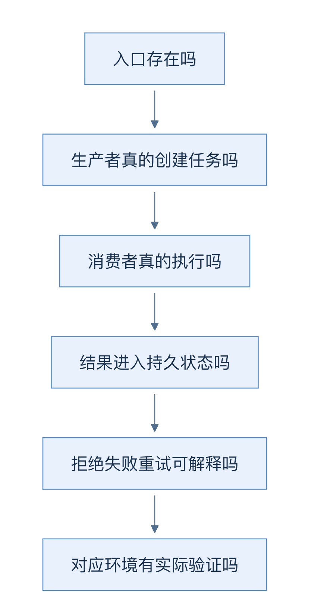
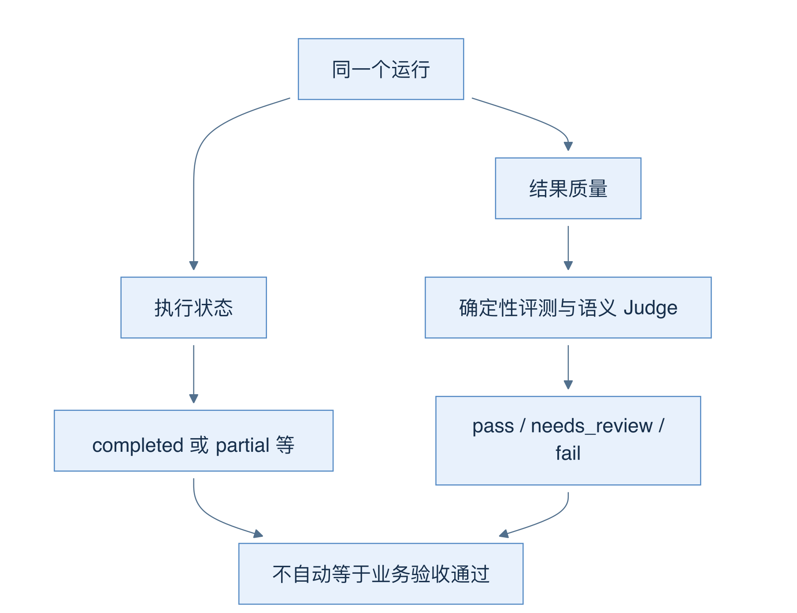

# 35 完成度与证据：实现、通过、上线各证明什么

[返回母文档](../README.md) · [上一章](34.md)

**本章目标：**区分固定主分支、历史验收、演示和未合并候选改动。

## 业务流程与阅读起点

你会学到：怎样阅读验收记录，怎样判断一个缺口是否影响自己的业务，以及怎样避免把示例演示当成真实系统证明。

代码导读不只是说明“有什么”。它也要说明入口有没有接通、异常怎样处理、证据覆盖到哪里。一个类、一张表或一个按钮存在，只能证明实现的一部分。完整业务需要把生产者、消费者、状态和失败恢复连起来。

顺着箭头依次核对。任何一步缺失，都应该缩小结论，而不是用后一层的漂亮界面补足前一层的证据。

### 先看已经接通的主线

主分支已合并聊天优先工作台、内置 Agent、持久运行、工具读取、知识证据、结构化结果、客户确认记忆、外部知识与观测适配，以及评测接口。它不是只有占位 UI。比如 Langfuse 有 OTLP 投递适配；Mem0 有确认事实的投影和排序；Pi 有实际 provider/tool-loop 适配。

但“有真实实现”仍然不能概括为“所有场景可无人值守运行”。例如工作台的外部发送候选没有由 start/resume 正常生成，实际候选数组为空；四个内置 Agent 没有直接发送工具。即使底层存在审批与恢复代码，也不能把工作台写成已经能从草稿进入客户消息发送。

### 目前最容易误用的地方

- 聊天连续性：页面能显示前文，但新提交创建独立 Run；不要预期模型自动得到完整聊天历史
- 联系人清空：某些可选字段在 UI 中清空后被省略，API 也不接受相应空值；保存不代表清空成功
- 标签筛选：下拉选项来自已加载的联系人分页，不能把它当成完整组织标签目录
- Inbox 草稿：较早发送请求的完成回调可能清空或恢复编辑框，覆盖用户后来输入的新草稿
- 跟进权限：导航对 manager 展示，而读取接口允许 viewer；菜单可见性和后端读权限并非完全一致
- 多 Agent 预算：现有边界和累计用量修复有价值，但 specialist、恢复阶段和单次模型调用不等于全局硬上限

这些问题影响的是具体流程。读第 05、06、07、10、13、16 章时，应同时看“正常链路”和“当前限制”。本书没有把这些问题悄悄改成已修复，也没有修改应用。

### 怎样读已有真实验收成绩

仓库 2026-10-03 的修复复验记录包含真实模型、数据库和本地连接服务的执行证据。客户确认记忆样本最终 Run 为 completed，总评 89、needs_review，Judge 为 92。三位 specialist 商机复盘有最终报告，总评 79、needs_review，Judge 为 80。

这是几个不同维度：completed 是运行状态；overall 是综合评分；Judge 是语义审查分数；needs_review 是质量结论。不能把 Judge 92 改写成系统 92% 完成，也不能把多 Agent 有最终报告写成业务验收通过。

图的左右两条线独立。执行到终点仍然可以缺证据、推断过度或需要人复核。质量审查也不能证明客户实际收到消息。

### 主分支和 PR #3 的验证不能混在一起

本书正文固定 main `679e09e8`。核验时 PR #3 为未合并的动效改动，重点是消息进入、按压反馈、真实运行状态投影、展开折叠和减少动效偏好。

该 PR 报告了定向测试和类型检查，但完整单测命令仍因既有 IPC 限制失败；完整生产构建被执行器终止；浏览器场景没有实际执行。不能把“定向 64 项通过”扩展为“完整浏览器验证通过”。也不能把候选分支的动效描述成 main 已有功能。

历史主分支验收是在另一个明确环境、固定代码与样本上发生的。本书没有在当前环境重跑其全量数据库、模型、浏览器和外部服务验证。文档中的运行证据必须保留原环境和时间边界。

### 怎样继续验证一个重要业务

先写一个可以观察的终点，例如“审批后的指定文本在受控接收器出现一次，并有可核对的状态”。再检查哪些前置条件存在：角色、组织、模型、渠道、Worker、数据库基线。使用合成资料，覆盖同意、拒绝、失败、重试、取消和跨组织访问。最后把日志、数据库状态与用户界面一起核对。

不要为了得到绿色结果而删掉失败样本、降低阈值、跳过组织隔离或把模拟响应说成真实平台响应。代码质量的价值，在于让失败可解释且可重现。

### 源码与证据定位

主分支固定版本：`679e09e8`

- [`docs/testing/system-acceptance-fixes-2026-10-03.md:1-71`](https://github.com/helsome/AiNativeCrm/blob/679e09e80878dff7b1c79b8537317b2b9e355331/docs/testing/system-acceptance-fixes-2026-10-03.md#L1-L71)：修复反例、真实样本、最终门禁与上线边界
- `docs/testing/fixtures/acceptance-fix-memory-2026-10-03.json`：已脱敏记忆样本
- `docs/testing/fixtures/acceptance-fix-multi-2026-10-03.json`：已脱敏多 Agent 样本
- 本章逐项产品限制的实现位置：见第 05、06、07、10、13、16 章源码定位

独立候选分支：PR #3，头提交 `50125afd199de3234d0a2bad3c9e5c434c9c2262`

- `docs/testing/workbench-motion.md:1-118`：该候选分支的动效契约及未执行验证，不属于 main
- PR 状态核验时间：2026-10-04；open、draft、merged=false

## 继续阅读

[返回母文档](../README.md) · [上一章](34.md)

