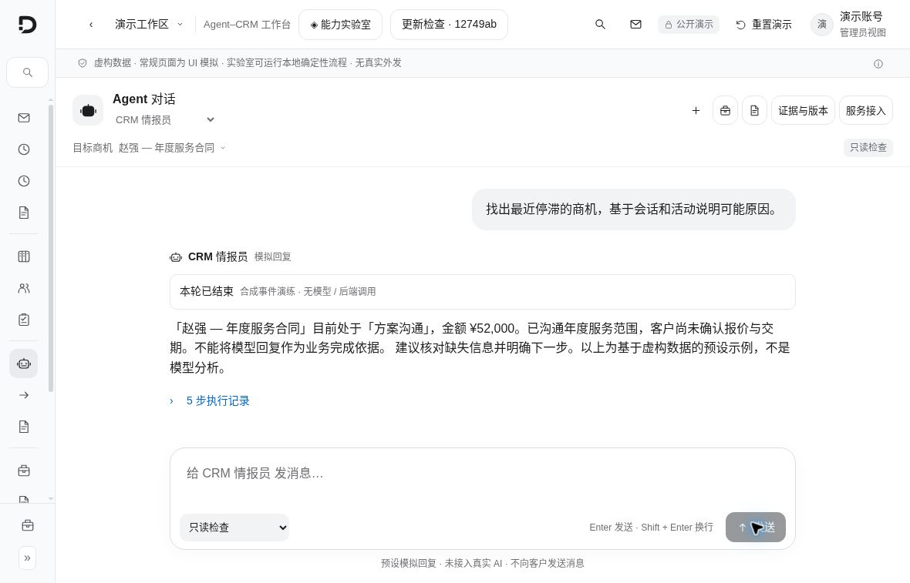
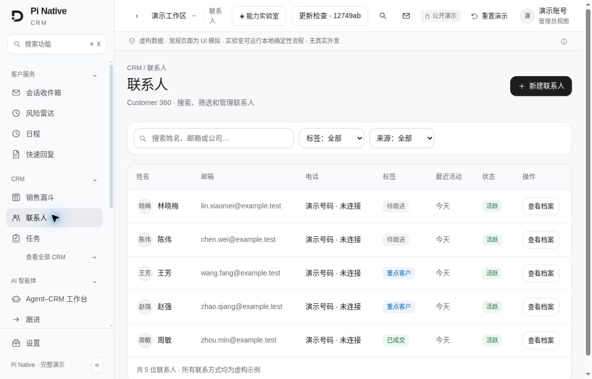
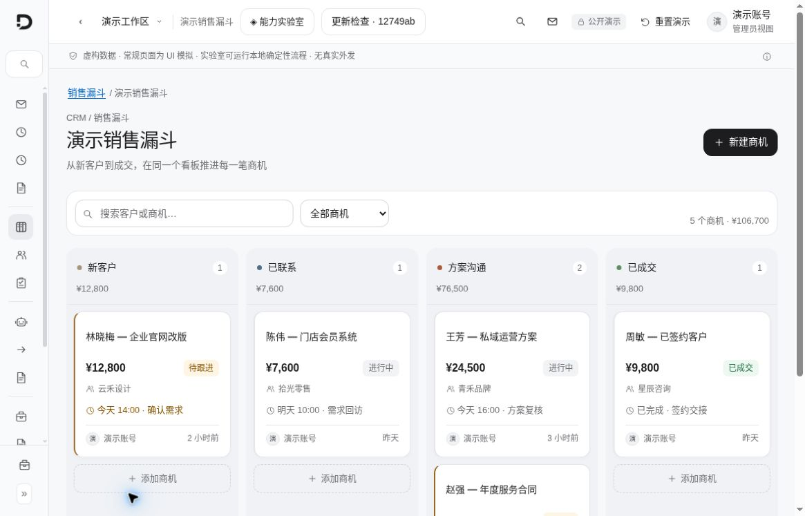
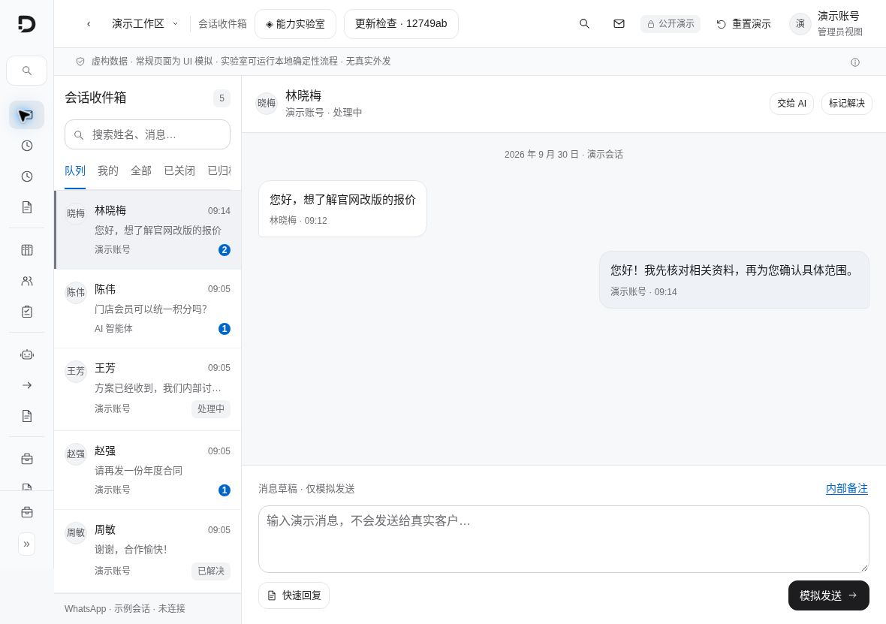
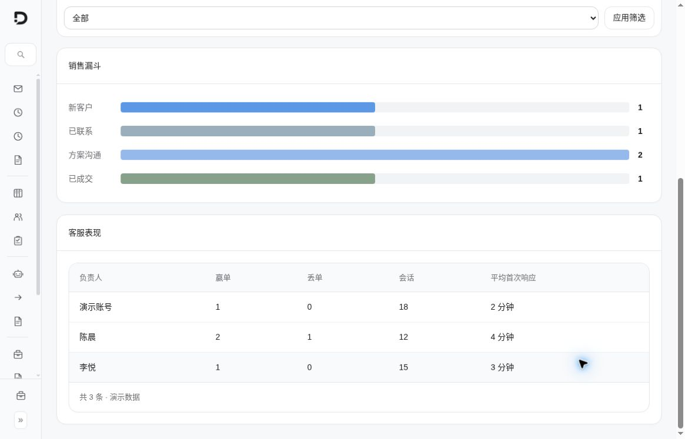
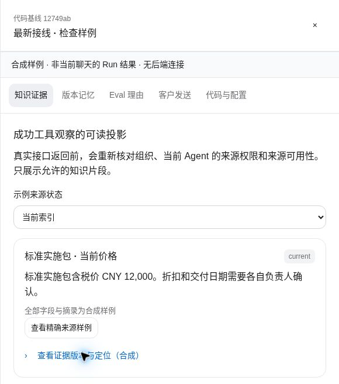
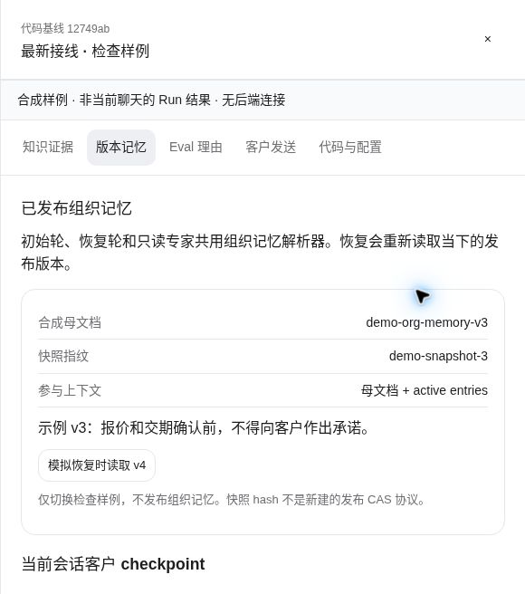
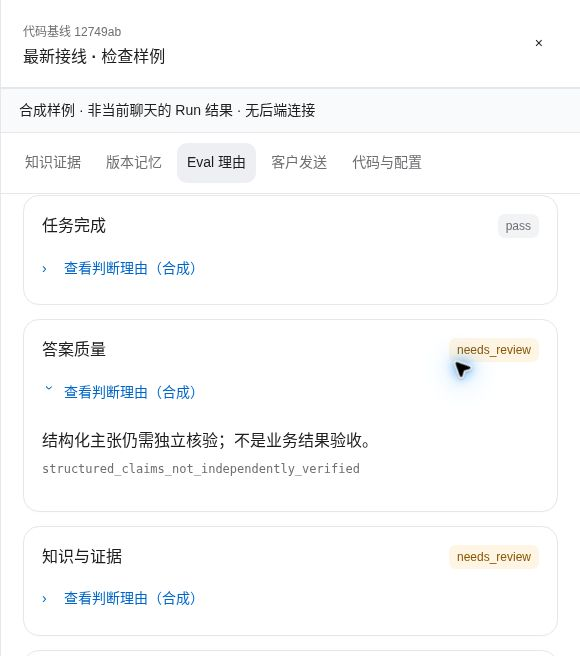

# 附录 图解与截图来源

[返回母文档](../README.md)

以下图片于 2026-10-04 从当前公开演示的真实浏览器页面直接截取，使用虚构数据；静态演示没有连接 CRM 后端、模型或真实通信渠道。它们说明界面如何呈现，不是主分支业务功能的在线验收。

- 拍摄日期：2026-10-04，16:08–16:17 UTC
- 来源：[当前公开 CRM 演示](https://pinative-crm-demo.free-ball-7539.chatgpt.site)
- 演示 Site 版本：9
- 演示部署提交：`acd09a467d7fa45b410a10e35137fe2d729b52bb`
- 页面接线标签：`12749ab`；正文固定主分支：`679e09e8`
- 图片数：9；通过页面导航、滚动与打开面板获得
- 像素处理：无重绘、无生成、无拼接、无改字；部分细节使用浏览器原生区域截图
- 联系人、公司、邮箱、金额、消息、评测状态及示例时间均为演示数据；页面内日期不是拍摄日期
- 不含真实客户资料、凭据、模型隐藏推理或遥测上传

## Agent–CRM 工作台

- 文件：`01-agent-workbench.jpg`
- 页面：`https://pinative-crm-demo.free-ball-7539.chatgpt.site/#/app/ai/workbench`
- 拍摄时间：2026-10-04 16:11 UTC（精度：分钟）
- 尺寸：1180 × 757 像素
- 画面状态：选择 CRM 情报员，运行预置的「停滞商机原因」只读模拟任务；页面明确写明合成事件、无模型或后端调用。
- SHA-256：`6734d0da5ab62fd6c5028746c14a2f9b8e0cf4fa4e39102ad9e3590fe08fcc14`

## 联系人列表

- 文件：`02-contacts.jpg`
- 页面：`https://pinative-crm-demo.free-ball-7539.chatgpt.site/#/app/contacts`
- 拍摄时间：2026-10-04 16:08 UTC（精度：分钟）
- 尺寸：1165 × 747 像素
- 画面状态：搜索、标签与来源筛选、五位虚构联系人。联系方式采用 example.test 与未连接演示号码。
- SHA-256：`5e8efd1b5a15cc989a6ac8ab76d5f04ebb0fba92afd756ddb608f8505dfeb822`

## 联系人内的客户记忆

- 文件：`04-memory-panel.jpg`
- 页面：`https://pinative-crm-demo.free-ball-7539.chatgpt.site/#/app/contacts`
- 拍摄时间：2026-10-04 16:08 UTC（精度：分钟）
- 尺寸：648 × 745 像素
- 画面状态：打开林晓梅的 Customer 360；Mem0 显示 OFF / NOT CONNECTED。仅查看预置表单，未保存记忆。
- SHA-256：`80ded62229482a0ee3f84aba6a33555eec6278cc4d2c62677e7741c3d586a67f`

## 销售漏斗看板

- 文件：`05-sales-kanban.jpg`
- 页面：`https://pinative-crm-demo.free-ball-7539.chatgpt.site/#/app/pipelines/demo`
- 拍摄时间：2026-10-04 16:09 UTC（精度：分钟）
- 尺寸：1165 × 747 像素
- 画面状态：折叠侧栏后同时查看四个销售阶段。金额、联系人和任务均为虚构演示。
- SHA-256：`9e191df640ea7f65516de7a1b800ed14717f625787034338bf55e03cdcbe8ac7`

## 会话收件箱

- 文件：`06-inbox.jpg`
- 页面：`https://pinative-crm-demo.free-ball-7539.chatgpt.site/#/app/inbox`
- 拍摄时间：2026-10-04 16:09 UTC（精度：分钟）
- 尺寸：1180 × 831 像素
- 画面状态：查看林晓梅示例会话及消息输入区；保留「未连接」与「模拟发送」标记，没有发送消息。
- SHA-256：`82b579dbbd116cbfd1b6f6d7585779ecc256ce92c55fcf45da8768687e34c2fc`

## 绩效中的漏斗和客服表现

- 文件：`07-metrics.jpg`
- 页面：`https://pinative-crm-demo.free-ball-7539.chatgpt.site/#/app/metrics`
- 拍摄时间：2026-10-04 16:09 UTC（精度：分钟）
- 尺寸：1165 × 747 像素
- 画面状态：滚动到漏斗及客服表格的可读区域；数值属于演示数据。
- SHA-256：`83f6fa691bde2947cc96df5993b1a225b465977dc155fe7f9a019ad186ee0ebc`

## 知识证据检查面板

- 文件：`08-knowledge-evidence.jpg`
- 页面：`https://pinative-crm-demo.free-ball-7539.chatgpt.site/#/app/ai/workbench`
- 拍摄时间：2026-10-04 16:17 UTC（精度：分钟）
- 尺寸：580 × 656 像素
- 画面状态：打开「证据与版本」中的「知识证据」。该面板声明合成样例、非当前聊天 Run 结果、无后端连接。
- SHA-256：`98f1fe75b6c3fd5d0ba7461734a8645dd2caa1b67eb9f2026dbdbe74ebc28305`

## 组织记忆的发布版本

- 文件：`09-versioned-memory.jpg`
- 页面：`https://pinative-crm-demo.free-ball-7539.chatgpt.site/#/app/ai/workbench`
- 拍摄时间：2026-10-04 16:11 UTC（精度：分钟）
- 尺寸：580 × 656 像素
- 画面状态：「证据与版本」→「版本记忆」，查看初始合成母文档、快照指纹与上下文组成；未发布组织记忆。
- SHA-256：`64e7f714ef5359b1809546cffbbefdb9142e309427ea7aafb30748f16acdf92a`

## Eval 逐项判断理由

- 文件：`10-eval-reasons.jpg`
- 页面：`https://pinative-crm-demo.free-ball-7539.chatgpt.site/#/app/ai/workbench`
- 拍摄时间：2026-10-04 16:11 UTC（精度：分钟）
- 尺寸：580 × 656 像素
- 画面状态：「证据与版本」→「Eval 理由」，展开「答案质量」原因。保留 needs_review 与合成样例说明，未调用 evaluator 或语义 Judge。
- SHA-256：`0cb7a90e48e79fae43aa62d782ad15fe5506880b9325f5cc2d1af50703a2fee6`

## 图解的来源与读法

原 Wiki 的教学图与界面截图保留在对应章节。实现详解中的关系图来自 zread 解析，图中箭头只解释固定版本的关系，不能单独证明事务、权限保证或真实连接。完整可编辑图源保留在本次内容包中。

[返回母文档](../README.md)

